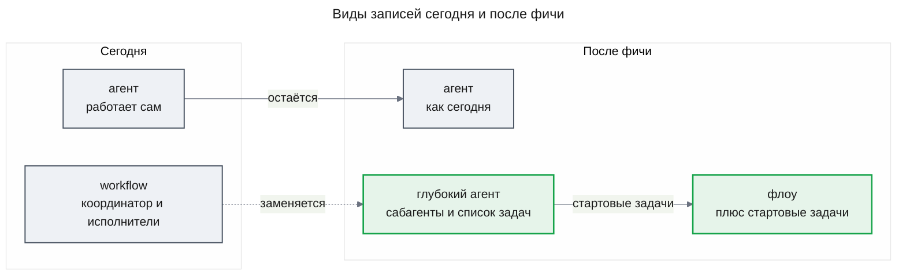
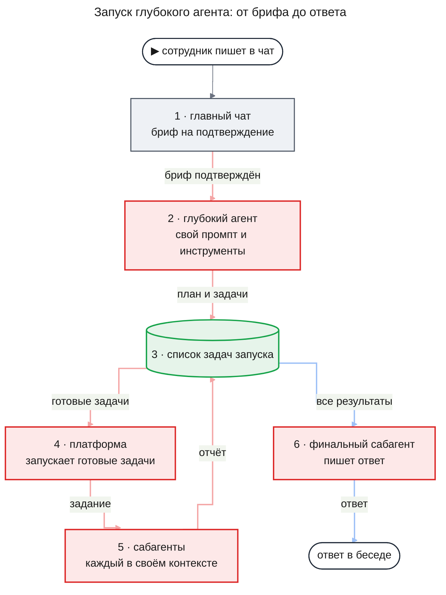
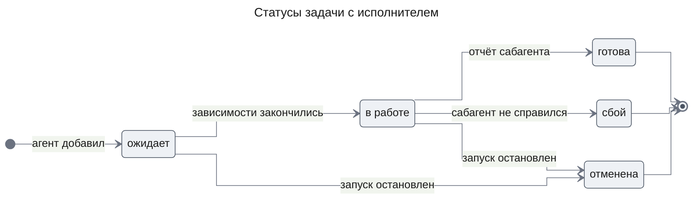
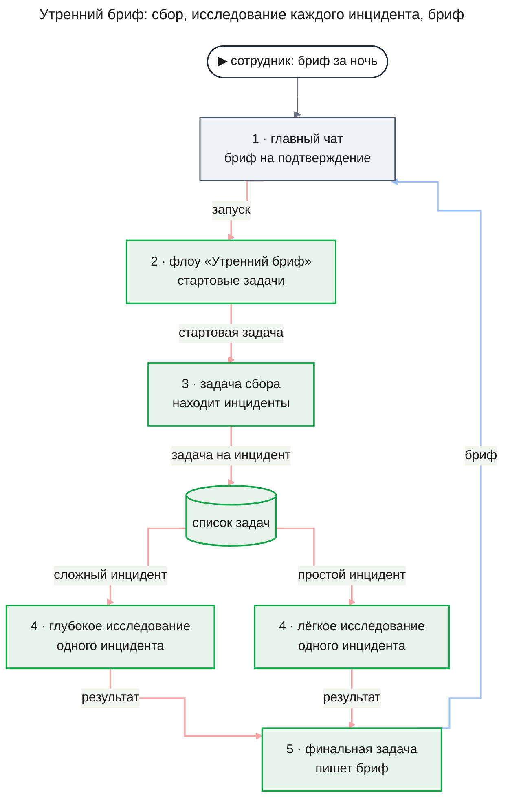
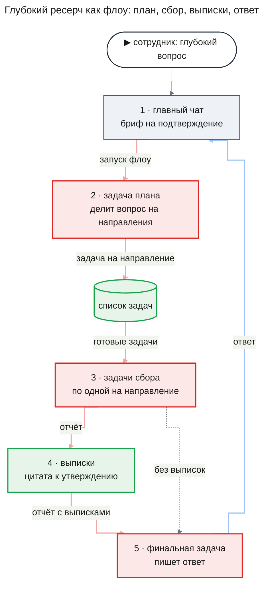
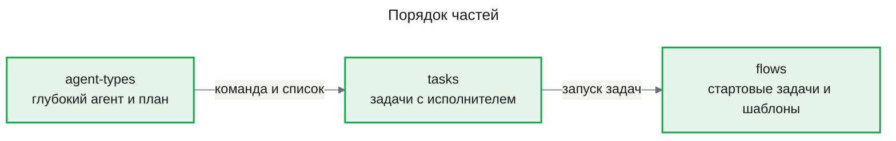

# PRD: Глубокие агенты, задачи и флоу (deep-agents)

| Date | Depth |
|---|---|
| 2026-11-21 | full |

## Snapshot

**Overview.** Сегодня в библиотеке Agent OS два вида записей: агент, который работает сам, и workflow, где координатор только раздаёт задания команде исполнителей. Ни у того ни у другого нет плана вне памяти модели, а новую задачу по ходу работы поставить нельзя: кого и когда запускать, модель держит в голове, и малая модель это путает. Фича вводит глубокого агента — агента со своей командой изолированных сабагентов и одним списком задач. Пункт списка без исполнителя — его собственный план, а задачу с исполнителем запускает платформа, как только закончились задачи, которых она ждёт; добавлять задачи могут сами агенты по ходу работы. Глубокий агент заменяет workflow, флоу — это глубокий агент со стартовыми задачами, и из чата можно получить черновик нового флоу по шаблону, например «утреннего брифа», который ставит по задаче исследования на каждый найденный инцидент.

- **Не меняется**: запуск из чата через подтверждение брифа, права сотрудника на каждый вызов, ход агента кончается текстом.
- **Не входит**: запуск по расписанию, флоу в виде кода, самообучение, которое меняет шаблоны.
- **Части**: `agent-types` → `tasks` → `flows`, в этом порядке.
- **Главный риск**: предела одновременных задач нет — малая модель может поставить десятки задач, и они стартуют разом; тормозят их только существующие пределы запусков сабагента, глубины и шагов и месячная квота сотрудника.
- **Открытые вопросы**: один, см. [Undetermined Items](#undetermined-items).

## Terms

- **Агент** — запись библиотеки: промпт, MCP-серверы, модель, предел шагов. Агент сам вызывает инструменты и может запускать других агентов из своего списка.
- **Workflow** — вид записи, который эта фича убирает: координатор с правилами и команда исполнителей. Координатор работает по общему тексту платформы и правилам записи, своих MCP-инструментов у него нет.
- **Глубокий агент** — агент с двумя дополнительными настройками: своя команда сабагентов и список задач, через который он планирует и раздаёт работу.
- **Сабагент** — агент, описанный внутри записи глубокого агента, как субагент в Claude Code: имя, описание «когда меня звать», промпт, свои MCP-серверы, модель и предел шагов. Сабагент работает в своём контексте, видит только своё задание и возвращает только отчёт.
- **Отчёт** — последний текст агента без вызовов инструментов. Он уходит тому, кто запустил агента ([design-agents.md](../agent-platform/design-agents.md), KD-2).
- **Запуск** — одна работа глубокого агента от брифа до ответа: его сессия, сессии его сабагентов и список задач.
- **Список задач** — один на запуск. Пункт без исполнителя — план самого глубокого агента. Пункт с исполнителем — задача, которую запускает платформа.
- **Исполнитель задачи** — сабагент того же глубокого агента, названный в задаче.
- **Зависимость** — задача, которая должна закончиться раньше этой. Задача, у которой все зависимости закончились, — **готовая**.
- **Финальный сабагент** — сабагент, чей отчёт становится ответом запуска. Его задача — **финальная**: она ждёт все остальные задачи запуска.
- **Флоу** — глубокий агент, в записи которого есть стартовые задачи. Каждый запуск начинается с их копии.
- **Шаблон** — флоу, по образцу которого чат делает черновик нового флоу.
- **Бриф** — вопрос, границы и форма результата. Сотрудник подтверждает, правит или отклоняет его в чате до запуска.
- **Черновик записи** — карточка в чате с предложенной записью. Пока сотрудник не нажал «Сохранить», в библиотеке ничего не появляется.
- **«Classify and act»** — приём: один шаг разбирает входные элементы и на каждый ставит задачу подходящему исполнителю. Пример: сбор находит инциденты и на каждый ставит глубокое или лёгкое исследование.
- **Модель класса Haiku** — малая дешёвая модель, на которой платформа держит рабочие роли.

## Background

Сотрудник работает с главным чатом. Короткую работу чат делает сам, длинную отдаёт агентам библиотеки или workflow. Workflow запускается только из чата и только после того, как сотрудник подтвердил бриф. Его координатор раздаёт задания исполнителям, ждёт отчёты и решает, что делать дальше, а ответом становится отчёт финального исполнителя. По этой схеме работает встроенный глубокий ресерч: исполнитель плана делит вопрос на направления, исполнители сбора собирают данные, исполнитель ответа пишет ответ.

Этой схеме не хватает четырёх вещей. Плана вне памяти модели нет: что сделано и что осталось, координатор помнит сам и при длинной работе теряет. Порядок задач тоже живёт в памяти координатора: он сам решает, что всё собрано, и сам переписывает отчёты в задание следующему исполнителю. Исполнитель не может поставить новую задачу, даже если нашёл ещё пять инцидентов. А у координатора нет своих инструментов: всё, даже один короткий запрос, он отдаёт исполнителю.

Владелец предложил собрать из агента «глубокого агента». Идея похожа на LangChain Deep Agents: у агента есть инструмент плана и вызов специализированных сабагентов в изолированном контексте ([документация Deep Agents](https://docs.langchain.com/oss/python/deepagents/overview)). Отличия Agent OS: настройки и промпты лежат в базе и правятся в библиотеке, а задачу с исполнителем запускает код платформы, а не модель. Это ставка проекта: код вокруг малой модели берёт на себя то, в чём она ошибается (project-context, бизнес-ограничение 6).

### Агент, глубокий агент и флоу

Глубокий агент по определению владельца почти совпадает с сегодняшним workflow: ведущий, команда и финальный участник. Проект запрещает две версии одной вещи, поэтому глубокий агент не встаёт рядом с workflow, а заменяет его.

В библиотеке остаются два вида записей: агент и глубокий агент. Флоу — не третий вид, а глубокий агент, в записи которого есть стартовые задачи. Так одна запись покрывает всё, что владелец описал: агента с командой, задачи по ходу работы и сценарий, с которого запуск начинается.

Что из сегодняшнего исчезает и что встаёт на его место:

| Сегодня | После фичи |
|---|---|
| Вид записи «workflow» | Вид записи «глубокий агент» |
| Координатор без своих инструментов | Глубокий агент со своим промптом, MCP-серверами и инструментами |
| Исполнитель с ролью | Сабагент с описанием, когда его звать |
| Финальный исполнитель | Финальный сабагент |
| Координатор сам запускает исполнителей | Платформа запускает задачу с исполнителем (часть `tasks`) |
| Порядок шагов в правилах координатора | Стартовые задачи флоу (часть `flows`) |

### Как это встраивается в работу

Путь от сообщения сотрудника до ответа после всех трёх частей. Чат и подтверждение брифа остаются как сегодня; меняется то, что происходит после подтверждения.

Глубокий агент сам ведёт свой план и сам решает, какие задачи поставить; сабагенты тоже могут их добавлять. Когда стартует задача, решает платформа: она сравнивает только статусы и зависимости и никогда не судит о тексте задачи. Отчёт сабагента становится результатом его задачи и попадает в задание тем задачам, которые её ждали. Финальная задача стартует последней и получает результаты всех остальных.

### Жизнь задачи

Статусы задачи с исполнителем и кто их меняет.

Все переходы задачи с исполнителем делает платформа. Пункт плана без исполнителя проходит те же статусы, кроме «сбоя», но переводит его сам глубокий агент. Задача, закончившаяся «сбоем» или «отменой», тоже считается законченной: ждущие её задачи стартуют и видят, чем она кончилась.

## Users and Use Cases

### Users

- **Сотрудник** — запускает глубоких агентов и флоу из чата, следит за списком задач и читает ответ. Ему важно, чтобы работа не терялась и не делалась дважды, а сабагенты не делали ничего сверх его прав.
- **Автор записи** — сотрудник или администратор, который собирает глубокого агента и его сабагентов в библиотеке или сохраняет черновик флоу из чата. Ему важно настраивать всё в редакторе, без кода.
- **Владелец платформы** — разбирает запуски по списку задач и журналу и решает, что править в промптах и шаблонах.

### Use Cases

- **UC-1**: Автор собирает глубокого агента со своими сабагентами → глубокий агент зовёт их по описаниям и сам работает своими инструментами, так что одна запись заменяет и агента, и команду.
- **UC-2**: Сотрудник запускает глубокого агента из чата → видит его план со статусами и сабагентов, которых тот запустил, так что понимает, на каком шаге работа.
- **UC-3**: Сотрудник запускает утренний бриф → по каждому инциденту за период идёт отдельное глубокое или лёгкое исследование, а бриф приходит, когда закончены все, так что ни один инцидент не теряется в общей сводке.
- **UC-4**: Сотрудник задаёт глубокий вопрос → план ставит задачу сбора на каждое направление, ответ пишется по отчётам всех направлений, так что ответ не зависит от того, не забыл ли ведущий кого-то дождаться.
- **UC-5**: Сотрудник просит чат сделать свой флоу по образцу шаблона → получает черновик, правит и сохраняет его, так что новый сценарий появляется без редактора и без кода.
- **UC-6**: Владелец разбирает неудачный запуск → по списку задач и журналу видит, какая задача кем поставлена, когда стартовала и чем кончилась, так что знает, какой промпт править.

### Путь сотрудника: утренний бриф

Утренний бриф — системный шаблон флоу. Сотрудник пишет в чат «сделай утренний бриф за ночь», подтверждает бриф, и запуск начинается с двух стартовых задач: сбор инцидентов и бриф.

1. Задача сбора стартует сразу: у неё нет зависимостей. Её сабагент ищет тикеты и логи за период.
2. На каждый найденный инцидент сабагент сбора ставит задачу и сам решает, кому её отдать: сложный инцидент — сабагенту глубокого исследования, простой — лёгкого. Это приём «classify and act».
3. Все поставленные задачи стартуют разом: предела параллельности нет. «По очереди» здесь значит «по зависимостям»: бриф ждёт всех, а исследования друг друга не ждут.
4. Финальная задача брифа стартует, когда закончились сбор и все исследования. Она получает их результаты, а исследования со «сбоем» называет в брифе неисследованными.

В фикстуре MCP нет настоящего источника инцидентов, поэтому шаблон показывается на синтетических тикетах и логах.

### Путь сотрудника: глубокий ресерч

Глубокий ресерч становится флоу с двумя стартовыми задачами: план и ответ. Задачи сбора ставит сам план — по одной на направление.

Сегодня тот же путь держит в памяти координатор: он запускает план, раздаёт направления, ждёт всех и переписывает отчёты в задание агенту ответа. После фичи порядок задают стартовые задачи и зависимости, ответ получает отчёты из списка задач без пересказа, а ждать всех сборщиков — дело платформы. Шаг выписок — необязательная часть шаблона (FR-25); без него ответ получает отчёты сбора как есть.

## Functional Requirements

### Must Have (MVP)

#### Глубокий агент — часть `agent-types`

- **FR-01. Глубокий агент вместо workflow.** Автор создаёт в библиотеке запись вида «глубокий агент»: имя, описание, свой промпт, MCP-серверы, модель, предел шагов, команда от одного до десяти сабагентов, необязательный финальный сабагент и флажок самообучения. У сабагента те же настройки, что в Terms, плюс предел запусков за один запуск; как исполнителя сегодня, его можно заполнить копией агента из библиотеки. Настройки и промпты хранятся в базе. Вида записи «workflow» больше нет.
  - AC-01.1: Given автор создаёт запись в библиотеке, when выбирает её вид, then ему доступны «агент» и «глубокий агент», а «workflow» нет.
  - AC-01.2: Given автор сохранил глубокого агента с двумя сабагентами, when он открывает библиотеку, then запись есть в списке, а чат может предложить её к запуску.

- **FR-02. Свои изолированные сабагенты.** Глубокий агент работает сам своими инструментами и отдаёт часть работы своим сабагентам, выбирая их по описаниям. Запустить он может только сабагентов своей записи. Сабагент начинает с чистого контекста: видит своё задание, а не историю глубокого агента, и возвращает только отчёт.
  - AC-02.1: Given у глубокого агента сабагенты «сбор» и «ответ», when он пытается запустить агента вне своей команды, then платформа отказывает с причиной, и ничего не запускается.
  - AC-02.2: Given глубокий агент запустил сабагента «сбор», when сотрудник открывает историю сабагента, then в ней только задание сабагента, а глубокий агент получает только его отчёт.
  - AC-02.3: Given в записи глубокого агента есть MCP-сервер, when глубокий агент сам вызывает инструмент этого сервера, then вызов идёт по правам запустившего сотрудника, как вызов агента.

- **FR-03. Запуск из чата через бриф.** Глубокого агента запускает только главный чат и только после того, как сотрудник подтвердил бриф, — как workflow сегодня. Другие агенты глубоких агентов не запускают.
  - AC-03.1: Given запрос сотрудника подходит под описание глубокого агента, when чат его запускает, then сотрудник видит бриф, а глубокий агент стартует только после подтверждения.
  - AC-03.2: Given агент общего назначения работает в беседе, when он пытается запустить глубокого агента, then платформа отказывает, и ничего не запускается.

- **FR-04. План глубокого агента.** Глубокий агент ведёт план — список задач запуска с пунктами без исполнителя. Он добавляет пункты и сам переводит их в «в работе», «готова» или «отменена». Сотрудник видит план со статусами на экране агента. План принадлежит запуску: рестарт сервера и продолжение работы новым сообщением его не теряют.
  - AC-04.1: Given глубокий агент добавил три пункта и первый перевёл в «в работе», when сотрудник открывает экран агента, then видит три пункта и их статусы.
  - AC-04.2: Given у запуска есть план, when сервер перезапустился или сотрудник продолжил работу сообщением, then план тот же, с теми же статусами.

- **FR-05. Ответ финального сабагента.** Если в записи назван финальный сабагент, запуск кончается только законченным отчётом этого сабагента, и этот отчёт без пересказа становится ответом в беседе — как с финальным исполнителем сегодня.
  - AC-05.1: Given финальный сабагент назван, when глубокий агент отвечает раньше, чем пришёл законченный отчёт финального сабагента, then ответ не принят, а глубокий агент получает уведомление, что нужен отчёт финального сабагента.
  - AC-05.2: Given финальный сабагент закончил работу отчётом, then сотрудник получает в беседе этот отчёт как ответ запуска.

- **FR-06. Редактор, панель администратора и черновик из чата.** Всё, что сегодня можно делать с workflow, можно делать с глубоким агентом: создавать и править в редакторе библиотеки, публиковать системным в панели администратора, делиться по ролям, копировать и предлагать черновиком из главного чата. Правила сохранения, видимости и прав на серверы и модели не меняются.
  - AC-06.1: Given сотрудник просит чат сделать глубокого агента, when чат предлагает черновик, then сотрудник видит карточку черновика, а в библиотеке ничего не появляется до сохранения.
  - AC-06.2: Given сотрудник сохраняет глубокого агента с сабагентом на сервере, к которому у него нет права, when он нажимает «Сохранить», then запись отклонена с той же причиной, что у workflow сегодня.
  - AC-06.3: Given администратор создал системного глубокого агента в панели и открыл его роли, when сотрудник этой роли открывает библиотеку, then видит эту запись.

- **FR-07. Глубокий ресерч — встроенный глубокий агент.** Встроенный глубокий ресерч становится глубоким агентом с теми же сабагентами плана, сбора и ответа и тем же финальным сабагентом. Сотрудник запускает его так же, как сегодня.
  - AC-07.1: Given сотрудник задаёт глубокий вопрос и подтверждает бриф, when запуск идёт, then работают план, сбор по направлениям и ответ, и ответ приходит в беседу.

- **FR-08. Самообучение у глубоких агентов.** Флажок самообучения и граф знаний работают у глубокого агента так же, как у workflow сегодня ([self-learning](../self-learning/prd.md)). У обычного агента флажка нет. Граф встроенного глубокого ресерча после замены остаётся тем же.
  - AC-08.1: Given у глубокого агента включено самообучение, when его запуск закончился, then в его графе знаний появляются новые записи.
  - AC-08.2: Given у встроенного глубокого ресерча был граф до фичи, when сотрудник открывает граф после фичи, then видит те же записи.

#### Задачи с исполнителем — часть `tasks`

- **FR-10. Задачу с исполнителем запускает платформа.** Глубокий агент назначает задаче исполнителя — одного из своих сабагентов. Готовую задачу платформа запускает сразу, не дожидаясь хода глубокого агента: сабагент получает текст задачи как задание. Исключение — финальная задача: её правило старта в FR-15. Все готовые задачи стартуют одновременно, без предела. Других способов запустить сабагента у глубокого агента нет, поэтому каждый запуск сабагента виден в списке как задача.
  - AC-10.1: Given глубокий агент добавил две задачи для «сбора» без зависимостей, when он заканчивает шаг, then обе задачи стартуют, не дожидаясь его следующего хода, и каждый запуск «сбора» получает текст своей задачи.
  - AC-10.2: Given запуск закончился, when сотрудник сравнивает сабагентов в дереве агентов и задачи в списке, then у каждого запуска сабагента есть своя задача.

- **FR-11. Зависимости и результаты.** Задача может ждать другие задачи того же запуска. Она стартует, когда все они закончились, и получает в задании их результаты со статусами. Закончившейся считается задача в статусе «готова», «сбой» или «отменена», поэтому сбой одной задачи не держит остальные.
  - AC-11.1: Given задача Б ждёт задачу А, when А ещё в работе, then Б не стартовала; when А готова, then Б стартует, и в её задании есть результат А.
  - AC-11.2: Given задача Б ждёт задачу А, when А кончилась сбоем, then Б стартует, и в её задании сказано, что А кончилась сбоем, с причиной.

- **FR-12. Статусы задач с исполнителем ведёт платформа.** Платформа переводит задачу в «в работе», когда запускает сабагента, в «готова» с отчётом как результатом, когда он отчитался, и в «сбой» с причиной, когда он не справился. Глубокий агент получает уведомление о каждой законченной задаче с её результатом. Менять статус задачи с исполнителем он не может.
  - AC-12.1: Given сабагент задачи отчитался, then задача в статусе «готова» с отчётом как результатом, а глубокий агент получил уведомление с id задачи и результатом.
  - AC-12.2: Given задача с исполнителем в работе, when глубокий агент пытается поставить ей «готова», then платформа отказывает с причиной, и статус не меняется.

- **FR-13. Задачи ставят агенты запуска.** Задачи по ходу работы добавляют глубокий агент и его сабагенты: например, сабагент сбора ставит по задаче на каждый найденный элемент и сам выбирает исполнителя. Новая задача сразу видна в списке и стартует, как только станет готовой.
  - AC-13.1: Given сабагент сбора нашёл три инцидента, when он добавляет три задачи, назначив каждой «глубокое» или «лёгкое исследование», then все три видны в списке и стартуют.

- **FR-14. Границы задачи.** Исполнителем задачи может быть только сабагент того же глубокого агента. Ждать можно только задачи того же запуска. У сабагента за один запуск не больше задач, чем его предел запусков. Задачу, которая нарушает одно из этих правил, платформа не добавляет и называет причину тому агенту, который её ставил.
  - AC-14.1: Given в команде нет сабагента «отчёт», when агент ставит задачу с исполнителем «отчёт», then задача не добавлена, агент видит причину, и список не изменился.
  - AC-14.2: Given задача ссылается на задачу другого запуска или на несуществующий id, when агент её ставит, then задача не добавлена, и агент видит причину.
  - AC-14.3: Given у сабагента предел пять запусков и ему уже назначено пять задач, when агент ставит шестую, then задача не добавлена, и агент видит, что предел исчерпан.

- **FR-15. Конец запуска и финальная задача.** Пока у запуска есть задача с исполнителем в статусе «ожидает» или «в работе», запуск не кончается. Задача финального сабагента стартует, когда закончились все остальные задачи запуска с исполнителем и глубокий агент закончил шаг, в котором получил уведомление о последней из них: так он ещё успевает поставить задачу взамен упавшей. Финальная задача получает результаты всех остальных со статусами. Когда она стартовала, новые задачи больше не добавляются.
  - AC-15.1: Given у запуска три задачи сбора и финальная задача, when две готовы, а третья в работе, then финальная задача не стартовала; when третья закончилась, then финальная стартует, и в её задании результаты всех трёх.
  - AC-15.2: Given финальная задача стартовала, when агент ставит новую задачу, then задача не добавлена, и агент видит причину.
  - AC-15.3: Given последняя задача перед финальной кончилась сбоем, when глубокий агент в шаге с этим уведомлением ставит задачу взамен, then задача добавлена, а финальная стартует только после неё.
  - AC-15.4: Given финального сабагента нет и задачи ещё работают, when глубокий агент отвечает текстом, then запуск не закончен и ждёт задачи, как сегодня агент ждёт своих детей.

- **FR-16. Остановка запуска и сбой задачи.** Когда сотрудник останавливает глубокого агента, платформа останавливает работающих сабагентов, переводит все незаконченные задачи в «отменена» и больше ничего не запускает. Сбой сабагента кончает только его задачу: глубокий агент получает уведомление и может поставить задачу заново, даже если упала последняя задача перед финальной (FR-15).
  - AC-16.1: Given у запуска две задачи в работе и одна ожидает, when сотрудник останавливает глубокого агента, then оба сабагента остановлены, все три задачи «отменена», и новых запусков нет.
  - AC-16.2: Given сабагент задачи кончился ошибкой, then задача в статусе «сбой» с причиной, глубокий агент получил уведомление, а другие задачи работают дальше.

- **FR-17. Рестарт не теряет и не дублирует задачи.** Рестарт сервера в любой момент запуска не теряет ни одной задачи и не запускает ни одну дважды: у каждой задачи с исполнителем не больше одного запуска сабагента.
  - AC-17.1: Given задача стала готовой, а её сабагент ещё не стартовал, when сервер перезапускается, then после старта сервера сабагент этой задачи стартует ровно один раз.
  - AC-17.2: Given сабагент задачи в работе, when сервер перезапускается, then работа продолжается в том же запуске сабагента, и второго запуска для этой задачи нет.

- **FR-18. Права и изоляция.** Сабагент задачи работает по правам сотрудника, запустившего глубокого агента, и каждый его вызов проверяется в момент вызова. Изменяющий вызов ждёт подтверждения сотрудника в беседе. Список задач запуска виден и доступен только его владельцу.
  - AC-18.1: Given у сотрудника нет права на инструмент X, when сабагент задачи вызывает X, then платформа отказывает по правам, аудит записывает одну запись с отказом, а сервер не вызывается.
  - AC-18.2: Given запуск принадлежит сотруднику A, when сотрудник B запрашивает его список задач или ставит в нём задачу, then B не получает ни одной задачи, и список не меняется.
  - AC-18.3: Given сабагент задачи делает изменяющий вызов, then сотрудник видит в беседе запрос на подтверждение, и вызов ждёт его решения.

- **FR-19. Список задач на экране агента.** На экране глубокого агента сотрудник видит каждую задачу: текст, исполнителя или пометку «свой пункт», статус, какие задачи она ждёт, кто её поставил, результат и переход к запуску её сабагента.
  - AC-19.1: Given у запуска задачи разных статусов, when сотрудник открывает экран глубокого агента, then видит у каждой задачи все перечисленные сведения и может открыть запуск её сабагента.

#### Флоу — часть `flows`

- **FR-21. Стартовые задачи.** В записи глубокого агента можно задать стартовые задачи: текст, исполнителя и зависимости. Каждый запуск начинается с копии этих задач, и готовые из них стартуют сразу; дальше агенты добавляют свои. Изменение записи не меняет список уже идущего запуска. Глубокий агент со стартовыми задачами — это флоу.
  - AC-21.1: Given у флоу стартовые задачи «сбор» и финальная «бриф», when запуск начинается, then в его списке обе задачи, «сбор» стартовал, а «бриф» ждёт.
  - AC-21.2: Given запуск флоу идёт, when автор меняет стартовые задачи в записи, then список этого запуска не меняется.

- **FR-22. Черновик флоу из шаблона в чате.** Сотрудник просит главный чат сделать флоу по образцу другого, и чат предлагает черновик нового глубокого агента со стартовыми задачами, взятыми из шаблона и подправленными под просьбу. Рабочее имя возможности — `create_workflow`; отдельный ли это инструмент или режим `draft_record`, решает дизайн части `flows`, но карточка черновика и правило сохранения у них одни. Шаблоном может быть любой флоу, который сотрудник видит в библиотеке. Чат только предлагает черновик: запись появляется, когда сотрудник её сохранит, по правилам сохранения библиотеки.
  - AC-22.1: Given сотрудник просит «сделай флоу как утренний бриф, но только по платежам», when чат отвечает, then сотрудник видит карточку черновика флоу со стартовыми задачами, а в библиотеке ничего нового нет.
  - AC-22.2: Given сотрудник сохранил черновик, when он открывает библиотеку, then там его новый флоу, и чат может его запустить.
  - AC-22.3: Given глубокий агент или сабагент работает в беседе, then предложить черновик записи он не может: это умеет только главный чат.

- **FR-23. Шаблон «Утренний бриф».** Платформа поставляет системный флоу «Утренний бриф». Его стартовые задачи — сбор инцидентов за период из тикетов и логов и финальный бриф. Сбор ставит по задаче на каждый инцидент сабагенту глубокого или лёгкого исследования. Бриф называет каждый найденный инцидент, а инциденты, чьё исследование кончилось сбоем или не было поставлено, — неисследованными.
  - AC-23.1: Given в синтетических тикетах и логах фикстуры за период N инцидентов, when задача сбора закончилась, then в списке ровно N задач исследования, по одной на инцидент, каждая назначена глубокому или лёгкому исследованию.
  - AC-23.2: Given все задачи исследования закончились и одна из них сбоем, when сотрудник читает бриф, then в нём есть все N инцидентов, а инцидент со сбоем назван неисследованным. Проверяет владелец вручную.

- **FR-24. Глубокий ресерч как флоу.** Встроенный глубокий ресерч становится флоу. Его стартовые задачи — план и финальный ответ. Сабагент плана ставит по задаче сбора на каждое направление, ответ ждёт все задачи и получает все отчёты. Если план кончился сбоем или не дал направлений, глубокий агент в шаге с этим уведомлением ставит одну задачу сбора на весь вопрос, и финальная задача её дожидается (FR-15). Указания, кого и когда запускать, из промпта записи уходят.
  - AC-24.1: Given план вернул три направления, when запуск идёт, then в списке три задачи сбора, поставленные планом, а финальная задача стартует после всех трёх с тремя отчётами в задании.
  - AC-24.2: Given задача плана кончилась сбоем, when глубокий агент получает уведомление, then он ставит одну задачу сбора на весь вопрос, и ответ всё равно приходит в беседу.

### Should Have

- **FR-09. Напоминание об открытых пунктах плана** (часть `agent-types`). Малая модель забывает закрывать пункты своего плана или отвечает, не доделав их. Когда глубокий агент отвечает текстом, а в его плане есть пункты «ожидает» или «в работе», ответ не принимается, и агент получает уведомление со списком этих пунктов. Он закрывает их как «готова» или «отменена» и отвечает снова; бесконечную петлю останавливает предел шагов.
  - AC-09.1: Given в плане пункт «в работе», when глубокий агент отвечает текстом, then ответ не принят, а агент видит уведомление с этим пунктом.
  - AC-09.2: Given все пункты плана «готова» или «отменена», when глубокий агент отвечает текстом, then ответ принят.

- **FR-20. Ключ элемента против дублей** (часть `tasks`). Малая модель может поставить две задачи на один инцидент. Задача может нести ключ элемента, который она обрабатывает, например номер тикета. Вторую задачу с тем же ключом в том же запуске платформа не добавляет и возвращает id уже поставленной. Ключи сравниваются как строки, по смыслу текста платформа дубли не ищет.
  - AC-20.1: Given в запуске есть задача с ключом `INC-42`, when агент ставит ещё одну с ключом `INC-42`, then задача не добавлена, и агент получает id существующей.

### Could Have

- **FR-25. Выписки в глубоком ресерче** (часть `flows`). Шаблон глубокого ресерча получает шаг выписок после каждой задачи сбора. Исполнитель сбора работает как сегодня и заканчивает работу текстом. Затем отдельный проход модели с чистым контекстом читает его отчёт и сохранённые результаты его вызовов и к каждому утверждению пишет дословную цитату и id вызова-источника. Код проверяет одно: цитата дословно, без учёта пробелов и переносов, есть в сохранённом результате вызова того же сабагента. Утверждение получает пометку «подкреплено цитатой» или «без цитаты», и код никогда его не удаляет. Финальная задача ответа получает отчёты вместе с выписками и пометками. Если проход кончился ошибкой, запуск идёт дальше без выписок этого отчёта. Зачем это нужно и где у подхода пределы, разобрано в [agent-harness/prd.md](../agent-harness/prd.md), FR-08–FR-11 и Risks.
  - AC-25.1: Given сабагент сбора закончил работу отчётом и у него есть сохранённые результаты, when шаг выписок выполнен, then у каждого утверждения отчёта есть выписка с цитатой и id вызова или пометка, что цитаты нет.
  - AC-25.2: Given в цитате изменено одно число против текста результата, when код проверяет выписку, then она получает пометку «без цитаты», а утверждение остаётся.
  - AC-25.3: Given шаг выписок кончился ошибкой модели, when стартует финальная задача, then она получает отчёт этого сбора с отметкой, что выписок нет, а запуск не падает.
  - AC-25.4: Given шаг выписок выполнен, then журнал содержит одну запись с числом утверждений, долей подкреплённых, стоимостью прохода и id запуска и задачи, без текстов утверждений и цитат.

### Won't Have

- Запуск по расписанию — позже, отдельной фичей. Планировщика нет, а запуск без сотрудника требует своих решений о правах: чьи права у запуска и кто подтверждает изменяющие вызовы. В этой фиче утренний бриф сотрудник запускает из чата.
- Флоу в виде скрипта — позже. Здесь флоу задают промпт и стартовые задачи, а агенты добавляют свои. Скрипту понадобились бы вызов агентов из кода и своя песочница.
- Самообучение, которое предлагает правки шаблонов и строит ветки, — позже, отдельной фичей. Здесь самообучение, как сегодня, наполняет только граф знаний.
- Типизированные результаты и инструмент «закончить работу» — нет. Ход агента кончается текстом ([design-agents.md](../agent-platform/design-agents.md), KD-2): результат задачи — отчёт сабагента, а структуру несут вызовы инструмента задач.
- Общие файлы или заметки внутри запуска — не эта фича. Результаты переходят от задачи к задаче через зависимости.
- Вызов агентов и постановка задач из `run_code` — нет. `run_code` вызывает только MCP-инструменты, а запуск сабагента идёт через список задач и проверку прав.
- Настройка предела параллельности — нет: все готовые задачи стартуют сразу (Constraints, «Решения владельца»). Тормоза — существующие пределы глубины, шагов и запусков сабагента.
- Бюджет токенов на запуск — не эта фича. Сегодня есть только месячная квота сотрудника, а новый предел противоречит решению о параллельности.
- Отдельная модель-проверяющая — нет. Выписку проверяет код дословным сравнением; модель-судья права в 75–80% случаев и стала бы вето с ложными срабатываниями.
- Глубокий агент в роли сабагента — не эта фича. Сабагент — обычный агент без своей команды и списка, иначе запуск упирается в предел глубины и множит расход.
- Запуск глубокого агента другим агентом — нет: только главный чат после брифа, как workflow сегодня.
- Сабагент как ссылка на агента библиотеки, которая подтягивает его правки, — нет. Сабагент — копия внутри записи, как исполнитель сегодня.
- Правка списка задач сотрудником с экрана: добавить, отменить, переставить — не эта фича. Сотрудник направляет работу сообщением глубокому агенту.
- Поиск дублей задач по смыслу текста — нет: платформа сравнивает только ключи (FR-20).
- Самообучение у обычных агентов и повтор сохранённых процедур без модели — нет: эта фича не разворачивает Won't Have из [self-learning/prd.md](../self-learning/prd.md).
- Показ выписок и пометок сотруднику в вебе — не эта фича: сначала журнал должен показать, что выписки работают.
- Перенос существующих workflow-записей сотрудников в глубоких агентов — нет: проект — PoC с одной версией всего.

## Non-Functional Requirements

### Observability

- **NFR-01**: Каждое событие задачи — добавлена, отклонена, стартовала, готова, сбой, отменена — пишется одной записью журнала через обёртку логгера `packages/common`: id запуска, задачи, исполнителя и запуска сабагента, сотрудника, статус, причина, длительность, кто поставил задачу. Секретов и токенов в записях нет. Проверка — запуск утреннего брифа на фикстуре: на каждое событие задачи в журнале ровно одна запись.

## Delivery Parts

| Part | Covers | Cut along | Depends on | Rationale |
|------|--------|-----------|------------|-----------|
| `agent-types` | FR-01 – FR-09 | domain | — | Новый вид записи с командой и планом заменяет workflow целиком, вместе с редактором |
| `tasks` | FR-10 – FR-20, NFR-01 | domain | `agent-types` | Задачи с исполнителем и их запуск платформой — отдельный механизм поверх списка и команды |
| `flows` | FR-21 – FR-25 | domain | `tasks` | Стартовые задачи, черновик из шаблона и первые шаблоны опираются на готовые задачи |

Каждая часть несёт и свои экраны: замена вида записи ломает редактор сразу, а старый редактор рядом с новым проект не держит. Части `tasks` и `flows` начинаются после того, как в main влита часть `core` фичи [agent-harness](../agent-harness/prd.md): она меняет тот же цикл агента. Часть `evidence` той фичи не строится: её требования стали FR-25 этого документа, а её дизайн опирался на координатора и исполнителей, которых убирает часть `agent-types`.

Что владелец запускает и видит после каждой части:

- **`agent-types`** — создаёт в библиотеке глубокого агента с двумя сабагентами, запускает его из чата, видит на экране агента план со статусами, а в дереве — сабагентов, которых тот позвал. Встроенный глубокий ресерч работает как глубокий агент.
- **`tasks`** — глубокий агент ставит задачи с исполнителями, и они стартуют сами; сабагент добавляет задачи по ходу; на экране агента виден весь список с исполнителями, зависимостями и результатами.
- **`flows`** — запускает из чата утренний бриф на синтетических инцидентах, получает черновик своего флоу по шаблону и сохраняет его; глубокий ресерч идёт как флоу.

### Part Dependency Diagram

## Success Criteria

Автоматического стенда оценки в проекте нет (project-context, бизнес-ограничение 6), поэтому владелец проверяет результат вручную на первых запусках после выпуска каждой части, с сабагентами на модели класса Haiku.

- Утренний бриф без потерь и дублей — в пяти запусках на фикстуре каждый инцидент, найденный сбором, получает ровно одну задачу исследования, и бриф называет каждый. Читается из списка задач запуска и журнала (NFR-01), после выпуска части `flows`.
- Глубокий ресерч как флоу не хуже прежнего — базовая линия снимается до влития части `agent-types`: десять запусков нынешнего глубокого ресерча на постоянном списке вопросов. После выпуска части `flows` те же десять вопросов дают ответ в каждом запуске, где сбор нашёл данные, а средняя стоимость не выше базовой. Стоимость обоих наборов читается из журнала токенов (бизнес-ограничение 7), качество ответов владелец сравнивает вручную.
- Малая модель держит план — в десяти запусках глубокого агента на Haiku в среднем не больше одного напоминания об открытых пунктах (FR-09) на запуск. Читается из журнала, после выпуска части `agent-types`.
- Черновик флоу работает — три флоу, сделанные владельцем через чат по шаблонам, сохраняются без отказа и доходят до ответа. Проверяется вручную после выпуска части `flows`.

## Constraints and Risks

### Constraints

- **Решения владельца.** Глубокий агент — агент со своими изолированными сабагентами и планом, настройки и промпты в базе. Один список задач служит и планом, и задачами с исполнителем. Все готовые задачи стартуют сразу. Порядок частей: тип агента, задачи, флоу. Чат только предлагает черновик флоу, сохраняет его человек — как с `draft_record` сегодня: агент никогда не сохраняет запись, которую могут запускать другие.
- **Один владелец долгих задач.** Работу сабагентов запускает и восстанавливает после рестарта только `packages/runtime` (ADR-0001, ADR-0004). Список задач решает, что пора запускать, но вторым планировщиком не становится.
- **Ход кончается текстом** ([design-agents.md](../agent-platform/design-agents.md), KD-2). Инструмента завершения нет. Структура — исполнитель, зависимости, ключ — идёт через вызовы инструмента задач.
- **Код не судит текст.** Платформа сравнивает id, статусы, исполнителей, зависимости и ключи задач и никогда не оценивает текст задачи или отчёта.
- **Права и аудит** (бизнес-ограничения 1 и 3). Каждый сабагент работает по правам запустившего сотрудника, права проверяются в момент вызова, изменяющий вызов ждёт подтверждения, каждый вызов пишется в аудит. Задача называет только сабагентов своего глубокого агента.
- **Изоляция** (бизнес-ограничение 2). Список задач и результаты запуска видит только его владелец. Граф знаний глубокого агента остаётся общим для всех его запусков — то же принятое исключение, что у workflow сегодня ([self-learning/prd.md](../self-learning/prd.md), Constraints).
- **Бюджет запуска** (бизнес-ограничение 4) этой фичей не выполняется: расход ограничивает только месячная квота сотрудника, при её исчерпании новые вызовы модели отклоняются.
- **Provenance** (бизнес-ограничение 5) этой фичей не выполняется: выписки (FR-25) приближают к нему глубокий ресерч, но сотрудник источников не видит.
- **Существующие пределы остаются, новых настроек нет**: предел глубины вложенности (три уровня от беседы), предел шагов записи, предел запусков сабагента. Ни новых настроек, ни переменных окружения фича не вводит.
- **Без совместимости.** Вид записи «workflow» заменяется сразу, записи не переносятся. Встроенный глубокий ресерч сохраняет свой id, поэтому его граф знаний остаётся. Что делать с workflow-записями сотрудников, их графами и прошлыми запусками в базе разработки, решает владелец при выкатке (project-context, «Обратная совместимость не нужна»).
- **Самообучение переезжает**, а не теряется: сегодня оно привязано к запуску координатора workflow, и замена вида записи без переноса этой привязки молча остановила бы обучение (FR-08).
- **Журнал** идёт через обёртку логгера `packages/common`.
- **Данные для демонстрации.** В фикстуре MCP нет настоящего источника инцидентов: утренний бриф показывается на синтетических тикетах и логах.

### Assumptions

- Модель класса Haiku в роли сабагента сбора надёжно ставит по одной задаче на элемент и выбирает исполнителя по описанию. Проверка — первые запуски утреннего брифа (Success Criteria).
- Отчёты всех задач помещаются в контекст финальной задачи. Проверка — запуски утреннего брифа с десятками инцидентов; при нехватке дизайн части `tasks` решает, как финальная задача читает длинные результаты.

### Risks

- **Разлёт задач без предела.** Малая модель может поставить десятки задач, и все стартуют разом: растёт расход и нагрузка на MCP-серверы, реальный сервер может начать отказывать по частоте запросов. Тормоза — предел запусков каждого сабагента (FR-14), предел глубины, предел шагов, подтверждение брифа до старта и месячная квота. Бюджета на один запуск нет.
- **Забытые статусы.** Малая модель не закрывает пункты своего плана. Статусы задач с исполнителем ведёт платформа (FR-12), а пункты плана — модель, и её подстраховывает напоминание (FR-09).
- **Раннее закрытие.** Модель отвечает, пока работа не сделана. Запуск не кончается, пока есть незаконченные задачи с исполнителем (FR-15), а ответом при финальном сабагенте становится только его отчёт (FR-05).
- **Дубли задач.** Модель ставит две задачи на один элемент. Защита — ключ элемента (FR-20); без ключа дубль пройдёт, потому что по смыслу платформа текст не сравнивает.
- **Длинный контекст финальной задачи.** Результаты десятков задач удлиняют задание финального сабагента, а длинный контекст снижает точность малых моделей. Влияние видно по качеству брифа; как читать длинные результаты, решает дизайн части `tasks`.
- **Инъекция через данные.** Текст тикета или лога может попасть в текст задачи, которую сабагент сбора ставит другому сабагенту, или в черновик флоу. Сабагенты получают задачи как данные, а не как инструкции, работают только по правам сотрудника, изменяющие вызовы ждут подтверждения, а черновик сохраняет только человек после просмотра.
- **Потеря пользовательских workflow.** Записи сотрудников вида «workflow» не переносятся. Продукт не в продакшене, а встроенный глубокий ресерч и его граф сохраняются.

## Undetermined Items

- **Оставить ли верхнюю границу предела запусков сабагента — 20 за запуск?** Утренний бриф за ночь с 30 инцидентами исследует не больше 20 сложных и 20 простых; лишние задачи не добавляются, и бриф называет такие инциденты неисследованными. Варианты: (а) оставить 20 — это единственный тормоз разлёта на уровне одного сабагента; (б) поднять границу константой кода, без новой настройки. Рекомендация: (а), пока ручные запуски не покажут нехватку. Блокирует масштаб демонстрации утреннего брифа, но не дизайн. Решает владелец.

## Update History

| Version | Date | Change |
|---------|------|--------|
| 1.0 | 2026-11-21 | Initial version |
