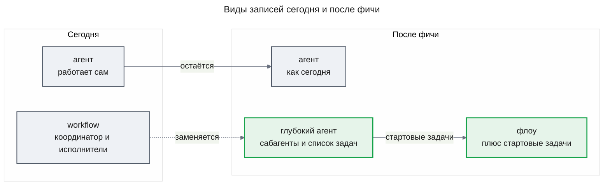
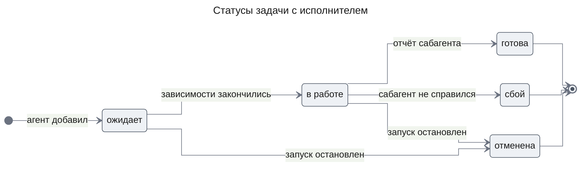
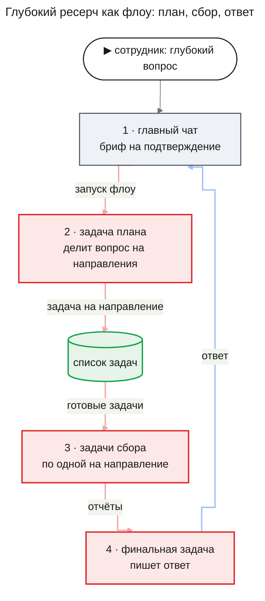
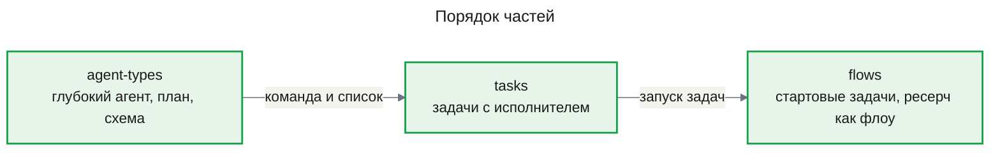

# PRD: Глубокие агенты, задачи и флоу (deep-agents)

| Date | Depth |
|---|---|
| 2026-11-22 | full |

## Snapshot

**Overview.** Сегодня в библиотеке Agent OS два вида записей: агент, который работает сам, и workflow, где координатор только раздаёт задания команде исполнителей. Ни у того ни у другого нет плана вне памяти модели, а новую задачу по ходу работы поставить нельзя: кого и когда запускать, модель держит в голове, и малая модель это путает. Фича вводит глубокого агента — агента со своей командой изолированных сабагентов и одним списком задач. Пункт списка без исполнителя — его собственный план, а задачу с исполнителем запускает платформа, как только закончились задачи, которых она ждёт; добавлять задачи могут сами агенты по ходу работы. Глубокий агент заменяет workflow, а флоу — это глубокий агент со стартовыми задачами; единственный встроенный флоу — глубокий ресерч. Записи сотрудник создаёт и правит словами в чате: чат сам собирает запись, сам выбирает MCP-серверы, сохраняет её после подтверждения сотрудника и рисует схему в панели рядом с беседой.

- **Не меняется**: запуск из чата через подтверждение брифа, права сотрудника на каждый вызов, подтверждение изменяющих вызовов, ход агента кончается текстом.
- **Не входит**: редактор-форма глубокого агента, запуск по расписанию, флоу в виде кода, самообучение, которое меняет шаблоны, выписки с цитатами из источников.
- **Части**: `agent-types` → `tasks` → `flows`, в этом порядке.
- **Главный риск**: предела одновременных задач нет — малая модель может поставить десятки задач, и они стартуют разом; тормозят их только существующие пределы запусков сабагента, глубины и шагов и месячная квота сотрудника.
- **Открытые вопросы**: нет.

## Terms

- **Агент** — запись библиотеки: промпт, MCP-серверы, модель, предел шагов. Агент сам вызывает инструменты и может запускать других агентов из своего списка.
- **Workflow** — вид записи, который эта фича убирает: координатор с правилами и команда исполнителей. Координатор работает по общему тексту платформы и правилам записи, своих MCP-инструментов у него нет.
- **Глубокий агент** — агент с двумя дополнительными настройками: своя команда сабагентов и список задач, через который он планирует и раздаёт работу.
- **Сабагент** — агент, описанный внутри записи глубокого агента, как субагент в Claude Code: имя, описание «когда меня звать», промпт, свои MCP-серверы, модель и предел шагов. Сабагент работает в своём контексте, видит только своё задание и возвращает только отчёт.
- **Отчёт** — последний текст агента без вызовов инструментов. Он уходит тому, кто запустил агента ([design-agents.md](../agent-platform/design-agents.md), KD-2).
- **Запуск** — одна работа глубокого агента от брифа до ответа: его сессия, сессии его сабагентов и список задач.
- **Список задач** — один на запуск. Пункт без исполнителя — план самого глубокого агента. Пункт с исполнителем — задача, которую запускает платформа.
- **Исполнитель задачи** — сабагент того же глубокого агента, названный в задаче.
- **Зависимость** — задача, которая должна закончиться раньше этой. Задача, у которой все зависимости закончились, — **готовая**.
- **Финальный сабагент** — сабагент, чей отчёт становится ответом запуска. Его задача — **финальная**: она ждёт все остальные задачи запуска.
- **Флоу** — глубокий агент, в записи которого есть стартовые задачи. Каждый запуск начинается с их копии.
- **Шаблон** — флоу, который чат читает и берёт за основу нового.
- **Бриф** — вопрос, границы и форма результата. Сотрудник подтверждает, правит или отклоняет его в чате до запуска.
- **Инструменты записей** — пять инструментов главного чата: список, чтение, создание, правка и удаление записей библиотеки.
- **Карточка подтверждения** — карточка в беседе, которую платформа сегодня показывает перед изменяющим вызовом. Вызов выполняется, только когда сотрудник её одобрил.
- **Панель схемы** — панель рядом с беседой. Она рисует запись, о которой идёт речь, а во время запуска показывает его список задач.
- **«Classify and act»** — приём: один шаг разбирает входные элементы и на каждый ставит задачу подходящему исполнителю. Владелец пояснял идею утренним брифом, где сбор находит инциденты за ночь и на каждый ставит задачу исследования; это пример того, что флоу умеет выразить, а не флоу, который фича поставляет.
- **Модель класса Haiku** — малая дешёвая модель, на которой платформа держит рабочие роли.

## Background

Сотрудник работает с главным чатом. Короткую работу чат делает сам, длинную отдаёт агентам библиотеки или workflow. Workflow запускается только из чата и только после того, как сотрудник подтвердил бриф. Его координатор раздаёт задания исполнителям, ждёт отчёты и решает, что делать дальше, а ответом становится отчёт финального исполнителя. По этой схеме работает встроенный глубокий ресерч: исполнитель плана делит вопрос на направления, исполнители сбора собирают данные, исполнитель ответа пишет ответ.

Этой схеме не хватает четырёх вещей. Плана вне памяти модели нет: что сделано и что осталось, координатор помнит сам и при длинной работе теряет. Порядок задач тоже живёт в памяти координатора: он сам решает, что всё собрано, и сам переписывает отчёты в задание следующему исполнителю. Исполнитель не может поставить новую задачу, даже если нашёл ещё пять тем, которые стоит проверить. А у координатора нет своих инструментов: всё, даже один короткий запрос, он отдаёт исполнителю.

Владелец предложил собрать из агента «глубокого агента». Идея похожа на LangChain Deep Agents: у агента есть инструмент плана и вызов специализированных сабагентов в изолированном контексте ([документация Deep Agents](https://docs.langchain.com/oss/python/deepagents/overview)). Отличия Agent OS: настройки и промпты лежат в базе и правятся словами в чате, а задачу с исполнителем запускает код платформы, а не модель. Это ставка проекта: код вокруг малой модели берёт на себя то, в чём она ошибается (project-context, бизнес-ограничение 6).

### Агент, глубокий агент и флоу

Глубокий агент по определению владельца почти совпадает с сегодняшним workflow: ведущий, команда и финальный участник. Проект запрещает две версии одной вещи, поэтому глубокий агент не встаёт рядом с workflow, а заменяет его.

В библиотеке остаются два вида записей: агент и глубокий агент. Флоу — не третий вид, а глубокий агент, в записи которого есть стартовые задачи. Так одна запись покрывает всё, что владелец описал: агента с командой, задачи по ходу работы и сценарий, с которого запуск начинается.

Что из сегодняшнего исчезает и что встаёт на его место:

| Сегодня | После фичи |
|---|---|
| Вид записи «workflow» | Вид записи «глубокий агент» |
| Координатор без своих инструментов | Глубокий агент со своим промптом, MCP-серверами и инструментами |
| Исполнитель с ролью | Сабагент с описанием, когда его звать |
| Финальный исполнитель | Финальный сабагент |
| Координатор сам запускает исполнителей | Платформа запускает задачу с исполнителем (часть `tasks`) |
| Порядок шагов в правилах координатора | Стартовые задачи флоу (часть `flows`) |
| Редактор-форма workflow | Правка словами в чате; в библиотеке — карточка записи только для чтения |
| Черновик записи с кнопкой «Сохранить» | Инструменты записей, которые сохраняют запись после карточки подтверждения |
| Сотрудник выбирает MCP-серверы в форме | Чат выбирает серверы каждому сабагенту из доступных сотруднику |

### Как запись появляется в чате

Сотрудник одной фразой говорит, какой флоу или глубокий агент ему нужен или что поменять. Дальше всё делает чат, а сотрудник только одобряет результат.

```mermaid
---
title: "Создание и правка записи словами в чате"
config:
  theme: base
  look: classic
  themeVariables:
    primaryColor: "#eef1f5"
    primaryBorderColor: "#4b5563"
    primaryTextColor: "#1a1a1a"
    lineColor: "#6b7280"
  flowchart:
    curve: step
  themeCSS: |
    @keyframes lit_da6{0%,22.5%{stroke:#991b1b;stroke-width:6px}25%,100%{stroke:#f4a5a5;stroke-width:2px}}
    @keyframes litr_da6{0%,22.5%{stroke:#1d4ed8;stroke-width:6px}25%,100%{stroke:#9ec1f7;stroke-width:2px}}
---
flowchart LR
    entry(["▶ сотрудник описывает флоу"])
    chat["1 · главный чат<br/>собирает запись и серверы"]
    card["2 · карточка подтверждения<br/>сотрудник одобряет"]
    lib[("3 · библиотека")]
    panel["4 · панель схемы<br/>рядом с беседой"]
    entry --> chat
    chat e1@-->|"создать или изменить"| card
    card e2@-->|"одобрено"| lib
    lib e3@-->|"сохранённая запись"| panel
    panel e4@-->|"схема"| entry
    card -.->|"отклонено"| chat
    classDef entry fill:#ffffff,stroke:#1f2937,stroke-width:1.5px,color:#1a1a1a
    classDef changed fill:#fde8e8,stroke:#dc2626,stroke-width:2px,color:#1a1a1a
    classDef new fill:#e6f4ea,stroke:#16a34a,stroke-width:2px,color:#1a1a1a
    classDef unchanged fill:#eef1f5,stroke:#4b5563,stroke-width:1.5px,color:#1a1a1a
    classDef w1 stroke:#f4a5a5,stroke-width:2px,animation:lit_da6 4.8s linear 0s infinite
    classDef w2 stroke:#f4a5a5,stroke-width:2px,animation:lit_da6 4.8s linear 1.2s infinite
    classDef r3 stroke:#9ec1f7,stroke-width:2px,animation:litr_da6 4.8s linear 2.4s infinite
    classDef r4 stroke:#9ec1f7,stroke-width:2px,animation:litr_da6 4.8s linear 3.6s infinite
    class entry entry
    class chat,card changed
    class lib unchanged
    class panel new
    class e1 w1
    class e2 w2
    class e3 r3
    class e4 r4
```

Чат сам читает нужные записи, например шаблон, на котором строит новый флоу, и сам выбирает каждому сабагенту MCP-серверы из тех, что доступны сотруднику. Запись в библиотеке меняется только после того, как сотрудник одобрил карточку подтверждения; отклонённая карточка ничего не меняет, и чат может предложить другой вариант. Тот же путь служит и для обычных агентов.

### Как это встраивается в работу

Путь от сообщения сотрудника до ответа после всех трёх частей. Чат и подтверждение брифа остаются как сегодня; меняется то, что происходит после подтверждения.

Глубокий агент сам ведёт свой план и сам решает, какие задачи поставить; сабагенты тоже могут их добавлять. Когда стартует задача, решает платформа: она сравнивает только статусы и зависимости и никогда не судит о тексте задачи. Отчёт сабагента становится результатом его задачи и попадает в задание тем задачам, которые её ждали. Глубокого агента платформа будит, только когда есть что решать: задача упала или незаконченных задач не осталось. Финальная задача стартует последней и получает результаты всех остальных.

### Жизнь задачи

Статусы задачи с исполнителем и кто их меняет.

Все переходы задачи с исполнителем делает платформа. Пункт плана без исполнителя проходит те же статусы, кроме «сбоя», но переводит его сам глубокий агент. Задача, закончившаяся «сбоем» или «отменой», тоже считается законченной: ждущие её задачи стартуют и видят, чем она кончилась.

## Users and Use Cases

### Users

- **Сотрудник** — запускает глубоких агентов и флоу из чата, следит за списком задач и читает ответ. Ему важно, чтобы работа не терялась и не делалась дважды, а сабагенты не делали ничего сверх его прав.
- **Автор записи** — сотрудник или администратор, который описывает в чате глубокого агента или флоу и одобряет то, что собрал чат. Ему важно получить рабочую запись одной фразой, не разбираясь в полях записи и в списке MCP-серверов.
- **Владелец платформы** — разбирает запуски по списку задач и журналу и решает, что править в промптах и шаблонах.

### Use Cases

- **UC-1**: Автор описывает в чате глубокого агента со своими сабагентами и видит его схему → глубокий агент зовёт их по описаниям и сам работает своими инструментами, так что одна запись заменяет и агента, и команду.
- **UC-2**: Сотрудник запускает глубокого агента из чата → видит его план со статусами и сабагентов, которых тот запустил, так что понимает, на каком шаге работа.
- **UC-4**: Сотрудник задаёт глубокий вопрос → план ставит задачу сбора на каждое направление, ответ пишется по отчётам всех направлений, так что ответ не зависит от того, не забыл ли ведущий кого-то дождаться.
- **UC-5**: Сотрудник пишет в чат, какой флоу ему нужен, например «как глубокий ресерч, но только по внутренней документации», или что поменять в своём → чат создаёт или правит запись после его подтверждения и показывает схему, так что новый сценарий появляется без формы и без кода.
- **UC-6**: Владелец разбирает неудачный запуск → по списку задач и журналу видит, какая задача кем поставлена, когда стартовала и чем кончилась, так что знает, какой промпт править.

### Путь сотрудника: глубокий ресерч

Глубокий ресерч — единственный встроенный флоу, с двумя стартовыми задачами: план и ответ. Сотрудник задаёт в чате глубокий вопрос и подтверждает бриф. Задача плана стартует, как только запуск создан; задачи сбора ставит сам план, по одной на направление, и сотрудник видит их в панели схемы по мере того, как они появляются.

Сегодня тот же путь держит в памяти координатор: он запускает план, раздаёт направления, ждёт всех и переписывает отчёты в задание агенту ответа. После фичи порядок задают стартовые задачи и зависимости, ответ получает отчёты из списка задач без пересказа, а ждать всех сборщиков — дело платформы. Если план упал или не поставил ни одной задачи сбора, платформа не стартует ответ и напоминает глубокому агенту, что нужна задача сбора (FR-24).

## Functional Requirements

### Must Have (MVP)

#### Глубокий агент — часть `agent-types`

- **FR-01. Глубокий агент вместо workflow.** В библиотеке есть вид записи «глубокий агент»: имя, описание, свой промпт, MCP-серверы, модель, предел шагов, команда от одного до десяти сабагентов, необязательный финальный сабагент и флажок самообучения. У сабагента те же настройки, что в Terms, плюс предел запусков за один запуск; как исполнителя сегодня, его можно собрать по образцу агента из библиотеки. Настройки и промпты хранятся в базе. Вида записи «workflow» больше нет нигде: ни в библиотеке, ни в инструментах записей, ни в панели администратора.
  - AC-01.1: Given сотрудник открывает библиотеку или просит чат создать запись, then видами записей названы только «агент» и «глубокий агент».
  - AC-01.2: Given чат создал глубокого агента с двумя сабагентами, when сотрудник открывает библиотеку, then запись есть в списке, а чат может предложить её к запуску.

- **FR-02. Свои изолированные сабагенты.** Глубокий агент работает сам своими инструментами и отдаёт часть работы своим сабагентам, выбирая их по описаниям. Запустить он может только сабагентов своей записи. Сабагент начинает с чистого контекста: видит своё задание, а не историю глубокого агента, и возвращает только отчёт.
  - AC-02.1: Given у глубокого агента сабагенты «сбор» и «ответ», when он пытается запустить агента вне своей команды, then платформа отказывает с причиной, и ничего не запускается.
  - AC-02.2: Given глубокий агент запустил сабагента «сбор», when сотрудник открывает историю сабагента, then в ней только задание сабагента, а глубокий агент получает только его отчёт.
  - AC-02.3: Given в записи глубокого агента есть MCP-сервер, when глубокий агент сам вызывает инструмент этого сервера, then вызов идёт по правам запустившего сотрудника, как вызов агента.

- **FR-03. Запуск из чата через бриф.** Глубокого агента запускает только главный чат и только после того, как сотрудник подтвердил бриф, — как workflow сегодня. Другие агенты глубоких агентов не запускают.
  - AC-03.1: Given запрос сотрудника подходит под описание глубокого агента, when чат его запускает, then сотрудник видит бриф, а глубокий агент стартует только после подтверждения.
  - AC-03.2: Given агент общего назначения работает в беседе, when он пытается запустить глубокого агента, then платформа отказывает, и ничего не запускается.

- **FR-04. План глубокого агента.** Глубокий агент ведёт план — список задач запуска с пунктами без исполнителя. Он добавляет пункты и сам переводит их в «в работе», «готова» или «отменена». Сотрудник видит план со статусами на экране агента. План принадлежит запуску: рестарт сервера и продолжение работы новым сообщением его не теряют.
  - AC-04.1: Given глубокий агент добавил три пункта и первый перевёл в «в работе», when сотрудник открывает экран агента, then видит три пункта и их статусы.
  - AC-04.2: Given у запуска есть план, when сервер перезапустился или сотрудник продолжил работу сообщением, then план тот же, с теми же статусами.

- **FR-05. Ответ финального сабагента.** Если в записи назван финальный сабагент, запуск кончается только законченным отчётом этого сабагента, и этот отчёт без пересказа становится ответом в беседе — как с финальным исполнителем сегодня.
  - AC-05.1: Given финальный сабагент назван, when глубокий агент отвечает раньше, чем пришёл законченный отчёт финального сабагента, then ответ не принят, а глубокий агент получает уведомление, что нужен отчёт финального сабагента.
  - AC-05.2: Given финальный сабагент закончил работу отчётом, then сотрудник получает в беседе этот отчёт как ответ запуска.

- **FR-06. Инструменты записей в главном чате.** Сотрудник управляет записями библиотеки словами, а чат делает это пятью инструментами. Список показывает записи, которые сотрудник видит, с пометкой, чья запись: его, открытая его роли или системная. Чтение даёт полное определение видимой записи, чтобы обсудить её или взять за основу новой. Создание, правка и удаление меняют записи по просьбе сотрудника. Инструменты работают с обоими видами записей — агентом и глубоким агентом — и есть только у главного чата.

  Создание, правка и удаление выполняются только после того, как сотрудник одобрил карточку подтверждения с полным определением записи или именем удаляемой. Менять инструменты могут только свои записи сотрудника, которые он никому не открыл; администратор так же создаёт и правит системные записи и удаляет их, кроме встроенных.

  Открыть запись другим людям и включить самообучение инструменты не могут — это делает человек. Права на серверы и модели при сохранении проверяются так же, как сегодня в библиотеке. Других способов создать или изменить запись из чата нет: черновика с кнопкой «Сохранить» больше нет.
  - AC-06.1: Given сотрудник пишет «сделай глубокого агента, который разбирает ночные логи», when чат вызывает создание, then сотрудник видит карточку подтверждения с определением, а в библиотеке ничего не появляется, пока он её не одобрил.
  - AC-06.2: Given сотрудник отклонил карточку, then запись не создана и не изменена, а чат получает отказ и может предложить другой вариант.
  - AC-06.3: Given запись чужая или открыта ролям, when чат вызывает её правку или удаление, then инструмент отказывает с причиной до карточки подтверждения, и запись не меняется. То же для системной записи, когда сотрудник не администратор.
  - AC-06.4: Given в записи назван сервер, к которому у сотрудника нет права, when чат её создаёт, then инструмент отказывает с той же причиной, что библиотека сегодня, и записи нет.
  - AC-06.5: Given глубокий агент или сабагент работает в беседе, then инструментов записей у него нет: вызвать их может только главный чат.
  - AC-06.6: Given администратор просит чат поправить промпт системного глубокого ресерча, when он одобрил карточку, then запись изменена, а сотрудники с доступом к ней видят новую версию.

- **FR-07. Глубокий ресерч — встроенный глубокий агент.** Встроенный глубокий ресерч становится глубоким агентом с теми же сабагентами плана, сбора и ответа и тем же финальным сабагентом. Сотрудник запускает его так же, как сегодня.
  - AC-07.1: Given сотрудник задаёт глубокий вопрос и подтверждает бриф, when запуск идёт, then работают план, сбор по направлениям и ответ, и ответ приходит в беседу.

- **FR-08. Самообучение у глубоких агентов.** Флажок самообучения и граф знаний работают у глубокого агента так же, как у workflow сегодня ([self-learning](../self-learning/prd.md)). У обычного агента флажка нет. Граф, накопленный до фичи, не сохраняется: базу пересоздают (Constraints, «Без совместимости»), и граф наполняется заново с первых запусков.
  - AC-08.1: Given у глубокого агента включено самообучение, when его запуск закончился, then в его графе знаний появляются новые записи.

- **FR-26. Чат сам выбирает MCP-серверы.** Когда чат создаёт или правит запись, он сам выбирает MCP-серверы для неё — обычного агента, глубокого агента и каждого его сабагента — из тех, что доступны сотруднику, и не просит сотрудника их выбирать. Каждый получает только серверы, нужные для его работы, а не все доступные: малая модель хуже выбирает инструмент, когда их много. Сотрудник может попросить словами добавить или убрать сервер. Запись не даёт больше прав, чем есть у запустившего: каждый вызов проверяется в момент вызова по его правам.
  - AC-26.1: Given у сотрудника пять серверов, и он просит глубокого агента, который разбирает ночные логи, when чат создаёт запись, then у сабагента сбора в схеме сервер логов, а серверов, не нужных для сбора, нет. Проверяет владелец вручную.
  - AC-26.2: Given запись сотрудника A называет сервер, к которому у запустившего её сотрудника B нет права, when сабагент вызывает инструмент этого сервера, then платформа отказывает по правам B, и сервер не вызывается.

- **FR-27. Ошибка в записи объясняется чату.** Слабая модель чата может собрать запись с ошибкой: сабагентов больше десяти, финальный сабагент, которого нет в команде, пустой промпт. Инструмент не сохраняет такую запись и возвращает чату, какое поле и какое правило нарушено, чтобы чат исправил запись и вызвал инструмент снова. Ошибку сотрудник не исправляет сам.
  - AC-27.1: Given чат создаёт глубокого агента с одиннадцатью сабагентами, then инструмент отказывает до карточки подтверждения, а в отказе названы поле команды и предел в десять сабагентов.

- **FR-28. Панель схемы.** Рядом с беседой сотрудник видит схему записи, о которой идёт речь: последней, которую чат в этой беседе прочитал, создал или изменил. На схеме — глубокий агент и его сабагенты с их описаниями и серверами; обычный агент на ней один. Схема только показывает: правят запись словами в чате. Когда инструмент создал или изменил запись, схема сразу показывает новую версию. Пока идёт запуск глубокого агента из этой беседы, на том же месте виден его список задач (FR-04, FR-19).
  - AC-28.1: Given чат создал глубокого агента с тремя сабагентами, then рядом с беседой видна схема с глубоким агентом и тремя сабагентами.
  - AC-28.2: Given схема показывает запись, when сотрудник просит убрать сабагента и одобряет карточку, then схема показывает запись без этого сабагента, не дожидаясь перезагрузки страницы.
  - AC-28.3: Given сотрудник запустил глубокого агента, when запуск идёт, then на месте схемы виден список задач запуска со статусами.

- **FR-29. Карточка глубокого агента в библиотеке.** Формы для глубокого агента нет. В библиотеке и в панели администратора запись глубокого агента открывается карточкой только для чтения: схема, как в панели схемы, и все тексты — промпты и описания сабагентов, их серверы и модели. С карточки, как сегодня, запись можно открыть ролям и закрыть, скопировать, удалить и включить или выключить самообучение; чтобы изменить запись, сотрудник просит чат. Открытую ролям запись владелец сначала закрывает с карточки, затем просит чат поправить её и открывает снова. Редактор обычного агента остаётся.
  - AC-29.1: Given сотрудник открывает в библиотеке своего глубокого агента, then видит схему и тексты записи, и ни одно поле не правится.
  - AC-29.2: Given сотрудник открыл свою запись ролям с карточки, when сотрудник этой роли открывает библиотеку, then видит эту запись.
  - AC-29.3: Given запись открыта ролям, when владелец закрывает её с карточки и просит чат поправить, then чат меняет запись после карточки подтверждения.

#### Задачи с исполнителем — часть `tasks`

- **FR-10. Задачу с исполнителем запускает платформа.** Глубокий агент назначает задаче исполнителя — одного из своих сабагентов. Готовую задачу платформа запускает сразу, не дожидаясь хода глубокого агента: сабагент получает текст задачи как задание. Исключение — финальная задача: её правило старта в FR-15. Все готовые задачи стартуют одновременно, без предела. Других способов запустить сабагента у глубокого агента нет, поэтому каждый запуск сабагента виден в списке как задача.
  - AC-10.1: Given глубокий агент добавил две задачи для «сбора» без зависимостей, when он заканчивает шаг, then обе задачи стартуют, не дожидаясь его следующего хода, и каждый запуск «сбора» получает текст своей задачи.
  - AC-10.2: Given запуск закончился, when сотрудник сравнивает сабагентов в дереве агентов и задачи в списке, then у каждого запуска сабагента есть своя задача.

- **FR-11. Зависимости и результаты.** Задача может ждать другие задачи того же запуска. Она стартует, когда все они закончились, и получает в задании их результаты со статусами. Закончившейся считается задача в статусе «готова», «сбой» или «отменена», поэтому сбой одной задачи не держит остальные.
  - AC-11.1: Given задача Б ждёт задачу А, when А ещё в работе, then Б не стартовала; when А готова, then Б стартует, и в её задании есть результат А.
  - AC-11.2: Given задача Б ждёт задачу А, when А кончилась сбоем, then Б стартует, и в её задании сказано, что А кончилась сбоем, с причиной.

- **FR-12. Статусы задач с исполнителем ведёт платформа.** Платформа переводит задачу в «в работе», когда запускает сабагента, в «готова» с отчётом как результатом, когда он отчитался, и в «сбой» с причиной, когда он не справился. Менять статус задачи с исполнителем глубокий агент не может.

  Глубокого агента платформа не будит на каждую законченную задачу: она сама записывает итог и стартует задачи, которые стали готовыми. Ход глубокий агент получает, только когда есть что решать: задача кончилась сбоем или отменой либо не осталось незаконченных задач, кроме финальной. В этом ходе он видит номера задач, их статусы и причины сбоев, но не отчёты: отчёты получают задачи, которые их ждут, и финальная. Ожидание задач не тратит предел шагов глубокого агента.
  - AC-12.1: Given у запуска три задачи сбора, when две отчитались, а третья в работе, then обе в статусе «готова» с отчётами как результатом, а глубокий агент не сделал ни одного хода; when отчиталась третья, then глубокий агент получает один ход и видит номера и статусы трёх задач без их отчётов.
  - AC-12.2: Given задача с исполнителем в работе, when глубокий агент пытается поставить ей «готова», then платформа отказывает с причиной, и статус не меняется.

- **FR-13. Задачи ставят агенты запуска.** Задачи по ходу работы добавляют глубокий агент и его сабагенты: например, сабагент плана ставит по задаче сбора на каждое направление и сам выбирает исполнителя. Одним вызовом можно поставить несколько задач, и задача может ждать другую, поставленную в том же вызове: так цепочку строят сразу, не запоминая номеров. Новая задача сразу видна в списке и стартует, как только станет готовой.
  - AC-13.1: Given сабагент плана выделил три направления, when он добавляет три задачи «сбору», then все три видны в списке и стартуют.
  - AC-13.2: Given агент одним вызовом ставит задачи А и Б, и Б ждёт А, then обе добавлены, а Б стартует, когда А закончилась.

- **FR-14. Границы задачи.** Исполнителем задачи может быть только сабагент того же глубокого агента. Ждать можно только задачи того же запуска. У сабагента за один запуск не больше задач, чем его предел запусков; предел задаётся в записи и не превышает 20. Задачу, которая нарушает одно из этих правил, платформа не добавляет и называет причину тому агенту, который её ставил.
  - AC-14.1: Given в команде нет сабагента «отчёт», when агент ставит задачу с исполнителем «отчёт», then задача не добавлена, агент видит причину, и список не изменился.
  - AC-14.2: Given задача ссылается на задачу другого запуска или на несуществующий id, when агент её ставит, then задача не добавлена, и агент видит причину.
  - AC-14.3: Given у сабагента предел пять запусков и ему уже назначено пять задач, when агент ставит шестую, then задача не добавлена, и агент видит, что предел исчерпан.

- **FR-15. Конец запуска и финальная задача.** Пока у запуска есть задача с исполнителем в статусе «ожидает» или «в работе», запуск не кончается. Задача финального сабагента стартует, когда закончились все остальные задачи запуска с исполнителем, а глубокий агент увидел их итоги и ответил текстом: так он ещё успевает поставить задачу взамен упавшей. Финальная задача получает результаты всех остальных со статусами. Пока финальная задача «в работе» или «готова», новые задачи не добавляются. Если она кончилась сбоем или отменой и сотрудник возобновил глубокого агента, задачи снова можно ставить, а финальная стартует заново после них: иначе запуск, которому нужен законченный финальный отчёт, не смог бы восстановиться.
  - AC-15.1: Given у запуска три задачи сбора и финальная задача, when две готовы, а третья в работе, then финальная задача не стартовала; when третья закончилась, then финальная стартует, и в её задании результаты всех трёх.
  - AC-15.2: Given финальная задача «в работе» или «готова», when агент ставит новую задачу, then задача не добавлена, и агент видит причину. Given финальная задача кончилась сбоем или отменена и сотрудник возобновил глубокого агента, when агент ставит новую задачу, then задача добавлена.
  - AC-15.3: Given последняя задача перед финальной кончилась сбоем, when глубокий агент в шаге с этим уведомлением ставит задачу взамен, then задача добавлена, а финальная стартует только после неё.
  - AC-15.4: Given финального сабагента нет и задачи ещё работают, when глубокий агент отвечает текстом, then запуск не закончен и ждёт задачи, как сегодня агент ждёт своих детей.

- **FR-16. Остановка запуска и сбой задачи.** Когда сотрудник останавливает глубокого агента, платформа останавливает работающих сабагентов, переводит все незаконченные задачи в «отменена» и больше ничего не запускает. Сбой сабагента кончает только его задачу: глубокий агент получает уведомление и может поставить задачу заново, даже если упала последняя задача перед финальной (FR-15).
  - AC-16.1: Given у запуска две задачи в работе и одна ожидает, when сотрудник останавливает глубокого агента, then оба сабагента остановлены, все три задачи «отменена», и новых запусков нет.
  - AC-16.2: Given сабагент задачи кончился ошибкой, then задача в статусе «сбой» с причиной, глубокий агент получил уведомление, а другие задачи работают дальше.

- **FR-17. Рестарт не теряет и не дублирует задачи.** Рестарт сервера в любой момент запуска не теряет ни одной задачи и не запускает ни одну дважды: у каждой задачи с исполнителем не больше одного запуска сабагента.
  - AC-17.1: Given задача стала готовой, а её сабагент ещё не стартовал, when сервер перезапускается, then после старта сервера сабагент этой задачи стартует ровно один раз.
  - AC-17.2: Given сабагент задачи в работе, when сервер перезапускается, then работа продолжается в том же запуске сабагента, и второго запуска для этой задачи нет.

- **FR-18. Права и изоляция.** Сабагент задачи работает по правам сотрудника, запустившего глубокого агента, и каждый его вызов проверяется в момент вызова. Изменяющий вызов ждёт подтверждения сотрудника в беседе. Список задач запуска виден и доступен только его владельцу.
  - AC-18.1: Given у сотрудника нет права на инструмент X, when сабагент задачи вызывает X, then платформа отказывает по правам, аудит записывает одну запись с отказом, а сервер не вызывается.
  - AC-18.2: Given запуск принадлежит сотруднику A, when сотрудник B запрашивает его список задач или ставит в нём задачу, then B не получает ни одной задачи, и список не меняется.
  - AC-18.3: Given сабагент задачи делает изменяющий вызов, then сотрудник видит в беседе запрос на подтверждение, и вызов ждёт его решения.

- **FR-19. Список задач на экране агента.** На экране глубокого агента сотрудник видит каждую задачу: текст, исполнителя или пометку «свой пункт», статус, какие задачи она ждёт, кто её поставил, результат и переход к запуску её сабагента.
  - AC-19.1: Given у запуска задачи разных статусов, when сотрудник открывает экран глубокого агента, then видит у каждой задачи все перечисленные сведения и может открыть запуск её сабагента.

#### Флоу — часть `flows`

- **FR-21. Стартовые задачи.** В записи глубокого агента можно задать стартовые задачи: текст, исполнителя и зависимости. Каждый запуск начинается с копии этих задач, и готовые из них стартуют, как только запуск создан, не дожидаясь хода глубокого агента; дальше агенты добавляют свои. Изменение записи не меняет список уже идущего запуска. Глубокий агент со стартовыми задачами — это флоу.

  Ещё запись может назвать сабагентов, у которых до финальной задачи должна быть хотя бы одна задача в запуске. Пока у такого сабагента задачи нет, финальная не стартует: ответ глубокого агента не принимается, и он получает уведомление с именем этого сабагента. Обе настройки чат задаёт и меняет инструментами записей (FR-06), а схема записи показывает стартовые задачи и их зависимости (FR-28).
  - AC-21.1: Given у флоу стартовые задачи «план» и финальная «ответ», when запуск создан, then в его списке обе задачи, «план» стартовал до первого хода глубокого агента, а «ответ» ждёт.
  - AC-21.2: Given запуск флоу идёт, when чат меняет стартовые задачи в записи, then список этого запуска не меняется.
  - AC-21.3: Given чат создал флоу со стартовыми задачами «сбор» и «проверка», которая ждёт «сбор», then на схеме видны обе задачи и то, что «проверка» ждёт «сбор».
  - AC-21.4: Given запись называет «сбор» обязательным до финальной, а в запуске нет ни одной задачи «сбору», when глубокий агент отвечает текстом, then финальная не стартует, ответ не принят, и глубокий агент видит уведомление, что нужна задача для «сбора».

- **FR-22. Флоу по образцу из чата.** Сотрудник просит главный чат сделать флоу по образцу другого, например «как глубокий ресерч, но только по внутренней документации». Чат читает шаблон инструментом чтения и создаёт новый глубокий агент со стартовыми задачами, взятыми из шаблона и подправленными под просьбу. Шаблоном может быть любой флоу, который сотрудник видит в библиотеке. Новая запись сохраняется по правилам создания (FR-06), а шаблон не меняется.
  - AC-22.1: Given сотрудник просит «сделай флоу как глубокий ресерч, но только по внутренней документации», when чат отвечает, then сотрудник видит карточку подтверждения нового флоу со стартовыми задачами, а в библиотеке ничего нового нет, пока он её не одобрил.
  - AC-22.2: Given сотрудник одобрил карточку, then в библиотеке его новый флоу, на схеме его стартовые задачи, шаблон не изменился, и чат может запустить новый флоу.

- **FR-24. Глубокий ресерч как флоу.** Встроенный глубокий ресерч становится флоу — единственным встроенным. Его стартовые задачи — план и финальный ответ. Сабагент плана ставит по задаче сбора на каждое направление, ответ ждёт все задачи и получает все отчёты. Сбор назван в записи обязательным до финальной (FR-21): если план кончился сбоем или не поставил ни одной задачи сбора, ответ не стартует, а глубокий агент получает уведомление и ставит одну задачу сбора на весь вопрос. Указания, кого и когда запускать, из промпта записи уходят.
  - AC-24.1: Given план вернул три направления, when запуск идёт, then в списке три задачи сбора, поставленные планом, а финальная задача стартует после всех трёх с тремя отчётами в задании.
  - AC-24.2: Given задача плана кончилась сбоем или не поставила задач сбора, when глубокий агент отвечает текстом, then ответ не стартует, и глубокий агент видит уведомление, что нужна задача для «сбора»; when он её поставил и она закончилась, then ответ приходит в беседу.

### Should Have

- **FR-09. Напоминание об открытых пунктах плана** (часть `agent-types`). Малая модель забывает закрывать пункты своего плана или отвечает, не доделав их. Когда глубокий агент отвечает текстом, а в его плане есть пункты «ожидает» или «в работе», ответ не принимается, и агент получает уведомление со списком этих пунктов. Он закрывает их как «готова» или «отменена» и отвечает снова; бесконечную петлю останавливает предел шагов.
  - AC-09.1: Given в плане пункт «в работе», when глубокий агент отвечает текстом, then ответ не принят, а агент видит уведомление с этим пунктом.
  - AC-09.2: Given все пункты плана «готова» или «отменена», when глубокий агент отвечает текстом, then ответ принят.

- **FR-20. Ключ элемента против дублей** (часть `tasks`). Малая модель может поставить две задачи на один элемент. Задача может нести ключ элемента, который она обрабатывает, например номер тикета. Вторую задачу с тем же ключом в том же запуске платформа не добавляет и возвращает id уже поставленной. Ключи сравниваются как строки, по смыслу текста платформа дубли не ищет.
  - AC-20.1: Given в запуске есть задача с ключом `TICKET-42`, when агент ставит ещё одну с ключом `TICKET-42`, then задача не добавлена, и агент получает id существующей.

### Could Have

Нет.

### Won't Have

- Расширенный режим — редактор-форма глубокого агента, его сабагентов и стартовых задач — позже, отдельной фичей. Здесь владелец оставил простой режим: сотрудник говорит словами, чат собирает и правит запись. Полуготовая форма рядом с чатом стала бы вторым способом делать то же самое.
- Выбор MCP-серверов сотрудником в чате и на карточке глубокого агента — нет. Серверы выбирает чат из доступных сотруднику (FR-26), а сотрудник может попросить словами добавить или убрать сервер. В редакторе обычного агента выбор серверов остаётся.
- Правка записи прямо на схеме — нет: панель схемы только показывает запись.
- Инструменты записей у других агентов, открытие записи коллегам и включение самообучения через инструменты, черновик без сохранения — нет: записи меняет только главный чат через карточку подтверждения, а открытие и самообучение остаются действиями человека (FR-06).
- Встроенный флоу «Утренний бриф» — нет: владелец приводил его как пример, а не как задачу. Единственный встроенный флоу — глубокий ресерч (FR-24).
- Выписки в глубоком ресерче — шаг, который привязывает каждое утверждение отчёта сбора к дословной цитате из источника, — отложены: нужны ли они, владелец решит, когда флоу поработают. Поэтому часть `evidence` фичи [agent-harness](../agent-harness/prd.md) тоже не строится.
- Слово «флоу» у записи в списках и действие «Сделать свой по образцу» — нет: флоу показывается и запускается как любой глубокий агент, а свой по образцу сотрудник просит словами в чате (FR-22).
- Описания встроенных записей на двух языках — нет: для работы флоу перевод описаний не нужен.
- Ссылка со страницы сабагента на его задачу и запрет перезапускать сабагента задачи — нет: от задачи к сабагенту ведёт список задач (FR-19), а перезапуск сабагента задачи для PoC принят — строка задачи от него не меняется.
- Запуск по расписанию — позже, отдельной фичей. Планировщика нет, а запуск без сотрудника требует своих решений о правах: чьи права у запуска и кто подтверждает изменяющие вызовы. В этой фиче флоу сотрудник запускает из чата.
- Флоу в виде скрипта — позже. Здесь флоу задают промпт и стартовые задачи, а агенты добавляют свои. Скрипту понадобились бы вызов агентов из кода и своя песочница.
- Самообучение, которое предлагает правки шаблонов и строит ветки, — позже, отдельной фичей. Здесь самообучение, как сегодня, наполняет только граф знаний.
- Типизированные результаты и инструмент «закончить работу» — нет. Ход агента кончается текстом ([design-agents.md](../agent-platform/design-agents.md), KD-2): результат задачи — отчёт сабагента, а структуру несут вызовы инструмента задач.
- Общие файлы или заметки внутри запуска — не эта фича. Результаты переходят от задачи к задаче через зависимости.
- Вызов агентов и постановка задач из `run_code` — нет. `run_code` вызывает только MCP-инструменты, а запуск сабагента идёт через список задач и проверку прав.
- Настройка предела параллельности — нет: все готовые задачи стартуют сразу (Constraints, «Решения владельца»). Тормоза — существующие пределы глубины, шагов и запусков сабагента.
- Бюджет токенов на запуск — не эта фича. Сегодня есть только месячная квота сотрудника, а новый предел противоречит решению о параллельности.
- Глубокий агент в роли сабагента — не эта фича. Сабагент — обычный агент без своей команды и списка, иначе запуск упирается в предел глубины и множит расход.
- Запуск глубокого агента другим агентом — нет: только главный чат после брифа, как workflow сегодня.
- Сабагент как ссылка на агента библиотеки, которая подтягивает его правки, — нет. Сабагент — копия внутри записи, как исполнитель сегодня.
- Правка списка задач сотрудником с экрана: добавить, отменить, переставить — не эта фича. Сотрудник направляет работу сообщением глубокому агенту.
- Поиск дублей задач по смыслу текста — нет: платформа сравнивает только ключи (FR-20).
- Самообучение у обычных агентов и повтор сохранённых процедур без модели — нет: эта фича не разворачивает Won't Have из [self-learning/prd.md](../self-learning/prd.md).
- Перенос существующих workflow-записей сотрудников в глубоких агентов — нет: проект — PoC с одной версией всего.

## Non-Functional Requirements

### Observability

- **NFR-01**: Каждое событие задачи — добавлена, отклонена, стартовала, готова, сбой, отменена — пишется одной записью журнала через обёртку логгера `packages/common`: id запуска, задачи, исполнителя и запуска сабагента, сотрудника, статус, причина, длительность, кто поставил задачу. Секретов и токенов в записях нет. Проверка — запуск глубокого ресерча: на каждое событие задачи в журнале ровно одна запись.

## Delivery Parts

| Part | Covers | Cut along | Depends on | Rationale |
|------|--------|-----------|------------|-----------|
| `agent-types` | FR-01 – FR-09, FR-26 – FR-29 | domain | — | Новый вид записи с командой и планом заменяет workflow целиком, вместе с инструментами записей и панелью схемы |
| `tasks` | FR-10 – FR-20, NFR-01 | domain | `agent-types` | Задачи с исполнителем и их запуск платформой — отдельный механизм поверх списка и команды |
| `flows` | FR-21, FR-22, FR-24 | domain | `tasks` | Стартовые задачи, флоу по образцу и глубокий ресерч как флоу опираются на готовые задачи |

Каждая часть несёт и свои экраны: замена вида записи ломает редактор workflow сразу, поэтому `agent-types` убирает его и вместе с инструментами записей и панелью схемы даёт способ создать глубокого агента и увидеть его. Части `tasks` и `flows` дополняют ту же панель: список задач с исполнителями и стартовые задачи на схеме. Части `tasks` и `flows` начинаются после того, как в main влита часть `core` фичи [agent-harness](../agent-harness/prd.md): она меняет тот же цикл агента.

Что владелец запускает и видит после каждой части:

- **`agent-types`** — описывает в чате глубокого агента с двумя сабагентами, одобряет карточку и видит его схему рядом с беседой, затем запускает его и следит за планом со статусами в той же панели, а в дереве — за сабагентами, которых тот позвал. Встроенный глубокий ресерч работает как глубокий агент.
- **`tasks`** — глубокий агент ставит задачи с исполнителями, и они стартуют сами; сабагент добавляет задачи по ходу; в панели и на экране агента виден весь список с исполнителями, зависимостями и результатами.
- **`flows`** — глубокий ресерч идёт как флоу: план стартует сразу, а без задачи сбора ответ не стартует; одной фразой владелец получает свой флоу по образцу ресерча и видит его стартовые задачи на схеме.

### Part Dependency Diagram

## Success Criteria

Автоматического стенда оценки в проекте нет (project-context, бизнес-ограничение 6), поэтому владелец проверяет результат вручную на первых запусках после выпуска каждой части, с сабагентами на модели класса Haiku.

- Глубокий ресерч как флоу не хуже прежнего — базовая линия снимается до влития части `agent-types`: десять запусков нынешнего глубокого ресерча на постоянном списке вопросов. Их ответы и стоимость записываются вне базы до её пересоздания: сами запуски после него не открываются. После выпуска части `flows` те же десять вопросов дают ответ в каждом запуске, где сбор нашёл данные, а средняя стоимость не выше базовой. Стоимость обоих наборов читается из журнала токенов (бизнес-ограничение 7), качество ответов владелец сравнивает вручную.
- Малая модель ведёт весь запуск — центральная ставка фичи. Те же десять вопросов прогоняются через встроенный глубокий ресерч, где модель класса Haiku стоит во всех ролях, включая самого глубокого агента; сегодня встроенная запись ставит ведущему более сильную модель. Цель — ответ в каждом запуске, где сбор нашёл данные, и качество, которое владелец оценивает не хуже прогона с сильным ведущим. Читается из списка задач, журнала и ответов; проверка ручная и платная, после выпуска части `flows`.
- Малая модель держит план — в десяти запусках глубокого агента на Haiku в среднем не больше одного напоминания об открытых пунктах (FR-09) на запуск. Читается из журнала, после выпуска части `agent-types`.
- Флоу из одной фразы — три флоу, которые владелец описал в чате по образцу глубокого ресерча или своих флоу, сохраняются после его подтверждения и доходят до ответа; ни у одного сабагента нет серверов, не нужных его работе. Отказы инструментов, после которых чат исправил запись сам, допустимы. Проверяется вручную по схеме и журналу после выпуска части `flows`.

## Constraints and Risks

### Constraints

- **Решения владельца.** Глубокий агент — агент со своими изолированными сабагентами и планом, настройки и промпты в базе. Один список задач служит и планом, и задачами с исполнителем. Все готовые задачи стартуют сразу. Порядок частей: тип агента, задачи, флоу. Записи создаются и правятся словами в чате — простой режим; редактор-форма — отдельная фича. MCP-серверы выбирает чат, сотрудник их не выбирает. Схему записи показывает панель рядом с беседой, а в чате остаются только системные инструменты записей: список, чтение, создание, правка и удаление.
- **Сохранение записей из чата.** Инструменты записей сохраняют запись только после карточки подтверждения: так текст, попавший в чат из данных инструментов, не попадает в сохранённый промпт незаметно. Кто какие записи меняет — FR-06. Те же пять инструментов служат и обычным агентам, поэтому черновик записи `draft_record` удаляется целиком, а редактор обычного агента остаётся.
- **Один владелец долгих задач.** Работу сабагентов запускает и восстанавливает после рестарта только `packages/runtime` (ADR-0001, ADR-0004). Список задач решает, что пора запускать, но вторым планировщиком не становится.
- **Ход кончается текстом** ([design-agents.md](../agent-platform/design-agents.md), KD-2). Инструмента завершения нет. Структура — исполнитель, зависимости, ключ — идёт через вызовы инструмента задач.
- **Код не судит текст.** Платформа сравнивает id, статусы, исполнителей, зависимости и ключи задач и никогда не оценивает текст задачи или отчёта.
- **Права и аудит** (бизнес-ограничения 1 и 3). Каждый сабагент работает по правам запустившего сотрудника, права проверяются в момент вызова, изменяющий вызов ждёт подтверждения, каждый вызов пишется в аудит. Задача называет только сабагентов своего глубокого агента.
- **Изоляция** (бизнес-ограничение 2). Список задач и результаты запуска видит только его владелец. Граф знаний глубокого агента остаётся общим для всех его запусков — то же принятое исключение, что у workflow сегодня ([self-learning/prd.md](../self-learning/prd.md), Constraints).
- **Бюджет запуска** (бизнес-ограничение 4) этой фичей не выполняется: расход ограничивает только месячная квота сотрудника, при её исчерпании новые вызовы модели отклоняются.
- **Provenance** (бизнес-ограничение 5) этой фичей не выполняется: выписки с цитатами отложены (Won't Have), и сотрудник источников не видит.
- **Существующие пределы остаются, новых настроек нет**: предел глубины вложенности (три уровня от беседы), предел шагов записи, предел запусков сабагента. Ни новых настроек, ни переменных окружения фича не вводит.
- **Без совместимости.** Вид записи «workflow» заменяется сразу, и никакие данные не переносятся: продакшен-базы нет, а базу разработки пересоздают и наполняют встроенными записями из кода. При пересоздании теряется всё, что в ней было: записи сотрудников, прошлые запуски и беседы, граф знаний глубокого ресерча. Владелец принял эту потерю 2026-11-22 ([ADR-0021](../../adr/ADR-0021-deep-agent-record-kind.md); [design-agent-types.md](./design-agent-types.md), KD-7).
- **Самообучение переезжает**, а не теряется: сегодня оно привязано к запуску координатора workflow, и замена вида записи без переноса этой привязки молча остановила бы обучение (FR-08).
- **Журнал** идёт через обёртку логгера `packages/common`.

### Assumptions

- Модель класса Haiku в роли сабагента плана ставит по одной задаче сбора на направление и выбирает исполнителя по описанию, а в роли глубокого агента отвечает, только когда задачи закончились. Проверка — прогон ресерча на Haiku во всех ролях (Success Criteria).

### Risks

- **Разлёт задач без предела.** Малая модель может поставить десятки задач, и все стартуют разом: растёт расход и нагрузка на MCP-серверы, реальный сервер может начать отказывать по частоте запросов. Тормоза — предел запусков каждого сабагента (FR-14), предел глубины, предел шагов, подтверждение брифа до старта и месячная квота. Бюджета на один запуск нет.
- **Забытые статусы.** Малая модель не закрывает пункты своего плана. Статусы задач с исполнителем ведёт платформа (FR-12), а пункты плана — модель, и её подстраховывает напоминание (FR-09).
- **Раннее закрытие.** Модель отвечает, пока работа не сделана. Запуск не кончается, пока есть незаконченные задачи с исполнителем (FR-15), а ответом при финальном сабагенте становится только его отчёт (FR-05).
- **Дубли задач.** Модель ставит две задачи на один элемент. Защита — ключ элемента (FR-20); без ключа дубль пройдёт, потому что по смыслу платформа текст не сравнивает.
- **Длинный контекст финальной задачи.** Результаты десятков задач удлиняют задание финального сабагента, а длинный контекст снижает точность малых моделей. Влияние видно по качеству ответа ресерча с многими направлениями.
- **Инъекция через данные.** Текст тикета или лога может попасть в текст задачи, которую сабагент сбора ставит другому сабагенту. Сабагенты получают задачи как данные, а не как инструкции, работают только по правам сотрудника, а изменяющие вызовы ждут подтверждения.
- **Инъекция в сохранённую запись.** Текст из результата инструмента — страницы, тикета, письма — может подтолкнуть чат вписать чужую инструкцию в промпт записи, и тогда она будет работать в каждом запуске. Защита: создание и правка идут только через карточку подтверждения с полным определением (FR-06), инструменты меняют только никому не открытые записи сотрудника, а запись не даёт больше его прав (FR-26). Остаётся риск, что сотрудник одобрит длинное определение, не читая.
- **Перегрузка инструментами.** Если чат выдаст сабагенту все серверы сотрудника, малая модель будет путаться в десятках лишних инструментов и чаще ошибаться. Требование давать только нужные серверы (FR-26) проверяет владелец по схеме; кода, который запрещает лишние серверы, нет.
- **Кривая запись от слабой модели чата.** Чат на малой модели может собрать запись с ошибкой. Инструмент не сохраняет её и называет чату поле и нарушенное правило (FR-27), так что чат исправляет запись сам. На это работает передача модели подробностей ошибки из части `core` фичи [agent-harness](../agent-harness/prd.md), она уже построена; петлю исправлений останавливает предел шагов чата.

## Update History

| Version | Date | Change |
|---------|------|--------|
| 1.0 | 2026-11-21 | Initial version |
| 1.1 | 2026-11-21 | Записи создаются и правятся в чате пятью инструментами с карточкой подтверждения; серверы выбирает чат; панель схемы; карточка записи вместо редактора; черновик записи и редактор-форма глубокого агента убраны |
| 1.2 | 2026-11-21 | Список задач снова открыт после сбоя или отмены финальной задачи; судьба workflow-записей при выкатке решена; предел запусков сабагента — до 20, вопрос закрыт |
| 1.3 | 2026-11-22 | Данные не переносятся, базу разработки пересоздают: обещание сохранить граф глубокого ресерча (AC-08.2) и риск потери workflow-записей сняты, базовая линия ресерча записывается вне базы |
| 1.4 | 2026-11-22 | Утренний бриф снят как пример (FR-23, UC-3, его путь); выписки FR-25, слово «флоу» в списках, двуязычные описания, ссылка сабагента на задачу — в Won't Have; глубокий агент получает ход только при сбое или конце задач; стартовые задачи стартуют при создании запуска; обязательные до финальной сабагенты; зависимость внутри одного вызова; ресерч на Haiku во всех ролях в Success Criteria |
