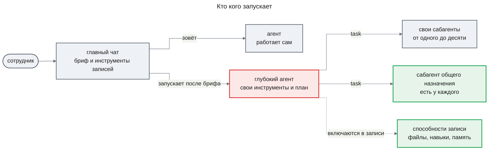
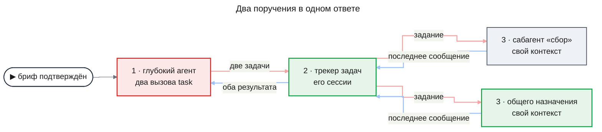

# PRD: Глубокие агенты (deep-agents)

| Date | Depth |
|---|---|
| 2026-11-22 | full |

## Snapshot

**Overview.** Глубокий агент — общий вид агента в библиотеке Agent OS, устроенный по образцу LangChain Deep Agents: у него свой промпт и инструменты, свои изолированные сабагенты и план запуска. Первая часть построена: глубокий агент заменил workflow и ведёт план, а сотрудник создаёт и правит записи словами в главном чате. Следующие части добавляют остальные способности Deep Agents: поручение сабагентам одним инструментом `task`, в том числе по одному сабагенту на пункт списка, общие файлы запуска, навыки и файл памяти. Каждая способность включается в записи, поэтому глубокий агент остаётся общим типом, а отчёты вроде утреннего брифа для сотрудников владелец потом соберёт на нём сам.

- **Не меняется**: запуск из чата через подтверждение брифа, права сотрудника на каждый вызов, ход агента кончается текстом, кроме ответа с полями результата (FR-33).
- **Не входит**: зависимости между задачами и стартовые задачи в записи, встроенные сценарии кроме глубокого ресерча, запуск по расписанию, бюджет токенов на запуск.
- **Части**: `agent-types` (построена) → `task` (следующая) → `files` → `skills-memory`.
- **Главный риск**: поручение по списку может разом запустить десятки сабагентов, а бюджета на один запуск нет.
- **Открытые вопросы**: три, в [Undetermined Items](#undetermined-items).

## Terms

- **Агент** — запись библиотеки: промпт, MCP-серверы, модель, предел шагов.
- **Сабагент** — агент внутри записи глубокого агента, как субагент в Claude Code: имя, описание «когда меня звать», промпт, серверы, модель, предел шагов. Работает в своём контексте и видит только своё задание.
- **Последнее сообщение** — последний текст сабагента без вызовов инструментов; оно становится результатом поручения.
- **Запуск** — одна работа глубокого агента от брифа до ответа, вместе с его сабагентами.
- **План** — необязательный список пунктов, который глубокий агент ведёт инструментом `task_list`. Это заметка самого агента, а не задания сабагентам.
- **Поручение** — вызов инструмента `task`: глубокий агент отдаёт работу сабагенту и получает его последнее сообщение. **Поручение по списку** — одна инструкция, которую платформа выполняет отдельным сабагентом на каждый пункт списка.
- **Задача** — один запуск сабагента по поручению; поручение по списку даёт по задаче на каждый пункт.
- **Трекер задач** — механизм рантайма, который ведёт поручения одной сессии: запускает сабагентов, ждёт их и будит сессию.
- **Карточка подтверждения** — карточка в беседе перед изменяющим вызовом; вызов выполняется, только когда сотрудник её одобрил.
- **Бриф** — вопрос, границы и форма результата, которые сотрудник подтверждает в чате до запуска.
- **Модель класса Haiku** — малая дешёвая модель, на которой платформа держит рабочие роли.

## Background

До этой фичи длинную работу в библиотеке описывал workflow — координатор без своих инструментов, который держал план в памяти модели и раздавал задания исполнителям. Часть `agent-types` заменила его глубоким агентом. Цель шире: глубокий агент должен уметь то же, что LangChain Deep Agents, чтобы на нём собирались сценарии отчётов для сотрудников.

[LangChain Deep Agents](https://docs.langchain.com/oss/python/deepagents/overview) ([код](https://github.com/langchain-ai/deepagents)) — библиотека, которая превращает обычный цикл модели в агента для долгой работы. Её держат шесть приёмов:

- сабагент работает в изолированном контексте и возвращает одно последнее сообщение;
- файлы служат внешней памятью, общей для агента и сабагентов, а большие результаты инструментов уходят в файлы, а не в контекст;
- длинный контекст сжимается;
- поведение модели задают описания инструментов и ошибки с кодом;
- когда важна полнота, обход списка ведёт код, а не модель;
- каждая способность — отдельный модуль, который включают или не включают.

Инструмент плана в библиотеке необязателен, и ничто не заставляет агента выполнить свой список. Планировщика, прав пользователей, бюджетов и интерфейса в ней нет, а в Agent OS права и интерфейс уже есть, как и сжатие контекста и хранение больших результатов по ссылке.

### Агент, глубокий агент и сабагенты

У сабагентов нет инструмента `task`, поэтому работа идёт не глубже двух уровней.

### Одно поручение

Глубокий агент не тратит шаги на ожидание: трекер будит его один раз, когда закончились оба сабагента.

### Поручение по списку

```mermaid
---
title: "Один сабагент на каждый пункт списка"
config:
  theme: base
  look: classic
  themeVariables:
    primaryColor: "#eef1f5"
    primaryBorderColor: "#4b5563"
    primaryTextColor: "#1a1a1a"
    lineColor: "#6b7280"
  flowchart:
    curve: step
  themeCSS: |
    @keyframes lit_dl2{0%,22.5%{stroke:#991b1b;stroke-width:6px}25%,100%{stroke:#f4a5a5;stroke-width:2px}}
    @keyframes litr_dl2{0%,22.5%{stroke:#1d4ed8;stroke-width:6px}25%,100%{stroke:#9ec1f7;stroke-width:2px}}
---
flowchart LR
    entry(["▶ список из N пунктов"])
    deep["1 · глубокий агент<br/>один вызов task"]
    tracker["2 · трекер задач<br/>обходит список"]
    subs["3 · сабагент × N<br/>по одному на пункт"]
    entry --> deep
    deep e1@-->|"инструкция и список"| tracker
    tracker e2@-->|"задание на пункт"| subs
    subs e3@-->|"ответ на пункт"| tracker
    tracker e4@-->|"таблица пунктов"| deep
    classDef entry fill:#ffffff,stroke:#1f2937,stroke-width:1.5px,color:#1a1a1a
    classDef changed fill:#fde8e8,stroke:#dc2626,stroke-width:2px,color:#1a1a1a
    classDef new fill:#e6f4ea,stroke:#16a34a,stroke-width:2px,color:#1a1a1a
    classDef unchanged fill:#eef1f5,stroke:#4b5563,stroke-width:1.5px,color:#1a1a1a
    classDef w1 stroke:#f4a5a5,stroke-width:2px,animation:lit_dl2 4.8s linear 0s infinite
    classDef w2 stroke:#f4a5a5,stroke-width:2px,animation:lit_dl2 4.8s linear 1.2s infinite
    classDef r3 stroke:#9ec1f7,stroke-width:2px,animation:litr_dl2 4.8s linear 2.4s infinite
    classDef r4 stroke:#9ec1f7,stroke-width:2px,animation:litr_dl2 4.8s linear 3.6s infinite
    class entry entry
    class deep changed
    class tracker,subs new
    class e1 w1
    class e2 w2
    class e3 r3
    class e4 r4
```

Список обходит код, а не модель: малая модель из тридцати тикетов может забыть пять, а код не забудет ни одного.

## Users and Use Cases

### Users

- **Сотрудник** — запускает глубоких агентов из чата и читает ответ; ему важно, чтобы работа не терялась и не шла сверх его прав.
- **Автор записи** — сотрудник или администратор, который описывает агента в чате и одобряет собранную запись.
- **Владелец платформы** — собирает на глубоком агенте сценарии отчётов и разбирает запуски.

### Use Cases

- **UC-1**: Автор описывает в чате глубокого агента → видит схему и сохраняет после подтверждения, без формы и кода.
- **UC-2**: Сотрудник запускает глубокого агента → видит план и поручения со статусами и понимает, на каком шаге работа.
- **UC-3**: Глубокому агенту нужно разобрать тридцать тикетов → он поручает это одним вызовом, на каждый тикет работает свой сабагент, и ни один не пропущен.
- **UC-4**: Сотрудник задаёт глубокий вопрос → глубокий ресерч делит его на направления, поручает сбор по каждому и отвечает по всем.
- **UC-5**: Владелец собирает на глубоком агенте отчёт для сотрудников → включает файлы, навыки и память и обходится без нового кода.
- **UC-6**: Владелец разбирает неудачный запуск → по вкладке «Задачи» и журналу видит, какое поручение кому ушло и чем кончилось, и знает, какой промпт править.

## Functional Requirements

### Must Have (MVP)

#### Глубокий агент — часть `agent-types` (построена)

- **FR-01. Глубокий агент вместо workflow.** Вид записи «глубокий агент»: имя, описание, промпт, MCP-серверы, модель, предел шагов, от одного до десяти сабагентов, необязательный финальный сабагент и флажок самообучения; у сабагента есть ещё предел запусков за запуск, не больше 20. Вида «workflow» больше нет.
  - AC-01.1: Given сотрудник открывает библиотеку или просит чат создать запись, then видами записей названы только «агент» и «глубокий агент».
  - AC-01.2: Given чат создал глубокого агента с двумя сабагентами, then запись есть в библиотеке, и чат может предложить её к запуску.

- **FR-02. Свои изолированные сабагенты.** Глубокий агент работает своими инструментами и отдаёт часть работы только сабагентам своей записи и сабагенту общего назначения (FR-32), выбирая их по описаниям. Сабагент начинает с чистого контекста: видит своё задание, а не историю глубокого агента.
  - AC-02.1: Given глубокий агент пытается отдать работу агенту библиотеки, которого нет в его записи, then платформа отказывает с причиной, и ничего не запускается.
  - AC-02.2: Given глубокий агент отдал работу сабагенту, then в истории сабагента только его задание, а глубокий агент получает только его результат.
  - AC-02.3: Given в записи глубокого агента есть MCP-сервер, when глубокий агент сам вызывает его инструмент, then вызов идёт по правам запустившего сотрудника.

- **FR-03. Запуск из чата через бриф.** Глубокого агента запускает только главный чат и только после того, как сотрудник подтвердил бриф. Другие агенты глубоких агентов не запускают.
  - AC-03.1: Given чат запускает глубокого агента, then сотрудник видит бриф, а агент стартует только после подтверждения.
  - AC-03.2: Given другой агент пытается запустить глубокого агента, then платформа отказывает, и ничего не запускается.

- **FR-04. План запуска.** Глубокий агент может вести план инструментом `task_list`: добавлять пункты и переводить их в «в работе», «готова» или «отменена». Код показывает план модели на каждом шаге и никого по нему не запускает. Рестарт и продолжение работы сообщением план не теряют.
  - AC-04.1: Given глубокий агент добавил три пункта и первый перевёл в «в работе», when сотрудник открывает вкладку «Задачи», then видит три пункта и их статусы.
  - AC-04.2: Given у запуска есть план, when сервер перезапустился или сотрудник продолжил работу сообщением, then план тот же, с теми же статусами.

- **FR-05. Ответ финального сабагента.** Если в записи назван финальный сабагент, запуск кончается только его законченным отчётом, и этот отчёт без пересказа становится ответом в беседе.
  - AC-05.1: Given финальный сабагент назван, when глубокий агент отвечает раньше его отчёта, then ответ не принят, а агент получает уведомление, что нужен отчёт финального сабагента.
  - AC-05.2: Given финальный сабагент закончил работу отчётом, then сотрудник получает этот отчёт как ответ запуска.

- **FR-06. Инструменты записей в главном чате.** Сотрудник управляет записями словами, а только главный чат — пятью инструментами записей: список (с пометкой, чья запись), чтение полного определения, создание, правка и удаление. Изменения выполняются только после карточки подтверждения и касаются только своих записей сотрудника, никому не открытых; администратор так же меняет системные, но встроенные не удаляет. Открыть запись другим и включить самообучение может только человек.
  - AC-06.1: Given чат вызывает создание, then сотрудник видит карточку с определением, а в библиотеке ничего не появляется до его одобрения.
  - AC-06.2: Given сотрудник отклонил карточку, then запись не изменена, а чат получает отказ.
  - AC-06.3: Given запись чужая, открыта ролям или системная, а сотрудник не администратор, when чат вызывает правку или удаление, then инструмент отказывает с причиной до карточки.
  - AC-06.4: Given в записи назван сервер, на который у сотрудника нет права, when чат её создаёт, then инструмент отказывает, и записи нет.
  - AC-06.5: Given глубокий агент или сабагент работает в беседе, then инструментов записей у него нет.
  - AC-06.6: Given администратор одобрил карточку правки системного глубокого ресерча, then сотрудники с доступом видят новую версию.

- **FR-07. Глубокий ресерч — встроенный глубокий агент.** Встроенный глубокий ресерч — глубокий агент с сабагентами плана, сбора и ответа; ответ — финальный сабагент. Сотрудник запускает его так же, как раньше. Это единственный встроенный сценарий.
  - AC-07.1: Given сотрудник задаёт глубокий вопрос и подтверждает бриф, then работают план, сбор по направлениям и ответ, и ответ приходит в беседу.

- **FR-08. Самообучение у глубоких агентов.** Флажок самообучения и граф знаний работают у глубокого агента так же, как раньше у workflow ([self-learning](../self-learning/prd.md)). У обычного агента флажка нет.
  - AC-08.1: Given у глубокого агента включено самообучение, when запуск закончился, then в его графе знаний появляются новые записи.

- **FR-26. Чат сам выбирает MCP-серверы.** Чат выбирает серверы агенту и каждому сабагенту из доступных сотруднику и даёт каждому только нужные: малая модель хуже выбирает инструмент, когда их много. Сотрудник может попросить добавить или убрать сервер. Каждый вызов проверяется по правам запустившего.
  - AC-26.1: Given у сотрудника пять серверов, и он просит агента для разбора ночных логов, then у сабагента сбора в схеме сервер логов и нет ненужных. Проверка ручная.
  - AC-26.2: Given запись сотрудника A называет сервер, на который у запустившего сотрудника B нет права, when сабагент вызывает его инструмент, then платформа отказывает по правам B.

- **FR-27. Ошибка в записи объясняется чату.** Запись с ошибкой — больше десяти сабагентов, финальный сабагент вне команды, пустой промпт — инструмент не сохраняет и называет чату поле и нарушенное правило, чтобы чат исправил запись сам.
  - AC-27.1: Given чат создаёт глубокого агента с одиннадцатью сабагентами, then инструмент отказывает до карточки и называет поле команды и предел в десять сабагентов.

- **FR-28. Панель «Схема».** Рядом с беседой панель показывает запись, которую чат последней прочитал, создал или изменил: агента и сабагентов с описаниями и серверами. Панель только показывает и после правки сразу рисует новую версию, а во время запуска из беседы — его план.
  - AC-28.1: Given чат создал глубокого агента с тремя сабагентами, then рядом с беседой видна схема с ним и тремя сабагентами.
  - AC-28.2: Given сотрудник одобрил правку, которая убирает сабагента, then схема показывает запись без него без перезагрузки страницы.
  - AC-28.3: Given запуск идёт, then в панели виден план запуска со статусами.

- **FR-29. Карточка глубокого агента в библиотеке.** В библиотеке и панели администратора глубокий агент открывается карточкой только для чтения со схемой и всеми текстами. С карточки запись открывают ролям и закрывают, копируют, удаляют, переключают самообучение; изменить её просят чат. Редактор обычного агента остаётся.
  - AC-29.1: Given сотрудник открывает своего глубокого агента в библиотеке, then видит схему и тексты, и ни одно поле не правится.
  - AC-29.2: Given сотрудник открыл свою запись роли с карточки, then сотрудник этой роли видит её в библиотеке.
  - AC-29.3: Given запись открыта ролям, when владелец закрывает её с карточки и просит чат поправить, then чат меняет её после карточки подтверждения.

#### Поручение `task` — часть `task` (следующая)

- **FR-30. Одно поручение.** Глубокий агент поручает работу одним инструментом `task`: называет сабагента и описывает задание. Сабагент работает в своём контексте, а его последнее сообщение возвращается результатом того же вызова. Несколько поручений в одном ответе работают одновременно, и агент видит все результаты вместе. `task` заменяет прямой запуск сабагента по имени: другого способа поручить нет.
  - AC-30.1: Given глубокий агент в одном ответе сделал два вызова `task`, then оба сабагента работают одновременно, а агент получает следующий ход один раз, с двумя результатами.
  - AC-30.2: Given сабагент закончил работу, then результат вызова — его последнее сообщение, а в истории сабагента только его задание.
  - AC-30.3: Given глубокий агент, then среди его инструментов нет прямого запуска сабагента по имени.

- **FR-31. Поручение по списку.** Глубокий агент называет сабагента, одну инструкцию и список прямо в вызове. Список обходит платформа и запускает по одному сабагенту на пункт, так что каждый пункт покрыт. Агент получает короткую таблицу: пункт, статус, ответ.
  - AC-31.1: Given список из пяти пунктов, then работают ровно пять сабагентов, и в таблице пять строк.
  - AC-31.2: Given один из пяти сабагентов кончился сбоем, then его строка в статусе «сбой» с причиной, а остальные четыре — с ответами.

- **FR-32. Сабагент общего назначения; сабагенты не поручают дальше.** У каждого глубокого агента рядом с его сабагентами есть сабагент общего назначения с инструментами самого глубокого агента, кроме `task`: сабагенты дальше не поручают.
  - AC-32.1: Given в записи только сабагент «сбор», when глубокий агент поручает сабагенту общего назначения, then тот работает и возвращает результат.
  - AC-32.2: Given сабагент работает, then инструмента `task` среди его инструментов нет.

- **FR-33. Поля результата.** Поручение может назвать поля, которые сабагент должен вернуть. Платформа проверяет ответ, и сабагент, получив ошибку с именем поля, исправляет его; повторы останавливает предел шагов сабагента.
  - AC-33.1: Given поручение требует поля «вывод» и «источники», when сабагент отвечает без «источников», then он получает ошибку с этим полем и отвечает снова, а результат несёт оба поля.
  - AC-33.2: Given сабагент исчерпал предел шагов, так и не вернув поля, then поручение кончается сбоем с причиной.

- **FR-34. Трекер задач в рантайме.** Поручения сессии ведёт трекер задач рантайма. Сессию он будит один раз, когда закончились все её задачи, а рестарт сервера не теряет и не удваивает ни одной задачи. Остановка сессии отменяет её незаконченные задачи, а сбой задачи сообщается сессии и не роняет её. Трекер изолирован: его видит только сессия, которая его открыла.
  - AC-34.1: Given поручение принято, а сабагент его задачи ещё не стартовал, when сервер перезапускается, then этот сабагент стартует ровно один раз.
  - AC-34.2: Given сабагент задачи в работе, when сервер перезапускается, then работа продолжается в том же запуске сабагента, второго нет.
  - AC-34.3: Given две задачи в работе, when сотрудник останавливает глубокого агента, then оба сабагента остановлены, обе задачи «отменена», новых запусков нет.
  - AC-34.4: Given сабагент кончился ошибкой, then глубокий агент получает результат «сбой» с причиной и работает дальше.
  - AC-34.5: Given сессии двух сотрудников поручают одновременно, then ни одна не видит задач и результатов другой.

- **FR-35. Права и вкладка «Задачи».** Сабагент, запущенный через `task`, не может ничего, чего не может тот, кто его запустил: каждый вызов проверяется по правам сотрудника, изменяющий ждёт его подтверждения. На вкладке «Задачи» сотрудник видит поручения запуска: сабагента, задание, статус, результат и переход к работе сабагента.
  - AC-35.1: Given у сотрудника нет права на инструмент X, when сабагент вызывает X, then платформа отказывает, аудит пишет отказ, а сервер не вызывается.
  - AC-35.2: Given запуск принадлежит сотруднику A, when сотрудник B запрашивает его задачи, then B не получает ни одной.
  - AC-35.3: Given у запуска поручения разных статусов, when сотрудник открывает вкладку «Задачи», then видит у каждого сабагента, статус и результат и может открыть работу сабагента.

- **FR-36. Способности включаются в записи.** План и поручение по списку включаются в записи глубокого агента. Когда способность выключена, у агента нет ни её инструмента, ни её правил в промпте. Так же включаются способности частей `files` и `skills-memory` (FR-40, FR-50, FR-51).
  - AC-36.1: Given в записи план выключен, then у глубокого агента нет `task_list`, и плана на вкладке «Задачи» нет.

#### Файлы запуска — часть `files`

- **FR-40. Общие файлы запуска.** Глубокий агент и его сабагенты могут смотреть список файлов запуска, читать, писать, править и искать в них. Файлы принадлежат запуску: их видят только агенты этого запуска и его сотрудник. Способность включается в записи.
  - AC-40.1: Given сабагент записал файл, then глубокий агент того же запуска читает его.
  - AC-40.2: Given файл записан в запуске сотрудника A, then ни другой запуск, ни сотрудник B его не видят.

- **FR-41. Большие результаты в файлах.** Большой результат инструмента платформа сама кладёт в файл запуска, а агент получает короткую справку с именем файла и читает его по страницам. Сегодняшние инструменты чтения сохранённых результатов (`read_tool_result`, `search_tool_result`) этим заменяются и удаляются.
  - AC-41.1: Given инструмент вернул результат больше порога, then в контексте агента справка с именем файла, а весь текст читается по страницам.
  - AC-41.2: Given часть построена, then инструментов чтения сохранённых результатов нет.

- **FR-42. Списки и длинные ответы в файлах.** Поручение по списку может взять список из файла запуска. Длинный ответ сабагента платформа кладёт в файл, а в таблице поручения стоит ссылка на этот файл.
  - AC-42.1: Given в файле запуска список из десяти пунктов, when глубокий агент поручает по нему, then работают десять сабагентов.
  - AC-42.3: Given поручение по списку ссылается на файл другого запуска, then поручение отклонено с причиной, и никто не запущен.
  - AC-42.2: Given ответ сабагента длиннее порога, then в таблице ссылка на файл с полным ответом.

#### Навыки и память — часть `skills-memory`

- **FR-50. Навыки.** Агент может пользоваться навыками — описанием, когда навык нужен, и текстом инструкций: он видит только описания и загружает весь текст, когда навык подходит к работе. Навыки задаёт чат инструментами записей (FR-06), а способность включается в записи. Где хранится навык — в записи агента или отдельной записью библиотеки — открытый вопрос.
  - AC-50.1: Given у агента навык «разбор инцидента», then до загрузки в его контексте только описание навыка.
  - AC-50.2: Given агент загрузил навык, then текст навыка стоит в его контексте, и агент работает по нему.

- **FR-51. Файл памяти.** У агента есть файл памяти, который всегда стоит в его контексте, и агент может его дополнить. Чья это память и кто её видит — открытый вопрос. Способность включается в записи.
  - AC-51.1: Given агент дополнил файл памяти, when тот же сотрудник запускает того же агента снова, then дополнение стоит в контексте нового запуска.

### Should Have

- **FR-09. Напоминание об открытых пунктах плана** (часть `agent-types`, построена). Когда глубокий агент отвечает текстом, а в его плане есть пункты «ожидает» или «в работе», ответ не принимается, и агент получает уведомление с этими пунктами. Бесконечную петлю останавливает предел шагов.
  - AC-09.1: Given в плане пункт «в работе», when глубокий агент отвечает текстом, then ответ не принят, а агент видит уведомление с этим пунктом.
  - AC-09.2: Given все пункты «готова» или «отменена», when глубокий агент отвечает текстом, then ответ принят.

### Could Have

Нет.

### Won't Have

- Зависимости между задачами, финальная задача, обязательные исполнители и стартовые задачи в записи — остановлены: в модели Deep Agents их нет.
- Встроенные сценарии кроме глубокого ресерча, в том числе утренний бриф, — бриф был примером, такие сценарии владелец соберёт сам.
- Запуск по расписанию и доставка отчёта — отдельная фича позже: для отчётов она нужна, но планировщика нет, а запуск без сотрудника требует своих решений о правах.
- Вызов сабагентов из `run_code` — поручать можно только через `task`.
- Редактор-форма глубокого агента («расширенный режим») — отдельная фича; здесь запись правят словами в чате.
- Самообучение, которое меняет агентов, — отдельная фича; здесь самообучение наполняет только граф знаний.
- Выписки, которые привязывают утверждения к цитатам из источников, — решение отложено до первых сценариев отчётов.
- Профили промптов под отдельные модели — не нужны, пока все роли идут на одном классе моделей.
- Бюджет токенов на запуск — не эта фича; риск разлёта описан в Risks.
- Глубокий агент в роли сабагента — нет: сабагенты не поручают дальше (FR-32).

## Non-Functional Requirements

### Observability

- **NFR-01** (часть `task`): каждое событие поручения — принято, отклонено, стартовало, закончилось, сбой, отменено — пишется одной записью журнала через обёртку логгера `packages/common`: id запуска, сессии, задачи, сабагента, сотрудника, статус, причина, длительность. Секретов и токенов в записях нет. Проверка — поручение по списку: на каждое событие каждого пункта в журнале ровно одна запись.

## Delivery Parts

| Part | Covers | Cut along | Depends on | Rationale |
|------|--------|-----------|------------|-----------|
| `agent-types` | FR-01 – FR-09, FR-26 – FR-29 | domain | — | Построена: вид записи, план, инструменты записей и их экраны |
| `task` | FR-30 – FR-36, NFR-01 | domain | `agent-types` | Поручение — механизм рантайма поверх команды сабагентов |
| `files` | FR-40 – FR-42 | domain | `task` | Файлы делят агенты запуска, а списки и длинные ответы поручений живут в них |
| `skills-memory` | FR-50, FR-51 | domain | `files` | Навыки и память — тексты в контексте агента, их удобно держать рядом с файлами |

Что владелец запускает и видит после каждой части:

- **`agent-types`** (построена) — описывает в чате глубокого агента, одобряет карточку, видит схему рядом с беседой, запускает его и следит за планом на вкладке «Задачи»; встроенный глубокий ресерч работает как глубокий агент. Проверено: все автоматические наборы тестов проходят на свежей базе. Не проверено: запусков на настоящей модели ещё не было, а интерфейс не смотрели в браузере.
- **`task`** — глубокий агент поручает одному сабагенту, нескольким сразу и по списку; вкладка «Задачи» показывает каждое поручение и пункт со статусом и ответом.
- **`files`** — сабагент пишет файл, глубокий агент его читает; большой результат инструмента читается из файла по страницам; список для поручения берётся из файла.
- **`skills-memory`** — агент загружает навык, когда тот подходит к работе, и помнит в следующем запуске то, что записал в память.

## Success Criteria

Стенда оценки в проекте нет (project-context, бизнес-ограничение 6): владелец проверяет вручную.

- **Малая модель ведёт весь запуск.** Десять запусков встроенного глубокого ресерча на постоянном списке вопросов с моделью класса Haiku во всех ролях, включая самого глубокого агента, дают ответ в каждом запуске, где сбор нашёл данные. Качество ответов владелец оценивает вручную, стоимость читается из журнала токенов (бизнес-ограничение 7). Проверка платная, после выпуска части `task`.
- **Поручение по списку покрывает каждый пункт.** Поручение по списку не меньше чем из 30 пунктов запускает ровно одного сабагента на пункт: ни один не пропущен и ни один не запущен дважды. Читается на вкладке «Задачи» и в журнале, после выпуска части `task`.

## Constraints and Risks

### Constraints

- **PoC без совместимости.** Старые форматы и инструменты удаляются сразу, данные не переносятся, базу разработки пересоздают.
- **Один владелец долгих задач.** Поручения запускает и восстанавливает после рестарта только рантайм `packages/runtime` (ADR-0001, ADR-0004); второго планировщика нет.
- **Настройки в базе**, новых переменных окружения нет.
- **Ход кончается текстом** ([design-agents.md](../agent-platform/design-agents.md), KD-2), кроме ответа на поручение, которое назвало поля результата (FR-33).
- **Код не судит текст.** Платформа сравнивает имена, статусы и пункты списка и не оценивает смысл задания или ответа.
- **Права, аудит и изоляция** (бизнес-ограничения 1–3). Каждый агент и сабагент работает по правам запустившего сотрудника, каждый вызов пишется в аудит, а запуск и его задачи видит только его владелец. Граф знаний глубокого агента общий для всех его запусков, как раньше у workflow ([self-learning/prd.md](../self-learning/prd.md), Constraints).
- **Бюджет запуска** (бизнес-ограничение 4) не выполняется: расход ограничивает только месячная квота сотрудника.

### Assumptions

- Модель класса Haiku в роли глубокого агента выбирает между одним поручением и поручением по списку и выбирает сабагента по описанию. Проверка — прогон ресерча на Haiku во всех ролях (Success Criteria).

### Risks

- **Разлёт поручений.** Поручение по списку может разом запустить десятки сабагентов: растёт расход, а MCP-сервер может начать отказывать по частоте запросов. Тормоза — предел шагов, подтверждение брифа и месячная квота; бюджета на запуск нет.
- **Инъекция через данные.** Текст тикета или лога может попасть в задание сабагенту. Сабагенты работают только по правам сотрудника, а изменяющие вызовы ждут его подтверждения.
- **Инъекция в сохранённую запись.** Текст из результата инструмента может подтолкнуть чат вписать чужую инструкцию в промпт или навык. Защита — карточка подтверждения с полным определением (FR-06); остаётся риск, что сотрудник одобрит длинное определение не читая.
- **Перегрузка инструментами.** Малая модель путается, когда инструментов много. Чат даёт только нужные серверы (FR-26), но сабагент общего назначения получает все инструменты глубокого агента, так что лишний сервер в записи вредит дважды.

## Undetermined Items

- **Предел запусков сабагента против поручения по списку.** Сегодня у сабагента не больше 20 запусков за запуск (FR-01), а критерий успеха требует списка из 30 пунктов. Блокирует: правило счёта в дизайне части `task`. Решает: владелец. Рекомендация: поручение по списку не считать в этот предел, а длину списка ограничить отдельной настройкой в базе.
- **Чья память.** Файл памяти может быть свой у каждого сотрудника или общим для всех запусков агента, как граф знаний; общий смешивает данные сотрудников. Блокирует: FR-51 и дизайн части `skills-memory`. Решает: владелец.
- **Где живут навыки.** Навык может быть частью одной записи или отдельной записью библиотеки, которую подключают разные агенты. Блокирует: FR-50 и дизайн части `skills-memory`. Решает: владелец.

## Update History

| Version | Date | Change |
|---------|------|--------|
| 1.0 | 2026-11-21 | Initial version |
| 1.1 | 2026-11-21 | Записи создаются и правятся в чате пятью инструментами с карточкой подтверждения; серверы выбирает чат; панель схемы; карточка записи вместо редактора; черновик записи и редактор-форма глубокого агента убраны |
| 1.2 | 2026-11-21 | Список задач снова открыт после сбоя или отмены финальной задачи; судьба workflow-записей при выкатке решена; предел запусков сабагента — до 20, вопрос закрыт |
| 1.3 | 2026-11-22 | Данные не переносятся, базу разработки пересоздают: обещание сохранить граф глубокого ресерча (AC-08.2) и риск потери workflow-записей сняты, базовая линия ресерча записывается вне базы |
| 1.4 | 2026-11-22 | Утренний бриф снят как пример (FR-23, UC-3, его путь); выписки FR-25, слово «флоу» в списках, двуязычные описания, ссылка сабагента на задачу — в Won't Have; глубокий агент получает ход только при сбое или конце задач; стартовые задачи стартуют при создании запуска; обязательные до финальной сабагенты; зависимость внутри одного вызова; ресерч на Haiku во всех ролях в Success Criteria |
| 1.5 | 2026-11-22 | Цель — общий глубокий агент по образцу Deep Agents; части `tasks` и `flows` (FR-10 – FR-22, FR-24) остановлены; новые части `task` (FR-30 – FR-36), `files` (FR-40 – FR-42), `skills-memory` (FR-50, FR-51); `agent-types` отмечена построенной; диаграммы сокращены до трёх |
