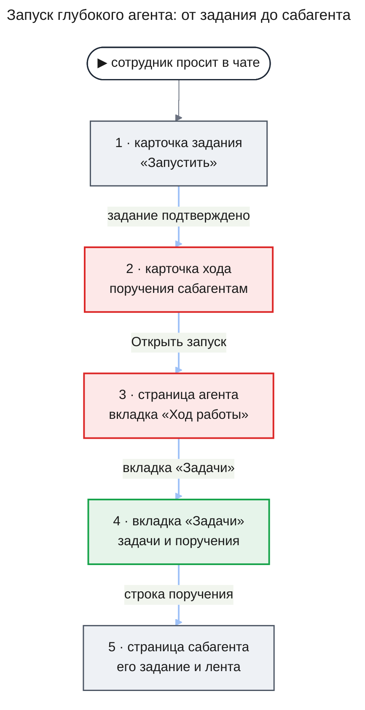

# UXRD: Глубокие агенты (deep-agents)

| Date | PRD |
|---|---|
| 2026-11-22 | [prd.md](./prd.md), версия 1.7 |

## Snapshot

**Overview.** В библиотеке два вида записей: агент и глубокий агент. Глубокого агента сотрудник создаёт и правит словами в чате: чат собирает запись и перед каждым изменением показывает карточку подтверждения с определением целиком. Справа от беседы панель «Схема» рисует запись, о которой идёт речь, а её вкладка «Задачи» показывает список задач самой беседы. У глубокого агента своя страница: на вкладке «Ход работы» его лента, на вкладке «Задачи» его список задач и поручения сабагентам. Всё это сотрудник только читает, а изменить запись или список просит чат.

- **Не меняется**: карточка задания перед запуском, лента беседы, подтверждение изменяющих вызовов, редактор обычного агента, страница сабагента.
- **Главный UX-риск**: сотрудник одобряет длинное определение, не читая. Защищают заголовок карточки, который называет действие словами, пометки у изменённого в правке и схема, которая сразу показывает результат (KD-6, KD-7).
- **Открытых вопросов нет.**

### Key Decisions

| ID | Решение | Почему |
|---|---|---|
| KD-1 | Вид записи называется «глубокий агент» везде, где интерфейс называет вид (MC-21). Формы у глубокого агента нет: «Заполнить форму» создаёт только агента | Глубокого агента правят словами в чате (PRD, Won't Have) |
| KD-2 | Слова интерфейса: «задача» — пункт списка задач, «поручение» — работа, отданная сабагенту. В английском каталоге задание перед запуском — “Brief”, а “Task” — только задача списка; по-русски это «Задание» | На одной странице не встретятся два “Task” с разным смыслом |
| KD-3 | Список задач стоит там, где видна его сессия: список беседы — на вкладке «Задачи» панели, список глубокого агента — на вкладке «Задачи» его страницы | Сотрудник видит список той сессии, которая перед ним (FR-15). Одно правило: не надо угадывать, чей список открыт |
| KD-4 | Список только читается и меняется вживую. Строка — номер, тема и статус словом; рядом текст «в работе», «ждёт {номера}» и исполнитель; описание раскрывается на месте | Десятки задач читаются одним взглядом. Правку сотрудник просит у чата (AC-15.3) |
| KD-5 | Номер задачи даёт платформа; он не пересчитывается. «Ждёт 1, 3», строка события и метка «задача 3» у поручения называют задачу номером | Номер человек читает и называет чату, и он связывает список, ленту и поручения |
| KD-6 | Запись меняется только через карточку решения, вариант «Запись»: заголовок называет действие словами, тело показывает определение целиком, в правке помечено изменённое. Отказ инструмента записей — блок вызова в ленте | Сотрудник одобряет то, что прочитал (FR-05; PRD, Risks). Ошибку в записи исправляет чат (FR-09) |
| KD-7 | Панель «Схема» — рабочая область оболочки (chat-shell UXRD, WS-01) под новым именем, с вкладками «Схема» и «Задачи». Схема — определение записи столбцом. От 1024 px панель открывается сама, когда запись создана или изменена и когда у беседы появилась первая задача; уже 1024 px она — шторка по кнопке «Схема» | Столбец читается на 360 px и скринридером. Шторка сама не открывается, чтобы не закрыть беседу. Меняет chat-shell UXRD, D-05 и WS-01 |
| KD-8 | Поручения стоят на вкладке «Задачи» страницы глубокого агента вторым разделом, под списком задач: строка на каждого сабагента, у поручения по списку — на каждый пункт. Строка ведёт на страницу сабагента | Оба раздела отвечают на один вопрос: что агент делает сейчас (UC-2). За тридцатью пунктами следят по сводке и статусам строк, третья вкладка для этого не нужна |

### Ещё не спроектировано

- Блокнот: заметки беседы и запуска, которые сотрудник только читает (FR-25 – FR-28).
- Память между запусками (FR-29).

## Terms

Термины продукта — в PRD, раздел Terms; здесь — слова интерфейса.

- **Схема** — панель справа от беседы и её содержимое: запись в фокусе, нарисованная столбцом (KD-7).
- **Запись в фокусе** — последняя запись, которую чат в этой беседе прочитал, создал или изменил.
- **Ход работы** — вкладка страницы глубокого агента с его лентой.
- **Задание** — бриф: вопрос, границы и результат, которые сотрудник подтверждает перед запуском (custom-agents UXRD, Terms).

## Design System

Фича следует [дизайн-системе](../../design-system/README.md). Библиотека, карточки в беседе и схема — комфортная плотность; список задач и поручения — компактная ([foundations → Spacing & Density](../../design-system/foundations.md#spacing--density)).

### Component Inventory

Поиск шёл по `docs/design-system/components/` и `apps/web/src/components/` (`agents`, `library`, `shell`). Новых компонентов нет: поручения — вариант списка задач.

| Компонент | Статус | Что меняется |
|---|---|---|
| [Список задач](../../design-system/components/run-task-list.md) | extended | Вариант «Задачи» — три статуса, «ждёт», исполнитель; вариант «Поручения» |
| [Статус агента](../../design-system/components/agent-status.md) | extended | Три статуса задачи, четыре статуса поручения |
| [Определение записи](../../design-system/components/definition-view.md) | extended | Варианты «Схема» и «Правка», строка «Способности» |
| [Карточка решения](../../design-system/components/decision-card.md) | extended | Вариант «Запись» |
| [Карточка хода](../../design-system/components/agent-run-card.md) | extended | Шаги глубокого агента — его поручения |
| [Дерево агентов](../../design-system/components/agent-tree.md) | extended | Сабагенты с текстом поручения |
| [Строка библиотеки](../../design-system/components/library-row.md) | extended | Вид «глубокий агент», «Доработать в чате» |
| [Метка состояния](../../design-system/components/state-badge.md) | extended | «изменено», «новый», «пишет ответ» |
| [Отчёт агента](../../design-system/components/agent-report.md) | extended | Вариант «Глубокий агент» |
| [Вызов инструмента](../../design-system/components/tool-call.md) | reused | Инструменты записей, задач и `task` |
| [Окно «Поделиться»](../../design-system/components/share-dialog.md), [подпись записи](../../design-system/components/record-label.md) | reused | — |
| Рабочая область, chat-shell UXRD, WS-01–WS-03 | extended | Имя «Схема», вкладки, шторка (KD-7) |
| Страница агента, agent-platform UXRD, AV-01–AV-06 | extended | Вкладки глубокого агента (DA-04) |

## User Flows

### Primary User Flow

**Implements:** UC-1; AC-01.2, AC-05.1, AC-05.2, AC-08.1, AC-10.1, AC-10.2

Сотрудник описывает глубокого агента словами и видит его схему рядом с беседой.


- Сотрудник пишет обычным сообщением, например «сделай как глубокий ресерч, но только по внутренней документации». Каждый вызов инструмента записей — блок вызова в ленте с подписью MC-23, а прочитанная запись встаёт в схему.
- Чат сам выбирает системы каждому сабагенту; лишнюю систему сотрудник просит убрать словами. После сохранения системы каждого сабагента видны на схеме (AC-08.1).
- Создание, правка и удаление встают карточкой подтверждения DA-11, и библиотека не меняется, пока сотрудник её не одобрил (AC-05.1, AC-05.2). После одобрения панель от 1024 px открывается сама и показывает новую версию без перезагрузки (AC-10.1, AC-10.2).
- Следующий шаг — «Использовать в чате» на карточке: запись встаёт чипом в поле сообщения, и следующей фразой сотрудник её запускает (AC-01.2).

### Alternative Flows

- **Список задач беседы** (UC-7; AC-12.1, AC-15.1 – AC-15.3). Чат заводит задачи для работы из нескольких шагов. С первой задачей у панели появляется вкладка «Задачи · {N}», и от 1024 px панель открывается на ней сама. Строки меняются вживую; поправить список сотрудник просит чат.
- **Запуск и поручения** (UC-2, UC-3, UC-6; AC-03.1, AC-18.1, AC-18.3, AC-19.1, AC-23.3). Сотрудник запускает глубокого агента из чата и следит за его работой на его странице.



  - Глубокий агент стартует только после «Запустить» в карточке задания (AC-03.1). В ленте встаёт карточка хода, и её строки шагов — поручения сабагентам (DA-07).
  - На вкладке «Задачи» его страницы два раздела: список задач агента и поручения (DA-05, DA-09). Поручение по списку даёт строку на каждый пункт (AC-19.1). Поручение, которое назвало задачу, ставит сабагента её исполнителем, а после его отчёта задача становится «Готова» (AC-18.3).
  - Строка поручения ведёт на страницу сабагента (DA-08).

- **Из библиотеки** (UC-1; AC-11.3). «Доработать в чате» (DA-13) открывает новую беседу с заготовкой в поле сообщения; дальше идёт основной путь. Запись, открытую ролям, владелец сначала закрывает в «Кто видит».
- **Запись компании** (AC-05.6). Администратор правит системную запись тем же путём в своём чате.
- **Глубокий ресерч** (UC-4; AC-06.1). Сабагент «План» делит вопрос на направления, «Сбор» работает по пункту на направление, «Ответ» пишет ответ; в разделе «Поручения» видна строка каждого направления.
- **Продолжение и рестарт** (AC-13.1). После рестарта сервера или нового сообщения список тот же: те же номера и статусы.
- **Подтверждение у сабагента.** Строка поручения показывает `Hand` и «Ждёт подтверждения», а карточка решения встаёт в беседе, как у агента любой глубины (agent-platform UXRD, KD-5).

### Error Flows

- **Отказ инструмента записей** (AC-05.3, AC-05.4, AC-09.1). Блок вызова с исходом «Отказано» и причиной MC-23; карточки нет, запись не меняется. Ошибку в записи чат исправляет и вызывает инструмент снова; на чужой записи или системе без права он отвечает текстом.
- **Карточка отклонена** (AC-05.2). Итог «Отклонено», запись не меняется; чат может предложить другой вариант новой карточкой.
- **Не сохранено после одобрения.** Итог «Не сохранено» с причиной MC-24; запись не меняется.
- **Ответ не принят** (AC-04.1, AC-14.4). Строка события MC-15 называет открытые задачи или сабагента, чей отчёт нужен; статус глубокого агента остаётся «Работает».
- **Отказ инструмента задач или `task`** (AC-02.1, AC-03.2, AC-14.1, AC-14.2). Блок вызова с исходом «Отказано» и текстом инструмента; список не меняется.
- **Сбой поручения** (AC-19.2, AC-22.4). Строка поручения «Сбой» с причиной; остальные строки работают дальше.
- **Запуск остановлен** (AC-22.3). «Остановить» в шапке — agent-platform UXRD, AV-01. Незаконченные поручения становятся «Отменено»; задачи списка сохраняют свои статусы.
- **Чужая сессия** (AC-17.1, AC-23.2). Экран «Агент не найден» (agent-platform UXRD, MC-15); чужие задачи и поручения не показываются.
- **Список не загрузился.** Ошибка MC-14 с «Повторить» на месте вкладки; лента и поле сообщения работают.

## Screens

### Screen 1: Библиотека

**DA-01. Вид записи** (AC-01.1). [Строка библиотеки](../../design-system/components/library-row.md) называет вид словом MC-1 — «агент» или «глубокий агент» — и открывает карточку записи DA-13. «Заполнить форму» открывает редактор агента, рядом стоит «Создать в чате» (KD-1). У своего глубокого агента в меню строки есть «Доработать в чате».

### Screen 2: Беседа — карточка подтверждения, схема и задачи беседы

Десктоп после того, как сотрудник одобрил нового глубокого агента:

```
┌────────────┬──────────────────────────────────┬────────────────────────────┐
│ ◆ Agent OS │ ◧ Ресерч по документации[▣ Схема]│ Схема                    × │ DA-12
│ [✎ Новый ] │   Сделай как глубокий ресерч, но │ ◈ Ресерч по документации   │
│            │   только по внутренней документ… │   глубокий агент           │
│            │ ✓ Чтение «Глубокий ресерч»       │   Создано · 14:37          │
│            │ ┌ ✓ Создано · 14:37 ───────────┐ │ Отвечает на вопрос по      │ DA-11
│            │ │ Создать глубокого агента     │ │ внутренней документации    │
│            │ │ Ресерч по документации       │ │ Системы   Confluence       │
│            │ │ (определение записи)         │ │ Сабагенты · 3              │
│            │ │ [ Использовать в чате ]      │ │  Ответ — пишет ответ по    │
│            │ │ Показать схему · Открыть     │ │  всем отчётам  пишет ответ │
│            │ └──────────────────────────────┘ │    без систем              │
│            │ Готово. Запустить по вопросу?    │  Сбор — собирает данные по │
│            │                                  │  направлению · Confluence  │
│            │                                  │                            │
│            │ │ Сообщение…               [↑] │ │ Открыть в библиотеке       │
└────────────┴──────────────────────────────────┴────────────────────────────┘
```

Та же панель, когда чат завёл задачи беседы:

```
┌ Схема ──────────────────────── × ┐
│ [ Схема ]  [ Задачи · 3 ]        │
│ ✓ 1  Найти релизы за год       ▸ │
│      Готова                      │
│ ⟳ 2  Сравнить с инцидентами    ▾ │
│      В работе · Сравниваю релизы │
│      с инцидентами               │
│      Для каждого релиза — были   │
│      ли откаты и инциденты.      │
│ ○ 3  Написать сводку           ▸ │
│      Ожидает · ждёт 2            │
└──────────────────────────────────┘
```

**DA-11. Карточка подтверждения записи** — [карточка решения](../../design-system/components/decision-card.md), вариант «Запись» (KD-6), одна для агента и глубокого агента. Она держит чат, как любой изменяющий вызов:

| Действие | Заголовок и тело | Кнопка |
|---|---|---|
| Создание | «Создать агента» или «Создать глубокого агента»; имя и определение целиком | «Создать» |
| Правка | «Изменить «{имя}»»; новое имя с пометкой «изменено» и определение с пометками | «Сохранить изменения» |
| Удаление | «Удалить «{имя}»»; подпись, описание, фраза | «Удалить» |

В правке изменённое помечено «изменено», добавленное — «новый», убранное названо строкой «Убрано: …». Рядом с основной кнопкой — «Отклонить». После сохранения у созданной записи есть «Использовать в чате», у созданной и изменённой — «Показать схему» и «Открыть» (DA-13).

| Состояние | Что показано | AC |
|---|---|---|
| Ждёт | «Ждёт подтверждения»; в библиотеке нет изменений | AC-05.1 |
| Создано, изменено | Итог MC-24 и следующий шаг; схема обновлена | AC-10.1, AC-10.2 |
| Удалено | Итог MC-24; схема говорит, что записи нет | — |
| Отклонено | Итог «Отклонено»; запись не менялась | AC-05.2 |
| Не сохранено | `CircleX` и причина MC-24 целиком | — |

**DA-12. Панель «Схема»** — рабочая область оболочки (chat-shell UXRD, WS-01–WS-03): ширина, ручка, «×» и кнопка HD-04 — оттуда, а имя, подписи и содержимое — здесь (KD-7). Панель есть только в беседе.

- **Вкладки** «Схема» и «Задачи · {N}» (MC-9). «Задачи» появляется с первой задачей беседы и остаётся до конца беседы; без задач вкладок нет, панель показывает схему.
- **Схема** — шапка с [подписью записи](../../design-system/components/record-label.md) записи в фокусе, её видом и «Создано · {время}» или «Изменено · {время}», если запись менялась из этой беседы. Под шапкой — [определение записи](../../design-system/components/definition-view.md), вариант «Схема»: описание, системы, сабагенты со строкой «когда звать» и их системами (AC-10.1). Инструкции и модели — на карточке DA-13, куда ведёт «Открыть в библиотеке».
- **Задачи** — [список задач](../../design-system/components/run-task-list.md) беседы, вариант «Задачи», по правилам узкой области (KD-3; AC-15.1, AC-15.2). Списков запусков панель не показывает.
- **Открытие.** Панель закрыта по умолчанию. От 1024 px она открывается сама, фокус остаётся в ленте: на «Схеме», когда инструмент создал или изменил запись, и на «Задачах», когда у беседы появилась первая задача. Закрытая «×» откроется сама только на следующем таком событии. Уже 1024 px кнопка «Схема» в шапке открывает шторку справа с тем же содержимым; сама шторка не открывается.

| Состояние | Что показано | AC |
|---|---|---|
| Пусто | Иконка `Workflow` и MC-25 по центру | — |
| Loading | Скелетон шапки и шести строк | — |
| Запись | Схема записи в фокусе | AC-10.1 |
| Изменена | Новая версия на месте прежней, без скелетона, «Изменено · {время}» | AC-10.2 |
| Задачи беседы | Вкладка «Задачи» со списком | AC-15.1 |
| Записи нет | MC-25: удалена или закрыта | — |
| Error | MC-25 и «Повторить» | — |

**DA-07. Карточка хода глубокого агента** — [agent-run-card](../../design-system/components/agent-run-card.md), вариант «Глубокий агент». Строки шагов — поручения: имя сабагента и текст поручения или пункт; видны первые шесть, остальные — под «Показать все шаги» (MC-18). «Открыть запуск» ведёт на страницу глубокого агента, вкладка «Ход работы».

### Screen 3: Страница глубокого агента

Десктоп, вкладка «Задачи» во время глубокого ресерча:

```
┌──────────────────┬───────────────────────────────────────────────────────────┐
│ ◆ Agent OS       │ ◧ Глубокий ресерч · релизы  ⟳ Работает   [⏹ Остановить]  │ AV-01
│ [✎ Новый чат   ] │ [ Ход работы ]  [ Задачи · 3 ]                            │ DA-04
│ ▌⌬ Агенты        │───────────────────────────────────────────────────────────│
│  ▤ Библиотека    │ Задачи                                                    │ DA-05
│                  │ ✓ 1  Разбить вопрос на направления               План   ▸ │
│                  │      Готова                                               │
│                  │ ⟳ 2  Собрать данные по направлениям                     ▸ │
│                  │      В работе · Собираю данные по трём направлениям       │
│                  │ ○ 3  Написать ответ                                     ▸ │
│                  │      Ожидает · ждёт 2                                     │
│                  │ Поручения · 4      в работе 1 · готово 2 · сбой 1         │ DA-09
│                  │ ✓ План  Разбить вопрос на направления   задача 1        ↗ │
│                  │         Готово · Три направления: регламент, откаты, …    │
│                  │ ✓ Сбор  Регламент релизов                               ↗ │
│                  │         Готово · Регламент меняли дважды: в марте и …     │
│                  │ ⟳ Сбор  История откатов                                 ↗ │
│                  │         В работе                                          │
│                  │ ✕ Сбор  Гайды дежурных                                  ↗ │
│                  │         Сбой · исчерпан предел шагов                      │
│                  │ │ Сообщение агенту — получит после…  [■ Прервать] [↑] │  │ AV-06
└──────────────────┴───────────────────────────────────────────────────────────┘
```

**DA-04. Вкладки.** Только у глубокого агента под шапкой стоит строка вкладок: «Ход работы» — лента (agent-platform UXRD, AV-02–AV-05), и «Задачи · {N}» (MC-9), где N — число задач списка. Строка вкладок не прокручивается вместе с содержимым. Поле сообщения стоит под обеими вкладками и работает по статусу агента (AV-06). Страница открывается на «Ход работы».

**DA-05. Список задач** — [список задач](../../design-system/components/run-task-list.md), вариант «Задачи», первым разделом вкладки на всю ширину основной области (KD-4). Статусы — [agent-status](../../design-system/components/agent-status.md#статусы-задачи) (MC-11). Раздела нет, пока у агента нет задач.

| Состояние | Что показано | AC |
|---|---|---|
| Loading | Скелетон строк обоих разделов | — |
| Пусто | MC-14 по центру, когда нет ни задач, ни поручений | — |
| Задачи | Строки по номеру, статус словом и иконкой | AC-12.1 |
| В работе | «В работе · {текст в работе}» под темой | AC-15.1 |
| Ждёт | «Ожидает · ждёт {номера}» | AC-15.2 |
| Исполнитель | Имя сабагента справа в строке | AC-18.3 |
| Error | MC-14 и «Повторить» на месте вкладки | — |

**DA-09. Поручения** — [список задач](../../design-system/components/run-task-list.md), вариант «Поручения», вторым разделом под задачами (KD-8). Шапка раздела — «Поручения · {N}» и сводка ненулевых статусов (MC-10). Строка — статус, сабагент, текст поручения или пункт, метка «задача {N}», если поручение назвало задачу, и под ними статус словом с началом ответа или причиной сбоя. Строка ведёт на страницу сабагента; пока сабагент не стартовал, она не ссылка. Раздела нет, пока агент ничего не поручил.

| Состояние | Что показано | AC |
|---|---|---|
| В работе | `LoaderCircle`; поручение ждёт очереди или идёт | AC-18.1, AC-19.1 |
| Ждёт подтверждения | `Hand` и «Ждёт подтверждения» | — |
| Готово | Начало ответа, две строки | AC-19.1, AC-23.3 |
| Сбой | «Сбой · {причина}» | AC-19.2, AC-22.4 |
| Отменено | «Отменено»; запуск остановлен | AC-22.3 |

**DA-06. Лента глубокого агента** — вкладка «Ход работы». К обычным событиям ленты добавляются:

- **Строки события** — [agent-status](../../design-system/components/agent-status.md), вариант «Строка события», тексты MC-15: ответ не принят, потому что открыты задачи или нет отчёта финального сабагента (AC-04.1, AC-14.4).
- **Вызовы инструментов задач и `task`** — [блоки вызова](../../design-system/components/tool-call.md) с подписью MC-16 и аргументами, как у любого инструмента; отказ — исход «Отказано» с текстом инструмента (AC-02.1, AC-14.1, AC-14.2).
- **Ответ финального сабагента** приходит в беседу отчётом (AC-04.2; agent-platform UXRD, AV-04).

### Screen 4: Сабагент и дерево агентов

**DA-08. Сабагент** — страница агента (agent-platform UXRD, Screen 3). Первое сообщение несёт только задание поручения или пункт; истории глубокого агента в ленте нет (AC-02.2, AC-18.2).

**Дерево агентов** — [agent-tree](../../design-system/components/agent-tree.md), вариант «Глубокий агент»: под строкой глубокого агента стоят его сабагенты с текстом поручения или пунктом.

### Screen 5: Карточка глубокого агента в библиотеке

```
┌──────────────────────────────────────────────────────────────┐
│ ◧ Библиотека / Ресерч по документации                        │ DA-13
│ [Кто видит: только вы]  [ Использовать в чате ]           ⋯  │
│ ◈ Ресерч по документации · только вы                         │
│ Чтобы изменить, нажмите «Доработать в чате».                 │
│ ◉ Самообучение   Запуски запоминают, где что нашли…          │
│──────────────────────────────────────────────────────────────│
│ Описание         Отвечает по внутренней документации         │
│ ⓘ Глубокий агент получает только задание, которое вы…        │
│ Инструкция       Ты отвечаешь на глубокий вопрос по…         │
│ …   (системы, способности, сабагенты, кто пишет ответ)       │
└──────────────────────────────────────────────────────────────┘
```

**DA-13. Карточка записи.** Глубокий агент открывается карточкой только для чтения: [определение записи](../../design-system/components/definition-view.md), вариант «На странице», — то, что на схеме, плюс инструкции, способности, модели и пределы (FR-11, AC-11.1). Полей и «Сохранить» нет.

- **Своя запись.** Шапка — «Кто видит» ([окно «Поделиться»](../../design-system/components/share-dialog.md), AC-11.2) и «Использовать в чате»; меню — «Доработать в чате», «Скопировать себе», «Удалить». «Доработать в чате» открывает новую беседу с заготовкой MC-26.
- **Самообучение** — переключатель под шапкой с подсказкой и ссылкой на знания (self-learning UXRD, MC-1); сохраняется сразу (FR-07).
- **Системная запись в панели администратора** — та же карточка без «Использовать в чате» и подсказки о «Доработать в чате»; у встроенной записи «Удалить» нет. Запись коллеги или компании в библиотеке — custom-agents UXRD, RV-01.

| Состояние | Что показано | AC |
|---|---|---|
| Своя, видите только вы | Все действия | AC-11.1 |
| Открыта ролям | «Доработать в чате» недоступна, причина MC-26 | AC-11.3 |
| Самообучение сохраняется | Переключатель недоступен, рядом `LoaderCircle` | — |
| Самообучение не сохранилось | Переключатель возвращается, строка ошибки MC-26 | — |
| Не найдено | custom-agents UXRD, RV-02 | — |

## Accessibility

- **Target level**: WCAG 2.1 AA, как во всём интерфейсе ([foundations](../../design-system/foundations.md)); PRD этой фичи своего уровня не задаёт.
- **Язык**: имена записей и сабагентов, темы задач, пункты и ответы, которые дали люди и модель, читаются с языком страницы и не помечаются (i18n UXRD, Accessibility).
- **Focus order across screens**:
  - Вкладки страницы и панели — `tablist` после шапки; стрелки переключают вкладку, Tab уходит в содержимое.
  - На вкладке «Задачи» Tab идёт по кнопкам раскрытия задач, затем по ссылкам поручений.
  - «Доработать в чате» ставит фокус в поле сообщения новой беседы, в конец заготовки.
  - Панель, открываясь сама, фокус не забирает; «Показать схему» и кнопка «Схема» ставят его на заголовок панели. Шторка модальна: Esc и «×» закрывают её и возвращают фокус на кнопку «Схема».
- **Announcements**: смены статусов, новые задачи и поручения, строки события и обновление схемы не объявляются. Объявления о решениях и отчётах — agent-platform UXRD, MC-25.

## Responsive Behavior

| Экран | Ширина | Поведение |
|---|---|---|
| Панель «Схема» | < 1024 px | Шторка 400 px по кнопке «Схема»; < 480 px — во всю ширину |
| Карточка подтверждения | < 480 px | Кнопки столбцом во всю ширину |
| Вкладки страницы агента | < 768 px | Делят ширину поровну |
| Задачи и поручения, в панели всегда | < 560 px | Исполнитель и «задача {N}» уходят во вторую строку |
| Карточка хода | < 720 px | Колонка имени сабагента — до 160 px |

При грубом указателе строки задач и поручений, вкладки, кнопка «Схема» и переключатель «Самообучение» — не меньше 44 px.

## Content and Microcopy

Каждый текст ниже — ключ каталогов сообщений `en` и `ru`, строк в коде нет. Фраза с числом или именем — одно сообщение со всеми формами языка ([foundations → Language & Formats](../../design-system/foundations.md#language--formats)). Тексты, которые дали люди и модель, — имена, темы, описания, пункты, ответы и тексты отказов инструментов — показываются как пришли.

| ID | Где | Русский | English |
|---|---|---|---|
| MC-1 | Вид записи | «агент», «глубокий агент» | “agent”, “deep agent” |
| MC-9 | Вкладки | Страница: «Ход работы», «Задачи · {N}»; панель: «Схема», «Задачи · {N}» | “Activity”, “Tasks · {N}”; “Diagram”, “Tasks · {N}” |
| MC-10 | Поручения | «Поручения · {N}»; «в работе {N}», «готово {N}», «сбой {N}», «отменено {N}» через « · »; «задача {N}»; имя ссылки «{сабагент}: {пункт}, {статус}» | “Delegations · {N}”; “running {N}”, “done {N}”, “failed {N}”, “cancelled {N}”; “task {N}”; “{subagent}: {item}, {status}” |
| MC-11 | Статусы | Задача: «Ожидает», «В работе», «Готова». Поручение: «В работе», «Готово», «Сбой», «Отменено»; «Ждёт подтверждения» — agent-platform UXRD, MC-3 | Task: “Pending”, “In progress”, “Completed”. Delegation: “Running”, “Done”, “Failed”, “Cancelled” |
| MC-12 | Строка задачи | «ждёт {номера}»; кнопка «Задача {N}: {тема}, {статус}»; «Задачи» — имя списка | “waits for {numbers}”; “Task {N}: {subject}, {status}”; “Tasks” |
| MC-14 | Вкладка «Задачи» | «Задач пока нет» / «Здесь появятся задачи и поручения агента.»; «Загружаем задачи…»; «Не удалось загрузить задачи», «Повторить» | “No tasks yet” / “The agent's tasks and delegations appear here.”; “Loading tasks…”; “Couldn't load tasks”, “Try again” |
| MC-15 | Строки события | «Ответ не принят: открыты задачи {номера} · {время}»; «Ответ не принят: нужен отчёт «{имя}» · {время}» | “Answer not accepted: tasks {numbers} are still open · {time}”; “Answer not accepted: waiting for the report from “{name}” · {time}” |
| MC-16 | Блоки вызова | «Новая задача», «Изменение задачи {N}», «Задача {N}», «Список задач», «Поручение «{сабагент}»»; аргументы «Тема», «Описание», «Текст в работе», «Статус», «Исполнитель», «Ждёт», «Блокирует», «Сабагент», «Задание», «Инструкция», «Пункты», «Поля ответа», «Задача» | “New task”, “Update task {N}”, “Task {N}”, “Task list”, “Delegate to “{subagent}””; “Subject”, “Description”, “In-progress text”, “Status”, “Owner”, “Waits for”, “Blocks”, “Subagent”, “Assignment”, “Instruction”, “Items”, “Answer fields”, “Task” |
| MC-18 | Карточка хода | «Показать все шаги · {N}», «Свернуть шаги»; «Глубокий агент изменён после запуска: сейчас версия {N}» | “Show all steps · {N}”, “Hide steps”; “The deep agent changed after the run started: now version {N}” |
| MC-21 | Слово вида (KD-1) | «Глубокий агент» в нужной форме слова везде, где интерфейс называет вид. Отдельные тексты: «Агенты и глубокие агенты»; инструмент «Запустить глубокого агента», аргумент «Глубокий агент»; строка мета «Глубокий агент «{имя}»»; «Агенты и глубокие агенты этой беседы тоже будут удалены, работающие — остановлены.»; «Что узнал глубокий агент», «Глубокий агент пока ничего не узнал», «Открыть глубокого агента», «Глубокий агент учится: …» | “deep agent”; “Agents and deep agents”; “Start deep agent”, “Deep agent”; “Deep agent “{name}””; “Agents and deep agents in this chat will be deleted too; running ones will be stopped.”; “What the deep agent learned”, “The deep agent hasn't learned anything yet”, “Open deep agent”, “The deep agent learns: …” |
| MC-22 | Задание по-английски (KD-2) | Без изменений | “Brief · {name}”, “Brief: {question}”, “Brief approved · {time}”, “Brief rejected · {time}”, “The brief is ready — your decision is needed” |
| MC-23 | Инструменты записей | «Список библиотеки», «Чтение «{имя}»», «Создание «{имя}»», «Правка «{имя}»», «Удаление «{имя}»»; отказы: «Чат меняет только то, что видите только вы», «Агентов компании меняет только администратор», «Встроенного агента удалить нельзя»; нет права — custom-agents UXRD, MC-8; «Не сохранено: {что не так}» — «сабагентов больше {N}», «финального сабагента «{имя}» нет в команде», «пустая инструкция у «{имя}»» | “Library list”, “Read “{name}””, “Create “{name}””, “Edit “{name}””, “Delete “{name}””; “The chat changes only what only you can see”, “Only an admin changes company agents”, “A built-in agent can't be deleted”; “Not saved: {what is wrong}” — “more than {N} subagents”, “final subagent “{name}” isn't in the team”, “empty instruction for “{name}”” |
| MC-24 | Карточка записи (DA-11) | «Создать агента», «Создать глубокого агента», «Изменить «{имя}»», «Удалить «{имя}»»; «{Вид} пропадёт из библиотеки. Вернуть его нельзя.»; «изменено», «новый», «Убрано: {что}»; «Создать», «Сохранить изменения», «Удалить», «Отклонить»; «Создано · {время}», «Изменено · {время}», «Удалено · {время}», «Отклонено · {время}», «Не сохранено: {причина}»; «Использовать в чате», «Показать схему», «Открыть» | “Create agent”, “Create deep agent”, “Change “{name}””, “Delete “{name}””; “The {kind} will be removed from the library. This can't be undone.”; “changed”, “new”, “Removed: {what}”; “Create”, “Save changes”, “Delete”, “Reject”; “Created · {time}”, “Changed · {time}”, “Deleted · {time}”, “Rejected · {time}”, “Not saved: {reason}”; “Use in chat”, “Show diagram”, “Open” |
| MC-25 | Панель (DA-12) | «Схема», «Закрыть схему», «Изменить ширину схемы»; «Создано · {время}», «Изменено · {время}»; «Системы», «без систем», «Сабагенты · {N}»; «Открыть в библиотеке»; «Здесь появится схема» / «Попросите чат создать или показать агента — его схема встанет здесь.»; «{Вид} «{имя}» удалён или закрыт для вас»; «Не удалось загрузить схему», «Повторить» | “Diagram”, “Close diagram”, “Resize diagram”; “Created · {time}”, “Changed · {time}”; “Systems”, “no systems”, “Subagents · {N}”; “Open in library”; “The diagram appears here” / “Ask the chat to create or show an agent — its diagram appears here.”; “{Kind} “{name}” was deleted or closed to you”; “Couldn't load the diagram”, “Try again” |
| MC-26 | Карточка записи (DA-13) | «Чтобы изменить, нажмите «Доработать в чате».»; «Доработать в чате», заготовка «Доработай «{имя}»: » (custom-agents UXRD, MC-7); недоступна — «Чат меняет только то, что видите только вы. Сначала закройте доступ в «Кто видит».»; «Глубокий агент получает только задание, которое вы подтверждаете перед запуском: вопрос, границы и результат. Беседу он не видит.»; «Не удалось сохранить. Попробуйте ещё раз.» | “To change it, press “Refine in chat”.”; “Refine in chat”, “Refine “{name}”: ”; “The chat changes only what only you can see. Close access in “Who can see” first.”; “The deep agent gets only the brief you approve before the run: the question, scope and result. It doesn't see the chat.”; “Couldn't save. Try again.” |
| MC-27 | Определение (DA-11, DA-12, DA-13) | «Сабагенты · {N}», «кого и когда звать, решает агент»; «пишет ответ»; «Подробнее»; «Сколько раз можно звать»; «Кто пишет ответ», «Сам агент»; «Агент» — «{модель} · до {N} шагов»; «Способности» — «список задач», «поручение по списку», «нет»; остальные подписи — custom-agents UXRD, MC-7 | “Subagents · {N}”, “the agent decides whom to call and when”; “writes the answer”; “Details”; “How many times it can be called”; “Who writes the answer”, “The agent itself”; “Agent” — “{model} · up to {N} steps”; “Capabilities” — “task list”, “list delegation”, “none” |

## Update History

| Version | Date | Change |
|---------|------|--------|
| 1.0 | 2026-11-21 | Initial version |
| 1.1 | 2026-11-21 | Записи создаются и правятся в чате через карточку подтверждения; панель «Схема»; карточка глубокого агента в библиотеке |
| 1.2 | 2026-11-22 | Экраны на глубоком ресерче; описано построенное |
| 1.3 | 2026-11-22 | Только целевой интерфейс по PRD 1.7: список задач сессии по образцу Claude Code, в панели — список беседы, поручения на вкладке «Задачи» страницы глубокого агента; ссылки на требования по новой нумерации |
