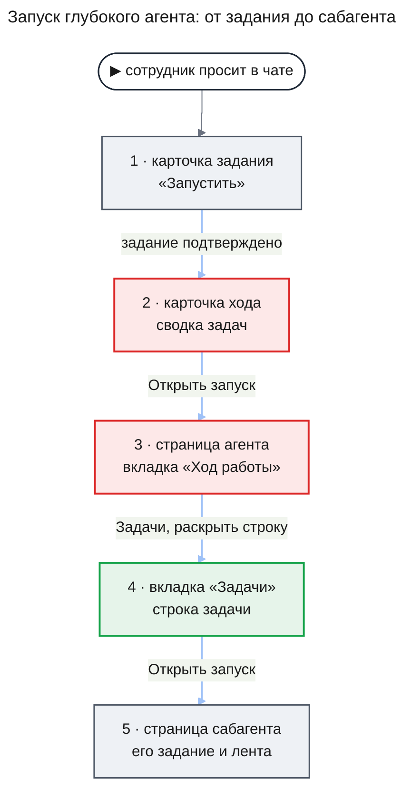

# UXRD: Глубокие агенты, задачи и флоу (deep-agents)

| Date | PRD |
|---|---|
| 2026-11-22 | [prd.md](./prd.md) |

## Snapshot

**Overview.** Вид записи «workflow» уходит из интерфейса: в библиотеке остаются агент и глубокий агент. Формы у глубокого агента нет: сотрудник пишет в чат, что ему нужно, а чат сам собирает запись и перед каждым изменением показывает карточку подтверждения с её определением. Справа от беседы панель «Схема» рисует запись, о которой идёт речь, — агента, его сабагентов и стартовые задачи, — а во время запуска показывает его список задач. Тот же список живёт на вкладке «Задачи» страницы глубокого агента, а в библиотеке запись открывается карточкой только для чтения.

- **Не меняется**: карточка задания перед запуском, лента беседы, подтверждение изменяющих вызовов, редактор обычного агента и страница сабагента.
- **Главный UX-риск**: сотрудник одобряет длинное определение, не читая. Защищают заголовок карточки, который называет действие словами, пометки только у изменённого в правке и схема, которая сразу показывает результат (KD-6, KD-7).
- **Открытых вопросов нет.**

### Key Decisions

| ID | Решение | Почему |
|---|---|---|
| KD-1 | «Глубокий агент» заменяет «workflow» везде, где интерфейс называл вид записи (MC-21). Формы у глубокого агента нет: «Заполнить форму» в библиотеке создаёт только агента, а глубокого агента создают и правят словами в чате | У одной вещи одна версия (PRD, Background). Простой режим — решение владельца, форма — отдельная фича (PRD, Won't Have) |
| KD-2 | Слова интерфейса: «глубокий агент», «сабагент», «задача». Глубокий агент со стартовыми задачами называется так же. В английском каталоге задание перед запуском называется “Brief”, а “Task” значит только задачу списка; русское «Задание» остаётся | “Task” сейчас занято заданием, и на одной странице оказались бы два “Task” с разным смыслом |
| KD-3 | Список задач запуска — один компонент в двух местах: в беседе — панель «Схема», на странице глубокого агента — вкладка «Задачи» рядом с «Ход работы». Вкладка — часть адреса страницы, поэтому ссылка открывает её с раскрытой задачей | В беседе за запуском следят, не уходя из неё (FR-28). На странице агента панели нет (chat-shell UXRD, KD-1), а лента идёт по времени, и план в ней уплывает вверх |
| KD-4 | Один список на запуск: пункты плана и задачи с исполнителем вместе, по порядку добавления, финальная задача всегда последней. Строка — статус, номер, текст и кто делает; остальное раскрывается на месте. Список только читается: что платформа сообщает агенту о задачах, стоит в его ленте строками события, отказы инструмента задач — блоком вызова | Десятки задач читаются одним взглядом, а подробности нужны по одной. Сотрудник направляет работу сообщением (PRD, Won't Have) и по ленте видит, где агенту отказали (UC-6) |
| KD-5 | У задачи есть номер в запуске, с 1, и ссылки на задачи идут через него: «Ждёт 1, 3» в списке, строка события и дерево агентов. Стартовая задача несёт номер из записи | id задачи человек не прочтёт, а номер связывает список, ленту и дерево (AC-10.2, UC-6) |
| KD-6 | Запись меняется только через карточку решения, вариант «Запись»: заголовок называет действие словами, тело показывает определение целиком, а в правке помечено изменённое. Отказ инструмента записей — блок вызова в ленте: ошибку в записи исправляет чат | Сотрудник одобряет то, что прочитал (FR-06; PRD, Risks), и в правке читает только изменённое. Ошибку модели сотрудник не исправляет (FR-27) |
| KD-7 | Панель «Схема» — рабочая область оболочки (chat-shell UXRD, WS-01) под новым именем. Схема — определение записи столбцом, без холста графа. На десктопе панель открывается сама, когда запись создана, изменена или запущена; уже 1024 px она — шторка по кнопке «Схема» | Панель уже есть и пустует, графового компонента в коде нет, а столбец читается на 360 px и скринридером. Шторка сама не открывается, чтобы не закрыть беседу. Меняет chat-shell UXRD, D-05 и WS-01 |

### Вне этой фичи

- Слово «флоу» и его иконка в строке библиотеки, действие «Сделать свой по образцу» и его заготовка в поле сообщения.
- Описания встроенных записей на двух языках.
- На странице сабагента задачи: номер задачи ссылкой в строке мета, ссылка «Задача N» назад к списку, запрет «Запустить с нуля» и строка вместо поля сообщения после конца задачи.
- Выдержки из источников и пометки источников.

## Terms

Термины продукта — в PRD, раздел Terms; здесь — слова интерфейса.

- **Схема** — панель справа от беседы и её содержимое: запись в фокусе, нарисованная столбцом (KD-7).
- **Запись в фокусе** — последняя запись, которую чат в этой беседе прочитал, создал, изменил или запустил; её показывает схема.
- **Ход работы** — вкладка страницы глубокого агента с его лентой: реплики, вызовы инструментов, сообщения и строки события.
- **Номер задачи** — порядковый номер задачи в запуске (KD-5).
- **Свой пункт** — пункт плана без исполнителя: его ведёт сам глубокий агент.
- **Задание** — бриф: вопрос, границы и результат, которые сотрудник подтверждает перед запуском (custom-agents UXRD, Terms). Не путать с задачей.

## Design System

Фича следует [дизайн-системе](../../design-system/README.md). Библиотека, карточки в беседе и схема — комфортная плотность; список задач, дерево и строки шагов — компактная ([foundations → Spacing & Density](../../design-system/foundations.md#spacing--density)).

### Component Inventory

Перед решением «new» поиск шёл по `docs/design-system/components/` и `apps/web/src/components/` (`agents`, `library`, `shell`); графового компонента в коде нет.

| Компонент | Спецификация | Статус | Примечание |
|---|---|---|---|
| Список задач | [run-task-list.md](../../design-system/components/run-task-list.md) | new | Ни одно место не показывает ожидающие задачи, зависимости и результат |
| Определение записи | [definition-view.md](../../design-system/components/definition-view.md) | extended | Вариант «Схема»; «Правка» с пометкой «новый» |
| Карточка решения | [decision-card.md](../../design-system/components/decision-card.md) | extended | Вариант «Запись»: создание, правка, удаление |
| Статус агента | [agent-status.md](../../design-system/components/agent-status.md) | extended | Пять статусов задачи |
| Карточка хода | [agent-run-card.md](../../design-system/components/agent-run-card.md) | extended | Вариант «Глубокий агент»: номер задачи у шага, сводка, «Показать все шаги» |
| Дерево агентов | [agent-tree.md](../../design-system/components/agent-tree.md) | extended | Сабагенты с номером задачи |
| Строка библиотеки | [library-row.md](../../design-system/components/library-row.md) | extended | Вид «глубокий агент», «Доработать в чате» |
| Метка состояния | [state-badge.md](../../design-system/components/state-badge.md) | extended | «финальная», «новый» |
| Отчёт агента | [agent-report.md](../../design-system/components/agent-report.md) | extended | Вариант «Глубокий агент» вместо «Workflow» |
| Вызов инструмента | [tool-call.md](../../design-system/components/tool-call.md) | reused | Инструменты записей и задач и их отказы |
| Окно «Поделиться», подпись записи | [share-dialog.md](../../design-system/components/share-dialog.md), [record-label.md](../../design-system/components/record-label.md) | reused | — |
| Рабочая область | chat-shell UXRD, WS-01–WS-03 | extended | Имя «Схема», содержимое DA-12, шторка уже 1024 px (KD-7) |
| Страница агента | agent-platform UXRD, AV-01–AV-06 | extended | Вкладки у глубокого агента (DA-04) |

## User Flows

### Primary User Flow

**Implements:** UC-1, UC-5; AC-01.2, AC-06.1, AC-06.2, AC-21.3, AC-22.1, AC-22.2, AC-26.1, AC-28.1, AC-28.2

Сотрудник описывает глубокого агента словами и видит его схему рядом с беседой.

```mermaid
---
title: "Глубокий агент словами в чате: от просьбы до схемы"
config:
  theme: base
  look: classic
  themeVariables:
    primaryColor: "#eef1f5"
    primaryBorderColor: "#4b5563"
    primaryTextColor: "#1a1a1a"
    lineColor: "#6b7280"
  flowchart:
    curve: step
  themeCSS: |
    @keyframes lit_dax3{0%,30%{stroke:#991b1b;stroke-width:6px}33.3%,100%{stroke:#f4a5a5;stroke-width:2px}}
    @keyframes litr_dax3{0%,30%{stroke:#1d4ed8;stroke-width:6px}33.3%,100%{stroke:#9ec1f7;stroke-width:2px}}
---
flowchart LR
    entry(["▶ сотрудник пишет, что нужно"])
    chat["1 · чат<br/>читает и собирает запись"]
    card["2 · карточка подтверждения<br/>определение записи"]
    lib[("3 · библиотека")]
    panel["4 · панель «Схема»<br/>новая версия"]
    refuse["блок вызова<br/>отказано с причиной"]
    entry --> chat
    chat e1@-->|"создать или изменить"| card
    card e2@-->|"одобрено"| lib
    lib e3@-->|"сохранённая запись"| panel
    chat -.->|"ошибка в записи"| refuse
    refuse -.->|"чат исправляет"| chat
    card -.->|"Отклонить"| chat
    classDef entry fill:#ffffff,stroke:#1f2937,stroke-width:1.5px,color:#1a1a1a
    classDef changed fill:#fde8e8,stroke:#dc2626,stroke-width:2px,color:#1a1a1a
    classDef new fill:#e6f4ea,stroke:#16a34a,stroke-width:2px,color:#1a1a1a
    classDef unchanged fill:#eef1f5,stroke:#4b5563,stroke-width:1.5px,color:#1a1a1a
    classDef w1 stroke:#f4a5a5,stroke-width:2px,animation:lit_dax3 3.6s linear 0s infinite
    classDef w2 stroke:#f4a5a5,stroke-width:2px,animation:lit_dax3 3.6s linear 1.2s infinite
    classDef r3 stroke:#9ec1f7,stroke-width:2px,animation:litr_dax3 3.6s linear 2.4s infinite
    class entry entry
    class chat,card,panel changed
    class lib,refuse unchanged
    class e1 w1
    class e2 w2
    class e3 r3
```



- Сотрудник пишет обычным сообщением, например «сделай как глубокий ресерч, но только по внутренней документации». Каждый вызов инструмента записей — блок вызова в ленте с подписью MC-23, а прочитанная запись встаёт в схему.
- Чат сам выбирает системы каждому сабагенту (FR-26); лишнюю систему сотрудник просит убрать словами. После сохранения системы каждого сабагента видны на схеме (AC-26.1).
- Создание, правка и удаление встают карточкой подтверждения DA-11, и библиотека не меняется, пока сотрудник её не одобрил (AC-06.1, AC-22.1). После одобрения панель на десктопе открывается сама и показывает новую версию без перезагрузки (AC-28.1, AC-28.2, AC-21.3).
- Следующий шаг — «Использовать в чате» на карточке: запись встаёт чипом в поле сообщения, и следующей фразой сотрудник её запускает (AC-01.2, AC-22.2).

### Alternative Flows

- **Запуск и задачи** (UC-2, UC-3, UC-4, UC-6; AC-03.1, AC-04.1, AC-10.1, AC-13.1, AC-15.1, AC-19.1, AC-21.1, AC-28.3). Сотрудник запускает глубокого агента из чата и следит за его задачами.



  - Чат и карточка задания работают как сегодня, глубокий агент стартует только после «Запустить» (AC-03.1). В ленте встаёт карточка хода со сводкой задач (DA-07), а панель «Схема» на десктопе открывается сама на вкладке «Задачи» этого запуска (AC-28.3).
  - Список растёт без перезагрузки: стартовые задачи стоят сразу (AC-21.1), сабагент сбора добавляет задачи по одной на найденный элемент (AC-13.1), готовые задачи стартуют сами (AC-10.1), а финальная ждёт последней (AC-15.1).
  - Строка раскрывается на месте: полный текст, кто делает, кого ждёт, кто поставил, время и результат (AC-19.1). «Открыть запуск» в подробностях ведёт на страницу сабагента (DA-08).

- **Из библиотеки** (UC-5; AC-29.3). «Доработать в чате» (DA-13) открывает новую беседу с заготовкой в поле сообщения; сотрудник дописывает просьбу, и дальше идёт основной путь. Запись, открытую ролям, владелец сначала закрывает в «Кто видит».
- **Запись компании** (AC-06.6). Администратор правит системную запись тем же путём в своём чате.
- **Глубокий ресерч** (UC-4; AC-07.1, AC-24.1). Список начинается с задач плана и ответа; задачи сбора, по одной на направление, ставит план, и в подробностях у них «Поставил: сабагент «План», задача 1».
- **Продолжение и рестарт** (AC-04.2). После рестарта сервера или нового сообщения список тот же: те же номера и статусы, новые задачи продолжают нумерацию.
- **Запись изменили во время запуска** (AC-21.2). Идущий запуск и его список не меняются; на вкладке «Схема» — новая версия, а карточка хода говорит, что агент изменён после запуска (MC-18).
- **Подтверждение у сабагента задачи** (AC-18.3). Строка задачи показывает `Hand` и «Ждёт подтверждения», а карточка решения встаёт в беседе, как у агента любой глубины (agent-platform UXRD, KD-5).

### Error Flows

- **Отказ инструмента записей** (AC-06.3, AC-06.4, AC-27.1). Блок вызова с исходом «Отказано» и причиной MC-23; карточки нет, запись не меняется. Ошибку в записи чат исправляет и вызывает инструмент снова, новым блоком ниже; на чужой записи или системе без права он отвечает текстом.
- **Карточка отклонена** (AC-06.2). Итог «Отклонено», запись не меняется; чат получает отказ и может предложить другой вариант новой карточкой.
- **Не сохранено после одобрения.** Итог карточки «Не сохранено» с причиной MC-24; запись не меняется, чат получает ошибку.
- **Сбой задачи** (AC-11.2, AC-16.2). Строка получает статус «Сбой», в подробностях — причина (MC-13), в ленте глубокого агента — строка события MC-15. Задачи, которые её ждали, стартуют. Если упала последняя перед финальной, агент может поставить задачу взамен, и она встаёт перед финальной (AC-15.3).
- **Запуск остановлен** (AC-16.1). «Остановить» в шапке работает как сегодня (agent-platform UXRD, AV-01); все незаконченные задачи становятся «Отменена» на месте, в ленте — строка события MC-15.
- **Ответ не принят** (AC-05.1, AC-09.1, AC-15.4). Строка события MC-15 называет открытые пункты плана или сабагента, чей отчёт нужен; статус глубокого агента остаётся «Работает».
- **Отказ инструмента задач или системы** (AC-02.1, AC-03.2, AC-12.2, AC-14.1–AC-14.3, AC-15.2, AC-20.1, AC-26.2). Блок вызова с исходом «Отказано» и причиной MC-16 или причиной прав; список не меняется.
- **Чужой запуск** (AC-18.2). Экран «Агент не найден» (agent-platform UXRD, MC-15): чужой список задач не показывается ни целиком, ни по ссылке на задачу.
- **Список не загрузился.** Ошибка MC-14 с «Повторить» на месте списка; лента и поле сообщения работают.

## Screens

### Screen 1: Библиотека — вид записи

**DA-01. Вид записи** (часть `agent-types`). «Заполнить форму» открывает редактор агента: формы глубокого агента нет (KD-1). [Строка библиотеки](../../design-system/components/library-row.md) называет вид словом MC-1 — «агент» или «глубокий агент» (AC-01.1) — и открывает карточку записи DA-13. Сохранённый глубокий агент стоит в «Мои», и чат может предложить его к запуску (AC-01.2). У своего глубокого агента в меню строки есть «Доработать в чате».

### Screen 2: Беседа — карточка подтверждения, схема и карточка хода

Десктоп после того, как сотрудник одобрил нового глубокого агента:

```
┌────────────┬──────────────────────────────────┬────────────────────────────┐
│ ◆ Agent OS │ ◧ Ресерч по документации[▣ Схема]│ Схема                    × │ DA-12
│ [✎ Новый ] │   Сделай как глубокий ресерч, но │ ◈ Ресерч по документации   │
│            │   только по внутренней документ… │   глубокий агент · Создано │
│            │ ✓ Чтение «Глубокий ресерч»       │   · 14:37                  │
│            │ ┌ ✓ Создано · 14:37 ───────────┐ │ Отвечает на вопрос по      │ DA-11
│            │ │ Создать глубокого агента     │ │ внутренней документации    │
│            │ │ Ресерч по документации       │ │ Системы   Confluence       │
│            │ │ (определение записи)         │ │ Сабагенты · 3              │
│            │ │ [ Использовать в чате ]      │ │  Ответ — пишет ответ по    │
│            │ │ Показать схему · Открыть     │ │  всем отчётам  пишет ответ │
│            │ └──────────────────────────────┘ │    без систем              │
│            │ Готово. Запустить по вопросу?    │  Сбор — собирает данные по │
│            │                                  │  направлению · Confluence  │
│            │                                  │ Стартовые задачи · 2       │
│            │                                  │  1 Составить план · План   │
│            │                                  │  2 Написать ответ · Ответ  │
│            │                                  │    финальная · ждёт все    │
│            │ │ Сообщение…               [↑] │ │ Открыть в библиотеке       │
└────────────┴──────────────────────────────────┴────────────────────────────┘
```

**DA-11. Карточка подтверждения записи** (часть `agent-types`) — [карточка решения](../../design-system/components/decision-card.md), вариант «Запись» (KD-6), одна для агента и глубокого агента. Она держит чат, как любой изменяющий вызов:

| Действие | Заголовок и тело | Кнопка |
|---|---|---|
| Создание | «Создать агента» или «Создать глубокого агента»; имя и определение целиком | «Создать» |
| Правка | «Изменить «{имя}»»; новое имя с пометкой «изменено», если имя сменилось, и определение с пометками | «Сохранить изменения» |
| Удаление | «Удалить «{имя}»»; подпись, описание, фраза | «Удалить» |

В правке изменённое помечено «изменено», добавленное — «новый», убранное названо строкой «Убрано: …». Рядом с основной кнопкой — «Отклонить». После сохранения у созданной записи есть «Использовать в чате», у созданной и изменённой — «Показать схему» и «Открыть» (DA-13).

| Состояние | Что показано | AC |
|---|---|---|
| Ждёт | «Ждёт подтверждения»; в библиотеке нет изменений | AC-06.1, AC-22.1 |
| Сохраняется | Одобрено, ответа инструмента ещё нет: общий итог «Подтверждено · {время}» (agent-platform UXRD, MC-19) | — |
| Создано, изменено | Итог MC-24 и следующий шаг; схема обновлена | AC-22.2, AC-28.1, AC-28.2 |
| Удалено | Итог MC-24; схема говорит, что записи нет | — |
| Отклонено | Итог «Отклонено»; запись не менялась | AC-06.2 |
| Не сохранено | `CircleX` и причина MC-24 целиком, с переносом строк | AC-06.4 |

**DA-12. Панель «Схема»** (часть `agent-types`; задачи с исполнителем — часть `tasks`) — рабочая область оболочки (chat-shell UXRD, WS-01–WS-03): ширина, ручка, «×» и кнопка HD-04 остаются, меняются имя, подписи и содержимое (KD-7). Панель есть только в беседе.

- **Шапка** — [подпись записи](../../design-system/components/record-label.md) записи в фокусе, под ней её вид и «Создано · {время}» или «Изменено · {время}», если запись менялась из этой беседы.
- **Схема** — [определение записи](../../design-system/components/definition-view.md), вариант «Схема»: описание, системы, сабагенты со строкой «когда звать» и их системами, стартовые задачи с «ждёт» (FR-28, AC-21.3). Инструкции и модели — на карточке DA-13, куда ведёт «Открыть в библиотеке».
- **Задачи.** Когда из беседы запущен глубокий агент, под шапкой панели встают вкладки «Схема» и «Задачи · {N}» (MC-9) и остаются до конца беседы; старт запуска переключает на «Задачи». «Схема» показывает запись в фокусе, а «Задачи» — [список задач](../../design-system/components/run-task-list.md) последнего запуска из беседы, какая бы запись ни была в фокусе. Под списком «Открыть запуск» ведёт на вкладку «Задачи» страницы глубокого агента (AC-28.3). После конца запуска список остаётся с итоговыми статусами.
- **Открытие.** Панель закрыта по умолчанию. От 1024 px она открывается сама, когда инструмент создал или изменил запись или стартовал запуск, и фокус остаётся в ленте; закрытая «×» откроется сама только на следующем таком событии. Уже 1024 px кнопка «Схема» в шапке открывает шторку справа с тем же содержимым; сама шторка не открывается.

| Состояние | Что показано | AC |
|---|---|---|
| Пусто | Иконка `Workflow` и MC-25 по центру | — |
| Loading | Скелетон шапки и шести строк | — |
| Запись | Схема записи в фокусе | AC-28.1, AC-21.3 |
| Изменена | Новая версия на месте прежней, без скелетона, «Изменено · {время}» | AC-28.2 |
| Запуск идёт | Вкладка «Задачи» | AC-28.3 |
| Записи нет | MC-25: удалена или закрыта | — |
| Error | MC-25 и «Повторить» | — |

**DA-07. Карточка хода глубокого агента** — [agent-run-card](../../design-system/components/agent-run-card.md), вариант «Глубокий агент». Строки шагов — запуски сабагентов с номером и текстом задачи; видны первые шесть, остальные — под «Показать все шаги» (MC-18). С частью `tasks` над шагами встаёт сводка задач, та же, что над списком (MC-10). «Открыть запуск» ведёт на страницу глубокого агента, вкладка «Ход работы».

### Screen 3: Страница глубокого агента

Десктоп, вкладка «Задачи» во время глубокого ресерча:

```
┌──────────────────┬─────────────────────────────────────────────────────────────┐
│ ◆ Agent OS       │ ◧ Глубокий ресерч · релизы   ⟳ Работает      [⏹ Остановить] │ AV-01
│ [✎ Новый чат   ] │ [ Ход работы ]  [ Задачи · 5 ]                              │ DA-04
│ ▌⌬ Агенты        │─────────────────────────────────────────────────────────────│
│  ▤ Библиотека    │ В работе: 1 · Ожидают: 1 · Готовы: 2 · Сбой: 1  Раскрыть все│ DA-05
│                  │ ✓ 1  Составить план по вопросу            План            ▸ │
│                  │ ✓ 3  Направление: регламент релизов       Сбор            ▸ │
│                  │ ⟳ 4  Направление: история откатов         Сбор            ▸ │
│                  │ ✕ 5  Направление: гайды дежурных          Сбор            ▾ │
│                  │        Статус      ✕ Сбой                                   │
│                  │        Задача      Направление: гайды дежурных за год       │
│                  │        Кто делает  Сбор  Открыть запуск ↗                   │
│                  │        Поставил    сабагент «План», задача 1 · 14:41        │
│                  │        Работа      14:42–14:44 · 2 мин                      │
│                  │        Результат   Причина: исчерпан предел ходов           │
│                  │ ○ 2  Написать ответ                       Ответ финальная ▸ │
│                  │ │ Сообщение агенту — получит после…   [■ Прервать] [↑]  │   │ AV-06
└──────────────────┴─────────────────────────────────────────────────────────────┘
```

**DA-04. Вкладки** (часть `agent-types`). Только у глубокого агента под шапкой стоит строка вкладок: «Ход работы» — лента, как сегодня (agent-platform UXRD, AV-02–AV-05), и «Задачи · {N}» — список (KD-3, MC-9). Строка вкладок не прокручивается вместе с содержимым. Поле сообщения стоит под обеими вкладками и работает по статусу агента, как сегодня (AV-06). Страница открывается на «Ход работы»; ссылка на задачу открывает «Задачи» с раскрытой строкой. Выбранная вкладка живёт в адресе, поэтому «Назад» в браузере возвращает к прежней.

**DA-05. Список задач** — [список задач](../../design-system/components/run-task-list.md) на всю ширину основной области. В части `agent-types` в нём только пункты плана, вариант «План» (FR-04, AC-04.1); с частью `tasks` — пункты плана и задачи с исполнителем вместе, вариант «Задачи» (FR-19). Список обновляется без перезагрузки: новые задачи встают перед финальной, статусы меняются на месте (AC-10.1, AC-13.1). Статусы задачи — [agent-status](../../design-system/components/agent-status.md#статусы-задачи) (MC-11).

| Состояние | Что показано | AC |
|---|---|---|
| Loading | Скелетон сводки и строк | — |
| Пусто | MC-14: агент ещё не поставил ни одного пункта | — |
| План | Пункты «свой пункт» со статусами | AC-04.1, AC-04.2 |
| Задачи идут | Готовые задачи «В работе» без хода глубокого агента; ждущие — «Ожидает» | AC-10.1, AC-11.1, AC-13.1 |
| Финальная ждёт | «Ожидает» последней строкой, «Ждёт: все остальные задачи» | AC-15.1, AC-21.1 |
| Сбой | «Сбой» и причина в подробностях | AC-11.2, AC-16.2 |
| Остановлен | Все незаконченные задачи — «Отменена» | AC-16.1 |
| Ждёт подтверждения | `Hand` у строки задачи, чей сабагент ждёт решения | AC-18.3 |
| Error | MC-14 и «Повторить» на месте списка | — |

**DA-06. Лента глубокого агента** — вкладка «Ход работы». К обычным событиям ленты добавляются:

- **Строки события задач** — [agent-status](../../design-system/components/agent-status.md), вариант «Строка события», тексты MC-15: ответ не принят, а с частью `tasks` ещё задача готова или кончилась сбоем и задачи отменены. «Задача N» в строке — ссылка на задачу в списке (KD-4; AC-05.1, AC-09.1, AC-12.1, AC-16.2).
- **Вызовы инструмента задач** — [блоки вызова](../../design-system/components/tool-call.md) с подписью MC-16 и аргументами, как у любого инструмента; отказ — исход «отказано» с причиной MC-16 (AC-02.1, AC-03.2, AC-12.2, AC-14.1–AC-14.3, AC-15.2, AC-20.1).
- **Ответ финального сабагента** приходит в беседу отчётом, как ответ workflow сегодня (AC-05.2; agent-platform UXRD, AV-04).

### Screen 4: Сабагент задачи и дерево агентов

**DA-08. Сабагент задачи** (часть `tasks`). Страница сабагента — страница агента как сегодня (agent-platform UXRD, Screen 3). Первое сообщение несёт только задание, которое собрала платформа: текст задачи и результаты задач, которых она ждала; истории глубокого агента в ленте нет (AC-02.2, AC-11.1).

**Дерево агентов** — [agent-tree](../../design-system/components/agent-tree.md), вариант «Глубокий агент»: под строкой глубокого агента стоят его сабагенты, и описание каждого начинается с номера задачи — «3 · Направление: регламент релизов». Так у каждого запуска сабагента в дереве видна его задача в списке (AC-10.2).

### Screen 5: Карточка глубокого агента в библиотеке

```
┌──────────────────────────────────────────────────────────────┐
│ ◧ Библиотека / Ресерч по документации                        │ DA-13
│ [Кто видит: только вы]  [ Использовать в чате ]           ⋯  │
│ ◈ Ресерч по документации · только вы                         │
│ Чтобы изменить, нажмите «Доработать в чате».                 │
│ ◉ Самообучение   Агент учится на своих запусках…             │
│──────────────────────────────────────────────────────────────│
│ Описание         Отвечает по внутренней документации         │
│ ⓘ Глубокий агент получает только задание, которое вы…        │
│ Инструкция       Ты отвечаешь на глубокий вопрос по…         │
│ …   (сабагенты с моделями и инструкциями, стартовые задачи)  │
└──────────────────────────────────────────────────────────────┘
```

**DA-13. Карточка записи** (часть `agent-types`). Глубокий агент, которого смотрящий может менять, открывается карточкой только для чтения: [определение записи](../../design-system/components/definition-view.md), вариант «На странице», — то, что на схеме, плюс инструкции, модели и пределы (FR-29, AC-29.1). Полей и «Сохранить» нет; агент по-прежнему открывается редактором.

- **Своя запись в библиотеке.** Шапка — «Кто видит» ([окно «Поделиться»](../../design-system/components/share-dialog.md), AC-29.2) и «Использовать в чате»; меню — «Доработать в чате», «Скопировать себе», «Удалить». «Доработать в чате» открывает новую беседу с заготовкой MC-26.
- **Самообучение** — переключатель под шапкой с подсказкой и ссылкой на знания (self-learning UXRD, MC-1); сохраняется сразу (FR-08).
- **Системная запись в панели администратора** — та же карточка без подсказки о «Доработать в чате», у встроенной записи «Удалить» нет. Запись коллеги или компании в библиотеке открывается как сегодня (custom-agents UXRD, RV-01), запись сотрудника в панели — тоже (custom-agents UXRD, AL-03).

| Состояние | Что показано | AC |
|---|---|---|
| Своя, видите только вы | Все действия | AC-29.1 |
| Открыта ролям | «Доработать в чате» недоступна, причина MC-26 | AC-29.3 |
| Самообучение сохраняется | Переключатель недоступен, рядом `LoaderCircle` | — |
| Самообучение не сохранилось | Переключатель возвращается, строка ошибки MC-26 | — |
| Не найдено | Как сегодня (custom-agents UXRD, RV-02) | — |

## Accessibility

- **Target level**: WCAG 2.1 AA, как во всём интерфейсе ([foundations](../../design-system/foundations.md)); PRD этой фичи своего уровня не задаёт.
- **Язык**: имена записей, сабагентов, тексты задач и отчёты, которые дали люди и модель, читаются с языком страницы и не помечаются (i18n UXRD, раздел Accessibility).
- **Focus order across screens**:
  - Вкладки — `tablist` после шапки; стрелки переключают вкладку, фокус остаётся на вкладке, Tab уходит в содержимое. Так же устроены вкладки панели «Схема».
  - Ссылка на задачу — из строки события, из «Ждёт» — открывает «Задачи», раскрывает строку и ставит фокус на её кнопку раскрытия.
  - «Доработать в чате» ставит фокус в поле сообщения новой беседы, в конец заготовки.
  - Панель «Схема», открываясь сама, фокус не забирает; «Показать схему» и кнопка «Схема» ставят его на заголовок панели. Шторка модальна: Esc и «×» закрывают её и возвращают фокус на кнопку «Схема».
- **Announcements**: смены статусов, новые задачи, строки события и обновление схемы не объявляются, как дерево агентов. Объявления о решениях и отчётах остаются прежними (agent-platform UXRD, MC-25).

## Responsive Behavior

| Экран | Ширина | Поведение |
|---|---|---|
| Панель «Схема» | < 1024 px | Шторка 400 px по кнопке «Схема», уже 480 px — во всю ширину |
| Карточка подтверждения | < 480 px | Кнопки столбцом во всю ширину |
| Вкладки страницы агента | < 768 px | Две вкладки делят ширину поровну |
| Список задач, и всегда в панели | < 720 px | Строка в две строки: текст, под ним «кто делает»; сводка переносится |
| Список задач, схема | < 560 px | Подписи — над значениями |
| Карточка хода | < 720 px | Колонка имени сабагента сужается до самого длинного имени, до 160 px |

При грубом указателе строки списка, вкладки, кнопка «Схема» и переключатель «Самообучение» — не меньше 44 px.

## Content and Microcopy

Интерфейс переведён: каждый текст ниже — ключ каталогов сообщений `en` и `ru`, строк в коде нет. Фраза с числом или именем — одно сообщение со всеми формами языка ([foundations → Language & Formats](../../design-system/foundations.md#language--formats)). Тексты, которые дали люди и модель — имена, задачи, отчёты, — показываются как пришли.

| ID | Где | Русский | English |
|---|---|---|---|
| MC-1 | Библиотека — вид записи | «агент», «глубокий агент» | “agent”, “deep agent” |
| MC-9 | Вкладки страницы агента и панели | «Ход работы», «Задачи · {N}»; в панели «Схема», «Задачи · {N}» | “Activity”, “Tasks · {N}”; “Diagram”, “Tasks · {N}” |
| MC-10 | Список задач — сводка | «В работе: {N}», «Ожидают: {N}», «Готовы: {N}», «Сбой: {N}», «Отменены: {N}» через « · »; «Раскрыть все», «Свернуть все» | “Running: {N}”, “Waiting: {N}”, “Done: {N}”, “Failed: {N}”, “Cancelled: {N}”; “Expand all”, “Collapse all” |
| MC-11 | Статус задачи | «Ожидает», «В работе», «Готова», «Сбой», «Отменена»; у сабагента на подтверждении — «Ждёт подтверждения» (agent-platform UXRD, MC-3) | “Waiting”, “Running”, “Done”, “Failed”, “Cancelled” |
| MC-12 | Список задач — строка | «свой пункт», «финальная»; кнопка раскрытия «Задача {N}: {текст}, {статус}» | “own item”, “final”; “Task {N}: {text}, {status}” |
| MC-13 | Список задач — подробности | «Статус», «Задача», «Кто делает», «Ждёт», «Поставил», «Элемент», «Работа», «Результат»; «свой пункт — ведёт сам агент», «Открыть запуск», «все остальные задачи», «глубокий агент», «сабагент «{имя}», задача {N}», «стартовая задача», «{время}–{время} · {длительность}», «с {время}»; «Причина: {причина}» с причинами agent-platform UXRD, MC-18; «Запуск остановлен до конца задачи»; «Показать целиком», «Свернуть» | “Status”, “Task”, “Who does it”, “Waits for”, “Added by”, “Item”, “Work”, “Result”; “own item — the agent keeps it”, “Open run”, “all other tasks”, “deep agent”, “subagent “{name}”, task {N}”, “starting task”, “{time}–{time} · {duration}”, “since {time}”; “Reason: {reason}”; “The run was stopped before the task was over”; “Show all”, “Collapse” |
| MC-14 | Список задач — пусто, загрузка, ошибка | «Задач пока нет» / «Агент добавит план, когда начнёт работу.»; «Загружаем задачи…»; «Не удалось загрузить задачи» и «Повторить» | “No tasks yet” / “The agent adds its plan when it starts working.”; “Loading tasks…”; “Couldn't load tasks” and “Try again” |
| MC-15 | Лента — строки события | «Задача {N} готова · {время}»; «Сбой задачи {N}: {причина} · {время}»; «Задачи отменены: запуск остановлен · {время}»; «Ответ не принят: открыты пункты плана {номера} · {время}»; «Ответ не принят: нужен отчёт «{имя}» · {время}» | “Task {N} done · {time}”; “Task {N} failed: {reason} · {time}”; “Tasks cancelled: the run was stopped · {time}”; “Answer not accepted: plan items {numbers} are still open · {time}”; “Answer not accepted: waiting for the report from “{name}” · {time}” |
| MC-16 | Лента — инструмент задач и отказы | Подпись «Список задач»; причины: «Запускать можно только сабагентов своей команды», «Глубокого агента запускает только чат после подтверждённого задания», «Сабагента «{имя}» нет в команде», «Задачи {ссылка} нет в этом запуске», «Предел запусков «{имя}» исчерпан: {N} за запуск», «Финальная задача уже стартовала — новые задачи не добавляются», «Статус задачи с исполнителем ведёт платформа», «Задача для {ключ} уже есть: задача {N}» | “Task list”; “Only subagents of this agent's team can be started”, “Only the chat can start a deep agent, after the brief is approved”, “There's no subagent “{name}” in the team”, “Task {ref} isn't in this run”, ““{name}” reached its limit: {N} per run”, “The final task has started — no new tasks can be added”, “The platform sets the status of a task with an assignee”, “A task for {key} already exists: task {N}” |
| MC-18 | Карточка хода | «Показать все шаги · {N}», «Свернуть шаги»; «Глубокий агент изменён после запуска: сейчас версия {N}» | “Show all steps · {N}”, “Hide steps”; “The deep agent changed after the run started: now version {N}” |
| MC-21 | Прежние тексты со словом «workflow» (KD-1) | Каждый текст, который называл вид записи «workflow», называет его «глубокий агент» в нужной форме слова. Отдельные тексты: раздел панели «Агенты и глубокие агенты»; инструмент «Запустить глубокого агента», аргумент «Глубокий агент»; строка мета «Глубокий агент «{имя}»»; удаление беседы «Агенты и глубокие агенты этой беседы тоже будут удалены, работающие — остановлены.»; знания «Что узнал глубокий агент», «Глубокий агент пока ничего не узнал», «Открыть глубокого агента», «Глубокий агент учится: …» | “deep agent” wherever the kind was “workflow”; “Agents and deep agents”; “Start deep agent”, “Deep agent”; “Deep agent “{name}””; “Agents and deep agents in this chat will be deleted too; running ones will be stopped.”; “What the deep agent learned”, “The deep agent hasn't learned anything yet”, “Open deep agent”, “The deep agent learns: …” |
| MC-22 | Задание по-английски (KD-2) | Без изменений | Задание называется “Brief”: “Brief · {name}”, “Brief: {question}”, “Brief approved · {time}”, “Brief rejected · {time}”, “The brief is ready — your decision is needed”; “Task” в этих местах больше не используется |
| MC-23 | Лента — инструменты записей | Подписи блока вызова: «Список библиотеки», «Чтение «{имя}»», «Создание «{имя}»», «Правка «{имя}»», «Удаление «{имя}»». Причины отказа: «Чат меняет только то, что видите только вы», «Агентов компании меняет только администратор», «Встроенного агента удалить нельзя»; нет права — как в библиотеке (custom-agents UXRD, MC-8); ошибка в записи — «Не сохранено: {что не так}» с фразой о правиле: «сабагентов больше {N}», «финального сабагента «{имя}» нет в команде», «пустая инструкция у «{имя}»» | “Library list”, “Read “{name}””, “Create “{name}””, “Edit “{name}””, “Delete “{name}””; “The chat changes only what only you can see”, “Only an admin changes company agents”, “A built-in agent can't be deleted”; “Not saved: {what is wrong}” — “more than {N} subagents”, “final subagent “{name}” isn't in the team”, “empty instruction for “{name}”” |
| MC-24 | Карточка подтверждения записи (DA-11) | «Создать агента», «Создать глубокого агента», «Изменить «{имя}»», «Удалить «{имя}»»; «{Вид} пропадёт из библиотеки. Вернуть его нельзя.»; «изменено», «новый», «Убрано: {что}»; кнопки «Создать», «Сохранить изменения», «Удалить», «Отклонить»; итоги «Создано · {время}», «Изменено · {время}», «Удалено · {время}», «Отклонено · {время}», «Не сохранено: {причина}»; «Использовать в чате», «Показать схему», «Открыть» | “Create agent”, “Create deep agent”, “Change “{name}””, “Delete “{name}””; “The {kind} will be removed from the library. This can't be undone.”; “changed”, “new”, “Removed: {what}”; “Create”, “Save changes”, “Delete”, “Reject”; “Created · {time}”, “Changed · {time}”, “Deleted · {time}”, “Rejected · {time}”, “Not saved: {reason}”; “Use in chat”, “Show diagram”, “Open” |
| MC-25 | Панель «Схема» (DA-12) | Кнопка и заголовок «Схема», «Закрыть схему»; ручка «Изменить ширину схемы»; «Создано · {время}», «Изменено · {время}»; «Системы», «без систем», «Сабагенты · {N}», «Стартовые задачи · {N}», «ждёт {номера}», «ждёт все остальные»; «Открыть в библиотеке», «Открыть запуск»; пусто «Здесь появится схема» / «Попросите чат создать или показать агента — его схема встанет здесь.»; «{Вид} «{имя}» удалён или закрыт для вас»; «Не удалось загрузить схему» и «Повторить» | “Diagram”, “Close diagram”; “Resize diagram”; “Created · {time}”, “Changed · {time}”; “Systems”, “no systems”, “Subagents · {N}”, “Starting tasks · {N}”, “waits for {numbers}”, “waits for all others”; “Open in library”, “Open run”; “The diagram appears here” / “Ask the chat to create or show an agent — its diagram appears here.”; “{Kind} “{name}” was deleted or closed to you”; “Couldn't load the diagram” and “Try again” |
| MC-26 | Карточка записи (DA-13) | «Чтобы изменить, нажмите «Доработать в чате».»; «Доработать в чате» и заготовка «Доработай «{имя}»: » (custom-agents UXRD, MC-7); недоступна — «Чат меняет только то, что видите только вы. Сначала закройте доступ в «Кто видит».»; «Глубокий агент получает только задание, которое вы подтверждаете перед запуском: вопрос, границы и результат. Беседу он не видит.»; «Не удалось сохранить. Попробуйте ещё раз.» | “To change it, press “Refine in chat”.”; “Refine in chat”, “Refine “{name}”: ”; “The chat changes only what only you can see. Close access in “Who can see” first.”; “The deep agent gets only the brief you approve before the run: the question, scope and result. It doesn't see the chat.”; “Couldn't save. Try again.” |
| MC-27 | Определение глубокого агента (DA-11, DA-13) | «Сабагенты · {N}» и «кого и когда звать, решает агент»; «пишет ответ»; «Подробнее»; «до {N} раз»; «Кто пишет ответ», «Сам агент»; «Агент» — «{модель} · до {N} шагов»; остальные подписи — custom-agents UXRD, MC-7 | “Subagents · {N}” and “the agent decides whom to call and when”; “writes the answer”; “Details”; “up to {N} times”; “Who writes the answer”, “The agent itself”; “Agent” — “{model} · up to {N} steps” |

## Update History

| Version | Date | Change |
|---------|------|--------|
| 1.0 | 2026-11-21 | Initial version |
| 1.1 | 2026-11-21 | Записи создаются и правятся в чате через карточку подтверждения; панель «Схема» рядом с беседой; карточка глубокого агента в библиотеке вместо редактора; редактор, стартовые задачи в форме, черновик и выбор систем убраны |
| 1.2 | 2026-11-22 | Утренний бриф убран, экраны перерисованы на глубоком ресерче; вид «флоу», образцы, описания встроенных записей на двух языках и правки страницы сабагента вынесены из фичи; описано построенное: итог «Подтверждено» до сохранения, подпись ручки панели, текст пустой панели без «флоу» |
