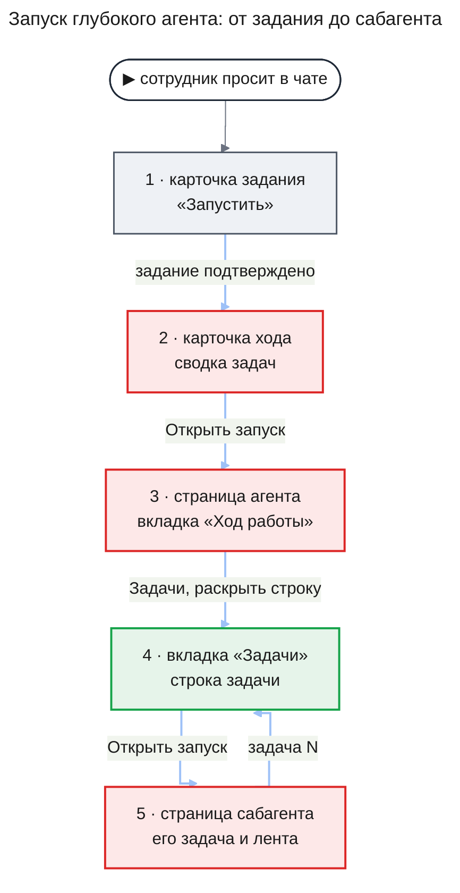
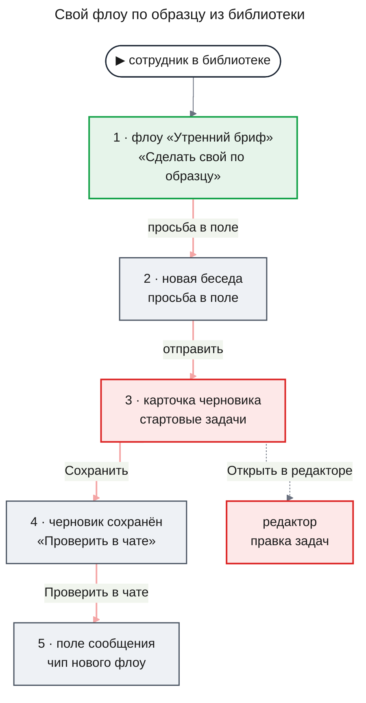

# UXRD: Глубокие агенты, задачи и флоу (deep-agents)

| Date | PRD |
|---|---|
| 2026-11-21 | [prd.md](./prd.md) |

## Snapshot

**Overview.** Вид записи «workflow» уходит из интерфейса: в библиотеке остаются агент и глубокий агент. Редактор глубокого агента — прежняя форма workflow, в которой у ведущего появились своя инструкция и системы, исполнители стали сабагентами, а внизу появились стартовые задачи; запись с ними библиотека показывает как флоу. На странице глубокого агента рядом с лентой встаёт вкладка «Задачи»: план и задачи запуска с исполнителем, статусом, зависимостями и результатом, и она обновляется сама. Свой флоу делают в чате: «Сделать свой по образцу» кладёт просьбу в новую беседу, чат отвечает карточкой черновика, а сотрудник сохраняет её, как любой черновик.

- **Не меняется**: карточка задания перед запуском, лента беседы и правило сохранения черновика — запись появляется только после «Сохранить».
- **Главный UX-риск**: утренний бриф ставит десятки задач разом, и список, карточка хода и дерево агентов растут. Защищают короткая строка задачи, сводка по статусам, финальная задача всегда последней и первые шесть шагов в карточке хода (KD-4).

### Key Decisions

| ID | Решение | Почему |
|---|---|---|
| KD-1 | «Глубокий агент» заменяет «workflow» везде: в меню «Заполнить форму», строке библиотеки, редакторе, черновике, карточке хода и дереве. Редактор — форма workflow без координатора и без «Как работает команда»: у агента своя инструкция и системы, исполнители стали сабагентами, вместо «Координатор сам» — «Сам агент» | У одной вещи одна версия (PRD, Background). Глубокий агент работает сам, и его поведение задаёт инструкция, как у обычного агента (FR-01, FR-02) |
| KD-2 | Слова интерфейса: «глубокий агент», «сабагент», «задача» и «флоу» — вид записи для глубокого агента со стартовыми задачами. В английском каталоге задание перед запуском называется “Brief”, а “Task” значит только задачу списка; русское «Задание» остаётся | Флоу ищут как образец (FR-22), поэтому его видно в списке без открытия. “Task” сейчас занято заданием, и на одной странице оказались бы два “Task” с разным смыслом |
| KD-3 | План и задачи живут на вкладке «Задачи» рядом с «Ход работы» на странице глубокого агента; поле сообщения видно на обеих. Вкладка — часть адреса страницы, поэтому ссылка открывает её с раскрытой задачей | Лента идёт по времени, и план в ней уплывает вверх. Рабочая область есть только на десктопе (chat-shell UXRD, D-05), а задачи нужны и на 360 px (FR-04, FR-19) |
| KD-4 | Один список на запуск: пункты плана и задачи с исполнителем вместе, по порядку добавления, финальная задача всегда последней. Строка — статус, номер, текст и кто делает; остальное раскрывается на месте | Так устроен список задач в PRD (Terms). Десятки задач читаются одним взглядом, а подробности нужны по одной |
| KD-5 | У задачи есть номер в запуске, с 1, и все ссылки на задачи идут через него: «Ждёт 1, 3» в списке, строка события, дерево агентов и страница сабагента. Стартовая задача несёт номер из записи | id задачи человек не прочтёт, а номер связывает список, ленту, дерево и сабагента (AC-10.2, UC-6) |
| KD-6 | В редакторе исполнитель у стартовой задачи обязателен, и ждать она может только задачи выше себя. Финальная задача одна, всегда стоит последней и ждёт все остальные без выбора; в «Ждёт» других задач её нет. Задач у сабагента не больше, чем раз за запуск его можно звать | Круговое ожидание и флоу, который не может кончиться, собрать нельзя, и автору не нужно перечислять зависимости финальной (FR-14, FR-15, FR-21) |
| KD-7 | Список только читается. То, что платформа сообщает глубокому агенту о задачах, стоит в его ленте строками события со ссылкой на задачу; отказы инструмента задач — блоком вызова с причиной | Сотрудник направляет работу сообщением (PRD, Won't Have). По ленте владелец видит, что агент получил и где ему отказали (UC-6) |

## Terms

Термины продукта — в PRD, раздел Terms; здесь — слова интерфейса.

- **Ход работы** — вкладка страницы глубокого агента с его лентой: реплики, вызовы инструментов, сообщения и строки события.
- **Номер задачи** — порядковый номер задачи в запуске (KD-5).
- **Свой пункт** — пункт плана без исполнителя: его ведёт сам глубокий агент.
- **Образец** — флоу, по которому чат делает черновик; PRD называет его шаблоном.
- **Задание** — бриф: вопрос, границы и результат, которые сотрудник подтверждает перед запуском (custom-agents UXRD, Terms). Не путать с задачей.

## Design System

Фича следует [дизайн-системе](../../design-system/README.md). Библиотека, редактор и карточки в беседе — комфортная плотность; список задач, дерево и строки шагов — компактная ([foundations → Spacing & Density](../../design-system/foundations.md#spacing--density)).

### Component Inventory

Перед решением «new» поиск шёл по `docs/design-system/components/` и `apps/web/src/components/` (`agents`, `library`).

| Компонент | Спецификация | Статус | Примечание |
|---|---|---|---|
| Список задач | [run-task-list.md](../../design-system/components/run-task-list.md) | new | Дерево показывает запуски, карточка хода — только стартовавших сабагентов; ни одно место не показывает ожидающие задачи, зависимости и результат |
| Стартовая задача | [start-task-item.md](../../design-system/components/start-task-item.md) | new | Карточка сабагента описывает участника, а не шаг с исполнителем и зависимостями |
| Статус агента | [agent-status.md](../../design-system/components/agent-status.md) | extended | Пять статусов задачи |
| Редактор записи | [record-editor.md](../../design-system/components/record-editor.md) | extended | Вариант «Глубокий агент» вместо «Workflow» |
| Сабагент | [executor-item.md](../../design-system/components/executor-item.md) | extended | Исполнитель стал сабагентом; переименование и уход меняют стартовые задачи |
| Определение записи | [definition-view.md](../../design-system/components/definition-view.md) | extended | Вариант «Глубокий агент», образец, стартовые задачи |
| Карточка хода | [agent-run-card.md](../../design-system/components/agent-run-card.md) | extended | Вариант «Глубокий агент»: номер задачи у шага, сводка, «Показать все шаги» |
| Дерево агентов | [agent-tree.md](../../design-system/components/agent-tree.md) | extended | Сабагенты с номером задачи |
| Строка библиотеки | [library-row.md](../../design-system/components/library-row.md) | extended | Вид «флоу», «Сделать свой по образцу» |
| Метка состояния | [state-badge.md](../../design-system/components/state-badge.md) | extended | «финальная» |
| Карточка решения | [decision-card.md](../../design-system/components/decision-card.md) | extended | Задание и черновик глубокого агента вместо workflow |
| Отчёт агента | [agent-report.md](../../design-system/components/agent-report.md) | extended | Вариант «Глубокий агент» вместо «Workflow» |
| Вызов инструмента | [tool-call.md](../../design-system/components/tool-call.md) | reused | Инструмент задач и его отказы |
| Окно «Поделиться», подпись записи | [share-dialog.md](../../design-system/components/share-dialog.md), [record-label.md](../../design-system/components/record-label.md) | reused | — |
| Страница агента | agent-platform UXRD, AV-01–AV-06 | extended | Вкладки у глубокого агента (DA-04), задача у сабагента (DA-08) |
| Вкладки, список, флажок, раскрытие | shadcn `tabs`, `select`, `checkbox`, `collapsible` | reused | `tabs` добавляется из shadcn без изменений |

## User Flows

### Primary User Flow

**Implements:** UC-2, UC-3, UC-4, UC-6; AC-03.1, AC-04.1, AC-10.1, AC-13.1, AC-15.1, AC-19.1, AC-21.1

Сотрудник запускает глубокого агента из чата и следит за его задачами.



- Чат и карточка задания работают как сегодня, глубокий агент стартует только после «Запустить» (AC-03.1). В ленте беседы встаёт карточка хода глубокого агента со сводкой задач (DA-07).
- «Открыть запуск» ведёт на страницу глубокого агента, вкладка «Ход работы». Сотрудник переходит на вкладку «Задачи» и видит план и задачи, а список растёт без перезагрузки: стартовые задачи флоу стоят сразу (AC-21.1), сабагент сбора добавляет задачи по одной на найденный элемент (AC-13.1), готовые задачи стартуют сами (AC-10.1), а финальная ждёт последней (AC-15.1).
- Строка раскрывается на месте: полный текст, кто делает, кого ждёт, кто поставил, время и результат (AC-19.1). «Открыть запуск» в подробностях ведёт на страницу сабагента, а «Задача N» в её строке мета возвращает в список с раскрытой строкой (DA-08).

### Alternative Flows

- **Собрать глубокого агента в редакторе** (UC-1; AC-01.1, AC-01.2, AC-06.3). Библиотека → «Заполнить форму» → «Глубокий агент» → редактор DA-02 → «Создать» → «Использовать в чате». Администратор собирает запись компании в панели тем же редактором, вариант «Системная», и открывает её ролям (custom-agents UXRD, AL-02).
- **Попросить глубокого агента в чате** (AC-06.1). Чат отвечает карточкой черновика глубокого агента (DA-09); сохранение и доработка — как у черновика агента (custom-agents UXRD, DC-01).
- **Флоу по образцу** (UC-5; AC-22.1, AC-22.2). Путь ниже: просьба уходит из библиотеки в новую беседу, а сохранённый флоу сразу встаёт чипом в поле сообщения.



  Сотрудник дописывает просьбу своими словами — например, «только по платежам» — и отправляет. До «Сохранить» в библиотеке ничего нет (AC-22.1). Сохранённый флоу виден в группе «Мои» с видом «флоу», и чат запускает его по чипу или по имени (AC-22.2).

- **Утренний бриф** (UC-3; AC-23.1). Список начинается со стартовых задач «Собрать инциденты» и финальной «Написать бриф». Когда сбор находит инциденты, перед финальной встают по задаче на инцидент, у каждой — «Глубокое исследование» или «Лёгкое исследование» в колонке «кто делает».
- **Глубокий ресерч** (UC-4; AC-07.1, AC-24.1). Список начинается с задач плана и ответа; задачи сбора, по одной на направление, ставит план, и в подробностях у них «Поставил: сабагент «План», задача 1».
- **Продолжение и рестарт** (AC-04.2). После рестарта сервера или нового сообщения список тот же: те же номера и статусы, новые задачи продолжают нумерацию.
- **Подтверждение у сабагента задачи** (AC-18.3). Строка задачи показывает `Hand` и «Ждёт подтверждения», а карточка решения встаёт в беседе, как у агента любой глубины (agent-platform UXRD, KD-5).

### Error Flows

- **Сбой задачи** (AC-11.2, AC-16.2). Строка получает статус «Сбой», в подробностях — причина (MC-13), в ленте глубокого агента — строка события MC-15. Задачи, которые её ждали, стартуют. Если упала последняя перед финальной, агент может поставить задачу взамен, и она встаёт перед финальной (AC-15.3).
- **Запуск остановлен** (AC-16.1). «Остановить» в шапке работает как сегодня (agent-platform UXRD, AV-01); все незаконченные задачи становятся «Отменена» на месте, в ленте — строка события MC-15.
- **Ответ не принят** (AC-05.1, AC-09.1, AC-15.4). Строка события MC-15 называет открытые пункты плана или сабагента, чей отчёт нужен; статус глубокого агента остаётся «Работает».
- **Отказ инструмента** (AC-02.1, AC-03.2, AC-12.2, AC-14.1–AC-14.3, AC-15.2, AC-20.1). Блок вызова с исходом «отказано» и причиной MC-16; список не меняется.
- **Сохранение отклонено** (AC-06.2). Ошибка на карточке сабагента, как у исполнителя сегодня (custom-agents UXRD, MC-8); ошибки стартовых задач — на их карточках (MC-7). Фокус — на первую ошибку.
- **Чужой запуск** (AC-18.2). Экран «Агент не найден» (agent-platform UXRD, MC-15): чужой список задач не показывается ни целиком, ни по ссылке на задачу.
- **Список не загрузился.** Ошибка MC-14 с «Повторить» на вкладке; лента и поле сообщения работают.

## Screens

### Screen 1: Библиотека — вид записи и образцы

```
┌──────────────────────────────────────────────────────────────┐
│ ◧ Библиотека   [ Создать в чате ] [ Заполнить форму ▾ ]      │
│                                    ┌────────────────────┐    │ DA-01
│                                    │ Агент              │    │
│                                    │ Глубокий агент     │    │
│                                    └────────────────────┘    │
│ Мои · 1                                                      │
│ ☷ Утренний бриф · платежи  только вы                       ⋯ │
│   флоу · Собирает инциденты по платежам и пишет бриф         │
│ От компании · 4                                              │
│ ⌬ chat  от компании                                        ⋯ │
│ ⌬ general-purpose  от компании                             ⋯ │
│ ☷ Глубокий ресерч  от компании                             ⋯ │ DA-10
│   флоу · Отвечает на глубокий вопрос по источникам           │
│ ☷ Утренний бриф  от компании    ┌──────────────────────────┐ │
│   флоу · Собирает инциденты…    │ Использовать в чате      │ │
│                                 │ Сделать свой по образцу  │ │
│                                 │ Открыть                  │ │
│                                 │ Скопировать себе         │ │
│                                 └──────────────────────────┘ │
└──────────────────────────────────────────────────────────────┘
```

**DA-01. Вид записи** (часть `agent-types`). Меню «Заполнить форму» предлагает «Агент» и «Глубокий агент» (AC-01.1); на телефоне оба пункта — в меню кнопки «+». [Строка библиотеки](../../design-system/components/library-row.md) называет вид словом MC-1: «агент», «глубокий агент» или «флоу». Сохранённый глубокий агент стоит в «Мои», и чат может предложить его к запуску (AC-01.2).

**DA-10. Образцы** (часть `flows`). Встроенные флоу «Глубокий ресерч» и «Утренний бриф» стоят в «От компании» с видом «флоу» (FR-23, FR-24). У любого флоу, который видит сотрудник, в меню строки и на странице записи есть «Сделать свой по образцу». Действие открывает новую беседу с заготовкой MC-19 в поле сообщения и ставит фокус в конец заготовки; ничего не отправляется. Так путь UC-5 начинается там, где сотрудник видит образец, а не с угадывания, что попросить у чата. Страница флоу — [определение записи](../../design-system/components/definition-view.md), вариант «На странице», со стартовыми задачами (custom-agents UXRD, RV-01).

| Состояние | Что показано | AC |
|---|---|---|
| Default | Агенты, глубокие агенты и флоу в трёх группах | AC-01.2, AC-06.3 |
| Флоу компании | «Утренний бриф» и «Глубокий ресерч» в «От компании» | AC-22.2 |

### Screen 2: Редактор глубокого агента

```
┌──────────────────────────────────────────────────────────────┐
│ ◧ Библиотека / Утренний бриф · платежи [Кто видит: только вы]⋯│ DA-02
│──────────────────────────────────────────────────────────────│
│ Имя         [ Утренний бриф · платежи                     ]  │
│ Описание    [ Собирает инциденты по платежам и пишет бриф ]  │
│ ⓘ Глубокий агент получает только задание, которое вы         │
│   подтверждаете перед запуском. Беседу он не видит.          │
│ Инструкция                                                   │
│ ┌──────────────────────────────────────────────────────────┐ │
│ │ Ты готовишь утренний бриф по платежам. Когда «Сбор»      │ │
│ │ вернёт инциденты, проверь, что на каждый есть задача…    │ │
│ └──────────────────────────────────────────────────────────┘ │
│ Как агент работает: что делает сам, какие задачи ставит…     │
│ Системы     ☑ Jira   Тикеты                                  │
│             ☐ Sentry                                         │
│ Сабагенты · 3                               [ + Добавить ▾ ] │
│ ┌ Бриф                                   пишет ответ    ⋯ ┐  │
│ │ [ Пишет бриф по результатам всех задач                ] │  │
│ │ Sonnet · без систем · до 1 раза                         │  │
│ └─────────────────────────────────────────────────────────┘  │
│ ┌ Глубокое исследование …                               ⋯ ┐  │
│ ┌ Сбор …                                                ⋯ ┐  │
│ Кто пишет ответ   [ Бриф                 ▾ ]                 │
│ Стартовые задачи · 2 · необязательно                         │ DA-03
│ Каждый запуск начинается с этих задач…                       │
│ ┌ Задача 1                                              ✕ ┐  │
│ │ Что сделать  [ Собрать инциденты по платежам за ночь  ] │  │
│ │ Кто делает   [ Сбор ▾ ]                                 │  │
│ │ не ждёт — стартует сразу                                │  │
│ └─────────────────────────────────────────────────────────┘  │
│ ┌ Задача 2                                  финальная   ✕ ┐  │
│ │ Что сделать  [ Написать бриф по всем инцидентам       ] │  │
│ │ Кто делает   [ Бриф ▾ ]                                 │  │
│ │ ⓘ Ждёт все остальные задачи: «Бриф» пишет ответ         │  │
│ └─────────────────────────────────────────────────────────┘  │
│ [ + Добавить задачу ]                                        │
│ ☐ Самообучение                                               │
│ ▸ Дополнительно: модель и максимум шагов агента              │
│──────────────────────────────────────────────────────────────│
│ ● Есть несохранённые изменения  [Отменить изменения][Сохранить]│
└──────────────────────────────────────────────────────────────┘
```

**DA-02. Редактор глубокого агента** (часть `agent-types`) — [редактор записи](../../design-system/components/record-editor.md), вариант «Глубокий агент» (KD-1). Шапка, меню, кнопка аудитории, конфликт и панель сохранения — как у редактора workflow сегодня (custom-agents UXRD, WF-01). Части сверху вниз:

1. **Имя и описание.** По описанию чат решает, когда предложить глубокого агента (MC-3).
2. **Задание** — фраза MC-3: агент получает только подтверждённое задание и не видит беседу.
3. **Инструкция** — свой промпт глубокого агента. Имена сабагентов в тексте подсвечены, а заметки под полем называют имя, которого нет в команде, и старое имя после переименования (MC-4).
4. **Системы** — системы самого глубокого агента, только из прав автора, как у агента (FR-02, AC-02.3).
5. **Сабагенты** — [карточки сабагентов](../../design-system/components/executor-item.md) по имени, от одного до предела PRD (FR-01). «Добавить» предлагает «Новый сабагент» и «Из библиотеки…» (custom-agents UXRD, WF-02). Панель сабагента — как панель исполнителя сегодня, с полем «Сколько раз можно звать за запуск».
6. **Кто пишет ответ** — «Сам агент» или имя сабагента (FR-05). Выбранный сабагент получает метку «пишет ответ».
7. **Стартовые задачи** — часть `flows`, DA-03.
8. **Самообучение** — флажок, как у workflow сегодня (FR-08; self-learning UXRD, SL-01).
9. **Дополнительно** — свёрнуто: модель и максимум шагов глубокого агента со значениями по умолчанию.

У новой пустой формы над сабагентами стоит подсказка «Описать в чате», как у workflow сегодня; в панели администратора её нет.

**DA-03. Стартовые задачи** (часть `flows`) — необязательная секция из [стартовых задач](../../design-system/components/start-task-item.md) по номеру (FR-21). «Добавить задачу» ставит новую карточку перед финальной и недоступна, пока сабагентов нет. У задачи обязательны текст и исполнитель; «Ждёт» предлагает только обычные задачи выше. Задача финального сабагента сама встаёт последней, а вместо «Ждёт» у неё заметка, что она ждёт все остальные (KD-6). Запись хотя бы с одной стартовой задачей библиотека и черновик называют флоу (KD-2).

| Состояние | Что показано | AC |
|---|---|---|
| Новая запись | «Новый глубокий агент», «Создать»; команда пуста, подсказка «Описать в чате» | AC-01.1 |
| Команда пуста при сохранении | Ошибка MC-5 у «Добавить» | — |
| Нет права на систему сабагента | Ошибка на карточке сабагента с причиной, как у исполнителя сегодня | AC-06.2 |
| Ошибка стартовой задачи | Ошибка на карточке задачи MC-7; фокус — на первую ошибку | — |
| Вторая финальная задача | Ошибка MC-7 на второй карточке финального сабагента | — |
| Задач больше предела сабагента | Ошибка MC-7 на карточке, которая превысила «Сколько раз можно звать за запуск» | AC-14.3 |
| Сабагент убран | Его стартовые задачи — с ошибкой исполнителя; «Кто пишет ответ» — «Сам агент» с заметкой MC-6 | — |
| Задача убрана | Номера ниже сдвигаются, ждавшие её задачи получают заметку MC-7 | — |
| Изменено во время запуска | Идущий запуск не меняется; карточка хода говорит «изменён после запуска» | AC-21.2 |

### Screen 3: Страница глубокого агента

Десктоп, вкладка «Задачи» во время утреннего брифа:

```
┌──────────────────┬─────────────────────────────────────────────────────────────┐
│ ◆ Agent OS       │ ◧ Утренний бриф · за ночь   ⟳ Работает        [⏹ Остановить] │ AV-01
│ [✎ Новый чат   ] │ [ Ход работы ]  [ Задачи · 7 ]                              │ DA-04
│ ▌⌬ Агенты        │─────────────────────────────────────────────────────────────│
│  ▤ Библиотека    │ В работе: 2 · Ожидают: 1 · Готовы: 3 · Сбой: 1 [Раскрыть все]│ DA-05
│                  │ ✓ 1  Собрать инциденты за ночь           Сбор             ▸ │
│                  │ ⟳ 3  INC-412: разобрать падение оплат    Глубокое иссл…   ▸ │
│                  │ ✓ 4  INC-413: проверить алерт очереди    Лёгкое исследов… ▸ │
│                  │ ✕ 5  INC-415: проверить алерт gateway    Лёгкое исследов… ▾ │
│                  │        Статус      ✕ Сбой                                   │
│                  │        Задача      INC-415: проверить алерт gateway за 01–03│
│                  │        Кто делает  Лёгкое исследование  Открыть запуск ↗    │
│                  │        Поставил    сабагент «Сбор», задача 1 · 02:41        │
│                  │        Работа      02:42–02:44 · 2 мин                      │
│                  │        Результат   Причина: исчерпан предел ходов           │
│                  │ ⟳ 6  INC-418: разобрать рост таймаутов   Глубокое иссл…   ▸ │
│                  │ ✓ 7  Проверить, что на каждый инцидент…  свой пункт       ▸ │
│                  │ ○ 2  Написать бриф                       Бриф  финальная  ▸ │
│                  │ │ Сообщение агенту — получит после…   [■ Прервать] [↑]  │  │ AV-06
└──────────────────┴─────────────────────────────────────────────────────────────┘
```

Мобильный 360 px:

```
┌──────────────────────────────────┐
│ ≡  Утренний бриф · за ночь    ⋯  │
│ [ Ход работы ][ Задачи · 7 ]     │
│ В работе: 2 · Ожидают: 1 ·       │
│ Готовы: 3 · Сбой: 1              │
│ ✓ 1  Собрать инциденты за…  ▸    │
│      Сбор                        │
│ ⟳ 3  INC-412: разобрать па… ▸    │
│      Глубокое исследование       │
│ ○ 2  Написать бриф          ▸    │
│      Бриф  финальная             │
│ │ Сообщение агенту…   [■] [↑] │  │
└──────────────────────────────────┘
```

**DA-04. Вкладки** (часть `agent-types`). Только у глубокого агента под шапкой стоит строка вкладок: «Ход работы» — лента, как сегодня (agent-platform UXRD, AV-02–AV-05), и «Задачи · {N}» — список (KD-3, MC-9). Строка вкладок не прокручивается вместе с содержимым. Поле сообщения стоит под обеими вкладками и работает по статусу агента, как сегодня (AV-06). Страница открывается на «Ход работы»; ссылка на задачу открывает «Задачи» с раскрытой строкой. Выбранная вкладка живёт в адресе, поэтому «Назад» в браузере возвращает к прежней.

**DA-05. Список задач** — [список задач](../../design-system/components/run-task-list.md) на всю ширину основной области. В части `agent-types` в нём только пункты плана, вариант «План» (FR-04, AC-04.1); с частью `tasks` — пункты плана и задачи с исполнителем вместе, вариант «Задачи» (FR-19). Список обновляется без перезагрузки: новые задачи встают перед финальной, статусы меняются на месте (AC-10.1, AC-13.1). Статусы задачи — [agent-status](../../design-system/components/agent-status.md#статусы-задачи) (MC-11).

| Состояние | Что показано | AC |
|---|---|---|
| Loading | Скелетон сводки и строк | — |
| Пусто | MC-14: агент ещё не поставил ни одного пункта | — |
| План | Пункты «свой пункт» со статусами | AC-04.1, AC-04.2 |
| Задачи идут | Готовые задачи «В работе» без хода глубокого агента; ждущие — «Ожидает» | AC-10.1, AC-11.1, AC-13.1 |
| Финальная ждёт | «Ожидает» последней строкой, «Ждёт: все остальные задачи» | AC-15.1, AC-21.1 |
| Сбой | «Сбой» и причина в подробностях | AC-11.2, AC-16.2 |
| Остановлен | Все незаконченные задачи — «Отменена» | AC-16.1 |
| Ждёт подтверждения | `Hand` у строки задачи, чей сабагент ждёт решения | AC-18.3 |
| Error | MC-14 и «Повторить» на месте списка | — |

**DA-06. Лента глубокого агента** — вкладка «Ход работы». К обычным событиям ленты добавляются:

- **Строки события задач** — [agent-status](../../design-system/components/agent-status.md), вариант «Строка события», тексты MC-15: задача готова или кончилась сбоем, задачи отменены, ответ не принят. «Задача N» в строке — ссылка на задачу в списке (KD-7; AC-05.1, AC-09.1, AC-12.1, AC-16.2).
- **Вызовы инструмента задач** — [блоки вызова](../../design-system/components/tool-call.md) с подписью MC-16 и аргументами, как у любого инструмента; отказ — исход «отказано» с причиной MC-16 (AC-02.1, AC-03.2, AC-12.2, AC-14.1–AC-14.3, AC-15.2, AC-20.1).
- **Ответ финального сабагента** приходит в беседу отчётом, как ответ workflow сегодня (AC-05.2; agent-platform UXRD, AV-04).

### Screen 4: Страница сабагента и дерево агентов

```
┌──────────────────────────────────────────────────────────────┐
│ ◧ INC-412: разобрать падение оплат   ✓ Завершён              │ AV-01
│ Haiku · запущен 02:42 · агентом «Утренний бриф» · задача 3   │ DA-08
│                                          Задача 3            │
│              ┌───────────────────────────────────────────┐   │
│              │ INC-412: разобрать падение оплат в 02:10…  │   │
│              └───────────────────────────────────────────┘   │
│ …                                                            │
│ Отчёт                                                        │
│ Падение вызвано истечением сертификата…                      │
│ Задача закончена. Чтобы продолжить, напишите глубокому агенту.│
│                                         К глубокому агенту → │
└──────────────────────────────────────────────────────────────┘
```

**DA-08. Сабагент задачи** (часть `tasks`) — страница агента (agent-platform UXRD, Screen 3) с тремя отличиями:

- Строка мета называет номер задачи ссылкой: «· задача {N}» открывает список задач глубокого агента с раскрытой строкой (MC-17, KD-5).
- Первое сообщение подписано «Задача {N}», а не «Поручение». В нём только текст задачи и результаты задач, которых она ждала, — истории глубокого агента в ленте нет (AC-02.2, AC-11.1).
- У задачи один запуск сабагента (FR-17), поэтому «Запустить с нуля» нет. Пока задача «В работе», поле сообщения работает как у любого агента; когда задача закончилась, вместо поля стоит строка MC-17 со ссылкой на глубокого агента: результат задачи уже ушёл тем, кто её ждал.

Сабагент, которого глубокий агент позвал без задачи (часть `agent-types`), выглядит как дочерний агент сегодня.

**Дерево агентов** — [agent-tree](../../design-system/components/agent-tree.md), вариант «Глубокий агент»: под строкой глубокого агента стоят его сабагенты, и описание каждого начинается с номера задачи — «3 · INC-412: разобрать падение оплат». Так у каждого запуска сабагента в дереве видна его задача в списке (AC-10.2).

### Screen 5: Беседа — карточка хода и черновик

```
┌──────────────────────────────────────────────────────────────┐
│ ⟳ Работает   Утренний бриф · платежи  только вы       02:00  │ DA-07
│ Что случилось с платежами за ночь                            │
│ В работе: 2 · Ожидают: 1 · Готовы: 3 · Сбой: 1               │
│ ✓ Сбор                   1 · Собрать инциденты по платежам   │
│ ⟳ Глубокое исследование  3 · INC-412: разобрать падение…     │
│ ✓ Лёгкое исследование    4 · INC-413: проверить алерт…       │
│ ▸ Показать все шаги · 9                                      │
│ Открыть запуск →                                             │
└──────────────────────────────────────────────────────────────┘
┌ ✎ Черновик                                            14:36 ┐
│ Новый флоу                                                   │ DA-09
│ Утренний бриф · платежи                                      │
│ По образцу        Утренний бриф                              │
│ Описание          Собирает инциденты по платежам и пишет бриф│
│ Сабагенты · 3     Бриф — пишет бриф…  пишет ответ            │
│                   Глубокое исследование — разбирает…         │
│                   Сбор — находит инциденты по платежам…      │
│ Стартовые задачи  1  Собрать инциденты по платежам · Сбор    │
│                   2  Написать бриф · Бриф  финальная         │
│ Чтобы поправить — напишите в чат, что изменить               │
│ [ Сохранить ]  [ Открыть в редакторе ]  [ Отклонить ]        │
└──────────────────────────────────────────────────────────────┘
```

**DA-07. Карточка хода глубокого агента** — [agent-run-card](../../design-system/components/agent-run-card.md), вариант «Глубокий агент». Строки шагов — запуски сабагентов с номером и текстом задачи; видны первые шесть, остальные — под «Показать все шаги» (MC-18). С частью `tasks` над шагами встаёт сводка задач, та же, что над списком (MC-10). «Открыть запуск» ведёт на страницу глубокого агента, вкладка «Ход работы».

**DA-09. Черновик глубокого агента и флоу** — карточка черновика записи, как сегодня (custom-agents UXRD, DC-01; FR-06, FR-22). Внутри — [определение записи](../../design-system/components/definition-view.md), вариант «Глубокий агент»: команда строками сабагентов и, у флоу, все стартовые задачи. Заголовок — «Новый глубокий агент» или «Новый флоу» (MC-20). Черновик по образцу несёт строку «По образцу» с именем флоу-образца. Блок вызова, которым чат готовит черновик по образцу, подписан MC-20.

| Состояние | Что показано | AC |
|---|---|---|
| Черновик ждёт | Карточка с определением; в библиотеке нового нет | AC-06.1, AC-22.1 |
| Сохранено | «Сохранено», «Проверить в чате», «Поделиться» | AC-22.2 |
| Не сохранено | Строка ошибки с причиной; «Открыть в редакторе» переносит черновик в DA-02 | AC-06.2 |

## Accessibility

- **Target level**: WCAG 2.1 AA, как во всём интерфейсе ([foundations](../../design-system/foundations.md)); PRD этой фичи своего уровня не задаёт.
- **Язык**: имена записей, сабагентов, тексты задач и отчёты, которые дали люди и модель, читаются с языком страницы и не помечаются (i18n UXRD, раздел Accessibility).
- **Focus order across screens**:
  - Вкладки — `tablist` после шапки; стрелки переключают вкладку, фокус остаётся на вкладке, Tab уходит в содержимое.
  - Ссылка на задачу — со страницы сабагента, из строки события, из «Ждёт» — открывает «Задачи», раскрывает строку и ставит фокус на её кнопку раскрытия.
  - «Сделать свой по образцу» ставит фокус в поле сообщения новой беседы, в конец заготовки.
  - В редакторе «Добавить задачу» ставит фокус в текст новой карточки; «Убрать» — на «Добавить задачу»; неудачное сохранение — на первую ошибку среди полей, сабагентов и стартовых задач.
- **Announcements**: смены статусов, новые задачи и строки события не объявляются, как дерево агентов. Объявления о решениях и отчётах остаются прежними (agent-platform UXRD, MC-25).

## Responsive Behavior

| Экран | < 560 px | < 720 px | < 768 px |
|---|---|---|---|
| Редактор, стартовые задачи | Подписи «Что сделать», «Кто делает», «Ждёт» — над полями | — | Панель сабагента на весь экран |
| Вкладки | — | — | Две вкладки делят ширину поровну |
| Список задач | Подписи подробностей — над значениями | Строка в две строки: текст, под ним «кто делает»; сводка переносится | — |
| Карточка хода | — | Колонка имени сабагента сужается до самого длинного имени, до 160 px | — |

При грубом указателе строки списка, вкладки, флажки «Ждёт» и «Убрать» — не меньше 44 px.

## Content and Microcopy

Интерфейс переведён: каждый текст ниже — ключ каталогов сообщений `en` и `ru`, строк в коде нет. Это относится и к именам и описаниям встроенных флоу. Фраза с числом или именем — одно сообщение со всеми формами языка ([foundations → Language & Formats](../../design-system/foundations.md#language--formats)). Тексты, которые дали люди и модель — имена, задачи, отчёты, — показываются как пришли.

| ID | Где | Русский | English |
|---|---|---|---|
| MC-1 | Библиотека — «Заполнить форму» и вид записи | «Агент», «Глубокий агент»; вид в строке: «агент», «глубокий агент», «флоу» | “Agent”, “Deep agent”; “agent”, “deep agent”, “flow” |
| MC-2 | Редактор — заголовок, уведомление | «Новый глубокий агент»; «Глубокий агент создан» | “New deep agent”; “Deep agent created” |
| MC-3 | Редактор — описание и задание | «По описанию чат решает, когда предложить глубокого агента.»; «Глубокий агент получает только задание, которое вы подтверждаете перед запуском: вопрос, границы и результат. Беседу он не видит.» | “The chat decides when to offer the deep agent from its description.”; “The deep agent gets only the brief you approve before the run: the question, scope and result. It doesn't see the chat.” |
| MC-4 | Редактор — инструкция | Подсказка «Как агент работает: что делает сам, какие задачи ставит и кому. Сабагентов называйте по именам.»; заметки «Сабагента «{имя}» нет в команде», «Сабагент «{имя}» переименован» и «Заменить в инструкции» | “How the agent works: what it does itself, which tasks it adds and for whom. Call subagents by name.”; “There's no subagent “{name}” in the team”, “Subagent “{name}” was renamed”, “Replace in instruction” |
| MC-5 | Редактор — сабагенты | «Сабагенты · {N}»; подсказка «Агент выбирает сабагента по строке «За что отвечает и когда звать». Каждый работает в своём контексте и возвращает только отчёт.»; «Добавить», «Новый сабагент», «Из библиотеки…»; пусто «Сабагентов пока нет» / «Добавьте хотя бы одного: глубокий агент работает со своей командой.»; ошибка «Добавьте хотя бы одного сабагента»; предел «Не больше {N} сабагентов»; панель «Сабагент «{имя}»», «Сколько раз можно звать за запуск» | “Subagents · {N}”; “The agent picks a subagent by its “What it does and when to call it” line. Each one works in its own context and returns only a report.”; “Add”, “New subagent”, “From library…”; “No subagents yet” / “Add at least one: a deep agent works with its own team.”; “Add at least one subagent”; “No more than {N} subagents”; “Subagent “{name}””, “How many times per run” |
| MC-6 | Редактор — «Кто пишет ответ» | Вариант «Сам агент»; подсказка «Отчёт этого сабагента придёт в беседу как ответ, без пересказа. Агент не ответит раньше него.»; заметка «Сабагент «{имя}» убран — ответ пишет сам агент» | “The agent itself”; “This subagent's report goes to the chat as the answer, unchanged. The agent can't answer before it.”; “Subagent “{name}” was removed — the agent writes the answer itself” |
| MC-7 | Редактор — стартовые задачи | «Стартовые задачи · {N}» · «необязательно»; подсказка «Каждый запуск начинается с этих задач. Задача стартует, когда закончились те, кого она ждёт. Со стартовыми задачами агент становится флоу.»; пусто «Стартовых задач нет — агент сам решит, с чего начать.»; «Добавить задачу» (недоступна: «Сначала добавьте сабагента»); «Задача {N}», «Что сделать», «Кто делает», «Ждёт», «не ждёт — стартует сразу»; «Ждёт все остальные задачи: «{имя}» пишет ответ»; «Убрать задачу {N}»; ошибки «Напишите, что сделать», «Выберите сабагента», «Сабагента «{имя}» больше нет в команде — выберите другого», «У «{имя}», который пишет ответ, может быть только одна задача», «Задач у «{имя}» больше, чем раз за запуск его можно звать: {N}»; заметка «Задача {N} убрана — эта задача её больше не ждёт» | “Starting tasks · {N}” · “optional”; “Every run starts with these tasks. A task starts when the tasks it waits for are over. With starting tasks, the agent becomes a flow.”; “No starting tasks — the agent decides where to begin.”; “Add task” (“Add a subagent first”); “Task {N}”, “What to do”, “Who does it”, “Waits for”, “doesn't wait — starts right away”; “Waits for all other tasks: “{name}” writes the answer”; “Remove task {N}”; “Write what to do”, “Choose a subagent”, “Subagent “{name}” is no longer in the team — choose another”, “Subagent “{name}” writes the answer and can have only one task”, “Subagent “{name}” has more tasks than calls per run: {N}”; “Task {N} was removed — this task no longer waits for it” |
| MC-8 | Редактор — «Дополнительно» | «Дополнительно: модель и максимум шагов агента» | “Advanced: the agent's model and step limit” |
| MC-9 | Страница агента — вкладки | «Ход работы», «Задачи · {N}» | “Activity”, “Tasks · {N}” |
| MC-10 | Список задач — сводка | «В работе: {N}», «Ожидают: {N}», «Готовы: {N}», «Сбой: {N}», «Отменены: {N}» через « · »; «Раскрыть все», «Свернуть все» | “Running: {N}”, “Waiting: {N}”, “Done: {N}”, “Failed: {N}”, “Cancelled: {N}”; “Expand all”, “Collapse all” |
| MC-11 | Статус задачи | «Ожидает», «В работе», «Готова», «Сбой», «Отменена»; у сабагента на подтверждении — «Ждёт подтверждения» (agent-platform UXRD, MC-3) | “Waiting”, “Running”, “Done”, “Failed”, “Cancelled” |
| MC-12 | Список задач — строка | «свой пункт», «финальная»; кнопка раскрытия «Задача {N}: {текст}, {статус}» | “own item”, “final”; “Task {N}: {text}, {status}” |
| MC-13 | Список задач — подробности | «Статус», «Задача», «Кто делает», «Ждёт», «Поставил», «Элемент», «Работа», «Результат»; «свой пункт — ведёт сам агент», «Открыть запуск», «все остальные задачи», «глубокий агент», «сабагент «{имя}», задача {N}», «стартовая задача», «{время}–{время} · {длительность}», «с {время}»; «Причина: {причина}» с причинами agent-platform UXRD, MC-18; «Запуск остановлен до конца задачи»; «Показать целиком», «Свернуть» | “Status”, “Task”, “Who does it”, “Waits for”, “Added by”, “Item”, “Work”, “Result”; “own item — the agent keeps it”, “Open run”, “all other tasks”, “deep agent”, “subagent “{name}”, task {N}”, “starting task”, “{time}–{time} · {duration}”, “since {time}”; “Reason: {reason}”; “The run was stopped before the task was over”; “Show all”, “Collapse” |
| MC-14 | Список задач — пусто, загрузка, ошибка | «Задач пока нет» / «Агент добавит план, когда начнёт работу.»; «Загружаем задачи…»; «Не удалось загрузить задачи» и «Повторить» | “No tasks yet” / “The agent adds its plan when it starts working.”; “Loading tasks…”; “Couldn't load tasks” and “Try again” |
| MC-15 | Лента — строки события | «Задача {N} готова · {время}»; «Сбой задачи {N}: {причина} · {время}»; «Задачи отменены: запуск остановлен · {время}»; «Ответ не принят: открыты пункты плана {номера} · {время}»; «Ответ не принят: нужен отчёт «{имя}» · {время}» | “Task {N} done · {time}”; “Task {N} failed: {reason} · {time}”; “Tasks cancelled: the run was stopped · {time}”; “Answer not accepted: plan items {numbers} are still open · {time}”; “Answer not accepted: waiting for the report from “{name}” · {time}” |
| MC-16 | Лента — инструмент задач и отказы | Подпись «Список задач»; причины: «Запускать можно только сабагентов своей команды», «Глубокого агента запускает только чат после подтверждённого задания», «Сабагента «{имя}» нет в команде», «Задачи {ссылка} нет в этом запуске», «Предел запусков «{имя}» исчерпан: {N} за запуск», «Финальная задача уже стартовала — новые задачи не добавляются», «Статус задачи с исполнителем ведёт платформа», «Задача для {ключ} уже есть: задача {N}» | “Task list”; “Only subagents of this agent's team can be started”, “Only the chat can start a deep agent, after the brief is approved”, “There's no subagent “{name}” in the team”, “Task {ref} isn't in this run”, ““{name}” reached its limit: {N} per run”, “The final task has started — no new tasks can be added”, “The platform sets the status of a task with an assignee”, “A task for {key} already exists: task {N}” |
| MC-17 | Страница сабагента | Подпись первого сообщения «Задача {N}»; в строке мета «· задача {N}»; «Задача закончена. Чтобы продолжить, напишите глубокому агенту.» и «К глубокому агенту» | “Task {N}”; “· task {N}”; “The task is over. To continue, write to the deep agent.” and “Go to the deep agent” |
| MC-18 | Карточка хода | «Показать все шаги · {N}», «Свернуть шаги»; «Глубокий агент изменён после запуска: сейчас версия {N}» | “Show all steps · {N}”, “Hide steps”; “The deep agent changed after the run started: now version {N}” |
| MC-19 | Образцы | «Сделать свой по образцу»; заготовка в поле «Сделай флоу по образцу «{имя}»: »; встроенный флоу «Утренний бриф» — «Собирает инциденты за период из тикетов и логов, исследует каждый и пишет бриф»; имя глубокого ресерча — как сейчас (i18n UXRD, MC-7) | “Make your own from it”; “Make a flow based on “{name}”: ”; “Morning brief” — “Collects incidents for the period from tickets and logs, looks into each one and writes a brief” |
| MC-20 | Черновик | «Новый глубокий агент», «Новый флоу»; строка «По образцу»; блок вызова «Подготовить флоу по образцу» | “New deep agent”, “New flow”; “Based on”; “Draft a flow from a template” |
| MC-21 | Прежние тексты со словом «workflow» (KD-1) | Каждый текст, который называл вид записи «workflow», называет его «глубокий агент» в нужной форме слова; «флоу» — только в MC-1 и MC-20. Отдельные тексты: раздел панели «Агенты и глубокие агенты»; инструмент «Запустить глубокого агента», аргумент «Глубокий агент»; строка мета «Глубокий агент «{имя}»»; удаление беседы «Агенты и глубокие агенты этой беседы тоже будут удалены, работающие — остановлены.»; знания «Что узнал глубокий агент», «Глубокий агент пока ничего не узнал», «Открыть глубокого агента», «Глубокий агент учится: …»; заготовка «Описать в чате» «Сделай глубокого агента, который » | “deep agent” wherever the kind was “workflow”; “Agents and deep agents”; “Start deep agent”, “Deep agent”; “Deep agent “{name}””; “Agents and deep agents in this chat will be deleted too; running ones will be stopped.”; “What the deep agent learned”, “The deep agent hasn't learned anything yet”, “Open deep agent”, “The deep agent learns: …”; “Make a deep agent that ” |
| MC-22 | Задание по-английски (KD-2) | Без изменений | Задание называется “Brief”: “Brief · {name}”, “Brief: {question}”, “Brief approved · {time}”, “Brief rejected · {time}”, “The brief is ready — your decision is needed”; “Task” в этих местах больше не используется |

## Update History

| Version | Date | Change |
|---------|------|--------|
| 1.0 | 2026-11-21 | Initial version |
