# Глубокое исследование — Design Doc — chat-entry

**Статус:** Approved · **Дата:** 2026-11-02 · **PRD:** [prd.md](./prd.md) · **UXRD:** [uxrd.md](./uxrd.md) · **Зависит от:** [design-engine.md](./design-engine.md#contract-definitions)

## Snapshot

**Overview.** Часть связывает беседу чата с движком исследования. Главный агент чата получает инструмент глубокого ресерча: если пользователь включил режим ресерча для сообщения, агент обязан вызвать инструмент, и тот сразу запускает расследование; без режима инструмент только записывает предложение. Кнопки карточки — «Запустить», «Не нужно», «Остановить» — отправляют короткий ход беседы, в котором агент обязан вызвать тот же инструмент с решением; в ленте этот ход не виден, меняется только карточка. Ходы режима и решения идут на Haiku 5.5, какой бы ни была модель чата: модель по умолчанию молча снимает обязательный вызов (KD-9). Каждый запуск — запись в новой таблице сервера с предложением, ссылкой на расследование и состоянием доставки ответа; когда расследование завершается, фоновый цикл дописывает ответ в беседу обычным сообщением ассистента. Открытая беседа узнаёт о переменах опросом сервера, пока в ней идёт ресерч. Если в развёртывании не подключён ни один источник данных, карточка предупреждает, что ответ будет из знаний модели: до старта — по режиму развёртывания, после — по режиму своего расследования; ответ хранит этот режим в метаданных и вместо сносок помечает каждое утверждение (KD-8).

- **Не меняется**: контракты `engine` и runtime, тела запросов и ответов существующих маршрутов `/api/chat` и `/api/threads`, формат истории и сайдбар; `ThreadsService.discardRepliesAfter` получает необязательный параметр и сообщает, был ли запрос повтором, у `ThreadRunRegistry` появляется одна операция чтения (KD-7, KD-4).
- **Главный риск**: в одной беседе чередуются ходы двух моделей; ход с рассуждением сразу после хода режима и после пары решения проверен только на Haiku 5.5, а на модели чата по умолчанию его проверяет приёмка ([Risks](#risks-and-mitigation)).
- **Открытые вопросы**: один, дизайн не блокирует — [Open Questions](#open-questions).
- **Для «Остановить» изменено фичей `agent-quality`**: кнопка «Остановить» не отправляет ход беседы, а вызывает прямую операцию остановки без вызова модели; остановка через агента чата остаётся вторым входом в ту же операцию (FR-21 из [PRD `agent-quality`](../agent-quality/prd.md)). «Запустить» и «Не нужно» идут ходом решения, как описано ниже. Подробнее — в отметке у KD-2.
- **Для нескольких экземпляров сервера изменено фичей `agent-quality`**: блокировка беседы и отметка о прогоне чата общие для всех экземпляров сервера, поэтому гарантии беседы держатся и при нескольких экземплярах (FR-22 из [PRD `agent-quality`](../agent-quality/prd.md)). Подробнее — в отметке у KD-4.
- **Для краткого вывода заменено фичей `agent-quality`**: краткий вывод больше не пересказ своими словами, а тексты принятых утверждений ответа (FR-16 из [PRD `agent-quality`](../agent-quality/prd.md)). Подробнее — в отметке у FR-20.

### Key Decisions

#### KD-1: Запуск, предложение и решения карточки — один серверный инструмент `deepResearch` главного агента; режим и решение приходят в метаданных сообщения

Веб кладёт в метаданные сообщения пользователя признак режима `deepResearch` или решение карточки `researchDecision`: режим переносит из `runConfig` композера функция `toCreateMessage` у `useChatRuntime`, решение кладёт сама карточка. `ChatDto` пропускает `messages` как есть, а Mastra хранит метаданные и отдаёт их в истории: ранняя проверка с реальным хранилищем подтвердила, что `deepResearch` и `researchDecision` переживают `Memory.recall` и преобразование v7 с тем же `id`. Поэтому тело запроса не меняется, а метка DR-02 переживает перезагрузку. С режимом или решением `ChatController` даёт ходу один шаг, единственный инструмент `deepResearch` с обязательным вызовом и выключенное рассуждение: Anthropic не принимает обязательный инструмент вместе с рассуждением ([документация](https://docs.claude.com/en/docs/build-with-claude/extended-thinking#extended-thinking-with-tool-use)). Такой ход идёт на Haiku 5.5 (KD-9). Без режима и решения выбор инструмента остаётся `auto`, и инструмент только записывает предложение, так что сам агент расследование не запустит (AC-19.5); `launchKey` — `toolCallId` вызова, который запустил или предложил ресерч.

Инструмент зарегистрирован в `tools` агента, а не набором инструментов хода (`toolsets`): обе формы приняли обязательный вызов, но предложить ресерч агент должен и в обычном ходе.

В ходе решения инструмент берёт действие и `launchKey` из контекста хода, а аргументы модели не читает: модель не может ни выбрать другой запуск, ни подменить решение. `sendAutomaticallyWhen` веба перестаёт переотправлять ход, который кончился вызовом `deepResearch`, иначе каждый такой ход вызвал бы второй ход агента.

Не взят `requireApproval` Mastra: подтверждение возобновляет приостановленный прогон по снимку, что запрещают PRD (Constraints) и ADR-0001. Не взят клиентский инструмент с `addResult`: расследование запускал бы сервер по результату от клиента, а не инструмент агента, и остановку так не выразить — у карточки «Идёт» нет ждущего вызова. Вдобавок вторая вкладка отправила бы результат снова и получила бы видимую реплику модели, а вызов без результата ломает следующий запрос к Anthropic. Не взяты ход решения без обязательного вызова — модель может ответить текстом или вызвать инструмент для другого запуска — и запуск из `ChatController` без инструмента или отдельными HTTP-маршрутами, которые запрещает PRD (Constraints).

> **Для «Остановить» изменено фичей `agent-quality`.** Остановка с карточки больше не идёт решением в метаданных сообщения и вызовом `deepResearch`: кнопка вызывает прямую операцию остановки без вызова модели, и запрет отдельной операции для остановки не действует (FR-21 из [PRD `agent-quality`](../agent-quality/prd.md)). Подробнее — в отметке у KD-2.

#### KD-2: Кнопка карточки отправляет скрытый ход решения через `POST /api/chat`; инструмент идемпотентен по `launchKey`

> **Для «Остановить» изменено фичей `agent-quality`.** Кнопка «Остановить» больше не отправляет скрытый ход решения: она вызывает прямую операцию остановки без вызова модели, поэтому расследование останавливается и тогда, когда провайдер модели недоступен. Остановка через агента чата остаётся вторым входом в ту же операцию. Действует FR-21 из [PRD `agent-quality`](../agent-quality/prd.md); это другое требование, чем FR-21 PRD глубокого исследования, который покрывает эта часть.
>
> Кнопка «Остановить» доступна и пока стримится ответ ([UXRD `agent-quality`, KD-5](../agent-quality/uxrd.md#key-decisions)). «Запустить» и «Не нужно» идут ходом решения, как описано ниже. Как устроена прямая операция, решает дизайн части `lifecycle` фичи `agent-quality` — `docs/features/agent-quality/design-lifecycle.md`.

Кнопка добавляет в беседу сообщение пользователя с текстом надписи кнопки и метаданными `researchDecision` — действием `confirm`, `decline` или `stop` и `launchKey` — и отправляет его обычным ходом. Инструмент под блокировкой беседы применяет решение к запуску, найденному по `launchKey` вместе с беседой и владельцем, и возвращает текущее состояние запуска, в том числе когда решение опоздало, поэтому устаревшая карточка переходит в решённое состояние без строки ошибки (DC-1). Подтверждение не принимает ни цели, ни бюджета: оно запускает предложение, которое записал инструмент, тем же `ResearchLaunchService`, что и явный режим. Ход решения не закрывает открытые предложения: это не следующее сообщение пользователя (DC-2, UXRD KD-4).

Ответ хода — одна реплика ассистента с вызовом `deepResearch` и его результатом, без текста: лимит в один шаг заканчивает ход после вызова. `ChatController` помечает эту реплику метаданными `researchDecisionReply` с `launchKey` в двух местах. В потоке этой вкладки метку несут метаданные сообщения (опция `messageMetadata` у `toAISdkStream`), и вкладка скрывает реплику, пока та стримится. В хранилище метку дописывают после потока: опции метаданных сохраняемой реплики у `agent.stream` в Mastra 1.80 нет. В обработчике разрешения `consumeStream`, до `run.release()`, контроллер берёт реплику хода из `(await stream.response).dbMessages` и сохраняет её через `Memory.updateMessages` с добавленной меткой; части реплики при этом не теряются, а метка стоит до освобождения прогона. Веб не показывает сообщение решения и помеченную реплику (DC-7): результат обновляет карточку в той реплике, где она стоит, а в хранилище пара остаётся, и в следующих ходах модель видит, что пользователь решил. Если ход решения упал или прерван до реплики, скрыто одно сообщение решения. Если ход упал до начала потока — сеть или HTTP-ошибка до первого фрагмента, — веб скрывает и заглушку ответа с ошибкой, которую assistant-ui рисует за скрытым сообщением решения: блока TH-08 и «Перегенерировать» там нет, а ошибку решения — MC-15, MC-29 или MC-16 — показывает карточка. Реплику веб узнаёт по метке, а не по месту за сообщением решения: после такого хода следующим в беседе может встать ответ ресерча, и правило по месту скрыло бы его; сообщение с `researchAnswer` не скрывается никогда. Повтор из второй вкладки (AC-19.7) находит запуск уже не в `proposed`, ничего не меняет и добавляет только ещё одну скрытую пару — второго расследования и второй видимой реплики нет. Цена — один короткий вызов Haiku 5.5 на каждое нажатие; пока в этой вкладке стримится ход, кнопки решений неактивны (UXRD KD-8): runtime вкладки ведёт один поток ответа.

Скрытые сообщения меняют, какое сообщение считается последним. Последнее видимое сообщение веб ищет только для постоянно видимой панели действий (TH-10). Блок ошибки с «Перегенерировать» (TH-08) остаётся у последнего сообщения хранилища runtime (`s.message.isLast`): AI SDK ставит ошибку чата только ему и сбрасывает её при каждой отправке, в том числе при ходе решения. `discardRepliesAfter` ищет последнее сообщение пользователя без `researchDecision` и удаляет хвост вместе со скрытыми парами в нём. Так перегенерация упавшей реплики отменяет расследование её карточки (AC-22.2), даже если решение по карточке пришло из другой вкладки, пока здесь виден блок ошибки. Следствие: в той вкладке, где нажата кнопка карточки, блока ошибки после нажатия нет, и упавшую реплику там уже не перегенерировать — остаётся задать вопрос заново.

Каждая пара занимает два места в окне памяти агента; это принято, потому что нажатия редки, а пара сообщает модели решение пользователя.

Чтение состояния остаётся маршрутом `GET /api/threads/:threadId/research`: ограничение PRD касается действий, которые меняют расследование, а чтение ничего не меняет, тогда как опрос ходами беседы стоил бы вызова модели на каждый период. Не взят видимый ход решения с репликой агента: каждое нажатие добавляло бы реплику, а вторая вкладка — вторую.

#### KD-3: Одна таблица `research_chat_launches` хранит предложение, связь с расследованием и доставку ответа; состояние карточки берётся из неё

Строка появляется при вызове инструмента в ходе режима или без режима и проходит состояния из [State Transitions](#state-transitions-and-invariants); конечное состояние ставит событие задачи контроллера, так что карточка отстаёт от движка не больше доставки события. Ход решения строки не создаёт: он меняет строку, найденную по `launchKey`. `InvestigationView` даёт содержимое ответа и сверку при старте: сервис сначала пишет `running` с `controllerTaskId`, затем читает `InvestigationView` и, если расследование уже кончилось, сразу ставит показанное там конечное состояние. Событие, пришедшее после записи, потребитель сопоставит по `controllerTaskId`, а пришедшее до неё ловит это чтение. Строку, которая дольше `RESEARCH_LAUNCH_RECOVERY_MS` стоит в `launching` после сбоя процесса, цикл доставки доводит повторным `startInvestigation` с тем же `launchKey`: запуск пользователь уже выбрал, а повтор возвращает существующее расследование, в том числе оболочку, которую оставил сбой внутри старта (`engine` KD-9).

Не взяты: строка движка `research_engine_runs` — она есть только у запущенных расследований и принадлежит движку, который о беседах не знает; состояние вызова в сообщении Mastra через `updateMessages` — цикл доставки и восстановление выбирают запуски по состоянию, а по сообщениям такая выборка потребовала бы SQL к внутренним таблицам Mastra; `InvestigationView` как источник состояния — он не знает отказа, закрытия предложения и доставки, а опрос читал бы его на каждый запуск.

#### KD-4: Ответ дописывает фоновый цикл `ResearchAnswerAppender` под блокировкой беседы, с детерминированным `id` и после конца идущего прогона чата

Потребитель `chat-entry.answers` по `TaskSucceeded` задачи контроллера только переводит строку в `answer_pending` в транзакции доставки: контракт `EventConsumer` запрещает внешние вызовы в `handle`. Цикл раз в `RUNTIME_POLL_MS` берёт такие строки в порядке завершения и внутри `ThreadsService.withOwnedThread` перепроверяет строку, сохраняет сообщение `research-answer-<investigationId>` через `Memory.saveMessages` и отмечает строку `answered`. Повтор перезаписывает то же сообщение, а `createdAt` существующей записи Mastra не меняет, поэтому ответ стоит в беседе один раз (NFR-03). Беседу с прогоном в `ThreadRunRegistry` цикл пропускает, а `createdAt` ответа берёт до этой проверки, поэтому в хранилище ответ не встаёт между сообщением пользователя и его ответом (DC-3).

> **Для нескольких экземпляров сервера изменено фичей `agent-quality`.** Блокировка беседы теперь advisory lock Postgres, а прогоны чата цикл видит со всех экземпляров по таблице `chat_thread_runs`; ответ он пишет только после того, как расследование закрыто. Как это устроено — в [`design-lifecycle.md`](../agent-quality/design-lifecycle.md#key-decisions), KD-1, KD-5 и KD-6.

Прогон чата регистрируется вне блокировки беседы, поэтому запрос, пришедший в миллисекунды между проверкой и записью, увидит ответ в хранилище перед своим сообщением, а в ленте — после ответа агента, до перезагрузки ([Risks](#risks-and-mitigation)). Регистрация прогона под блокировкой закрыла бы это окно, но меняет порядок, на котором держится удаление беседы (`design-threads-api.md`, KD-6).

Неудачную запись цикл повторяет с паузой, которая начинается с `RUNTIME_POLL_MS` и удваивается до 16-кратной, как циклы runtime; через `RESEARCH_APPEND_GIVE_UP_MS` после первой неудачи строка уходит в `failed` (DC-4). Окно, а не число попыток, задаёт срок отказа: при периоде цикла в доли секунды несколько попыток кончились бы за секунды короткого сбоя базы, а неудачный ответ держит очередь своей беседы (AC-20.6) не дольше этого окна.

Не взяты: запись в Mastra внутри `handle` — нарушает контракт потребителя; SQL-вставка в `mastra_messages` — привязывает часть к внутренней схеме Mastra; `createdAt` по времени события — сообщение, отправленное между событием и записью, после перезагрузки оказалось бы после ответа.

#### KD-5: Ответ — сообщение ассистента с текстом в Markdown и структурой в метаданных `researchAnswer`

Текстовая часть — ответ целиком: шапка со строкой цели, краткий вывод синтеза, когда он есть, группы, утверждения со сносками `[n]` и список источников, а в режиме без источников — предупреждение и пометки вместо сносок и списка (KD-8); порядок частей — в [Contract Definitions](#contract-definitions). Её видит модель в следующих ходах через память последних сообщений агента и копирует кнопка «Копировать». Владелец сообщения — сервер: транспорт переотправляет весь список, и `ChatController` убирает из входа хода клиентские копии сообщений с `id` `research-answer-*`; модель получает ответ из памяти. Mastra 1.80 по копии с тем же `id` и другим текстом сохранённое сообщение не перезаписала (ранняя проверка с реальным хранилищем), но её контракт этого не обещает, а фильтр по `id` ничего не стоит. Метаданные несут то же в структуре: цель, краткий вывод, исход, причину остановки, ссылку на сообщение-запуск, утверждения с номерами сносок и записи источников из `EvidenceReader.get`; по ним веб рисует ответ (DR-04), а текстовую часть не показывает. Номера сносок по первому появлению источника вычисляет сервер один раз при записи. Не взяты: часть `data-*` — не проверено, что история v7 её возвращает, и модель её не видит; только текст — группы и записи источников пришлось бы разбирать из Markdown.

#### KD-6: Открытая беседа узнаёт о переменах опросом `GET /api/threads/:threadId/research`, пока в ней есть идущий ресерч

Веб опрашивает состояние с периодом из [Runtime settings](#contract-definitions), пока в открытой беседе есть запуск `running` или запуск `completed` с признаком `answerPending` — ответ, который перегенерация убрала и цикл ещё не дописал снова, — и один раз после каждого хода с вызовом `deepResearch` и после каждого хода решения, в том числе упавшего или прерванного: решение могло примениться до сбоя. Когда у запуска `completed` без `answerPending` нет его `answerMessageId` в ленте, веб дожидается конца стриминга в этой вкладке, читает `GET /api/threads/:threadId/messages` и добавляет недостающие ответы в конец ленты без запуска хода. Такой же ограниченный опрос уже есть у автозаголовка, и это наименьшее изменение: доставка события, цикл и опрос укладываются в срок NFR-01. Не взяты: канал SSE или WebSocket — в проекте его нет, нужен новый маршрут с переподключением и рассылкой между вкладками ради одного события на ресерч; опрос `/messages` — он тяжелее и не даёт состояния карточек.

#### KD-7: Перегенерация отбирает запуски из удаляемого хвоста до удаления, удаление беседы чистит строки хуком

`discardRepliesAfter` получает необязательный `beforeDelete`, который видит удаляемый хвост до удаления, а его исключение удаление отменяет. Через него `ResearchLaunchService` под блокировкой беседы переводит в `discarded` каждый запуск, чья карточка лежит в хвосте, — ждущий решения, идущий или уже ответивший — и отменяет его расследование; ответ такого запуска, если он тоже в хвосте, удаляется и не возвращается. Ответы других запусков — тех, чья карточка вне хвоста, — переходят в `answer_reappend`, их карточки остаются «Завершён», а цикл допишет их после конца прогона перегенерации (KD-4). Хвост удаляется целиком, как сейчас, так что за сообщением пользователя следует только новый ответ (AC-14.6 `chat-shell`).

> **Для нескольких экземпляров сервера изменено фичей `agent-quality`.** Блокировка беседы общая для всех экземпляров сервера, поэтому перегенерация останавливает расследование до записи его ответа, даже когда ответ пишет другой экземпляр (AC-22.4 из [PRD `agent-quality`](../agent-quality/prd.md)). Как устроена блокировка — в [`design-lifecycle.md`](../agent-quality/design-lifecycle.md#key-decisions), KD-5.

Удаление беседы останавливает расследования хуком runtime, а хук `ResearchChatModule` в `purge` удаляет строки запусков беседы.

Не взяты: оставлять ответы других ресерчей в хвосте — они встанут между сообщением пользователя и новым ответом; реестр хуков сброса по образцу хуков удаления — у сброса один вызывающий.

#### KD-8: Режим источников карточки — `Engine.sourceMode`, пока расследования нет, и `InvestigationView.sourceMode` после старта; строка запуска и `researchAnswer` хранят режим расследования

Предложение появляется раньше расследования, поэтому предупреждение MC-31 на нём следует режиму развёртывания. Для строки без расследования — предложения, отклонённой или закрытой, упавшей при старте и `launching` — `ResearchLaunchService` отдаёт текущий `Engine.sourceMode`. Расследование получает режим при старте и не меняет его, даже если процесс перезапущен с другим набором источников (`engine` KD-8, DC-16). Поэтому при сверке после старта (KD-3) сервис копирует `InvestigationView.sourceMode` в строку запуска, и дальше карточка показывает режим своего расследования. Предложение, открытое через рестарт, меняет предупреждение вместе с развёртыванием, а запущенный ресерч — нет (DC-8). Инструмент возвращает тот же `ResearchLaunchView` после сверки, поэтому при явном выборе карточка несёт MC-31 с первого показа, а объявление MC-17 звучит в варианте без источников (AC-27.2).

Цикл доставки собирает ответ из `InvestigationView` и кладёт в `researchAnswer` его `sourceMode`. По этому полю веб рисует предупреждение MC-32 и пометку MC-33 у каждого утверждения вместо сносок, меток «не проверено» и списка источников, в том числе после перезагрузки (AC-27.3); записи источников цикл в этом режиме не читает — evidence у расследования нет. Текстовая часть несёт ту же оговорку: MC-32 в начале и MC-33 после каждого утверждения, так что её получают и «Копировать», и модель в следующих ходах (DC-9). С хотя бы одним подключённым источником режим — `sources`, и карточка и ответ остаются прежними, даже если источник недоступен (AC-27.4).

Инструмент `deepResearch` и инструкция агента от режима не зависят: без источников `apps/api` стартует (`engine` FR-26), агент предлагает и запускает ресерч как обычно, а часть сама не проверяет, что подключено. Режим хранится в существующих структурах — колонке строки запуска и поле `researchAnswer`: он принадлежит тому же запуску и живёт столько же.

Не взяты: чтение `InvestigationView` на каждый опрос — от него KD-3 отказался ради состояния карточки; режим в настройке веба или окружения — он может разойтись с тем, что действительно подключено, как и в `engine` KD-8; `Engine.sourceMode`, записанный в строку при предложении, — карточка показывала бы источники на момент вызова, а не подключённые сейчас, как требует спецификация карточки (Variants); отдельный маршрут режима развёртывания — второй запрос ради поля, которое уже несёт `ResearchLaunchView`; режим, который веб выводит из отсутствия сносок, — так же выглядит ответ `sources`, из которого удалены все утверждения.

#### KD-9: Ходы режима и решения идут на Haiku 5.5, какой бы ни была модель чата; обычные ходы — на модели чата

Ход режима и ход решения всегда идут на `anthropic/claude-haiku-5-5`, а обычный ход беседы — на модели `ASSISTANT_MODEL`. Модель чата по умолчанию, Opus 5.5 (`DEFAULT_MODEL`), не принимает обязательный `tool_choice` и выключенное рассуждение, и провайдер AI SDK молча отправляет ход с `tool_choice: auto` и без `thinking`. Такой ход принят, но может кончиться текстом, и решение не применится. Haiku 5.5 обязательный вызов без рассуждения принимает: в ранней проверке 5 ходов из 5 кончились одним вызовом `deepResearch` без текста и без второго шага. В этих ходах пользователь видит только карточку — текста у реплики нет, а реплика хода решения скрыта, — поэтому другая модель не меняет того, что он читает.

Haiku 5.5 принимает выключенное рассуждение только при `effort` не выше `high`, поэтому эти ходы берут `REASONING_EFFORT`, ограниченный `high`. Модель выбирает сам агент: его `model` в Mastra может быть функцией контекста хода, и по режиму или решению в `requestContext` она возвращает Haiku 5.5, иначе — модель чата. Агент, память, инструкция и инструмент остаются одни. Следствие: развёртывание с моделью чата другого провайдера всё равно нуждается в ключе Anthropic для ходов режима и решения.

Не взята модель чата с запасным путём в коде, который применяет решение, когда ход не вызвал инструмент: ход режима мог бы кончиться видимым текстом модели, а решение применял бы контроллер мимо инструмента агента, что запрещает PRD (Constraints). Не взят второй агент для этих ходов: две копии инструкции и инструмента над одной памятью ради выбора модели, который делает одна функция.

## Terms

- **Ресерч** — расследование движка, запущенное из беседы; так его называет интерфейс.
- **Запуск** — строка `research_chat_launches`: одно предложение или явный запуск и его судьба.
- **Сообщение-запуск** — сообщение пользователя с режимом ресерча или реплика агента с подтверждённой карточкой.
- **`launchKey`** — `toolCallId` вызова `deepResearch`, который запустил или предложил ресерч; ключ запуска и идемпотентности старта.
- **Ход решения** — скрытый ход беседы, которым кнопка карточки передаёт решение агенту (KD-2).
  > **Для «Остановить» изменено фичей `agent-quality`.** Остановку кнопка передаёт не ходом решения, а прямой операцией. Подробнее — в отметке у KD-2.
- **Скрытая пара** — сообщение решения с метаданными `researchDecision` и реплика ассистента, которую `ChatController` пометил `researchDecisionReply`; если ход упал до реплики, скрыто одно сообщение решения (KD-2).
- **Хвост** — все сообщения после последнего сообщения пользователя без `researchDecision`: ответы ассистента и скрытые пары. Его удаляет перегенерация.

## Part

- **Part**: `chat-entry`
- **Covers**: FR-19, FR-20, FR-21, FR-22, FR-27; NFR-01, NFR-02, NFR-03 и NFR-05 в части беседы
- **Depends on**: [design-engine.md, Contract Definitions](./design-engine.md#contract-definitions) — `Engine.startInvestigation`, `Engine.readInvestigation`, `Engine.sourceMode`, `InvestigationView` с полем `sourceMode`, события завершения; [design-runtime.md, Contract Definitions](../research-runtime/design-runtime.md#contract-definitions) — `InvestigationService.cancel`, `EvidenceReader.get`, `EventConsumer`, `ThreadDeletionHook`; [design-threads-api.md, Contract Definitions](../chat-shell/design-threads-api.md#contract-definitions) и [design-web-shell.md, Contract Definitions](../chat-shell/design-web-shell.md#contract-definitions)
- **Prerequisite ADRs**: [ADR-0001](../../adr/ADR-0001-durable-runtime-owner.md), [ADR-0002](../../adr/ADR-0002-app-schema-migrations.md), [ADR-0003](../../adr/ADR-0003-drizzle-data-layer.md), [ADR-0004](../../adr/ADR-0004-agent-framework-packages.md), [ADR-0005](../../adr/ADR-0005-process-config-data-only.md)
- **Sibling parts**: `engine` (FR-01–FR-12, FR-25, FR-26)

**Out of scope**

- Движок, runtime, их таблицы и события остаются как есть; часть только вызывает их операции и регистрирует потребителя событий и хук удаления.
- Подробный ход, открытие записи evidence и управление ходом из чата — фичи `investigation-ui` и `chat-steering`.
- Редактирование сообщений и перегенерация успешного ответа остаются скрытыми, как в `chat-shell`.
- Работа нескольких экземпляров `apps/api`: блокировка беседы и реестр прогонов остаются локальными для процесса.
  > **Заменено фичей `agent-quality`.** Работа нескольких экземпляров теперь в области: блокировка беседы и отметка о прогоне чата хранятся в Postgres и видны всем экземплярам (FR-22 из [PRD `agent-quality`](../agent-quality/prd.md)). Как это устроено — в [`design-lifecycle.md`](../agent-quality/design-lifecycle.md#key-decisions), KD-5 и KD-6.

**Constraints**

- Запуск, подтверждение, отклонение и остановка идут только ходом беседы, в котором главный агент вызывает свой инструмент, без отдельного HTTP API (PRD, Constraints): явный выбор и кнопки карточки дают ходу обязательный вызов `deepResearch` (KD-1, KD-2), а единственный новый маршрут только читает состояние.
  > **Для остановки изменено фичей `agent-quality`.** Остановка идёт не только ходом беседы: у кнопки «Остановить» есть прямая операция без вызова модели, и запрет отдельной операции для остановки больше не действует (FR-21 из [PRD `agent-quality`](../agent-quality/prd.md)). Подробнее — в отметке у KD-2.
- ADR-0004: логика части живёт в `apps/api` (чат и беседы — его зона), таблица — в модели `@agent-os/db` с миграцией вперёд (ADR-0002, ADR-0003); `apps/web` зависит только от `@agent-os/contracts`.
- ADR-0001: Mastra исполняет только обычный ход агента, без workflows и восстановления прогонов (KD-1).
- Ходы режима и решения идут на Haiku 5.5 независимо от `ASSISTANT_MODEL`, обычные ходы — на модели чата (KD-9).
- NFR-01 измеряется сквозным тестом части (UC-N1).
- FR-26 (`engine`): без подключённых источников `apps/api` стартует, чат принимает сообщения, а `deepResearch` предлагается и запускает ресерч в режиме без источников; часть не добавляет своей проверки источников (KD-8).
- Бизнес-ограничение 5 действует с исключением режима без источников (PRD, Constraints): ответ без сносок допустим, только когда `researchAnswer` несёт `sourceMode` `model_knowledge` (KD-8).

## Acceptance Criteria

### FR-19: Запуск из чата

- From the PRD: AC-19.1, AC-19.2, AC-19.3, AC-19.4, AC-19.5, AC-19.6, AC-19.7
- Когда пользователь нажимает «Запустить», «Не нужно» или «Остановить» на карточке, чья судьба уже решена, ход решения ничего не меняет, а карточка переходит в текущее состояние запуска без строки ошибки (DC-1).
  > **Для «Остановить» изменено фичей `agent-quality`.** Кнопка «Остановить» вызывает прямую операцию, а не ход решения (отметка у KD-2). Видимый итог тот же: карточка сразу показывает текущее состояние без строки ошибки (UXRD `agent-quality`, поток «Остановка», шаг 3); как этого добивается операция, решает дизайн части `lifecycle` фичи `agent-quality`.
- Когда пользователь нажимает кнопку карточки, лента ни в одной вкладке и после перезагрузки не получает ни сообщения пользователя, ни реплики ассистента; меняется только карточка (DC-7). Пока во вкладке стримится ответ, кнопки решений неактивны (UXRD KD-8).
  > **Для «Остановить» изменено фичей `agent-quality`.** Кнопка «Остановить» доступна и пока стримится ответ ([UXRD `agent-quality`, KD-5](../agent-quality/uxrd.md#key-decisions)); неактивны в это время только «Запустить» и «Не нужно». Подробнее — в отметке у KD-2.
- Когда пользователь отправляет следующее сообщение, открытые предложения беседы закрываются, и карточка показывает «Не запущен» с причиной MC-13 для продолжившейся беседы (DC-2); нажатие кнопки карточки следующим сообщением не считается (UXRD KD-4). Перегенерация не закрывает предложения: она повторяет то же сообщение, а предложения из удаляемого хвоста уходят в `discarded` (KD-7).

### FR-20: Ответ в беседе

- From the PRD: AC-20.1, AC-20.2, AC-20.3, AC-20.4, AC-20.5, AC-20.6, AC-20.7, AC-20.8, AC-20.9
- Стримящийся ответ из NFR-01 — любой прогон чата беседы, зарегистрированный в `ThreadRunRegistry` этого процесса, в том числе ход решения; ответ ресерча дописывается после его конца (DC-3).
  > **Для нескольких экземпляров сервера изменено фичей `agent-quality`.** Стримящимся считается прогон чата беседы на любом экземпляре сервера, а не только в этом процессе (AC-22.3 из [PRD `agent-quality`](../agent-quality/prd.md)). Подробнее — в отметке у KD-4.
- Когда ответ не удаётся записать дольше `RESEARCH_APPEND_GIVE_UP_MS` с первой неудачи, запуск переходит в `failed`, и карточка показывает «Не удался»; так же кончается повторная запись ответа, убранного перегенерацией (DC-4).
- Когда синтез дал краткий вывод (`summary` у ответа движка), ответ показывает его под строкой «Цель», перед группами, и в ленте, и в текстовой части; в ленте без источников первым под строкой цели остаётся предупреждение MC-32 (спецификация компонента `research-answer`), и вывод идёт за ним. Вывод — пересказ утверждений ответа, а не утверждение со своей опорой ([engine, `InvestigationView`](./design-engine.md#contract-definitions)), поэтому сразу под ним и в ленте, и в текстовой части стоит подпись MC-34 «Краткий пересказ — основания в утверждениях ниже» (UXRD KD-11). Вывод и подпись показываются вместе, только когда в ответе есть хотя бы одно утверждение в любой группе, включая «Не выяснено». В ответе без утверждений пересказывать нечего, и сборщик ответа отбрасывает вывод: `researchAnswer.summary` — null, нет ни абзаца вывода, ни подписи. У ответа, который собрал код без синтеза, тоже нет ни вывода, ни подписи (DC-10).
  > **Заменено фичей `agent-quality`.** Правило «вывод — пересказ, который код не проверяет» больше не действует: сводку составляют тексты принятых утверждений ответа, без принятых утверждений сводки нет, а у ответа, который при принудительной остановке собрал код, её тоже нет (FR-16, AC-16.3 и AC-16.4 из [PRD `agent-quality`](../agent-quality/prd.md)). Подпись и вид сводки задаёт [UXRD `agent-quality`, KD-3](../agent-quality/uxrd.md#key-decisions).

### FR-21: Остановка

- From the PRD: AC-21.1

### FR-22: Удаление и перегенерация

- From the PRD: AC-22.1, AC-22.2
- Когда перегенерация удаляет хвост с ответом ресерча, чья карточка лежит вне хвоста, этот ответ дописывается снова после перегенерированного ответа, а его карточка остаётся «Завершён» (DC-5). Только в этом случае ответ меняет позицию, полученную при завершении (уточняет AC-20.2).
- Диалог удаления любой беседы сайдбара показывает абзац MC-22, когда у неё есть запуск в состоянии `running` (DC-6).

### FR-27: Предупреждение о режиме без источников

- From the PRD: AC-27.1, AC-27.2, AC-27.3, AC-27.4
- Пока у запуска нет расследования, карточка показывает MC-31 по режиму развёртывания в момент чтения; после старта — по режиму своего расследования, и рестарт с другим набором источников её не меняет (DC-8).
- Текстовая часть ответа в режиме без источников начинается с MC-32 и несёт MC-33 после каждого утверждения, поэтому «Копировать» и модель в следующих ходах получают ту же оговорку (DC-9).

## Design

### Architecture (C1–C4)

#### C2 · Containers

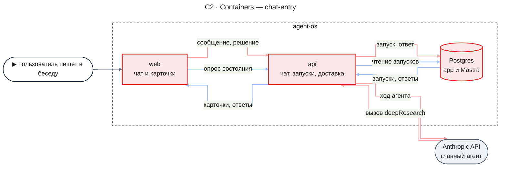

- `web` получает переключатель режима, метку запуска, карточку, ответ ресерча и опрос состояния.
- `api` получает инструмент агента с ходами режима и решения, маршрут чтения состояния, потребителя итога и цикл доставки ответа.
- Postgres получает таблицу `research_chat_launches` в схеме `app`; ответы пишутся в существующие таблицы Mastra; Anthropic API не меняется.

#### C3 · Components: api

**api — запуск и решения карточки**

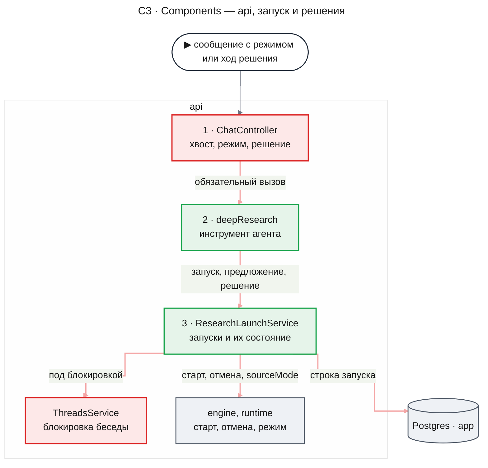

- `ChatController` перед ходом сбрасывает хвост с `beforeDelete` (KD-7). Если `discardRepliesAfter` сообщает, что запрос не повторяет сохранённое последнее сообщение пользователя, а сообщение не несёт `researchDecision`, контроллер закрывает открытые предложения беседы (DC-2). Он убирает из входа клиентские копии ответов ресерча (KD-5). Для режима или решения он кладёт в `requestContext` режим, решение и `id` сообщения пользователя и передаёт ходу `maxSteps` 1, `toolChoice` `{ type: 'tool', toolName: 'deepResearch' }`, `activeTools` `['deepResearch']` и весь объект `providerOptions` агента с выключенным `anthropic.thinking` и `effort` не выше `high`; по тому же `requestContext` агент берёт Haiku 5.5 (KD-1, KD-9). После хода решения, в обработчике разрешения `consumeStream` до `run.release()`, он дописывает реплике метку `researchDecisionReply` (KD-2).
- `deepResearch` зарегистрирован в `tools` агента. Беседу и владельца он берёт из `ctx.agent.threadId` и `ctx.agent.resourceId`, `launchKey` нового запуска — из `ctx.agent.toolCallId`, а режим, решение с его `launchKey` и `id` сообщения — из `requestContext`; в инструкции агента добавляется, когда предлагать ресерч.
- `ResearchLaunchService` — единственный, кто создаёт расследование и меняет строку запуска вне потребителя и цикла доставки. Старт расследования он вызывает вне блокировки беседы: `InvestigationService.create` сам берёт её через `ThreadOwnership`, а блокировка не реентерабельна. Режим источников строки он копирует из `InvestigationView` при сверке, а для строки без расследования отдаёт `Engine.sourceMode` (KD-8).
- Новый `ResearchChatController` в этой схеме не участвует: он обслуживает только `GET /api/threads/:threadId/research`, а маршрутов, которые меняют запуск, у части нет (KD-2).
  > **Для остановки изменено фичей `agent-quality`.** У остановки есть прямая операция, которая меняет запуск без хода беседы (FR-21 из [PRD `agent-quality`](../agent-quality/prd.md)). Где она живёт, решает дизайн части `lifecycle` фичи `agent-quality` — `docs/features/agent-quality/design-lifecycle.md`.

**api — доставка ответа**

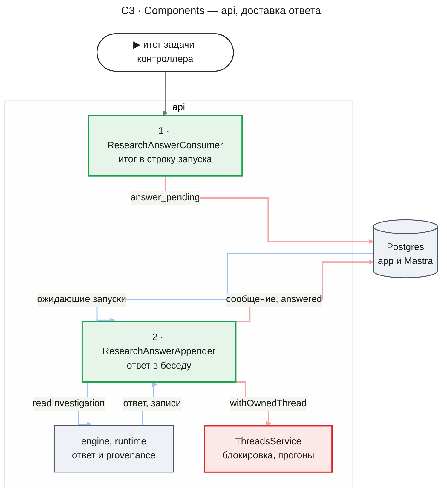

- `ResearchAnswerConsumer` реагирует только на итог задачи, чей `taskId` совпадает с `controllerTaskId` строки запуска; события дочерних задач и расследований, запущенных не из беседы, он пропускает.
- `ResearchAnswerAppender` работает при `RUNTIME_WORKERS=on`, стартует после `Runtime.start` и останавливается до `Runtime.stop`; беседу с прогоном в `ThreadRunRegistry` он пропускает до следующего прохода (KD-4). Режим источников ответа он берёт из `InvestigationView` и при `model_knowledge` не читает записи evidence (KD-8).
- `ResearchChatModule` — модуль Nest над компонентами части: импортирует `ThreadsModule` и модуль движка, а потребителя и хук удаления регистрирует до `Runtime.start`.

#### C3 · Components: web

**web — отправка и решения**

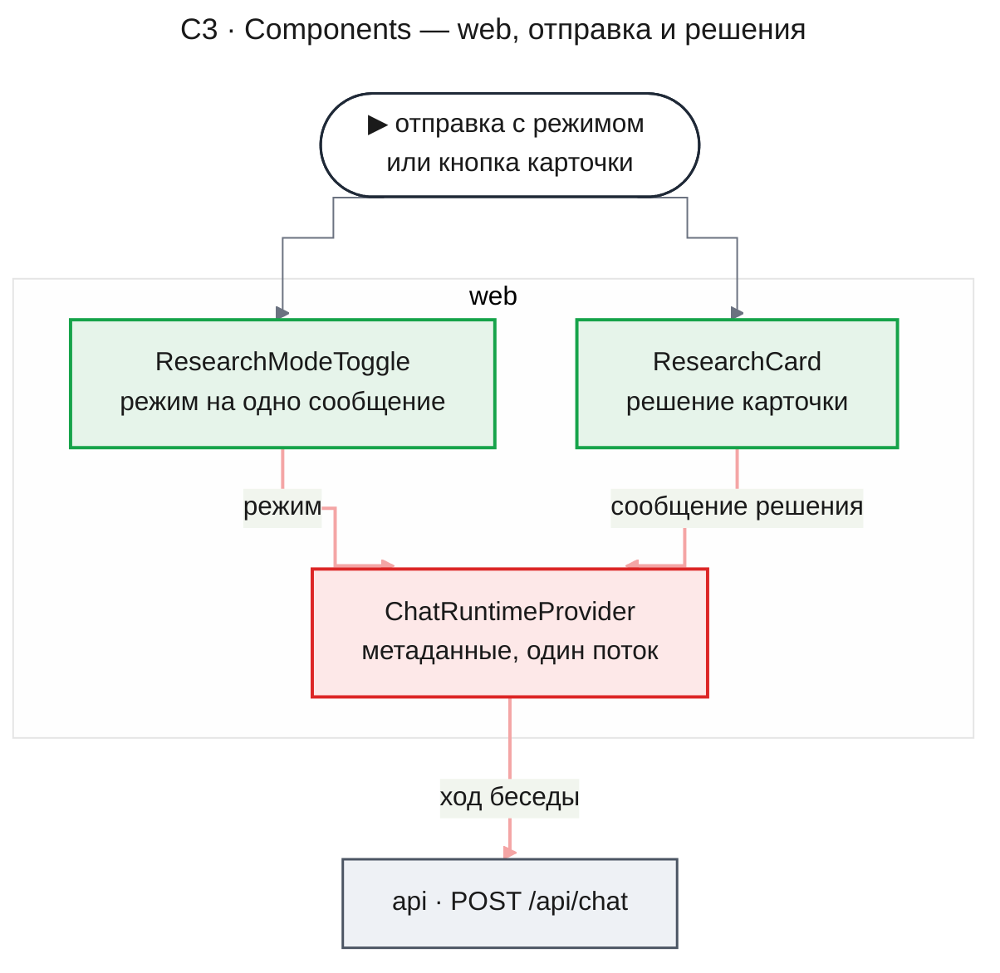

- `ResearchModeToggle` — shadcn `toggle` в слоте `ComposerExtra` по UXRD (DR-01, KD-1 UXRD). `ChatRuntimeProvider` передаёт `toCreateMessage` и исключает `deepResearch` из `sendAutomaticallyWhen` (KD-1).
- `ResearchCard` — интерфейс инструмента `deepResearch`: состояние берёт из `useThreadResearch`, до первого ответа сервера — из результата вызова. Кнопка добавляет в поток беседы сообщение решения (KD-2). При `sourceMode` `model_knowledge` карточка во всех состояниях несёт под бюджетом предупреждение MC-31 (KD-8, DC-8).
  > **Для «Остановить» изменено фичей `agent-quality`.** Кнопка «Остановить» не добавляет сообщение решения, а вызывает прямую операцию остановки. Поэтому «Остановка» на карточке длится, пока не ответит операция, ошибка MC-16 значит, что операция отказала или не ответила, а сама кнопка доступна и пока стримится ответ. Это меняет для «Остановить» и два пункта ниже. Действуют FR-21 из [PRD `agent-quality`](../agent-quality/prd.md) и [UXRD `agent-quality`, KD-5](../agent-quality/uxrd.md#key-decisions).
- Пока в этой вкладке стримится ход, кнопки решений на всех карточках неактивны с описанием MC-30 (UXRD KD-8), и очереди решений нет. «Запуск», «Отклонение» и «Остановка» — локальные состояния карточки, пока ход решения не вернул результат; композер тем временем в обычном состоянии идущего хода.
- Ошибку запуска, отказа или остановки — MC-15, MC-29 или MC-16 — карточка показывает по `decisionError` результата или по ошибке хода, в том числе когда пользователь прервал его кнопкой композера. Если решение успело примениться до сбоя, чтение состояния после хода решения (KD-6) переводит карточку в него.
- `ThreadMessage` не рисует сообщение пользователя с `researchDecision` и реплику ассистента с `researchDecisionReply`, как уже выбирает компонент по метаданным `modality` (DC-7); сообщение с `researchAnswer` он рисует всегда. Заглушку ответа с ошибкой, которую assistant-ui рисует за скрытым сообщением решения, когда ход упал до начала потока, он тоже не рисует: ошибку показывает карточка. Признак последнего сообщения для TH-10 веб считает по видимым сообщениям, а блок TH-08 остаётся у `s.message.isLast` (KD-2): после хода решения его нет, потому что AI SDK сбрасывает ошибку чата при отправке.

**web — опрос и ответ**

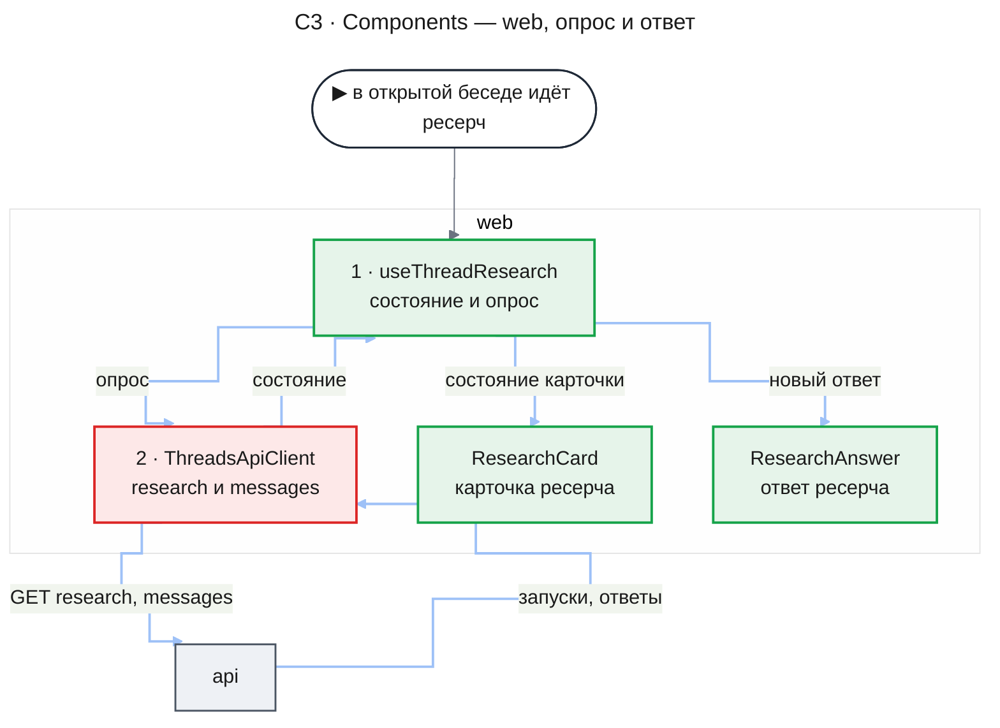

- `useThreadResearch` держит запуски открытой беседы отдельно от `ShellStatusStore`, ведёт опрос (KD-6), добавляет новые ответы в ленту и объявляет смену состояний по правилу UXRD, Accessibility; MC-17 и MC-18 звучат в варианте по `sourceMode` запуска (UXRD KD-9).
- `AssistantMessage` рисует `ResearchAnswer` вместо текста по метаданным `researchAnswer`, а `ResearchAnswer` показывает их `summary` и под ним подпись MC-34 под строкой цели, когда `summary` не null (DC-10), и по их `sourceMode` выбирает сноски и список источников или MC-32 и MC-33 (KD-8); `UserMessage` — метку DR-02 по признаку `deepResearch`; корень сообщения получает его `id` как якорь «К ответу» и «К запросу».
  > **Для краткого вывода заменено фичей `agent-quality`.** Сводка теперь — тексты принятых утверждений, а её подпись и вид задаёт [UXRD `agent-quality`, KD-3](../agent-quality/uxrd.md#key-decisions). Подробнее — в отметке у FR-20.
- Блок ошибки ответа (TH-08) показывает MC-21 для реплики с карточкой `proposed` или `running`; диалог удаления (DLG-01) при открытии читает запуски своей беседы и показывает MC-22 по числу `running` (DC-6).

### Runtime Flows

Удаление беседы с идущим ресерчем идёт по существующему потоку ([design-runtime.md, Flow 5](../research-runtime/design-runtime.md#flow-5-удаление-беседы-с-расследованиями)); часть добавляет только хук `purge`, удаляющий строки запусков беседы, и гонку с записью ответа из Flow 3.

#### Flow 1: явный запуск

**Starts when:** пользователь отправляет сообщение с включённым режимом «Глубокий ресерч», for AC-19.1, AC-19.6, AC-27.2

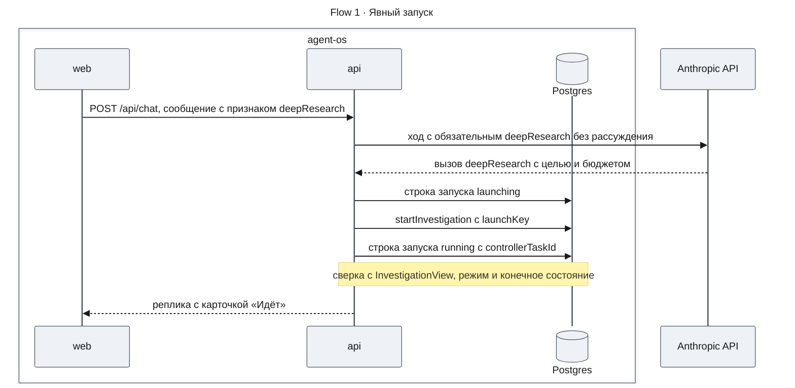

**Outcome:** у беседы одно расследование этого пользователя, строка запуска `running` с режимом источников расследования, а сохранённая реплика несёт вызов `deepResearch` с `launchKey`; без источников карточка с первого показа несёт MC-31 (KD-8). Сообщение пользователя хранит признак режима, и метка DR-02 видна после перезагрузки.

**Failure handling:**

- `startInvestigation` отказывает → строка запуска `failed`, инструмент возвращает это состояние, и карточка показывает «Не удался» (MC-12).
- Модель или провайдер падают до вызова инструмента → реплика с ошибкой TH-08, расследования нет; повтор — перегенерация.
- Процесс падает между `launching` и `running` → цикл доставки через `RESEARCH_LAUNCH_RECOVERY_MS` повторяет `startInvestigation` с тем же `launchKey` и доводит строку до `running` или `failed` (KD-3); реплика с карточкой при этом может быть не сохранена ([Risks](#risks-and-mitigation)).

#### Flow 2: подтверждение предложения

**Starts when:** пользователь нажимает «Запустить» на карточке-предложении, и веб отправляет ход решения, for AC-19.2, AC-19.3, AC-19.7, DC-1, DC-2, DC-7

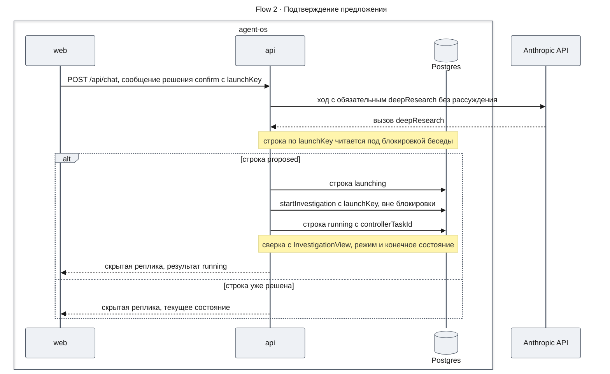

**Outcome:** у предложения ровно одно расследование с целью и бюджетом, которые записал инструмент; карточка «Идёт». Повторное подтверждение из любой вкладки возвращает то же состояние, а лента ни одной вкладки не получает нового сообщения (DC-7).

**Failure handling:**

- `startInvestigation` отказывает → строка возвращается в `proposed`, результат инструмента несёт `decisionError` `launch_failed`, карточка показывает MC-15, и кнопки снова активны.
- Модель или провайдер падают до вызова инструмента → строка не меняется, ход решения кончается ошибкой, карточка показывает MC-15; реплика с ошибкой несёт `researchDecisionReply` и скрыта вместе с сообщением решения, а без реплики скрыто одно сообщение решения.
- Строка `launching` после сбоя процесса → цикл доставки через `RESEARCH_LAUNCH_RECOVERY_MS` повторяет `startInvestigation`, получает `existing` или `created` и доводит строку до `running`; отказ старта возвращает её в `proposed` (KD-3).
- Пока шёл старт, хвост с карточкой удалён перегенерацией → строка `discarded`, и сервис отменяет только что созданное расследование.

#### Flow 3: доставка ответа

**Starts when:** runtime доставляет `TaskSucceeded` задачи контроллера потребителю `chat-entry.answers`, for AC-20.1, AC-20.2, AC-20.3, AC-20.6, AC-20.7, AC-27.3, DC-10, NFR-01, NFR-03

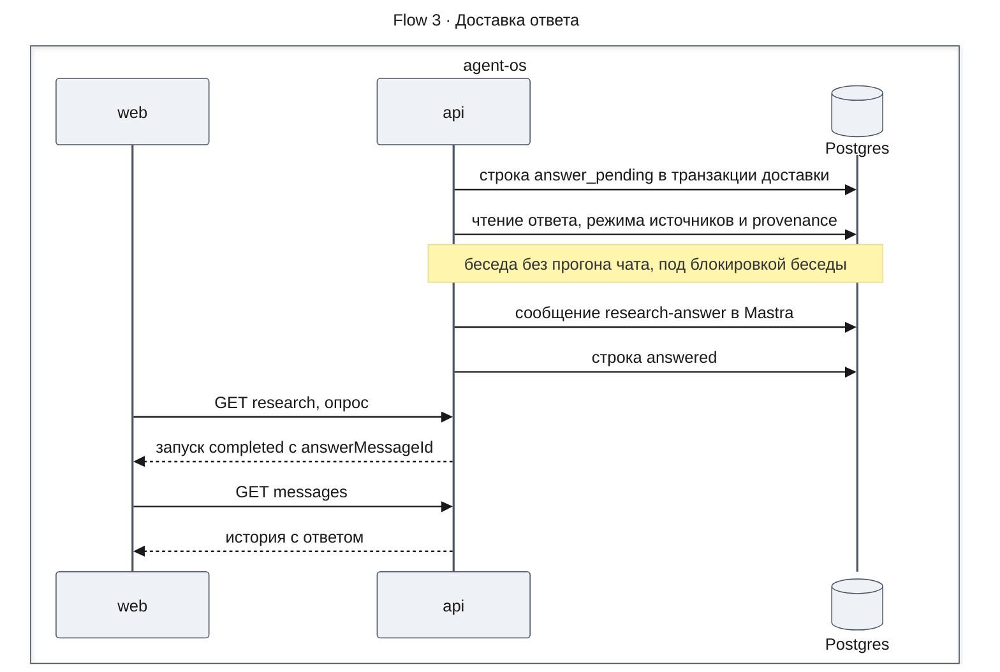

**Outcome:** ответ — одно сообщение ассистента в конце беседы на момент записи, со ссылкой на сообщение-запуск; карточка показывает «Завершён» со ссылкой «К ответу», а веб добавил ответ в ленту без перезагрузки и без запуска хода. В режиме без источников `researchAnswer` несёт `sourceMode` `model_knowledge`, а ответ — MC-32 и MC-33 вместо сносок; provenance не читается (KD-8).

**Failure handling:**

- В беседе идёт прогон чата → цикл пропускает беседу и дописывает ответ после конца прогона (DC-3).
- Беседа удалена → `withOwnedThread` отвечает 404, строка уже удалена хуком `purge`, и цикл ничего не пишет; ответ, записанный до фазы удаления, удаляется вместе с беседой (AC-22.1).
- Строка стала `stopped` или `discarded` до записи → проверка под блокировкой отменяет запись (AC-21.1, AC-22.2).
- Ошибка чтения или записи → строка остаётся `answer_pending` и пробуется снова после паузы, растущей по KD-4; ответы этой беседы, завершённые позже, ждут, так что порядок завершения сохраняется (AC-20.6); через `RESEARCH_APPEND_GIVE_UP_MS` после первой неудачи — `failed` (DC-4). Строка `answer_reappend` проходит тот же путь.
- Сбой процесса между записью сообщения и отметкой `answered` → следующий проход перезаписывает то же сообщение, дубля нет (NFR-03).
- `TaskFailed` или `TaskCancelled` задачи контроллера → строка `failed` или `stopped` без записи в беседу (AC-20.4).

#### Flow 4: остановка

> **Для кнопки изменено фичей `agent-quality`.** Кнопка «Остановить» больше не запускает этот поток: она вызывает прямую операцию остановки без вызова модели, и для остановки провайдер модели не нужен. Остановка через агента чата остаётся вторым входом в ту же операцию (FR-21 из [PRD `agent-quality`](../agent-quality/prd.md)). Как идёт остановка теперь, решает дизайн части `lifecycle` фичи `agent-quality` — `docs/features/agent-quality/design-lifecycle.md`.

**Starts when:** пользователь подтверждает «Остановить» на карточке, и веб отправляет ход решения, for AC-21.1, DC-1, DC-7

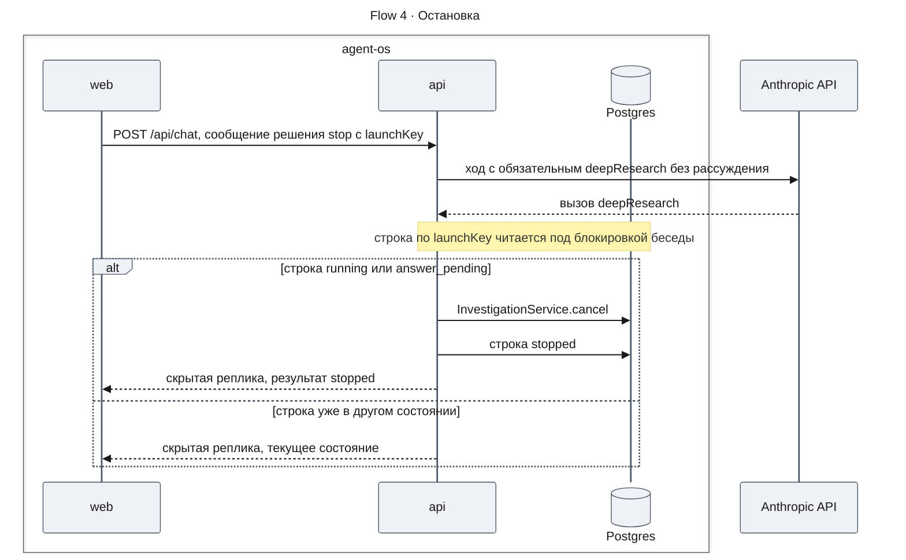

**Outcome:** расследование отменено, новых вызовов модели и источника нет (AC-01.4), и ответ не будет дописан, даже если контроллер успел завершиться; в ленте нет нового сообщения (DC-7).

**Failure handling:**

- `cancel` отказывает → строка не меняется, результат инструмента несёт `decisionError` `stop_failed`, карточка возвращается в «Идёт» с MC-16.
- Модель или провайдер падают до вызова инструмента → строка не меняется, ход решения кончается ошибкой, карточка возвращается в «Идёт» с MC-16.
- Строка `launching` → результат — текущее состояние, остановка доступна после перехода в `running`.

#### Flow 5: перегенерация реплики с карточкой

**Starts when:** пользователь перегенерирует упавший ответ, хвост которого несёт карточку или ответ ресерча, for AC-22.2, DC-5

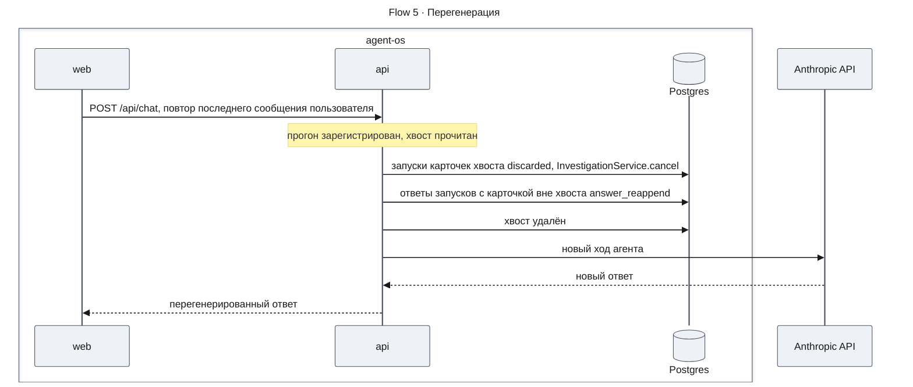

**Outcome:** за сообщением пользователя следует только перегенерированный ответ; расследования удалённых карточек отменены и ответа не дадут, а ответы запусков, чьи карточки вне хвоста, встают после нового ответа, когда прогон закончится.

**Failure handling:**

- Отбор запусков или отмена падают → `beforeDelete` бросает исключение, хвост не удалён, запрос отвечает ошибкой до стриминга; повтор перегенерации проходит тот же путь.
- `beforeDelete` прошёл, а удаление хвоста упало → `beforeDelete` работает вне транзакции удаления, поэтому запуски уже `discarded` или `answer_reappend`, а хвост на месте, и запрос отвечает ошибкой до стриминга. Повтор перегенерации отбирает тот же хвост заново: строку, уже переведённую в `discarded` или `answer_reappend`, отбор не меняет, а отмена runtime идемпотентна, так что повтор доводит удаление без второго эффекта. Если повтора нет, цикл перезаписывает ответы `answer_reappend` на их прежнем месте в хвосте: сообщение с тем же `id` ещё лежит в хранилище, и `createdAt` у него не меняется (KD-4). Карточки запусков, отобранных в `discarded`, остаются в ленте, но `GET research` их не отдаёт, и карточка показывает состояние из результата вызова. Выход — повтор перегенерации: он удаляет хвост вместе с этими карточками.
- В режиме ресерча новый ход снова вызывает `deepResearch` с новым `launchKey` → новый запуск, а отменённый остаётся в строке `discarded`.

### Contract Definitions

Схемы — в `@agent-os/contracts`. Действий над запуском в HTTP API нет: они идут ходом `POST /api/chat` с метаданными сообщения (KD-2).

> **Для остановки изменено фичей `agent-quality`.** У остановки есть прямая операция без хода беседы (FR-21 из [PRD `agent-quality`](../agent-quality/prd.md)); её контракт задаёт дизайн части `lifecycle` фичи `agent-quality` — `docs/features/agent-quality/design-lifecycle.md`. «Запустить» и «Не нужно» идут ходом, как сказано здесь.

- **`GET /api/threads/:threadId/research`** — под `SessionGuard`; запуски беседы владельца в порядке создания, кроме `discarded`. Возвращает `ThreadResearchResponse` со списком `ResearchLaunchView`. Чужая, удалённая или несуществующая беседа — 404 `THREAD_NOT_FOUND`, как в `/api/threads`.
- **Инструмент `deepResearch`, ход режима и ход без режима** — вход: `goal` — цель, как агент понял вопрос, в пределах `query` у `InvestigationSpec`; `tokenBudget` — необязательный бюджет токенов в границах `investigationTokens` конфигурации процесса, без него — её умолчание. В режиме ресерча запускает расследование процесса `deep-research` последней загруженной версии, иначе записывает предложение. Результат — `ResearchLaunchView` нового запуска; отказ старта возвращается состоянием `failed`, а не исключением, чтобы ход агента завершился.
- **Инструмент `deepResearch`, ход решения** — аргументы модели не читаются; действие и `launchKey` берутся из `researchDecision` сообщения. `confirm` запускает `proposed` (Flow 2), `decline` переводит `proposed` в `declined`, `stop` отменяет `running` или `answer_pending` (Flow 4); в любом другом состоянии решение ничего не меняет. Результат — `ResearchLaunchView` запуска и `decisionError` — `launch_failed` или `stop_failed`, когда старт или отмена отказали; запуск, которого нет в этой беседе этого владельца, даёт `decisionError` `not_found` без изменений.
- **`ThreadsService.discardRepliesAfter`** — получает необязательный `beforeDelete`, который вызывается с удаляемым хвостом до удаления и, как сам сброс, без блокировки беседы — вызывающий берёт её сам; его исключение отменяет удаление и пробрасывается. Последним сообщением пользователя считается последнее без `researchDecision`, а хвост после него может содержать скрытые пары решений и удаляется вместе с ними (KD-2). Возвращает признак `repeated`: совпадает ли последнее сообщение запроса с этим сообщением, то есть повтор ли это. Без `beforeDelete` хвост удаляется как прежде.
- **`ThreadRunRegistry.hasRuns`** — по `threadId` отвечает, есть ли у беседы зарегистрированный прогон чата в этом процессе.
  > **Для нескольких экземпляров сервера изменено фичей `agent-quality`.** `hasRuns` отвечает по прогонам чата всех экземпляров сервера: он читает таблицу `chat_thread_runs` ([`design-lifecycle.md`](../agent-quality/design-lifecycle.md#key-decisions), KD-6).
- **Потребитель `chat-entry.answers`** — `TaskSucceeded`, `TaskFailed`, `TaskCancelled` версии 1; меняет только строку запуска в переданной транзакции, повторная доставка ничего не меняет.

**ResearchLaunchView**

- `launchKey`, `mode` — `explicit` или `proposal`.
- `state` — `proposed`, `not_launched`, `running`, `completed`, `failed`, `stopped`; `launching` и `answer_pending` показываются как `running`, `answered` и `answer_reappend` — как `completed`, `declined` и `superseded` — как `not_launched`.
- `notLaunchedReason` — `declined` или `superseded`, только при `not_launched` (MC-13).
- `goal`, `tokenBudget`, `createdAt` — для строк «Цель», «Бюджет» и времени карточки.
- `answerMessageId` — только при `completed`, когда сообщение ответа сохранено: цель ссылки «К ответу».
- `answerPending` — `true` при `completed`, пока ответ, убранный перегенерацией, не дописан снова (`answer_reappend`); веб продолжает опрос (KD-6).
- `sourceMode` — `sources` или `model_knowledge`: режим расследования запуска, а пока расследования нет — текущий `Engine.sourceMode`; при `model_knowledge` карточка показывает MC-31 (KD-8, DC-8).

**Метаданные сообщений**

- `deepResearch` у сообщения пользователя — `true`, когда пользователь включил режим; читают `ChatController` и метка DR-02.
- `researchDecision` у сообщения пользователя — `action` (`confirm`, `decline`, `stop`) и `launchKey`; читают `ChatController` и `ThreadMessage`, который прячет это сообщение (KD-2).
- `researchDecisionReply` у реплики ассистента — `launchKey` хода решения; ставит `ChatController` на реплику этого хода, читает `ThreadMessage`, который прячет реплику (KD-2). Сообщение с `researchAnswer` эту метку не получает и не скрывается.
- `researchAnswer` у сообщения ответа — `launchKey`, `goal`, `summary` — краткий вывод синтеза из `InvestigationView.answer.summary` или null, когда его нет: ответ без синтеза собрал код (при остановке или когда контроллер признал, что вывода нет), конфигурация процесса не включает раздел `summary` или в группах `established`, `assumed`, `unknown` нет ни одного утверждения — тогда сборщик отбрасывает вывод движка (DC-10); `outcome`, `stopReason`, `launch` (`messageId` сообщения пользователя для явного режима или `toolCallId` карточки для предложения), группы `established`, `assumed`, `unknown` с утверждениями (текст, номера сносок, `verified`) и источники по номерам (`sourceId`, `toolName`, `snapshot`, признак `truncated` из `coverage`), `sourceMode` расследования. Раздел `removed` в ответ не попадает. При `sourceMode` `model_knowledge` группа `established` пуста, утверждения без номеров сносок, источников нет, а веб вместо меток «не проверено» и сносок рисует MC-32 и MC-33 (KD-8, DC-9).
  > **Для краткого вывода заменено фичей `agent-quality`.** Когда `summary` пуст, теперь решает правило сводки из принятых утверждений (FR-16 из [PRD `agent-quality`](../agent-quality/prd.md)). Подробнее — в отметке у FR-20.
- Текстовая часть сообщения ответа — Markdown из `researchAnswer` в таком порядке: MC-32, только при `sourceMode` `model_knowledge`; шапка MC-23 с исходом MC-24, строка «Цель» и причина MC-25, когда она есть; `summary` отдельным абзацем и следующим абзацем подпись MC-34, оба только когда `summary` не null, то есть когда синтез дал вывод и в ответе есть хотя бы одно утверждение в любой группе; группы MC-26 с утверждениями; список источников MC-28, когда источники есть. Подпись — постоянная микрокопия: в `researchAnswer` её нет, и текстовая часть, и веб берут её из UXRD. Причина остановки и `summary` вместе не встречаются: при остановке ответ собирает код, и вывода у него нет. Веб текстовую часть не показывает, её получают модель в следующих ходах и «Копировать» (KD-5, DC-9, DC-10).
  > **Для краткого вывода заменено фичей `agent-quality`.** Когда в тексте есть сводка и какая у неё подпись, теперь решают FR-16 из [PRD `agent-quality`](../agent-quality/prd.md) и [UXRD `agent-quality`, KD-3](../agent-quality/uxrd.md#key-decisions). Подробнее — в отметке у FR-20.

**Runtime settings**

- `RESEARCH_APPEND_GIVE_UP_MS` — default `300000`; сколько после первой неудачной записи ответа цикл ещё пробует, прежде чем перевести запуск в `failed` (KD-4, DC-4). Пауза между попытками — от `RUNTIME_POLL_MS` с удвоением до 16-кратной.
- `RESEARCH_LAUNCH_RECOVERY_MS` — default `60000`; через сколько строку в `launching` доводит цикл доставки (KD-3).
- Период цикла доставки — `RUNTIME_POLL_MS` runtime; период опроса веба — 2 000 мс, константа `apps/web` рядом с настройками опроса заголовка.
- Модель ходов режима и решения — `anthropic/claude-haiku-5-5`, константа `apps/api` рядом с `DEFAULT_MODEL`, а не настройка: обязательный вызов держится не на всякой модели (KD-9). `effort` этих ходов — `REASONING_EFFORT`, но не выше `high`.

### Data Model

`research_chat_launches` в схеме `app`: по строке на вызов `deepResearch` в ходе режима или без режима, ключ — `launchKey`; ход решения строки не создаёт. Строка хранит владельца и беседу, режим, цель и бюджет, `id` сообщения пользователя для явного режима, состояние, `investigationId`, `controllerTaskId` и `sourceMode` расследования после старта, время создания, завершения и записи ответа, время первой неудачной записи и следующей попытки. `investigationId` ссылается на `research_investigations` с каскадом, поэтому удаление расследования удаляет строку, а строки без расследования удаляет хук `purge` беседы (KD-7).

### State Transitions and Invariants

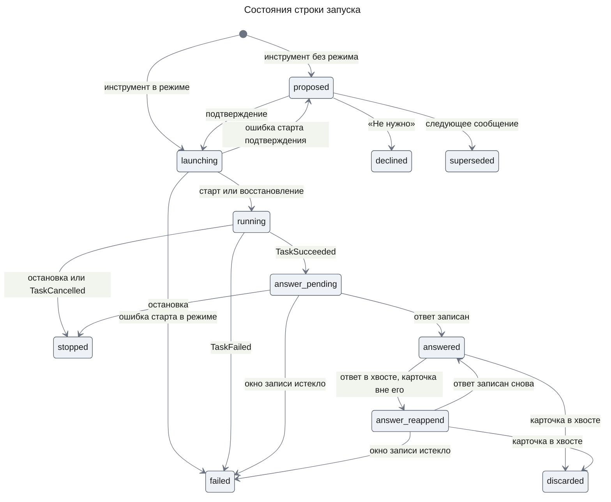

Из `proposed`, `launching`, `running` и `answer_pending` строка тоже уходит в `discarded`, когда перегенерация удаляет реплику с её карточкой; эти рёбра опущены на схеме. Остановка строку в `answer_reappend` не меняет: её ответ пользователь уже получил. Строка `failed` из `answer_reappend` показывает «Не удался»: ответа в беседе больше нет, и ссылке «К ответу» некуда вести.

**Invariants**

1. У строки не больше одного расследования, и создаёт его только `ResearchLaunchService` из `launching`, в том числе при восстановлении строки.
2. Строка без признака режима в сообщении пользователя и без подтверждения не покидает `proposed`, `declined`, `superseded` или `discarded`.
3. Сообщение ответа пишется только из `answer_pending` или `answer_reappend`, под блокировкой беседы, после проверки, что у беседы нет прогона чата; ход решения и отбор хвоста меняют строку под той же блокировкой.
4. У расследования не больше одного сообщения ответа: его `id` выводится из `investigationId`.
5. Строки ожидающих ответов одной беседы записываются в порядке завершения расследований.
6. `sourceMode` строки записывается один раз — из `InvestigationView` при сверке после старта — и совпадает с режимом расследования; сообщение ответа несёт тот же режим.

## Test Strategy

### Main Use Cases

- **UC-1: явный запуск** — covers AC-19.1, AC-19.6
  - Given: открытая беседа, агент отвечает вызовом инструмента ресерча
  - When: пользователь отправляет вопрос с включённым режимом, затем ещё одно сообщение без режима
  - Then: у беседы одно расследование, карточка «Идёт», метка DR-02 над вопросом и после перезагрузки; второе сообщение получает обычный ответ без нового расследования
- **UC-2: предложение и решение** — covers AC-19.2, AC-19.3, AC-19.4, AC-19.5
  - Given: беседа без режима, агент вызывает инструмент ресерча
  - When: пользователь нажимает «Запустить» на одной карточке и «Не нужно» на другой
  - Then: до нажатия расследований нет; после — одно расследование с целью и бюджетом первой карточки, вторая показывает «Не запущен» с причиной отказа
- **UC-3: повторное подтверждение** — covers AC-19.7, DC-1, DC-7
  - Given: беседа открыта в двух вкладках, обе показывают карточку «Ждёт подтверждения», и в первой предложение подтверждено
  - When: во второй вкладке на той же карточке нажимаются «Запустить», затем «Не нужно»
  - Then: расследование одно, карточка второй вкладки показывает «Идёт» без строки ошибки, и ни одна вкладка ни до, ни после перезагрузки не показывает новых сообщений в ленте
- **UC-4: ответ в открытой беседе** — covers AC-20.1, AC-20.7, AC-20.8, AC-27.4, DC-10
  - Given: подключён fixture, идущий ресерч, синтез вернул краткий вывод, беседа открыта
  - When: задача контроллера завершается `succeeded`
  - Then: без перезагрузки в конце ленты появляется ответ с исходом, кратким выводом сразу под строкой «Цель» и подписью MC-34 под ним, группами, сносками и списком источников, а в текстовой части вывод и следующая за ним подпись стоят там же, между строкой цели и группами; карточка — «Завершён» со ссылкой «К ответу»; ни карточка, ни ответ не несут MC-31, MC-32 и MC-33
  > **Для краткого вывода заменено фичей `agent-quality`.** Этот случай проверяет вывод-пересказ с подписью MC-34; сводку из принятых утверждений и её подпись проверяют случаи фичи `agent-quality` (отметка у FR-20).
- **UC-5: ответ после перезагрузки и рестарта** — covers AC-20.2, NFR-03
  - Given: процесс убит после записи сообщения и до отметки `answered`
  - When: процесс поднят, беседа перезагружена
  - Then: ответ стоит в беседе один раз, на той же позиции
- **UC-6: два ресерча** — covers AC-20.6
  - Given: два идущих ресерча одной беседы
  - When: запущенный вторым завершается первым
  - Then: его ответ стоит выше, и ссылка «К запросу» каждого ведёт на своё сообщение-запуск
- **UC-7: остановка** — covers AC-21.1
  - Given: идущий ресерч, контроллер успел завершиться, ответ ещё не записан
  - When: пользователь останавливает ресерч
  - Then: карточка «Остановлен», ответ не появляется, новых вызовов модели и источника нет
- **UC-8: удаление беседы** — covers AC-22.1, DC-6
  - Given: беседа с идущим ресерчем
  - When: пользователь открывает диалог удаления и удаляет беседу, затем расследование завершается
  - Then: диалог показал MC-22; расследование и строки запусков удалены, ответ не записан, беседа не появилась снова
- **UC-9: перегенерация** — covers AC-22.2, DC-5
  - Given: последний ответ упал и несёт карточку «Идёт», а в хранилище после него уже лежит ответ другого ресерча, чья карточка стоит выше последнего сообщения пользователя
  - When: пользователь перегенерирует ответ
  - Then: расследование карточки отменено, его ответ не появляется; за сообщением пользователя — только новый ответ, ответ другого ресерча — после него, а карточка другого ресерча всё время показывает «Завершён» и не предлагает «Остановить»; в открытой вкладке ответ другого ресерча возвращается в ленту после нового ответа без перезагрузки
- **UC-10: перегенерация после решения карточки** — covers AC-22.2, DC-7
  - Given: упавший последний ответ с карточкой «Предложение» открыт в двух вкладках, обе показывают блок ошибки
  - When: во второй вкладке пользователь нажимает «Запустить», затем в первой — «Перегенерировать»
  - Then: во второй вкладке блок ошибки исчез после нажатия; расследование карточки отменено, а за сообщением пользователя — только новый ответ, и после перезагрузки тоже
- **UC-11: перегенерация реплики с карточкой и её ответом** — covers AC-22.2, DC-5
  - Given: последний ответ упал и несёт карточку ресерча, который уже завершился, а его ответ стоит в хранилище после этой реплики
  - When: пользователь перегенерирует ответ
  - Then: за сообщением пользователя — только новый ответ; ответ этого ресерча не возвращается ни в открытой вкладке, ни после перезагрузки, а запуск не виден в `GET /api/threads/:threadId/research`
- **UC-12: беседа без источников** — covers AC-27.1, AC-27.2, AC-27.3, DC-9
  - Given: `apps/api` запущен без пакета `@agent-os/mcp-fixture`, синтез возвращает два утверждения
  - When: в одной беседе агент предлагает ресерч; в другой пользователь отправляет вопрос с режимом, ресерч завершается, беседа перезагружена, ответ скопирован
  - Then: предложение до решения несёт MC-31; карточка явного запуска несёт MC-31 с первого показа, а объявления — варианты MC-17 и MC-18 без источников; ответ открывается MC-32, у каждого утверждения MC-33, сносок, меток «не проверено» и списка источников нет, и после перезагрузки так же; скопированный текст содержит MC-32 и пометки
- **UC-13: смена набора источников** — covers DC-8, AC-27.4
  - Given: без источников в беседе стоят предложение и идущий ресерч, затем процесс перезапущен с подключённым fixture
  - When: пользователь открывает беседу, идущий ресерч завершается, затем подтверждается предложение
  - Then: предложение уже без MC-31; карточка идущего ресерча и его ответ — с предупреждениями и пометками; подтверждённый ресерч идёт без MC-31, а его ответ — со сносками

### Error and Edge Use Cases

- **UC-E1: ошибка запуска и остановки** — covers DC-1, DC-7
  - Given: старт или отмена расследования отказывают, провайдер модели падает в ходе решения, или ход решения падает до начала потока
  - When: пользователь нажимает «Запустить», «Не нужно» или «Остановить»
  - Then: карточка показывает MC-15, MC-29 или MC-16, кнопка снова доступна, а в ленте нет ни сообщения, ни блока ошибки
  - Then: если решение применилось до сбоя, после чтения состояния карточка показывает его, и опрос идёт
  > **Для «Остановить» изменено фичей `agent-quality`.** Ошибка остановки с карточки приходит от прямой операции, а не от хода решения (отметка у KD-2). Какие случаи проверяют остановку теперь, решает дизайн части `lifecycle` фичи `agent-quality`.
- **UC-E2: предложение без решения** — covers DC-2, AC-19.5
  - Given: карточка-предложение без решения
  - When: пользователь отправляет следующее сообщение, затем подтверждает старую карточку
  - Then: карточка показывает «Не запущен» с причиной MC-13, расследования нет
- **UC-E3: ответ во время стриминга** — covers AC-20.3, DC-3
  - Given: в беседе стримится ответ агента
  - When: ресерч завершается
  - Then: ответ ресерча появляется отдельной репликой после стримящегося ответа, и после перезагрузки порядок тот же
- **UC-E4: сбой ресерча и записи** — covers AC-20.4, DC-4
  - Given: задача контроллера проваливается, или запись ответа отказывает каждый раз
  - When: проходит доставка события или истекает `RESEARCH_APPEND_GIVE_UP_MS` с первой неудачной записи
  - Then: карточка «Не удался», ответа нет
- **UC-E5: чужая беседа** — covers AC-20.5
  - Given: беседа пользователя U с ресерчем
  - When: другой пользователь читает её запуски или отправляет ход решения с её `launchKey` в свою беседу
  - Then: чтение получает 404 `THREAD_NOT_FOUND`, ход решения — `decisionError` `not_found`, состояние запусков не изменилось
- **UC-E6: сбой процесса при старте** — covers AC-19.1, AC-19.3
  - Given: процесс упал после записи `launching` и до `running`
  - When: процесс поднят и прошло `RESEARCH_LAUNCH_RECOVERY_MS`
  - Then: у запуска одно расследование, карточка «Идёт», а по завершении ответ дописан
- **UC-E7: ответ после хода решения без реплики** — covers DC-7, AC-20.1
  - Given: идущий ресерч, и ход решения «Остановить» по его карточке упал или прерван до реплики, так что в хранилище за сообщением решения реплики нет
  - When: ресерч завершается
  - Then: ответ ресерча появляется в конце ленты без перезагрузки и после неё, а сообщение решения остаётся скрытым
  > **Для «Остановить» изменено фичей `agent-quality`.** Этот случай описывает ход решения от кнопки «Остановить», а кнопка теперь вызывает прямую операцию (отметка у KD-2).
- **UC-E8: остановка до синтеза без источников** — covers AC-27.3, AC-20.9, DC-9, DC-10
  - Given: без источников бюджет расследования исчерпан раньше, чем синтез завершён
  - When: ответ дописан в беседу
  - Then: ответ «Вывода нет» открывается MC-32, несёт причину MC-25 и не несёт ни краткого вывода, ни подписи MC-34, ни утверждений, а `researchAnswer.summary` — null; карточка — «Завершён»

### Non-Functional Use Cases

- **UC-N1: срок появления ответа** — covers NFR-01
  - Given: открытая беседа с настройками опроса по умолчанию, в одном случае без стримящегося ответа, в другом — со стримящимся ответом агента
  - When: задача контроллера завершается
  - Then: ответ в ленте в срок NFR-01, отсчитанный от завершения или от конца стрима
- **UC-N2: первый токен хода с режимом** — covers NFR-02
  - Given: сообщение с включённым режимом ресерча
  - When: пользователь его отправляет
  - Then: время до первого токена ответа не хуже требования `chat-shell`, измеренное тем же способом
- **UC-N3: доступность** — covers NFR-05
  - Given: экран беседы с карточкой и ответом
  - When: пользователь работает с клавиатуры и экранным диктором
  - Then: переключатель передаёт `aria-pressed`, фокус и объявления следуют таблице UXRD, Accessibility; MC-33 читается как текст сразу после утверждения

## Security Considerations

- **Authentication & Authorization**: маршрут чтения под `SessionGuard` и проверяет владельца беседы через `ThreadsService`. Ход решения проходит проверку владельца беседы в `ChatController`, как любой ход, а инструмент ищет запуск по `launchKey` вместе с беседой и владельцем хода, поэтому чужой `launchKey` ничего не меняет. Ответ пишется под `withOwnedThread` с владельцем из строки запуска.
- **Input Validation**: признак режима и решение приходят от клиента, но действуют только в беседе самого пользователя и только на её запуски; метаданные сообщения и вход инструмента проверяют схемы `@agent-os/contracts`, а бюджет — границы конфигурации процесса.
- **Sensitive Data Handling**: текст ответа — вывод модели и проходит ту же политику Markdown, что ответы чата; в логах — только `launchKey`, `investigationId` и состояния, без цели и текста ответа.

## Risks and Mitigation

- **Провайдер не принимает ход одной модели после ходов другой** — в беседе чередуются ходы Haiku 5.5 и модели чата (KD-9). Ранняя проверка приняла обычный ход с рассуждением сразу после ходов режима и после пары решения, но только на Haiku 5.5. Если провайдер не примет ход Opus 5.5 после пары решения или ход Haiku 5.5 после ходов Opus 5.5 с рассуждением, не работает следующий ход беседы или ход режима и решения; вероятность низкая. Приёмка части с реальной моделью проверяет обе последовательности на модели чата по умолчанию; расхождение — обновление дизайна до выпуска.
- **Метка реплики не записана после потока** — `Memory.updateMessages` после хода решения отказывает: вкладка, отправившая решение, скрывает реплику по метке потока, а после перезагрузки реплика видна второй карточкой того же запуска; редко. Ошибка пишется в лог, прогон освобождается как обычно.
- **Провайдер модели недоступен в момент нажатия** — ход решения падает, карточка показывает MC-15, MC-29 или MC-16, и пользователь нажимает снова; так же часто, как сбои обычных ходов. Цена ограничения PRD: решение карточки зависит от модели.
  > **Для остановки изменено фичей `agent-quality`.** Остановка от модели больше не зависит: кнопка «Остановить» вызывает прямую операцию без вызова модели (FR-21 из [PRD `agent-quality`](../agent-quality/prd.md)). Риск остаётся для «Запустить» и «Не нужно».
- **Процесс падает во время хода после старта расследования** — реплика с карточкой не сохраняется, а ответ, доведённый восстановлением строки, приходит без карточки; редко. Остаточный риск прототипа: ходы Mastra не восстанавливаются (ADR-0001).
- **Доставка события уходит в `needs_attention`** — карточка остаётся «Идёт»; редко. Ошибка видна в логе runtime и в SQL по доставкам.
- **Запрос чата приходит между проверкой прогонов и записью ответа** — до перезагрузки ответ в ленте стоит после ответа агента, а в хранилище — перед сообщением пользователя; окно в миллисекунды. Остаточный риск KD-4.
- **Блокировка и реестр прогонов локальны** — при нескольких экземплярах `apps/api` гарантии KD-4 и KD-7 не держатся; вне области (Part).
  > **Заменено фичей `agent-quality`.** Блокировка беседы и отметка о прогоне чата хранятся в Postgres, поэтому гарантии KD-4 и KD-7 держатся и при нескольких экземплярах (FR-22 из [PRD `agent-quality`](../agent-quality/prd.md)). Подробнее — в отметке у KD-4.
- **Пользователь принимает ответ на знаниях модели за проверенный по данным** — влияние среднее, вероятность высокая (PRD, Risks). Предупреждение стоит на карточке и в ответе, пометка — у каждого утверждения; все три переживают перезагрузку и копирование, а модель видит оговорку в следующих ходах (KD-8).
- **`EvidenceReader.get` читает и байты** — запись ответа читает до десятков записей со всем содержимым ради provenance; терпимо на fixture, [Open Questions](#open-questions).

## Open Questions

- Нужна ли в runtime операция чтения записи evidence без байтов? Это блокирует только стоимость записи ответа; решает Design Doc `runtime`, часть работает и без неё.

## Appendix: Fact Disposition

| Fact | Disposition | Handled in |
|------|-------------|------------|
| Маршрут чата и что доходит до агента, `chat.controller.ts` (chat.controller.ts:ChatController.chat) | transform | KD-1: режим из метаданных, обязательный инструмент; KD-7: `beforeDelete`, закрытие предложений |
| Агент без инструментов, `assistant.agent.ts` (assistant.agent.ts:createAssistantAgent) | transform | KD-1: инструмент `deepResearch` и инструкция |
| Нет возобновления после одобрения инструмента, `chat.controller.ts` (chat.controller.ts:tool-approval-resume) | out-of-scope | KD-1, KD-2: одобрение Mastra не используется |
| Хвост перегенерации удаляется целиком, `threads.service.ts` (threads.service.ts:ThreadsService.discardRepliesAfter) | transform | KD-7, Flow 5: `beforeDelete` |
| Реестр прогонов чата, `thread-run-registry.ts` (thread-run-registry.ts:ThreadRunRegistry) | transform | KD-4: операция `hasRuns` |
| Композер без режима, `thread.aui.tsx` (thread.aui.tsx:Composer) | transform | C3 web: `ResearchModeToggle`, MC-2, MC-3 |
| Слоты сообщений без интерфейсов инструментов, `tool-fallback.aui.tsx` (tool-fallback.aui.tsx:ToolFallbackImpl) | transform | C3 web: `ResearchCard`, `ResearchAnswer`, якоря; `ToolFallback` не меняется |
| Диалог удаления без данных о ресерче, `delete-thread-dialog.tsx` (delete-thread-dialog.tsx:DeleteThreadDialog) | transform | C3 web, DC-6 |
| DR-01…DR-04 нет в коде, `uxrd.md` (uxrd.md:DR-01..DR-04) | transform | C3 web, Contract Definitions |
| Haiku 5.5 принимает обязательный вызов без рассуждения, 5 из 5 ходов — один вызов без текста; работают и `tools` агента, и `toolsets` хода, план части (Progress Tracking, T1.4 S1) | transform | KD-1: регистрация в `tools`; C3 api: опции хода |
| Opus 5.5 (`DEFAULT_MODEL`) молча получает `tool_choice: auto` и рассуждение, план части (Progress Tracking, T1.4 S1) | transform | KD-9: ходы режима и решения на Haiku 5.5 |
| Haiku 5.5 выключает рассуждение только при `effort` не выше `high`, план части (Progress Tracking, T1.4 S1) | transform | KD-9, Runtime settings: `effort` не выше `high` |
| Обычный ход с рассуждением после ходов режима и пары решения принят на Haiku 5.5, план части (Progress Tracking, T1.4 S2) | preserve | Risks: смена модели проверяется приёмкой |
| `deepResearch` и `researchDecision` переживают `Memory.recall` и v7 с тем же `id`, план части (Progress Tracking, T1.4 S3) | preserve | KD-1 |
| Метаданных сохраняемой реплики у `agent.stream` нет; метку ставит `Memory.updateMessages` по `dbMessages` до `run.release()`, план части (Progress Tracking, T1.4 S4) | transform | KD-2, C3 api; Risks: метка не записана |
| `execute` получает `ctx.agent.threadId`, `ctx.agent.resourceId`, `ctx.agent.toolCallId` и `requestContext`, план части (Progress Tracking, T1.4 S5) | transform | C3 api: `deepResearch` |
| Копия реплики с тем же `id` во входе хода сохранённую не перезаписала, план части (Progress Tracking, T1.4 S6) | transform | KD-5: причина фильтра; KD-3: причина отказа от состояния в сообщении |
| `model` агента Mastra — функция контекста хода (agent.d.ts:Agent model `DynamicArgument`), агент чата с постоянной моделью (assistant.agent.ts:createAssistantAgent) | transform | KD-9: выбор модели по `requestContext` |
| `toAISdkStream` v7 принимает `messageMetadata` (convert-streams.d.ts:AgentStreamOptionsV7) | transform | KD-2: метка в потоке этой вкладки |
| `summary` ответа движка — null у ответа, который собрал код, и отсутствует во `InvestigationView`, когда конфигурация процесса не включает раздел (code-answer.ts:buildCodeAnswer, investigation-view.ts:answerView); синтез ставит `stopReason` null (reference-gateway.ts) | transform | Contract Definitions: `researchAnswer.summary` и текстовая часть; DC-10 |

Дизайн сохраняет без изменений `ThreadsService.withOwnedThread` как блокировку записи вне хода (threads.service.ts:ThreadsService.withOwnedThread), контракт `EventConsumer` (event-consumer.registry.ts:EventConsumer), порядок удаления беседы и хук runtime (threads.service.ts:ThreadsService.delete), форму `HistoryMessage` (threads.ts:HistoryMessageSchema), однократную загрузку истории (thread-history-adapter.ts:createHistoryAdapterFactory) и идемпотентную отмену runtime (investigation.service.ts:InvestigationService.cancel).

## Update History

| Version | Date | Change |
|---------|------|--------|
| 1.0 | 2026-11-01 | Initial version |
| 1.1 | 2026-11-01 | Решения карточки — скрытый ход беседы с обязательным вызовом `deepResearch` вместо POST-маршрутов; NFR-01 при стриме по PRD; опрос до повторной записи ответа (`answerPending`); `discarded` из `answered` и `answer_reappend`; отказ записи по окну `RESEARCH_APPEND_GIVE_UP_MS`; порядок сверки при старте; признак повтора у `discardRepliesAfter`; скрытые пары решений не считаются последним сообщением и уходят с хвостом; убраны ссылки на часть `eval` |
| 1.2 | 2026-11-01 | Согласовано с UXRD: кнопки решений неактивны, пока стримится ответ (KD-8, MC-30), очереди решений нет; состояние «Отклонение» и ошибка отказа MC-29; нажатие кнопки не закрывает предложения (KD-4) |
| 1.3 | 2026-11-01 | После хода решения блок ошибки TH-08 исчезает: AI SDK сбрасывает ошибку при отправке, правило последнего видимого сообщения остаётся для TH-10 и для TH-08 до решения; повтор отбора хвоста после неудачного удаления ничего не меняет повторно (Flow 5) |
| 1.4 | 2026-11-01 | Approved. Реплика хода решения скрывается по метке `researchDecisionReply`, а не по месту, ответ ресерча не скрывается (UC-E7); чтение состояния после каждого хода решения, в том числе упавшего (UC-E1); правило последнего видимого сообщения — только для TH-10, TH-08 у `s.message.isLast`; ход решения строки не создаёт; ответы `answer_reappend` после неудачного удаления хвоста перезаписываются на месте; уточнены «Хвост» и «Скрытая пара» |
| 1.5 | 2026-11-01 | Ход решения, упавший до начала потока: заглушка ответа с ошибкой скрыта, ошибку показывает карточка (KD-2, UC-E1); ранний тест с реальной моделью проверяет, что Mastra сохраняет метаданные потоковой реплики и `researchDecisionReply` переживает перезагрузку (Risks) |
| 1.6 | 2026-11-01 | По PRD 1.12, UXRD 1.7 и Design Doc `engine` 1.9 — режим без источников (FR-27): KD-8 — карточка читает `Engine.sourceMode`, пока расследования нет, и режим расследования после старта; поле `sourceMode` в `ResearchLaunchView`, строке запуска и `researchAnswer`; MC-31–MC-33 и варианты MC-17, MC-18; текстовая часть ответа несёт оговорку (DC-8, DC-9, инвариант 6); `apps/api` без источников (FR-26) в Constraints; повтор старта берёт оболочку (`engine` KD-9); UC-4 с fixture, UC-12, UC-13, UC-E8; риск ответа на знаниях модели. Статус Approved сохранён |
| 1.7 | 2026-11-02 | По ранней проверке с реальной моделью: KD-9 — ходы режима и решения на Haiku 5.5 с `effort` не выше `high`, обычные — на модели чата; опции хода, регистрация `deepResearch` в `tools` агента и источники контекста инструмента (KD-1, C3 api); метка `researchDecisionReply` — в потоке и через `Memory.updateMessages` до `run.release()` (KD-2); исправлены причины в KD-5 и KD-3; риски — смена модели в беседе и незаписанная метка вместо проверенных; строки Fact Disposition по находкам. Статус Approved сохранён |
| 1.8 | 2026-11-02 | Решение пользователя: ответ показывает краткий вывод синтеза (`InvestigationView.answer.summary`) сразу под строкой «Цель», перед группами. `researchAnswer` получает `summary` (строка или null); порядок частей текстовой части — в Contract Definitions, в режиме без источников текст по-прежнему открывается MC-32 (KD-5, C3 web, DC-10, UC-4, UC-E8). Статус Approved сохранён |
| 1.9 | 2026-11-02 | Решение пользователя: краткий вывод — пересказ утверждений ответа, а не самостоятельное утверждение (Design Doc `engine` 1.15). По PRD 1.14 и UXRD 1.9 (KD-11, MC-34) сразу после абзаца `summary` текстовая часть ставит подпись MC-34, а веб показывает её под выводом. По правилу оркестратора вывод и подпись идут только вместе: в ответе без единого утверждения ни в одной группе сборщик отбрасывает вывод (`researchAnswer.summary` null), и нет ни абзаца, ни подписи; с хотя бы одним утверждением в любой группе, включая «Не выяснено», есть оба. AC-20.8 и AC-20.9 в FR-20, UC-4 и UC-E8 (DC-10, C3 web, Contract Definitions — порядок текстовой части). Статус Approved сохранён |
| 1.10 | 2026-11-06 | Отметки об изменении KD-2 для остановки утверждённой фичей `agent-quality` (её FR-21): у «Остановить» прямая операция без вызова модели, ход чата — второй вход. Отмечены Snapshot, KD-1, KD-2, термин «Ход решения», первое ограничение в Part, пункты FR-19 об устаревшей карточке и о кнопках во время стрима, `ResearchChatController` в C3 api, `ResearchCard` в C3 web, Flow 4, вступление Contract Definitions, UC-E1, UC-E7, риск недоступного провайдера. Утверждённый текст не менялся; статус Approved сохранён |
| 1.11 | 2026-11-06 | Отметки о двух правилах, которые заменила утверждённая фича `agent-quality`. Гарантии беседы при нескольких экземплярах сервера (её FR-22, `design-lifecycle.md` KD-1, KD-5, KD-6): блокировка беседы — advisory lock Postgres, отметки прогонов чата — таблица `chat_thread_runs`, ответ пишется только закрытого расследования; отмечены Snapshot, KD-4, KD-7, пункт Out of scope о нескольких экземплярах, пункт FR-20 о стримящемся ответе, `ThreadRunRegistry.hasRuns`, риск «Блокировка и реестр прогонов локальны». Сводка из текстов принятых утверждений (её FR-16, AC-16.3, AC-16.4 и UXRD KD-3): отмечены Snapshot, пункт FR-20 о кратком выводе, `AssistantMessage` в C3 web, `researchAnswer`, порядок текстовой части, UC-4. Утверждённый текст не менялся; статус Approved сохранён |
