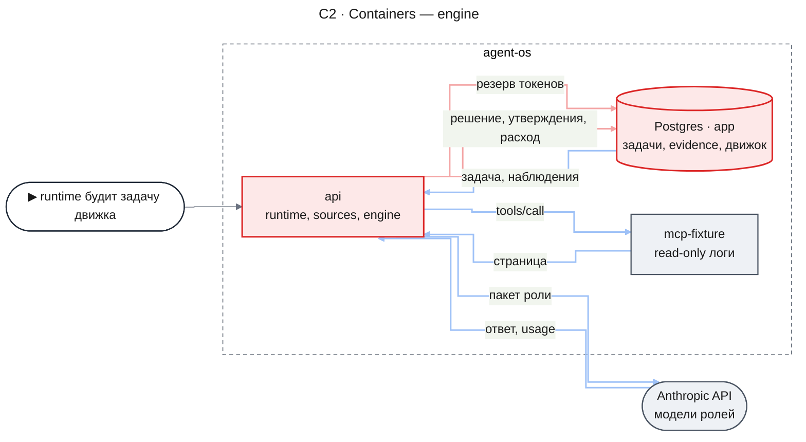
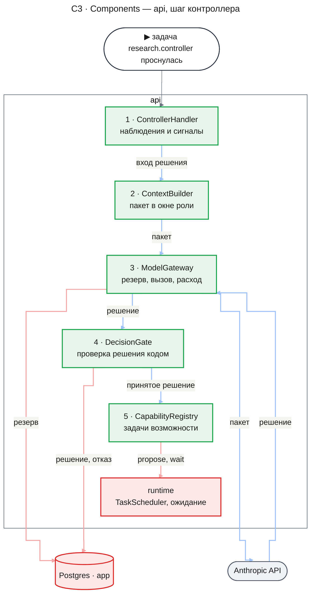
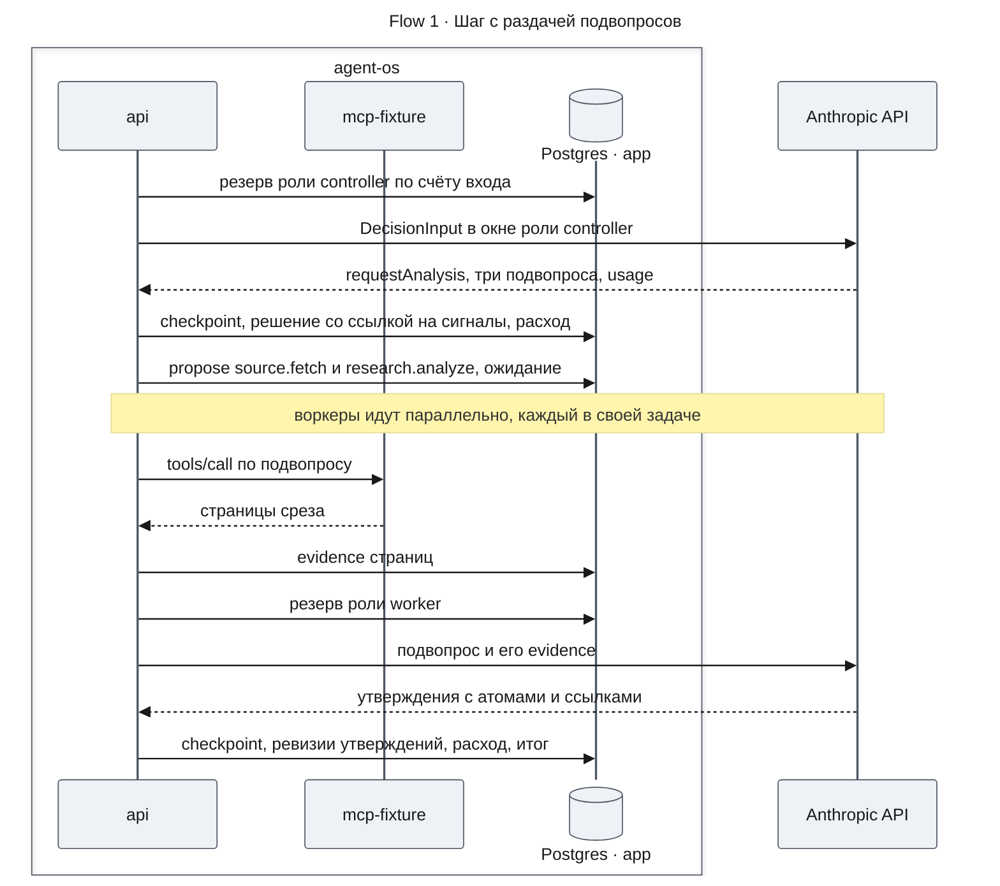
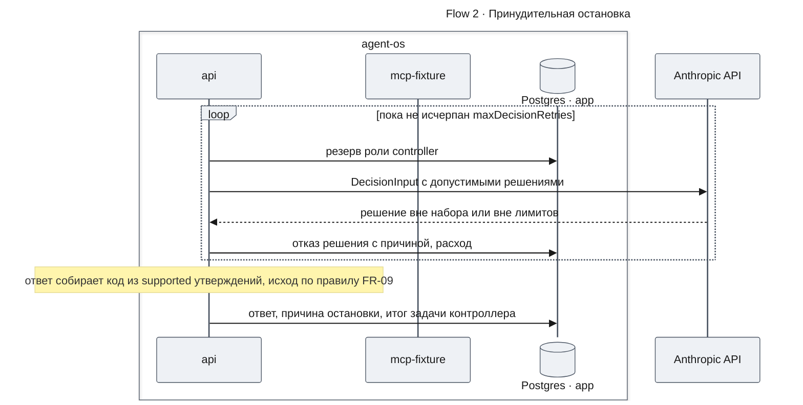
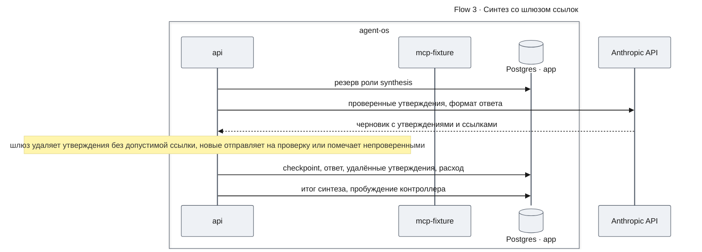
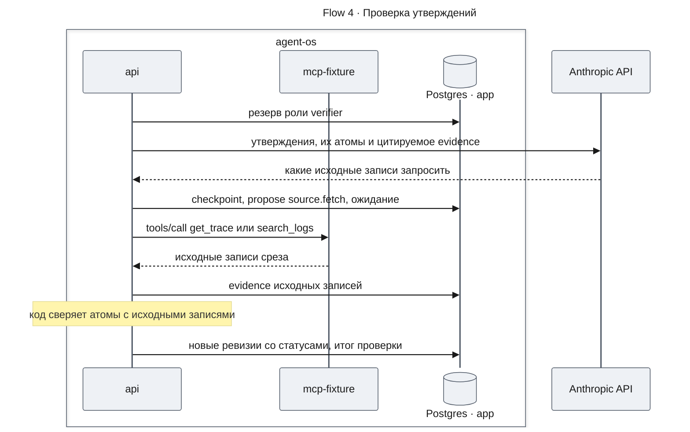
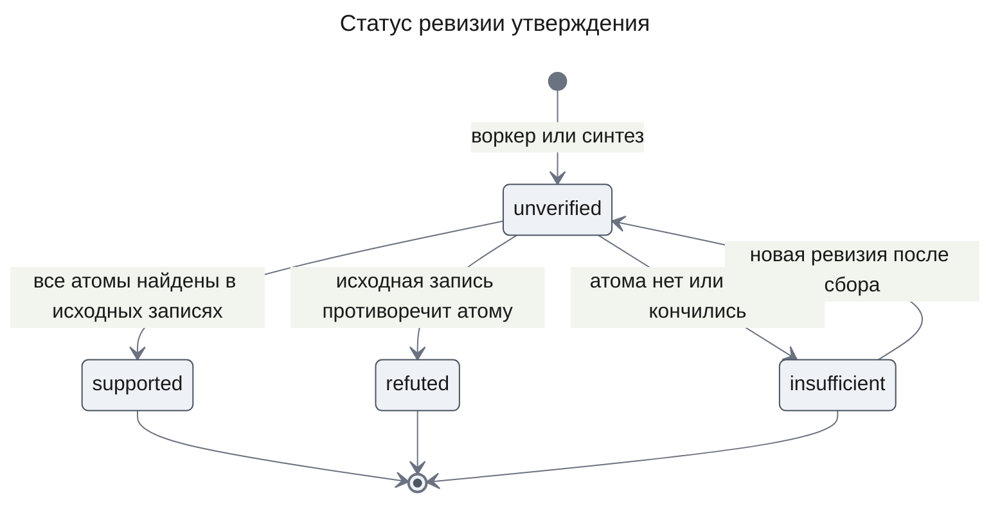

# Глубокое исследование — Design Doc — engine

**Статус:** Approved · **Дата:** 2026-11-01 · **PRD:** [prd.md](./prd.md) · **UXRD:** [uxrd.md](./uxrd.md) — часть без UI · **Зависит от:** внутри фичи — ничего; внешние контракты — [design-runtime.md](../research-runtime/design-runtime.md#contract-definitions), [design-mcp-source.md](../research-runtime/design-mcp-source.md#contract-definitions)

## Snapshot

**Overview.** Часть добавляет отдельный пакет — исследовательский движок поверх runtime задач. Процесс исследования не зашит в код: движок читает одну декларативную конфигурацию с целью, включёнными возможностями, промптами, моделями ролей и лимитами. Контроллер живёт как одна задача runtime и на каждом шаге выбирает одно решение из закрытого набора; код проверяет решение и только тогда ставит задачи сбора, воркеров, проверки или синтеза. Каждый вызов модели получает пакет в бюджете рабочего окна своей роли и начинается, только если под него зарезервированы токены задачи и расследования. Утверждения проверяет код по исходным записям, а в ответ попадают только утверждения со ссылкой на evidence этого расследования.

- **Не меняется**: контракт `mcp-source`, таблицы и события runtime и `mcp-source`, агент чата и `DEFAULT_MODEL`; контракт runtime получает одно обратно совместимое добавление — порт `TaskContext.withAttemptGuard` (KD-3).
- **Главный риск**: модель класса Haiku в роли воркера или проверяющего даёт невалидный структурированный вывод, и расследование уходит в отказы и принудительную остановку.
- **Открытые вопросы**: нет.

### Key Decisions

#### KD-1: Процесс задан одной конфигурацией-данными, а движок её исполняет

Цель, включённые возможности и их лимиты, источники, промпты и модели ролей, бюджеты окна и формат ответа лежат в одном JSON-объекте `ProcessConfig`, который строгая схема проверяет при создании движка. Возможности берутся только из закрытого реестра движка, промпты подставляют только поля из закрытого списка, а неизвестный ключ — ошибка, поэтому в конфигурации негде разместить исполняемый код (FR-12). Конфигурация глубокого исследования поставляется файлом данных пакета и проходит ту же проверку (AC-12.3). Процесс как TS-модуль, процесс как Mastra workflow и язык выражений для переходов сравнены с этим решением и отвергнуты в [ADR-0005](../../adr/ADR-0005-process-config-data-only.md).

Процесс определяет пара `processId` и `version`, поэтому движок держит несколько версий одного процесса, а повтором считается только та же пара. Старт без версии берёт наибольшую загруженную, и расследование до конца исполняется на версии, с которой стартовало (DC-15). Не взят запрет повторного `processId` без учёта версии: новая версия процесса вытесняла бы старую при загрузке, и старую можно было бы запустить только под другим именем.

#### KD-2: Контроллер — одна долгоживущая задача `research.controller`, шаг — принятое решение, сон — ожидание runtime

Движок ставит задачу контроллера при старте расследования. Попытка задачи принимает решения подряд, пока очередное решение не требует ждать; тогда она предлагает задачи через `TaskScheduler.propose`, регистрирует ожидание через `registerWait` и возвращает `wait`, а runtime будит её новой попыткой, когда ожидаемые задачи завершились. Решение записывает только текущая попытка и до того, как предложены его задачи; принятое решение на шаг одно, а повторное предложение того же `TaskSpec` после рестарта даёт `subscribed`, поэтому рестарт не теряет и не дублирует шаг (NFR-03, инвариант 3).

Всё расследование укладывается в дедлайн задачи контроллера ([Runtime settings](#contract-definitions)). Runtime ставит задаче дедлайн только при первом захвате и прерывает попытку на дедлайне. Задачу, которая ждёт за дедлайном, он проваливает, а ожидания по времени не знает: `wait` несёт только `waitFor`.

Поэтому момент `notAfter` — дедлайн контроллера минус `deadlineMarginMs` — ограничивает все роли: после него ни одна не начинает вызов модели, а идущий вызов прерывается (инвариант 5). Решение записывает `notAfter`, и каждая его задача получает срок, равный остатку времени до `notAfter` в момент предложения; runtime отсчитывает этот срок от захвата задачи. Задачи анализа, проверки и синтеза сами останавливаются в `notAfter`, а задача сбора идёт до своего срока, поэтому контроллер просыпается до своего дедлайна и собирает ответ кодом (DC-3), если сбор захвачен в пределах `deadlineMarginMs` после решения. Остальное — остаточный риск: контроллер проваливается без ответа, когда сбор захвачен позже и идёт до своего срока или сам контроллер не захвачен до дедлайна ([Risks](#risks-and-mitigation)).

Не взяты: цепочка задач-шагов, где шаг возвращает задачи и следующий шаг в `proposedTasks`, — провал любой задачи сбора каскадом отменяет следующий шаг через `depends_on`; цикл контроллера в памяти процесса — рестарт теряет расследование; ожидание с таймером в runtime — меняет утверждённый контракт runtime.

#### KD-3: Состояние движка — собственные таблицы `research_*` в `@agent-os/db`, а запись охраняет новый порт runtime

План, решения, сигналы, утверждения, ответ и журнал вызовов модели живут в шести новых таблицах; каждая каскадно удаляется вместе с `research_investigations`, так что удаление беседы чистит и их. Отвергнуты три варианта: итог задачи и checkpoint — они ограничены 64 KiB, не читаются запросом и пропадают у потерянной попытки, а журнал вызовов должен её пережить; evidence — оно требует provenance источника и всегда пишет статус `observed`, а утверждению нужен статус `insufficient`, которого нет в `KnowledgeStatus`; расширение runtime типом события решения и бюджетом токенов в `InvestigationSpec` — оно меняет утверждённый контракт ради одного клиента. `TaskBudget.maxTokens` движок использует как есть — это лимит токенов задачи.

Записи движка от ответа модели должна отклонять охрана попытки, как отклоняет runtime записи брошенной попытки (инвариант 3). Для этого контракт runtime получает одну обратно совместимую операцию `TaskContext.withAttemptGuard`: она исполняет работу движка в одной транзакции `@agent-os/db`, сначала проверив под блокировкой runtime, что задача `running` и попытка — вызывающего, и возвращает отказ `fenced` с откатом, если это не так. Существующие обработчики её не вызывают, а реализует операцию план этой части. Решение об операции и отвергнутые варианты записаны в [design-runtime.md, KD-9](../research-runtime/design-runtime.md#key-decisions), контракт и ограничения для движка — в [Contract Definitions](#contract-definitions).

#### KD-4: Бюджет токенов держит резерв в журнале вызовов до вызова: счёт входа провайдером, запас, потолок выхода

Перед каждым вызовом `ModelGateway` считает входные токены пакета через `count_tokens` провайдера (порт `TokenCounter`), прибавляет `marginTokens` и `maxOutputTokens` роли и одной охраняемой записью резервирует сумму в пределах остатка расследования и `maxTokens` задачи (FR-07). Отказ резерва останавливает вызов до сети; после ответа резерв заменяется фактическим расходом с ценой по каталогу моделей (FR-11). Резерв, который никто не закрыл, — потерянной попытки, отменённой или завершённой задачи — закрывается как `abandoned` и списывается целиком, поэтому журнал завышает, но не занижает расход.

Адаптер `AnthropicTokenCounter` живёт в пакете движка и обращается к `count_tokens` обычным HTTP-запросом; ключ и базовый URL провайдера даёт точка сборки. Не взяты: учёт после вызова — он не мешает вызову сверх бюджета; оценка по числу символов — токенизатор на JSON логов с ней заметно расходится; резерв токенов внутри runtime — меняет его контракт (KD-3); `@anthropic-ai/sdk` для счёта — второй SDK провайдера рядом с Mastra ради одного метода.

#### KD-5: Модели ролей — Anthropic: `anthropic/claude-sonnet-5-5` в узких точках, `anthropic/claude-haiku-5-5` в воркерах и проверке

Модели ролей выбирает этот KD; их идентификаторы, окна и цены — в каталоге и таблице ролей [Runtime settings](#contract-definitions). Постановка, контроллер и синтез работают на модели узких точек — Sonnet 5.5 — с коротким пакетом, воркеры и проверяющий — на Haiku 5.5; это смешанная схема FR-10, и любую роль переводит на другую модель правка конфигурации (AC-10.2). Окна и цены проверены по [странице цен провайдера](https://platform.claude.com/docs/en/about-claude/pricing) 2026-11-01 и записаны в каталоге моделей ([Runtime settings](#contract-definitions)); установленная Mastra 1.80.0 подтверждает только, что идентификаторы есть в её реестре.

Окно Haiku 5.5 — 1M, вопреки допущению дайджеста (250k), и выше 100 000 входных токенов её цена растёт впятеро. Поэтому бюджет окна Haiku-ролей держится ниже 100 000: рабочее окно меньше номинального и по качеству (дайджест, раздел 9). Данные сценария всё равно больше окна: 120 000 записей среза `v1`, в каждой 32-символьный `traceId`, время ISO и сообщение, — заведомо больше 30 токенов на запись, то есть больше 3,6M токенов. Не взяты: Haiku 4.5 — окно 200K и цена в 10 раз выше; Opus 5.5 в узких точках — вход, выход и cache read вдвое дороже Sonnet 5.5, пользователь выбрал Sonnet; модели класса Haiku во всех ролях — узкие точки пользователь оставил на Sonnet (PRD, Constraints).

#### KD-6: Статус утверждения и допуск в ответ решает код, а модель только предлагает

Проверяющий на Haiku выбирает, какие исходные записи запросить для утверждения; задача `research.verify` предлагает по ним задачи `source.fetch`, ждёт их тем же способом, что контроллер (KD-2), и сверяет кодом атомы утверждения с полученными записями (FR-08, дайджест, раздел 1, п. 4). Ответ синтеза проходит шлюз ссылок кодом, а ответ при принудительной остановке собирает код без вызова модели, потому что бюджета на вызов может не быть (FR-09). Не взяты: вердикт модели-проверяющего как статус — самооценка без внешнего сигнала близка к угадыванию; запрос исходных записей через решение контроллера `requestEvidence` — проверка растягивается на лишние шаги контроллера на дорогой модели; ответ принудительной остановки от модели синтеза — при исчерпанном бюджете его нельзя получить.

#### KD-7: Агенты ролей — отдельные `Agent` Mastra без экземпляра `Mastra` и без памяти, модели и ключи даёт точка сборки

Это ответ на известное неизвестное ADR-0004: движку не нужен экземпляр `Mastra` из `apps/api`. Каждый вызов роли — обычный `Agent` со структурированным выводом, как у агента заголовков беседы; историю расследования собирает `ContextBuilder` из таблиц движка и evidence, а не память Mastra. Модель по идентификатору возвращает порт `resolveModel` от точки сборки, так что пакет не читает окружение. Не взяты: регистрация агентов в экземпляре `Mastra` — экземпляр живёт в `apps/api`, поэтому тесты пакета движка без `AppModule` (ADR-0004) не могли бы его собрать, и он даёт ненужную память; прямой Anthropic SDK для вызовов — ADR-0004 закрепляет Mastra в пакете движка.

## Terms

- **Возможность** — процедура движка из закрытого реестра: `plan`, `gather`, `analyze`, `verify`, `synthesize`; конфигурация включает подмножество.
- **Решение** — выбор контроллера на шаге: `requestEvidence`, `requestAnalysis`, `requestVerification`, `replan`, `wait`, `proposeAnswer` или `concludeInconclusive` (спецификация, раздел 9).
- **Шаг** — одно принятое решение контроллера; отклонённое решение шагом не считается.
- **Атом** — проверяемая кодом часть утверждения: `traceId`, сервис, событие, интервал или число.
- **Новизна шага** — новое evidence или новая ревизия утверждения, появившиеся после предыдущего шага.
- **Принудительная остановка** — конец расследования по бюджету, лимиту шагов, отказам контроллера, недоступности модели, запасу дедлайна или входу контроллера больше его окна; исход ставит правило PRD (FR-09).

## Part

- **Part**: `engine`
- **Covers**: FR-01, FR-02, FR-03, FR-04, FR-05, FR-06, FR-07, FR-08, FR-09, FR-10, FR-11, FR-12
- **Depends on**: ничего внутри фичи — первая часть. Внешние контракты: [design-runtime.md, Contract Definitions](../research-runtime/design-runtime.md#contract-definitions) и [design-mcp-source.md, Contract Definitions](../research-runtime/design-mcp-source.md#contract-definitions)
- **Prerequisite ADRs**: [ADR-0001](../../adr/ADR-0001-durable-runtime-owner.md), [ADR-0002](../../adr/ADR-0002-app-schema-migrations.md), [ADR-0003](../../adr/ADR-0003-drizzle-data-layer.md), [ADR-0004](../../adr/ADR-0004-agent-framework-packages.md), [ADR-0005](../../adr/ADR-0005-process-config-data-only.md)
- **Sibling parts**: `chat-entry` (FR-19–FR-22)

**Out of scope**

- Запуск из чата и ответ в беседе (`chat-entry`) — ему движок отдаёт контракты старта, чтения и учёта.
- Партиции (`dataset-exploration`), статусы знания evidence (`evidence-graph`), показ хода (`investigation-ui`), пробуждение контроллера сигналом (`chat-steering`), права на источники (`access-control`).
- Таблицы и события runtime и `mcp-source`, порты `mcp-source`, агент чата и `DEFAULT_MODEL` остаются как есть; порт runtime получает только операцию `TaskContext.withAttemptGuard` (KD-3).

**Constraints**

- Бизнес-ограничения 4–7: резерв токенов до каждого вызова (KD-4), шлюз ссылок кодом (KD-6), модели ролей в конфигурации, так что агентский контур меняет правка конфигурации новой версии процесса (KD-1, KD-5), и стоимость каждого вызова по ролям в журнале вызовов (KD-4, AC-11.1).
- ADR-0001 и ADR-0004: задачами владеет runtime, в обработчиках только обычные агенты Mastra (KD-2, KD-7); пакет `@agent-os/engine` без NestJS и без SDK и фреймворков сверх `@mastra/core`, библиотеки уровня `zod` и `drizzle-orm` — как у runtime; окружение читает только `apps/api` (KD-4).
- ADR-0002, ADR-0003: таблицы в модели `@agent-os/db`, миграция только вперёд.
- Данные — только read-only fixture MCP через `source.fetch` v1 со срезом из `SourceRegistry.currentSnapshot`.

## Acceptance Criteria

Критерии, зависящие от решения модели, проверяются по правилу PRD (Functional Requirements, вступление).

### FR-01: Контроллер вместо конвейера

- From the PRD: AC-01.1, AC-01.2, AC-01.3, AC-01.4
- Решение, чья возможность не включена в конфигурации, отклоняется так же, как решение вне набора (DC-1).
- После первого недопустимого решения шага контроллер вызывается повторно не больше `maxDecisionRetries` раз, всего `maxDecisionRetries` + 1 вызовов на шаг, и каждый отказ записан с причиной (DC-2).
- Когда наступает `notAfter` (инвариант 5), задача анализа, проверки или синтеза проваливается с классом `deadline`, а контроллер — при пробуждении, перед своим вызовом или после прерванного вызова — останавливает расследование с причиной `deadline` и ответом кодом (DC-3).

### FR-02: Инкрементальный план и перепланирование

- From the PRD: AC-02.1, AC-02.2
- Описание ожидаемого результата задачи сбора движок строит кодом из инструмента и аргументов, поэтому одинаковый запрос с тем же срезом всегда даёт тот же ключ дедупликации (DC-4).

### FR-03: Остановка без новизны

- From the PRD: AC-03.1, AC-03.2

### FR-04: Вход решения принимает внешние сигналы

- From the PRD: AC-04.1, AC-04.2
- Сигнал незарегистрированного вида или с payload не по схеме своего вида не записывается, и вызывающий получает отказ (DC-5).

### FR-05: Декомпозиция данных больше окна

- From the PRD: AC-05.1, AC-05.2, AC-05.3
- Решение раздать больше `maxFanOut` подвопросов отклоняется (DC-6).

### FR-06: Рабочий пакет каждого вызова в бюджете окна

- From the PRD: AC-06.1, AC-06.2, AC-06.3
- Когда обязательный материал не помещается, воркер завершается результатом `needs_narrowing` с размером материала, и контроллер видит это в наблюдениях следующего шага (DC-7).
- Когда обязательная часть входа контроллера не помещается в его окно, модель не вызывается, и расследование останавливается с причиной `context_overflow` и ответом кодом (DC-8).

### FR-07: Бюджет токенов задачи и расследования

- From the PRD: AC-07.1, AC-07.2, AC-07.3
- Незакрытый резерв списывается целиком как `abandoned`: при следующей попытке задачи, когда контроллер видит задачу в конечном статусе, и при записи ответа (DC-9).

### FR-08: Проверка утверждений по исходным данным

- From the PRD: AC-08.1, AC-08.2, AC-08.3
- `refuted` ставится только тогда, когда полученная исходная запись противоречит атому; отсутствие атома или провал задачи сбора дают `insufficient` (DC-10).

### FR-09: Ответ только с provenance

- From the PRD: AC-09.1, AC-09.2, AC-09.3
- Исход `answered` без единого `supported` утверждения код понижает до `inconclusive` (DC-11).

### FR-10: Модель по роли

- From the PRD: AC-10.1, AC-10.2
- Когда модель недоступна и повторы исчерпаны, задача воркера, проверки или синтеза проваливается с кодом `model_unavailable`, а контроллер останавливает расследование принудительно с этой причиной (DC-12).

### FR-11: Учёт расхода по вызову

- From the PRD: AC-11.1
- Строка журнала хранит и счёт входа до вызова, и фактический вход, так что расхождение счёта провайдера видно по каждому вызову (DC-13).

### FR-12: Процесс задаётся декларативной конфигурацией

- From the PRD: AC-12.1, AC-12.2, AC-12.3
- Источник или инструмент конфигурации, которого нет в allowlist `source.fetch`, отклоняет создание движка с путём в конфигурации (DC-14).
- Создание движка отклоняет повтор пары `processId` и `version`, а разные версии одного процесса загружаются рядом. Старт без версии берёт наибольшую загруженную, и расследование до конца исполняется на версии, с которой стартовало (DC-15).

## Design

### Architecture (C1–C4)

#### C2 · Containers

- `api` исполняет runtime, `sources` и новый пакет `engine` в одном процессе и регистрирует обработчики движка до старта воркеров runtime; allowlist `source.fetch` получает строки `aggregate_logs` и `get_trace`.
- Postgres · `app` получает шесть таблиц движка ([Data Model](#data-model)); `mcp-fixture` и Anthropic API не меняются.

#### C3 · Components: api

**api — шаг контроллера**

- `ControllerHandler` собирает `DecisionInput`: план, статусы задач из `InvestigationService.listForThread`, утверждения, остаток бюджета, сигналы и допустимые решения, которые код вычислил по лимитам.
- `ContextBuilder` раскладывает материал по слотам роли — инструкции, задание, сводка, evidence — в пределах `windowTokens` и не обрезает обязательную запись: не помещается — у воркера итог `needs_narrowing` (AC-06.2), у контроллера остановка (DC-8).
- `ModelGateway` — единственный путь к модели: проверяет `ctx.signal`, считает вход, резервирует токены, вызывает `Agent` с сигналом отмены, отбрасывает ответ после отмены и записывает расход.
- `DecisionGate` принимает решение, только если его тип в закрытом наборе, возможность включена, структура проходит схему и лимиты его допускают; иначе пишет отказ.
- `CapabilityRegistry` превращает принятое решение в задачи runtime: `source.fetch` со срезом, `research.analyze`, `research.verify` или `research.synthesize`; `plan` и `wait` исполняются внутри задачи контроллера.

Вход контроллера `ContextBuilder` делит на обязательную и сжимаемую части. Обязательная — инструкции роли, текущая ревизия плана, `budget`, `admissible` и непрочитанные сигналы. К ней же относятся задачи и ревизии утверждений, которые появились или сменили статус после предыдущего шага.

Остальные задачи сводятся к счётчикам по типу, статусу и причине провала. Остальные утверждения сводятся к строке с `claimId`, статусом и началом текста и идут от новых к старым, пока есть место в окне. Если обязательная часть больше `windowTokens` контроллера, модель не вызывается, и расследование останавливается с ответом кодом (DC-8).

Воркер, проверяющий и синтез идут тем же путём `ContextBuilder` → `ModelGateway`, но без `DecisionGate`: их вывод проверяют правила [State Transitions and Invariants](#state-transitions-and-invariants).

### Runtime Flows

#### Flow 1: шаг с раздачей подвопросов воркерам

**Starts when:** задача `research.controller` проснулась, и контроллер выбирает `requestAnalysis` с тремя подвопросами, for AC-01.1, AC-01.4, AC-04.1, AC-05.1, AC-05.2, AC-05.3, AC-06.1, AC-07.1, AC-07.2, AC-10.1, AC-11.1

**Outcome:** решение шага и его задачи записаны; у каждого воркера свой пакет без истории контроллера; утверждения воркеров — ревизии со статусом `unverified` и охватом задачи сбора; когда ожидаемые задачи завершены, runtime будит контроллер новой попыткой.

**Failure handling:**

- Отказ резерва задачи анализа, проверки или синтеза → задача `failed` с классом `budget_exhausted`, код `task_tokens_exhausted`; остальные задачи идут дальше (AC-07.2).
- Отказ резерва расследования → новый вызов не начинается; контроллер при пробуждении останавливает расследование (Flow 2).
- Отказ резерва самого контроллера → задача контроллера не проваливается, а останавливает расследование с причиной `budget_exhausted` и ответом кодом (Flow 2).
- Материал воркера не помещается в окно → итог `needs_narrowing` без вызова модели (DC-7).
- Охват сбора `partial` → утверждения воркера несут этот охват; код не даёт объявить его полным (AC-05.3).
- Ошибка провайдера (429, 5xx, сеть) → до двух повторов с задержкой, каждый со своим резервом; резерв неудачного вызова закрыт как `failed` со списанием того, что провайдер сообщил в usage; после повторов — DC-12.
- Задача анализа, проверки или синтеза захвачена после `notAfter` или дошла до него → вызова модели нет или идущий вызов прерван, задача проваливается с классом `deadline` (DC-3).
- Отмена расследования → новый вызов модели не начинается, а идущий прерывается сигналом отмены (инвариант 4); новый вызов источника runtime не разрешает (AC-01.4).
- Гибель процесса после решения, но до `propose` → новая попытка находит записанное решение шага и предлагает те же задачи, а runtime отвечает `subscribed`.
- Гибель процесса во время вызова модели → резерв закрывается как `abandoned` (DC-9); записей по этому ответу ещё нет, потому что движок пишет их только после checkpoint.
- Попытка потеряла задачу, а следующая её захватила → записи прежней попытки `TaskContext.withAttemptGuard` отклоняет отказом `fenced`; следующая берёт ответ модели из checkpoint без нового вызова, и её записи совпадают с принятыми (инвариант 3).

#### Flow 2: принудительная остановка

**Starts when:** контроллер исчерпал повторы недопустимого решения, лимит шагов, бюджет расследования, повторы вызова модели или запас дедлайна, либо его обязательный вход больше окна, for AC-01.2, AC-01.3, AC-03.2, AC-07.3

**Outcome:** у расследования один ответ с исходом `partial`, когда есть хотя бы одно `supported` утверждение, иначе `inconclusive`, и с причиной остановки; отклонённые решения не породили ни одной задачи и ни одного вызова источника.

**Failure handling:**

- Отказ резерва или недоступность модели на первом же вызове → цикл пропускается, ответ собирает код с причиной `budget_exhausted` или `model_unavailable` (AC-07.3, DC-12).
- Обязательный вход контроллера больше окна → цикла нет, ответ кодом с причиной `context_overflow` (DC-8).
- Лимит шагов или `notAfter` при пробуждении → цикла нет, остановка сразу (AC-03.2, DC-3). Ожидаемые задачи к этому моменту завершены — иначе контроллер не проснулся бы; задачи без ожидания (`await` false) после `notAfter` модель не вызывают и проваливаются с классом `deadline`.
- `notAfter` наступил перед вызовом контроллера или прервал его вызов → новый вызов не начинается, ответ кодом с причиной `deadline` (DC-3).
- Задача сбора захвачена позже чем через `deadlineMarginMs` после решения и идёт до своего срока, или задача контроллера не захвачена до его дедлайна → ответа нет: runtime проваливает задачу контроллера с классом `deadline`, а `chat-entry` показывает, что расследование не удалось (AC-20.4).

#### Flow 3: синтез ответа со шлюзом ссылок

**Starts when:** контроллер принял `proposeAnswer`, и задача `research.synthesize` исполняется, for AC-09.1, AC-09.2, AC-09.3

**Outcome:** ответ разделяет установленное (только `supported`), предположенное и неизвестное; каждое утверждение ведёт к evidence задач этого расследования со всеми полями provenance; удалённые утверждения и причина удаления записаны в ответе.

**Failure handling:**

- Ссылка на evidence, которого нет (`evidence_not_found`), или на evidence задачи другого расследования → утверждение удалено (AC-09.1).
- Новое утверждение, когда раунды проверки остались → итог `needs_verification`; контроллер решает `requestVerification`, затем снова `proposeAnswer` (AC-09.3).
- Новое утверждение без оставшихся раундов → оно в разделе предположенного с пометкой «не проверено» (AC-09.3).
- Исход `answered` без `supported` → понижен до `inconclusive` (DC-11).

#### Flow 4: проверка утверждений по исходным записям

**Starts when:** контроллер принял `requestVerification`, и задача `research.verify` исполняется, for AC-08.1, AC-08.2, AC-08.3

**Outcome:** у каждого проверенного утверждения новая ревизия: `supported` с основанием и областью, `refuted` с противоречащей записью или `insufficient` с недостающими атомами; раунд проверки засчитан.

**Failure handling:**

- Задача сбора провалилась → атомы, которые она должна была подтвердить, не найдены, ревизия `insufficient` (DC-10).
- Утверждение опирается только на сводку воркера → `supported` невозможен, пока исходные записи не получены (AC-08.2).
- Раунды проверки исчерпаны → утверждение остаётся `insufficient` (AC-08.3).

### Contract Definitions

Порты — внутрипроцессные API пакета `@agent-os/engine`; HTTP-поверхности нет. Схемы — zod внутри пакета; `packages/contracts` не меняется.

- **`createEngine`** — точка сборки передаёт базу, сервисы runtime (`HandlerRegistry`, `TaskScheduler`, `InvestigationService`, `EvidenceReader`), `SourceRegistry`, список `ProcessConfig`, порты `resolveModel` и `TokenCounter`, каталог моделей, виды сигналов, `Clock` и логгер. Функция регистрирует обработчики движка и возвращает `Engine`; вызывается до `Runtime.start`. Создание бросает исключение с путём в конфигурации, когда конфигурация не проходит схему, источник не разрешён для `source.fetch` (DC-14), у модели роли нет записи в каталоге или повторяется пара `processId` и `version`; разные версии одного процесса загружаются рядом (DC-15).
- **`AnthropicTokenCounter`** — адаптер `TokenCounter`: считает вход пакета HTTP-запросом к `count_tokens` провайдера по ключу и базовому URL от точки сборки. Ошибку сети или провайдера возвращает отказом, и `ModelGateway` обрабатывает её как ошибку вызова модели: повторы, затем DC-12.
- **`loadProcessConfig`** — проверяет данные той же схемой, что `createEngine`. Возвращает `ProcessConfig` или отказ `process_config_rejected` с путём поля и сообщением (AC-12.2).
- **`Engine.startInvestigation`** — по `resourceId`, `threadId`, `query`, `processId`, необязательной `version`, `launchKey` и необязательному бюджету токенов создаёт расследование через `InvestigationService.create` с `maxTasks` и `maxToolCalls` из конфигурации, строку движка и задачу контроллера. Без `version` движок берёт наибольшую загруженную версию процесса. Строка движка записывает пару `processId` и `version` с замороженной копией её конфигурации, и расследование исполняется на ней до конца (DC-15). Возвращает `investigationId`, `controllerTaskId` и признак `created` или `existing`: повтор с тем же `launchKey` того же пользователя возвращает уже созданное. Отказы: `process_unknown` — процесса или запрошенной версии нет среди загруженных, `budget_out_of_range`; ошибка владения беседой пробрасывается из runtime.
- **`Engine.recordSignal`** — по `investigationId`, `resourceId`, `kind` и `payload` записывает внешний сигнал; следующее решение контроллера получает его во входе (AC-04.1). Возвращает `signalId`. Отказы: `investigation_not_found`, `signal_kind_unknown`, `signal_payload_invalid` (DC-5).
- **`Engine.readInvestigation`** — по `investigationId` и `resourceId` возвращает `InvestigationView`. Отказ — `investigation_not_found`.
- **Завершение расследования** — финальный статус задачи `controllerTaskId` в событиях runtime `TaskSucceeded`, `TaskFailed`, `TaskCancelled`; при `succeeded` её `answerOrDelta` — `answerId` и `outcome`. `chat-entry` подписывается на эти события по `controllerTaskId`; тот же исход виден в `status` через `readInvestigation`.
- **`TaskContext.withAttemptGuard`** — потребляемая операция runtime, её контракт — [design-runtime.md, Contract Definitions](../research-runtime/design-runtime.md#contract-definitions). Через неё движок пишет каждую запись инварианта 3; на отказ `fenced` он прекращает попытку, не записав итога. Движок выполняет три условия runtime:
  - `work` только пишет в базу через переданную транзакцию; вызов модели, `TokenCounter` или источника идёт до или после `withAttemptGuard`, но не внутри;
  - таблицы движка ссылаются по FK только на своё расследование или свою задачу, и `purge` удаляет их строки каскадом (Data Model);
  - `work` укладывается в `RUNTIME_LEASE_MS`: иначе runtime откатывает транзакцию и бросает исключение. Вызов другой функции `TaskContext` внутри `work` runtime тоже отклоняет исключением, поэтому движок сохраняет checkpoint с ответом модели до охраняемой записи, а не внутри неё (инвариант 3).
- **Обработчики** — `research.controller`, `research.analyze`, `research.verify`, `research.synthesize`, все версии 1. Задачи этих типов предлагает только движок; вход анализа, проверки и синтеза несёт `notAfter` решения, которое их предложило.

**ProcessConfig**

- `processId`, `version` — имя процесса и его версия, целое число больше нуля. Пара уникальна в движке, а версий одного процесса может быть несколько.
- `goal` — постановка цели; без возможности `plan` она же становится первой ревизией плана.
- `capabilities` — включённые возможности. Решения требуют: `requestEvidence` — `gather`, `requestAnalysis` — `gather` и `analyze`, `requestVerification` — `verify`, `replan` — `plan`, `proposeAnswer` — `synthesize`; `wait` и `concludeInconclusive` доступны всегда. Без `synthesize` ответ собирает код, как при принудительной остановке (AC-12.1).
- `sources` — пары `sourceId` и `toolName`, разрешённые процессу; каждая есть в allowlist `source.fetch`.
- `roles` — для `plan`, `controller`, `worker`, `verifier`, `synthesis`: `model` (`provider/model`), `effort`, `maxOutputTokens`, `windowTokens` — бюджет входных токенов пакета (AC-06.1, AC-06.3), `marginTokens` — запас на расхождение счёта, и `prompt` — шаблон с полями из закрытого списка. Резерв вызова — `windowTokens` не больше, плюс `marginTokens` и `maxOutputTokens`.
- `limits` — `maxSteps`, `maxPlanRevisions`, `noveltyWindow` (K из AC-03.1), `maxDecisionRetries`, `maxFanOut`, `maxVerifyRounds`, `deadlineMarginMs`, `investigationTokens` (умолчание и верхняя граница), `maxTasks` и `maxToolCalls` расследования, `taskBudgets` по типу задачи.
- `answer` — разделы ответа и их порядок.

**DecisionInput**

- `planRevision` — текущая ревизия плана: цель, критерии готовности, ветки.
- `observations` — задачи расследования со статусом, охватом, причиной провала и признаками `needs_narrowing`, `needs_verification`; утверждения с последней ревизией и статусом; новизна последних шагов.
- `budget` — остаток токенов, шагов, ревизий плана, раундов проверки и времени до запаса дедлайна.
- `admissible` — решения, которые код допускает на этом шаге.
- `signals` — непрочитанные сигналы: `signalId`, `kind`, `recordedAt`, `payload` (JSON до 4 KiB). Новый вид сигнала добавляет запись в список видов `createEngine`, не меняя форму входа (AC-04.2).

**Decision**

- `kind` — одно из решений Terms; `rationale` — до 2 000 символов; `evidenceIds` — на что опирается решение.
- `requestEvidence` — `sourceId`, `toolName`, `args`, `completeness` (`all`, `sample`); `requestAnalysis` — до `maxFanOut` подвопросов, у каждого текст и запрос сбора; `requestVerification` — `claimIds`; `replan` — причина; `proposeAnswer`, `concludeInconclusive` — без полей.
- `await` у решений с задачами — ждать их перед следующим шагом (`true` по умолчанию) или продолжать; `wait` ждёт все идущие задачи расследования и допустим, только когда они есть.

**InvestigationView**

- `status` — `running`, `completed`, `failed`, `cancelled`; `controllerTaskId`.
- `processId`, `version` — процесс и версия, с которыми расследование стартовало.
- `answer` — null до завершения; иначе `outcome` (`answered`, `partial`, `inconclusive`), `stopReason` (null, `budget_exhausted`, `step_limit`, `controller_invalid`, `model_unavailable`, `deadline`, `context_overflow`), `summary`, `established`, `assumed`, `unknown`, `removed`. Утверждение раздела — `claimId`, текст, `evidenceIds`, `verified`; provenance evidence читается через `EvidenceReader.get`.
- `usage` — по ролям и моделям: вызовы, входные, выходные, cache read и cache write токены, стоимость в USD; итог и бюджет расследования (AC-11.1).

**Error handling**

- `task_tokens_exhausted`, `investigation_tokens_exhausted` — код `FailureReason` класса `budget_exhausted` в итоге задачи движка.
- `model_unavailable` — код класса `transport_protocol`: провайдер отвечает ошибкой после двух повторов (DC-12).
- `deadline` — класс провала задачи анализа, проверки или синтеза, которая дошла до `notAfter` (DC-3).
- `needs_narrowing`, `needs_verification` — не провалы, а признак в `answerOrDelta` задачи со статусом `succeeded`.
- Невалидный структурированный вывод воркера или проверяющего → один повтор вызова, затем итог без утверждений с предупреждением `invalid_model_output`; контроллер видит это в наблюдениях.
- Отказ модели (`stop_reason` `refusal`) → как невалидный вывод; повтора на другой модели нет.

**Runtime settings**

Пакет не читает окружение: `apps/api` передаёт и адаптеру `AnthropicTokenCounter`, и порту `resolveModel` ключ из уже используемого `ANTHROPIC_API_KEY` и базовый URL из новой настройки `ANTHROPIC_BASE_URL` с умолчанием `https://api.anthropic.com`, так что счёт и вызов идут к одному адресу. Каталог моделей поставляется пакетом, точка сборки может его переопределить; цены — страница цен провайдера на 2026-11-01:

| Модель | Окно | Вход / выход, $ за MTok | Cache write 5 мин / read |
|---|---|---|---|
| `anthropic/claude-haiku-5-5`, запрос до 100 000 | 1M | 0.10 / 0.50 | 0.125 / 0.01 |
| `anthropic/claude-haiku-5-5`, запрос больше 100 000 | 1M | 0.50 / 2.50 | 0.625 / 0.05 |
| `anthropic/claude-sonnet-5-5` | 1M | 2 / 10 | 2.50 / 0.10 |

Умолчания конфигурации глубокого исследования:

| Роль | Модель | `windowTokens` | `maxOutputTokens` | `effort` |
|---|---|---|---|---|
| `plan` | `anthropic/claude-sonnet-5-5` | 16 000 | 8 000 | `medium` |
| `controller` | `anthropic/claude-sonnet-5-5` | 32 000 | 8 000 | `low` |
| `worker` | `anthropic/claude-haiku-5-5` | 64 000 | 8 000 | `low` |
| `verifier` | `anthropic/claude-haiku-5-5` | 32 000 | 4 000 | `low` |
| `synthesis` | `anthropic/claude-sonnet-5-5` | 48 000 | 8 000 | `medium` |

| Лимит | Умолчание |
|---|---|
| `marginTokens` | 5 % `windowTokens` роли |
| `maxSteps` | 24 |
| `maxPlanRevisions` | 3 |
| `noveltyWindow` | 3 |
| `maxDecisionRetries` | 2 |
| `maxFanOut` | 4 |
| `maxVerifyRounds` | 3 (дайджест, раздел 11, п. 6) |
| `deadlineMarginMs` | 120 000 |
| `investigationTokens` | 3 000 000, верхняя граница 10 000 000 |
| `maxTasks`, `maxToolCalls` расследования | 300, 3 000 |
| Дедлайн задачи контроллера | 3 600 000 мс |
| `maxTokens` задачи контроллера | бюджет токенов расследования |
| `maxTokens` задач анализа, проверки, синтеза | три резерва вызова своей роли |
| `maxToolCalls`, `maxRetries` задач движка | 1 и 0 — инструменты они не вызывают |
| Срок задач анализа, проверки, синтеза | остаток времени до `notAfter` решения в момент предложения |
| Бюджет задачи `source.fetch` | 20 вызовов, 3 повтора, срок — остаток времени до `notAfter` в момент предложения |

Три резерва вмещают вызов, его повтор после невалидного вывода и запас. Неудачный вызов при ошибке провайдера списывает только то, что провайдер сообщил в usage, поэтому его повторы почти не тратят лимит задачи. Роль `plan` исполняется в задаче контроллера и тратит её бюджет. Решение, создающее задачи, допустимо, только пока до `notAfter` больше 1 000 мс — минимального срока задачи в runtime; иначе контроллер останавливается с причиной `deadline` (DC-3).

### Data Model

Шесть таблиц в схеме `app`, все с FK на `research_investigations` и каскадом удаления. Других FK на таблицы runtime, кроме ссылки на свою задачу, у них нет: evidence и предложенные задачи указаны идентификатором.

- `research_engine_runs` — расследование глазами движка: пара `processId` и `version`, с которой оно стартовало, замороженная копия её конфигурации, по которой исполняются все его задачи, ключ запуска, бюджет токенов и счётчики, итоговый ответ. Списанное не больше бюджета, а `launchKey` уникален у пользователя.
- `research_plan_revisions` — ревизии плана; номер растёт на 1 и не больше `maxPlanRevisions` + 1.
- `research_decisions` — каждый вывод контроллера, принятый или отклонённый с причиной, со ссылками на ревизию плана, прочитанные сигналы и предложенные задачи и с `notAfter`. Принятое решение на шаг одно, поэтому повтор шага после рестарта находит его, а не пишет второе.
- `research_signals` — внешние сигналы и решение, которое их прочитало.
- `research_claims` — ревизии утверждений с атомами, ссылками на evidence, охватом и статусом. Ревизия неизменяема и уникальна по задаче, которая её записала, и номеру утверждения в выводе этой задачи, поэтому следующая попытка той же задачи, взявшая тот же вывод модели из checkpoint, не добавляет копию.
- `research_llm_calls` — по строке на вызов модели с резервом и фактическим расходом; статус `reserved` → `settled`, `failed` или `abandoned`. Сумма строк расследования равна списанному в `research_engine_runs`.

### State Transitions and Invariants

Состояния ревизии утверждения:

Переход — это новая ревизия, а прежняя остаётся как была.

**Invariants**

1. Вызов модели не начинается без записанного резерва, а резерв не выходит за остаток бюджета расследования и `maxTokens` задачи.
2. Резерв — верхняя граница расхода вызова, пока расхождение счёта провайдера с фактическим входом не больше `marginTokens`.
3. Запись движка, порождённая ответом модели, — решение, ревизия утверждения, ответ, закрытие резерва — принимается, только пока задача `running` и её `attempt` равен попытке писавшего. Движок делает её внутри `TaskContext.withAttemptGuard`, и runtime проверяет попытку в той же транзакции под своей блокировкой (KD-3). Охрана отклоняет запись, когда задача уже не `running` или попытка не текущая. Выставленная отмена охрану не меняет: пока задача `running`, движок может писать, например закрыть открытый резерв как `abandoned`, а новый вызов модели останавливает проверка `ctx.signal` перед резервом (инвариант 4). Записи движка, порождённые ответом модели, делаются после того, как ответ сохранён в checkpoint; следующая попытка берёт ответ из checkpoint и не вызывает модель повторно, поэтому повтор записи совпадает с принятой и ничего не добавляет (Data Model).
4. После отмены расследования не начинается ни один новый вызов модели: `ModelGateway` проверяет `ctx.signal` перед резервом и передаёт его в вызов.
5. Ни одна роль — контроллер с `plan`, анализ, проверка, синтез — не начинает вызов модели после `notAfter`, а идущий вызов прерывается в `notAfter`; `notAfter` наступает за `deadlineMarginMs` до дедлайна контроллера.
6. Решение принимается, только если тип в закрытом наборе, возможность включена в конфигурации, структура проходит схему и лимиты его допускают.
7. `supported` получает ревизия, у которой каждый атом найден в исходных записях источника этого расследования; сводка воркера для этого не годится.
8. В ответ попадают только утверждения со ссылкой на evidence задач этого расследования; `established` содержит только `supported`.
9. Ревизии плана и утверждений только добавляются.

## Test Strategy

### Main Use Cases

- **UC-1: две цепочки решений** — covers AC-01.1, AC-10.1
  - Given: два расследования; контроллер даёт в первом сразу `proposeAnswer`, во втором `requestEvidence` → `requestVerification` → `replan` → `requestEvidence` → `proposeAnswer`
  - When: оба доходят до ответа
  - Then: задачи каждого — ровно возможности выбранных решений в их порядке; журнал показывает модель своей роли у каждого вызова
- **UC-2: раздача трёх подвопросов** — covers AC-05.2, AC-05.3, AC-06.1
  - Given: `requestAnalysis` с тремя подвопросами, один — на все совпадения с лимитом вызовов меньше числа страниц
  - When: воркеры исполняются
  - Then: три задачи `research.analyze` в статусе `running` одновременно; вход каждой модели содержит только свой подвопрос и своё evidence; у ограниченного подвопроса охват `partial`; вход каждого вызова не больше `windowTokens` роли
- **UC-3: данные больше окна** — covers AC-05.1
  - Given: срез сценария спецификации, раздел 15, объёмом больше окна модели
  - When: расследование доходит до ответа
  - Then: ни один вызов не превысил окна своей роли, а ответ ссылается на evidence этого среза
- **UC-4: перепланирование без повторного сбора** — covers AC-02.1, DC-4
  - Given: собрано evidence по запросу, затем `replan`
  - When: новая ревизия плана снова решает тот же запрос с тем же срезом, с другим текстом обоснования
  - Then: ревизий плана две; `propose` отвечает `subscribed`; fixture не получил второго вызова
- **UC-5: сигналы во входе решения** — covers AC-04.1, AC-04.2, DC-5
  - Given: записаны сигнал вида `test.note` и сигнал вида, зарегистрированного только в этом тесте; попытки записать сигнал неизвестного вида и с payload не по схеме
  - When: контроллер принимает следующее решение
  - Then: оба записанных сигнала во входе модели, запись решения ссылается на их `signalId`; две попытки получили `signal_kind_unknown` и `signal_payload_invalid`; код контроллера не менялся
- **UC-6: проверка по исходным записям** — covers AC-08.1, AC-08.2, DC-10
  - Given: четыре утверждения — с `traceId`, которого нет в исходных записях, с числом, совпадающим с агрегатом, с интервалом, которому противоречит полученная запись, и опирающееся только на сводку воркера
  - When: проходит раунд проверки
  - Then: первое `insufficient`, второе `supported`, третье `refuted`, четвёртое не `supported`, пока не получены исходные записи; каждое изменение — новая ревизия
- **UC-7: шлюз ссылок** — covers AC-09.1, AC-09.2, AC-09.3, DC-11
  - Given: черновик синтеза с утверждением без ссылки, со ссылкой на чужое расследование, с новым утверждением и с проверенным утверждением; во втором расследовании черновик `answered` без `supported` утверждений
  - When: синтез завершается сначала с оставшимися раундами проверки, затем без них
  - Then: первые два удалены и записаны в `removed`; новое уходит на проверку, а во втором прогоне стоит в `assumed` с `verified` false; проверенное в `established` со всеми полями provenance; второе расследование получает `inconclusive`
- **UC-8: учёт по ролям** — covers AC-11.1, AC-10.2, DC-13
  - Given: все роли переведены на одну модель правкой конфигурации
  - When: расследование завершено
  - Then: сумма строк журнала равна списанному с бюджета, итог разбит по ролям и одной модели; каждая строка хранит счёт входа и фактический вход
- **UC-9: вторая конфигурация** — covers AC-12.1, AC-12.3, AC-06.3, DC-1
  - Given: тестовая конфигурация с другой целью, без `verify` и `analyze`, с другими промптами и другим `windowTokens`
  - When: по ней запущено расследование, а контроллер предлагает `requestVerification`
  - Then: решение отклонено; промпты и окна — из этой конфигурации; конфигурация глубокого исследования проходит ту же проверку
- **UC-10: две версии одного процесса** — covers DC-15
  - Given: движок с версиями 1 и 2 одного `processId` с разными промптами; конфигурации для второго движка с повтором версии 1
  - When: одно расследование стартует без версии, другое — с версией 1; затем движок пересоздан с версиями 1, 2 и 3, и оба расследования продолжаются
  - Then: второй движок не создан, отказ с путём повторной пары; `readInvestigation` показывает версию 2 у первого и 1 у второго; оба доходят до ответа на промптах своей версии, а новое расследование без версии берёт версию 3

### Error and Edge Use Cases

- **UC-E1: недопустимые решения** — covers AC-01.2, AC-01.3, DC-2
  - Given: контроллер выдаёт решение вне набора, затем с невалидной структурой, затем снова вне набора
  - When: исчерпан `maxDecisionRetries` 2
  - Then: три вызова контроллера на шаг; ни одной задачи и ни одного вызова источника; три отказа записаны с причинами; ответ собран кодом с причиной `controller_invalid` и исходом по правилу FR-09
- **UC-E2: отмена** — covers AC-01.4
  - Given: вызов воркера идёт, вторая задача в очереди
  - When: расследование отменено
  - Then: после вступления отмены журнал не получает нового резерва, fixture — нового вызова; незакрытый резерв воркера закрыт как `abandoned`
- **UC-E3: лимиты плана и раздачи** — covers AC-02.2, DC-6
  - Given: достигнут `maxPlanRevisions`; в другом шаге контроллер раздаёт `maxFanOut` + 1 подвопросов
  - When: контроллер решает `replan`, затем раздачу
  - Then: оба решения отклонены; в `admissible` после первого только `requestVerification`, `proposeAnswer`, `concludeInconclusive`
- **UC-E4: нет новизны, лимит шагов, запас дедлайна** — covers AC-03.1, AC-03.2, DC-3
  - Given: `noveltyWindow` шагов подряд без нового evidence и ревизий; во втором расследовании достигнут `maxSteps`; в третьем задача анализа захвачена после `notAfter` своего решения
  - When: контроллер решает следующий шаг
  - Then: в первом допустимы только `proposeAnswer` и `concludeInconclusive`; второе завершено с причиной `step_limit`; задача анализа третьего провалилась с классом `deadline` без вызова модели, а расследование завершено ответом с причиной `deadline`, а не провалом контроллера
- **UC-E5: бюджеты токенов** — covers AC-07.1, AC-07.2, AC-07.3
  - Given: у одной задачи `maxTokens` меньше её вызова; бюджет расследования меньше нужного
  - When: расследование идёт
  - Then: задача `failed` с `task_tokens_exhausted`, соседние продолжают; списанное не больше бюджета; после отказа резерва расследования вызовов нет, ответ с причиной `budget_exhausted` и проверенными утверждениями
- **UC-E6: материал не помещается** — covers AC-06.2, DC-7, DC-8
  - Given: обязательное evidence воркера больше его окна; в другом расследовании обязательная часть входа контроллера больше его `windowTokens`
  - When: воркер и контроллер собирают пакет
  - Then: ни воркер, ни контроллер не вызывают модель; итог воркера `needs_narrowing`, evidence не обрезано; второе расследование завершено ответом кодом с причиной `context_overflow`
- **UC-E7: раунды проверки кончились** — covers AC-08.3
  - Given: утверждение без подтверждения, раунды исчерпаны
  - When: синтез собирает ответ
  - Then: утверждение `insufficient`, в `established` его нет
- **UC-E8: отказ конфигурации** — covers AC-12.2, DC-14
  - Given: конфигурации с возможностью вне реестра, с неизвестным ключом `script`, с неизвестным полем в шаблоне промпта и с инструментом вне allowlist
  - When: они загружаются
  - Then: каждая отклонена с путём ошибки, расследование по ней не стартует
- **UC-E9: рестарт посреди шага** — covers AC-11.1, DC-9, NFR-03
  - Given: процесс убит после решения до `propose`; в другом прогоне — во время вызова воркера; в третьем попытка воркера потеряла задачу и пишет утверждения после захвата следующей попыткой
  - When: runtime восстанавливает задачи
  - Then: решение и задачи шага записаны один раз; незавершённый резерв закрыт как `abandoned`, сумма журнала равна списанному; утверждения потерянной попытки не записаны
- **UC-E10: провайдер недоступен** — covers DC-12
  - Given: провайдер отвечает 5xx на все вызовы воркера, затем контроллера
  - When: расследование идёт
  - Then: у воркера три вызова и `failed` с `model_unavailable`; расследование завершено ответом кодом с причиной `model_unavailable`; резервы неудачных вызовов закрыты как `failed`

## Security Considerations

- **Authentication & Authorization**: HTTP-входа нет. `startInvestigation` создаёт расследование через `InvestigationService.create`, который проверяет владение беседой; `recordSignal` и `readInvestigation` отвечают `investigation_not_found` на чужое расследование; evidence читается только через `EvidenceReader.get` с `resourceId` расследования (бизнес-ограничение 2).
- **Input Validation**: конфигурация, вход каждой задачи, решение контроллера, вывод воркера и проверяющего, payload сигнала проверяются схемами; аргументы инструмента — схемой дескриптора из `SourceRegistry.resolveTool`. Инструменты только читают (NFR-04).
- **Sensitive Data Handling**: в лог не попадают промпты, содержимое evidence и ответы модели — только идентификаторы, роли, модели, токены и классы исходов (правило runtime). Ключ провайдера держит точка сборки.

## Risks and Mitigation

- **Haiku 5.5 даёт невалидный структурированный вывод или неверные атомы** — высокое влияние, вероятность средняя. Структурированный вывод со схемой, один повтор, атомы проверяет код; отказ виден контроллеру как предупреждение `invalid_model_output` в наблюдениях (Error handling).
- **Счёт `count_tokens` расходится с фактическим входом сильнее запаса** — бюджет окна или токенов может быть превышен на единицы процентов; вероятность низкая. Журнал хранит счёт и факт (DC-13), превышение пишется в лог как ошибка, `marginTokens` настраивается.
- **Задача сбора захвачена позже чем через `deadlineMarginMs` после решения и идёт до своего срока, или контроллер не захвачен до своего дедлайна** — например, слоты `RUNTIME_CONCURRENCY` заняты раздачей; контроллер проваливается с классом `deadline` без ответа, и беседа показывает провал (AC-20.4). Вероятность низкая на fixture: задачи движка не работают после `notAfter`. Срок задачи сбора отсчитывается от её захвата, поэтому он кончается до дедлайна контроллера, только если задачу захватили в пределах `deadlineMarginMs`; на fixture сбор идёт секунды (KD-2). Ожидание с таймером закрыло бы этот путь, но меняет контракт runtime.
- **Контроллер на модели узких точек выводит расследование за цель стоимости** (бизнес-ограничение 7) — влияние высокое, вероятность высокая: контроллер собирает пакет до 32 000 токенов заново и платит полную входную ставку на каждом шаге, тогда как один агент на той же модели читал бы растущую историю из кэша по ставке cache read, в 20 раз ниже входной (каталог моделей). Учёт по ролям показывает долю контроллера в стоимости каждого расследования (AC-11.1); перевод контроллера на Haiku 5.5 — правка конфигурации новой версии процесса.

## Appendix: Fact Disposition

| Fact | Disposition | Handled in |
|------|-------------|------------|
| `maxTokens` хранится, но никем не расходуется, `packages/contracts/src/research.ts` (`TaskBudget`) | transform | движок резервирует и списывает его в журнале вызовов, KD-4 |
| у расследования нет бюджета токенов, `packages/contracts/src/research.ts` (`InvestigationSpec`) | transform | бюджет расследования в `research_engine_runs`; `maxTasks` и `maxToolCalls` — из конфигурации, KD-3, KD-4 |
| в схеме `app` нет таблиц плана, решений, утверждений, ответа и расхода, `packages/db/src/schema.ts` (`researchInvestigations`) | transform | шесть таблиц движка, Data Model, KD-3 |
| `aggregate_logs` и `get_trace` не разрешены ни одному типу, `packages/sources/src/source-registry.ts` (`SourceRegistry`) | transform | строки allowlist `source.fetch` в `apps/api`, C2, DC-14 |
| обработчики регистрирует модуль-потребитель до старта, `apps/api/src/research/research.module.ts` (`ResearchModule`) | transform | новый модуль движка в `apps/api` вызывает `createEngine` до `Runtime.start`; экземпляр `Mastra` не нужен, KD-7 |
| статусы знания evidence, кроме `observed`, не пишутся, `packages/contracts/src/research.ts` (`KnowledgeStatus`) | out-of-scope | статусы утверждений — в `research_claims`; статусы evidence — `evidence-graph`, KD-3 |
| охрана записи попытки по статусу `running` и `attempt` доступна только внутри runtime, `packages/runtime/src/guarded-transition.ts` (`TaskGuard`) | transform | обработчику её открывает операция `TaskContext.withAttemptGuard`, KD-3, инвариант 3 |

Дизайн сохраняет без изменений: остальной порт `TaskContext` (`packages/runtime/src/handler.registry.ts`) и три вида `HandlerResult`; дедупликацию при приёме (`TaskScheduler.admit`) для AC-02.1 и DC-4; ожидание, checkpoint и повтор попытки (`Dispatcher.waitWrite`) для KD-2 и KD-6; дедлайн с первого захвата и ожидание только по `waitFor` (`TaskChange`, `HandlerResultSchema`), из-за которых есть `notAfter`; закрытый набор `RuntimeEventType`; `source.fetch` v1 (`FetchHandler`); `DEFAULT_MODEL`; поля usage Mastra (`apps/api/src/chat/chat.controller.ts`); `InvestigationService`.

## Update History

| Version | Date | Change |
|---------|------|--------|
| 1.0 | 2026-11-01 | Первая версия |
| 1.1 | 2026-11-01 | `notAfter` у задач движка и остаточный провал контроллера по дедлайну; записи движка только текущей попыткой; `maxTokens` задач по типу и переполнение входа контроллера; счёт токенов HTTP-запросом без SDK, адаптер `AnthropicTokenCounter`; лимиты таблицей; DC по порядку чтения |
| 1.2 | 2026-11-01 | Запись движка через новую операцию runtime `TaskContext.withAttemptGuard`; записи по ответу модели только после checkpoint; точный остаточный риск дедлайна для задачи сбора; настройка `ANTHROPIC_BASE_URL`; уточнено ограничение зависимостей пакета; сокращения; статус Approved |
| 1.3 | 2026-11-01 | Согласовано с design-runtime v1.18 (KD-9): охрана отклоняет запись задачи не в `running` или чужой попытки, а выставленная отмена запись не запрещает; три условия runtime к `work`; FK таблиц движка только на своё расследование или задачу; KD-3 ссылается на KD-9 вместо пересказа отвергнутых вариантов; статус Approved сохранён |
| 1.4 | 2026-11-01 | Процесс определяет пара `processId` и `version`: движок держит несколько версий, старт без версии берёт наибольшую, расследование исполняется на своей версии (DC-15, UC-10); KD-1 ссылается на ADR-0005 вместо сравнения вариантов; ADR-0005 в Prerequisite ADRs; статус Approved сохранён |
| 1.5 | 2026-11-01 | Согласовано с design-eval.md (KD-6): «Завершение расследования» — `chat-entry` подписывается на события runtime, `eval` опрашивает `status` через `readInvestigation`; статус Approved сохранён |
| 1.6 | 2026-11-01 | По решению пользователя: `plan`, `controller` и `synthesis` переведены с Opus 5.5 на `anthropic/claude-sonnet-5-5`, воркер и проверяющий остаются на Haiku 5.5; модель сравнения B1 и B2 — тот же Sonnet 5.5, термины «модель узких точек» и «модель сравнения» по PRD 1.9, B1 отличается от H только моделью воркера и проверяющего; KD-5 — единственный владелец идентификаторов моделей, включая модель судьи `eval`; Fable 5.1 убран из каталога, Opus 5.5 остаётся только для судьи; таблица ролей с полными идентификаторами; риск паритета пересчитан для контроллера на Sonnet; цены сверены со страницей цен; статус Approved сохранён |
| 1.7 | 2026-11-01 | По решению пользователя модель судьи `eval` (FR-24) — `anthropic/claude-sonnet-5-5` вместо Opus 5.5 (KD-5); строка Opus 5.5 убрана из каталога моделей, глубокое исследование Opus не использует; статус Approved сохранён |
| 1.8 | 2026-11-01 | По решению пользователя часть `eval` снята: убраны модель сравнения B1 и B2 и модель судьи (KD-5), `eval` как потребитель `readInvestigation` и окружения (`readInvestigation` остаётся публичным чтением для `chat-entry`), поле `counters` в `InvestigationView`, подбор окон экспериментом FR-18; бизнес-ограничения 4–7 по текущему project-context; риск стоимости контроллера переписан без B2 против цели бизнес-ограничения 7; таблица ролей и каталог моделей не менялись; статус Approved сохранён |
