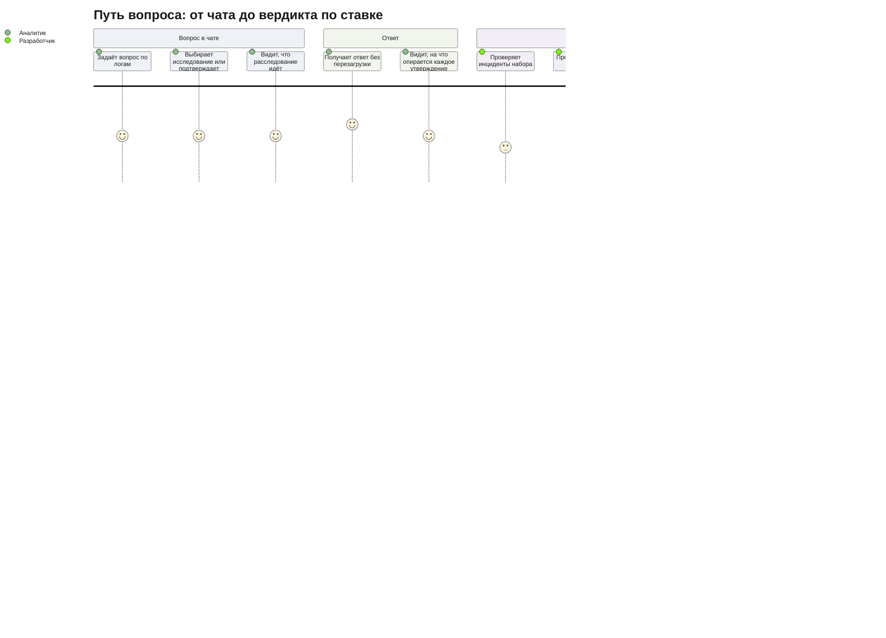
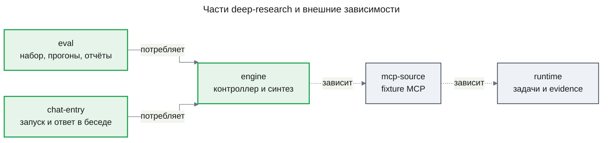

# PRD: Глубокое исследование (deep-research)

| Статус | Дата | Глубина | UXRD | Design Docs |
|---|---|---|---|---|
| Approved | 2026-11-01 | full | — | — |

## Snapshot

**Overview.** Аналитик задаёт в чате вопрос по логам, объём которых больше окна модели, и получает ответ, где у каждого утверждения есть ссылка на исходные данные. Ответ готовят модели класса Haiku: контроллер на каждом шаге сам решает, что делать дальше — собрать данные, раздать независимые подвопросы воркерам, проверить утверждения, перестроить план или писать ответ. Данные лежат во внешнем хранилище evidence, а каждый вызов модели получает только ограниченный рабочий пакет; сам процесс задан декларативной конфигурацией, чтобы на том же движке позже строились другие процессы. Фича проверяет ставку проекта: такая схема отвечает не хуже одной большой модели и стоит не дороже её; качество пользователь оценивает сам по эталонному набору инцидентов.

- **Для кого**: аналитик или SRE в чате; разработчик, который проверяет ставку на эталонном наборе.
- **Не входит**: управление ходом расследования из чата, подробный ход и evidence в интерфейсе, партиции и coverage manifest, граф evidence (Won't Have).
- **Части**: `engine` → `eval` → `chat-entry`; внешние предусловия выполнены (Delivery Parts).
- **Главный риск**: модель класса Haiku не держит роль контроллера или проверяющего, и ставка проваливается не из-за архитектуры, а из-за невалидных решений.
- **Открытые вопросы**: 1 — порог качества, пользователь задаёт его после первого прогона `eval` ([Undetermined Items](#undetermined-items)).

## Terms

- **Модель класса Haiku** — небольшая дешёвая модель; конкретная модель и провайдер выбираются в Design Doc `engine`.
- **Конфигурация процесса** — декларативное описание одного процесса исследования: цель, доступные возможности, источники, промпты, модели ролей, формат ответа; будущий пользовательский шаблон.
- **Воркер** — исполнение возможности в свежем контексте: получает только свой подвопрос и нужный материал, без истории расследования.
- **Рабочее окно шага** — бюджет токенов, который собирается в один вызов модели данной роли; он намеренно меньше номинального окна модели (дайджест, раздел 9).
- **Evidence и provenance** — сохранённый результат вызова инструмента и его происхождение: источник, инструмент, аргументы, срез данных, признак усечения (`research-runtime/prd.md`, FR-12).
- **Схема H, B1, B2** — H: схема этой фичи на моделях класса Haiku; B1: та же схема, где все роли на большой модели; B2: один агент большой модели с теми же инструментами данных. Какая модель считается большой, задаёт раздел Constraints.
- **Исход ответа** — `answered`, `partial` или `inconclusive`; корректный `inconclusive` тоже завершает расследование (спецификация, раздел 11).

## Background

`research-runtime` дал долговечный runtime задач, событий и evidence. Его части готовы: `runtime` живёт в пакетах (ADR-0004), а `mcp-source` отдаёт данные fixture MCP на синтетических логах. Вызовов LLM в runtime нет. Бюджет задачи уже содержит лимит токенов, но его никто не расходует, а у расследования лимита токенов нет. Главный агент чата сейчас работает без инструментов.

Спецификация предлагает первым циклом фиксированную последовательность сбор → решение → проверка → ответ (раздел 17, шаг 3); эта фича вместо неё даёт контроллер, который сам включает возможности по наблюдениям. Статьи показывают пользу таких механизмов только на больших моделях и QA-задачах, а на логах их не проверял никто (дайджест, раздел 1, п. 1; раздел 12).

## Users and Use Cases

### Users

- **Аналитик / SRE** — спрашивает в чате о причине инцидента; ему важны проверяемый ответ и то, что расследование не требует его присмотра.
- **Разработчик-оценщик** (основной пользователь сейчас) — единственный разработчик прототипа; он проверяет набор инцидентов, сам судит качество ответов и решает, подтверждена ли ставка.

### Use Cases

- **UC-1**: Аналитик явно выбирает глубокое исследование и спрашивает, почему выросли ошибки платежей → расследование запускается сразу, беседа показывает, что оно идёт, и аналитик может продолжать работу.
- **UC-1a**: Аналитик задаёт тот же вопрос без этого выбора → агент предлагает глубокое исследование с целью и оценкой бюджета, и аналитик подтверждает или отклоняет его, так что ни бюджет, ни время не тратятся без его согласия.
- **UC-2**: Расследование завершается, пока беседа открыта → ответ появляется в ней без перезагрузки, и у каждого утверждения видно, на какое evidence оно опирается; открыть саму исходную запись можно будет с фичей `investigation-ui`.
- **UC-3**: Аналитик возвращается в беседу позже → находит в ней ответ, сохранённый как обычное сообщение ассистента.
- **UC-4**: Аналитик передумал → останавливает расследование из беседы, и оно больше не тратит бюджет.
- **UC-5**: Данных больше окна модели → контроллер сужает выборки, просит агрегаты и раздаёт независимые подвопросы воркерам, так что ни один вызов не превышает рабочего окна.
- **UC-6**: Найдено противоречие текущей гипотезе → контроллер включает проверку и перестраивает план; уже собранные данные не запрашиваются заново.
- **UC-7**: Бюджет токенов исчерпан или новые шаги не дают нового → расследование заканчивается ответом `partial` или `inconclusive` с тем, что проверено, и с причиной остановки.
- **UC-8**: Разработчик-оценщик проверяет инциденты эталонного набора, которые написал Claude Code → в оценку попадают только проверенные инциденты.
- **UC-9**: Разработчик-оценщик прогоняет набор схемами H, B1 и B2 → читает ответы рядом, видит, найдена ли известная причина и сколько стоил каждый прогон, и выносит свой вердикт.
- **UC-10**: Разработчик-оценщик прогоняет набор при разных бюджетах рабочего окна → выбирает бюджет по умолчанию для моделей класса Haiku.

### User Journey Diagram

## Functional Requirements

Критерии движка проверяются против fixture MCP. Там, где исход зависит от решения модели, критерий проверяется моделью-заглушкой с заданными решениями; качество настоящих моделей меряет `eval`.

### Must Have (MVP)

#### Движок

- **FR-01. Контроллер вместо конвейера.** Возможности расследования — процедуры вроде сбора данных, анализа подвопроса, проверки утверждений и синтеза ответа (спецификация, разделы 5–11) — образуют реестр, а не последовательность. На каждом шаге контроллер по текущим наблюдениям выбирает одно решение из закрытого набора: собрать данные, раздать подвопросы, проверить утверждения, перестроить план, ждать уже идущей работы, писать ответ или завершить как `inconclusive` (спецификация, раздел 9). Решение вне набора, с недопустимой структурой или с недоступной возможностью отклоняет код.
  - AC-01.1: Given на двух расследованиях контроллер выдаёт разные цепочки решений (сразу ответ; сбор → проверка → перестройка плана → сбор → ответ), Then в каждом исполняются ровно выбранные возможности в выбранном порядке и ни одной без решения контроллера.
  - AC-01.2: Given контроллер выдал решение вне закрытого набора или с невалидной структурой, Then оно не порождает ни одной задачи и ни одного вызова источника, а отказ записан в ходе расследования.
  - AC-01.3: Given контроллер раз за разом выдаёт недопустимые решения и исчерпал лимит повторов, Then расследование завершается с причиной «контроллер не дал допустимого решения», а пользователь получает ответ по уже проверенному материалу с исходом по правилу принудительной остановки (FR-09).
  - AC-01.4: Given расследование отменено, Then после того как отмена вступила в силу, не начинается ни один новый вызов модели и ни один вызов источника.

- **FR-02. Инкрементальный план и перепланирование.** План растёт по шагам: контроллер добавляет ветки и меняет глубину по найденному. Новая ревизия плана сохраняет пригодные результаты. Число ревизий плана ограничено.
  - AC-02.1: Given найдено противоречие текущей гипотезе и контроллер перестроил план, Then у расследования новая ревизия плана, evidence прежней ревизии доступно новой, а тот же запрос с тем же срезом не вызывает источник повторно.
  - AC-02.2: Given достигнут лимит ревизий плана, When контроллер снова решает перестроить план, Then решение отклонено, и следующим допустимы только проверка, ответ или `inconclusive`.

- **FR-03. Остановка без новизны.** Если заданное число шагов подряд не дало ни нового evidence, ни нового или изменённого утверждения, новый сбор данных не запускается, и расследование переходит к ответу. Общее число шагов контроллера тоже ограничено. Значения порогов — настройка расследования.
  - AC-03.1: Given порог новизны K, и K шагов подряд сбор не дал нового, Then новый сбор не запускается, а следующий шаг — ответ или `inconclusive`.
  - AC-03.2: Given достигнут лимит шагов контроллера, Then расследование завершается ответом с причиной «лимит шагов» и исходом по правилу принудительной остановки (FR-09).

- **FR-04. Вход решения принимает внешние сигналы.** Кроме наблюдений расследования, вход решения контроллера принимает внешние сигналы. В этой фиче решает только контроллер, а единственный источник сигналов — тестовый; управление из чата добавит фича `chat-steering` без изменения входа решения.
  - AC-04.1: Given для расследования записан внешний сигнал, When контроллер принимает следующее решение, Then сигнал входит в его вход, а запись решения на него ссылается.
  - AC-04.2: Given регистрируется новый вид сигнала, Then контроллер получает его без изменения формы входа решения и без правок кода контроллера.

- **FR-05. Декомпозиция данных больше окна.** Расследование не загружает данные целиком в модель. Сбор идёт узкими выборками с фильтрами и интервалами, агрегатами и пагинацией, полноту которой проверяет код (`research-runtime/prd.md`, FR-17). Независимые подвопросы контроллер раздаёт воркерам, которые исполняются параллельно в свежих контекстах.
  - AC-05.1: Given fixture-срез логов, объём которого больше окна модели (сценарий спецификации, раздел 15, `research-runtime/prd.md`, FR-21), When расследование по нему завершено, Then ни один вызов модели не превысил рабочего окна своей роли (FR-06), а ответ ссылается на evidence из этих данных.
  - AC-05.2: Given контроллер раздал три независимых подвопроса, Then три воркера стартуют, не дожидаясь друг друга, и вход каждого содержит только его подвопрос и его материал, без истории контроллера и других воркеров.
  - AC-05.3: Given подвопрос требует всех совпадений, Then воркер не объявляет охват полным, пока у источника остались страницы; при нехватке бюджета охват помечен неполным.

- **FR-06. Рабочий пакет каждого вызова в бюджете окна.** Перед каждым вызовом модели рабочий пакет собирается в пределах бюджета рабочего окна роли (спецификация, раздел 12). Evidence хранится вне контекста и попадает в пакет по отбору. Сводка не подменяет молча обязательную точную запись.
  - AC-06.1: Given бюджет рабочего окна роли, Then входные токены каждого вызова этой роли не больше бюджета, что видно из учёта вызовов (FR-11).
  - AC-06.2: Given обязательное evidence не помещается в бюджет, Then шаг сужается — более узкая подзадача или агрегат, — а не обрезает evidence молча.
  - AC-06.3: Given бюджет рабочего окна роли изменён в настройке, Then следующий прогон собирает пакеты по новому бюджету без изменения кода.

- **FR-07. Бюджет токенов задачи и расследования.** У каждой задачи и каждого расследования есть бюджет токенов, и он проверяется перед каждым вызовом модели (бизнес-ограничение 4). Вызов не начинается, если остатка не хватает на его наибольший возможный расход.
  - AC-07.1: Given бюджет расследования меньше требуемого, Then суммарный расход токенов не превышает бюджета, и ни один вызов не начат после того, как остатка перестало хватать.
  - AC-07.2: Given у задачи исчерпан свой бюджет токенов, Then задача завершается с причиной «бюджет исчерпан», а остальные задачи продолжают работу, пока хватает бюджета расследования.
  - AC-07.3: Given исчерпан бюджет расследования, Then пользователь получает итоговое сообщение с причиной «бюджет исчерпан», исходом по правилу принудительной остановки (FR-09) и уже проверенными утверждениями с их ссылками на evidence.

- **FR-08. Проверка утверждений по исходным данным.** Существенное утверждение проверяется по исходным записям через инструменты и кодом — идентификаторы, числа, интервалы, ссылки, — а не мнением модели (спецификация, раздел 10; дайджест, раздел 1, п. 4). Каждое утверждение получает `supported`, `refuted` или `insufficient`. Исправление создаёт новую ревизию утверждения, а не переписывает его. Число циклов проверки ограничено.
  - AC-08.1: Given утверждение называет число или идентификатор, которого нет в цитируемом evidence, Then код помечает его `refuted` или `insufficient`, и в ответ оно не попадает как установленное.
  - AC-08.2: Given утверждение опирается только на сводку того, кто выдвинул гипотезу, Then оно не получает `supported`, пока не получены исходные записи.
  - AC-08.3: Given лимит циклов проверки исчерпан без подтверждения, Then утверждение `insufficient` и никогда не становится `supported` автоматически.

- **FR-09. Ответ только с provenance.** Ответ отделяет установленное, предположенное и неизвестное и имеет исход `answered`, `partial` или `inconclusive`. Каждое утверждение ответа ссылается на evidence; утверждение без допустимой ссылки в ответ не попадает, и это проверяет код (бизнес-ограничение 5). Правило принудительной остановки: если движок останавливает расследование сам, а не по решению контроллера, ответ по уже проверенному материалу собирает код, и он же определяет исход — `partial`, когда хотя бы одно утверждение `supported`, и `inconclusive` в остальных случаях. Причины такой остановки: исчерпан бюджет, достигнут лимит шагов, контроллер не дал допустимого решения, провайдер модели недоступен и после повторов, истекло время расследования, обязательный вход контроллера не помещается в его рабочее окно. Если время истекло раньше, чем код успел собрать ответ, расследование не удалось (AC-20.4).
  - AC-09.1: Given черновик ответа содержит утверждение без ссылки, со ссылкой на несуществующее evidence или на evidence другого расследования, Then это утверждение удалено из ответа до выдачи, а удаление записано в ходе расследования.
  - AC-09.2: Given выданный ответ, Then каждое его утверждение ведёт к evidence со всеми полями provenance.
  - AC-09.3: Given при написании ответа появилось новое существенное утверждение, When циклы проверки (FR-08) ещё остались, Then оно проверяется до выдачи; When циклов не осталось, Then оно выдаётся как предположенное и помечено как непроверенное. Как установленное оно не выдаётся ни в одном случае.

- **FR-10. Модель по роли.** У каждой роли — постановка и план, контроллер, воркер, проверяющий, синтез — своя модель в настройке. Допустима смешанная схема: большая модель в узких точках с коротким контекстом и модели класса Haiku в воркерах.
  - AC-10.1: Given настройка назначает большую модель контроллеру, а остальным ролям — модель класса Haiku, Then учёт вызовов показывает, что каждый вызов сделан моделью своей роли.
  - AC-10.2: Given все роли переведены на одну модель, Then это делается настройкой, без изменения кода (основа B1).

- **FR-11. Учёт расхода по вызову.** Каждый вызов модели учитывается с ролью, моделью, входными и выходными токенами и стоимостью; у расследования есть итог по ролям.
  - AC-11.1: Given завершённое расследование, Then сумма учтённых вызовов совпадает с расходом, списанным с бюджета (FR-07), и разбита по ролям и моделям.

- **FR-12. Процесс задаётся декларативной конфигурацией.** Движок не зашивает процесс глубокого исследования: всё, что относится к процессу, читается из одной конфигурации процесса (Terms), включая лимиты возможностей и модели ролей (FR-10). Глубокое исследование поставляется как единственная такая конфигурация. Формат — задел для пользовательских шаблонов (`workflow-templates`), поэтому он только данные: без исполняемого кода, с проверкой по схеме, с возможностями только из закрытого реестра и с источниками в пределах прав пользователя (`access-control`).
  - AC-12.1: Given вторая тестовая конфигурация с другой целью, другим набором возможностей и другими промптами, When по ней запущено расследование, Then оно исполняется без изменения кода движка, а контроллер выбирает только из возможностей этой конфигурации.
  - AC-12.2: Given конфигурация ссылается на возможность вне реестра, содержит исполняемый код или не проходит схему, Then она отклоняется при загрузке с указанием места ошибки, и расследование по ней не запускается.
  - AC-12.3: Given конфигурация глубокого исследования, Then она проходит ту же схему и ту же проверку, что любая другая конфигурация.

#### Оценка

- **FR-13. Эталонный набор инцидентов.** В fixture MCP лежат 20–30 синтетических инцидентов в логах. У каждого есть вопрос пользователя, эталонный исход и метки ключевых данных: затронутые `traceId`, сервисы, интервалы; у инцидента с эталонным исходом не `inconclusive` есть и известная причина. Срез логов, по которому расследуется любой инцидент, целиком больше окна модели, как срез сценария спецификации, раздел 15 (`research-runtime/prd.md`, FR-21). Записи самого инцидента могут занимать меньше окна. Инциденты пишет Claude Code, пользователь их проверяет. Первый инцидент — сценарий спецификации, раздел 15 (`research-runtime/prd.md`, FR-21).
  - AC-13.1: Given набор, Then в нём от 20 до 30 инцидентов, у каждого есть вопрос, эталонный исход и метки, у каждого с исходом не `inconclusive` — известная причина, а каждая метка находится инструментами fixture.
  - AC-13.2: Given инцидент не отмечен пользователем как проверенный, Then он не входит в итоги отчёта.
  - AC-13.3: Given набор, Then в нём не меньше 5 разных типов причин, не меньше 5 инцидентов с правдоподобным ложным следом и не меньше 3 инцидентов с эталонным исходом `inconclusive`.
  - AC-13.4: Given одна версия инцидента, Then его данные одинаковы при каждом прогоне.

- **FR-14. Прогон тремя схемами.** Одна команда прогоняет набор схемами H, B1 и B2. B2 — один агент большой модели с теми же инструментами и доступом к данным, без контроллера и воркеров, который сам решает, когда ответ готов. B1 и B2 существуют только в оценочном контуре и в продукт не входят.
  - AC-14.1: Given набор и три схемы, When запущен прогон, Then для каждого проверенного инцидента сохранены три ответа с исходом, расходом токенов и стоимостью.
  - AC-14.2: Given прогон B1, Then его настройка отличается от H только моделями ролей, а бюджеты совпадают.
  - AC-14.3: Given прогон B2, Then его ограничивает только защитный предел заполнения окна: он заканчивается, когда агент выдал ответ или заполнил окно, и отчёт показывает его фактический расход.

- **FR-15. Отчёт для ручной оценки.** Отчёт показывает по каждому инциденту вопрос, эталонный исход, известную причину, если она есть, и три ответа рядом со ссылками на evidence. Пользователь выносит вердикт сам; отчёт сохраняет вердикт по каждому инциденту и считает итог. Для диагностики отчёт показывает число отклонённых решений контроллера и ревизий плана.
  - AC-15.1: Given прогон завершён, Then по каждому инциденту видны три ответа рядом, и из любой ссылки можно открыть цитируемое evidence.
  - AC-15.2: Given пользователь вынес вердикты, Then отчёт показывает долю инцидентов, где H не хуже B2, и долю, где H не хуже B1.

- **FR-16. Объективная проверка исхода.** Код по эталону проверяет ответ каждой схемы только по проверяемым фактам: на какое evidence ссылаются установленные утверждения и какой у ответа исход. LLM-судья в этой проверке не участвует.
  - AC-16.1: Given у инцидента есть известная причина, и установленное утверждение ответа ссылается на evidence с ключевыми метками инцидента (`traceId`, сервис, интервал), Then инцидент отмечен «причина найдена»; Given такого утверждения нет, Then «не найдена».
  - AC-16.2: Given эталонный исход инцидента `inconclusive`, Then проверка отмечает «исход верный», когда исход ответа `inconclusive` или `partial`, и «ложная причина», когда исход ответа `answered`.

- **FR-17. Отчёт о стоимости.** Отчёт показывает расход токенов и стоимость каждого прогона по ролям и отношение стоимости H к B2 и к B1 — по инциденту и по набору.
  - AC-17.1: Given прогон завершён, Then по каждому инциденту и по набору видны стоимость H, B1 и B2 и отношение H к B2 в процентах.

- **FR-18. Эксперимент порога рабочего окна.** Набор прогоняется схемой H при нескольких бюджетах рабочего окна; отчёт показывает для каждого бюджета долю найденных причин и стоимость (дайджест, раздел 9, рекомендация). Выбранное значение становится бюджетом по умолчанию.
  - AC-18.1: Given список бюджетов окна, When запущен эксперимент, Then для каждого бюджета видны доля найденных причин и стоимость по набору.

#### Вход из чата

- **FR-19. Запуск из чата: явный выбор или подтверждённое предложение.** Сообщение, для которого пользователь явно выбрал глубокое исследование, сразу запускает расследование. Без такого выбора главный агент может только предложить запуск, показав цель — вопрос, как агент его понял, — и оценку бюджета; расследование стартует после подтверждения пользователя. Расследование привязано к беседе и пользователю; пока оно идёт, пользователь может писать дальше, и в одной беседе могут параллельно идти несколько расследований.
  - AC-19.1: Given пользователь явно выбрал глубокое исследование для сообщения, When он его отправил, Then по нему запущено расследование этого пользователя в этой беседе, а беседа показывает, что оно идёт.
  - AC-19.2: Given пользователь не выбирал глубокое исследование и агент счёл, что вопрос его требует, Then агент предлагает запуск, показывая цель и оценку бюджета, а расследования у беседы нет, пока пользователь не подтвердил.
  - AC-19.3: Given предложение показано, When пользователь подтвердил, Then запущено расследование с показанной целью и в пределах показанного бюджета, а беседа показывает, что оно идёт.
  - AC-19.4: Given предложение показано, When пользователь отклонил его, Then расследование не запущено, а беседа продолжается как обычно.
  - AC-19.5: Given пользователь не выбирал глубокое исследование и не подтверждал ни одного предложения, Then у беседы нет ни одного расследования, что бы ни решил агент.
  - AC-19.6: Given расследование идёт, When пользователь пишет в беседу, Then главный агент отвечает как обычно.
  - AC-19.7: Given предложение уже подтверждено, When пользователь подтверждает его повторно, Then новое расследование не запускается, и у этого предложения остаётся ровно одно расследование.

- **FR-20. Ответ дописывается в беседу.** Готовый ответ становится сообщением ассистента в конце беседы, из которой запущено расследование, в момент его завершения, и ссылается на сообщение-запуск — сообщение пользователя с явным выбором или подтверждённое предложение агента; ответы нескольких расследований идут в порядке завершения. В закрытой беседе ответ виден при следующем открытии. Просмотр самого evidence — фича `investigation-ui`.
  - AC-20.1: Given беседа открыта, When расследование завершено, Then ответ появляется в беседе без перезагрузки страницы (NFR-01), и беседа больше не показывает, что это расследование идёт.
  - AC-20.2: Given ответ дописан, When беседа перезагружена или открыта позже, Then ответ стоит в ней ровно один раз, на позиции, которую получил при завершении расследования.
  - AC-20.3: Given в момент завершения расследования в беседе стримится другой ответ, Then ответ расследования показан отдельным сообщением и не склеен со стримящимся ни вживую, ни после перезагрузки.
  - AC-20.4: Given расследование завершилось ошибкой, Then беседа показывает, что оно не удалось, и больше не показывает, что оно идёт.
  - AC-20.5: Given беседа и расследование пользователя U, Then другой пользователь не видит ни ответа, ни состояния расследования (бизнес-ограничение 2).
  - AC-20.6: Given в беседе идут два расследования, When запущенное вторым завершилось первым, Then его ответ дописан раньше ответа первого, и каждый ответ ссылается на своё сообщение-запуск.
  - AC-20.7: Given ответ дописан, Then у каждого его утверждения в беседе видно, на какое evidence оно опирается (AC-09.2).

- **FR-21. Остановка расследования из беседы.** Пользователь останавливает идущее расследование из беседы; используется отмена runtime (`research-runtime/prd.md`, FR-20).
  - AC-21.1: Given расследование идёт, When пользователь его остановил, Then новых вызовов модели и источника нет (AC-01.4), беседа показывает, что расследование остановлено, а ответ не дописывается.

- **FR-22. Удаление и перегенерация не оставляют сирот.** Ответ никогда не дописывается в удалённую беседу и не оживляет её. Перегенерация ответа ассистента, который отвечает на сообщение-запуск или сам им является, останавливает это расследование.
  - AC-22.1: Given расследование беседы T идёт, When беседа T удалена, Then расследование остановлено и удалено (`research-runtime/prd.md`, FR-23), ответ не дописан, и беседа T не появилась снова.
  - AC-22.2: Given перегенерирован ответ ассистента, который отвечает на сообщение-запуск расследования или сам им является, Then это расследование остановлено и его ответ не дописан; за сообщением пользователя следует только перегенерированный ответ (`chat-shell/prd.md`, AC-14.6).

### Should Have

- **FR-23. Вердикт вслепую.** В отчёте для ручной оценки ответы схем показаны под нейтральными метками в случайном порядке; схема раскрывается после вердикта.
  - AC-23.1: Given отчёт открыт до вердикта по инциденту, Then по ответу нельзя узнать, какая схема его дала.

### Could Have

- **FR-24. LLM-судья как подсказка.** Отчёт может показать оценку LLM-судьи рядом с ответами. Она не участвует ни в приёмке, ни в итоговых долях.
  - AC-24.1: Given оценка судьи включена, Then итоговые доли отчёта (AC-15.2) от неё не меняются.

### Won't Have

- **Управление ходом расследования из чата** — следующая фича `chat-steering`; здесь решает только контроллер, а вход решения уже принимает внешние сигналы (FR-04).
- **Подробный ход расследования в интерфейсе** — шаги, воркеры и evidence в беседе или рабочей области; фича `investigation-ui`.
- **Полный сбор данных с партициями и coverage manifest** — фича `dataset-exploration`; здесь только узкие выборки и подвопросы воркерам.
- **Граф evidence и интеграция утверждений** — фича `evidence-graph`.
- **RBAC, реестр MCP-серверов, аудит вызовов** — платформенная ветка `access-control` → `mcp-registry`.
- **Реальные источники логов** — только синтетический fixture MCP.
- **Шаблоны процессов пользователей** — редактор шаблонов, шаблоны, созданные пользователями, выбор шаблона при запуске и больше одной поставляемой конфигурации; фича `workflow-templates`, здесь только формат конфигурации (FR-12).
- **Запуск агентом без явного выбора и без подтверждения** — расследование тратит бюджет и время пользователя (AC-19.5).
- **LLM-судья как критерий приёмки** — качество судит пользователь вручную.

## Non-Functional Requirements

### Performance

- **NFR-01**: ответ завершённого расследования появляется в открытой беседе не позже чем через 5 с после завершения; измеряется сквозным тестом `chat-entry`.
- **NFR-02**: время до первого токена ответа главного агента не хуже требования проекта, в том числе в ответе, который запускает расследование; измеряется тем же способом, что в `chat-shell`.

### Reliability

- **NFR-03**: рестарт процесса посреди расследования не теряет и не дублирует его: расследование доходит до ответа, и ответ дописан в беседу ровно один раз; проверяется тестом с убийством процесса.

### Security

- **NFR-04**: инструменты данных только читающие; расследование и его ответ изолированы по пользователю (AC-20.5).

### Accessibility

- **NFR-05**: новые состояния беседы соответствуют целевому уровню `chat-shell` (WCAG 2.1 AA, `chat-shell/prd.md`, раздел Accessibility).

## Delivery Parts

| Часть | Покрывает | Шов | Зависит от | Обоснование |
|---|---|---|---|---|
| `engine` | FR-01–FR-12 | `domain` | — | Исследовательский движок: контроллер, контекст, бюджеты, проверка, синтез и формат конфигурации процесса — одна предметная область поверх runtime |
| `eval` | FR-13–FR-18; Should: FR-23; Could: FR-24 | `domain` | `engine` | Оценка ставки — свои данные (набор), свои прогоны и отчёты; стоит перед `chat-entry`, чтобы проверить ставку рано |
| `chat-entry` | FR-19–FR-22 | `domain` | `engine` | Шов с контекстом бесед: явный выбор и предложение запуска, дописывание в беседу, её удаление и перегенерация, показ в открытой беседе |

`chat-entry` разрезан по домену, а не по слою: основная сложность — семантика бесед (запуск только по выбору или подтверждению, порядок ответов, гонки с удалением и перегенерацией). Как это выглядит в интерфейсе, описывает UXRD. Порядок проектирования и сборки — `engine` → `eval` → `chat-entry`.

**Внешние зависимости.** `engine` и `eval` стоят на runtime в пакетах (ADR-0004) и на fixture MCP части `mcp-source` (`research-runtime/prd.md`, Delivery Parts); обе части `research-runtime` готовы.

### Part Dependency Diagram

## Success Criteria

Все метрики читаются из отчёта `eval` на проверенных инцидентах эталонного набора и снимаются при приёмке `eval`, затем повторяются при каждом изменении агентского контура (бизнес-ограничение 6).

- **Качество** — порог из открытого вопроса 1 ([Undetermined Items](#undetermined-items)) по вердиктам пользователя (AC-15.2) и проверке исхода кодом (FR-16).
- **Стоимость** — суммарная стоимость H по набору не больше 100 % стоимости B2 (бизнес-ограничение 7), из отчёта о стоимости (FR-17). Схема выше паритета не принимается без отдельного ADR.
- **Разрыв моделей** — отчёт показывает долю, где H не хуже B1; цели нет, метрика объясняет, сколько качества теряется на модели, а не на схеме.
- **Бюджет рабочего окна** — эксперимент (FR-18) дал значение по умолчанию для каждой роли на моделях класса Haiku, и оно записано в настройке.
- **Вход из чата** — внутренняя возможность; её подтверждают UC-1, UC-1a, UC-2–UC-4.

## Constraints and Risks

### Constraints

- Бизнес-ограничения 4–7 проекта: бюджет токенов, provenance, оценка на эталонном наборе, паритет по стоимости.
- Агентская система — внутренний фреймворк из приватных пакетов монорепозитория, движок — отдельный пакет, а `apps/api` — только точка входа. Раскладку и границы пакетов задаёт `docs/adr/ADR-0004-agent-framework-packages.md`.
- Движок работает на runtime `research-runtime`: задачами, событиями и восстановлением владеет он (ADR-0001). Mastra используется в пакетах напрямую, без своей абстракции над ним, и только простыми агентами внутри обработчиков — без workflows Mastra и восстановления его запусков.
- Данные — только синтетический read-only fixture MCP.
- Запуск — только инструментом главного агента чата, по явному выбору или подтверждённому предложению (FR-19); отдельного HTTP API запуска нет.
- PRD фиксирует роли, а не модели схемы H: конкретные модели и провайдер выбирает Design Doc `engine`, проверив фактическое окно и цены.
- Большая модель схем B1 и B2 — самая большая модель того же провайдера, что выбран для H.

### Assumptions

- Модель класса Haiku держит роль контроллера при закрытом наборе решений и проверке кодом — проверяется числом отклонённых решений в первом прогоне `eval` (FR-15).
- Качество модели класса Haiku падает задолго до заполнения её окна в 1M токенов, поэтому рабочие окна шагов остаются малыми — проверяется экспериментом FR-18 (дайджест, раздел 9). Малое окно выгодно и по стоимости: выше порога входных токенов цена модели растёт. Модель, окно и цены проверены в Design Doc `engine`, KD-5.
- 20–30 инцидентов достаточно, чтобы увидеть разрыв со схемой B2, но не для статистических выводов — принято для прототипа.
- Синтетические инциденты похожи на реальные — проверяется при подключении первого реального источника.

### Risks

| Риск | Влияние | Вероятность | Митигация |
|---|---|---|---|
| Модель класса Haiku не держит роли контроллера, плана или проверки | Высокое | Высокое | Закрытый набор решений (FR-01), лимиты (FR-02, FR-03), большая модель в узких точках (FR-10) |
| Накладные расходы контроллера и проверки съедают паритет по стоимости | Высокое | Среднее | Учёт по ролям (FR-11, FR-17) и бюджет окна по эксперименту (FR-18) |
| 20–30 инцидентов — малая выборка, вывод о ставке шаткий | Среднее | Высокое | Разнообразие причин, ложные следы и `inconclusive`-инциденты (AC-13.3); повтор прогона при изменениях контура |
| Только синтетика даёт ложную уверенность | Среднее | Высокое | Ручная проверка набора (AC-13.2); пересмотр при первом реальном источнике |
| Формат конфигурации, удобный для одного процесса, не подойдёт пользовательским шаблонам | Среднее | Среднее | Только данные со схемой и закрытым реестром (FR-12); вторая тестовая конфигурация (AC-12.1) |
| Дописывание ответа гонится с перегенерацией, удалением беседы или другим расследованием | Среднее | Среднее | Порядок ответов и остановка при удалении и перегенерации заданы критериями (FR-19, FR-20, FR-22) |

## Undetermined Items

- **Порог качества.** Бизнес-ограничение 6 требует зафиксировать его здесь. Блокирует только приёмку `eval`; задаёт пользователь после первого прогона `eval`. Стартовое предложение: H не хуже B2 по вердиктам пользователя не меньше чем в 80 % проверенных инцидентов, и причина найдена (FR-16) не реже, чем у B2.

## Appendix

### References

- Спецификация: `docs/side_reserch/agent_os_workflow_spec.md` — разделы 5–13, 15, 17, 18.
- Дайджест статей: `docs/side_reserch/papers_digest.md` — раздел 1 (малые модели, ранняя остановка, самопроверка), раздел 9 (большое окно не заменяет отбор контекста, эксперимент порога; дайджест считает окно до 250k, фактическое — 1M, Design Doc `engine`, KD-5), раздел 11 (лимиты ревизий, оценка), раздел 12 (риски).
- Предшественник: `docs/features/research-runtime/prd.md` — FR-12, FR-17, FR-20, FR-21, FR-23; дорожная карта.
- Утверждённые контракты: `docs/features/research-runtime/design-runtime.md` (Contract Definitions), `docs/features/research-runtime/design-mcp-source.md`.
- ADR: `docs/adr/ADR-0001-durable-runtime-owner.md`, `docs/adr/ADR-0003-drizzle-data-layer.md`, `docs/adr/ADR-0004-agent-framework-packages.md`.
- Беседы: `docs/features/chat-shell/prd.md` — AC-08.5, AC-14.6, раздел Accessibility.

## Update History

| Версия | Дата | Изменение |
|---|---|---|
| 1.0 | 2026-10-31 | Первая версия по подтверждённым требованиям |
| 1.1 | 2026-10-31 | Агентская система — внутренний фреймворк из пакетов, `apps/api` — точка входа; перенос runtime в пакет — предусловие `engine` |
| 1.2 | 2026-10-31 | Проверка исхода кодом по меткам и для `inconclusive`-инцидентов; правило исхода при принудительной остановке; модель и бюджеты B1/B2; параллельные расследования, порядок ответов и идемпотентное подтверждение; минимумы эталонного набора; UI-детали и раскладка пакетов вынесены; ссылка на ADR-0004 |
| 1.3 | 2026-10-31 | Проверка `inconclusive`-инцидента только по исходу ответа (AC-16.2); предусловия приёмки названы по месту; большая модель B1/B2 — от провайдера H; определено сообщение-запуск (FR-20, FR-22, AC-22.2); порог качества — после первого прогона `eval`; сокращены Terms, Background, Constraints и Risks; `mcp-source` на схеме частей — ещё не собран |
| 1.4 | 2026-10-31 | Приведено к текущему шаблону |
| 1.5 | 2026-11-01 | Утверждён вместе с частями `engine` → `eval` → `chat-entry`; внешние предусловия отмечены выполненными, риск их задержки снят |
| 1.6 | 2026-11-01 | Окно модели класса Haiku исправлено на 1M токенов по Design Doc `engine`, KD-5; в FR-13 больше окна — срез логов расследования, а не данные каждого инцидента |
| 1.7 | 2026-11-01 | Правило принудительной остановки (FR-09) охватывает любую остановку движком: добавлены недоступность провайдера модели, истечение времени и вход контроллера больше его окна |
