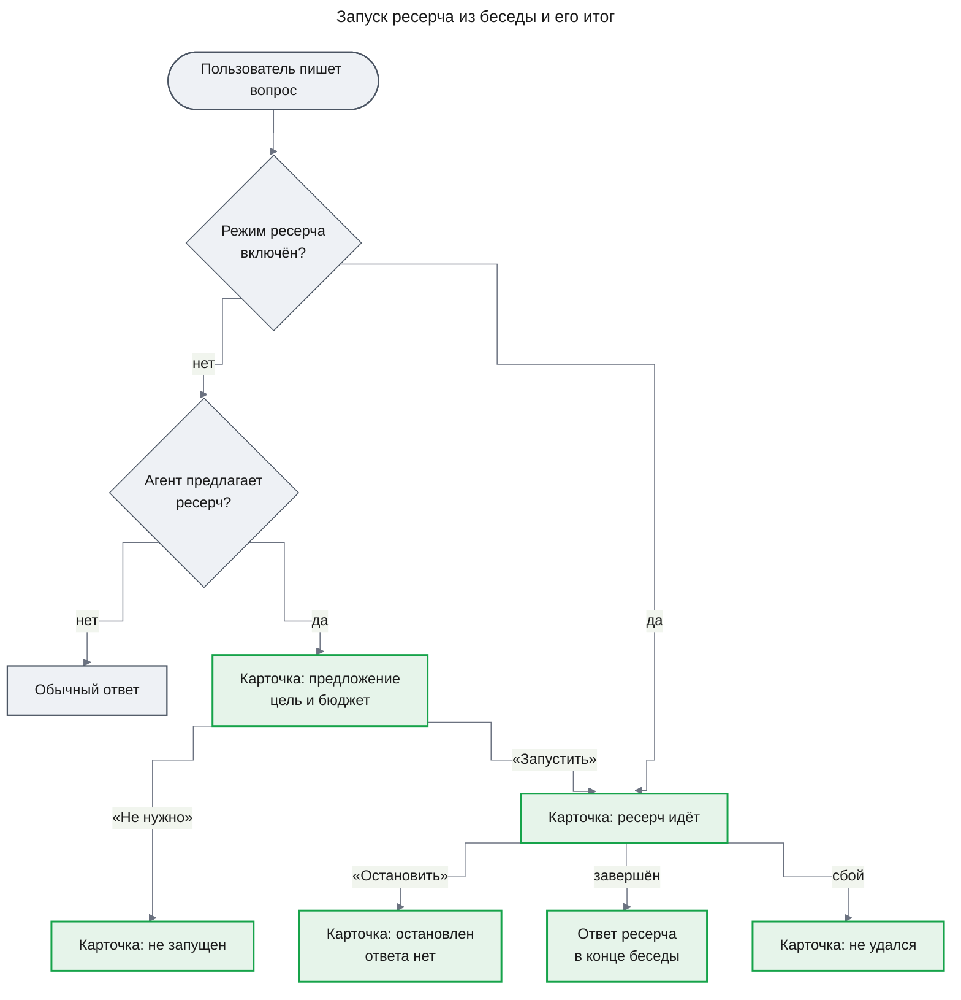

# UXRD: Глубокий ресерч из чата (deep-research)

| Статус | Дата | PRD | Design Docs |
|---|---|---|---|
| Approved | 2026-11-01 | [prd.md](./prd.md) | — |

## Snapshot

**Overview.** Пользователь запускает расследование прямо из беседы: включает в композере режим «Глубокий ресерч» для одного сообщения или подтверждает предложение агента, где видны цель и предел бюджета. В интерфейсе расследование называется «ресерч». Каждое расследование в ленте — одна карточка: на ней решают, запускать ли его, видно, что оно идёт, и его можно остановить. Готовый ответ встаёт в конец беседы в момент завершения, ссылается на свой запуск, а у каждого утверждения есть сноска на источник. Документ описывает то, что пользователь видит в беседе (часть `chat-entry`, FR-19–FR-22). У отчёта оценки части `eval` (FR-15, FR-17, FR-18, FR-23) нет UI в `apps/web`: это файл, который пишет eval CLI, и его формат решает Design Doc `eval`; подробный ход расследования и открытие записи evidence — фича `investigation-ui`.

- **Не меняется**: сайдбар, шапка и action bar сообщений chat-shell; у ресерча нет индикаторов вне ленты беседы.
- **Главный UX-риск**: ответ приходит через минуты, когда пользователь уже ушёл вперёд в беседе, и он может не понять, на какой вопрос этот ответ.
- **Открытые вопросы**: нет.

### Key Decisions

| ID | Решение | Почему | Отклонённая альтернатива |
|---|---|---|---|
| KD-1 | Режим «Глубокий ресерч» действует на одно сообщение и выключается после отправки | Ресерч тратит бюджет и минуты; режим, который остаётся включённым, незаметно запустит расследование на следующий уточняющий вопрос | Режим включён, пока пользователь его не выключит |
| KD-2 | Одно расследование — одна [карточка ресерча](../../design-system/components/research-card.md) в реплике ассистента, которая его предложила или запустила; карточка проходит все состояния на месте и остаётся единственным признаком, что ресерч идёт | Решение, ход и итог читаются в одном месте и одинаково до и после перезагрузки; вращающийся индикатор у композера минутами тянет взгляд за собой — это против комфорта долгой сессии ([README → Direction](../../design-system/README.md#direction)) | Полоса идущих ресерчей над композером; отдельная системная реплика на каждую смену состояния |
| KD-3 | Остановка просит подтверждения на месте, в самой карточке | Остановку нельзя отменить: ответа не будет, потраченный бюджет не вернётся. Подтверждение на месте не уводит из ленты | Остановка без подтверждения; модальный диалог |
| KD-4 | Предложение без решения закрывается, когда пользователь отправляет следующее сообщение; карточка показывает «Ресерч не запущен» | Так уже закрываются вопросы инструментов без решения («Отменено до решения» в блоке инструмента chat-shell). Кнопка далеко вверху ленты не запустит ресерч через час по ошибке | Предложение ждёт решения бессрочно |
| KD-5 | Приход ответа не переносит фокус. Лента прокручивается к шапке ответа, только если пользователь стоит у конца ленты и ничего не стримится; иначе позиция чтения не меняется | Пользователь мог уйти читать или писать (AC-19.6); прыжок посреди чтения сбивает. Прокрутка к шапке, а не к концу, ставит длинный ответ на начало | Всегда прокручивать к новому ответу; следовать к концу ответа, как при стриминге |
| KD-6 | Опору утверждений показывают сноски `[n]` и свёрнутый список «Источники» в конце ответа: источник, инструмент, срез данных и признак усечения ([ответ ресерча](../../design-system/components/research-answer.md)) | Сноска работает на касание и с клавиатуры, попадает в копируемый текст и не прячет происхождение в подсказку; аргументы и открытие записи придут с `investigation-ui` | Подсказка или поповер у каждого утверждения |
| KD-7 | Диалог удаления беседы (chat-shell DLG-01) и блок ошибки ответа (chat-shell TH-08) получают строку о ресерче, который действие остановит | Удаление и перегенерация молча останавливают ресерч (FR-22); пользователь должен знать это до нажатия | Останавливать без предупреждения |

## Design System

Фича следует [дизайн-системе](../../design-system/README.md) и оболочке [chat-shell](../chat-shell/uxrd.md): цвет, шрифт, движение и плотность — из [foundations](../../design-system/foundations.md), элементы оболочки цитируются по их ID (TH-04, DLG-01).

### Component Inventory

Перед решением «new» поиск шёл по `apps/web/src/components/**` и спецификациям chat-shell. Ближайший кандидат — блок вызова инструмента с вопросом на подтверждение в `tool-fallback.aui.tsx`. Он показывает аргументы и результат одного вызова и после решения сворачивается в запись, но не знает цели, бюджета, остановки и итогов расследования; расширять общий блок инструмента под один процесс значило бы смешать два компонента.

| Компонент | Спецификация | Статус | Примечание |
|---|---|---|---|
| Композер | chat-shell UXRD, TH-04 | extended | Элемент описан в chat-shell UXRD, расширен здесь: ряд под полем ввода получает переключатель режима DR-01 на одно сообщение (KD-1); в режиме ресерча — placeholder MC-2 и имя «Отправить» MC-3 |
| Метка запуска (DR-02) | [research-launch-label.md](../../design-system/components/research-launch-label.md) | new | Сообщение пользователя каркаса (chat-shell TH-01) не несёт меток; метка отличает сообщение-запуск в истории |
| Переключатель режима | [shadcn `toggle`](https://ui.shadcn.com/docs/components/toggle) | reused | Из shadcn, в проект ещё не добавлен. Вариант `outline`, размер `sm`; включённое состояние несёт метку акцентом по правилу «метка выбранного» ([foundations → Color](../../design-system/foundations.md#color)) |
| Карточка ресерча | [research-card.md](../../design-system/components/research-card.md) | new | Блок инструмента не покрывает цель, бюджет, остановку и итоги — см. выше |
| Ответ ресерча | [research-answer.md](../../design-system/components/research-answer.md) | new | Markdown-ответ каркаса не умеет шапку с исходом, сноски и список источников |
| Кнопка | [shadcn `button`](https://ui.shadcn.com/docs/components/button) | reused | В карточке ресерча |
| Action bar сообщения | chat-shell UXRD, TH-10 | reused | У ответа ресерча — «Копировать», как у любого ответа |
| «Вниз» | chat-shell UXRD, TH-09 | reused | Появляется, когда ответ пришёл ниже позиции чтения (KD-5) |
| Блок ошибки ответа | chat-shell UXRD, TH-08 | extended | Элемент описан в chat-shell UXRD, расширен здесь: строка о ресерче над «Перегенерировать» (KD-7, MC-21) |
| Диалог удаления | chat-shell UXRD, DLG-01 | extended | Элемент описан в chat-shell UXRD, расширен здесь: абзац о ресерче, как у варианта со стримингом (KD-7, MC-22) |

## User Flows

### Primary User Flow

**Implements:** UC-1, UC-1a, UC-2, UC-4; AC-19.1, AC-19.2, AC-19.3, AC-19.4, AC-19.6, AC-20.1, AC-20.4, AC-20.7, AC-21.1



1. **Явный выбор.** Пользователь нажимает «Глубокий ресерч» в композере (DR-01), пишет вопрос и отправляет. Над его сообщением появляется метка запуска (DR-02), режим выключается (KD-1). В ответной реплике агента карточка ресерча (DR-03) сразу стоит в состоянии «Идёт» с целью и бюджетом (AC-19.1).
2. **Предложение.** Без режима агент может ответить карточкой-предложением с целью и пределом бюджета (AC-19.2). «Запустить» переводит ту же карточку в «Идёт» (AC-19.3); «Не нужно» — в «Не запущен», и беседа идёт дальше (AC-19.4).
3. **Пока идёт.** Композер работает как обычно, агент отвечает на новые сообщения (AC-19.6); в беседе может идти несколько карточек «Идёт» одновременно.
4. **Итог.** Ответ ресерча (DR-04) встаёт в конец беседы без перезагрузки, а карточка переходит в «Завершён» со ссылкой «К ответу» (AC-20.1). У каждого утверждения есть сноска на источник (AC-20.7). Если ресерч упал, карточка показывает «Не удался», и ответа нет (AC-20.4).
5. **Остановка.** «Остановить» в карточке спрашивает подтверждения (KD-3); после него карточка показывает «Остановлен», ответ не дописывается (AC-21.1).

### Alternative Flows

- **Повторное подтверждение** (AC-19.7). После первого нажатия «Запустить» обе кнопки неактивны. Если в другой вкладке висит та же карточка-предложение и пользователь нажимает «Запустить» там, карточка переходит в текущее состояние того же ресерча, обычно «Идёт»: второй карточки и сообщения об ошибке нет.
- **Действие на устаревшей карточке.** Судьба ресерча могла решиться в другой вкладке или без пользователя: ресерч запущен, от предложения отказались, беседа продолжилась без него (KD-4), ресерч завершился, упал или остановлен. Тогда «Запустить», «Не нужно» или «Остановить» на старой карточке переводит её в это решённое состояние: «Идёт», «Не запущен» с его причиной, «Завершён», «Не удался» или «Остановлен». Строки ошибки MC-15 или MC-16 нет.
- **Предложение без решения** (KD-4). Пользователь отправляет новое сообщение, не нажав ни одной кнопки, — карточка закрывается как «Не запущен», ресерча нет (AC-19.5).
- **Несколько ресерчей** (AC-20.6). Шапка каждого ответа показывает его цель и ссылку «К запросу» на своё сообщение-запуск: сообщение пользователя с меткой DR-02 или подтверждённую карточку-предложение.
- **Ответ во время стриминга** (AC-20.3). Если в момент завершения стримится другой ответ, ответ ресерча встаёт отдельной репликой под ним; лента не прокручивается (KD-5).
- **Беседа закрыта или перезагружена** (UC-3, AC-20.2). Карточки показывают сохранённое состояние, ответ — на своём месте в ленте.
- **Перегенерация** (AC-22.2). Если упавшая реплика с блоком ошибки (chat-shell TH-08) несёт карточку «Идёт» или «Предложение», блок показывает строку MC-21 над «Перегенерировать». Новый ответ заменяет реплику вместе с карточкой.
- **Удаление беседы** (AC-22.1). Если в беседе идёт ресерч, диалог удаления (chat-shell DLG-01) добавляет абзац MC-22.
- **Чужая беседа** (AC-20.5). Другой пользователь видит экран «Беседа не найдена» (chat-shell TH-06) — ни карточек, ни ответов.

### Error Flows

- **Запуск не удался** после «Запустить»: под целью появляется строка ошибки MC-15, кнопки снова активны.
- **Остановка не удалась**: карточка возвращается в «Идёт» со строкой MC-16, «Остановить» снова доступна.
- **Ресерч упал** в ходе работы: карточка «Не удался» с пояснением MC-12; новый запуск — новым сообщением в режиме ресерча.
- **Ресерч остановлен принудительно** — это не ошибка: приходит ответ с исходом `partial` или `inconclusive` и строкой причины остановки MC-25 (AC-07.3, AC-03.2, AC-01.3).

## Screens

### Screen 1: беседа с ресерчем (`/chat/<id>`)

Экран — лента chat-shell (TH-01) с новыми элементами DR-01…DR-04. Набросок показывает беседу, где ресерч запущен явным выбором, завершился и ответ пришёл после двух обычных реплик.

```
┌ Лента, колонка 768 px ─────────────────────────────────────┐
│                                       ⌕ Глубокий ресерч    │ DR-02 метка запуска
│              ┌──────────────────────────────────────────┐  │
│              │ Почему с 14:00 выросли ошибки платежей?  │  │ сообщение-запуск
│              └──────────────────────────────────────────┘  │
│ Запускаю ресерч. Пока он идёт, можно продолжать беседу.    │ реплика агента
│ ┌──────────────────────────────────────────────┐           │
│ │ ✓ Ресерч завершён                     14:32  │           │ DR-03, «Завершён»
│ │ Цель    Найти, почему с 14:00 выросли ошибки │           │
│ │         платежей в сервисе payments          │           │
│ │ Бюджет  до 400 000 токенов                   │           │
│ │ К ответу ↓                                   │           │
│ └──────────────────────────────────────────────┘           │
│                   … две обычные реплики …                  │
│ ⌕ Ответ ресерча  ✓ Есть ответ               К запросу ↑   │ DR-04
│ Найти, почему с 14:00 выросли ошибки платежей в сервисе…   │
│ Установлено                                                │
│ Ошибки 5xx идут от таймаутов к gateway [1] [2]             │
│ ▸ Источники (2)                                            │
│ ⧉                                                          │ TH-10
├────────────────────────────────────────────────────────────┤
│ ┌────────────────────────────────────────────────────────┐ │
│ │ Спросите что-нибудь…                                   │ │ TH-04
│ │ [⌕ Глубокий ресерч]                                (↑) │ │ DR-01
│ └────────────────────────────────────────────────────────┘ │
└────────────────────────────────────────────────────────────┘
```

`⌕` — иконка `Telescope`; она обозначает ресерч везде: в DR-01, DR-02 и DR-04.

**Layout**:

- **DR-01 переключатель режима** — первый элемент ряда под полем ввода, слева; «Отправить» остаётся справа. Включённый режим меняет placeholder на MC-2 и имя «Отправить» на MC-3. Тот же композер стоит на `/` под приветствием (chat-shell D-10), и режим доступен и для первого сообщения новой беседы. Во время стриминга переключатель работает: режим применится к следующему отправленному сообщению.
- **DR-02 метка запуска** — над пузырём сообщения пользователя, по его правому краю, отступ 4 px; вид — в [спецификации](../../design-system/components/research-launch-label.md). Метка сохраняется в истории.
- **DR-03 карточка ресерча** — в реплике ассистента, после её текста, с отступом 12 px; ширина и состояния — в [спецификации](../../design-system/components/research-card.md).
- **DR-04 ответ ресерча** — отдельная реплика ассистента в конце ленты на момент завершения; устройство — в [спецификации](../../design-system/components/research-answer.md).

**Screen states**:

| Состояние | Что видно | AC |
|---|---|---|
| Ресерч идёт | Карточка «Идёт»; композер и ответы агента работают | AC-19.1, AC-19.3, AC-19.6 |
| Несколько ресерчей | Каждый — своя карточка «Идёт»; ответы встают по мере завершения | AC-20.6 |
| Ответ пришёл | Реплика DR-04 в конце ленты, карточка — «Завершён»; лента по правилу KD-5 | AC-20.1, AC-20.3 |
| Восстановление истории | Скелетон chat-shell TH-05, затем карточки и ответы в сохранённом виде | AC-20.2 |

## Accessibility

- **Целевой уровень**: WCAG 2.1 AA (NFR-05).
- **Фокус**:

| Событие | Куда фокус |
|---|---|
| Нажат DR-01 | Остаётся на переключателе |
| Отправка в режиме ресерча | Как при любой отправке (chat-shell) |
| «Запустить», «Не нужно», подтверждённая остановка | Карточка этого ресерча (кнопки исчезают) |
| «Остановить» | «Продолжить» в подтверждении; «Продолжить» и Esc возвращают на «Остановить» |
| «К ответу» в карточке | Шапка ответа ресерча |
| «К запросу» в ответе | Сообщение-запуск |
| Сноска в ответе | Запись источника в раскрытом списке |
| Ответ пришёл, ресерч остановлен или упал | Не перемещается |

- **Объявления**: одна вежливая область (`status`) на экран объявляет MC-17…MC-20 — запуск, итог, остановку и сбой каждого ресерча, один раз на событие. Ошибки запуска и остановки объявляются как `alert`. Смена состояний «Запуск» и «Остановка» не объявляется — это шум.
- **Переключатель**: `aria-pressed` передаёт, включён ли режим; изменённое имя «Отправить» (MC-3) читается при переходе к кнопке.
- **Reduced motion**: прокрутка к шапке ответа (KD-5) и переходы «К ответу», «К запросу», к записи источника — мгновенные.

## Responsive Behavior

| Брейкпоинт | Ширина | Экран | Что меняется |
|---|---|---|---|
| Mobile | < 640 px | Беседа | Карточка и ответ на всю ширину колонки; при грубом указателе кнопки, сноски и переключатель — цель касания 44×44 |
| Tablet | 640–1024 px | Беседа | Как на десктопе |
| Desktop | > 1024 px | Беседа | Карточка не шире прозы (640 px), ответ — по правилам ленты chat-shell D-01 |

На 360 px подпись «Глубокий ресерч» помещается в ряд композера вместе с «Отправить» и не сокращается; ряд действий карточки переносится на вторую строку, если кнопки не помещаются.

## Content and Microcopy

Тон chat-shell: короткие нейтральные фразы на «вы», без восклицательных знаков; кавычки — «ёлочки», внутри — „лапки“.

| ID | Где (экран / компонент / состояние) | Текст | Примечание |
|---|---|---|---|
| MC-1 | DR-01, подпись | «Глубокий ресерч» | — |
| MC-2 | Композер, placeholder в режиме ресерча | «Опишите, что нужно исследовать…» | — |
| MC-3 | «Отправить» в режиме ресерча, доступное имя | «Запустить ресерч» | Иконка не меняется |
| MC-4 | DR-02, метка запуска | «Глубокий ресерч» | — |
| MC-5 | DR-03, «Предложение»: метка и заголовок | «Ждёт подтверждения» / «Запустить глубокий ресерч?» | — |
| MC-6 | DR-03, подписи строк | «Цель» / «Бюджет»: «до {N} токенов» | — |
| MC-7 | DR-03, кнопки предложения | «Запустить» / «Не нужно»; в «Запуск» — «Запускаем…» | — |
| MC-8 | DR-03, «Идёт» | «Ресерч идёт»; кнопка «Остановить» | — |
| MC-9 | DR-03, подтверждение остановки | «Остановить ресерч? Ответа не будет, потраченный бюджет не вернётся.»; кнопки «Остановить» / «Продолжить»; в «Остановка» — «Останавливаем…» | KD-3 |
| MC-10 | DR-03, «Завершён» | «Ресерч завершён»; ссылка «К ответу» | — |
| MC-11 | DR-03, «Остановлен» | «Ресерч остановлен» / «Ответа не будет.» | — |
| MC-12 | DR-03, «Не удался» | «Ресерч не удался» / «Ответа не будет. Чтобы попробовать снова, отправьте вопрос в режиме „Глубокий ресерч“.» | Текст фиксирован, причина сбоя не показывается |
| MC-13 | DR-03, «Не запущен» | «Ресерч не запущен» / «Вы отказались.» или «Беседа продолжилась без него.» | Вторая фраза — KD-4 |
| MC-14 | DR-03, доступное имя карточки | «Ресерч: {цель}» | — |
| MC-15 | DR-03, ошибка запуска | «Не удалось запустить ресерч. Попробуйте ещё раз.» | — |
| MC-16 | DR-03, ошибка остановки | «Не удалось остановить ресерч. Попробуйте ещё раз.» | — |
| MC-17 | Объявление, запуск | «Ресерч запущен» | — |
| MC-18 | Объявление, итог | «Ресерч завершён. Ответ добавлен в конец беседы.» | — |
| MC-19 | Объявление, остановка | «Ресерч остановлен» | — |
| MC-20 | Объявление, сбой | «Ресерч не удался» | — |
| MC-21 | chat-shell TH-08, реплика с ресерчем | «Перегенерация остановит ресерч из этого ответа.» | Над кнопкой «Перегенерировать», KD-7 |
| MC-22 | chat-shell DLG-01, в беседе идёт ресерч | «В беседе идёт ресерч — он будет остановлен, ответа не будет.»; при нескольких — «В беседе идут ресерчи — они будут остановлены, ответов не будет.» | KD-7 |
| MC-23 | DR-04, шапка | «Ответ ресерча»; ссылка «К запросу», доступное имя «К запросу ресерча» | — |
| MC-24 | DR-04, исход | «Есть ответ» / «Частичный ответ» / «Вывода нет» | `answered` / `partial` / `inconclusive` |
| MC-25 | DR-04, причина остановки | «Остановлен: исчерпан бюджет» / «Остановлен: достигнут лимит шагов» / «Остановлен: агент не смог выбрать следующий шаг» / «Остановлен: модель недоступна» / «Остановлен: истёк срок расследования» / «Остановлен: материала больше, чем агент может учесть» | `budget_exhausted` (AC-07.3) / `step_limit` (AC-03.2) / `controller_invalid` (AC-01.3) / `model_unavailable` / `deadline` / `context_overflow` |
| MC-26 | DR-04, группы | «Установлено» / «Предположения» / «Не выяснено» | FR-09 |
| MC-27 | DR-04, метка непроверенного утверждения | «не проверено» | AC-09.3 |
| MC-28 | DR-04, список источников | «Источники ({N})»; сноска — доступное имя «Источник {n}»; усечение — «данные усечены» | KD-6 |

## Update History

| Версия | Дата | Изменение |
|---|---|---|
| 1.0 | 2026-11-01 | Первая версия: UI части `chat-entry` |
| 1.1 | 2026-11-01 | Схема основного потока без пересечений; расширения элементов chat-shell отмечены в инвентаре и описаны в chat-shell UXRD; альтернативные потоки без пересказа AC; действие на устаревшей карточке; цель в наброске целиком и одна во всех местах; переключатель режима ещё не добавлен в проект |
| 1.2 | 2026-11-01 | Одобрен пользователем с последней правкой: устаревшие переходы карточки ресерча вынесены в отдельную схему, «уже запущен» ведёт в текущее состояние ресерча; у отчёта оценки нет UI в `apps/web` — это файл eval CLI |
| 1.3 | 2026-11-01 | MC-25 дополнен текстами причин остановки `model_unavailable`, `deadline` и `context_overflow` из Design Doc `engine`; UX не меняется |
