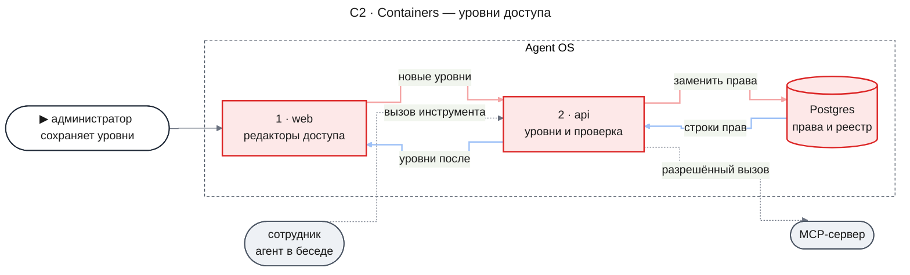
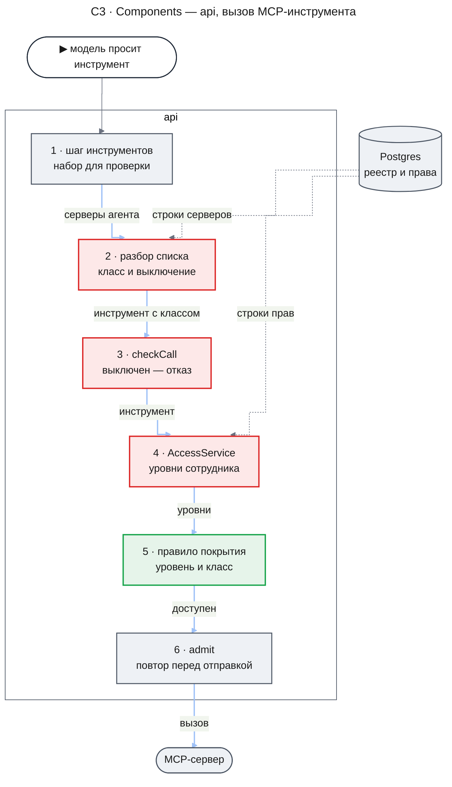
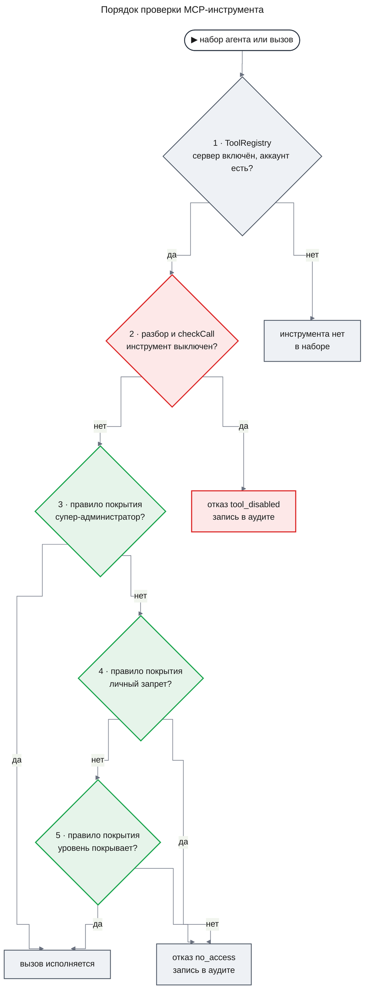
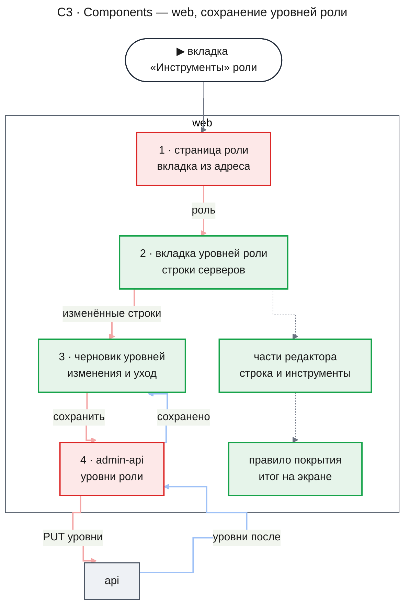
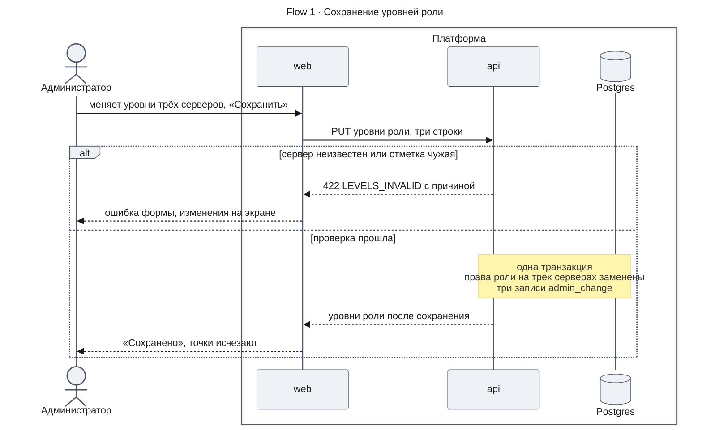
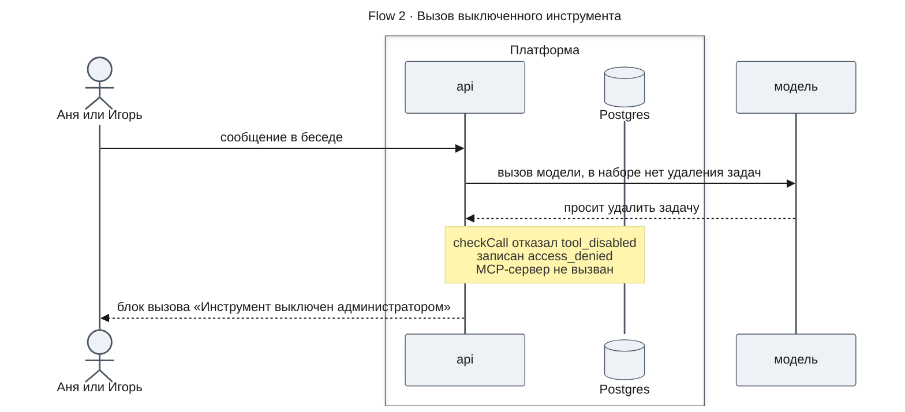
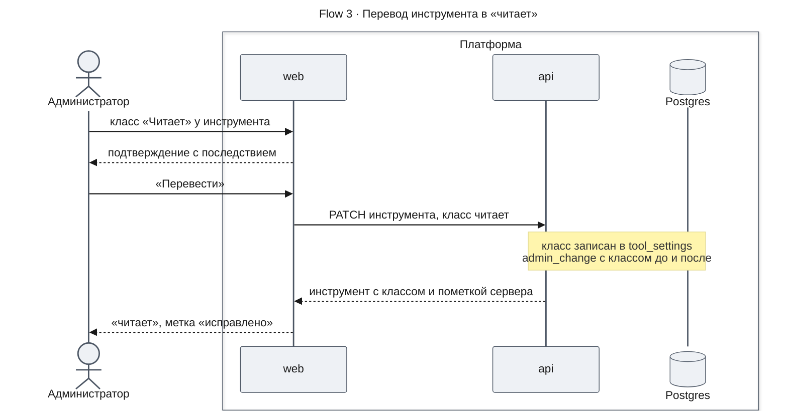
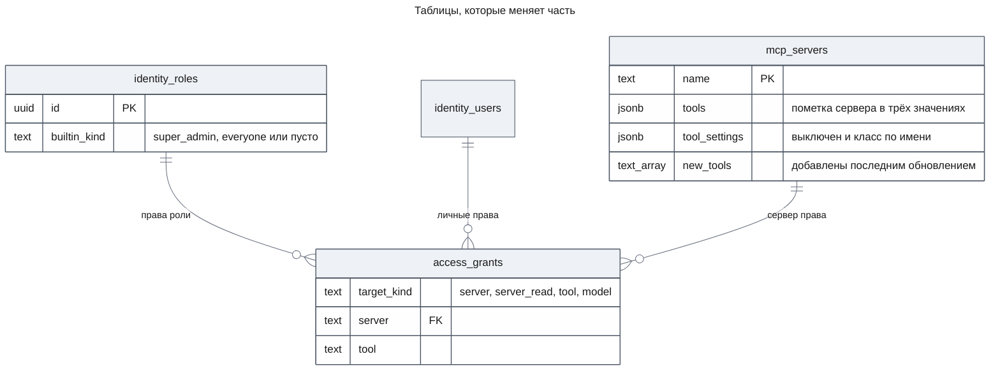

# Корпоративный вход и управление доступом — Design Document — access-levels

**Status:** Draft · **Date:** 2026-11-27 · **PRD:** [prd.md](./prd.md) · **UXRD:** [uxrd.md](./uxrd.md) · **Depends on:** [design-identity.md](./design-identity.md#contract-definitions), [design-mcp-connect.md](./design-mcp-connect.md#contract-definitions), [design-access.md](./design-access.md#contract-definitions), [design-admin.md](./design-admin.md#contract-definitions)

## Snapshot

**Overview.** Администратору неудобно выдавать права на MCP-инструменты по одному, когда ролей и серверов десятки. Эта часть даёт роли и сотруднику один уровень доступа на сервер — «Нет», «Только чтение», «Все», «Выборочно», у сотрудника ещё «Запрещено» — и настройки самих инструментов на странице сервера: выключить для всех и исправить класс «читает» или «меняет». Уровень хранится теми же строками прав, что сегодня, плюс один новый вид права — «все читающие инструменты сервера»; экран выводит уровень из строк, а сохранение заменяет строки одним запросом. Настройки инструмента применяет одно место — разбор списка инструментов сервера в пакете `agents`, поэтому набор агента, подтверждение вызова, список для расписаний и счётчики экранов видят один и тот же класс. Встроенная роль «Все сотрудники» даёт свои права каждому включённому сотруднику без назначения.

- **Не меняется**: права и квоты на модели, вердикт модели и подтверждение меняющих вызовов (правило `callRule`); регистрация, включение и удаление серверов.
- **Biggest risk**: администратор переводит меняющий инструмент в «читает», и его вызовы идут без подтверждения у всех, кому он доступен. Защита — подтверждение с последствием в интерфейсе и запись в аудите с классом до и после ([Risks and Mitigation](#risks-and-mitigation)).
- **Open questions**: нет.

### Key Decisions

Идентификаторы UXRD цитируются с префиксом: «UXRD KD-9» — решение UXRD, «KD-2» — решение этого документа.

#### KD-1: Уровень доступа — это строки `access_grants` с одним новым видом цели `server_read`; уровень выводится из строк держателя на сервере, а сохранение заменяет эти строки в одной транзакции и пишет одну запись аудита на каждый изменённый уровень

Каждый уровень уже выражается правами, кроме «Только чтение»: «Все» — разрешение сервера целиком, «Запрещено» — личный запрет сервера, «Выборочно» — разрешения и личные запреты отдельных инструментов. Для «Только чтение» добавлен вид цели `server_read` — «все читающие инструменты сервера, и будущие тоже». Так действующие права по-прежнему читаются одним запросом строк сотрудника и его ролей, а отдельной таблицы уровней, которая дублировала бы разрешение и запрет сервера, нет. Какой уровень показать, решает чистая функция вывода ([«Как уровень выводится из прав»](#как-уровень-выводится-из-прав)), и та же функция отдаёт уровни правилу проверки (KD-3), поэтому экран и проверка не расходятся.

Сохранение получает уровни нескольких серверов и для каждого сервера из запроса удаляет все MCP-строки держателя на нём и пишет строки нового уровня — всё в одной транзакции (AC-37.5). Аудит пишет одну запись `admin_change` на изменённый уровень, с уровнем до и после (AC-37.6): запись на каждую строку права дала бы десятки записей на одно «Выборочно». Строки прав MCP меняются только этим путём, поэтому смешанных наборов строк, которые не выводятся ни в один уровень, не возникает.

#### KD-2: Настройки инструментов лежат на строке сервера — `tool_settings` и `new_tools`; применяет их одна функция разбора списка инструментов в `agents`, через которую список читают все места использования

`tool_settings` — jsonb по имени инструмента: выключен ли он и исправленный класс. `new_tools` — имена, которых не было до последнего обновления списка (AC-36.6). Пометку сервера список хранит как есть, в трёх значениях: «читает», «меняет», «без пометки» — экран показывает её рядом с исправленным классом (`uxrd.md` ST-01).

Список инструментов сервера уже читает одна функция разбора `storedMcpTools` в `packages/agents/src/mcp/mcp-tool.ts`: набор агента, набор для проверки вызова, список серверов сотрудника, список для расписаний и экраны реестра. Она начинает принимать строку сервера целиком и отдаёт инструмент с действующим классом (исправление сильнее пометки, без пометки — «меняет») и признаком «включён». Подтверждение вызова, отказ меняющего вызова в read-прогоне кода, запись вызова в обучении и список меняющих инструментов для расписаний читают этот класс и ничего не знают об исправлении.

Выключенный инструмент не попадает ни в набор агента, ни в списки серверов. В наборе для проверки вызова он остаётся с признаком «выключен», и `checkCall` отказывает в нём с причиной `tool_disabled` раньше вопроса о правах — так отказ одинаков для любого сотрудника, в том числе супер-администратора, а MCP-сервер не получает вызова (AC-36.1). Права на выключенный инструмент не трогаются и снова действуют после включения (AC-36.3).

#### KD-3: Покрывает ли уровень инструмент, решает одна чистая функция в `@agent-os/contracts`; её зовут проверка вызова в `apps/api` и редакторы доступа в вебе

Веб считает итоги «{n} из {N}», метки и «Откуда» по несохранённым уровням на экране (`uxrd.md` EA-01, LV-01), а сервер проверяет вызовы по сохранённым. Одно правило в двух копиях разошлось бы на первой правке, поэтому правило покрытия — функция пакета `contracts`, который импортируют обе стороны ([pure-decision.md](../../code-system/patterns/pure-decision.md)). Вход — инструмент с классом и признаком «включён», признак супер-администратора, уровни ролей сотрудника с их отмеченными инструментами и личный уровень с личными отметками. Выход — состояние инструмента («выключен для всех», «доступен», «запрещён лично», «нет») и источники доступа.

Функция `effectiveAccess` в `apps/api` (design-access KD-2) выводит уровни из строк сотрудника (KD-1) и отвечает про инструмент этой функцией; модели и квоты в ней не меняются. Отдельная функция `superAdminAccess` уходит: супер-администратор — ветка правила покрытия.

#### KD-4: Порт `AccessGate.tools` спрашивают об инструменте вместе с его действующим классом

Уровень «Только чтение» зависит от класса, а класс знает разбор списка в `agents` (KD-2). Поэтому ответ `AccessGate.tools(ownerId)` проверяет не пару «сервер — инструмент», а инструмент с сервером, именем и действующим классом. Все, кто спрашивает порт, держат в руках разобранный инструмент: набор агента, `checkCall`, `admit`, списки серверов сотрудника. Чтение прошлых задач для обучения (`training-reads.ts`) знает о прошлом вызове только имена и берёт инструмент из текущего списка сервера; вызов инструмента, которого в списке больше нет или который выключен, считается недоступным.

Сервер читать строки реестра заново не стал бы проще: `apps/api` пришлось бы разбирать список инструментов вторым местом, а `agents` всё равно нужен класс для подтверждения.

#### KD-5: «Все сотрудники» — вторая встроенная роль; вид встроенной роли хранит колонка `builtin_kind`, а членство неявное

Логическая колонка `builtin` превращается в `builtin_kind` со значениями `super_admin`, `everyone` или пусто; у каждого вида не больше одной строки. Обе строки создаёт миграция встроенных строк ([builtin-record.md](../../code-system/patterns/builtin-record.md)). Строк членства у «Все сотрудники» нет: `AccessService`, читая права сотрудника, добавляет её id к его ролям, и права роли доходят до каждого включённого сотрудника тем же запросом, что права остальных ролей (AC-38.1). `IdentityDirectory.rolesOf` по-прежнему отдаёт только членство, поэтому аудитории записей библиотеки, которые строятся по ролям сотрудника, эта роль не расширяет. Заблокированному сотруднику права не нужны: `AccessService.tools` отказывает ему раньше (design-access KD-1).

Назначить и снять эту роль, переименовать, удалить и дать ей право администратора или права обучать сервер не даёт — 409 `BUILTIN_ROLE`, как для «Супер-администратора» (AC-38.2). Уровни и модели ей задаются, как любой роли, и копировать её можно.

#### KD-6: API — три пары «прочитать и заменить уровни» (роль, сотрудник, сервер), правка одного инструмента и копия роли при создании; права через `/api/admin/grants` — только на модели

Каждая пара отвечает одной вкладке экрана: «Инструменты» роли, «Инструменты» сотрудника, «Доступ» сервера. Чтение отдаёт всё, что вкладке нужно для расчёта на экране, — список инструментов каждого сервера, сохранённые уровни и, у сотрудника, уровни его ролей, — поэтому отдельного маршрута «действующий доступ» нет. Запись принимает только изменённые строки и отвечает тем же видом, что чтение. Все три записи — одна операция `AccessLevelsService` над одной функцией вывода уровней (KD-1).

`POST /api/admin/grants` и `Grant` несут только цель «модель»; создать право на сервер или инструмент этим маршрутом нельзя. Модели и квоты правятся тем же диалогом GR-01, что раньше.

#### KD-7: Веб — общий черновик уровней и общие части редактора для трёх вкладок; вкладка входит в адрес страницы

Три вкладки уровней различаются строками и колонками, но одинаково копят изменения, считают их число, сохраняют одной кнопкой и держат уход со страницы. Это одна логика — хук черновика уровней над `lib/leave-guard`; строку сервера, выбор уровня, раскрытие инструментов и панель сохранения собирает общий набор частей [редактора уровней доступа](../../design-system/components/access-level-editor.md). Вкладка «Инструменты» сервера сохраняет каждый контрол сразу и обходится без черновика, как `saving-switch` (UXRD KD-11).

Вкладка — сегмент адреса после ключа записи; первая вкладка живёт по адресу самой записи. Ссылка «Выбрать инструменты» ведёт на `/admin/roles/<id>?server=<имя>`: вкладка «Инструменты» открывается с раскрытой строкой этого сервера (`uxrd.md` ST-02).

## Terms

- **Уровень доступа** — сколько инструментов одного сервера дано роли или сотруднику: `none` («Нет»), `read` («Только чтение»), `all` («Все»), `pick` («Выборочно»), у сотрудника ещё `denied` («Запрещено»).
- **Отметка** — инструмент, выбранный в «Выборочно»: у роли — разрешён, у сотрудника — лично разрешён или лично запрещён.
- **Сирота** — отметка инструмента, которого в списке сервера больше нет (`uxrd.md`, Terms).
- **Действующий класс** — класс инструмента после исправления администратора: исправление, иначе пометка сервера, без пометки — «меняет».
- **Правило покрытия** — чистая функция KD-3: доступен ли инструмент сотруднику при данных уровнях.
- **Вывод уровня** — функция KD-1: строки прав держателя на сервере → уровень и отметки, и обратно.

## Part

- **Prerequisite ADRs**: [ADR-0014](../../adr/ADR-0014-mcp-registry-owned-by-agents.md) (реестр MCP в `agents`), [ADR-0015](../../adr/ADR-0015-access-gate-and-model-catalogue.md) (порт `AccessGate`), [ADR-0022](../../adr/ADR-0022-one-database-and-nestjs-modules.md) (одна база, модули NestJS), [ADR-0024](../../adr/ADR-0024-every-reference-is-a-foreign-key.md) (ссылки — внешние ключи).

**Out of scope**

- Права и квоты на модели, их диалог GR-01 и вердикт модели остаются как в [design-access.md](./design-access.md) и [design-admin.md](./design-admin.md); вкладки «Модели» только показывают их.
- Правило подтверждения вызова (`callRule`), разрешения расписаний и беседы (`allowed_tools`, `granted_tools`) не меняются; они получают действующий класс из разбора списка (KD-2).
- Регистрация, включение, удаление сервера и обновление списка по кнопке остаются как в [design-mcp-connect.md](./design-mcp-connect.md); обновление лишь пишет `new_tools`.
- Сироты не убираются сами: отметка остаётся, пока администратор её не снимет (AC-37.7).

**Constraints**

- PoC: схема меняется в единственной миграции `0000_schema.sql` и в миграции встроенных строк `0001_builtin_rows.sql`, которые генерируются заново; база разработки пересоздаётся, существующие строки не переносятся.
- Настроек окружения нет: всё, что правит часть, лежит в базе и правится в панели.
- Проверка прав перед вызовом читает права сотрудника тем же одним запросом, что сейчас; id роли «Все сотрудники» добавляется к id его ролей до этого запроса (NFR-04).
- Все запросы к таблицам — в репозиториях `packages/db`; сервисы — `@Injectable`; правило покрытия и вывод уровня — чистые функции.

## Building-block Inventory

Follows the [code system](../../code-system/README.md).

| Building block | Pattern | Status | Note |
|---|---|---|---|
| `access_grants`, `AccessGrantsRepository` | [repository-over-transaction.md](../../code-system/patterns/repository-over-transaction.md) | extended | Вид цели `server_read`; удаление MCP-строк держателя на серверах; копия строк роли |
| Вывод уровня (строки ↔ уровень) | [pure-decision.md](../../code-system/patterns/pure-decision.md) | new | В `apps/api/src/access`; искали в `effective-access.ts` и `grant-rows.ts` — там строки только переводятся в цели |
| Правило покрытия | [pure-decision.md](../../code-system/patterns/pure-decision.md) | new | В `packages/contracts`; инструментальная часть `effectiveAccess` переезжает сюда, чтобы веб звал её же |
| `effectiveAccess`, `AccessService.tools` | [pure-decision.md](../../code-system/patterns/pure-decision.md) | extended | Уровни из строк, ответ по инструменту с классом (KD-4) |
| `AccessLevelsService` и контроллер уровней | [auth-boundary.md](../../code-system/patterns/auth-boundary.md) | new | В модуле `access`; запись и аудит в одной транзакции |
| `RolesService`, `IdentityDirectory` | [builtin-record.md](../../code-system/patterns/builtin-record.md) | extended | `builtin_kind`, неявная «Все сотрудники», копия роли |
| `storedMcpTools`, `McpRegistry` | [tool-declaration.md](../../code-system/patterns/tool-declaration.md) | extended | Настройки инструмента, `new_tools`, пометка в трёх значениях |
| `checkCall` | [pure-decision.md](../../code-system/patterns/pure-decision.md) | extended | Отказ `tool_disabled` до вопроса о правах |
| Миграция встроенных строк | [builtin-record.md](../../code-system/patterns/builtin-record.md) | extended | Строка «Все сотрудники» |
| Адрес вкладки и `?server=` | [shell-route.md](../../code-system/patterns/shell-route.md) | extended | `AdminPage` записи получает вкладку |
| Черновик уровней, части редактора | состояние страницы, KD-7 | new | Искали в `components/admin` и `components/library`: `record-editor` копит поля одной записи, а не строки с отметками. Уход держит существующий стор `leaveGuard` ([shell-store.md](../../code-system/patterns/shell-store.md)) |
| `data-table`, `saving-switch`, `confirm-dialog`, `grants-section` | [web-api-client.md](../../code-system/patterns/web-api-client.md) | reused | `grants-section` показывает только модели |

## Acceptance Criteria

### FR-36: Настройки инструментов на сервере

- From the PRD: AC-36.1, AC-36.2, AC-36.3, AC-36.4, AC-36.5, AC-36.6
- Отказ в выключенном инструменте несёт причину `tool_disabled`, и блок вызова показывает текст «Инструмент выключен администратором» (`uxrd.md` MC-10) (DC-1).

### FR-37: Уровни доступа роли

- From the PRD: AC-37.1, AC-37.2, AC-37.3, AC-37.4, AC-37.5, AC-37.6, AC-37.7, AC-37.8
- Сохранение, где хотя бы один сервер неизвестен реестру или в «Выборочно» отмечен инструмент, которого нет ни в списке, ни среди сохранённых отметок, отвечает 422 `LEVELS_INVALID` и не меняет ни одной строки (DC-2).

### FR-38: Встроенная роль «Все сотрудники»

- From the PRD: AC-38.1, AC-38.2, AC-38.3, AC-38.4

### FR-39: Кто имеет доступ — на странице сервера

- From the PRD: AC-39.1, AC-39.2

### FR-40: Личный доступ сотрудника и действующий доступ

- From the PRD: AC-40.1, AC-40.2, AC-40.3

Через новые маршруты PRD-критерии FR-16, FR-17 и FR-34 (AC-16.1, AC-16.2, AC-17.1, AC-17.2, AC-34.2) задаются уровнями; их проверяет правило покрытия (UC-2).

## Design

### Architecture (C1–C4)

#### C2 · Containers

Новых контейнеров нет. В `api` меняются модули `access` и `identity` и пакет `agents`, который работает в том же процессе; в базе — таблицы `access_grants`, `identity_roles` и `mcp_servers` ([Data Model](#data-model)).

#### C3 · Components: api

**api — вызов MCP-инструмента**

- Разбор списка (`storedMcpTools`) накладывает `tool_settings` на список сервера; набор агента тем же разбором собирает `ToolRegistry.toolsFor`, отбрасывая выключенные (KD-2).
- `AccessService.tools` читает роли сотрудника вместе с «Все сотрудники», строки прав и признак супер-администратора, выводит уровни (KD-1) и отвечает правилом покрытия (KD-3). `admit` спрашивает его ещё раз прямо перед отправкой, как сейчас.

**api — сохранение уровней** идёт по [Flow 1](#flow-1-сохранение-уровней-роли): контроллер уровней проверяет тело схемой из `contracts`, `AccessLevelsService` читает список инструментов серверов из реестра, проверяет отметки, переводит уровни в строки функцией вывода и в одной транзакции заменяет строки через `AccessGrantsRepository` и пишет `admin_change` через `AuditLog`.

#### How the tool check works

Схема повторяет решение PRD «Доступен ли агенту MCP-инструмент» в порядке, в каком его проверяет код, с местом каждой проверки.

- Проверка 1 — та же, что сейчас: выключенный сервер и сервер с личным OAuth без аккаунта сотрудника не дают инструментов в набор, а вызов без аккаунта получает `auth_required` (design-mcp-connect KD-5, DC-3). В PRD она стоит последней; итог от этого не меняется, потому что в обоих местах инструмента просто нет в наборе.
- В наборе агента выключенного инструмента нет; если модель всё же просит его, `checkCall` отказывает `tool_disabled` и пишет `access_denied` с этой причиной.
- Проверки 3–5 — одна функция. «Покрывает» значит: уровень хотя бы одной роли сотрудника, включая «Все сотрудники», или личный уровень — `all`; или `read` у инструмента с действующим классом «читает»; или `pick` с отметкой этого инструмента (у сотрудника — «разрешён»). Личный запрет — личный уровень `denied` или отметка «запрещён».

#### Как уровень выводится из прав

Таблица — правило функции вывода для MCP-строк одного держателя на одном сервере; модельные строки она не трогает.

| Строки держателя на сервере | Уровень | Строки, которые пишет сохранение этого уровня |
|---|---|---|
| нет строк | `none` | ничего |
| разрешение `server_read` | `read` | одно разрешение `server_read` |
| разрешение `server` | `all` | одно разрешение `server` |
| только строки `tool` | `pick` с отметками | у роли — разрешение `tool` на каждую отметку; у сотрудника — разрешение или запрет `tool` по отметке |
| запрет `server` (только сотрудник) | `denied` | один запрет `server` |

Если строк нескольких видов окажется больше одной, побеждает первый сверху вниз вид: запрет `server`, разрешение `server`, `server_read`, строки `tool`; следующее сохранение сервера пишет чистый набор. «Выборочно» без отметок сохраняется как «Нет». Отметка сироты остаётся строкой `tool`, и вывод показывает её в отметках (AC-37.7).

#### C3 · Components: web

- **Страницы записей.** Страница роли несёт вкладки «Инструменты», «Модели», «Права», «Участники»; страница сотрудника — «Инструменты», «Модели», «Права», «Роли»; страница сервера под сведениями — «Инструменты» и «Доступ» (UXRD KD-12). Вкладка «Модели» — существующий раздел прав `grants-section` только с моделями; «Права», «Участники» и «Роли» — существующие блоки страниц, разложенные по вкладкам.
- **Вкладки уровней.** Вкладка «Инструменты» роли (`uxrd.md` LV-01–LV-04), «Инструменты» сотрудника (EA-01) и «Доступ» сервера (ST-02) читают свой маршрут, отдают строки частям редактора и изменения черновику. У «Супер-администратора» вкладка роли показывает таблицу только для чтения из того же ответа и не даёт черновика.
- **Черновик уровней** — один хук для трёх вкладок: держит сохранённые строки и изменённые, считает изменённые строки (строка, вернувшаяся к сохранённой, не считается), помнит отметки «Выборочно» при уходе с него и при возврате, начинает «Выборочно» с того, что давал прежний уровень (UXRD KD-10). «Сохранить» отправляет только изменённые строки и после ответа заменяет сохранённые строки ответом; отказ оставляет черновик на экране. Пока изменения есть, черновик держит `lib/leave-guard` с текстом MC-37; переход между вкладками той же страницы черновик не теряет, потому что он живёт на странице, а не во вкладке.
- **Части редактора** — строка сервера или роли с выбором уровня, раскрытие инструментов с группами «Меняют» и «Читают», группа «Нет на сервере», выбор «—», «Разрешён», «Запрещён» у сотрудника и панель сохранения ([access-level-editor.md](../../design-system/components/access-level-editor.md)). Итог, метки и «Откуда» они считают правилом покрытия из `contracts`.
- **Вкладка «Инструменты» сервера** (ST-01) — список инструментов из `GET /api/admin/mcp-servers/:name` в группах по действующему классу; переключатель «Доступен» и выбор класса сохраняют каждый свой контрол маршрутом правки инструмента. Перевод в «Читает» и «Вернуть как у сервера», если сервер помечает инструмент читающим, идут после `confirm-dialog` с текстом MC-36.
- **Адреса.** `AdminPage` записи получает вкладку: `/admin/roles/<id>/models|rights|members`, `/admin/users/<id>/models|rights|roles`, `/admin/servers/<имя>/access`; адрес без сегмента — первая вкладка. Параметр `?server=<имя>` на вкладке «Инструменты» роли раскрывает строку сервера и ставит на неё фокус.

### Runtime Flows

#### Flow 1: Сохранение уровней роли

**Starts when:** администратор нажимает «Сохранить» на вкладке «Инструменты» роли, for AC-37.5, AC-37.6, AC-38.4

Все проверки идут до транзакции; отказ базы внутри транзакции откатывает и строки, и записи аудита, и веб показывает ту же ошибку формы с причиной «попробуйте ещё раз» (MC-37). Новые права действуют со следующего вызова модели любого агента: кэша прав нет (design-access KD-1). Вкладка «Доступ» сервера и вкладка сотрудника сохраняют тем же путём своими маршрутами.

#### Flow 2: Вызов выключенного инструмента

**Starts when:** модель агента просит инструмент, который администратор выключил, for AC-36.1, AC-36.2

Отказ одинаков у сотрудника с уровнем «Все» и у супер-администратора: проверка выключения стоит раньше правила покрытия. Агент получает отказ как результат вызова и продолжает ход.

#### Flow 3: Перевод инструмента в «читает»

**Starts when:** администратор выбирает класс «Читает» на вкладке «Инструменты» сервера, for AC-36.4, AC-36.5

Перевод в «Меняет» идёт так же, но без подтверждения. Набор агента и решение о подтверждении видят новый класс со следующего шага: разбор списка читает строку сервера на каждом шаге (KD-2).

### Contract Definitions

Все маршруты этой части закрыты `@AdminOnly`: без права администратора — 403 `ADMIN_REQUIRED` ([design-identity.md](./design-identity.md#contract-definitions)). Тела проверяют схемы `@agent-os/contracts`; неверная форма тела — 400 от пайпа.

**Уровни роли и сотрудника**

- **`GET /api/admin/roles/:id/levels`** — уровни роли на каждом зарегистрированном сервере. Returns `RoleLevels`. 404 `ROLE_NOT_FOUND`. У «Супер-администратора» уровни всех серверов — `none`: ответ нужен экрану только ради списка серверов и инструментов (`uxrd.md` LV-04).
- **`PUT /api/admin/roles/:id/levels`** — заменяет уровни роли на серверах тела; серверы, которых в теле нет, не меняются (KD-1). Тело — `servers`: строки с `server`, `level` (`none`, `read`, `all`, `pick`) и `picked` — именами отмеченных инструментов при `pick`. Returns `RoleLevels`. 404 `ROLE_NOT_FOUND`; 409 `BUILTIN_ROLE` у «Супер-администратора»; 422 `LEVELS_INVALID`.
- **`GET /api/admin/users/:id/levels`** — личные уровни сотрудника и уровни его ролей на каждом сервере. Returns `UserLevels`. 404 `USER_NOT_FOUND`.
- **`PUT /api/admin/users/:id/levels`** — заменяет личные уровни на серверах тела. Тело — `servers`: строки с `server`, `level` (те же значения и `denied`) и `marks` при `pick` — инструмент и `effect` (`allow` или `deny`). Returns `UserLevels`. 404 `USER_NOT_FOUND`; 422 `LEVELS_INVALID`.

**Доступ ролей к серверу**

- **`GET /api/admin/mcp-servers/:name/access`** — роли с уровнем, отличным от `none`, на этом сервере. Returns `ServerAccess`. 404 `MCP_SERVER_NOT_FOUND`.
- **`PUT /api/admin/mcp-servers/:name/access`** — заменяет уровни ролей тела на этом сервере. Тело — `roles`: строки с `roleId`, `level` и `picked` при `pick`. Returns `ServerAccess`. 404 `MCP_SERVER_NOT_FOUND`; 409 `BUILTIN_ROLE`, если в теле «Супер-администратор»; 422 `LEVELS_INVALID`.

**Настройки инструмента**

- **`PATCH /api/admin/mcp-servers/:name/tools/:tool`** — меняет `enabled` и/или `readOnly` одного инструмента; `readOnly: null` возвращает класс к пометке сервера. Returns `McpToolView`. 404 `MCP_SERVER_NOT_FOUND`, `MCP_TOOL_NOT_FOUND` — инструмента нет в списке сервера. Пишет `admin_change` с `objectType` `mcp_tool`, id `<сервер>/<инструмент>`, «было» и «стало» — `enabled` и класс с пометкой сервера.
- **`POST /api/admin/mcp-servers/:name/tools/refresh`** — как в [design-mcp-connect.md](./design-mcp-connect.md#contract-definitions); дополнительно записывает в `new_tools` имена из `added`. Регистрация и первое получение списка после входа администратора пишут пустой `new_tools`.

**Роли**

- **`POST /api/admin/roles`** — тело получает необязательный `copyFrom` — id роли-образца. Новая роль получает копию всех строк `access_grants` образца — уровни серверов с отметками и разрешения моделей с квотами, — но не сотрудников, не право администратора и не права обучать (AC-37.8). 404 `ROLE_NOT_FOUND` — образца нет; 409 `BUILTIN_ROLE` — образец «Супер-администратор». Одна запись `admin_change` о создании роли называет образец в «стало». Роль, копия строк и запись аудита пишутся в одной транзакции; при отказе роль не создаётся.
- **`PATCH /api/admin/roles/:id`**, **`DELETE /api/admin/roles/:id`**, **`PUT`** и **`DELETE /api/admin/users/:id/roles/:roleId`** — как в design-identity; у «Все сотрудники» переименование, право администратора, права обучать, удаление, назначение и снятие отвечают 409 `BUILTIN_ROLE`.

**Права на модели**

- **`GET`**, **`POST`**, **`PATCH`**, **`DELETE /api/admin/grants`** — как в design-access, но только для моделей: `GET` отдаёт права на модели, а `target` тела и ответа — только `model` с `model` (в ответе ещё `modelName`).

**Порт для `agents`**

- **`AccessGate.tools(ownerId)`** — как в design-access, но ответ проверяет инструмент: сервер, имя инструмента и его действующий класс (KD-4). Ответ `true` — правило покрытия дало «доступен».
- **`ToolRefusalReason`** получает `tool_disabled`; запись `access_denied` о таком отказе несёт ту же причину, `objectType` `tool` и id `<сервер>/<инструмент>`.

**RoleSummary** (изменения)

- `builtinKind` — `super_admin`, `everyone` или `null` вместо `builtin`.
- `memberCount` — `null` у «Все сотрудники»; список `members` у неё пуст.

**RoleLevels**

- `servers` — по имени сервера: `server`, `status` (`McpServerStatus`), `tools` — `LevelTool[]` или `null`, пока сервер не отдал список (тогда `pick` для него недоступен), `level`, `picked` — отметки, сироты тоже.

**UserLevels**

- `superAdmin` — сотрудник в роли «Супер-администратор»: его личные уровни сохраняются, но не действуют (`uxrd.md` EA-01).
- `servers` — по имени сервера: `server`, `status`, `tools`; `personal` — `level` и `marks`; `roles` — роли сотрудника с уровнем не `none` на этом сервере, «Все сотрудники» тоже: `id`, `name`, `builtinKind`, `level`, `picked`.

**ServerAccess**

- `server`, `status`, `tools`; `roles` — роли с уровнем не `none`, кроме «Супер-администратора»: `id`, `name`, `builtinKind`, `memberCount`, `level`, `picked`. Строку «Супер-администратор» и роли для «Дать доступ ролям» веб берёт из `GET /api/admin/roles`.

**LevelTool** и **McpToolView**

- `LevelTool` — `name`, `title` (или `null`), `readOnly` — действующий класс, `enabled`, `isNew`.
- `McpToolView` (ответ реестра и правки инструмента) — поля `LevelTool` и ещё `description`, `serverReadOnly` — пометка сервера: `true`, `false` или `null` (без пометки), `overridden` — класс исправлен администратором.

**Error handling**

- `LEVELS_INVALID` — 422 с полем `reason`: `server_unknown` — сервера нет в реестре; `role_unknown` — роли из тела нет; `tool_unknown` — отмеченного инструмента нет ни в списке сервера, ни среди сохранённых отметок держателя; `pick_without_list` — `pick` у сервера без списка. При отказе не меняется ни одна строка (DC-2).
- `MCP_TOOL_NOT_FOUND` — 404 у правки инструмента.
- `BUILTIN_ROLE` — 409, как в design-identity.

### Data Model

- **`identity_roles.builtin_kind`** — вид встроенной роли; уникален среди непустых. Миграция встроенных строк создаёт «Супер-администратор» (`super_admin`, право администратора и права обучать) и «Все сотрудники» (`everyone`, без прав).
- **`access_grants.target_kind`** получает `server_read`: у него задан `server`, а `tool` и `model` пусты. Запрет — по-прежнему только у сотрудника, квота — только у разрешения модели; каскад от сервера, роли и сотрудника тот же.
- **`mcp_servers.tool_settings`** — объект по имени инструмента с необязательными `enabled: false` и `readOnly`; пустой объект — настроек нет. Запись остаётся, когда инструмент пропадает из списка, и снова действует, если он вернётся.
- **`mcp_servers.new_tools`** — имена, добавленные последним обновлением; пусто после регистрации.

### Что часть убирает

Код, тесты и ключи переводов уходят вместе с тем, что их заменяет.

| Что | Что вместо него |
|---|---|
| `identity_roles.builtin` и поле `builtin` ролей | `builtin_kind` и `builtinKind` (KD-5) |
| Цели `server` и `tool` в `POST /api/admin/grants`, `Grant.target`, причины `server_unknown` и `tool_unknown` у `GRANT_TARGET_UNKNOWN`, колбэк `McpTargetCheck` | Маршруты уровней (KD-6) |
| `superAdminAccess` | Ветка правила покрытия (KD-3) |
| Виды «сервер» и «инструмент» в диалоге права, строки-сироты в разделе прав, помощники сирот в `lib/admin/grants.ts` и их ключи | Вкладки уровней; сироты — группа «Нет на сервере» |
| Таблица инструментов на странице сервера и её ключи | Вкладка «Инструменты» сервера (ST-01) |
| Разрешения серверов в `seed:access` | Не нужны: супер-администратор получает все инструменты без прав (FR-34) |

`seed:access` ищет встроенную роль по `builtinKind: super_admin` и по-прежнему разрешает ей модели чата; `identity:super-admin` назначает роль того же вида.

## Test Strategy

Тесты e2e и интеграционные пишутся, но локально не запускаются: их гоняет CI.

- **UC-1: Вывод уровня** — covers AC-37.3, AC-37.7, AC-40.1, AC-40.2, DC-2
  - Given: строки таблицы [вывода](#как-уровень-выводится-из-прав): каждый вид строк роли и сотрудника, смешанный набор, «Выборочно» без отметок, отметка сироты
  - When: функция выводит уровень и строит строки по уровню
  - Then: уровни и строки как в таблице; смешанный набор — по старшему виду; пустое «Выборочно» — `none`; сирота остаётся в отметках
- **UC-2: Правило покрытия** — covers AC-36.1, AC-36.3, AC-37.1, AC-37.2, AC-37.4, AC-16.2, AC-17.1, AC-17.2, AC-34.2, AC-38.3
  - Given: строки таблицы: выключенный инструмент при уровне «Все» и у супер-администратора; супер-администратор с личным запретом; `read` и читающий инструмент, появившийся позже; `read` и меняющий; `read` у одной роли и `pick` с меняющим у другой; личный `pick` с запретом при роли «Все»; личный `denied` при «Все сотрудники» — «Все»; личная отметка без ролей
  - When: функция отвечает на каждую строку
  - Then: «выключен для всех» дважды; доступен; доступен; нет; доступны оба; запрещён лично; запрещён лично; доступен с источником «лично»
- **UC-3: Разбор списка с настройками** — covers AC-36.4, AC-36.5, AC-36.6
  - Given: пометка «читает» и исправление «меняет»; без пометки и исправление «читает»; выключенный инструмент; имя в `new_tools`
  - When: список разбирается
  - Then: классы «меняет» и «читает», признак «выключен», признак «новый»
- **UC-4: Выключенный инструмент не вызывается** — covers AC-36.1, DC-1
  - Given: тестовый MCP-сервер, у Ани уровень «Все», Игорь — супер-администратор, инструмент выключен
  - When: модель агента каждого просит этот инструмент
  - Then: сервер не получил ни одного вызова, отказ `tool_disabled`, по одной записи `access_denied`
- **UC-5: Базовый доступ «Все сотрудники»** — covers AC-38.1, AC-37.2, AC-36.5
  - Given: у «Все сотрудники» уровень «Только чтение», у нового сотрудника нет ролей
  - When: его агент просит читающий инструмент, потом меняющий; затем администратор переводит меняющий в «читает», и агент просит его снова
  - Then: читающий исполняется; меняющий — отказ `no_access` без вызова сервера; после перевода инструмент в наборе и исполняется без подтверждения, а в аудите класс до и после
- **UC-6: Сохранение уровней и изоляция** — covers AC-37.5, AC-37.6, AC-39.2, AC-40.3, DC-2
  - Given: роль, Аня и Борис, три сервера
  - When: сотрудник без права администратора зовёт каждый новый маршрут; администратор сохраняет три уровня, один из которых на неизвестном сервере; сохраняет три верных; задаёт уровни ролям со страницы сервера; задаёт Ане личный уровень
  - Then: 403 на каждом маршруте; 422 и ни одной изменённой строки; три записи `admin_change`; уровни видны на странице каждой роли; личные уровни Бориса не изменились
- **UC-7: Встроенные роли и копия** — covers AC-38.2, AC-37.8
  - Given: «Все сотрудники», «Супер-администратор» и роль «SRE» с уровнями, моделью с квотой, сотрудником и правом администратора
  - When: администратор назначает, снимает, переименовывает, удаляет «Все сотрудники» и даёт ей право администратора; создаёт копию «SRE» и копию «Супер-администратора»
  - Then: 409 `BUILTIN_ROLE` на каждое действие с «Все сотрудники»; у копии «SRE» те же уровни и модели с квотой, без сотрудников и права администратора; копия «Супер-администратора» — 409
- **UC-8: Черновик уровней в вебе** — covers AC-37.5, AC-37.7, AC-36.3
  - Given: вкладка «Инструменты» роли с сервером на «Все», сервером с сиротой и сервером с выключенным инструментом
  - When: администратор переводит первый в «Выборочно», возвращает второй к сохранённому, сохраняет, и сервер отвечает отказом
  - Then: в «Выборочно» отмечены все инструменты; изменений одно; отправлена одна строка; после отказа изменения на экране и ошибка формы; сирота в группе «Нет на сервере»; выключенный инструмент отмечен и не входит в итог
## Security Considerations

- **Authentication & Authorization**: каждый новый маршрут закрыт `@AdminOnly` и проверен e2e без права (UC-6). Проверка вызова остаётся одним местом (FR-18): выключение — в `checkCall`, права — в `AccessGate.tools`, а `admit` спрашивает порт ещё раз перед отправкой. Встроенные роли защищает сервер, а не только панель (AC-38.2).
- **Input Validation**: тела проверяют схемы `contracts`; серверы, роли и отметки сверяются с реестром и правами до транзакции (DC-2). Имя инструмента в адресе правки сверяется со списком сервера.
- **Sensitive Data Handling**: часть не трогает секретов. Логи сохранения пишут id администратора, держателя, имена серверов, число изменённых уровней, исход и длительность; логи правки инструмента — сервер, инструмент и что изменилось. Токены и секреты серверов в ответы и аудит не попадают, как в design-mcp-connect.

## Risks and Mitigation

- **Перевод меняющего инструмента в «читает» снимает подтверждение у всех и открывает его ролям с «Только чтение»** — влияние высокое, вероятность низкая. Подтверждение называет последствие (MC-36), запись аудита хранит класс до и после, а «Вернуть как у сервера» возвращает пометку одним нажатием.
- **«Все сотрудники» с широким уровнем открывает сервер каждому, в том числе вошедшему через публичный Google** — влияние высокое, вероятность средняя. Предупреждения на роли и у провайдера Google (MC-38, MC-27); личный «Запрещено» сильнее роли (AC-38.3).
- **Экран и проверка разошлись в правиле** — влияние высокое, вероятность низкая. Одна функция покрытия в `contracts` и одна функция вывода уровня, обе с табличным тестом (UC-1, UC-2).
- **Класс, сменённый посреди шага, действует только со следующего шага** — влияние низкое. Разбор списка читает строку сервера на каждом шаге, и `admit` проверяет права по классу, который знал этот шаг.

## Update History

| Version | Date | Change |
|---------|------|--------|
| 1.0 | 2026-11-27 | Первая версия |
