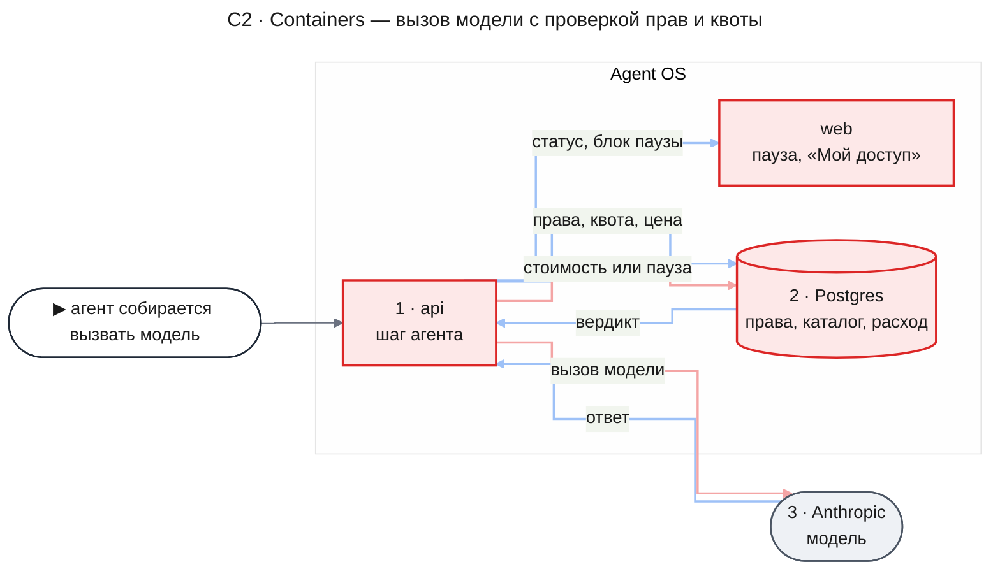
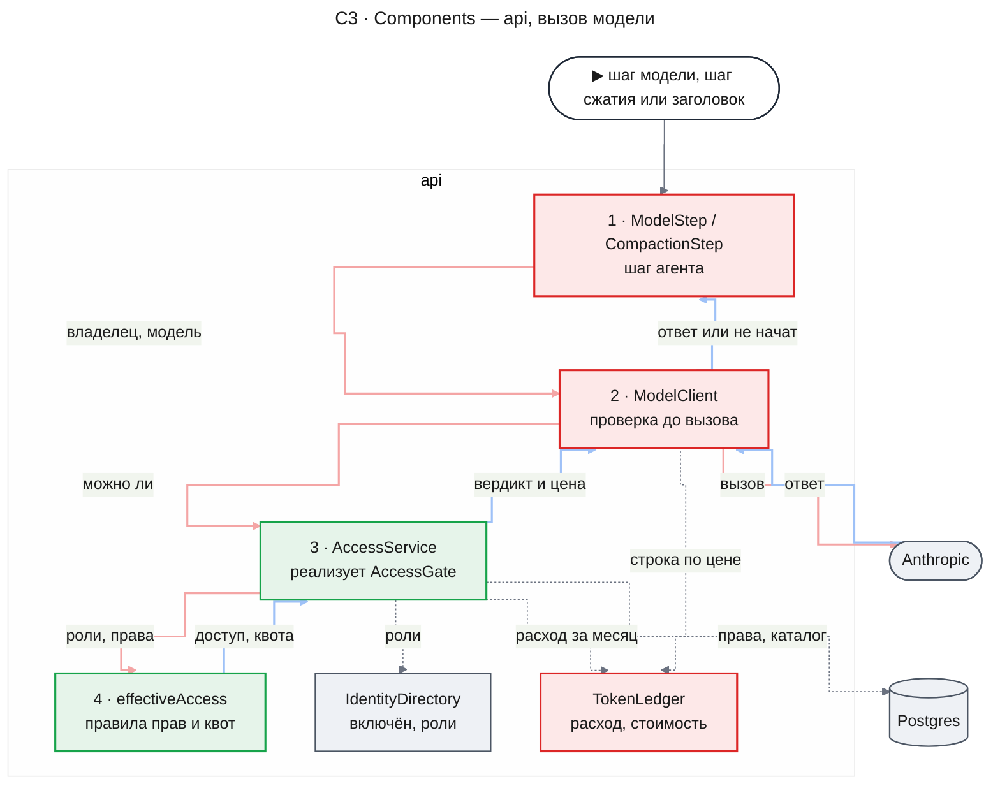
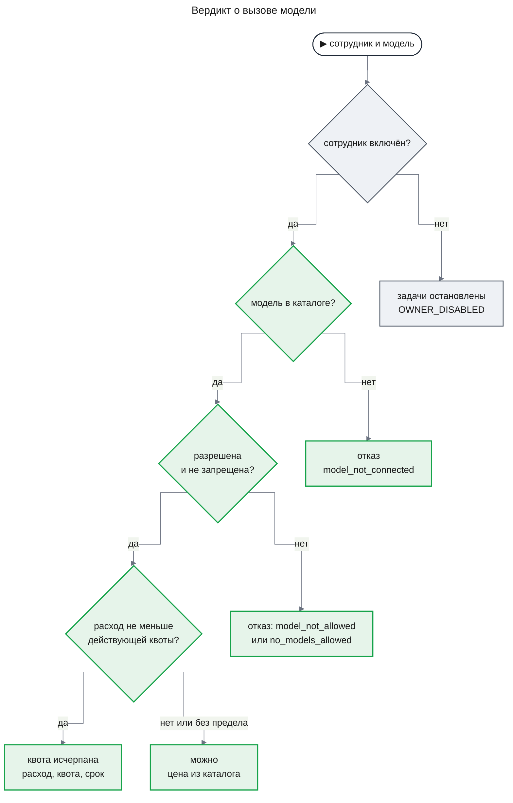
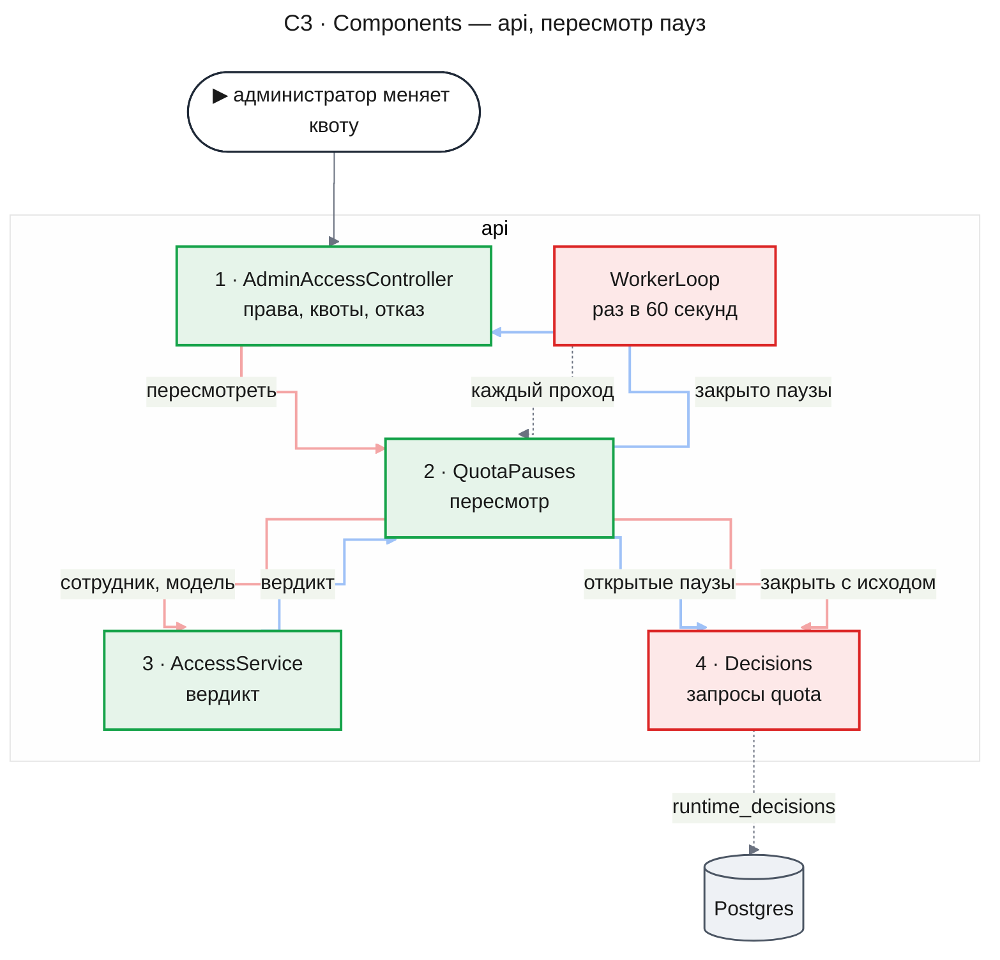
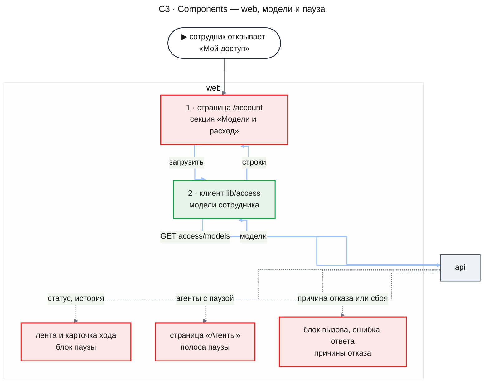
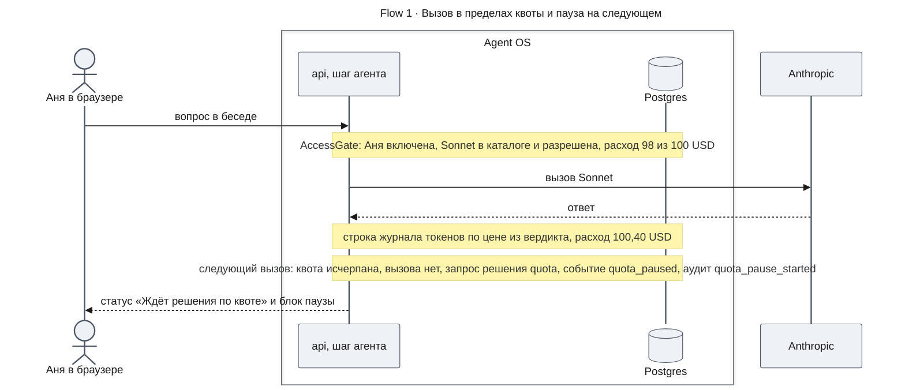
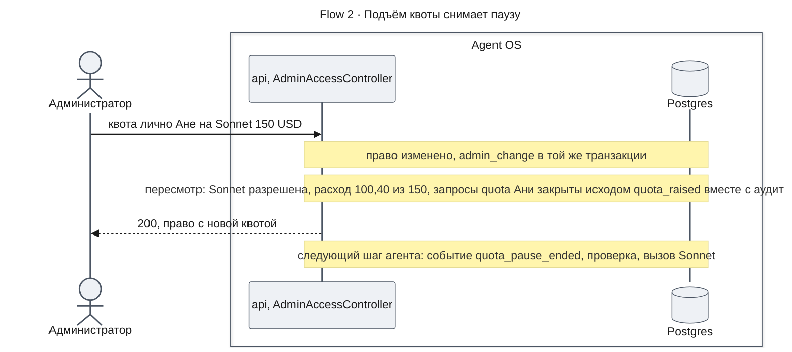
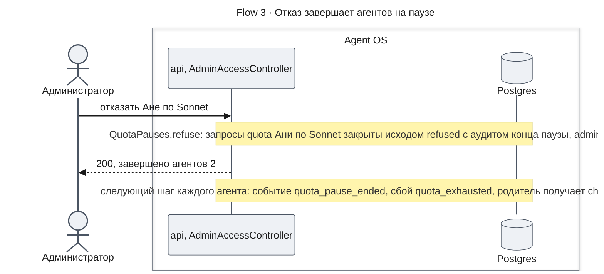
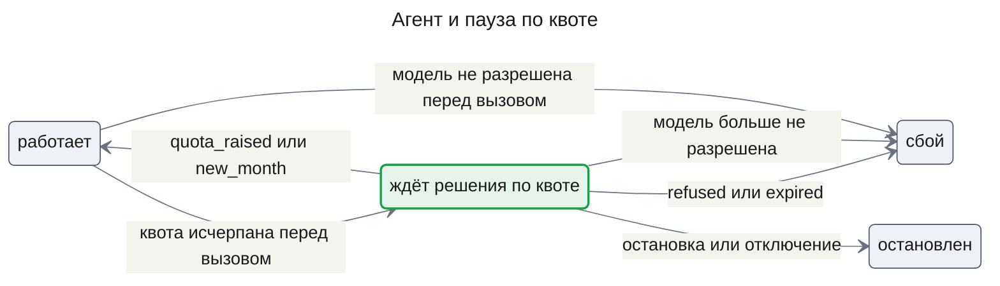

# Корпоративный вход и управление доступом — Design Document — access

**Status:** Approved · **Date:** 2026-11-15 · **PRD:** [prd.md](./prd.md) · **UXRD:** [uxrd.md](./uxrd.md) · **Depends on:** [design-identity.md](./design-identity.md#contract-definitions), [design-mcp-connect.md](./design-mcp-connect.md#contract-definitions)

## Snapshot

**Overview.** Сегодня право на MCP-сервер задаёт таблица в переменной окружения, цены моделей лежат в JSON-файле, а расход сотрудника только считается и ничего не ограничивает. Эта часть переносит всё в базу: администратор даёт ролям и сотрудникам права на сервер, на инструмент и на модель с месячной квотой в долларах, лично запрещает и ведёт каталог моделей с ценами. Перед каждым вызовом модели и инструмента агент спрашивает один порт `AccessGate`, а тот по базе отвечает: можно ли, по какой цене и не кончилась ли квота. Если квота кончилась, вызов не начинается, а агент встаёт на паузу и ждёт; снимает паузу не сотрудник, а сама платформа: раз в минуту и сразу после каждого изменения прав она проверяет паузы и продолжает агента, завершает его по отказу администратора или по сроку. Сотрудник видит паузу и отказы в беседе, а свои модели с расходом и квотой — на странице «Мой доступ».

- **Не меняется**: правило выбора модели агента (`agent-platform` FR-04), подтверждение меняющих вызовов, строка журнала токенов на каждый вызов и расход за месяц под именем (`GET /spend`). Экраны панели администратора строит часть `admin` поверх операций этой части.
- **Biggest risk**: ошибка в проверке пропускает вызов без права. Защита — одно место проверки у самого вызова, одна чистая функция правил с табличным тестом и e2e-тесты на отказ без единого запроса к серверу ([Risks and Mitigation](#risks-and-mitigation)).
- **Open questions**: блокирующих нет; три решения по умолчанию ждут подтверждения владельца — [Open Questions](#open-questions).

### Key Decisions

#### KD-1: Права, квоты, каталог моделей и предел ожидания — таблицы `access_*` модуля `access` в `apps/api`; пакеты видят их через один порт `AccessGate`, который заменяет и порт `OwnerGate`, и функцию доступа

Права ссылаются на роли и сотрудников внешним ключом с каскадом ([design-identity.md](./design-identity.md#contract-definitions), «Сотрудник для `access`»), поэтому их таблицы живут в том же слое, что `identity_*`, — в `apps/api`. Пакеты `agents` и `runtime` не знают о ролях и квотах: `createAgents` получает порт `AccessGate`, и агенты спрашивают его там, где сегодня спрашивают `OwnerGate` и функцию доступа `serverAllowed`. Реализация порта сначала проверяет, включён ли сотрудник, и для отключённого делает то же, что `OwnerGate`: вызывает `TaskControl.stopOwner` и отклоняет вызов с `OWNER_DISABLED`. Так перед каждым вызовом модели и инструмента стоит одна проверка, а не две (FR-18). `MCP_ACCESS_TABLE`, её разбор, `tool-access.ts` и их тесты удаляются, и функция доступа меняется во всех трёх местах сразу — в наборе для модели, в проверке вызова и в списке подключений ([design-mcp-connect.md](./design-mcp-connect.md#contract-definitions), «Для `access`»).

Варианты, которые не взяты:

- **Таблицы прав в пакете `agents`.** Нижний пакет ссылался бы внешним ключом на таблицы приложения — то, от чего ADR-0012 уводит столбцы владельца, — а запись прав всё равно шла бы из контроллеров `apps/api`.
- **Отдельный порт прав рядом с `OwnerGate`.** Два вызова порта перед каждым вызовом модели и два места, которые должны согласоваться для отключённого сотрудника.
- **Кэш прав в памяти процесса со сбросом по сигналу.** Те же доводы, что в [design-mcp-connect.md](./design-mcp-connect.md), KD-2: изменение должно доходить до всех экземпляров со следующего вызова, а выигрыш — несколько чтений по индексу рядом с вызовом модели на секунды.

Решение записано в [ADR-0015](../../adr/ADR-0015-access-gate-and-model-catalogue.md).

#### KD-2: Действующие права вычисляет одна чистая функция `effectiveAccess` при каждом запросе из ролей сотрудника и строк прав; хранимого «итога» нет

Функция получает роли сотрудника (`IdentityDirectory.rolesOf`), разрешения этих ролей, личные разрешения и личные запреты и отвечает на три вопроса: доступен ли инструмент сервера, доступна ли модель и какова действующая квота с её слагаемыми. Правила такие. Запрет сервера закрывает все его инструменты, запрет инструмента — этот инструмент, запрет модели — модель, и запрет сильнее любого разрешения. Инструмент доступен, если разрешён его сервер целиком или он сам. Квоты всех разрешений модели складываются, а одно разрешение без квоты снимает предел. Этой же функцией пользуются проверка вызова, страница «Мой доступ» и объяснение доступа в панели, поэтому три места не расходятся (FR-18, AC-28.1). Функция — экземпляр паттерна [pure-decision.md](../../code-system/patterns/pure-decision.md), и все её правила проверяет один табличный тест.

Варианты, которые не взяты:

- **Таблица действующих прав, которую пересчитывает каждое изменение.** Это второе место правды, которое расходится с ролями при сбое посреди пересчёта или при изменении групп из IdP ([design-identity.md](./design-identity.md), KD-6, по тем же причинам).
- **Правила в SQL-запросе.** Объяснению для панели нужны источники каждого права, и правило пришлось бы писать второй раз в коде.

#### KD-3: Каталог моделей с ценами — таблица `access_models`; цена приходит к вызову вместе с разрешением, и журнал токенов считает стоимость по ней; файл цен и цены в `createRuntime` удаляются

Проверка перед вызовом модели всё равно читает строку каталога: модель вне каталога не используется (FR-19). Поэтому ответ `AccessGate` несёт цену модели, `ModelClient` передаёт её в `TokenLedger.record`, а журнал считает стоимость прежней функцией `callCostUsd` и хранит её в строке, как сейчас. Цена на момент вызова — это цена, прочитанная за миллисекунды до него, а прошлые строки не пересчитываются (AC-19.2). Опция `modelPrices` в `createRuntime`, `pricedModels()`, `parseModelPrices`, `MODEL_PRICES_FILE` и `apps/api/config/model-prices.json` удаляются. Ошибка `UNKNOWN_MODEL_PRICE` после уже оплаченного вызова исчезает: цена известна до вызова.

Варианты, которые не взяты:

- **Каталог в пакете `runtime` (`runtime_model_prices`).** Runtime владел бы данными, которые правит администратор, а права на модели ссылались бы внешним ключом в чужую таблицу нижнего слоя.
- **Журнал спрашивает цену через порт при записи.** Цена читалась бы после вызова провайдера, и модель, убранная из каталога посреди вызова, оставила бы оплаченный вызов без строки.

Решение записано в [ADR-0015](../../adr/ADR-0015-access-gate-and-model-catalogue.md).

#### KD-4: Модель проверяется внутри `ModelClient` перед каждым вызовом — у шага модели, у сжатия истории и у заголовка беседы; при запуске агента её проверяет ещё `start_agent`

Модель выбирается при создании сессии и дальше берётся из неё: форк и перезапуск её наследуют. Снятое посреди работы разрешение видно только проверке в момент вызова (AC-20.3), поэтому `ModelClient.call` и `ModelClient.completeText` спрашивают `AccessGate` один раз, до первой попытки; повторы провайдера идут без проверки. Отказ или пауза возвращаются шагу как результат «вызов не начат», и шаг модели и шаг сжатия превращают его в итог одной общей функцией.

`start_agent` проверяет модель, на которой запустит агента, — выбранную или унаследованную форком. При отказе агент не создаётся, а родитель получает отказ в истории (AC-20.1). Квоту `start_agent` не проверяет: агент на исчерпанной модели встанет на паузу при первом вызове. `sessions.start` и `start_workflow` модель при запуске не проверяют. Главный чат и координатор workflow на неразрешённой модели завершаются сбоем на первом же вызове, и чат показывает это блоком ошибки ответа (AC-20.2). `chooseModel` перестаёт сверяться с ценами и только выбирает модель, а отказ `unknown_model` и ошибка `UNKNOWN_MODEL` уходят.

Заголовок беседы — вызов модели по умолчанию за счёт сотрудника. Поэтому он подчиняется тем же правам и квоте: если модель не разрешена или квота исчерпана, заголовка нет, а беседа остаётся без названия, как при любой ошибке заголовка сейчас. Паузы у заголовка нет — у него нет задачи (DC-7).

Варианты, которые не взяты:

- **Проверка только при выборе модели.** Она пропускает форк, перезапуск и снятие разрешения посреди работы.
- **Проверка ещё и в `sessions.start` и `start_workflow`.** Первый вызов модели всё равно откажет, а `start_workflow` запускает координатора в транзакции шага, где асинхронный вызов порта держал бы транзакцию.
- **Заголовок вне прав и квот.** Это вызов модели без права, а критерий успеха PRD — ноль таких вызовов.

#### KD-5: Пауза по квоте — запрос решения runtime вида `quota`, который открывает шаг агента; снимает его пересмотр пауз в пакете `agents` — раз в минуту на каждом экземпляре и сразу после изменения прав

Запрос решения уже даёт паузе всё нужное. Задача ждёт в базе и переживает рестарт (AC-22.6). Сообщения встают в очередь и не будят её (AC-22.1). Остановка отменяет запрос (AC-22.5). Решение доставляется ровно одному следующему шагу. Новое — вид запроса `quota` и то, кто его решает. `Agents.quotaPauses.review` для каждой открытой паузы спрашивает `AccessGate` о той же модели и закрывает запрос с исходом: `quota_raised` или `new_month`, если вызов снова разрешён; `model_not_allowed` или `model_not_connected`, если модель больше не разрешена или убрана из каталога; `expired`, если наступил срок паузы. Отказ администратора закрывает паузы сотрудника по модели исходом `refused`. Пересмотр идёт раз в 60 секунд в `WorkerLoop`, который `runtime` теперь экспортирует, и сразу после каждой операции администратора над правами, квотами и каталогом. Поэтому изменение из панели снимает паузу до ответа на запрос (AC-30.2), а смена месяца, срок и изменения ролей из IdP — не позже чем через минуту.

Срок паузы — время её начала плюс предел ожидания, прочитанный в этот момент. Он записан в запросе, поэтому новый предел действует только для пауз, которые начнутся после сохранения (AC-30.4, `uxrd.md` MC-31). Если модель перестала быть разрешена во время паузы, агент завершается сбоем «модель не разрешена»: квота тут уже ни при чём. Главный чат на паузе остановить нельзя, как и сегодня (у корня беседы нет «Остановить»). Сотрудник ждёт одного из четырёх других исходов FR-22 или начинает новую беседу.

Три места, которые сегодня считают любой запрос подтверждением, начинают различать вид: `sessions.confirmations` перечисляет только подтверждения, `resolveConfirmation` отвечает на запрос паузы как на чужой (DC-11), а статус агента показывает «ждёт решения по квоте» вместо «ждёт подтверждения».

Варианты, которые не взяты:

- **Новая причина ожидания в runtime со своими операциями «разбудить» и «завершить».** Это второй механизм ожидания рядом с запросом решения, с той же отменой при остановке и тем же переживанием рестарта.
- **Ожидание сообщений с пробуждением сообщением.** Сообщение сотрудника будило бы агента и доставлялось бы шагу, который снова встаёт на паузу.
- **Срок у запроса решения в runtime.** Он закрыл бы срок и смену месяца, но не подъём квоты через роль из IdP и не снятие разрешения.
- **Пересмотр в `apps/api`.** Приложение разбирало бы данные запроса, которые принадлежат пакету `agents`.

#### KD-6: Отказы по правам, начало и конец паузы пишутся в аудит в той транзакции, которая записывает исход: агенты зовут хук `audit(tx, entry)` из `createAgents`; конец паузы при остановке ловит потребитель нового события runtime `decision.cancelled`

Отказ в инструменте закрывает строку вызова, отказ модели завершает задачу или закрывает вызов `start_agent`, а пауза открывается в фиксации шага. В каждой из этих транзакций агенты зовут хук, и `apps/api` пишет `AuditLog.record(tx, entry)` — так на каждый исход приходится ровно одна запись (AC-18.1, AC-22.9). Хук повторяет приём `onChange(tx, change)` из [design-mcp-connect.md](./design-mcp-connect.md), KD-1. Отказ модели для заголовка беседы задачи не имеет: `ModelClient` пишет его через `audit(null, entry)` в своей короткой транзакции, прежде чем бросить ошибку.

Конец паузы пишется там, где закрывается запрос. `QuotaPauses` закрывает его через `Decisions.resolve`, который теперь принимает запись вызывающего и делает её в своей транзакции: туда идёт `quota_pause_ended` с исходом. Следующий шаг агента пишет только событие истории. Остановка идёт мимо `QuotaPauses`: `TaskControl` отменяет открытые запросы задач, которые останавливает. Поэтому runtime получает событие `decision.cancelled` с видом запроса, а потребитель пакета `agents` в транзакции доставки пишет конец паузы с исходом `stopped`. Удаление беседы удаляет её задачи вместе с событиями, поэтому пауза удалённой беседы остаётся в аудите без записи конца (DC-12).

Варианты, которые не взяты:

- **Запись аудита внутри `AccessGate` при отказе.** Порт отвечает и при сборке набора, где отказа ещё нет, а шаг, потерянный после проверки, проверил бы вызов второй раз и записал бы отказ дважды.
- **Только строки `agent_tool_calls` как аудит.** Они удаляются вместе с беседой, а отказов модели в них нет.

## Terms

- **Право** — строка `access_grants`: разрешение роли или сотрудника на сервер целиком, на инструмент сервера или на модель. У разрешения модели может быть квота.
- **Личный запрет** — строка `access_grants` с действием «запрет»; бывает только у сотрудника.
- **Действующие права** — ответ `effectiveAccess`: что сотруднику доступно сейчас (KD-2).
- **Слагаемые квоты** — квоты всех разрешений модели у сотрудника; действующая квота — их сумма или «без предела».
- **Вердикт модели** — ответ `AccessGate` о вызове модели: можно с такой-то ценой, квота исчерпана или отказ с причиной.
- **Запрос решения** — строка `runtime_decisions`: задача ждёт, пока кто-то закроет запрос; до этой части так ждало только подтверждение меняющего вызова.
- **Пауза** — открытый запрос решения вида `quota` (KD-5).
- **Пересмотр пауз** — `Agents.quotaPauses.review`: проверка открытых пауз и их закрытие (KD-5).
- **Предел ожидания** — сколько часов пауза ждёт решения, прежде чем агент завершится сбоем; настройка в базе.

## Part

- **Part**: `access`
- **Covers**: FR-16, FR-17, FR-18, FR-19, FR-20, FR-21, FR-22, FR-23; NFR-04; NFR-03 для маршрутов этой части
- **Depends on**: [design-identity.md#contract-definitions](./design-identity.md#contract-definitions) — `IdentityDirectory.rolesOf` и `isActive`, внешние ключи на `identity_roles` и `identity_users`, `OwnerGate` (заменяется), `TaskControl.stopOwner`, `AuditLog.record`, `@AdminOnly()`, `req.user.id`, хранение настроек одной строкой; [design-mcp-connect.md#contract-definitions](./design-mcp-connect.md#contract-definitions) — функция доступа в трёх местах, набор агента, ссылка права на пару «сервер — инструмент» текстом, список инструментов реестра, `Agents.mcp.list` и `accountsOf`, исход `auth_required`
- **Prerequisite ADRs**: [ADR-0001](../../adr/ADR-0001-durable-runtime-owner.md) (состояние в Postgres, runtime — владелец ожидания), [ADR-0002](../../adr/ADR-0002-app-schema-migrations.md) и [ADR-0003](../../adr/ADR-0003-drizzle-data-layer.md) (свои таблицы в схеме `app`, Drizzle), [ADR-0004](../../adr/ADR-0004-agent-framework-packages.md) (пакеты не читают окружение, порты параметрами), [ADR-0009](../../adr/ADR-0009-agent-definitions-as-process-data.md) (модель в определении агента), принятые [ADR-0012](../../adr/ADR-0012-closed-api-and-server-issued-employee-id.md) (закрытый API, UUID сотрудника в столбцах владельца без внешнего ключа) и [ADR-0014](../../adr/ADR-0014-mcp-registry-owned-by-agents.md) (реестр MCP в пакете `agents`)
- **Sibling parts**: `identity` (FR-01–FR-11), `mcp-connect` (FR-12–FR-15), `admin` (FR-24–FR-31)

**Out of scope**

- Экраны панели (`uxrd.md` Screen 6, 7, 10, 11 и диалоги GR-01, QD-01) — часть `admin` поверх операций этой части. Здесь строятся только экраны сотрудника: секция «Модели и расход» на «Мой доступ», блок и полоса паузы, статус, строка карточки хода, причины отказа и тексты сбоев (PRD, Delivery Parts).
- Журнал аудита в панели (FR-31) отложен и в этой фиче не строится: экрана журнала и операции чтения аудита нет. Эта часть только пишет записи.
- Права на `run_code`, workflow, встроенные инструменты и определения агентов (PRD, Won't Have): встроенный инструмент — не цель права. Его вызов, как любой вызов, проходит через `AccessGate.tools` проверку «сотрудник включён», а пара «сервер — инструмент» для него не проверяется.
- Бюджет на задачу — бизнес-ограничение 4 из `.claude/skills/project-context/SKILL.md` не покрывается этой фичей.
- Строка расхода под именем и `GET /spend` остаются как есть (`uxrd.md`, Snapshot).
- Документы `agent-platform` с правилом «превышение расхода ничего не блокирует» не правятся: эта часть их заменяет. Комментарии кода с этим правилом и тексты про файл цен меняются вместе с кодом.

**Constraints**

- PoC, одна версия: `MCP_ACCESS_TABLE`, `MODEL_PRICES_FILE`, файл цен, их разбор, опции `access`, `mcpAccess` и `modelPrices` и их тесты удаляются целиком. Новых переменных окружения часть не добавляет, а `AGENT_DEFAULT_MODEL` остаётся.
- Слои: пакеты получают порт `AccessGate` и хук `audit` параметрами `createAgents` и не импортируют `apps/api` (code-system README, Layer Map).
- Квота не резервирует денег: вызовы, которые уже идут, заканчиваются и учитываются, поэтому расход может превысить квоту на их стоимость (PRD FR-22, Won't Have).
- Логи идут через логгер `packages/common` с id сотрудника, агента, задачи, вызова, модели и права; в лог пишутся вердикт, расход, квота и длительность проверки.
- Тестов мало и на критичное: правила прав одной таблицей, отказ без вызова сервера, деньги и квота, пауза через рестарт и параллельные экземпляры.

## Building-block Inventory

Follows the [code system](../../code-system/README.md). Перед «new» поиск шёл по `docs/code-system/` и по `apps/api/src`, `packages/agents/src`, `packages/runtime/src` (`access`, `grant`, `permission`, `quota`, `price`, `catalog`, `deny`, `pause`, `budget`): прав, квот и каталога в базе нет, есть `serverAllowed` над таблицей из окружения и цены из файла.

| Building block | Pattern | Status | Note |
|---|---|---|---|
| `AccessModule` в `apps/api/src/access`: `AccessService`, репозитории `access_*` | [repository-over-transaction.md](../../code-system/patterns/repository-over-transaction.md) | new | Реализует `AccessGate`; таблицы объявлены в `packages/db` (KD-1) |
| `effectiveAccess` | [pure-decision.md](../../code-system/patterns/pure-decision.md) — новый паттерн | new | Правила прав и квот одной функцией (KD-2) |
| `AdminAccessController`, `MyAccessController` | [auth-boundary.md](../../code-system/patterns/auth-boundary.md) | new | Администратор — `@AdminOnly()`, сотрудник — под сеансом |
| `AccessGate` и хук `audit` в `createAgents` | [composition-root.md](../../code-system/patterns/composition-root.md) | extended | Заменяют `OwnerGate`, `access`, `mcpAccess` (KD-1, KD-6) |
| `ModelClient` | [step-handler.md](../../code-system/patterns/step-handler.md) | extended | Вердикт до вызова, цена в журнал, результат «вызов не начат» (KD-3, KD-4) |
| `ModelStep`, `CompactionStep`, `AgentStepHandler` | [step-handler.md](../../code-system/patterns/step-handler.md) | extended | Пауза как запрос решения `quota`, его исход в следующем шаге (KD-5) |
| `Agents.quotaPauses` и его цикл | [step-handler.md](../../code-system/patterns/step-handler.md) | new | Список, пересмотр, отказ; `WorkerLoop` из runtime (KD-5) |
| `ToolRegistry`, `ToolRunner`, `start_agent` | [step-handler.md](../../code-system/patterns/step-handler.md) | extended | Право на пару «сервер — инструмент»; проверка модели в `start_agent` (KD-4) |
| `chooseModel`, `gateStart`, `agentStatus`, `chatStatus` | [pure-decision.md](../../code-system/patterns/pure-decision.md) | extended | Выбор модели без цен; статус `awaiting_quota` по виду открытого запроса (KD-4, KD-5) |
| `sessions.confirmations`, `resolveConfirmation` | [step-handler.md](../../code-system/patterns/step-handler.md) | extended | Отбирают запросы по виду (KD-5, DC-11) |
| Потребитель `decision.cancelled` в `agents` | [transactional-outbox.md](../../code-system/patterns/transactional-outbox.md) | new | Конец паузы при остановке (KD-6) |
| `TokenLedger` | [repository-over-transaction.md](../../code-system/patterns/repository-over-transaction.md) | extended | Цена в записи, `monthSpendByModel`, общий `monthOf`; без `pricedModels` (KD-3) |
| `Decisions`, `TaskControl`, `WorkerLoop` в runtime | [step-handler.md](../../code-system/patterns/step-handler.md) | extended | `listOpen(kind)`, запись вызывающего в `resolve`, событие `decision.cancelled`, экспорт `WorkerLoop` (KD-5, KD-6) |
| Скрипт `seed:access` в `apps/api` | — | new | Каталог и права базы разработки (Contract Definitions) |
| Секция «Модели и расход» страницы `/account` | — | new | `uxrd.md` MA-02 |
| Блок и полоса паузы, статус, карточка хода, блок вызова, тексты сбоев веба | [quota-pause.md](../../design-system/components/quota-pause.md) и компоненты `uxrd.md` | new / extended | `uxrd.md` Screen 4 |

## Acceptance Criteria

### FR-16: Права ролей и личные права

- From the PRD: AC-16.1, AC-16.2, AC-16.3
- Сотрудник, которого первый вход через провайдера создал без ролей, прав не имеет: набор MCP-инструментов его агентов пуст, а главный чат завершается сбоем `no_models_allowed` (DC-6), пока администратор не даст ему роль или личное право.
- Агенту предлагается инструмент сервера, только если `effectiveAccess` разрешает пару «сервер — инструмент» его владельцу. Та же функция решает при проверке вызова — прямого, после подтверждения и из `run_code` — и в списке подключений, где сервер стоит, если доступен хоть один инструмент его списка. Инструмент, убранный из списка реестра, по праву на него ничего не даёт (DC-1).
- Право создаётся только на сервер, который есть в реестре, на инструмент из списка его инструментов и на модель из каталога; запрет — только сотруднику; квота — только у разрешения модели. Иначе — 422, и ничего не сохраняется. Второе такое же право тому же держателю — 409 (DC-2).

### FR-17: Личный запрет сильнее разрешения

- From the PRD: AC-17.1, AC-17.2, AC-17.3

### FR-18: Одна проверка действующих прав

- From the PRD: AC-18.1, AC-18.2, AC-18.3, AC-18.4
- Перед каждым вызовом модели — шага модели, сжатия истории и заголовка беседы — и перед каждым вызовом инструмента агент спрашивает `AccessGate`. Для отключённого сотрудника порт останавливает его задачи и отклоняет вызов, и вызов не начинается (DC-3).
- Каждый отказ по правам — инструмента (`no_access`) и модели (`model_not_allowed`, `model_not_connected`, `no_models_allowed`) — даёт ровно одну запись `access_denied` в аудите, в той же транзакции, что записывает сам отказ (DC-4).

### FR-19: Каталог моделей с ценами

- From the PRD: AC-19.1, AC-19.2, AC-19.3
- Стоимость вызова считается по цене, которую вернула проверка перед этим вызовом. Модель, убранная из каталога, не запускается через `start_agent` (отказ `model_not_connected`), а работающий на ней агент завершается сбоем `model_not_connected` на следующем вызове (DC-5).

### FR-20: Разрешённые модели

- From the PRD: AC-20.1, AC-20.2, AC-20.3, AC-20.4
- Если сотруднику не разрешена ни одна модель, главный чат завершается сбоем с причиной `no_models_allowed`, и сотрудник видит третий текст `uxrd.md` MC-11 (DC-6).
- Заголовок беседы не делается, если модель по умолчанию сотруднику не разрешена или её квота исчерпана; стоимость сделанного заголовка входит в расход сотрудника (DC-7).

### FR-21: Месячные квоты по моделям

- From the PRD: AC-21.1, AC-21.2, AC-21.3, AC-21.4, AC-21.5

### FR-22: Пауза по квоте

- From the PRD: AC-22.1, AC-22.2, AC-22.3, AC-22.4, AC-22.5, AC-22.6, AC-22.7, AC-22.8, AC-22.9, AC-22.10
- Квота исчерпана, когда расход сотрудника на модель за месяц не меньше действующей квоты. Пауза кончается не позже чем через 60 секунд после смены месяца, наступления срока или изменения ролей сотрудника в IdP, а после операции администратора над правами, квотами или каталогом — до ответа на неё (DC-8).
- Срок паузы — её начало плюс предел ожидания на этот момент; изменение предела не меняет срок пауз, которые уже идут (DC-9).
- Если во время паузы модель сотруднику больше не разрешена (снято разрешение, личный запрет, роль), пауза кончается, а агент завершается сбоем `model_not_allowed`; если модель убрана из каталога — `model_not_connected` (DC-10).
- Сотрудник не может закрыть паузу сам: `POST /api/decisions/:decisionId` на запрос паузы отвечает 404 `DECISION_NOT_FOUND`, а в списке подтверждений беседы паузы нет (DC-11).
- Главный чат на паузе нельзя остановить: сообщения сотрудника встают в очередь и доставляются после паузы, а пауза кончается одним из четырёх других исходов FR-22. Удаление беседы удаляет её вместе с паузой, и записи конца паузы в аудите тогда нет (DC-12).

### FR-23: Сотрудник видит свои модели и квоты

- From the PRD: AC-23.1
- Расход и квота на «Мой доступ» считаются тем же правилом месяца и той же суммой, что проверка перед вызовом: если там стоит «Квота исчерпана», следующий вызов модели встаёт на паузу (DC-13).

## Design

### Architecture (C1–C4)

C1 не рисуется: люди и внешние системы те же, что в [design-identity.md](./design-identity.md) и [design-mcp-connect.md](./design-mcp-connect.md).

#### C2 · Containers

Вызов модели теперь проходит проверку по базе, а его стоимость считается по цене из каталога.

- `api` хранит права, квоты, каталог и предел ожидания, отвечает агентам через `AccessGate`, ведёт паузы и отдаёт операции администратора и страницу «Мой доступ».
- `Postgres` получает таблицы `access_*` (Data Model); CHECK причины отказа в `agent_tool_calls` и `agent_code_calls` меняет `unknown_model` на `model_not_connected` и получает `model_not_allowed`.
- `web` получает статус «Ждёт решения по квоте», блок и полосу паузы, новые причины отказа и тексты сбоев, секцию «Модели и расход».

#### C3 · Components: api

**api — вызов модели.** Проверка стоит в `ModelClient`, поэтому её проходят шаг модели, шаг сжатия и заголовок беседы.

- `ModelClient` спрашивает `AccessGate.model` один раз до первой попытки; повторы провайдера идут уже без проверки. При вердикте «можно» он вызывает модель и передаёт цену из вердикта в `TokenLedger.record`. При вердикте «квота исчерпана» или «отказ» он не вызывает модель и возвращает шагу результат «вызов не начат» с вердиктом. `completeText` при таком результате бросает ошибку, и сервис заголовков записывает её в лог, как любую ошибку заголовка.
- Шаг модели и шаг сжатия превращают результат «вызов не начат» в итог одной общей функцией. Квота даёт итог «ждать решения» вида `quota`, событие истории `quota_paused` и запись аудита `quota_pause_started` в фиксации. Отказ даёт итог «упасть» с причиной вердикта и запись `access_denied`.
- `AccessService` читает сотрудника (`IdentityDirectory.isActive`, `rolesOf`), права его ролей и его личные права одним запросом, строку каталога и, только для модели с квотой, расход за месяц (`TokenLedger.monthSpendByModel`). Отвечает `effectiveAccess`, а `AccessService` добавляет к ответу цену и срок паузы.

#### Как `AccessGate` решает о вызове модели

Порядок проверок задаёт, какую причину увидит сотрудник.

`no_models_allowed` вместо `model_not_allowed` стоит, когда сотруднику не разрешена ни одна модель каталога. Отказ инструменту решается так же, без каталога и квоты: включён ли сотрудник, затем `effectiveAccess` для пары «сервер — инструмент».

**api — пересмотр пауз.** Паузы закрывает только пакет `agents`; `apps/api` зовёт его после своих изменений.

- `QuotaPauses.review` берёт открытые запросы вида `quota` через `Decisions.listOpen` и для каждого спрашивает `AccessGate.model`. Исход: «можно» — `new_month`, если месяц паузы прошёл, иначе `quota_raised`; отказ — `model_not_allowed` или `model_not_connected`; «квота исчерпана» после срока — `expired`; иначе пауза остаётся. Решение пишется через `Decisions.resolve` с владельцем из строки запроса, и в той же транзакции — запись аудита `quota_pause_ended` (KD-6).
- Цикл работает на каждом экземпляре. Два экземпляра, закрывшие один запрос одновременно, безвредны: второй получает `already_resolved` и ничего не пишет. Пауза отключённого сотрудника закрывается остановкой его задач, которую делает порт ([design-identity.md](./design-identity.md), KD-4).
- `AdminAccessController` после каждой фиксированной операции над правами, квотами и каталогом зовёт `review` для всех открытых пауз, а «Отказать» зовёт `QuotaPauses.refuse` для сотрудника и модели.

#### C3 · Components: web

**web — пауза и «Мой доступ».** Пауза приходит в беседу тем же потоком событий, что «Ждёт подтверждения»; модели читаются один раз при открытии страницы.

- Секция «Модели и расход» встаёт под «Подключениями» страницы из [design-mcp-connect.md](./design-mcp-connect.md) (`uxrd.md` MA-02, MC-9).
- Статус `awaiting_quota` получает вид и управление в каждой таблице статусов веба: метка «Ждёт решения по квоте» (`uxrd.md` MC-12), кнопка «Остановить» у агента и её отсутствие у чата, плейсхолдер композера MC-16 (QP-03).
- Лента рисует блок паузы QP-01 из последнего события `quota_paused`, пока статус — `awaiting_quota`. После паузы на его месте остаётся строка итога MC-13 по событию `quota_pause_ended` или `stopped`. Карточка хода и полоса QP-02 берут модель, расход и квоту из `quotaPause` агента (MC-15).
- Причины отказа `model_not_allowed`, `model_not_connected` и новый текст `no_access` берутся из MC-10, тексты сбоя главного чата — из MC-11, строки событий сбоя — из MC-14.
- Пауза, которая кончилась исходом `model_not_allowed` или `model_not_connected` (DC-10), строки итога MC-13 не получает: блок паузы сменяется строкой события сбоя MC-14, где есть тексты и для `model_not_allowed`, и для `model_not_connected`.

### Runtime Flows

#### Flow 1: Квота кончилась посреди работы

**Starts when:** агент Ани вызывает Sonnet, и этот вызов доводит её расход до квоты, for AC-21.3, AC-22.1, AC-22.2, AC-22.9, DC-3

**Outcome:** задача ждёт в статусе `waiting` с открытым запросом `quota`, в котором модель, месяц, расход и квота на момент паузы и срок. Агенты Ани на других моделях работают дальше (AC-22.7), а каждый её агент на Sonnet встаёт на паузу на своём следующем вызове. Вызов, который уже шёл в момент исчерпания, закончился, и его стоимость вошла в расход (AC-22.2).

**Failure handling:**

- Модель не разрешена или не в каталоге → вызова нет, задача завершается сбоем с причиной вердикта, в той же фиксации `access_denied` (AC-20.3, DC-4, DC-5).
- Аня отключена → порт останавливает её задачи и бросает `OWNER_DISABLED`, вызова нет (DC-3).
- База недоступна при проверке → шаг падает, как при любой ошибке базы, и runtime повторяет его; вызова модели без проверки нет.
- Шаг потерян после вызова модели → строка журнала уже записана, повтор шага проверяет квоту заново, и повторный вызов тоже учитывается (Risks and Mitigation).

#### Flow 2: Администратор поднимает квоту

**Starts when:** администратор сохраняет новую личную квоту Ани на Sonnet в диалоге паузы, for AC-22.3, AC-30.2, DC-8

**Outcome:** агенты Ани сами продолжают с того места, где встали: следующий шаг получает исход, пишет событие истории и делает вызов модели, который снова проходит проверку. Сообщения, пришедшие во время паузы, доставляются этому шагу. Строка Ани уходит из списка пауз, потому что ни одного открытого запроса у неё больше нет.

**Failure handling:**

- Новая квота не выше расхода → пересмотр оставляет паузы, а список пауз показывает новую квоту (`uxrd.md` QD-01, MC-31).
- Пересмотр не прошёл (база недоступна) → изменение квоты уже зафиксировано и ответ — 200; паузы закроет следующий проход цикла.
- Агента остановили до того, как пересмотр закрыл запрос → `Decisions.resolve` отвечает `already_resolved`, пересмотр пишет это в лог и идёт дальше; конец паузы с исходом `stopped` записал потребитель `decision.cancelled`.
- Агента остановили после того, как пересмотр закрыл запрос, но до его следующего шага → конец паузы уже записан с исходом `quota_raised`, а агент получает статус «остановлен», как при любой остановке работающего агента.

#### Flow 3: Администратор отказывает

**Starts when:** администратор жмёт «Отказать» в строке Ани и Sonnet, for AC-22.4, AC-30.3, AC-22.9

**Outcome:** агенты Ани получают статус «сбой» с причиной `quota_exhausted`, родитель — уведомление, а Аня — строку итога «Администратор отказал» и строку события «Сбой: квота исчерпана». Сбой родителя по-прежнему останавливает его незавершённых детей. Срок паузы кончается так же, только исход — `expired` и закрывает его цикл пересмотра (AC-22.10).

**Failure handling:**

- Пауз у Ани по Sonnet уже нет → ответ 200 с нулём завершённых.
- Агент Ани встаёт на паузу по Sonnet уже после отказа → это новая пауза: она ждёт нового решения и видна в списке.

#### Flow 4: Отказ в инструменте

**Starts when:** модель агента Ани просит `update_issue`, который ей запрещён лично, for AC-17.1, AC-18.1, DC-1, DC-4

**Outcome:** модель получает отказ результатом вызова и продолжает работу, остальные инструменты Sentry доступны. Так же отказывают вызов из `run_code` (строка `agent_code_calls` и запись аудита в одной транзакции) и вызов после подтверждения на другом экземпляре.

**Failure handling:**

- Право сняли после сборки набора, но до вызова → проверка вызова видит текущие права и отказывает (AC-18.2).
- Сервер выключен → отказ `tool_not_in_definition` по [design-mcp-connect.md](./design-mcp-connect.md), DC-2; запись `access_denied` не пишется: это не отказ по правам.

### Contract Definitions

Все маршруты — под префиксом `/api` и закрыты сеансом; маршруты `/api/admin/...` помечены `@AdminOnly()` ([design-identity.md](./design-identity.md#contract-definitions)). Тело ошибки — `ApiErrorSchema`. Деньги — числа в долларах: квота с точностью до цента, расход и цены — как их считает журнал.

#### Для веба — сотрудник

- **`GET /api/access/models`** — модели, разрешённые сотруднику сейчас, по названию, с расходом за текущий месяц. Returns `MyModels`. Пустой список — «Вам не разрешена ни одна модель» (MC-9).
- **Вид агента и чата** — `AgentStatusSchema` и `ChatStatusSchema` получают `awaiting_quota`. `AgentView` получает `quotaPause` (`QuotaPause` или `null`), а корень беседы несёт его в виде беседы.
- **Причины сбоя агента** — к `turn_limit` и `model_error` прибавляются `quota_exhausted`, `model_not_allowed`, `model_not_connected` и `no_models_allowed`.
- **Причины отказа вызова** (`ToolRefusalReasonSchema`) — `unknown_model` заменяется на `model_not_connected`, прибавляется `model_not_allowed`.
- **События истории** (`HistoryEventSchema`) — `quota_paused` с полями `QuotaPause` без `since` и `quota_pause_ended` с `ending`: `quota_raised`, `new_month`, `refused`, `expired`, `model_not_allowed` или `model_not_connected`. Конец паузы остановкой показывает существующее событие `stopped`.
- **`POST /api/decisions/:decisionId`** — на запрос паузы отвечает 404 `DECISION_NOT_FOUND`, как на чужой запрос (DC-11).

**MyModels**

- `month` — месяц расхода, `YYYY-MM` по UTC, как у `GET /spend`.
- `models` — список: `model` (ID), `name`, `spentUsd`, `quotaUsd` (`null` — без предела), `remainingUsd` (`null` без предела, не меньше нуля), `exhausted` — расход не меньше квоты.

**QuotaPause**

- `model`, `modelName` — модель паузы и её название в каталоге.
- `month` — месяц, по которому исчерпана квота.
- `spentUsd`, `quotaUsd` — расход и действующая квота в момент начала паузы.
- `since` — начало паузы; `waitUntil` — срок, после которого агент завершится сбоем.

#### Операции администратора — для `admin`

Каждое изменение пишет `admin_change` с «было» и «стало» в той же транзакции, а изменение прав, квот и каталога после фиксации пересматривает все открытые паузы (KD-5).

- **`GET /api/admin/models`** — каталог по названию. Returns список `CatalogModel`.
- **`POST /api/admin/models`** — добавляет модель: `id` по форме `anthropic/<имя>` (как `AGENT_DEFAULT_MODEL`), `name` (1–80 знаков), `prices`, `longContext` или `null`. Returns 201 и `CatalogModel`. 409 `MODEL_ID_TAKEN`.
- **`PATCH /api/admin/models/:id`** (`id` закодирован как часть адреса) — меняет `name`, `prices`, `longContext`; новая цена действует для следующих вызовов. 404 `MODEL_NOT_FOUND`.
- **`DELETE /api/admin/models/:id`** — убирает модель; права на неё удаляются каскадом, а агенты на ней завершаются сбоем `model_not_connected` на следующем вызове. Returns 204. 404 `MODEL_NOT_FOUND`.
- **`GET /api/admin/grants?roleId=<id>`** или **`?userId=<id>`** — права роли или личные права и запреты сотрудника по времени создания. Returns список `Grant`. 404 `ROLE_NOT_FOUND`, `USER_NOT_FOUND`.
- **`POST /api/admin/grants`** — создаёт право: держатель (`roleId` или `userId`), `effect` (`allow` или `deny`), цель (`Grant.target`) и `quotaUsd` (необязательно). Returns 201 и `Grant`. 422 `GRANT_TARGET_UNKNOWN` — сервера нет в реестре, инструмента нет в его списке или модели нет в каталоге. 422 `GRANT_INVALID` — запрет у роли или квота не у разрешения модели. 409 `GRANT_EXISTS` — у держателя уже есть право с тем же действием и целью.
- **`PATCH /api/admin/grants/:id`** — меняет `quotaUsd` разрешения модели; `null` снимает квоту. Returns `Grant`. 404 `GRANT_NOT_FOUND`, 422 `GRANT_INVALID`.
- **`DELETE /api/admin/grants/:id`** — убирает право. Returns 204. 404 `GRANT_NOT_FOUND`.
- **`GET /api/admin/users/:id/access`** — объяснение действующих прав сотрудника (AC-28.1, AC-29.1). Returns `UserAccess`. 404 `USER_NOT_FOUND`.
- **`GET /api/admin/settings/quota-pause`**, **`PUT` тот же путь** — настройки паузы по тому же образцу, что `GET` и `PUT /api/admin/settings/sign-in` (`SignInSettings`) в [design-identity.md](./design-identity.md#contract-definitions). Returns `QuotaPauseSettings`: `waitLimitHours` — целое 1–720, по умолчанию 24. Значение вне границ — 400 `VALIDATION_FAILED`. Новый предел действует для пауз, которые начнутся после сохранения (DC-9).
- **`GET /api/admin/quota-pauses`** — строки «сотрудник — модель» с открытыми паузами, старые сверху. Returns список `QuotaPauseRow`.
- **`POST /api/admin/quota-pauses/refuse`** с `userId` и `model` — отказ: паузы сотрудника по модели кончаются исходом `refused`. Returns `{ ended }` — число завершённых агентов; 0, если пауз нет.

**CatalogModel**

- `id`, `name`.
- `prices` — `inputUsdPerMTok`, `outputUsdPerMTok`, `cacheWriteUsdPerMTok`, `cacheReadUsdPerMTok`: доллары за миллион токенов, не меньше нуля.
- `longContext` — `aboveInputTokens` (целое больше нуля) и `prices` той же формы: эти цены действуют, когда весь вход вызова больше порога; `null` — одна цена.

**Grant**

- `id`; `holder` — `role` с `id` и `name` или `user` с `id`.
- `effect` — `allow` или `deny`.
- `target` — `server` с `server`; `tool` с `server` и `tool`; `model` с `model` и `modelName`. Имена сервера и инструмента — текстом, как в реестре.
- `quotaUsd` — у разрешения модели: от 0,01 до 1 000 000 с точностью до цента или `null` (без квоты); у прочих — `null`.

**UserAccess**

- `month`.
- `servers` — на каждый сервер реестра: `server`, `mode`, `result` (`allowed`, `denied` или `none`), `sources`, `account` (`connected`, `not_connected` или `shared`, из `Agents.mcp.accountsOf`) и `tools` — только инструменты, чей итог отличается от итога сервера, с `tool`, `result` и `sources`.
- `models` — на каждую модель каталога: `model`, `name`, `result`, `sources`, `quota` и `spentUsd`. `quota` — `unlimited` с `unlimitedBy` (источники разрешений без квоты) или `limited` с `totalUsd`, `parts` (`source`, `grantId`, `quotaUsd`) и `remainingUsd`.
- `source` — `role` с `id` и `name` или `personal`; у `denied` источник — `personal_deny`.

**QuotaPauseRow**

- `user` — `id`, `name`, `email`; `model` — `id`, `name`.
- `spentUsd` — расход за месяц сейчас; `quota` — действующая квота сейчас в форме `UserAccess.models[].quota`, с `grantId` каждого слагаемого для диалога QD-01.
- `agentCount` — агентов на паузе; `since` — начало самой ранней паузы строки.

**Error handling**

- `MODEL_NOT_FOUND` — 404; `MODEL_ID_TAKEN` — 409.
- `GRANT_NOT_FOUND` — 404; `GRANT_EXISTS` — 409; `GRANT_TARGET_UNKNOWN`, `GRANT_INVALID` — 422 с полем `reason`.
- `ROLE_NOT_FOUND`, `USER_NOT_FOUND` — 404 по [design-identity.md](./design-identity.md#contract-definitions).

#### Пакеты — для `apps/api` и между пакетами

- **`createAgents`** получает `access` (`AccessGate`) и `audit` вместо `ownerGate` и таблицы доступа. `start()` запускает цикл пересмотра пауз, `stop()` его останавливает.
- **`AccessGate.tools(ownerId)`** — права сотрудника на инструменты; ответ отвечает без базы, разрешена ли пара «сервер — инструмент». Его спрашивают при сборке набора, при каждой проверке вызова и в `Agents.mcp.connections`. У вызова встроенного инструмента ответ даёт только проверку «сотрудник включён»: встроенный инструмент — не цель права, и пару «сервер — инструмент» проверяют только у MCP-инструментов. Для отключённого или неизвестного сотрудника — `TaskControl.stopOwner(ownerId, 'owner_disabled')` и ошибка `OWNER_DISABLED`.
- **`AccessGate.model(ownerId, model)`** — вердикт: `allowed` с ценой; `quota_exhausted` с `modelName`, `month`, `spentUsd`, `quotaUsd` и `waitUntil`; `refused` с причиной `model_not_connected`, `model_not_allowed` или `no_models_allowed`. Отключённый сотрудник — как выше.
- **`audit(tx | null, entry)`** — запись в форме `AuditLog.record`; агенты зовут его в транзакции исхода. Виды: `access_denied` (`objectType` — `tool` с id `<сервер>/<инструмент>` или `model`), `quota_pause_started` и `quota_pause_ended` с исходом в `outcome`.
- **`Agents.quotaPauses`** — `list()`: открытые паузы с `agentId`, `rootId`, `ownerId` и полями `QuotaPause`; `review()`: пересмотр всех открытых пауз, возвращает число закрытых по исходам; `refuse(ownerId, model)`: число завершённых.
- **`TokenLedger`** — `record` получает цену вызова вместе с моделью и токенами. Новая операция `monthSpendByModel(ownerId, month)` возвращает расход по каждой модели за месяц. `monthSpend` остаётся, `pricedModels` удаляется. Runtime экспортирует `monthOf(time)` — месяц `YYYY-MM` по UTC — и `WorkerLoop`.
- **`Decisions.listOpen(kind)`** — открытые запросы вида со всеми полями `TreeDecision` и `ownerId`.
- **`Decisions.resolve`** принимает необязательную запись вызывающего и делает её в транзакции, которая закрывает запрос; если запрос уже закрыт, запись не делается.
- **Событие `decision.cancelled`** — `TaskControl` пишет его на каждый открытый запрос, который отменяет остановка, с `decisionId` и `kind`.

**Runtime settings**

- `MCP_ACCESS_TABLE`, `MODEL_PRICES_FILE` — удаляются.
- Предел ожидания паузы — настройка в базе, по умолчанию 24 часа, 1–720 часов.
- Постоянные кода: период цикла пересмотра — 60 секунд; квота — от 0,01 до 1 000 000 долларов.
- `seed:access` (`pnpm --filter api seed:access`, только в разработке) — каталог из `anthropic/claude-haiku-5-5` и `anthropic/claude-sonnet-5-5` с ценами удалённого файла и права встроенной роли «Супер-администратор» на серверы `seed:mcp` и на обе модели без квоты. Разработчик, заведённый командой `identity:super-admin` и вошедший по логину и паролю, работает с агентами сразу; других сотрудников скрипт не заводит.

### Data Model

Новые таблицы лежат в схеме `app`, объявлены в `packages/db/src/schema.ts` и приходят одной миграцией. Префикс `access_` принадлежит модулю `access` в `apps/api`.

- **`access_models`** — каталог: ID модели (первичный ключ), название, цены и, при наличии, порог и цены длинных запросов.
- **`access_grants`** — право: держатель — роль (внешний ключ на `identity_roles` с каскадом) или сотрудник (`identity_users`, каскад), ровно один из двух; действие; вид цели; имя сервера и инструмента текстом или модель (внешний ключ на `access_models` с каскадом); квота. Запрет бывает только у сотрудника, квота — только у разрешения модели. Одно право на держателя, действие и цель. Удаление роли, сотрудника или модели уносит их права. Встроенная роль «Супер-администратор» получает права, как любая роль: это обычная роль, которая ещё несёт право администратора.
- **`access_settings`** — одна строка настроек части, столбец на настройку с проверкой границ в базе, как `identity_settings`: здесь один столбец — предел ожидания паузы.
- **`runtime_decisions`** — схема не меняется; запрос паузы — строка вида `quota`.
- **`runtime_model_calls`** — схема не меняется; стоимость считается по цене из вердикта.
- **`agent_tool_calls`**, **`agent_code_calls`** — CHECK причины отказа: `model_not_connected` вместо `unknown_model`, плюс `model_not_allowed`.

### State Transitions and Invariants

Схема показывает только переходы, которые касаются паузы; остальные статусы агента — как в `agent-platform`.

**Invariants**

1. Ни один вызов модели и ни один вызов инструмента не начинается без ответа `AccessGate` для владельца задачи в этом же шаге.
2. Запрет сильнее любого разрешения; роль только добавляет возможности.
3. Стоимость каждого вызова модели посчитана по цене из каталога, прочитанной до этого вызова.
4. У задачи на паузе ровно один открытый запрос вида `quota`, и закрывает его только пересмотр, отказ администратора или остановка.
5. Срок паузы не меняется после её начала.
6. На каждый отказ по правам и на каждое начало и конец паузы в аудите одна запись; исключение — пауза удалённой беседы, у которой есть только запись начала.

## Test Strategy

Тесты `apps/api` создают каталог и права операциями администратора, а расход в них известен до цента: число токенов каждого вызова задаёт тест.

### Main Use Cases

- **UC-1: Правила прав и квот одной таблицей** — covers AC-16.1, AC-16.2, AC-17.1, AC-17.2, AC-17.3, AC-21.1, AC-21.2, AC-21.5, DC-1
  - Given: таблица случаев `effectiveAccess`: право роли на сервер; личное право на один инструмент без права на сервер; личный запрет инструмента при праве роли; запрет сервера при личном праве на его инструмент; запрет модели при праве роли; квоты SRE 50, Дежурный 20 и лично 30; роль A без квоты и роль B с квотой 20; инструмент, которого нет в списке реестра
  - When: функция отвечает на каждый случай
  - Then: доступны все инструменты сервера; только один инструмент; все, кроме запрещённого; ни одного; модель закрыта; квота 100 со слагаемыми; без предела с источником «роль A»; инструмент вне списка не доступен
- **UC-2: Отказ без вызова сервера — прямой, после подтверждения и из кода** — covers AC-17.1, AC-18.1, AC-18.4, DC-3, DC-4
  - Given: Ане роль даёт сервер фикстуры `backoffice`, а лично запрещён его меняющий инструмент; Борису не разрешено ничего; оба запустили workflow
  - When: модель агента Ани просит запрещённый инструмент; модель агента Бориса просит инструмент `backoffice`; скрипт `run_code` Бориса зовёт его же
  - Then: три отказа `no_access`, журнал фикстуры без единого вызова; в аудите ровно по одной записи `access_denied` на отказ; агент workflow получает те же отказы, что главный чат
- **UC-3: Права меняются на работающем агенте** — covers AC-18.2, AC-18.3, AC-16.2
  - Given: работающий агент Ани с правом на `logs`
  - When: администратор снимает право, модель агента вызывает инструмент `logs`; администратор даёт личное право на один инструмент `tracker`; агент вызывает модель
  - Then: вызов `logs` — отказ `no_access` без запроса к фикстуре; набор следующего вызова модели содержит один инструмент `tracker` и ни одного `logs`, без рестарта
- **UC-4: Каталог и разрешённые модели** — covers AC-19.1, AC-19.2, AC-19.3, AC-20.1, AC-20.4, AC-17.3, DC-5
  - Given: в каталоге тестовые модели A по 1 и 5 USD за миллион и B по 3 и 15; Ане разрешена только A
  - When: агент Ани вызывает A на 1000 входных и 100 выходных токенов; администратор меняет цену A и агент вызывает её снова; модель агента запускает `start_agent` на B, затем на модели вне каталога; Ане лично запрещают A, и `start_agent` запускает на A
  - Then: стоимость первого вызова — 0,0015 USD, второго — по новой цене, первая строка не изменилась; три отказа результатом вызова: `model_not_allowed` B, `model_not_connected`, `model_not_allowed` A; дочерних агентов нет; три записи `access_denied` с сотрудником, моделью и причиной
- **UC-5: Чат без разрешённой модели** — covers AC-16.3, AC-20.2, DC-6
  - Given: Боре не разрешено ничего; Ане разрешена Sonnet, а модель по умолчанию — Haiku
  - When: каждый пишет первое сообщение в новую беседу
  - Then: вызова модели нет; у Бори чат в статусе `failed` с причиной `no_models_allowed`, у Ани — `model_not_allowed`; веб показывает тексты MC-11
- **UC-6: Разрешение сняли посреди работы** — covers AC-20.3
  - Given: агент Ани работает на Sonnet
  - When: администратор убирает право роли на Sonnet, и агент делает следующий вызов
  - Then: вызова нет, агент — «сбой» с причиной `model_not_allowed`, родитель получает уведомление, в аудите `access_denied`
- **UC-7: Пауза и подъём квоты** — covers AC-21.3, AC-22.1, AC-22.2, AC-22.3, AC-22.7, AC-22.9, AC-30.2, DC-8
  - Given: модель A по 1 и 5 USD за миллион токенов; личная квота Ани на A — 0,01 USD при расходе 0; два агента Ани на A держат вызовы в полёте по 5000 входных и 500 выходных токенов, третий работает на B без квоты; Аня шлёт сообщение агенту
  - When: оба вызова заканчиваются и стоят 0,0075 USD каждый, агенты делают следующий вызов; администратор читает список пауз и поднимает квоту до 1 USD
  - Then: оба результата в истории, расход — 0,015 USD, следующий вызов A не начат; оба агента в `awaiting_quota` с `quotaPause`, агент на B работает; строка Ани в списке пауз с двумя агентами; после подъёма — до ответа операции паузы закрыты, агенты сами продолжают, сообщение доставлено, строки нет; в аудите по записи начала и конца с исходом `quota_raised`
- **UC-8: Отказ, срок и новый месяц** — covers AC-21.4, AC-22.4, AC-22.8, AC-22.10, AC-30.3, AC-30.4, DC-9
  - Given: последний день месяца; квоты Ани на модели A, B и C исчерпаны; пауза агента на A началась при пределе 24 часа; затем администратор поставил предел 2 часа, и начались паузы на B и C
  - When: администратор отказывает по C; часы пересмотра уходят на 2 часа вперёд; затем — на начало следующего месяца
  - Then: агент на C — «сбой» `quota_exhausted`, родитель уведомлён; через 2 часа пауза на B кончается исходом `expired`, а пауза на A, начатая при пределе 24 часа, остаётся открытой; с началом месяца пауза на A кончается исходом `new_month`, агент продолжает, а расход Ани против квоты за новый месяц — ноль
- **UC-9: Остановка и рестарт на паузе** — covers AC-22.5, AC-22.6, AC-22.9, DC-12
  - Given: фоновый агент Ани и её главный чат на паузе; работают два экземпляра API
  - When: первый экземпляр перезапускают; Аня пишет в чат; Аня останавливает фонового агента; затем Аня удаляет беседу с чатом на паузе
  - Then: после рестарта оба по-прежнему в `awaiting_quota`; сообщение чату лежит в очереди, чат ждёт; агент — «остановлен», в аудите конец паузы с исходом `stopped`; после удаления беседы паузы нет, а в аудите осталась только запись начала паузы чата
- **UC-10: «Мой доступ» и квота против проверки** — covers AC-23.1, DC-13
  - Given: Ане разрешены Haiku без квоты и Sonnet с квотой 100 USD, расход на Sonnet 64,20 USD
  - When: Аня читает `GET /api/access/models`; затем её расход на Sonnet доходит до 100 USD, и она читает снова
  - Then: Haiku без предела, Sonnet с квотой 100 и остатком 35,80; во втором ответе Sonnet `exhausted` с остатком 0, и следующий вызов Sonnet встаёт на паузу
- **UC-11: Веб: пауза, отказы и модели** — covers AC-22.1, AC-22.3, AC-22.4, AC-23.1
  - Given: API отдаёт чат в `awaiting_quota` с `quotaPause`, фонового агента на паузе, вызов с отказом `model_not_allowed` и список моделей Ани
  - When: Аня открывает беседу, «Агенты» и «Мой доступ»; затем приходит событие `quota_pause_ended` с исходом `quota_raised`, а у другого агента — `refused`
  - Then: блок паузы с моделью, расходом, квотой и сроком; полоса над деревом; «Отправить» кладёт в лоток, «Прервать» нет; блок вызова с текстом MC-10; таблица MA-02; блок сменяется строками итога MC-13

### Error and Edge Use Cases

- **UC-E1: Сотрудник пытается снять паузу сам** — covers DC-11
  - Given: агент Ани на паузе
  - When: Аня шлёт `POST /api/decisions/<id запроса паузы>` и читает подтверждения беседы
  - Then: 404 `DECISION_NOT_FOUND`, пауза открыта; в подтверждениях её нет, и список читается без ошибки
- **UC-E2: Модель запретили во время паузы** — covers DC-10
  - Given: агент Ани на паузе по Sonnet
  - When: администратор ставит Ане личный запрет Sonnet
  - Then: до ответа операции пауза закрыта исходом `model_not_allowed`, агент — «сбой» `model_not_allowed`
- **UC-E3: Заголовок беседы без права** — covers DC-7
  - Given: модель по умолчанию Ане не разрешена, а другая разрешена и указана при запуске; у Бориса квота модели по умолчанию исчерпана
  - When: каждый начинает беседу
  - Then: вызова модели для заголовка нет, беседы без названия, ошибки сотрудник не видит; записи `access_denied` для Ани
- **UC-E4: Неверные права администратора** — covers DC-2
  - Given: администратор вошёл
  - When: он создаёт запрет роли; квоту у права на сервер; право на инструмент, которого нет в списке реестра; право на модель вне каталога; второе такое же право
  - Then: 422 `GRANT_INVALID`, 422 `GRANT_INVALID`, 422 `GRANT_TARGET_UNKNOWN` дважды, 409 `GRANT_EXISTS`; в базе ничего не прибавилось
- **UC-E5: Отключённый сотрудник посреди работы** — covers DC-3
  - Given: агент Ани ждёт сообщения, а её отключают в ту же миллисекунду, когда шаг уже начался
  - When: шаг доходит до вызова модели
  - Then: вызова нет, задачи Ани остановлены с причиной `owner_disabled`, как в [design-identity.md](./design-identity.md) DC-8

### Non-Functional Use Cases

- **UC-N1: Цена проверки перед вызовом** — covers NFR-04
  - Given: у сотрудника десять ролей и сто прав, модель с квотой, локальный Postgres
  - When: отдельный скрипт замера сто раз меряет время до первого токена с проверкой и без неё
  - Then: разница p95 не больше 50 мс (`.claude/skills/project-context/SKILL.md`, Performance Requirements); скрипт не входит в обычный набор тестов

## Security Considerations

- **Authentication & Authorization**: открытых маршрутов часть не добавляет (NFR-03). Операции администратора — `@AdminOnly()`; `GET /api/access/models` отвечает только о сотруднике сеанса. Права проверяются у самого вызова, а не только при сборке набора, поэтому модель не получит запрещённый инструмент, назвав его по имени, в том числе из `run_code`. Сотрудник не может снять свою паузу: маршрут подтверждений не принимает запрос вида `quota` (DC-11).
- **Input Validation**: тела операций администратора проверяет zod на границе контроллера: ID модели по форме `anthropic/<имя>`, цены не меньше нуля, порог — целое больше нуля, квота от 0,01 до 1 000 000, предел ожидания — целое 1–720, цель права — один из трёх видов. Существование сервера, инструмента и модели проверяется при создании права (DC-2). Имена сервера и инструмента в праве — текст, они только сравниваются.
- **Sensitive Data Handling**: секретов часть не хранит и не передаёт. Лог проверки несёт id сотрудника, задачи, вызова, модели, вердикт, расход, квоту и длительность, но не текст сообщений. Список пауз и объяснение доступа в панели не несут содержимого бесед (PRD FR-30).

## Risks and Mitigation

- **Ошибка в правилах пропускает вызов без права** — высокое влияние, средняя вероятность. Правила — одна функция с табличным тестом (UC-1), проверка — один порт у самого вызова (KD-1, KD-4), e2e-тесты на отказ без вызова сервера для обоих режимов учётных данных и из кода (UC-2).
- **Потерянный шаг вызывает модель второй раз** — низкое влияние. Строка журнала пишется сразу после ответа, поэтому оба вызова учитываются, и расход может превысить квоту на их стоимость; это то же принятое превышение, что у вызовов в полёте (PRD, Risks).
- **Каталог пуст после первого развёртывания** — среднее влияние: ни один агент не работает, пока администратор не добавит модели. Сбой чата говорит «модель не подключена» (MC-11), а база разработки заполняется скриптом `seed:access`.
- **Пауза ждёт до минуты после смены месяца, срока или изменения ролей из IdP** — низкое влияние: пересмотр раз в 60 секунд (DC-8). Изменения из панели снимают паузу сразу.
- **Блок паузы показывает расход и квоту на момент начала** — низкое влияние: квота, поднятая не выше расхода, не меняет текст блока, пока пауза не кончится; список пауз в панели показывает текущие числа.
- **Сравнение расхода с квотой в числах с плавающей точкой** — низкое влияние: журнал хранит стоимость с девятью знаками, квота — центы, и ошибка в последних знаках не видна в долларах.

## Open Questions

Решения не блокирует ни один вопрос. Три решения приняты по умолчанию и ждут подтверждения владельца без срока:

- Новый предел ожидания действует только для пауз, которые начнутся после сохранения; у идущих пауз срок прежний (DC-9, как в `uxrd.md` MC-31). Другой вариант — пересчитать срок идущих пауз от их начала.
- Если модель перестала быть разрешена во время паузы, агент завершается сбоем «модель не разрешена», а не «квота исчерпана» (DC-10).
- Заголовок беседы подчиняется правам и квоте модели по умолчанию: без права или при исчерпанной квоте заголовка нет, а его стоимость входит в расход сотрудника (KD-4, DC-7).

## Appendix: Fact Disposition

| Fact | Disposition | Handled in |
|------|-------------|------------|
| `chooseModel` синхронно сверяет модель с ценами, отказы в двух формах, форк и перезапуск без проверки (`packages/agents/src/model/model-choice.ts:chooseModel`) | transform | KD-4: проверка при каждом вызове и в `start_agent`; `unknown_model`, `UNKNOWN_MODEL` уходят |
| Порядок шага модели, второй вызов в сжатии, повторы внутри шага, итоги шага (`packages/agents/src/step/model-step.ts:createModelStep`) | transform | KD-4, KD-5: проверка до повторов в `ModelClient`, пауза — итог «ждать решения» |
| Цены в памяти из файла, `UNKNOWN_MODEL_PRICE` после вызова, нет расхода по модели, правило месяца дважды (`packages/runtime/src/token-ledger.ts:TokenLedger`) | transform | KD-3; Contract Definitions, «Пакеты»: цена в записи, `monthSpendByModel`, общий `monthOf` |
| `GET /spend` одной суммой, чтение раз на загрузку страницы (`apps/api/src/chat/spend.controller.ts:SpendController`) | out-of-scope | Остаётся; модели с квотой — новый `GET /api/access/models` (DC-13) |
| Ожидание решения: только владелец снимает, нет пробуждения по времени (`packages/runtime/src/decisions.ts:Decisions.resolve`) | transform | KD-5: запрос вида `quota`, пересмотр в `agents`, `listOpen`, `WorkerLoop` |
| Подтверждения разбирают любой запрос, сотрудник решает любой свой запрос, статус «ждёт подтверждения» (`packages/agents/src/operations/agent-sessions.ts:confirmations`) | transform | KD-5, DC-11: вид запроса различается в трёх местах |
| Сбой родителя останавливает детей, у корня беседы нет остановки, прерывание не достаёт до ожидания решения (`packages/agents/src/events/stop-children-on-failure.ts:createStopChildrenOnFailure`) | out-of-scope | Используется как есть; DC-12 и KD-5 для чата на паузе |
| `serverAllowed` над `MCP_ACCESS_TABLE` и всё вокруг неё (`packages/agents/src/tools/tool-access.ts:serverAllowed`) | remove | KD-1: `AccessGate.tools` во всех трёх местах |
| Набор и проверка знают пару «сервер — инструмент», снимок `run_code` до фильтра прав (`packages/agents/src/tools/tool-registry.ts:definitionMcpTools`) | transform | DC-1: фильтр по паре; снимок `run_code` не меняется |
| Отказ — строка вызова без владельца, удаляется с беседой; отказов модели в аудите нет (`packages/agents/src/store/tool-calls.repository.ts:agent_tool_calls`) | transform | KD-6: `access_denied` через хук `audit` в транзакции исхода |
| Все таблицы в `packages/db`, писатель по префиксу, пакеты не импортируют приложение (`packages/db/src/schema.ts:table-ownership-and-layering`) | transform | KD-1, Data Model: `access_*` в `apps/api` |
| Арифметика стоимости, параллельные шаги одного владельца без сериализации (`packages/runtime/src/model-cost.ts:callCostUsd`) | out-of-scope | `callCostUsd` не меняется; превышение на вызовы в полёте принято (Constraints) |
| Модель подменяется ниже `ModelClient`, цены в помощниках из кода и из файла, права через таблицу (`packages/agents/src/testing.ts:createScriptedModel`) | transform | Test Strategy: тестовый `AccessGate`, каталог операциями администратора |
| `completeText` для заголовка без задачи и без проверки (`packages/agents/src/model/model-client.ts:completeText`) | transform | KD-4, DC-7 |
| «Превышение расхода ничего не блокирует» в документах и комментариях `agent-platform` (`docs/features/agent-platform/prd.md:FR-02`) | out-of-scope | Документы не правятся; комментарии кода меняются вместе с кодом (Part) |
| Правило месяца UTC записано дважды (conformance: `apps/api/src/chat/agent-control.service.ts:utcMonth`) | remove | Contract Definitions: `monthOf` из runtime |

Дизайн сохраняет паттерны функции сборки, репозитория над транзакцией, обработчика шага, журнала событий и логирования (conformance) и подтверждение меняющих вызовов `agent-platform`.

## Update History

| Version | Date | Change |
|---------|------|--------|
| 1.0 | 2026-11-15 | Первая версия |
| 1.1 | 2026-11-15 | Утверждён; встроенные инструменты проходят через `AccessGate.tools` только проверку «сотрудник включён»; ссылка на ADR-0015 из KD-1 и KD-3; концы паузы DC-10 и сбой `model_not_connected` показываются текстами `uxrd.md` MC-14 |
| 1.2 | 2026-11-15 | Журнал аудита (FR-31) отложен: в этой фиче аудит только пишется |
| 1.3 | 2026-11-15 | Под `identity` 2.0: образец настроек — `/api/admin/settings/sign-in`; `seed:access` даёт права роли «Супер-администратор»; сотрудник без ролей после первого входа; права у встроенной роли |
