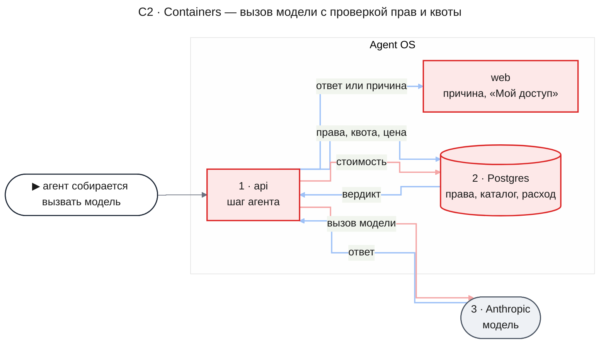
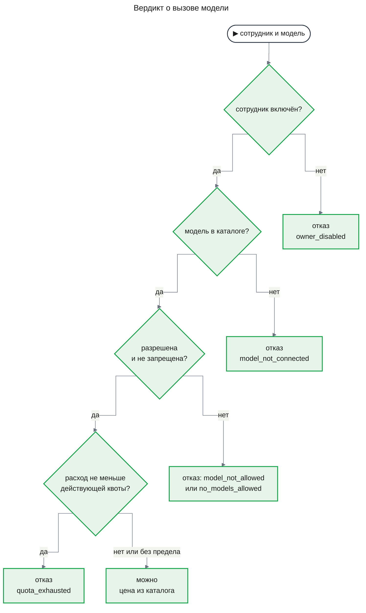
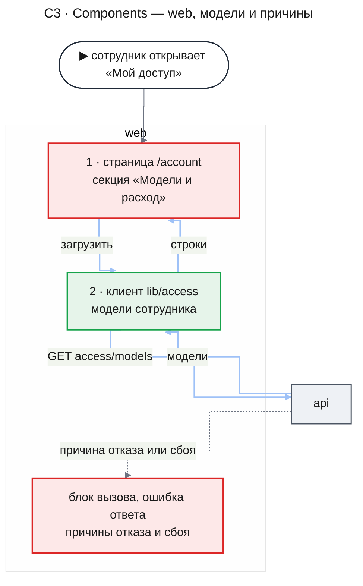
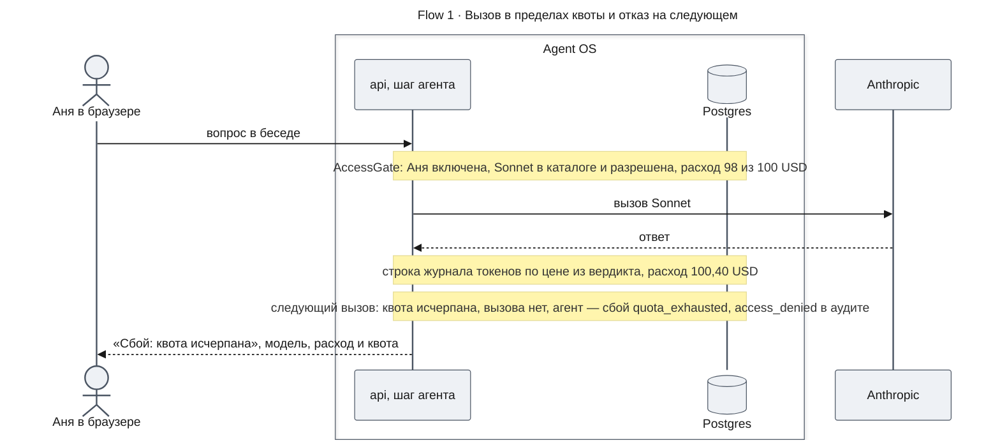
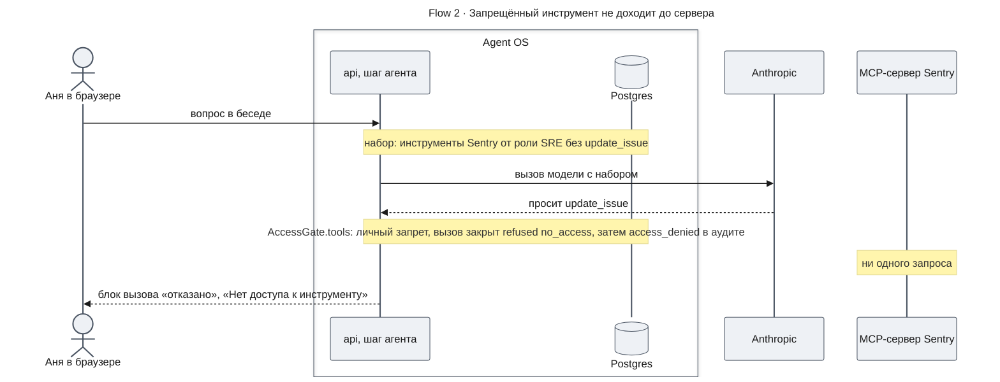

# Корпоративный вход и управление доступом — Design Document — access

**Status:** Approved · **Date:** 2026-11-15 · **PRD:** [prd.md](./prd.md) · **UXRD:** [uxrd.md](./uxrd.md) · **Depends on:** [design-identity.md](./design-identity.md#contract-definitions), [design-mcp-connect.md](./design-mcp-connect.md#contract-definitions)

## Snapshot

**Overview.** Сегодня право на MCP-сервер задаёт таблица в переменной окружения, цены моделей лежат в JSON-файле, а расход сотрудника только считается и ничего не ограничивает. Эта часть переносит всё в базу: администратор даёт ролям и сотрудникам права на сервер, на инструмент и на модель с месячной квотой в долларах, лично запрещает и ведёт каталог моделей с ценами. Перед каждым вызовом модели и инструмента агент проходит одну проверку, и она по базе отвечает: можно ли, по какой цене и не кончилась ли квота. Если квота модели кончилась, агент, которому эта модель нужна, не делает вызова и завершается с причиной «квота исчерпана»; когда квота снова есть, сотрудник пишет в беседу, и работа продолжается, как после любого завершения. Сотрудник видит отказы и причину в беседе, а свои модели с расходом и квотой — на странице «Мой доступ».

- **Не меняется**: правило выбора модели агента (`agent-platform` FR-04), подтверждение меняющих вызовов, продолжение беседы сообщением, строка журнала токенов на каждый вызов и расход за месяц под именем (`GET /spend`). Экраны панели строит часть `admin` поверх операций этой части.
- **Biggest risk**: ошибка в проверке пропускает вызов без права. Защита — одно место проверки у самого вызова, одна чистая функция правил с табличным тестом и e2e-тесты на отказ без единого запроса к серверу ([Risks and Mitigation](#risks-and-mitigation)).
- **Open questions**: нет.

### Key Decisions

#### KD-1: Права, квоты и каталог моделей — таблицы `access_*` модуля `access` в `apps/api`; пакеты видят их через один порт `AccessGate`, который проверяет и то, что сотрудник включён, и его права

Права ссылаются на роли и сотрудников внешним ключом с каскадом ([design-identity.md](./design-identity.md#contract-definitions), «Сотрудник для `access`»), поэтому их таблицы живут в том же слое, что `identity_*`, — в `apps/api`. Пакеты `agents` и `runtime` не знают о ролях и квотах: `createAgents` получает порт `AccessGate`, и агенты спрашивают его там, где сегодня спрашивают функцию доступа `serverAllowed`, и перед каждым вызовом модели. Реализация порта сначала проверяет, включён ли сотрудник (`IdentityDirectory.isActive`), и заблокированному отказывает с причиной `owner_disabled`: агент завершается сам, как при любом отказе (KD-5). Так перед каждым вызовом модели и инструмента стоит одна проверка, а отдельного порта «сотрудник включён» и остановки сверху нет (FR-18). `MCP_ACCESS_TABLE`, её разбор, `tool-access.ts` и их тесты удаляются, а функция доступа меняется во всех трёх местах сразу — в наборе для модели, в проверке вызова и в списке подключений ([design-mcp-connect.md](./design-mcp-connect.md#contract-definitions), «Для `access`»).

Варианты, которые не взяты:

- **Таблицы прав в пакете `agents`.** Нижний пакет ссылался бы внешним ключом на таблицы приложения — то, от чего ADR-0012 уводит столбцы владельца, — а запись прав всё равно шла бы из контроллеров `apps/api`.
- **Отдельный порт «сотрудник включён» рядом с портом прав.** Два вызова порта перед каждым вызовом модели и два места, которые должны согласоваться для заблокированного сотрудника.
- **Кэш прав в памяти процесса.** Изменение должно действовать со следующего вызова, а выигрыш мал: несколько чтений по индексу против вызова модели, который длится секунды.

Решение записано в [ADR-0015](../../adr/ADR-0015-access-gate-and-model-catalogue.md).

#### KD-2: Действующие права вычисляет одна чистая функция `effectiveAccess` при каждом запросе из ролей сотрудника и строк прав; хранимого «итога» нет

Функция получает роли сотрудника (`IdentityDirectory.rolesOf`), разрешения этих ролей, личные разрешения и личные запреты и отвечает на три вопроса: доступен ли инструмент сервера, доступна ли модель и какова действующая квота с её слагаемыми. Запрет сервера закрывает все его инструменты, запрет инструмента — этот инструмент, запрет модели — модель, и запрет сильнее любого разрешения. Инструмент доступен, если разрешён его сервер целиком или он сам. Квоты всех разрешений модели складываются, а одно разрешение без квоты снимает предел.

Этой же функцией пользуются проверка вызова и страница «Мой доступ», поэтому они не расходятся (FR-18). Функция — экземпляр паттерна [pure-decision.md](../../code-system/patterns/pure-decision.md), и все её правила проверяет один табличный тест.

Варианты, которые не взяты:

- **Таблица действующих прав, которую пересчитывает каждое изменение.** Это второе место правды, которое расходится с ролями при сбое посреди пересчёта.

#### KD-3: Каталог моделей с ценами — таблица `access_models`; цена приходит к вызову вместе с разрешением, и журнал токенов считает стоимость по ней; файл цен и цены в `createRuntime` удаляются

Проверка перед вызовом модели всё равно читает строку каталога: модель вне каталога не используется (FR-19). Поэтому ответ `AccessGate` несёт цену модели, `ModelClient` передаёт её в `TokenLedger.record`, а журнал считает стоимость прежней функцией `callCostUsd` и хранит её в строке, как сейчас. Цена на момент вызова — это цена, прочитанная за миллисекунды до него, а прошлые строки не пересчитываются (AC-19.2). Опция `modelPrices` в `createRuntime`, `pricedModels()`, `parseModelPrices`, `MODEL_PRICES_FILE` и `apps/api/config/model-prices.json` удаляются. Ошибка `UNKNOWN_MODEL_PRICE` после уже оплаченного вызова исчезает: цена известна до вызова.

Варианты, которые не взяты:

- **Каталог в пакете `runtime` (`runtime_model_prices`).** Runtime владел бы данными, которые правит администратор, а права на модели ссылались бы внешним ключом в чужую таблицу нижнего слоя.
- **Журнал спрашивает цену через порт при записи.** Цена читалась бы после вызова провайдера, и модель, убранная из каталога посреди вызова, оставила бы оплаченный вызов без строки.

Решение записано в [ADR-0015](../../adr/ADR-0015-access-gate-and-model-catalogue.md).

#### KD-4: Модель проверяется внутри `ModelClient` перед каждым вызовом — у шага модели, у сжатия истории и у заголовка беседы; при запуске агента её проверяет ещё `start_agent`

Модель выбирается при создании сессии и дальше берётся из неё: форк и перезапуск её наследуют. Снятое посреди работы разрешение видно только проверке в момент вызова (AC-20.3), поэтому `ModelClient.call` и `ModelClient.completeText` спрашивают `AccessGate` один раз, до первой попытки; повторы провайдера идут без проверки. Если вердикт — не «можно», `ModelClient` возвращает шагу результат «вызов не начат», и шаг модели и шаг сжатия завершают агента одной общей функцией (KD-5).

`start_agent` проверяет модель, на которой запустит агента, — выбранную или унаследованную форком. При отказе агент не создаётся, а родитель получает отказ в истории (AC-20.1). Исчерпанную квоту `start_agent` не проверяет: такой агент упрётся в неё на первом вызове. `sessions.start` и `start_workflow` модель при запуске не проверяют: главный чат и координатор workflow на неразрешённой модели завершаются на первом же вызове, и чат показывает это блоком ошибки ответа (AC-20.2). `chooseModel` перестаёт сверяться с ценами и только выбирает модель, а отказ `unknown_model` и ошибка `UNKNOWN_MODEL` уходят.

Заголовок беседы — вызов модели по умолчанию за счёт сотрудника, поэтому он подчиняется тем же правам и квоте. Если модель не разрешена или квота исчерпана, заголовка нет, и беседа остаётся без названия, как при любой ошибке заголовка сейчас (DC-7).

Варианты, которые не взяты:

- **Проверка только при выборе модели.** Она пропускает форк, перезапуск и снятие разрешения посреди работы.
- **Проверка ещё и в `sessions.start` и `start_workflow`.** Первый вызов модели всё равно откажет, а `start_workflow` запускает координатора в транзакции шага, где вызов порта держал бы транзакцию.
- **Заголовок вне прав и квот.** Это вызов модели без права, а критерий успеха PRD — ноль таких вызовов.

#### KD-5: Квота исчерпана или сотрудник заблокирован — агент, который упёрся в отказ, сам завершается с причиной отказа тем же путём, что при отказе модели; паузы и остановки сверху нет

Шаг агента уже умеет завершать агента итогом `fail` с причиной, и сбой по модели идёт этим путём. Заблокированный сотрудник (`owner_disabled`) — такая же причина: шаг модели или шаг инструментов, получив её от `AccessGate`, завершает агента, и вызова нет. Исчерпанная квота — ещё одна причина того же итога: вызова нет, агент получает статус «сбой» с причиной `quota_exhausted` («Сбой: квота исчерпана», `uxrd.md` MC-14). Остальные агенты сотрудника на этой модели упираются в ту же проверку на своём следующем вызове и завершаются так же, а агент на модели, где квота есть, работает дальше (AC-22.7). Что происходит после сбоя — уведомление родителя, остановка его незавершённых детей, показ в беседе — уже делает runtime и `agent-platform`, и эта часть ничего к этому не добавляет. Продолжение тоже прежнее: сообщение сотрудника продолжает беседу, как после любого сбоя главного чата (`agent-platform` FR-09). Если квота всё ещё исчерпана, первый же вызов модели снова завершает агента с той же причиной (AC-22.11).

Варианты, которые не взяты:

- **Пауза до решения администратора.** Нужны новый статус, ожидание решения, его пересмотр по времени и экраны пауз; владелец исключил её (PRD, Won't Have).
- **Остановка всего дерева беседы сверху.** Нужен код, который останавливает дерево извне шага, а агенты беседы на других моделях остановились бы без причины.
- **Новый итог шага «остановлен» вместо «сбой».** Это новый путь завершения в runtime ради другой метки статуса; причина «квота исчерпана» видна и так.

#### KD-6: Отказы по правам пишутся в аудит сразу после отказа через хук `audit(entry)` из `createAgents`

`AuditLog` живёт в `apps/api`, а отказы решаются в пакете `agents`: отказ в инструменте закрывает строку вызова, отказ модели и исчерпанная квота завершают агента или закрывают вызов `start_agent`, отказ заголовка бросает ошибку. Сразу после такой записи агенты зовут хук, и `apps/api` пишет `AuditLog.record(null, entry)` с видом `access_denied` (AC-18.1, AC-20.4, FR-22). Общая транзакция с записью отказа не нужна. Изменения администратора пишет сам `apps/api` после изменения. Хук нужен, потому что пакет не импортирует `apps/api`: `createAgents` получает его параметром, как порт `AccessGate`.

Варианты, которые не взяты:

- **Запись аудита внутри `AccessGate` при отказе.** Порт отвечает и при сборке набора, где отказа ещё нет.
- **Только строки `agent_tool_calls` как аудит.** Они удаляются вместе с беседой, а отказов модели в них нет.

## Terms

- **Право** — строка `access_grants`: разрешение роли или сотрудника на сервер целиком, на инструмент сервера или на модель. У разрешения модели может быть квота.
- **Личный запрет** — строка `access_grants` с действием «запрет»; бывает только у сотрудника.
- **Действующие права** — ответ `effectiveAccess`: что сотруднику доступно сейчас (KD-2).
- **Слагаемые квоты** — квоты всех разрешений модели у сотрудника; действующая квота — их сумма или «без предела».
- **Вердикт модели** — ответ `AccessGate` о вызове модели: можно с такой-то ценой, квота исчерпана или отказ с причиной.

## Part

- **Part**: `access`
- **Covers**: FR-16, FR-17, FR-18, FR-19, FR-20, FR-21, FR-22, FR-23; NFR-04; NFR-03 для маршрутов этой части
- **Depends on**: [design-identity.md#contract-definitions](./design-identity.md#contract-definitions) — `IdentityDirectory.rolesOf` и `isActive`, внешние ключи на `identity_roles` и `identity_users`, `AuditLog.record`, `@AdminOnly()`, `req.user.id`, вход в тестах; [design-mcp-connect.md#contract-definitions](./design-mcp-connect.md#contract-definitions) — функция доступа в трёх местах, набор агента, ссылка права на пару «сервер — инструмент» текстом, список инструментов реестра
- **Prerequisite ADRs**: [ADR-0001](../../adr/ADR-0001-durable-runtime-owner.md), [ADR-0002](../../adr/ADR-0002-app-schema-migrations.md) и [ADR-0003](../../adr/ADR-0003-drizzle-data-layer.md) (свои таблицы в схеме `app`, Drizzle), [ADR-0004](../../adr/ADR-0004-agent-framework-packages.md) (пакеты не читают окружение, порты параметрами), [ADR-0009](../../adr/ADR-0009-agent-definitions-as-process-data.md) (модель в определении агента), принятые [ADR-0012](../../adr/ADR-0012-closed-api-and-server-issued-employee-id.md) (UUID сотрудника в столбцах владельца без внешнего ключа) и [ADR-0014](../../adr/ADR-0014-mcp-registry-owned-by-agents.md) (реестр MCP в пакете `agents`)
- **Sibling parts**: `identity` (FR-01–FR-04, FR-06–FR-08, FR-11, FR-32, FR-33), `mcp-connect` (FR-12–FR-15), `admin` (FR-24–FR-29, FR-31)

**Out of scope**

- Экраны панели (`uxrd.md` Screen 6, 7, 10 и диалог GR-01) — часть `admin` поверх операций этой части. Здесь строятся только экраны сотрудника: секция «Модели и расход» на «Мой доступ», причины отказа и тексты сбоев.
- Журнал аудита в панели (FR-31) отложен и в этой фиче не строится: экрана журнала и операции чтения аудита нет. Эта часть только пишет записи.
- Права на `run_code`, workflow, встроенные инструменты и определения агентов (PRD, Won't Have): встроенный инструмент — не цель права. Его вызов, как любой вызов, проходит через `AccessGate.tools` проверку «сотрудник включён», а пара «сервер — инструмент» для него не проверяется.
- Бюджет на задачу — бизнес-ограничение 4 из `.claude/skills/project-context/SKILL.md` не покрывается этой фичей.
- Строка расхода под именем и `GET /spend` остаются как есть.
- Документы `agent-platform` с правилом «превышение расхода ничего не блокирует» не правятся: эта часть их заменяет. Комментарии кода с этим правилом и тексты про файл цен меняются вместе с кодом.

**Constraints**

- PoC, одна версия: `MCP_ACCESS_TABLE`, `MODEL_PRICES_FILE`, файл цен, их разбор, опции `access`, `mcpAccess` и `modelPrices` и их тесты удаляются целиком. Новых переменных окружения часть не добавляет, а `AGENT_DEFAULT_MODEL` остаётся.
- Один процесс API: часть не добавляет своей координации между экземплярами.
- Слои: пакеты получают порт `AccessGate` и хук `audit` параметрами `createAgents` и не импортируют `apps/api` (code-system README, Layer Map).
- Квота не резервирует денег: вызовы, которые уже идут, заканчиваются и учитываются, поэтому расход может превысить квоту на их стоимость (PRD FR-22, Won't Have).
- Логи идут через логгер `packages/common` с id сотрудника, агента, задачи, вызова, модели и права; в лог пишутся вердикт, расход, квота и длительность проверки.
- Тестов мало и на критичное: правила прав одной таблицей, отказ без вызова сервера, деньги и квота, основной путь.

## Building-block Inventory

Follows the [code system](../../code-system/README.md). Перед «new» поиск шёл по `docs/code-system/` и по `apps/api/src`, `packages/agents/src`, `packages/runtime/src` (`access`, `grant`, `permission`, `quota`, `price`, `catalog`, `deny`, `budget`): прав, квот и каталога в базе нет, есть `serverAllowed` над таблицей из окружения и цены из файла.

| Building block | Pattern | Status | Note |
|---|---|---|---|
| `AccessModule` в `apps/api/src/access`: `AccessService`, репозитории `access_*` | [repository-over-transaction.md](../../code-system/patterns/repository-over-transaction.md) | new | Реализует `AccessGate`; таблицы объявлены в `packages/db` (KD-1) |
| `effectiveAccess` | [pure-decision.md](../../code-system/patterns/pure-decision.md) | new | Правила прав и квот одной функцией (KD-2) |
| `AdminAccessController`, `MyAccessController` | [auth-boundary.md](../../code-system/patterns/auth-boundary.md) | new | Администратор — `@AdminOnly()`, сотрудник — под сеансом |
| `AccessGate` и хук `audit` в `createAgents` | [composition-root.md](../../code-system/patterns/composition-root.md) | extended | Заменяют `access`, `mcpAccess` (KD-1, KD-6) |
| `ModelClient`, `ModelStep`, `CompactionStep` | [step-handler.md](../../code-system/patterns/step-handler.md) | extended | Вердикт до вызова, цена в журнал, итог `fail` с причиной вердикта (KD-3, KD-4, KD-5) |
| `ToolRegistry`, `ToolRunner`, `start_agent` | [step-handler.md](../../code-system/patterns/step-handler.md) | extended | Право на пару «сервер — инструмент»; проверка модели в `start_agent` (KD-4) |
| `chooseModel`, `gateStart` | [pure-decision.md](../../code-system/patterns/pure-decision.md) | extended | Выбор модели без цен (KD-4) |
| `TokenLedger` | [repository-over-transaction.md](../../code-system/patterns/repository-over-transaction.md) | extended | Цена в записи, `monthSpendByModel`, общий `monthOf`; без `pricedModels` (KD-3) |
| Скрипт `seed:access` в `apps/api` | — | new | Каталог и права базы разработки (Contract Definitions) |
| Секция «Модели и расход» страницы `/account`, тексты отказов и сбоев | — | new / extended | `uxrd.md` MA-02, MC-9, MC-10, MC-11, MC-14 |

## Acceptance Criteria

### FR-16: Права ролей и личные права

- From the PRD: AC-16.1, AC-16.2, AC-16.3
- Агенту предлагается инструмент сервера, только если `effectiveAccess` разрешает пару «сервер — инструмент» его владельцу. Та же функция решает при проверке вызова — прямого, после подтверждения и из `run_code` — и в списке подключений, где сервер стоит, если доступен хоть один инструмент его списка. Инструмент, убранный из списка реестра, по праву на него ничего не даёт (DC-1).
- Право создаётся только на сервер, который есть в реестре, на инструмент из списка его инструментов и на модель из каталога; запрет — только сотруднику; квота — только у разрешения модели. Иначе — 422, и ничего не сохраняется. Второе такое же право тому же держателю — 409 (DC-2).
- Сотрудник, которого первый вход через провайдера создал без ролей, прав не имеет: набор MCP-инструментов его агентов пуст, а главный чат завершается сбоем `no_models_allowed` (DC-6), пока администратор не даст ему роль или личное право.

### FR-17: Личный запрет сильнее разрешения

- From the PRD: AC-17.1, AC-17.2, AC-17.3

### FR-18: Одна проверка действующих прав

- From the PRD: AC-18.1, AC-18.2, AC-18.3, AC-18.4
- Перед каждым вызовом модели — шага модели, сжатия истории и заголовка беседы — и перед каждым вызовом инструмента агент спрашивает `AccessGate`. Заблокированному сотруднику порт отказывает с причиной `owner_disabled`: вызов не начинается, а агент завершается сбоем с этой причиной (DC-3).
- Каждый отказ по правам — инструмента (`no_access`), модели (`model_not_allowed`, `model_not_connected`, `no_models_allowed`) и по квоте (`quota_exhausted`) — даёт одну запись `access_denied` в аудите сразу после того, как отказ записан (DC-4).

### FR-19: Каталог моделей с ценами

- From the PRD: AC-19.1, AC-19.2, AC-19.3
- Стоимость вызова считается по цене, которую вернула проверка перед этим вызовом. Модель, убранная из каталога, не запускается через `start_agent` (отказ `model_not_connected`), а работающий на ней агент завершается сбоем `model_not_connected` на следующем вызове (DC-5).

### FR-20: Разрешённые модели

- From the PRD: AC-20.1, AC-20.2, AC-20.3, AC-20.4
- Если сотруднику не разрешена ни одна модель, главный чат завершается сбоем с причиной `no_models_allowed`, и сотрудник видит третий текст `uxrd.md` MC-11 (DC-6).
- Заголовок беседы не делается, если модель по умолчанию сотруднику не разрешена или её квота исчерпана; стоимость сделанного заголовка входит в расход сотрудника (DC-7).

### FR-21: Месячные квоты по моделям

- From the PRD: AC-21.1, AC-21.2, AC-21.3, AC-21.4, AC-21.5

### FR-22: Квота исчерпана

- From the PRD: AC-22.1, AC-22.2, AC-22.3, AC-22.7, AC-22.11
- Квота исчерпана, когда расход сотрудника на модель за месяц не меньше действующей квоты. Тогда агент, чей следующий вызов идёт к этой модели, вызова не делает и получает статус «сбой» с причиной `quota_exhausted`; другие агенты ничего не получают, пока сами не вызовут эту модель. Модель, расход и квоту сотрудник видит в беседе по модели агента и строке этой модели из `GET /api/access/models` (DC-8).

### FR-23: Сотрудник видит свои модели и квоты

- From the PRD: AC-23.1
- Расход и квота на «Мой доступ» считаются тем же правилом месяца и той же суммой, что проверка перед вызовом: если там стоит «Квота исчерпана», следующий вызов этой модели завершает агента с причиной `quota_exhausted` (DC-9).

## Design

### Architecture (C1–C4)

C1 не рисуется: люди и внешние системы те же, что в [design-identity.md](./design-identity.md) и [design-mcp-connect.md](./design-mcp-connect.md).

#### C2 · Containers

Вызов модели теперь проходит проверку по базе, а его стоимость считается по цене из каталога.

- `api` хранит права, квоты и каталог, отвечает агентам через `AccessGate` и отдаёт операции администратора и страницу «Мой доступ».
- `Postgres` получает таблицы `access_*` (Data Model); CHECK причины отказа в `agent_tool_calls` и `agent_code_calls` меняет `unknown_model` на `model_not_connected` и получает `model_not_allowed`.
- `web` получает новые причины отказа и тексты сбоев и секцию «Модели и расход».

#### C3 · Components: api

**api — вызов модели.** Проверка стоит в `ModelClient`, поэтому её проходят шаг модели, шаг сжатия и заголовок беседы.

- `ModelClient` спрашивает `AccessGate.model` один раз до первой попытки. При вердикте «можно» он вызывает модель и передаёт цену из вердикта в `TokenLedger.record`. При любом другом вердикте он не вызывает модель и возвращает шагу результат «вызов не начат»; `completeText` в этом случае бросает ошибку, и сервис заголовков записывает её в лог, как любую ошибку заголовка.
- Шаг модели и шаг сжатия превращают результат «вызов не начат» в итог `fail` с причиной вердикта — `owner_disabled`, `quota_exhausted`, `model_not_allowed`, `model_not_connected` или `no_models_allowed` — и, кроме `owner_disabled`, зовут хук `audit` (KD-5, KD-6). Шаг инструментов так же завершает агента, если `AccessGate.tools` ответил `owner_disabled`.
- `AccessService` читает сотрудника (`IdentityDirectory.isActive`, `rolesOf`), права его ролей и его личные права одним запросом, строку каталога и, только для модели с квотой, расход за месяц (`TokenLedger.monthSpendByModel`). Отвечает `effectiveAccess`, а `AccessService` добавляет к ответу цену.

#### Как `AccessGate` решает о вызове модели

Порядок проверок задаёт, какую причину увидит сотрудник.

`no_models_allowed` вместо `model_not_allowed` стоит, когда сотруднику не разрешена ни одна модель каталога. Отказ инструменту решается так же, без каталога и квоты: включён ли сотрудник, затем `effectiveAccess` для пары «сервер — инструмент».

#### C3 · Components: web

**web — «Мой доступ» и причины.** Модели читаются один раз при открытии страницы.

- Секция «Модели и расход» встаёт под «Подключениями» страницы из [design-mcp-connect.md](./design-mcp-connect.md) (`uxrd.md` MA-02, MC-9).
- Причины отказа `model_not_allowed`, `model_not_connected` и новый текст `no_access` берутся из MC-10, тексты сбоя главного чата — из MC-11, строки событий сбоя, в том числе «Сбой: квота исчерпана», — из MC-14. При сбое `quota_exhausted` веб рядом с причиной показывает модель агента, расход и квоту из строки этой модели в `GET /api/access/models`.

### Runtime Flows

#### Flow 1: Квота кончилась посреди работы

**Starts when:** агент Ани вызывает Sonnet, и этот вызов доводит её расход до квоты, for AC-21.3, AC-22.1, AC-22.2, AC-22.7, DC-3, DC-8

**Outcome:** агент, который упёрся в квоту, завершён с причиной `quota_exhausted`; дальше работают обычные правила сбоя: родитель получает уведомление, а сбой родителя останавливает его незавершённых детей. Агенты Ани на других моделях работают дальше (AC-22.7). Вызов, который уже шёл в момент исчерпания, закончился, и его стоимость вошла в расход (AC-22.2). Когда администратор поднимает квоту или начинается новый месяц, сообщение Ани продолжает беседу; если квота всё ещё исчерпана, первый вызов Sonnet снова завершает агента с той же причиной (AC-22.3, AC-22.11).

**Failure handling:**

- Модель не разрешена или не в каталоге → вызова нет, агент завершается сбоем с причиной вердикта, в аудите `access_denied` (AC-20.3, DC-4, DC-5).
- Аню заблокировали → порт отказывает с `owner_disabled`, вызова нет, агент завершается сбоем с этой причиной; каждый её агент так же завершается на своём следующем вызове (DC-3).
- База недоступна при проверке → шаг падает, как при любой ошибке базы, и runtime повторяет его; вызова модели без проверки нет.
- Шаг потерян после вызова модели → строка журнала уже записана, повтор шага проверяет квоту заново, и повторный вызов тоже учитывается (Risks and Mitigation).

#### Flow 2: Отказ в инструменте

**Starts when:** модель агента Ани просит `update_issue`, который ей запрещён лично, for AC-17.1, AC-18.1, DC-1, DC-4

**Outcome:** модель получает отказ результатом вызова и продолжает работу, остальные инструменты Sentry доступны. Так же отказывают вызов из `run_code` и вызов после подтверждения.

**Failure handling:**

- Право сняли после сборки набора, но до вызова → проверка вызова видит текущие права и отказывает (AC-18.2).
- Сервер выключен → отказ `tool_not_in_definition` по [design-mcp-connect.md](./design-mcp-connect.md), DC-2; запись `access_denied` не пишется: это не отказ по правам.

### Contract Definitions

Все маршруты — под префиксом `/api` и закрыты сеансом; маршруты `/api/admin/...` помечены `@AdminOnly()` ([design-identity.md](./design-identity.md#contract-definitions)). Тело ошибки — `ApiErrorSchema`. Деньги — числа в долларах: квота с точностью до цента, расход и цены — как их считает журнал.

#### Для веба — сотрудник

- **`GET /api/access/models`** — модели, разрешённые сотруднику сейчас, по названию, с расходом за текущий месяц. Returns `MyModels`. Пустой список — «Вам не разрешена ни одна модель» (MC-9).
- **Причины сбоя агента** — к `turn_limit` и `model_error` прибавляются `owner_disabled`, `quota_exhausted`, `model_not_allowed`, `model_not_connected` и `no_models_allowed`.
- **Причины отказа вызова** (`ToolRefusalReasonSchema`) — `unknown_model` заменяется на `model_not_connected`, прибавляется `model_not_allowed`.

**MyModels**

- `month` — месяц расхода, `YYYY-MM` по UTC, как у `GET /spend`.
- `models` — список: `model` (ID), `name`, `spentUsd`, `quotaUsd` (`null` — без предела), `remainingUsd` (`null` без предела, не меньше нуля), `exhausted` — расход не меньше квоты.

#### Операции администратора — для `admin`

Каждое изменение пишет `admin_change` с «было» и «стало» через `AuditLog.record`.

- **`GET /api/admin/models`** — каталог по названию. Returns список `CatalogModel`.
- **`POST /api/admin/models`** — добавляет модель: `id` по форме `anthropic/<имя>` (как `AGENT_DEFAULT_MODEL`), `name` (1–80 знаков), `prices`, `longContext` или `null`. Returns 201 и `CatalogModel`. 409 `MODEL_ID_TAKEN`.
- **`PATCH /api/admin/models/:id`** (`id` закодирован как часть адреса) — меняет `name`, `prices`, `longContext`; новая цена действует для следующих вызовов. 404 `MODEL_NOT_FOUND`.
- **`DELETE /api/admin/models/:id`** — убирает модель; права на неё удаляются каскадом, а агенты на ней завершаются сбоем `model_not_connected` на следующем вызове. Returns 204. 404 `MODEL_NOT_FOUND`.
- **`GET /api/admin/grants?roleId=<id>`** или **`?userId=<id>`** — права роли или личные права и запреты сотрудника по времени создания. Returns список `Grant`. 404 `ROLE_NOT_FOUND`, `USER_NOT_FOUND`.
- **`POST /api/admin/grants`** — создаёт право: держатель (`roleId` или `userId`), `effect` (`allow` или `deny`), цель (`Grant.target`) и `quotaUsd` (необязательно). Returns 201 и `Grant`. 422 `GRANT_TARGET_UNKNOWN` — сервера нет в реестре, инструмента нет в его списке или модели нет в каталоге. 422 `GRANT_INVALID` — запрет у роли или квота не у разрешения модели. 409 `GRANT_EXISTS` — у держателя уже есть право с тем же действием и целью.
- **`PATCH /api/admin/grants/:id`** — меняет `quotaUsd` разрешения модели; `null` снимает квоту. Returns `Grant`. 404 `GRANT_NOT_FOUND`, 422 `GRANT_INVALID`.
- **`DELETE /api/admin/grants/:id`** — убирает право. Returns 204. 404 `GRANT_NOT_FOUND`.

**CatalogModel**

- `id`, `name`.
- `prices` — `inputUsdPerMTok`, `outputUsdPerMTok`, `cacheWriteUsdPerMTok`, `cacheReadUsdPerMTok`: доллары за миллион токенов, не меньше нуля.
- `longContext` — `aboveInputTokens` (целое больше нуля) и `prices` той же формы: эти цены действуют, когда весь вход вызова больше порога; `null` — одна цена.

**Grant**

- `id`; `holder` — `role` с `id` и `name` или `user` с `id`.
- `effect` — `allow` или `deny`.
- `target` — `server` с `server`; `tool` с `server` и `tool`; `model` с `model` и `modelName`. Имена сервера и инструмента — текстом, как в реестре.
- `quotaUsd` — у разрешения модели: от 0,01 до 1 000 000 с точностью до цента или `null` (без квоты); у прочих — `null`.

**Error handling**

- `MODEL_NOT_FOUND` — 404; `MODEL_ID_TAKEN` — 409.
- `GRANT_NOT_FOUND` — 404; `GRANT_EXISTS` — 409; `GRANT_TARGET_UNKNOWN`, `GRANT_INVALID` — 422 с полем `reason`.
- `ROLE_NOT_FOUND`, `USER_NOT_FOUND` — 404 по [design-identity.md](./design-identity.md#contract-definitions).

#### Пакеты — для `apps/api` и между пакетами

- **`createAgents`** получает `access` (`AccessGate`) и `audit` вместо таблицы доступа.
- **`AccessGate.tools(ownerId)`** — права сотрудника на инструменты: `owner_disabled` для заблокированного или неизвестного сотрудника, иначе ответ, который без базы говорит, разрешена ли пара «сервер — инструмент». Его спрашивают при сборке набора, при каждой проверке вызова и в `Agents.mcp.connections`. На `owner_disabled` шаг завершает агента сбоем с этой причиной, а список подключений пуст. У вызова встроенного инструмента ответ даёт только проверку «сотрудник включён»: встроенный инструмент — не цель права, и пару «сервер — инструмент» проверяют только у MCP-инструментов.
- **`AccessGate.model(ownerId, model)`** — вердикт: `allowed` с ценой; `refused` с причиной `owner_disabled`, `quota_exhausted` (и `spentUsd`, `quotaUsd`, `month`), `model_not_connected`, `model_not_allowed` или `no_models_allowed`.
- **`audit(entry)`** — запись в форме `AuditLog.record`; агенты зовут его сразу после записи отказа. Вид — `access_denied`, `objectType` — `tool` с id `<сервер>/<инструмент>` или `model`, причина — из отказа.
- **`TokenLedger`** — `record` получает цену вызова вместе с моделью и токенами. Новая операция `monthSpendByModel(ownerId, month)` возвращает расход по каждой модели за месяц. `monthSpend` остаётся, `pricedModels` удаляется. Runtime экспортирует `monthOf(time)` — месяц `YYYY-MM` по UTC, — и `utcMonth` в `apps/api` удаляется.

**Runtime settings**

- `MCP_ACCESS_TABLE`, `MODEL_PRICES_FILE` — удаляются.
- `seed:access` (`pnpm --filter api seed:access`, только в разработке) — каталог из `anthropic/claude-haiku-5-5` и `anthropic/claude-sonnet-5-5` с ценами удалённого файла и права встроенной роли «Супер-администратор» на серверы `seed:mcp` и на обе модели без квоты. Разработчик, заведённый командой `identity:super-admin` и вошедший по логину и паролю, работает с агентами сразу; других сотрудников скрипт не заводит.

### Data Model

Новые таблицы лежат в схеме `app`, объявлены в `packages/db/src/schema.ts` и приходят одной миграцией. Префикс `access_` принадлежит модулю `access` в `apps/api`.

- **`access_models`** — каталог: ID модели (первичный ключ), название, цены и, при наличии, порог и цены длинных запросов.
- **`access_grants`** — право: держатель — роль (внешний ключ на `identity_roles` с каскадом) или сотрудник (`identity_users`, каскад), ровно один из двух; действие; вид цели; имя сервера и инструмента текстом или модель (внешний ключ на `access_models` с каскадом); квота. Запрет бывает только у сотрудника, квота — только у разрешения модели. Одно право на держателя, действие и цель. Удаление роли, сотрудника или модели уносит их права. Встроенная роль «Супер-администратор» получает права, как любая роль: это обычная роль, которая ещё несёт право администратора.
- **`runtime_model_calls`** — схема не меняется; стоимость считается по цене из вердикта.
- **`agent_tool_calls`**, **`agent_code_calls`** — CHECK причины отказа: `model_not_connected` вместо `unknown_model`, плюс `model_not_allowed`.

**Invariants**

1. Ни один вызов модели и ни один вызов инструмента не начинается без ответа `AccessGate` для владельца задачи в этом же шаге.
2. Запрет сильнее любого разрешения; роль только добавляет возможности.
3. Стоимость каждого вызова модели посчитана по цене из каталога, прочитанной до этого вызова.

## Test Strategy

Интеграционных тестов три: права на каждом входе, вердикты моделей с деньгами и заблокированный сотрудник. Они идут через API на настоящей базе: каталог и права создаются операциями администратора, а расход известен до цента, потому что число токенов каждого вызова задаёт тест. Остальное — модульные таблицы.

### Main Use Cases

- **UC-1: Права на каждом входе** (интеграционный) — covers AC-16.1, AC-16.2, AC-17.1, AC-17.2, AC-18.1, AC-18.2, AC-18.3, AC-18.4, DC-1, DC-4
  - Given: роль Ани даёт сервер фикстуры `backoffice`, а лично ей запрещён его меняющий инструмент; Борису запрещён сервер `logs` и лично разрешён один инструмент `tracker` без права на сервер; оба запустили workflow
  - When: агенты собирают набор и вызывают модель; модель Ани просит запрещённый инструмент; модель Бориса просит инструмент `logs`, затем скрипт `run_code` Бориса зовёт его же; администратор снимает право Ани на `backoffice`, и агент вызывает модель снова
  - Then: в наборе Ани все инструменты `backoffice`, кроме запрещённого, в наборе Бориса — один инструмент `tracker`; три отказа `no_access`, журнал фикстуры без единого вызова; по одной записи `access_denied` на отказ; агенты workflow получают те же отказы, что главный чат; после снятия права инструментов `backoffice` в наборе нет, без рестарта
- **UC-2: Модели и деньги** (интеграционный) — covers AC-17.3, AC-19.1, AC-19.2, AC-19.3, AC-20.1, AC-20.3, AC-20.4, AC-21.3, AC-22.1, AC-22.2, AC-22.3, AC-22.7, AC-22.11, AC-23.1, DC-5, DC-8, DC-9
  - Given: в каталоге модели A по 1 и 5 USD за миллион токенов, B по 3 и 15 и C, которая Ане не разрешена; Ане разрешена A с личной квотой 0,01 USD и B без квоты; главный чат Ани и его фоновый агент работают на A и держат вызовы в полёте по 5000 входных и 500 выходных токенов; агент Ани в другой беседе работает на B
  - When: модель агента запускает `start_agent` на модели вне каталога и на C; оба вызова на A заканчиваются, и агенты делают следующий вызов; Аня читает `GET /api/access/models` и пишет в беседу; администратор поднимает квоту до 1 USD и меняет цену A, Аня пишет снова; администратор снимает разрешение B, и агент на B делает следующий вызов
  - Then: `start_agent` — отказы `model_not_connected` и `model_not_allowed` без дочерних агентов; каждый вызов на A стоит 0,0075 USD, расход — 0,015 USD; оба агента на A — «сбой» `quota_exhausted` без вызова, агент на B работает; в ответе «Мой доступ» A `exhausted` с остатком 0, B без предела; первое сообщение — снова сбой `quota_exhausted`; после подъёма беседа продолжается, а новый вызов посчитан по новой цене при прежней стоимости старых строк; агент на B — «сбой» `model_not_allowed`; на каждый отказ — запись `access_denied`
- **UC-3: Заблокированный сотрудник** (интеграционный) — covers DC-3
  - Given: главный чат Ани и её фоновый агент работают
  - When: администратор блокирует Аню, и каждый агент доходит до следующего вызова модели или инструмента
  - Then: ни одного вызова модели и инструмента после блокировки; каждый агент — «сбой» с причиной `owner_disabled`

### Error and Edge Use Cases

Модульные таблицы, по одной на правило:

- **UC-4: Правила `effectiveAccess`** — covers AC-16.1, AC-16.2, AC-17.1, AC-17.2, AC-17.3, AC-21.1, AC-21.2, AC-21.5, DC-1
  - Given: строки таблицы: право роли на сервер; личное право на инструмент без права на сервер; личный запрет инструмента при праве роли; запрет сервера при личном праве на его инструмент; запрет модели при праве роли; квоты 50, 20 и лично 30; роль без квоты и роль с квотой 20; инструмент вне списка реестра
  - When: функция отвечает на каждую строку
  - Then: все инструменты сервера; один инструмент; все, кроме запрещённого; ни одного; модель закрыта; квота 100; без предела; инструмент не доступен
- **UC-5: Порядок вердикта модели** — covers AC-16.3, AC-20.2, AC-21.4, DC-6
  - Given: строки: сотрудник заблокирован; модели нет в каталоге; не разрешена ни одна модель; разрешена другая модель; расход равен квоте; расход прошлого месяца выше квоты, в этом — ноль
  - When: вердикт считается для каждой строки
  - Then: `owner_disabled`; `model_not_connected`; `no_models_allowed`; `model_not_allowed`; `quota_exhausted`; `allowed` с ценой
- **UC-6: Заголовок беседы** — covers DC-7
  - Given: вердикт модели по умолчанию — отказ или `quota_exhausted`
  - When: `completeText` зовётся для заголовка
  - Then: вызова модели нет, ошибка уходит в лог сервиса заголовков, хук `audit` позван один раз
- **UC-7: Проверка прав администратора** — covers DC-2
  - Given: запрет роли; квота у права на сервер; право на инструмент вне списка реестра; право на модель вне каталога; второе такое же право
  - When: проверяется создание права
  - Then: `GRANT_INVALID`, `GRANT_INVALID`, `GRANT_TARGET_UNKNOWN` дважды, `GRANT_EXISTS`
- **UC-8: Тексты веба** — covers AC-20.2, AC-22.1, AC-23.1
  - Given: причины `quota_exhausted`, `owner_disabled`, `model_not_allowed`, `model_not_connected`, `no_models_allowed` и строки «Мой доступ» с квотой, без предела и исчерпанной
  - When: веб выбирает текст
  - Then: тексты MC-10, MC-11 и MC-14 по причине, у `quota_exhausted` — модель, расход и квота; строки MA-02 с остатком, «без предела» и меткой «Квота исчерпана»

### Non-Functional Use Cases

- **UC-N1: Цена проверки перед вызовом** — covers NFR-04
  - Given: у сотрудника десять ролей и сто прав, модель с квотой, локальный Postgres
  - When: отдельный скрипт замера сто раз меряет время до первого токена с проверкой и без неё
  - Then: разница p95 укладывается в бюджет NFR-04; скрипт не входит в обычный набор тестов

## Security Considerations

- **Authentication & Authorization**: открытых маршрутов часть не добавляет (NFR-03). Операции администратора — `@AdminOnly()`; `GET /api/access/models` отвечает только о сотруднике сеанса. Права проверяются у самого вызова, а не только при сборке набора, поэтому модель не получит запрещённый инструмент, назвав его по имени, в том числе из `run_code`.
- **Input Validation**: тела операций администратора проверяет zod на границе контроллера по границам из Contract Definitions (`CatalogModel`, `Grant`). Существование сервера, инструмента и модели проверяется при создании права (DC-2). Имена сервера и инструмента в праве — текст, они только сравниваются.
- **Sensitive Data Handling**: секретов часть не хранит и не передаёт. Лог проверки несёт id сотрудника, задачи, вызова, модели, вердикт, расход, квоту и длительность, но не текст сообщений.
## Risks and Mitigation

- **Ошибка в правилах пропускает вызов без права** — высокое влияние, средняя вероятность. Правила — одна функция с табличным тестом (UC-4), проверка — один порт у самого вызова (KD-1, KD-4), интеграционный тест на отказ без вызова сервера — прямой и из кода (UC-1).
- **Потерянный шаг вызывает модель второй раз** — низкое влияние. Строка журнала пишется сразу после ответа, поэтому оба вызова учитываются, и расход может превысить квоту на их стоимость; это то же принятое превышение, что у вызовов в полёте (PRD, Risks).
- **Каталог пуст после первого развёртывания** — среднее влияние: ни один агент не работает, пока администратор не добавит модели и права. Сбой чата говорит «модель не подключена» (MC-11), а база разработки заполняется скриптом `seed:access`.
- **Сравнение расхода с квотой в числах с плавающей точкой** — низкое влияние: журнал хранит стоимость с девятью знаками, квота — центы, и ошибка в последних знаках не видна в долларах.

## Appendix: Fact Disposition

| Fact | Disposition | Handled in |
|------|-------------|------------|
| `chooseModel` синхронно сверяет модель с ценами, отказы в двух формах, форк и перезапуск без проверки (`packages/agents/src/model/model-choice.ts:chooseModel`) | transform | KD-4: проверка при каждом вызове и в `start_agent`; `unknown_model`, `UNKNOWN_MODEL` уходят |
| Порядок шага модели, второй вызов в сжатии, повторы внутри шага, итоги шага (`packages/agents/src/step/model-step.ts:createModelStep`) | transform | KD-4, KD-5: проверка до повторов в `ModelClient`, отказ и квота — итог `fail` |
| Цены в памяти из файла, `UNKNOWN_MODEL_PRICE` после вызова, нет расхода по модели, правило месяца дважды (`packages/runtime/src/token-ledger.ts:TokenLedger`) | transform | KD-3; Contract Definitions, «Пакеты»: цена в записи, `monthSpendByModel`, общий `monthOf` |
| `GET /spend` одной суммой, чтение раз на загрузку страницы (`apps/api/src/chat/spend.controller.ts:SpendController`) | out-of-scope | Остаётся; модели с квотой — новый `GET /api/access/models` (DC-9) |
| Ожидание решения: только владелец снимает, нет пробуждения по времени (`packages/runtime/src/decisions.ts:Decisions.resolve`) | out-of-scope | KD-5: паузы нет, запросы решения не меняются |
| Подтверждения разбирают любой запрос, статус «ждёт подтверждения» (`packages/agents/src/operations/agent-sessions.ts:confirmations`) | out-of-scope | KD-5: нового вида запроса нет, подтверждения не меняются |
| Сбой родителя останавливает детей, у корня беседы нет остановки (`packages/agents/src/events/stop-children-on-failure.ts:createStopChildrenOnFailure`) | out-of-scope | Используется как есть после сбоя `quota_exhausted` (KD-5) |
| `serverAllowed` над `MCP_ACCESS_TABLE` и всё вокруг неё (`packages/agents/src/tools/tool-access.ts:serverAllowed`) | remove | KD-1: `AccessGate.tools` во всех трёх местах |
| Набор и проверка знают пару «сервер — инструмент», снимок `run_code` до фильтра прав (`packages/agents/src/tools/tool-registry.ts:definitionMcpTools`) | transform | DC-1: фильтр по паре; снимок `run_code` не меняется |
| Отказ — строка вызова без владельца, удаляется с беседой; отказов модели в аудите нет (`packages/agents/src/store/tool-calls.repository.ts:agent_tool_calls`) | transform | KD-6: `access_denied` через хук `audit` |
| Все таблицы в `packages/db`, писатель по префиксу, пакеты не импортируют приложение (`packages/db/src/schema.ts:table-ownership-and-layering`) | transform | KD-1, Data Model: `access_*` в `apps/api` |
| Арифметика стоимости, параллельные шаги одного владельца без сериализации (`packages/runtime/src/model-cost.ts:callCostUsd`) | out-of-scope | `callCostUsd` не меняется; превышение на вызовы в полёте принято (Constraints) |
| Модель подменяется ниже `ModelClient`, цены в помощниках из кода и из файла, права через таблицу (`packages/agents/src/testing.ts:createScriptedModel`) | transform | Test Strategy: каталог и права операциями администратора |
| `completeText` для заголовка без задачи и без проверки (`packages/agents/src/model/model-client.ts:completeText`) | transform | KD-4, DC-7 |
| «Превышение расхода ничего не блокирует» в документах и комментариях `agent-platform` (`docs/features/agent-platform/prd.md:FR-02`) | out-of-scope | Документы не правятся; комментарии кода меняются вместе с кодом (Part) |
| Правило месяца UTC записано дважды (conformance: `apps/api/src/chat/agent-control.service.ts:utcMonth`) | remove | Contract Definitions: `monthOf` из runtime |

Дизайн сохраняет паттерны функции сборки, репозитория над транзакцией, обработчика шага, журнала событий и логирования (conformance) и подтверждение меняющих вызовов `agent-platform`.

## Update History

| Version | Date | Change |
|---------|------|--------|
| 1.0 | 2026-11-15 | Первая версия |
| 1.1 | 2026-11-15 | Утверждён; встроенные инструменты проходят через `AccessGate.tools` только проверку «сотрудник включён»; ссылка на ADR-0015 из KD-1 и KD-3; концы паузы DC-10 и сбой `model_not_connected` показываются текстами `uxrd.md` MC-14 |
| 1.2 | 2026-11-15 | Журнал аудита (FR-31) отложен: в этой фиче аудит только пишется |
| 1.3 | 2026-11-15 | Под `identity` 2.0: образец настроек — `/api/admin/settings/sign-in`; `seed:access` даёт права роли «Супер-администратор»; сотрудник без ролей после первого входа; права у встроенной роли |
| 1.4 | 2026-11-15 | Упрощение по решению владельца: паузы по квоте нет — агент, упёршийся в квоту, сам завершается сбоем `quota_exhausted`, а сообщение сотрудника продолжает беседу; удалены запрос решения `quota`, статус ожидания, пересмотр пауз, предел ожидания, `access_settings`, операции пауз, `Decisions.listOpen`, `decision.cancelled`; аудит пишется сразу после события, без общей транзакции; один процесс API |
| 1.5 | 2026-11-15 | Убраны объяснение доступа для администратора (`GET /api/admin/users/:id/access`, `UserAccess`) и остановка сотрудника сверху: заблокированному `AccessGate` отказывает с `owner_disabled`, и агент завершается сам; тесты сведены к трём интеграционным и модульным таблицам |
| 1.6 | 2026-11-15 | KD-6 больше не ссылается на хук `onChange` из `mcp-connect` |
