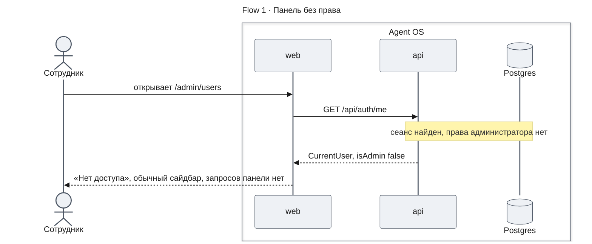
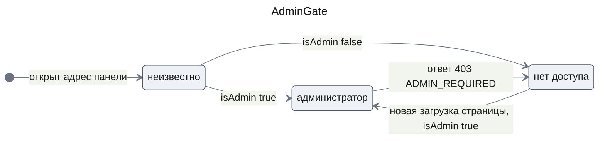

# Корпоративный вход и управление доступом — Design Document — admin

**Status:** Approved · **Date:** 2026-11-16 · **PRD:** [prd.md](./prd.md) · **UXRD:** [uxrd.md](./uxrd.md) · **Depends on:** [design-identity.md](./design-identity.md), [design-mcp-connect.md](./design-mcp-connect.md), [design-access.md](./design-access.md)

## Snapshot

**Overview.** Три первые части фичи отдают операции администратора по HTTP, но экранов для них нет. Эта часть строит в вебе панель администратора: раздел той же оболочки чата по адресам `/admin/…`, где вместо списка бесед стоят разделы «Сотрудники», «Роли», «Авторизация», «MCP-серверы» и «Модели». Администратор заводит локальные учётные записи, блокирует сотрудников, назначает роли, даёт ролям и сотрудникам права на серверы, инструменты и модели с квотами, ставит личные запреты, подключает провайдеров входа и регистрирует MCP-серверы. Оболочка узнаёт право администратора из ответа о текущем сотруднике и только тогда показывает разделы и читает данные; без права на любом адресе панели стоит экран «Нет доступа». Каждый экран читает свои данные при открытии и перечитывает их после изменения; новых зависимостей нет.

- **Не меняется**: операции администратора и их контракты в трёх дизайнах выше, страница входа, «Мой доступ» и отказы в беседе.
- **Главный риск**: примитивы shadcn `base-nova` (таблица, выпадающий список, переключатель) могут не держать компактную плотность; запасной путь — свой примитив на `@base-ui/react` (Risks and Mitigation).
- **Открытые вопросы**: нет ([Open Questions](#open-questions)).

### Key Decisions

#### KD-1: Панель — новый вид маршрута `admin` внутри существующей оболочки чата, а не отдельная группа маршрутов со своей оболочкой

Оболочка уже выбирает экран по адресу: файлы страниц пусты, а разбор адреса `parseShellRoute` даёт вид — беседа, «Агенты», страница агента, «Мой доступ». Панель получает ещё один вид `admin` с разделом и, на странице записи, её ключом; все адреса `/admin/…` ловит одна пустая страница с необязательным catch-all сегментом. В панели сайдбар показывает разделы вместо истории бесед, а основная область — экран раздела. Шапка, блок пользователя, тема, строка связи и уведомления остаются от оболочки, поэтому «Нет доступа» (AD-02) стоит в обычном сайдбаре, а «К чату» не перезапускает чат (`uxrd.md` KD-1).

- **Отдельная группа `(admin)` со своей оболочкой** — не взята. Переход между группами снимает раскладку чата, и «К чату» заново грузит список бесед и поток событий; вторая оболочка повторила бы логику ящика, полосы иконок и фокуса (`app-sidebar.tsx`).
- **Настоящие страницы Next с `params`** — не взяты. При `cacheComponents` чтение `params` без `generateStaticParams` требует `Suspense` на каждой странице, а пустые страницы с разбором адреса уже работают в этом коде.

Цена: на страницах панели живут список бесед и поток событий чата, как сегодня на «Агентах».

#### KD-2: Право администратора веб берёт из одного значения `CurrentUser`; экраны панели монтируются и читают данные только при `isAdmin`, а ответ 403 `ADMIN_REQUIRED` переводит панель в «Нет доступа» на месте

Сервер Next к API не ходит и cookie сеанса не видит (`design-identity.md`, C3 · web), поэтому охранять `/admin` на сервере Next нечем. Настоящая защита — `@AdminOnly()` в API; веб только не показывает панель тому, у кого права нет. `AdminGate` читает `isAdmin` из того же значения `CurrentUser`, из которого меню берёт имя, и пока ответа нет, не отправляет ни одного запроса `/api/admin/…`. Если право сняли при открытой панели, любой ответ 403 `ADMIN_REQUIRED` сбрасывает `isAdmin`, и оболочка сразу показывает AD-02 и меню без пункта панели.

- **Только по ответу 403** — не взято: каждое открытие панели не администратором писало бы `access_denied` в аудит, а сайдбар панели мелькал бы до ответа.
- **Свой запрос `/me` в панели** — не взят: два источника одного факта расходятся.

#### KD-3: Один общий клиент API для всего веба; функции панели — модуль `lib/admin` поверх него; ошибка несёт `reason`

Ядро запроса `apiRequest` в `lib/api` построила часть `identity`: адрес API, cookie, методы `GET`, `POST`, `PUT`, `PATCH`, `DELETE`, тело JSON, разбор ответа схемой из `@agent-os/contracts`, ошибка `ApiRequestError` с видом, статусом, кодом, причиной (`reason`) и текстом сервера, один обработчик 401. Клиент чата `threadsApiClient` и клиенты `lib/mcp` и `lib/access` уже идут через это ядро. Панель добавляет в ядро только обработчик 403 `ADMIN_REQUIRED` (KD-2) и строит `adminApi` в `lib/admin` — ещё один набор функций поверх ядра.

- **Второй клиент для панели** — не взят: обработчики 401 и 403 обходились бы, а одна логика жила бы в двух местах.

#### KD-4: Данные экрана читаются при открытии хуком `useResource`, списки по страницам — `usePagedResource`; после изменения экран читает данные заново; библиотеки кэша нет

`uxrd.md` читает каждый раздел при открытии и не обновляет его вживую. Таблицы и страницы записей повторяют одну машину состояний: загрузка, готово, ошибка с «Повторить», «Показать ещё» со своей ошибкой подгрузки. Её держат два маленьких хука. `apiRequest` не принимает сигнала отмены, поэтому хуки нумеруют чтения и применяют только ответ последнего, пока экран смонтирован; ответ на прежний ключ и после ухода со страницы отбрасывается, ошибка пишется в лог один раз. Новое чтение оставляет строки на экране до своего ответа, а «Показать ещё» ничего не отправляет, пока первая страница нового чтения не применена. Изменение — вызов функции `adminApi`, затем `reload()` того ресурса, который изменение затронуло.

- **TanStack Query** — не взят: кэш между страницами и фоновое обновление здесь не нужны, а новая библиотека — новый образец для всего веба.
- **Хранилище zustand на ресурс, как `agent-list-store`** — не взято: такие хранилища живут в сервисах оболочки, потому что их обновляет поток событий, а данные панели нужны одной странице.

#### KD-5: Формы — управляемое состояние, проверка чистой функцией формы и поля shadcn `field` поверх `@base-ui/react`; таблицы — один `DataTable` поверх shadcn `table`; без react-hook-form и TanStack Table

Форм в вебе нет, а панели нужны: учётная запись (AD-16), сброс пароля, роль, право (GR-01), провайдер с полями своего типа, настройки входа, регистрация сервера, общий токен, модель. Каждая проверяется при нажатии, ставит фокус на первое поле с ошибкой, блокирует себя на время сохранения и показывает ошибку сервера блоком над действиями ([settings-form](../../design-system/components/settings-form.md)). Это поведение собрано один раз в `AdminForm`; связь подписи, подсказки и ошибки с полем дают примитивы `Field` из `@base-ui/react` 1.9.0, которые уже стоят в приложении. Правила полей — чистая функция у каждой формы. Таблица одна — `DataTable` по [data-table](../../design-system/components/data-table.md); сортировки и отбора на клиенте нет, порядок задаёт сервер.

- **react-hook-form** — не взят: новая зависимость для маленьких форм, а связь полей с подсказкой и ошибкой уже дают примитивы `Field`.
- **TanStack Table** — не взят: его сила — сортировка, отбор и виртуализация на клиенте, а здесь их нет.

#### KD-6: Компактная плотность панели — существующий размер кнопок `sm` и новые роли текста Data и Mono 13 / 20 как токены `globals.css`; механизма плотности нет

В панели контрол 28 px, строка 32 px, отступ ячейки 12 px, текст Data 13 / 18 ([foundations → Spacing & Density](../../design-system/foundations.md#spacing--density)). Кнопки панели берут существующий размер `sm` (28 px); поля, выпадающие списки и строки таблицы получают 28 и 32 px в `AdminForm` и `DataTable`. Роли текста Data и Mono 13 / 20 становятся токенами в `@theme` файла `globals.css`, потому что жёсткий размер в компоненте — дефект дизайн-системы. При грубом указателе цели растут до 44 px тем же вариантом `pointer-coarse:`, что в оболочке.

- **Контекст или атрибут плотности для всех контролов** — не взят: других компактных экранов пока нет, а смена размеров по умолчанию задела бы чат.

## Terms

- **Оболочка** — каркас веба из chat-shell: сайдбар, шапка, основная область (`ChatShell`).
- **Вид маршрута** — значение `ShellRoute`, которое `parseShellRoute` выводит из адреса; по нему оболочка выбирает экран.
- **Ядро запроса** — функция `apiRequest` в `lib/api`, через которую идёт каждый запрос веба к API.
- **Ресурс** — данные, которые экран читает при открытии: список, запись или настройки.
- **Право** — строка `Grant`: разрешение или личный запрет на сервер, инструмент или модель, у разрешения модели — квота.

## Part

- **Part**: `admin`
- **Covers**: FR-24, FR-25, FR-26, FR-27, FR-28, FR-29; FR-31 (Could) — отложено, см. Out of scope; NFR-05 в части панели; NFR-02 в части веба
- **Depends on**: [design-identity.md#contract-definitions](./design-identity.md#contract-definitions) (`CurrentUser`, сотрудники и локальные учётные записи, роли, провайдеры, `SignInSettings`; обработчик 401, `UserMenu`, страница `/account`), [design-mcp-connect.md#contract-definitions](./design-mcp-connect.md#contract-definitions) (реестр для `admin`, возврат подключения администратора), [design-access.md#contract-definitions](./design-access.md#contract-definitions) (каталог моделей, права и квоты)
- **Prerequisite ADRs**: [ADR-0012](../../adr/ADR-0012-closed-api-and-server-issued-employee-id.md) (API закрыт сеансом, сотрудника выдаёт сервер), [ADR-0014](../../adr/ADR-0014-mcp-registry-owned-by-agents.md) (сервер реестра адресуется именем), [ADR-0015](../../adr/ADR-0015-access-gate-and-model-catalogue.md) (каталог и права в `access`)
- **Sibling parts**: `identity`, `mcp-connect`, `access` — их требования здесь только контракты

**Out of scope**

- Журнал аудита в панели (FR-31, Could) в этой фиче не строится: ни одна часть не отдаёт операцию чтения аудита. Экрана AD-13 и пункта «Журнал» нет.
- Объяснение действующих прав сотрудника с источниками и разбивкой квоты: администратор читает роли сотрудника и права напрямую.
- Группы IdP и их сопоставление с ролями: роли назначаются только в панели.
- Страница входа, имя и почта в меню, «Выйти», переход на вход по 401, страница «Мой доступ» и смена своего пароля — `identity`; подключения на «Мой доступ» и точка на аватаре — `mcp-connect`; модели на «Мой доступ» и отказы в беседе — `access`. Эта часть добавляет в меню только пункт «Панель администратора».
- Отдельная раскладка панели под телефон: ниже 1280 px таблицы прокручиваются внутри блока, а ниже 768 px действия шапки встают своей строкой под заголовком (`uxrd.md`, Responsive Behavior).

**Constraints**

- PoC без совместимости: ядро запроса одно на весь веб, второго клиента у панели нет (KD-3).
- Новых зависимостей нет: примитивы `table`, `tabs`, `switch`, `radio-group`, `select`, `label`, `field`, `checkbox` добавляются в `components/ui` командой shadcn поверх `@base-ui/react` (`uxrd.md`, Component Inventory).
- `apps/web` зависит только от `contracts` и `common` ([code system](../../code-system/README.md), Layer Map): схемы ответов панели — из `@agent-os/contracts`.
- Логи — через `src/lib/logger.ts`: метод, путь, статус, код и причина ошибки; тела запросов и ответов в лог не попадают, поэтому пароли и секреты тоже.
- Комфорт долгой сессии: только роли цвета foundations, без чистого белого и чёрного; компактная плотность (KD-6).
- WCAG 2.1 AA и работа от 1280 px (NFR-05): роли, имена и клавиатура — по спецификациям компонентов, порядок фокуса — `uxrd.md`, Accessibility.

## Building-block Inventory

Follows the [code system](../../code-system/README.md). Поиск перед «new» шёл по `docs/code-system/`, `docs/design-system/components/` и `apps/web/src` (`components/ui`, `components/shell`, `components/agents`, `lib`, `hooks`; слова `admin`, `table`, `form`, `field`, `secret`, `badge`, `copy`): упоминаний `admin` в коде, таблиц, форм и поля секрета нет.

| Building block | Pattern | Status | Note |
|---|---|---|---|
| `ShellRoute`, `parseShellRoute`, `MainView`, `DocumentTitle`, пустая страница `/admin/[[...path]]` | [shell-route.md](../../code-system/patterns/shell-route.md) (KD-1) | extended | Вид `admin` и экран раздела; `DocumentTitle` оставляет вкладку панели её экрану |
| `AppSidebar` | [shell-route.md](../../code-system/patterns/shell-route.md) | extended | В панели — «К чату», «Панель» и разделы вместо истории бесед (`AdminSidebarNav`) |
| `ChatHeader` | [shell-route.md](../../code-system/patterns/shell-route.md) | extended | На адресе панели вместо заголовка — один слот `AdminHeaderSlot`; экран ставит в него `h1` и действия через `AdminPageHeader` |
| `useDocumentTitle`, `pageTitle` | — | new | Вкладка панели (MC-18, MC-19): экран называет её сам, потому что знает имя записи |
| `UserMenu` | [shell-route.md](../../code-system/patterns/shell-route.md) | extended | Пункт «Панель администратора» при `isAdmin` |
| Значение `CurrentUser` | — | extended | Общее значение оболочки из `identity`; панель добавляет сброс `isAdmin` (`revokeAdmin`) |
| `ThreadNotice` | [shell-route.md](../../code-system/patterns/shell-route.md) | extended | Варианты `no-access` (AD-02) и `record-not-found` (AD-15) |
| Ядро `apiRequest`, `ApiRequestError` в `lib/api` | [web-api-client.md](../../code-system/patterns/web-api-client.md) (KD-3) | extended | Построено `identity`; панель добавляет обработчик 403 `ADMIN_REQUIRED` (`setAdminRequiredHandler`) |
| `adminApi` в `lib/admin` | [web-api-client.md](../../code-system/patterns/web-api-client.md) | new | Операции администратора трёх частей |
| Схемы ответов в `@agent-os/contracts` | [web-api-client.md](../../code-system/patterns/web-api-client.md) | reused | Объявлены частями, которые отдают операции; у строки каталога своей схемы нет, её разбирает `CreateCatalogModelBodySchema` |
| `useResource`, `usePagedResource`, `useDebouncedValue` | [read-on-open.md](../../code-system/patterns/read-on-open.md) (KD-4) | new | Чтение при открытии; поиск сотрудников через 300 мс |
| `DataTable`, `resourceTableState`, `ActionsMenu`, `RecordPlaceholder` | [data-table](../../design-system/components/data-table.md) | new | KD-5 |
| `AdminForm`, `AdminTextField`, `AdminRadioField`, `CopyValue` | [settings-form](../../design-system/components/settings-form.md) | new | KD-5 |
| `ConfirmDialog`, `SavingSwitch` | [settings-form](../../design-system/components/settings-form.md) | new | Подтверждение одним запросом; «Сохранение на месте» |
| `SecretField` | [secret-field](../../design-system/components/secret-field.md) | new | Секрет провайдера и общий токен сервера |
| `PasswordField`, `RevealInput` | [secret-field](../../design-system/components/secret-field.md) | extended | `PasswordField` из `identity`; поле с «Показать» вынесено в `RevealInput`, общий для `SecretField` и `PasswordField` |
| `describeAdminError`, `isNotFound`, `rereadOnNotFound`, `isListChanged` в `lib/admin/admin-errors.ts`; тексты в `admin-texts.ts` | — | new | Отказ сервера → текст у поля или формы; 404 → новое чтение |
| `StateBadge` | [state-badge](../../design-system/components/state-badge.md) | reused | Построен `mcp-connect` |
| Формат денег `lib/access/money.ts` | — | extended | Новый `formatPriceUsd` — цена за миллион токенов; квота — готовый `formatQuotaUsd` из `access` |
| `formatTime`, `useCopyToClipboard`, `focusShellTarget`, `Announcer`, `toast` | — | reused | Время таблиц, копирование, фокус `h1`, объявления, уведомления |
| Токены Data и Mono 13 / 20 в `globals.css` | — | extended | KD-6 |

## Acceptance Criteria

### FR-24: Панель администратора

- From the PRD: AC-24.1, AC-24.2
- Пока ответа `GET /api/auth/me` нет, на адресе `/admin/…` стоит состояние «Право ещё не известно» (`uxrd.md` AD-01), и ни одного запроса `/api/admin/…` не уходит (DC-1).
- Если любой запрос панели получил 403 `ADMIN_REQUIRED`, экран сразу меняется на «Нет доступа» (AD-02), сайдбар — на обычный со списком бесед, а пункта «Панель администратора» в меню больше нет (DC-2).

### FR-25: Сотрудники и роли

- From the PRD: AC-25.1. AC-25.2 — панель удаляет роль и возвращает к списку с уведомлением «Роль удалена»; что права пропадают у агентов, проверяет часть `access`. AC-25.3.
- Поиск сотрудников уходит через 300 мс после последнего ввода; ответ на прежний текст поиска на экран не попадает (DC-3).
- Сотрудник с непустым `login` — локальная учётная запись: метка «локальная» в списке и «Сбросить пароль» на его странице. Пароль проверяется по длине из MC-22 и MC-23 до отправки, живёт только в поле диалога и после ответа стирается; уведомление называет только логин (DC-4).
- Роли назначаются и снимаются только в панели. Встроенные роли «Супер-администратор» и «Все сотрудники» (`builtinKind`) стоят в списке первыми; у них нет «Переименовать» и «Удалить», а переключатели прав роли недоступны: у первой включены, у второй выключены (DC-5).
- «Заблокировать» после подтверждения отправляет блокировку, и страница показывает статус «Отключён»; работу агентов сотрудника экран не обещает остановить сразу (DC-6).
- Право администратора даётся только после подтверждения — лично («Дать лично») и роли (переключатель «Право администратора»); диалог роли называет, сколько сотрудников станут администраторами. Снятие — одно нажатие без подтверждения (DC-15).

### FR-26: Авторизация

- From the PRD: AC-26.1, AC-26.3, AC-26.4
- Форма «Настройки входа» одна: поле «Без активности» показывает `idleMinutes ÷ 60`, «Всего с момента входа» — `absoluteMinutes ÷ 60`, дробь с запятой; «Сохранить» отправляет адрес и оба срока в минутах одним `PUT` после проверки по MC-33. Пока `publicUrl` равен `null`, поле адреса показывает адрес API, к которому обращается веб (DC-7).
- Переключатель «Включено» с ответом 409 `PROVIDER_INCOMPLETE` возвращается в «выкл.», под ним — отказ включения из MC-27 (DC-8).

### FR-27: MCP-серверы

- From the PRD: AC-27.1
- Страница сервера адресуется именем: `/admin/servers/<имя>`, а регистрация — `/admin/register-server`, так что любое допустимое имя открывается. Параметры возврата `connected`, `error=connect_failed` и `error=tools_failed` страница читает один раз и убирает из адреса (DC-9).
- Имя, адрес и режим сервера после регистрации только читаются; на странице сервера меняются переключатель «Включён», у общей учётной записи токен доступа и настройки инструментов ([design-access-levels.md](./design-access-levels.md)). Сменить адрес или режим — удалить сервер и зарегистрировать заново (DC-10).
- «Обновить список» с ответом 409 `MCP_ACCOUNT_REQUIRED` уводит вкладку на `GET /api/admin/mcp-servers/:name/connect`, как «Подключить мой аккаунт» (DC-11).

### FR-28: Права и запреты

- From the PRD: AC-28.2
- Диалог права (GR-01) предлагает модели каталога; модель, на которую у держателя уже есть право или запрет, недоступна с подписью «уже есть» (DC-12).

### FR-29: Модели, цены и квоты

- From the PRD: AC-29.2
- Квоту права на модель администратор меняет полем «Изменить квоту» в правах роли или сотрудника: `PATCH /api/admin/grants/:id` с `quotaUsd` — суммой в долларах от 0,01 до 1 000 000, не больше двух знаков после запятой, — или `null`, затем новое чтение прав. Так же поднимается исчерпанная квота (DC-14).

### NFR-02, NFR-05

- From the PRD: NFR-05 в части панели; NFR-02 в части веба — секрет провайдера, общий токен сервера и пароль не попадают в лог, уведомление, заголовок вкладки и сообщение об ошибке.

## Design

### Architecture (C1–C4)

#### C2 · Containers

Браузер администратора говорит с API так же, как чат: напрямую, с cookie сеанса. Новых контейнеров нет; меняется только `web`.

- `web` получает раздел панели в оболочке, общий клиент API и строительные блоки форм и таблиц.
- `api` и `Postgres` не меняются: операции, проверки и аудит описаны в трёх дизайнах выше.
- Сервер авторизации MCP-сервера браузер видит только при подключении аккаунта администратора — переходом в той же вкладке через `api` (`design-mcp-connect.md`, KD-6).

#### C3 · Components: web

**web — открытие раздела панели.** Адрес даёт вид `admin`, `AdminGate` решает по праву, экран раздела читает данные через `adminApi`.

- `parseShellRoute` разбирает `/admin`, `/admin/users`, `/admin/users/<id>`, `/admin/roles`, `/admin/roles/<id>`, `/admin/sign-in`, `/admin/sign-in/new`, `/admin/sign-in/<id>`, `/admin/servers`, `/admin/register-server`, `/admin/servers/<имя>`, `/admin/models`. Регистрация сервера стоит вне `/admin/servers/…`, потому что сервер может называться `new`. `/admin` и неизвестный адрес под ним открывают «Сотрудники».
- `AdminGate` стоит в `MainView` и в `AppSidebar`; его состояния — в [State Transitions and Invariants](#state-transitions-and-invariants).
- Экран раздела — компонент `components/admin/…`: таблица или форма из блоков инвентаря. Шапка оболочки на адресе панели ставит один пустой слот `AdminHeaderSlot`; экран рисует в него `h1`, метку состояния и свои действия через `AdminPageHeader` порталом, поэтому кнопки и диалоги шапки живут в состоянии экрана. Ниже 768 px действия встают отдельной строкой под заголовком.
- Фокус на `h1` (`focusShellTarget('page-title')`) ставит один эффект в `AdminScreen` (`admin-screen.tsx`) при смене раздела, вида страницы или ключа записи — откуда бы страница ни открылась: из меню, сайдбара, строки, формы или после удаления записи.
- Вкладку называет экран через `useDocumentTitle`: «{раздел} — Панель — Agent OS», на странице записи «{запись} — {раздел} — Панель — Agent OS», пока право неизвестно — «Панель — Agent OS», без права — «Нет доступа — Agent OS».
- Потребители `ShellRoute` учитывают вид `admin`: `main-view.tsx` и `app-sidebar.tsx` показывают экран и разделы, `chat-header.tsx` — слот `AdminHeaderSlot` без кнопки рабочей области, `document-title.tsx` не трогает вкладку панели, ссылка пропуска в `chat-shell.tsx` ведёт на `h1` вместо поля сообщения, `chat-runtime-provider.tsx` не ищет на этих адресах беседу.

**web — изменение и новое чтение.** Каждое изменение идёт одним путём: форма или кнопка → функция `adminApi` → обработка ошибки → `reload()` затронутых ресурсов → уведомление и фокус по `uxrd.md`, Accessibility.

- Ошибки переводит в текст одна функция `describeAdminError(error, context?)`: код и `reason` → поле или форма и текст из `lib/admin/admin-texts.ts` (MC-20, MC-22, MC-23, MC-25–MC-27, MC-29, MC-30, MC-33); `ADMIN_REQUIRED` даёт `null`: экран сменяет «Нет доступа» по общему обработчику 403, а форма ничего не показывает. Свои тексты есть и у двух отказов без текста в UXRD: `PUBLIC_URL_REQUIRED` — «Сначала сохраните публичный адрес Agent OS в настройках входа.», `VALIDATION_FAILED` с `invalid_cursor` — «Список изменился. Откройте раздел заново.». Отказ без сети — «Не удалось сохранить: нет связи с сервером»; прочий код или причина — «Не удалось сохранить: {текст сервера}», как требует [settings-form](../../design-system/components/settings-form.md), Content Rules. `context` несёт то, чего в ошибке нет: вид права для `GRANT_EXISTS` («Такое право уже есть» или «Такой запрет уже есть») и рамку `checkFailed` вокруг причины `MCP_SERVER_CHECK_FAILED` — «Не удалось зарегистрировать: …» у регистрации, «Не удалось сохранить: …» у сохранения токена.
- Уведомления — `toast` из `sonner`, как в оболочке (chat-shell UXRD, TST-01). Уведомление получают: заведение учётной записи (называет логин), сброс пароля, блокировка и разблокировка, удаление роли, добавление, правка и удаление модели, обновление списка инструментов и удаление сервера, сохранение формы-страницы («Сохранено»: провайдер, токен сервера, настройки входа). Переключатели, диалоги роли, права и квоты, назначение роли и личное право уведомления не дают: результат виден по новому чтению. Объявления — единственная вежливая live-область оболочки.
- Ушедшую строку `DataTable` схлопывает и переводит фокус на следующую строку, без неё — на предыдущую, без строк — на `h1`.

### Runtime Flows

Оба потока идут одним путём: администратор → `web` → `api` → запись в Postgres (заметка) → `api` → `web` → администратор. Прочие изменения панели — тот же путь в одну операцию с новым чтением затронутого ресурса.

#### Flow 1: Не администратор открывает панель

**Starts when:** сотрудник без права администратора открывает `/admin/users` по ссылке, for AC-24.2, DC-1

**Outcome:** сотрудник видит AD-02 с кнопкой «В чат»; в аудите нет записи `access_denied`, потому что панель ничего не спросила.

**Failure handling:**

- Право сняли, пока панель была открыта → следующий запрос панели получает 403 `ADMIN_REQUIRED`, обработчик 403 сбрасывает `isAdmin`, и экран меняется на AD-02 без перезагрузки (DC-2).
- `GET /api/auth/me` отвечает 401 → обработчик 401 из `identity` уводит на `/login` с `next` текущей страницы.
- `GET /api/auth/me` не дошёл (сеть) → строка связи оболочки; панель остаётся в состоянии «неизвестно» и не шлёт запросов.

#### Flow 2: Регистрация сервера с личным OAuth

**Starts when:** администратор регистрирует Sentry MCP в режиме «Личный OAuth», for AC-27.1, DC-9

**Outcome:** страница сервера показывает статус «Включён» и таблицу инструментов; параметр `connected` убран из адреса.

**Failure handling:**

- 422 `MCP_SERVER_CHECK_FAILED` или 409 `MCP_SERVER_NAME_TAKEN` на регистрации → ошибка формы или поля с текстом MC-29, поля сохраняют введённое, перехода нет.
- Вход в Sentry отменён (`error=connect_failed`) или инструменты не получены (`error=tools_failed`) → страница сервера со статусом «Ждёт аккаунта администратора» или с ошибкой над таблицей, тексты MC-29.
- Режим «Общая учётная запись» → `POST` проверяет сервер сразу, кнопка показывает «Проверяем сервер…», успех открывает страницу сервера без перехода к владельцу.

### Contract Definitions

Панель потребляет контракты трёх частей так, как они написаны: [design-identity.md#contract-definitions](./design-identity.md#contract-definitions), [design-mcp-connect.md#contract-definitions](./design-mcp-connect.md#contract-definitions), [design-access.md#contract-definitions](./design-access.md#contract-definitions). Ниже — что эта часть предлагает остальному вебу и как экраны раскладывают данные контрактов.

#### Ядро запроса и `CurrentUser` — для всего веба

Ядро и `CurrentUser` построила часть `identity`; панель добавляет обработчик 403 и сброс `isAdmin`.

- **`apiRequest`** — отправляет запрос к `apiBaseUrl` с cookie, методом `GET`, `POST`, `PUT`, `PATCH` или `DELETE` и телом JSON; разбирает ответ схемой, которую передал вызывающий. Без схемы (204) возвращает пустой результат. Сигнала отмены не принимает. Ошибка — `ApiRequestError`.
- **`ApiRequestError`** — `kind`: `not_found` (404), `http` (прочий отказ), `invalid_response` (тело не прошло схему), `network` (ответа нет); `method`, `path` без строки запроса, `status`; `code` — `errorCode` тела; `reason` и `message` тела.
- **Обработчики 401 и 403 `ADMIN_REQUIRED`** — по одному на веб; оболочка регистрирует их в ядре (`setUnauthorizedHandler`, `setAdminRequiredHandler`), поэтому `lib/api` не импортирует ни страницу входа, ни `CurrentUser`. Обработчик 403 вызывает `revokeAdmin()` у `CurrentUser`; вызывающий получает ту же ошибку и ничего не показывает сам.
- **`CurrentUser` в вебе** — одно значение в сервисах оболочки: одно чтение `GET /api/auth/me` на загрузку страницы. Состояния — «неизвестно» и «прочитано» с `id`, `email`, `name`, `isAdmin`. `UserMenu` и `AdminGate` читают его; единственная запись панели — сброс `isAdmin` в `false` обработчиком 403.
- **`describeApiError`** — поля для лога: вид, метод, путь, статус, код, причина. Тел в них нет.

#### `adminApi`, хуки и блоки — для экранов панели

- **`adminApi`** — по функции на операцию из контрактов выше, с её входом и схемой ответа:
  - `users` — список по страницам с `query`, запись, заведение, сброс пароля (`PUT /api/admin/users/:id/password`), блокировка и разблокировка, личное право администратора (`PUT /api/admin/users/:id/admin` с `enabled`), назначение и снятие роли (`PUT` и `DELETE /api/admin/users/:id/roles/:roleId`). Удаления сотрудника в API нет.
  - `roles` — список, запись, создание, правка (`PATCH` с `name` или `isAdmin`), удаление. `grants` — права держателя, создание, `updateQuota` (`PATCH` с `quotaUsd`), удаление.
  - `providers` — список, запись, создание, правка; удаления провайдера в API нет. `signInSettings` — чтение и `PUT`.
  - `servers` — список, запись, регистрация, правка, `refreshTools` (`POST /api/admin/mcp-servers/:name/tools/refresh`), удаление и `connectUrl` — адрес перехода «Подключить мой аккаунт»: функция возвращает адрес, а не делает запрос.
  - `models` — каталог, добавление, правка, удаление; строку каталога разбирает `CreateCatalogModelBodySchema`.
  - Каждый сегмент пути после `/api/admin/` — имя сервера, id модели `anthropic/…` и прочие ключи — идёт через `encodeURIComponent`.
- **`useResource(load, key)`** — `status` (`loading`, `ready`, `error`), `data`, `error` (исходная ошибка, чтобы экран отличил `not_found`), `reload()`. Только ответ последнего чтения доходит до экрана и только пока экран смонтирован; ошибка пишется в лог один раз. `reload()` оставляет данные на экране до нового ответа. **`usePagedResource(loadPage, key)`** — то же с `items`, `nextCursor`, `loadMore()`, `loadingMore` и своей ошибкой подгрузки `loadMoreError`; ошибка подгрузки оставляет загруженные строки, а во время `reload()` `loadMore()` ничего не отправляет.
- **`DataTable`** — подпись для скринридера, колонки и состояние: загрузка, ошибка с «Повторить» или готово со строками, пустым состоянием, текстом «нет совпадений» и «Показать ещё». Строка — ключ, имя, ячейки, ссылка или действия (кнопками или меню «⋯», `actionsAs`), вложенные строки, ошибка под строкой. `resourceTableState` переводит ресурс в состояние таблицы; `ActionsMenu` — то же меню «⋯» в шапке записи; `RecordPlaceholder` — страница записи до её ответа: заголовок раздела над загрузкой или ошибкой.
- **`AdminForm`** — вариант (страница или диалог), начальные значения, `validate`, `onSubmit`, подписи кнопки, `hasChange` (кнопка недоступна, пока отправлять нечего), текст уведомления `savedText`, `secretFields` (поля секрета очищаются после успешного сохранения), `errorContext` для `describeAdminError`, событие лога. Поля — `AdminTextField` (с `suffix` — единицей после поля, например часы у сроков входа) и `AdminRadioField`.
- **`ConfirmDialog`** — заголовок, текст, кнопка, `onConfirm` (один запрос; диалог закрывается при успехе и остаётся открытым с причиной при отказе), `focusTitleAfterConfirm` — после действия, которое убирает открывший диалог контрол, фокус уходит на `h1`. **`SavingSwitch`** — «Сохранение на месте»: стоит в новом положении до ответа, отказ возвращает его и показывает причину; `disabled` и `confirmOn` — включение сначала спрашивает подтверждение.
- **`SecretField`** — подпись, «задан ли» (`options.clientSecretSet` или `sharedTokenSet`), значение замены; пока замены нет, секрет в отправку не входит. `SecretField` и `PasswordField` стоят на одном поле с «Показать» `RevealInput`; оба в панели не отдают значение менеджерам паролей.
- **`isNotFound`, `rereadOnNotFound`, `isListChanged`** (`lib/admin/admin-errors.ts`) — 404 ли это; обёртка изменения, после 404 которой ресурс экрана читается заново, а отказ всё равно доходит до контрола; отказ «Показать ещё» по устаревшему курсору.

#### Как экраны раскладывают данные контрактов

- **Сотрудники (AD-03, AD-16, AD-04)** — `GET /api/admin/users` с `query`; «локальная» и логин второй строкой при непустом `login`. «Завести учётную запись» — `POST /api/admin/users`, затем новое чтение; «Сбросить пароль» — `PUT /api/admin/users/:id/password`. Страница сотрудника — `GET /api/admin/users/:id` и `GET /api/admin/grants?userId=`: роли с «Снять роль» (`DELETE …/roles/:roleId`) и «Назначить роль» (`PUT …/roles/:roleId`; роли из `GET /api/admin/roles`, которых у сотрудника нет), личные права и запреты, «Право администратора» по `adminRight`. «Дать лично» — `PUT /api/admin/users/:id/admin` с `enabled: true` после подтверждения, «Снять лично» — с `enabled: false` одним нажатием (DC-15).
- **Роли (AD-05, AD-06)** — `GET /api/admin/roles`, встроенная роль наверху; страница — `GET /api/admin/roles/:id` и `GET /api/admin/grants?roleId=`. Право администратора роли — `SavingSwitch` (`PATCH` с `isAdmin`): включение сначала спрашивает подтверждение с числом сотрудников роли, выключение сохраняется сразу (DC-15).
- **Права на модели (GR-01)** — модели из `GET /api/admin/models`; доступ к MCP-инструментам правят вкладки уровней ([design-access-levels.md](./design-access-levels.md)). Квота — в долларах, поле «Квота за месяц, $» с двумя знаками; «Изменить квоту» — `PATCH /api/admin/grants/:id` (DC-14). «Убрать» отправляет `DELETE /api/admin/grants/:id` сразу, без подтверждения: тот же диалог возвращает право.
- **Авторизация (AD-07, AD-14)** — постоянная строка «Логин и пароль» (в ответе её нет), затем `GET /api/admin/providers`. Новый провайдер — `POST` с `type` (`google` или `oidc`) и `name`, затем переход на его страницу; без сохранённого публичного адреса API отвечает 409 `PUBLIC_URL_REQUIRED`. Страница — `ProviderView`: поля типа из `options` (AC-26.4), Issuer — адрес `https://` или `http://localhost`, секрет — `SecretField`, «Данные для провайдера» — `CopyValue` на каждое значение `providerData`, у `google` — предупреждение MC-27. Настройки входа — `GET` и `PUT /api/admin/settings/sign-in` (DC-7).
- **MCP-серверы (AD-08 — AD-10)** — `McpServerSummary` в таблице, `McpServerView` на странице. Адрес при регистрации — `https://` или `http://localhost`. «Обновить список» — `POST /api/admin/mcp-servers/:name/tools/refresh`, уведомление называет число новых и убранных по `added` и `removed`; у общей учётной записи токен меняется через `SecretField` и `PATCH` с `sharedToken` (DC-10). Подтверждение удаления говорит, что вместе с сервером удаляются подключённые аккаунты сотрудников.
- **Модели (AD-11)** — `CatalogModel`, разобранный схемой `CreateCatalogModelBodySchema`; цены — `formatPriceUsd`, цены длинных запросов — вложенной строкой при `longContext`. Подтверждение «Убрать из каталога» говорит, что удаляются все права и личные запреты на модель, а агенты на ней завершатся сбоем.

**Error handling**

- `ADMIN_REQUIRED` (403) — экран AD-02 (DC-2).
- `USER_NOT_FOUND`, `ROLE_NOT_FOUND`, `PROVIDER_NOT_FOUND`, `MCP_SERVER_NOT_FOUND`, `MODEL_NOT_FOUND`, `GRANT_NOT_FOUND` (404) — на странице записи: «Запись не найдена» (AD-15, MC-34); на действии в строке — ресурс экрана читается заново (`rereadOnNotFound`).
- `LOGIN_TAKEN`, `EMAIL_TAKEN`, `ROLE_NAME_TAKEN`, `MCP_SERVER_NAME_TAKEN`, `MODEL_ID_TAKEN`, `VALIDATION_FAILED` с `weak_password` — ошибки полей с текстами MC-22, MC-23, MC-26, MC-29, MC-30.
- `PROVIDER_INCOMPLETE`, `MCP_SERVER_INCOMPLETE` (409) — отказ переключателя с текстом MC-27 или MC-29 (DC-8).
- `PROVIDER_CHECK_FAILED`, `MCP_SERVER_CHECK_FAILED` (с `reason`), `GRANT_EXISTS`, `GRANT_TARGET_UNKNOWN`, `GRANT_INVALID` — ошибка формы с текстом причины из MC-27, MC-29 или MC-25.
- `MCP_ACCOUNT_REQUIRED` (409) — переход на подключение аккаунта (DC-11).
- `PUBLIC_URL_REQUIRED` (409) на создании провайдера — ошибка формы «Сначала сохраните публичный адрес Agent OS в настройках входа.».
- `VALIDATION_FAILED` с `invalid_cursor` на «Показать ещё» — ошибка подгрузки «Список изменился. Откройте раздел заново.», загруженные строки остаются.
- `NOT_LOCAL_ACCOUNT`, `BUILTIN_ROLE` (409) и прочий `VALIDATION_FAILED` — экран эти действия не предлагает; пришедший ответ — «Не удалось сохранить: {текст сервера}», а `BUILTIN_ROLE` ещё и перечитывает роль.
- Нет сети — «Не удалось сохранить: нет связи с сервером».

**Runtime settings**

- Постоянные кода: задержка поиска сотрудников — 300 мс.

### State Transitions and Invariants

`AdminGate` — единственное место, где веб решает, показать ли панель.

**Invariants**

1. Запрос `/api/admin/…` уходит только в состоянии «администратор».
2. В состоянии «нет доступа» на экране нет данных панели, а в меню нет пункта «Панель администратора».
3. Секрет провайдера, общий токен сервера и пароль живут только в своём поле: после отказа введённое остаётся для исправления, после успешного сохранения поле очищается. В лог, уведомление, заголовок вкладки, адрес, хранилище браузера и текст ошибки они не попадают.
4. После любого изменения экран показывает данные нового чтения, а не склейку ответа изменения со старым списком.

## Test Strategy

Интеграционных проверок три, все в `components/shell/enterprise-access-admin.int.test.tsx`, каждая — таблица строк внутри настоящей оболочки:

- **INT-1** — охрана панели: UC-1, UC-E1, UC-E2.
- **INT-2** — сотрудники, роли, права и каталог: UC-2 — UC-6, UC-11, UC-E6.
- **INT-3** — авторизация и MCP-серверы: UC-7 — UC-10, UC-E3, UC-E4, UC-E5, UC-E8.

Сеть подменяют MSW-бэкенды в самом файле. Каждый разбирает тело запроса схемой контрактов (`CreateGrantBodySchema`, `UpdateMcpServerBodySchema` и другие) и на тело не по схеме отвечает 400 `VALIDATION_FAILED`, так что неверная отправка роняет строку. Проверка `expectNowhere(value)` из `src/test/admin-support.ts` ищет секрет или пароль везде, где страница может его оставить: текст и атрибуты документа, значения полей, заголовок вкладки, адрес, оба хранилища браузера, записи лога и аргументы переходов.

Остальное проверяют таблицы случаев рядом с кодом:

- `shell-route.test.ts` — адреса панели; `api-request.test.ts` — `reason`, обработчики 401 и 403.
- `use-resource.test.tsx` — ответ на прежний ключ, ошибка в логе один раз, перечитывание со строками на экране, ошибка «Показать ещё», «Показать ещё» во время перечитывания, поиск через 300 мс с устаревшим ответом (UC-E9).
- `admin-errors.test.ts` — `describeAdminError` по кодам и причинам; `form-rules.test.ts` — правила полей, часы и минуты (UC-E7); `money.test.ts` — `formatPriceUsd`.
- `data-table.test.tsx` — фокус после ушедшей строки; `admin-form.test.tsx` — фокус на первой ошибке, блокировка на время сохранения, отказ сервера над действиями.

Плотность, токены, контраст и порядок фокуса (UC-N1) — L1-сценарии в браузере.

### Main Use Cases

- **UC-1: Администратор видит панель** — covers AC-24.1
  - Given: `CurrentUser` с `isAdmin: true`
  - When: администратор открывает меню и выбирает «Панель администратора»
  - Then: открыт «Сотрудники», в сайдбаре «К чату» и пять разделов, фокус на `h1`
- **UC-2: Локальная учётная запись** — covers AC-25.3, DC-4
  - Given: в списке нет логина `boris`
  - When: администратор заводит учётную запись `boris` с именем, почтой и паролем из 12 знаков; затем на странице Бориса сбрасывает пароль
  - Then: ушёл `POST /api/admin/users`, список перечитан, у Бориса метка «локальная»; уведомление называет логин, не пароль; сброс отправил `PUT /api/admin/users/:id/password`, поле очищено; у сотрудника без `login` кнопки «Сбросить пароль» нет
- **UC-3: Роль, право, запрет и квоты** — covers AC-29.2, DC-12, DC-14
  - Given: роль «SRE», модели Sonnet и Haiku
  - When: администратор даёт роли Sonnet с квотой 50 $; ставит Ане личный запрет на Haiku и личную квоту 30 $ на Sonnet; снова открывает роль и Аню; меняет квоту роли на 80 $, затем очищает поле
  - Then: в GR-01 у роли Sonnet после сохранения недоступен с подписью «уже есть»; ушли `POST /api/admin/grants` с `quotaUsd: 50` и запрет с `effect: 'deny'`; роль и Аня показывают 50 $ и 30 $; ушли `PATCH /api/admin/grants/:id` с `quotaUsd: 80`, затем с `quotaUsd: null`; после каждого шага права перечитаны и показывают новое
- **UC-4: Удаление роли** — covers AC-25.2
  - Given: роль «Дежурный»
  - When: администратор выбирает «Удалить» и подтверждает
  - Then: ушёл `DELETE /api/admin/roles/:id`, открыт список ролей, уведомление «Роль удалена», фокус на `h1`
- **UC-5: Встроенная роль** — covers DC-5
  - Given: роли «Супер-администратор» (`builtinKind: super_admin`), «Дежурный», «SRE»
  - When: администратор открывает список и встроенную роль
  - Then: «Супер-администратор» первой строкой с меткой «встроенная»; нет «Переименовать» и «Удалить», переключатель права администратора включён и недоступен
- **UC-6: Блокировка** — covers DC-6
  - Given: Аня включена
  - When: администратор жмёт «Заблокировать» и подтверждает
  - Then: ушёл `POST /api/admin/users/:id/block`, статус «Отключён», кнопка «Разблокировать»
- **UC-7: Провайдер OIDC и данные для Okta** — covers AC-26.1, AC-26.4
  - Given: администратор на `/admin/sign-in/new`
  - When: он создаёт провайдера OIDC, затем отдельно — Google
  - Then: у OIDC — «Issuer», «Client ID», «Client secret» и для копирования адрес возврата и «Scopes»; у Google — «Client ID», «Client secret», адрес возврата и предупреждение MC-27
- **UC-8: Настройки входа** — covers AC-26.3, DC-7
  - Given: сервер отдаёт `publicUrl` `https://agent-os.corp`, `idleMinutes` 480, `absoluteMinutes` 1440
  - When: администратор вводит «0,25» и «24» и сохраняет
  - Then: поля показали 8 и 24; ушёл один `PUT /api/admin/settings/sign-in` с адресом, 15 и 1440; уведомление MC-33
- **UC-9: Регистрация сервера с личным OAuth** — covers AC-27.1, DC-9
  - Given: сервер `sentry` не зарегистрирован
  - When: администратор регистрирует его в режиме «Личный OAuth», и вкладка возвращается на `/admin/servers/sentry?connected=1`
  - Then: после `POST` вкладка ушла на адрес подключения; после возврата страница показывает инструменты с «читает» и «меняет», в адресе нет `connected`
- **UC-10: Сервер с общей учётной записью** — covers DC-10
  - Given: сервер `incidents` с общей учётной записью
  - When: администратор заменяет токен доступа и выключает сервер
  - Then: имя, адрес и режим только читаются; ушли `PATCH` с `sharedToken` и `PATCH` с `enabled: false`; поле секрета снова «Задан»
- **UC-11: Роли сотрудника и право администратора** — covers AC-25.1, DC-15
  - Given: у Ани роли «SRE» и «Дежурный», есть ещё роль, которой у неё нет; роль «Дежурный» без права администратора
  - When: администратор открывает Аню, снимает одну роль и назначает другую; жмёт «Дать лично», затем «Снять лично»; на роли «Дежурный» включает право администратора, затем выключает
  - Then: видны обе роли, у каждой «Снять роль»; ушли `DELETE` и `PUT /api/admin/users/:id/roles/:roleId`; «Дать лично» и включение у роли сначала спрашивают, «Отмена» и Esc ничего не отправляют, подтверждение отправляет `PUT /api/admin/users/:id/admin` с `enabled: true` и `PATCH /api/admin/roles/:id` с `isAdmin: true`; снятие и выключение уходят сразу

### Error and Edge Use Cases

- **UC-E1: Не администратор на адресе панели** — covers AC-24.2, DC-1
  - Given: `CurrentUser` с `isAdmin: false`
  - When: сотрудник открывает `/admin/roles`
  - Then: экран «Нет доступа» и «В чат», сайдбар со списком бесед, в меню нет «Панель администратора», ни одного запроса `/api/admin/…`
- **UC-E2: Право сняли при открытой панели** — covers DC-2
  - Given: администратор на списке ролей
  - When: «Создать роль» получает 403 `ADMIN_REQUIRED`
  - Then: на том же адресе экран «Нет доступа», обычный сайдбар, пункта панели в меню нет
- **UC-E3: Секрет провайдера не возвращается** — covers NFR-02
  - Given: у провайдера OIDC `options.clientSecretSet: true`
  - When: администратор меняет название и сохраняет; затем жмёт «Заменить», вводит секрет и сохраняет — сначала с отказом сервера, потом успешно
  - Then: поле показывает «Задан» без ввода; первый `PATCH` без `clientSecret`, следующие — с ним; после отказа секрет есть только в своём поле; после успеха снова «Задан», и `expectNowhere` не находит значения нигде
- **UC-E4: Включение провайдера без настроек** — covers DC-8
  - Given: провайдер без полных настроек
  - When: администратор включает переключатель в таблице
  - Then: ответ 409 `PROVIDER_INCOMPLETE`; переключатель вернулся в «выкл.», под ним отказ включения из MC-27 с ролью `alert`
- **UC-E5: Проверка провайдера не прошла** — covers AC-26.4
  - Given: провайдер OIDC
  - When: сохранение Issuer получает 422 `PROVIDER_CHECK_FAILED` с `reason` `invalid_document`
  - Then: ошибка формы с текстом этой причины из MC-27; поля сохраняют введённое
- **UC-E6: Занятый логин и короткий пароль** — covers DC-4
  - Given: логин `boris` уже есть
  - When: администратор вводит пароль из 8 знаков, затем исправляет пароль и заводит ещё одного `boris`
  - Then: сначала ошибка поля «Пароль — от 12 до 256 знаков» без запроса; затем 409 `LOGIN_TAKEN` и ошибка поля «Логин» из MC-22, пароль не попал в лог
- **UC-E7: Настройки входа вне границ** — covers AC-26.3, DC-7
  - When: администратор вводит «0,3» и «24», затем «8» и «4»
  - Then: ошибки полей из MC-33, запросов нет, фокус на поле с ошибкой
- **UC-E8: Обновление списка без аккаунта администратора** — covers DC-11
  - Given: сервер с личным OAuth без аккаунта администратора
  - When: администратор жмёт «Обновить список»
  - Then: ответ 409 `MCP_ACCOUNT_REQUIRED`, вкладка уходит на адрес подключения
- **UC-E9: Устаревший поиск** — covers DC-3
  - Given: ответ на «ан» приходит позже ответа на «аня»
  - When: администратор быстро вводит «аня» в поиск сотрудников
  - Then: таблица сотрудников показывает результат «аня»

### Non-Functional Use Cases

- **UC-N1: Доступность панели** — covers NFR-05
  - Given: панель на ширине 1280 px, только клавиатура
  - When: администратор проходит Tab от skip link до содержимого и открывает диалог права
  - Then: порядок — skip link, «К чату», разделы, блок пользователя, шапка, содержимое; у полей подписи, ошибки связаны с полями; после закрытия диалога фокус на кнопке, которая его открыла

### L1-сценарии в браузере

Готовый интерфейс принимается в настоящем браузере (Claude-in-Chrome) на `next build && next start` против настоящего API; вход — по логину и паролю локальной учётной записи.

| Сценарий | Шаги | Проверяемый сигнал |
|---|---|---|
| Вход в панель | Войти сотрудником с ролью «Супер-администратор», меню → «Панель администратора» | В Network первым идёт `GET /api/auth/me`, затем `/api/admin/…`; вкладка «Сотрудники — Панель — Agent OS» |
| Без права | Войти без права, открыть `/admin/users` | В Network нет `/api/admin/…`; виден AD-02 и список бесед |
| Плотность и токены | Открыть «Сотрудники» | Строка таблицы 32 px, кнопки 28 px, шрифт ячеек Geist 13 / 18; в светлой и тёмной теме нет чистого белого и чёрного |
| Локальная учётная запись | Завести учётную запись, выйти, войти ею | Метка «локальная» в списке; вход новой учётной записью удался; пароля нет в консоли |
| Права и квота | Дать роли право на модель с квотой, затем изменить квоту | Права перечитаны с новой квотой; агент сотрудника этой роли пользуется моделью |
| Подключение администратора | Зарегистрировать сервер фикстуры с личным OAuth | Вкладка ушла к серверу авторизации и вернулась на `/admin/servers/<имя>` без `connected`; таблица инструментов |
| Провайдер | Создать провайдера OIDC, задать секрет, перезагрузить страницу | Поле секрета «Задан»; секрета нет в DOM, Network-ответах и консоли |

## Security Considerations

- **Authentication & Authorization**: права проверяет API (`@AdminOnly()`). Веб не показывает панель без `isAdmin` и не шлёт её запросов (KD-2), но на это не полагается: подделанный `isAdmin` в браузере даёт только 403. Изменяющие запросы идут с cookie и проверяются по `Origin` на сервере.
- **Input Validation**: формы проверяют поля до отправки для подсказок человеку; окончательная проверка — сервер, его отказ показывается ошибкой формы. Имя сервера и id модели кодируются в пути. Ответы разбираются схемами `@agent-os/contracts`; тело не по схеме — ошибка `invalid_response`, а не частичный показ.
- **Sensitive Data Handling**: секрет провайдера и общий токен сервера уходят только в теле `POST` или `PATCH` при замене и не возвращаются (`options.clientSecretSet`, `sharedTokenSet`). Пароль уходит только в теле `POST /api/admin/users` или `PUT …/password`, поле очищается после ответа, уведомление называет только логин. Поля секрета и пароля в панели помечены для менеджеров паролей как «не сохранять» (`NO_PASSWORD_MANAGER`), чтобы чужой секрет не лёг в хранилище администратора. Лог веба пишет только `describeApiError`, без тел (NFR-02).

## Risks and Mitigation

- **Примитивы shadcn `base-nova` не держат компактную плотность или отсутствуют** — среднее влияние, средняя вероятность. Примитив, который не держит 28 и 32 px или не возвращает фокус из выпадающего списка в диалоге, собирается на `@base-ui/react` по той же спецификации.
- **Три части меняют `user-menu.tsx` по очереди** — низкое влияние. Панель меняет его последней и добавляет только пункт с условием `isAdmin`.
- **На страницах панели живут список бесед и поток событий** — низкое влияние. Так же сегодня на «Агентах»; цена единой оболочки (KD-1).

## Open Questions

Открытых вопросов нет. Схемы ответов администратора объявлены в `@agent-os/contracts` частями, которые отдают операции; у строки каталога своей схемы нет, и `adminApi` разбирает её схемой `CreateCatalogModelBodySchema`.

## Appendix: Fact Disposition

| Fact | Disposition | Handled in |
|------|-------------|------------|
| Одна оболочка, неизвестный адрес — новый чат, `apps/web/src/lib/shell-route.ts` (FA-01) | transform | KD-1: вид `admin`, пустая страница `/admin/[[...path]]` |
| Сайдбар из примитивов, образец пункта `AgentsNavItem`, `app-sidebar.tsx` (FA-02) | transform | KD-1: разделы панели тем же образцом |
| Меню показывает `DEV_USER`, `user-menu.tsx` (FA-03) | out-of-scope | Имя и «Выйти» — `identity`; здесь только пункт «Панель администратора» |
| Один клиент с приватными `send` и `parse`, нет `PUT`, `reason` теряется, `threads-api-client.ts` (FA-04) | transform | KD-3: ядро `apiRequest` в `lib/api` построила `identity`; панель добавляет обработчик 403 |
| Хранилища zustand и кэш промиса, `agent-list-store.ts`, `spend.ts` (FA-05) | transform | KD-4: хуки чтения при открытии |
| Форм и библиотеки форм нет, `package.json` (FA-06) | transform | KD-5: `AdminForm` на примитивах `Field` |
| Нет примитивов таблицы, вкладок, переключателя, радиогруппы, списка, подписи, флажка, `components/ui` (FA-07) | transform | Constraints; Risks and Mitigation |
| Схем ответов администратора в контрактах нет, `packages/contracts/src` (FA-08) | out-of-scope | Схемы объявили части-владельцы; Open Questions |
| Токенов ролей Data и Mono 13 / 20 нет, `globals.css` (FA-09) | transform | KD-6 |
| Механизма плотности нет, `button.tsx`, `input.tsx` (FA-10) | transform | KD-6: размеры в `AdminForm` и `DataTable` |
| Фокус только `composer` и `page-title`, одна live-область, `focus.ts`, `announcer.tsx` (FA-11) | transform | C3 · web: `h1` через `page-title`, фокус строки в `DataTable` |
| Обвязка тестов — только `ChatShell`, `src/test` (FA-12) | transform | Test Strategy: экраны проверяются внутри оболочки (KD-1) |
| Русский текст прямо в компонентах, приватный `formatSpend`, `spend.ts` (FA-13) | transform | Building-block Inventory: `formatPriceUsd` в `lib/access/money.ts`; тексты панели — `lib/admin/admin-texts.ts` |
| `ThreadNotice` — закрытый набор вариантов, `thread-notice.tsx` (FA-14) | transform | Варианты `no-access` и `record-not-found` |
| Next 16 с `cacheComponents`, пустые страницы под динамическими сегментами, `next.config.ts` (FA-15) | transform | KD-1: одна пустая страница с необязательным catch-all |
| Расхождения UXRD и контрактов (FA-16) | transform | Contract Definitions; оставшиеся — в отчёте владельцу UXRD |
| Охрана панели возможна только в браузере (FA-17) | transform | KD-2, State Transitions |
| Подключение аккаунта — переход в той же вкладке с параметрами возврата (FA-18) | transform | Flow 2, DC-9, DC-11 |
| Подъём квоты из строки паузы несколькими записями (FA-19) | remove | Экрана пауз нет; квота меняется полем права (DC-14) |

Дизайн сохраняет корневую раскладку с `Toaster` и темой, цели касания `pointer-coarse:`, `useCopyToClipboard`, `formatTime` и правило «каждый ответ разбирается схемой контрактов» (FA-04, FA-07, FA-13).

## Update History

| Version | Date | Change |
|---------|------|--------|
| 1.0 | 2026-11-15 | Initial version |
| 1.1 | 2026-11-15 | Причины проверки в `reason`; тексты ошибок, адреса серверов, «Запись не найдена», состояние до ответа о сотруднике — по UXRD; журнал аудита — вне части; статус Approved |
| 1.2 | 2026-11-15 | Раздел «Авторизация» с провайдерами и публичным адресом; локальные учётные записи и сброс пароля; встроенная роль; «Мой доступ» — у `identity` |
| 1.3 | 2026-11-15 | Сокращение: без пауз по квоте, SCIM, SAML, Facebook, GitHub, групп IdP, последнего администратора и объяснения действующих прав; квота меняется полем права; одна форма настроек входа; у сервера меняются только включение и общий токен; три интеграционных проверки |
| 1.4 | 2026-11-15 | Данные провайдера OIDC без claim групп; число созданных прав в UC-3; разблокировка в `adminApi.users` |
| 1.5 | 2026-11-16 | Сверка с построенным кодом: ядро запроса и `CurrentUser` — от `identity`, деньги — `lib/access/money.ts`; один слот шапки `AdminHeaderSlot` и вкладка через `useDocumentTitle`; поколения чтений в `useResource`; общие блоки и `describeAdminError` как построены; маршруты, квоты в долларах, схема каталога; подтверждение права администратора (DC-15), уведомления, секреты и `http://localhost`; Test Strategy по INT-1 — INT-3, UC-11, AC-25.1 и AC-29.2; открытых вопросов нет |
