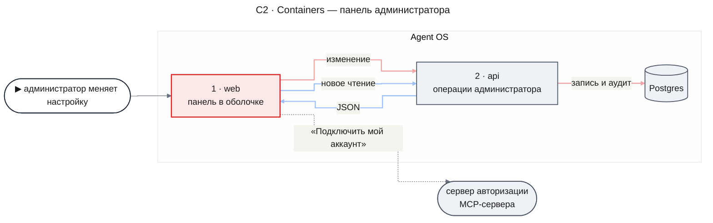
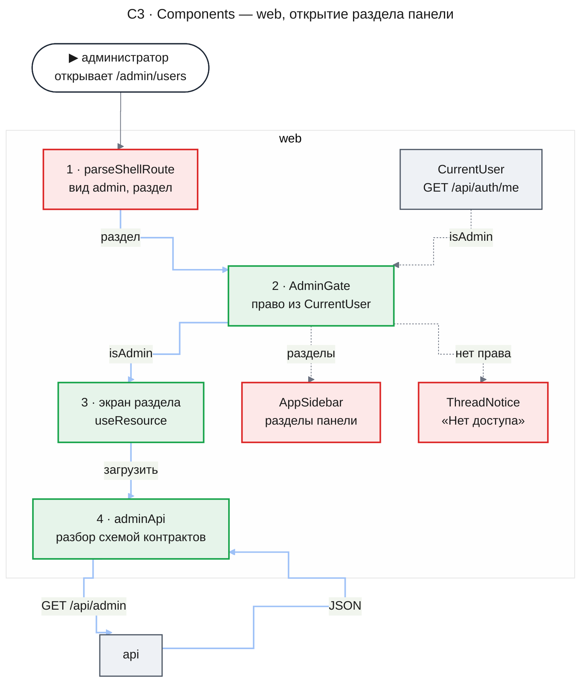
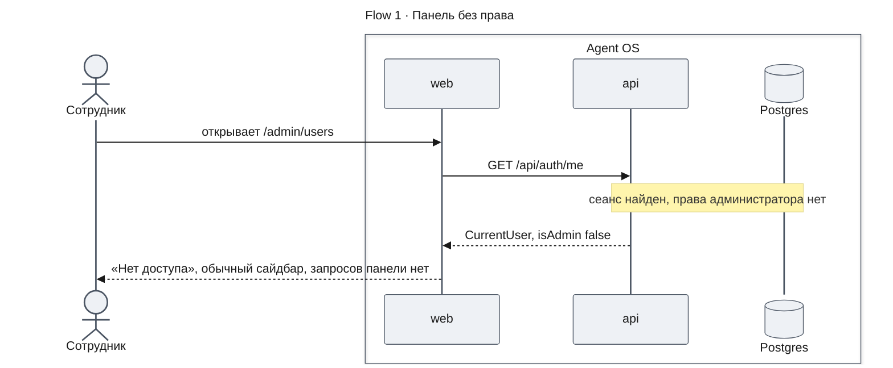
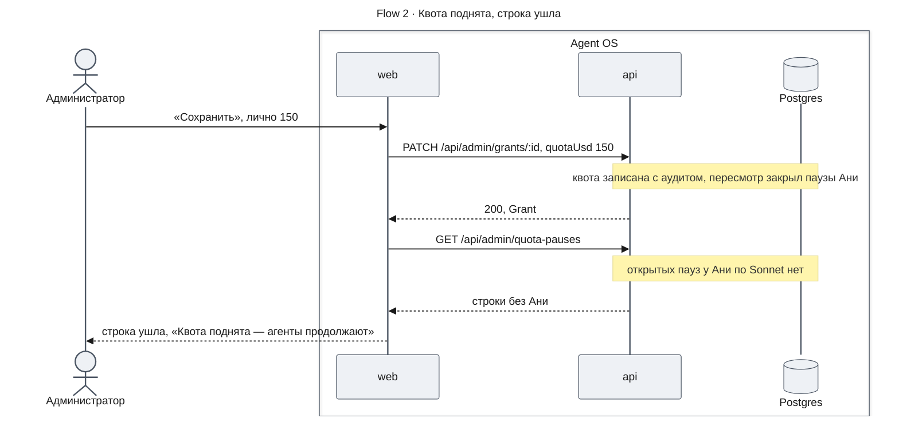
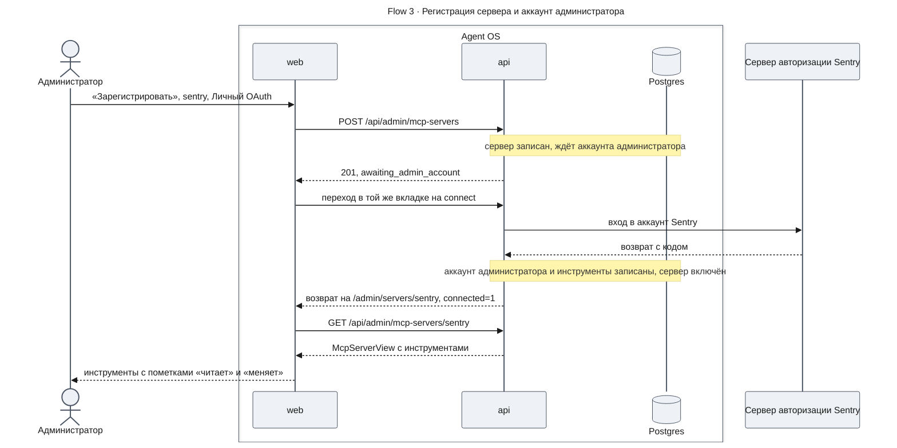
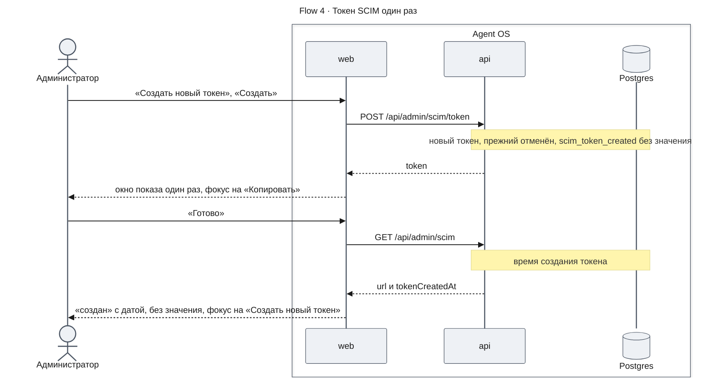
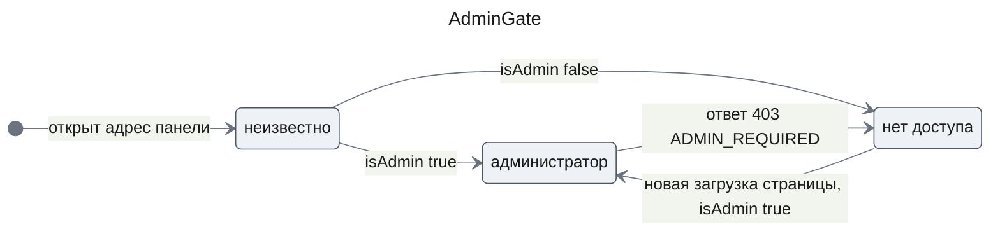

# Корпоративный вход и управление доступом — Design Document — admin

**Status:** Approved · **Date:** 2026-11-15 · **PRD:** [prd.md](./prd.md) · **UXRD:** [uxrd.md](./uxrd.md) · **Depends on:** [design-identity.md](./design-identity.md), [design-mcp-connect.md](./design-mcp-connect.md), [design-access.md](./design-access.md)

## Snapshot

**Overview.** Три первые части фичи отдают операции администратора по HTTP, но экранов для них нет. Эта часть строит в вебе панель администратора: раздел той же оболочки чата по адресам `/admin/…`, где вместо списка бесед стоят разделы «Сотрудники», «Роли», «Вход и SCIM», «MCP-серверы», «Модели» и «Паузы по квоте». Оболочка узнаёт право администратора из ответа `GET /api/auth/me` и только тогда показывает разделы и читает данные панели; без права на любом адресе панели стоит экран «Нет доступа». Каждый экран читает свои данные при открытии, а после изменения читает их заново; формы, таблицы, поле секрета и метки собраны по спецификациям дизайн-системы в компактной плотности. Новых зависимостей нет: запросы идут через тот же клиент API, что у чата, с теми же схемами из `@agent-os/contracts`.

- **Не меняется**: операции администратора и их контракты в трёх дизайнах выше, страница входа, «Мой доступ», блок паузы и отказы в беседе.
- **Главный риск**: «Поднять квоту» сохраняет слагаемые несколькими запросами без общей транзакции, и сохранение может пройти частично; защита — остановка на первом отказе и новое чтение (KD-7).
- **Открытые вопросы**: [Open Questions](#open-questions).

### Key Decisions

#### KD-1: Панель — новый вид маршрута `admin` внутри существующей оболочки чата, а не отдельная группа маршрутов со своей оболочкой

Оболочка уже выбирает экран по адресу: файлы страниц пусты, а разбор адреса `parseShellRoute` даёт вид — беседа, «Агенты», страница агента, «Мой доступ» из `mcp-connect`. Панель получает ещё один вид `admin` с разделом и, на странице записи, её ключом; все адреса `/admin/…` ловит одна пустая страница с необязательным catch-all сегментом. В панели сайдбар показывает разделы вместо истории бесед, основная область — экран раздела, шапка, блок пользователя, тема, строка связи и уведомления остаются оболочки. Так выходит ровно то, что просит `uxrd.md` KD-1: «Нет доступа» (AD-02) показывается в обычном сайдбаре со списком бесед, «К чату» не перезапускает чат, а строка связи (AD-01) уже есть.

- **Отдельная группа `(admin)` со своей оболочкой** — не взята. Переход между группами снимает раскладку чата, и «К чату» заново грузит список бесед и поток событий. Экрану AD-02 всё равно нужен сайдбар чата, а вторая оболочка повторила бы логику ящика на телефоне, полосы иконок и фокуса (`app-sidebar.tsx`) и потребовала бы второй тестовой обвязки.
- **Настоящие страницы Next с `params`** — не взяты. При `cacheComponents` чтение `params` без `generateStaticParams` требует границы `Suspense` на каждой странице, а пустые страницы с разбором адреса в оболочке уже работают в этом коде.

Цена решения: на страницах панели живут список бесед и поток событий чата, как сегодня на «Агентах». Пять потребителей `ShellRoute` учитывают новый вид (Change impact в [Design](#design)).

#### KD-2: Право администратора веб берёт из одного источника `CurrentUser`; экраны панели монтируются и читают данные только при `isAdmin`, а ответ 403 `ADMIN_REQUIRED` переводит панель в «Нет доступа» на месте

Сервер Next к API не ходит и cookie сеанса не видит (`design-identity.md`, C3 · web), поэтому охранять `/admin` на сервере Next нечем. Настоящая защита — `@AdminOnly()` в API; веб только не показывает панель тому, у кого права нет. `AdminGate` читает `isAdmin` из того же значения `CurrentUser`, которое меню берёт из `GET /api/auth/me`, и пока ответа нет, не отправляет ни одного запроса `/api/admin/…`. Если право сняли при открытой панели, любой ответ 403 `ADMIN_REQUIRED` сбрасывает `isAdmin` в этом значении, и оболочка сразу показывает AD-02, обычный сайдбар и меню без пункта панели.

- **Только по ответу 403** — не взято. Каждое открытие панели не администратором писало бы `access_denied` в аудит (`design-identity.md`, Error handling), а сайдбар панели мелькал бы до ответа.
- **Свой запрос `/me` в панели** — не взято: два источника одного факта расходятся.

#### KD-3: Один общий клиент API для всего веба; функции панели — модуль `lib/admin` поверх него; ошибка несёт `reason`

Клиент чата `threadsApiClient` прячет отправку и разбор ответа внутри модуля и знает только `GET`, `POST`, `PATCH`, `DELETE`. Операции администратора используют ещё `PUT`, а `CONNECTION_CHECK_FAILED`, `MCP_SERVER_CHECK_FAILED`, `GRANT_TARGET_UNKNOWN` и `GRANT_INVALID` несут поле `reason`, которое клиент чата сегодня отбрасывает. Ядро запроса `apiRequest` живёт в `lib/api`: адрес API, cookie, тело JSON, разбор ответа схемой из `@agent-os/contracts`, ошибка `ApiRequestError` с видом, статусом, кодом и причиной, один обработчик 401 из `identity` и один обработчик 403 `ADMIN_REQUIRED` (KD-2). `threadsApiClient`, клиенты `lib/mcp` и `lib/access` и новый `adminApi` — наборы функций поверх ядра. Необязательное поле `reason` в `ApiErrorSchema` добавляет `identity` ([design-identity.md#contract-definitions](./design-identity.md#contract-definitions)); ядро кладёт его в ошибку, а панель переводит причину в текст UXRD.

- **Второй клиент для панели** — не взят: обработчики 401 и 403 обходились бы, а правило «один кусок логики — одно место» нарушилось бы.
- Существующие вызывающие продолжают работать так. Если части `mcp-connect` и `access` уже вынесли ядро, панель его расширяет. Иначе ядро и класс ошибки выносятся из `threads-api-client.ts` и `threads-api-error.ts` здесь, а пять модулей, которые сегодня проверяют `ThreadsApiError` (`title-poller.ts`, `thread-list-adapter.ts`, `resolve-main-view.ts`, `feed-store.ts`, `thread-history-list.tsx`), меняют только импорт и имя класса. Виды ошибки `not_found`, `invalid_response`, `http`, `network` остаются прежними; старое имя удаляется сразу (PoC, одна версия).

#### KD-4: Данные экрана читаются при открытии хуком `useResource`, списки по страницам — `usePagedResource`; после изменения экран читает данные заново; библиотеки кэша нет

`uxrd.md` требует читать каждый раздел при открытии и не обновлять его вживую. Восемь таблиц и шесть страниц записей повторяют одну машину состояний: загрузка, готово, ошибка, «Повторить», «Показать ещё» с собственной ошибкой подгрузки. Её держат два маленьких хука: они отменяют устаревший ответ при смене ключа и при уходе со страницы и пишут ошибку в лог. Изменение — вызов функции `adminApi`, затем `reload()` того ресурса, который изменение затронуло; ответ изменения экран не склеивает со списком сам.

- **TanStack Query** — не взят. Кэш между страницами, дедупликация и фоновое обновление здесь не нужны (чтение при открытии), а новая библиотека — новый образец для всего веба.
- **Хранилище zustand на ресурс, как `agent-list-store`** — не взято. Такие хранилища живут в сервисах оболочки, потому что их обновляет поток событий; данные панели нужны одной странице и умирают вместе с ней.
- **Склейка ответа изменения с состоянием** — не взята. Изменение прав и квот пересматривает паузы на сервере (`design-access.md`, KD-5), и только новое чтение показывает настоящий итог.

#### KD-5: Формы — управляемое состояние, проверка чистой функцией формы и поля shadcn `field` поверх `@base-ui/react`; таблицы — один `DataTable` поверх shadcn `table`; без react-hook-form и TanStack Table

Форм в вебе нет, а `uxrd.md` даёт около десяти: диалоги роли, права (GR-01) и квоты (QD-01), подключение входа, срок сеанса, регистрация и настройки сервера, модель, предел ожидания. Каждая проверяется при нажатии, ставит фокус на первое поле с ошибкой, блокирует себя на время сохранения и показывает ошибку сервера блоком над действиями ([settings-form](../../design-system/components/settings-form.md)). Это поведение собрано один раз в `AdminForm`; связь подписи, подсказки и ошибки с полем (`aria-describedby`, `aria-invalid`) дают примитивы `Field` из `@base-ui/react` 1.9.0, которые уже стоят в приложении. Правила полей — чистая функция у каждой формы; часы и минуты сеанса, квоты и цены переводятся там же. Таблица одна — `DataTable` по [data-table](../../design-system/components/data-table.md): строки-ссылки, строки с действиями, вложенные строки, все состояния, фокус после ушедшей строки. Сортировки и отбора на клиенте нет: порядок задаёт сервер.

- **react-hook-form** — не взят: новая зависимость для маленьких форм, а связь полей с подсказкой и ошибкой уже дают примитивы `Field`.
- **TanStack Table** — не взят: его сила — сортировка, отбор и виртуализация на клиенте, а здесь их нет.

#### KD-6: Компактная плотность панели — размеры контролов из существующих вариантов и новые роли текста Data и Mono 13 / 20 как токены `globals.css`; механизма плотности нет

В панели контрол 28 px, строка 32 px, отступ ячейки 12 px, текст Data 13 / 18 ([foundations → Spacing & Density](../../design-system/foundations.md#spacing--density)). Кнопки панели берут существующий размер `sm` (28 px); поля, выпадающие списки и строки таблицы получают 28 и 32 px в `AdminForm` и `DataTable`. Роли текста Data и Mono 13 / 20 становятся токенами в `@theme` файла `globals.css`, потому что жёсткий размер в компоненте — дефект дизайн-системы. При грубом указателе цели растут до 44 px тем же вариантом `pointer-coarse:`, что в оболочке.

- **Контекст или атрибут плотности, который меняет размеры всех контролов** — не взят: компактных экранов, кроме панели, пока нет, а смена размеров по умолчанию задела бы чат.

#### KD-7: «Поднять квоту» сохраняет изменённые слагаемые по одному, останавливается на первом отказе и решает уведомление по новому чтению списка пауз

Пакетной операции нет: слагаемое роли или личное право меняет `PATCH /api/admin/grants/:id`, а «Лично» без права создаёт `POST /api/admin/grants` (`design-access.md`, Contract Definitions). Диалог QD-01 отправляет только изменённые поля, по одному, в порядке строк. Первый отказ останавливает сохранение: диалог остаётся открытым с ошибкой формы, заново читает строку паузы и показывает, что уже сохранено. Если после отказа строки паузы больше нет (уже сохранённая часть подняла квоту выше расхода), диалог закрывается по состоянию «Сохранено частично, строка ушла» (`uxrd.md` QD-01, MC-31). После успеха экран заново читает `GET /api/admin/quota-pauses`. Строки нет — уведомление «Квота поднята — агенты продолжают», строка есть — «Квота сохранена — агенты на паузе» (`uxrd.md` MC-31). Живая сумма «Новая квота» в диалоге — сложение показанных полей для подсказки, а не решение о доступе: решает сервер (`effectiveAccess`, [pure-decision](../../code-system/patterns/pure-decision.md)).

- **Уведомление по сравнению суммы с расходом на клиенте** — не взято: оно дублирует правило сервера и расходится с таблицей, если пересмотр пауз ещё не прошёл.
- **Параллельная отправка частей** — не взята: при отказе одной части порядок сохранённых не виден.

## Terms

- **Оболочка** — каркас веба из chat-shell: сайдбар, шапка, основная область (`ChatShell`).
- **Вид маршрута** — значение `ShellRoute`, которое `parseShellRoute` выводит из адреса; по нему оболочка выбирает экран.
- **Ядро запроса** — функция `apiRequest` в `lib/api`, через которую идёт каждый запрос веба к API.
- **Ресурс** — данные, которые экран читает при открытии: список, запись или настройки.
- **Слагаемое квоты** — квота одной роли или личная квота на модель; их сумма — действующая квота (PRD, Terms).

## Part

- **Part**: `admin`
- **Covers**: FR-24, FR-25, FR-26 (с AC-26.3), FR-27, FR-28, FR-29, FR-30; FR-31 (Could) — отложено, см. Out of scope; NFR-05 в части панели; NFR-02 в части веба
- **Depends on**: [design-identity.md#contract-definitions](./design-identity.md#contract-definitions) (`CurrentUser`, операции администратора, `SessionSettings`, SCIM, обработчик 401 и `UserMenu`), [design-mcp-connect.md#contract-definitions](./design-mcp-connect.md#contract-definitions) (реестр для `admin`, возврат подключения администратора), [design-access.md#contract-definitions](./design-access.md#contract-definitions) (каталог, права, `UserAccess`, паузы и их настройка)
- **Prerequisite ADRs**: [ADR-0012](../../adr/ADR-0012-closed-api-and-server-issued-employee-id.md) (API закрыт сеансом, сотрудника выдаёт сервер), [ADR-0013](../../adr/ADR-0013-sealed-secret-format.md) (секрет после сохранения не возвращается), [ADR-0014](../../adr/ADR-0014-mcp-registry-owned-by-agents.md) (сервер реестра адресуется именем), [ADR-0015](../../adr/ADR-0015-access-gate-and-model-catalogue.md) (каталог и права в `access`)
- **Sibling parts**: `identity` (FR-01–FR-11), `mcp-connect` (FR-12–FR-15), `access` (FR-16–FR-23)

**Out of scope**

- Журнал аудита в панели (FR-31, Could) в этой фиче не строится: ни одна часть не отдаёт операцию чтения аудита, а приоритет PRD — Could. Экрана AD-13 и пункта «Журнал» в сайдбаре нет.
- Страница входа, имя и почта в меню, «Выйти», переход на вход по 401 — `identity`; «Мой доступ», точка на аватаре и число у пункта меню — `mcp-connect`; модели на «Мой доступ», блок и полоса паузы, отказы в беседе — `access`. Эта часть добавляет в меню только пункт «Панель администратора».
- Операции администратора, их проверки, аудит и пересмотр пауз — на сервере в трёх частях выше; панель их не повторяет.
- Раскладка панели под телефон: от 1280 px панель держит целевую ширину, ниже работает с прокруткой таблиц внутри блока (`uxrd.md`, Responsive Behavior).

**Constraints**

- PoC без совместимости: вынос ядра запроса и переименование класса ошибки делаются сразу во всех вызывающих (KD-3).
- Новых зависимостей нет: примитивы `table`, `tabs`, `switch`, `radio-group`, `select`, `label`, `field`, `checkbox` добавляются в `components/ui` командой shadcn поверх уже стоящего `@base-ui/react` (`uxrd.md`, Component Inventory).
- `apps/web` зависит только от `contracts` и `common` ([code system](../../code-system/README.md), Layer Map): схемы ответов панели — из `@agent-os/contracts`.
- Логи — через `src/lib/logger.ts` (обёртка `packages/common`): метод, путь, статус, код и причина ошибки; тела запросов и ответов в лог не попадают, поэтому секреты тоже (Security Considerations).
- Комфорт долгой сессии: только роли цвета foundations, без чистого белого и чёрного; компактная плотность (KD-6).
- WCAG 2.1 AA и работа от 1280 px (NFR-05): роли, имена и клавиатура — по спецификациям компонентов, порядок фокуса — `uxrd.md`, Accessibility.

## Building-block Inventory

Follows the [code system](../../code-system/README.md). Поиск перед «new» шёл по `docs/code-system/`, `docs/design-system/components/` и `apps/web/src` (`components/ui`, `components/shell`, `components/agents`, `lib`, `hooks`; слова `admin`, `table`, `form`, `field`, `secret`, `badge`, `copy`): в вебе нет ни одного упоминания `admin` в коде, нет таблиц, форм, поля секрета и меток состояния.

| Building block | Pattern | Status | Note |
|---|---|---|---|
| `ShellRoute`, `parseShellRoute`, `MainView`, `DocumentTitle`, пустая страница `/admin/[[...path]]` | [shell-route.md](../../code-system/patterns/shell-route.md) — новая запись образца (KD-1) | extended | Вид `admin`, экран раздела, заголовок вкладки MC-18 и MC-19 |
| `AppSidebar` | [shell-route.md](../../code-system/patterns/shell-route.md) | extended | В панели — «К чату», «Панель», разделы и число пауз вместо истории бесед |
| `ChatHeaderView` | — | extended | Слот действий справа для основной кнопки раздела |
| `UserMenu` | — | extended | Пункт «Панель администратора» при `isAdmin` |
| Значение `CurrentUser` из `GET /api/auth/me` | — | extended | Чтение `identity` для меню становится общим значением в сервисах оболочки с состоянием «неизвестно» и сбросом `isAdmin` (Contract Definitions) |
| `ThreadNotice` | — | extended | Варианты `no-access` (AD-02, MC-19) и `record-not-found` (AD-15, MC-34) |
| Ядро запроса `apiRequest`, `ApiRequestError` в `lib/api` | [web-api-client.md](../../code-system/patterns/web-api-client.md) — новая запись образца (KD-3) | extended | Вынесено из клиента чата; `PUT`, `reason`, обработчик 403 |
| `adminApi` в `lib/admin` | [web-api-client.md](../../code-system/patterns/web-api-client.md) | new | Функции операций администратора трёх частей |
| `ApiErrorSchema` в `@agent-os/contracts` | — | reused | Необязательное поле `reason` добавляет `identity`; панель читает его у `CONNECTION_CHECK_FAILED`, `MCP_SERVER_CHECK_FAILED`, `GRANT_TARGET_UNKNOWN`, `GRANT_INVALID` |
| Схемы ответов администратора в `@agent-os/contracts` | — | reused | Их объявляет часть, которая отдаёт операцию ([Open Questions](#open-questions)) |
| `useResource`, `usePagedResource` | [read-on-open.md](../../code-system/patterns/read-on-open.md) — новый (KD-4) | new | Чтение при открытии; второй и следующие экраны панели — те же хуки |
| `DataTable` | [data-table](../../design-system/components/data-table.md) | new | KD-5 |
| `AdminForm`, `CopyValue` | [settings-form](../../design-system/components/settings-form.md) | new | KD-5 |
| `SecretField`, `ShowOnceDialog` | [secret-field](../../design-system/components/secret-field.md) | new | Security Considerations |
| `StateBadge` | [state-badge](../../design-system/components/state-badge.md) | reused | Строит `mcp-connect` для «Мой доступ»; если его нет, создаётся здесь |
| Формат денег `lib/format/money.ts` | — | extended | `formatSpend` выносится из `spend.ts`; квота без лишних нулей, цена за миллион токенов |
| `formatTime`, `pluralRu`, `useCopyToClipboard`, `focusShellTarget`, `Announcer`, `toast` | — | reused | Время таблиц, склонения, копирование, фокус `h1`, объявления, уведомления |
| Токены Data и Mono 13 / 20 в `globals.css` | — | extended | KD-6 |

## Acceptance Criteria

### FR-24: Панель администратора

- From the PRD: AC-24.1, AC-24.2
- Пока ответа `GET /api/auth/me` нет, на адресе `/admin/…` экран — состояние «Право ещё не известно» (`uxrd.md` AD-01), и ни одного запроса `/api/admin/…` не уходит (DC-1).
- Если любой запрос панели получил 403 `ADMIN_REQUIRED`, экран сразу меняется на «Нет доступа» (AD-02, MC-19), сайдбар — на обычный со списком бесед, а пункта «Панель администратора» в меню больше нет (DC-2).
- Число у пункта «Паузы по квоте» — число строк `GET /api/admin/quota-pauses` при загрузке страницы панели; без строк числа нет (DC-3).

### FR-25: Сотрудники и роли

- From the PRD: AC-25.1, AC-25.2 — панель удаляет роль и возвращает к списку с уведомлением «Роль удалена»; что права пропадают у агентов, проверяет часть `access`.
- Ответ 409 `LAST_ADMIN` на блокировку, снятие личного права, снятие роли, удаление роли, снятие группы или выключение права администратора у роли показывает MC-21 у этого действия; на экране ничего не меняется (DC-4).
- Поиск сотрудников уходит через 300 мс после последнего ввода; ответ на прежний текст поиска на экран не попадает (DC-5).

### FR-26: Подключения входа и SCIM

- From the PRD: AC-26.1, AC-26.2, AC-26.3
- Поле «Без активности» показывает `idleMinutes ÷ 60`, поле «Всего с момента входа» — `absoluteMinutes ÷ 60`, дробь — с запятой. Сохранение отправляет часы × 60 после проверки по MC-33; при ошибке поля запрос не уходит (DC-6).
- После закрытия окна показа токен SCIM не хранится ни в состоянии страницы, ни в одном ответе API, а секция показывает «создан {дата}» (DC-7).
- Переключатель «Включено» с ответом 409 `CONNECTION_INCOMPLETE` возвращается в «выкл.», под ним — MC-27 «Нельзя включить…» (DC-8).

### FR-27: MCP-серверы

- From the PRD: AC-27.1
- Страница сервера адресуется именем: `/admin/servers/<имя>`, а регистрация — `/admin/register-server`, так что любое допустимое имя открывается (`uxrd.md` Screen 9). Параметры возврата `connected`, `error=connect_failed` и `error=tools_failed` она читает один раз и сразу убирает из адреса; перезагрузка их не повторяет (DC-9).
- «Обновить список» с ответом 409 `MCP_ACCOUNT_REQUIRED` уводит вкладку на `GET /api/admin/mcp-servers/:name/connect`, как «Подключить мой аккаунт» (DC-10).

### FR-28: Права и запреты

- From the PRD: AC-28.1, AC-28.2
- Диалог права (GR-01) предлагает только серверы с инструментами: сервер в статусе `awaiting_admin_account` в списке недоступен; цель, которая у держателя уже есть, недоступна с подписью «уже есть» (DC-11).

### FR-29: Модели, цены и квоты

- From the PRD: AC-29.1

### FR-30: Паузы по квоте

- From the PRD: AC-30.1, AC-30.2, AC-30.3, AC-30.4
- «Поднять квоту» сохраняет только изменённые слагаемые по одному; первый отказ оставляет диалог открытым с ошибкой формы и показывает уже сохранённое (KD-7, DC-12).
- После сохранения квоты или отказа экран заново читает список пауз; уведомление и уход строки следуют этому чтению (KD-7, DC-13).

### NFR-02, NFR-05

- From the PRD: NFR-05 в части панели; NFR-02 в части веба — значение секрета не попадает в лог, уведомление, заголовок вкладки и сообщение об ошибке.

## Design

### Architecture (C1–C4)

#### C2 · Containers

Браузер администратора говорит с API так же, как чат: напрямую, с cookie сеанса. Новых контейнеров нет; меняется только `web`.

- `web` получает раздел панели в оболочке, общий клиент API и строительные блоки форм и таблиц.
- `api` и `Postgres` не меняются: операции, проверки, аудит и пересмотр пауз описаны в трёх дизайнах выше.
- Сервер авторизации MCP-сервера браузер видит только при подключении аккаунта администратора — переходом в той же вкладке через `api` (`design-mcp-connect.md`, KD-6).

#### C3 · Components: web

**web — открытие раздела панели.** Адрес даёт вид `admin`, `AdminGate` решает по праву, экран раздела читает данные через `adminApi`.

- `parseShellRoute` разбирает `/admin`, `/admin/users`, `/admin/users/<id>`, `/admin/roles`, `/admin/roles/<id>`, `/admin/sign-in`, `/admin/sign-in/new`, `/admin/sign-in/<id>`, `/admin/servers`, `/admin/register-server`, `/admin/servers/<имя>`, `/admin/models`, `/admin/quota-pauses`. Регистрация сервера стоит вне `/admin/servers/…`: имя сервера — любое kebab-case от 1 до 32 знаков, и сервер с именем `new` иначе нельзя было бы открыть. `/admin` и неизвестный адрес под ним открывают «Сотрудники», как неизвестный адрес оболочки открывает новый чат. Ключ записи раскодируется так же, как id беседы.
- `AdminGate` стоит в `MainView` и в `AppSidebar`. Его три состояния — в [State Transitions and Invariants](#state-transitions-and-invariants).
- Экран раздела — компонент `components/admin/…`: таблица или форма из блоков инвентаря, свой `h1` в шапке через слот `heading` и основная кнопка через новый слот действий `ChatHeaderView`. При переходе в раздел фокус идёт на `h1` (`focusShellTarget('page-title')`).
- `adminApi` — функции по областям: `users`, `roles`, `connections`, `sessions`, `scim`, `servers`, `models`, `grants`, `access`, `pauses`, `pauseSettings`. Каждая зовёт `apiRequest` со схемой ответа из `@agent-os/contracts`. Имя сервера, id модели и имя группы IdP идут в путь через `encodeURIComponent`.
- Пять потребителей `ShellRoute` учитывают вид `admin` (по `findReferences`): `main-view.tsx` и `app-sidebar.tsx` показывают экран и разделы, `chat-header.tsx` — заголовок и действия без кнопки рабочей области, `document-title.tsx` — вкладку «{раздел} — Панель — Agent OS», `chat-runtime-provider.tsx` не ищет на этих адресах беседу. `chat-shell.tsx` рабочую область на них не открывает и так.

**web — изменение и новое чтение.** Каждое изменение идёт одним путём: форма или кнопка → функция `adminApi` → обработка ошибки → `reload()` затронутых ресурсов → уведомление и фокус по `uxrd.md`, Accessibility.

- Ошибки переводит в текст одна функция `describeAdminError`: код и `reason` → текст из `uxrd.md` (MC-21, MC-25–MC-31, MC-33). Причины `CONNECTION_CHECK_FAILED` берутся из MC-27, причины `MCP_SERVER_CHECK_FAILED` — из MC-29, отказы права — из MC-25. Для кода или причины, которым UXRD текста не дал, ошибка формы называет причину словами сервера — поле `message` ответа, как требует [settings-form](../../design-system/components/settings-form.md), Content Rules.
- Уведомления — `toast` из `sonner`, как в оболочке (chat-shell UXRD, TST-01); объявления — единственная вежливая live-область оболочки.
- Ушедшую строку `DataTable` схлопывает и переводит фокус на следующую строку, без неё — на предыдущую, без строк — на `h1`.

### Runtime Flows

Все потоки идут одним путём: администратор → `web` → `api` → запись в Postgres (заметка) → `api` → `web` → администратор.

#### Flow 1: Не администратор открывает панель

**Starts when:** сотрудник без права администратора открывает `/admin/users` по ссылке, for AC-24.2, DC-1

**Outcome:** сотрудник видит AD-02 с кнопкой «В чат»; в аудите нет записи `access_denied`, потому что панель ничего не спросила.

**Failure handling:**

- Право сняли, пока панель была открыта → следующий запрос панели получает 403 `ADMIN_REQUIRED`, обработчик 403 сбрасывает `isAdmin`, и экран меняется на AD-02 без перезагрузки (DC-2).
- `GET /api/auth/me` отвечает 401 → обработчик 401 из `identity` уводит на `/login` с `next` текущей страницы; после входа сотрудник возвращается на тот же адрес панели.
- `GET /api/auth/me` не дошёл (сеть) → строка связи оболочки (AD-01); панель остаётся в состоянии «неизвестно» и не шлёт запросов, пока ответ не придёт.

#### Flow 2: Подъём квоты из строки паузы

**Starts when:** администратор вводит личную квоту Ани в QD-01 и жмёт «Сохранить», for AC-30.2, DC-12, DC-13

**Outcome:** агенты Ани продолжают сами (`design-access.md`, Flow 2); строка схлопнулась, фокус — на следующую строку. Число у пункта сайдбара обновится при следующей загрузке страницы (DC-3).

**Failure handling:**

- Личного права у Ани нет → вместо `PATCH` уходит `POST /api/admin/grants` с `userId`, `effect` `allow`, моделью и `quotaUsd`.
- Изменены и роль, и «Лично», вторая запись получила отказ → диалог открыт, ошибка формы называет причину, строка паузы перечитана: первая запись видна сохранённой (KD-7).
- Новая квота не выше расхода → строка остаётся с новой квотой, уведомление «Квота сохранена — агенты на паузе».
- Пересмотр на сервере не прошёл → ответ всё равно 200; новое чтение ещё видит строку и показывает «агенты на паузе», а цикл пересмотра закроет паузу в пределах минуты (Risks and Mitigation).
- «Отказать» идёт тем же путём: подтверждение, `POST /api/admin/quota-pauses/refuse`, новое чтение, уведомление «Отказано — агенты завершены».

#### Flow 3: Регистрация сервера с личным OAuth

**Starts when:** администратор регистрирует Sentry MCP в режиме «Личный OAuth», for AC-27.1, DC-9

**Outcome:** страница сервера показывает статус «Включён» и таблицу инструментов; параметр `connected` убран из адреса.

**Failure handling:**

- `422 MCP_SERVER_CHECK_FAILED` или `409 MCP_SERVER_NAME_TAKEN` на регистрации → ошибка формы «Не удалось зарегистрировать: {причина}» (MC-29), поля сохраняют введённое, перехода нет.
- Вход в Sentry отменён → возврат с `error=connect_failed`: страница показывает статус «Ждёт аккаунта администратора» и «Подключить мой аккаунт» (AD-09).
- Инструменты не получены → возврат с `error=tools_failed`: страница показывает статус сервера и ошибку над таблицей с текстом `tools_failed` из MC-29; `error=connect_failed` получает свой текст оттуда же.
- Режим «Общая учётная запись» → `POST` проверяет сервер сразу, кнопка показывает «Проверяем сервер…», успех открывает страницу сервера без перехода к владельцу.

#### Flow 4: Токен SCIM показан один раз

**Starts when:** администратор жмёт «Создать новый токен» и подтверждает, for AC-26.2, DC-7

**Outcome:** значение токена было только в состоянии окна; закрытие окна его стёрло, и ни один запрос его больше не вернёт.

**Failure handling:**

- Запрос не прошёл → окно не открывается, под секцией SCIM — ошибка формы; прежний токен работает, потому что сервер его не отменил.
- Копирование в буфер не удалось → под значением Caption `--destructive`, значение выделяется вручную ([secret-field](../../design-system/components/secret-field.md)).

### Contract Definitions

Панель потребляет контракты трёх частей так, как они написаны: [design-identity.md#contract-definitions](./design-identity.md#contract-definitions), [design-mcp-connect.md#contract-definitions](./design-mcp-connect.md#contract-definitions), [design-access.md#contract-definitions](./design-access.md#contract-definitions). Ниже — что эта часть предлагает остальному вебу и как экраны раскладывают данные контрактов.

#### Ядро запроса — для всего веба

- **`apiRequest`** — отправляет запрос к `apiBaseUrl` с cookie (`credentials: include`), методом `GET`, `POST`, `PUT`, `PATCH` или `DELETE` и телом JSON; разбирает ответ схемой, которую передал вызывающий. Ответ 204 возвращается без тела. Ошибка — `ApiRequestError`.
- **`ApiRequestError`** — `kind`: `not_found` (404), `http` (прочий отказ), `invalid_response` (тело не прошло схему), `network` (ответа нет); `status`; `code` — `errorCode` тела; `reason` — поле `reason` тела, если сервер его прислал; `message` — `message` тела для показа причины словами сервера.
- **Обработчик 401** — один на веб, из `identity`; ядро отдаёт ему каждый ответ 401 (`design-identity.md`, C3 · web).
- **Обработчик 403 `ADMIN_REQUIRED`** — один на веб, как обработчик 401: оболочка при старте регистрирует в ядре сброс `isAdmin` значения `CurrentUser`, поэтому `lib/api` не импортирует это значение. Вызывающий получает ту же ошибку и ничего не показывает сам, потому что экран уже сменился на AD-02.
- **`CurrentUser` в вебе** — одно значение в сервисах оболочки: одно чтение `GET /api/auth/me` на загрузку страницы. Состояния — «неизвестно» (ответа ещё нет) и «прочитано» с `id`, `email`, `name` и `isAdmin`. `UserMenu` берёт из него имя, почту и пункт панели, `AdminGate` — `isAdmin`. Единственная операция записи — сброс `isAdmin` в `false` обработчиком 403; обратно `true` даёт только новое чтение при следующей загрузке страницы.
- **`describeApiError`** — строка для лога: метод, путь, статус, код, причина. Тела в ней нет.

#### `adminApi` — для экранов панели

Каждая функция — одна операция из контрактов выше, с её входом и схемой ответа. Состав по областям:

- `users` — список с поиском и курсором, запись, блокировка и разблокировка, личное право администратора, назначение и снятие роли; `access` — `UserAccess` сотрудника.
- `roles` — список, запись, создание, переименование и право администратора, удаление, сопоставление и снятие группы IdP.
- `connections` — список, запись, создание, правка и включение; `sessions` — чтение и сохранение `SessionSettings`; `scim` — состояние и новый токен.
- `servers` — список, запись, регистрация, правка и включение, обновление инструментов, удаление и адрес перехода «Подключить мой аккаунт» (функция возвращает адрес, а не делает запрос).
- `models` — каталог, добавление, правка, удаление; `grants` — список по роли или сотруднику, создание, смена квоты, удаление; `pauses` — список и отказ; `pauseSettings` — чтение и сохранение предела ожидания.

#### `useResource` и `usePagedResource` — для экранов панели

- **`useResource(load, key)`** — вызывает `load` при монтировании и при смене `key`. Возвращает `status` (`loading`, `ready`, `error`), `data`, `error` и `reload()`. Ответ на прежний `key` и ответ после ухода со страницы отбрасываются. Ошибку пишет в лог один раз через `describeApiError`.
- **`usePagedResource(loadPage, key)`** — то же для курсорного списка: `items`, `nextCursor`, `loadMore()` со своим состоянием ошибки подгрузки; загруженные строки при ошибке подгрузки остаются ([data-table](../../design-system/components/data-table.md), Partial).

#### Блоки интерфейса — пропсы по группам

- **`DataTable`** — колонки (подпись шапки, выравнивание, рендер ячейки), строки с ключом, вид строки (ссылка с адресом, строка с действиями), вложенные строки, подпись таблицы для скринридера, состояние ресурса из хука, тексты пустого состояния и «нет совпадений», `onRetry` и `onLoadMore`. Таблица сама ставит фокус после ушедшей строки и схлопывает её.
- **`AdminForm`** — значения, `validate` (чистая функция: значения → ошибки полей), `onSubmit` (асинхронная запись), подпись основной кнопки, вариант (страница или диалог). Она блокирует поля на время записи, показывает «Сохраняем…», ставит фокус на первое поле с ошибкой или на блок ошибки формы и показывает текст `describeAdminError`.
- **`SecretField`** — подпись, `isSet` (из `clientSecretSet` или `sharedTokenSet`), значение замены и его изменение. Пока секрет задан и замены нет, поля ввода нет, а в отправку секрет не входит.
- **`ShowOnceDialog`** — заголовок, предупреждение, значение, `onClose`. Значение живёт только в состоянии открытого окна.
- **`CopyValue`** — подпись и значение; копирование через `useCopyToClipboard`, «Скопировано» в live-область.
- **`StateBadge`** — вариант («Состояние» или «Источник»), состояние, текст.

#### Как экраны раскладывают данные контрактов

- **Сотрудники (AD-03, AD-04)** — список: `GET /api/admin/users` с `query` из поля поиска; «Роли» — названия ролей в порядке ответа через « · »; «Последний вход» — `formatTime` или «никогда». Вкладка «Роли»: `roles[].sources` → метки «из IdP · группа {группа}» и «из панели»; «Снять роль» только при источнике `panel`; «Назначить роль» — роли из `GET /api/admin/roles` без тех, что уже назначены из панели. Вкладка «Доступ» читает сразу `GET /api/admin/users/:id`, `GET /api/admin/users/:id/access` и `GET /api/admin/grants?userId=`.
- **Итог и источник (AD-04)** — `result` `allowed` / `denied` / `none` → «Доступен» / «Закрыт» / «Нет доступа» у сервера и инструмента, «Доступна» / «Закрыта» / «Нет доступа» у модели; источник `role` → «роль {имя}», `personal` → «лично», `personal_deny` → «закрыто личным запретом»; `account` → «Подключён», «Не подключён», «общая». Квота `limited` → «{totalUsd} = {роль} {квота} + … + лично {квота}», `unlimited` → «без предела» и под ним «роль {имя} без квоты» по `unlimitedBy`; месяц колонки — из `UserAccess.month`. «Право администратора»: `adminRight.personal` → «есть: лично», `adminRight.roles` → «есть: роль {роль}», иначе «нет».
- **Роли (AD-05, AD-06)** — список из `GET /api/admin/roles`; страница — `GET /api/admin/roles/:id` и `GET /api/admin/grants?roleId=`. Право администратора роли — переключатель «Сохранение на месте» (`PATCH` с `isAdmin`). Строка-сирота (`uxrd.md` GR-02) в правах роли и в личных правах — цель, чьего сервера нет в `GET /api/admin/mcp-servers` или чьего инструмента нет в `tools` записи сервера; экран читает запись каждого сервера, на инструменты которого есть права.
- **Диалог права (GR-01)** — серверы из `GET /api/admin/mcp-servers`, инструменты выбранного сервера — `tools` из `GET /api/admin/mcp-servers/:name` (название, имя Mono, «читает» при `readOnly`, иначе «меняет»), модели — `GET /api/admin/models`; «уже есть» — по правам держателя из списка экрана. Квота — от 0,01 до 1 000 000 с точностью до цента, пусто — без квоты.
- **Вход и SCIM (AD-07, AD-14)** — таблица `GET /api/admin/connections`; страница подключения — `ConnectionView`: секрет OIDC — `SecretField` с `clientSecretSet`, «Данные для IdP» — `CopyValue` на каждое значение `idpData`; новое подключение — `POST` с протоколом и названием, затем переход на его страницу. Отказ проверки данных IdP (`CONNECTION_CHECK_FAILED`) форма показывает ошибкой формы с текстом причины из MC-27. SCIM — `url` и `tokenCreatedAt` из `GET /api/admin/scim`.
- **MCP-серверы (AD-08 — AD-10)** — `McpServerSummary` в таблице, `McpServerView` на странице; «Обновить список» показывает «Список обновлён: новых {N}, убрано {M}» по `added` и `removed`. «Настройки» при смене адреса или режима показывают предупреждение и спрашивают подтверждение до `PATCH` (`uxrd.md` AD-10, MC-29).
- **Модели (AD-11)** — `CatalogModel`; цены — `formatPrice`, вложенная строка при `longContext`. Путь записи содержит `id`, закодированный целиком.
- **Паузы по квоте (AD-12, QD-01)** — строки `QuotaPauseRow`; «Расход / квота» — `formatSpend(spentUsd)` / `formatQuota(quota.totalUsd)`; «На паузе с» — `formatTime(since)`. В QD-01 строка на каждое `quota.parts`: роль — с числом сотрудников роли из `GET /api/admin/roles`, «Лично» — всегда. Отказ: `POST /api/admin/quota-pauses/refuse`, `ended` в тексте подтверждения не нужен — там `agentCount` строки.

**Error handling**

- `ADMIN_REQUIRED` (403) — экран AD-02 (DC-2).
- `LAST_ADMIN` (409) — MC-21 у действия, которое его вызвало (DC-4).
- `ROLE_NAME_TAKEN` (409) — ошибка поля «Такая роль уже есть» (MC-26).
- `CONNECTION_INCOMPLETE` (409) — отказ переключателя, MC-27 (DC-8).
- `VALIDATION_FAILED` (400) — ошибка формы; поля проверены заранее, поэтому этот ответ виден только при расхождении правил веба и сервера.
- `USER_NOT_FOUND`, `ROLE_NOT_FOUND`, `CONNECTION_NOT_FOUND`, `MCP_SERVER_NOT_FOUND`, `MODEL_NOT_FOUND`, `GRANT_NOT_FOUND` (404) — на странице записи: экран «Запись не найдена» (`uxrd.md` AD-15, MC-34) в сайдбаре панели; на действии в строке — ресурс экрана читается заново.
- `CONNECTION_CHECK_FAILED` (с `reason`: `insecure_url`, `unreachable`, `invalid_document`), `MCP_SERVER_CHECK_FAILED` (с `reason`), `MCP_SERVER_NAME_TAKEN`, `MCP_SERVER_INCOMPLETE`, `MCP_ACCOUNT_REQUIRED`, `MODEL_ID_TAKEN`, `GRANT_EXISTS`, `GRANT_TARGET_UNKNOWN`, `GRANT_INVALID` — текст из `describeAdminError`; `MCP_ACCOUNT_REQUIRED` вместо текста уводит на подключение (DC-10).

**Runtime settings**

- Постоянные кода: задержка поиска сотрудников — 300 мс; страница списка сотрудников — как отдаёт сервер (50).

### State Transitions and Invariants

`AdminGate` — единственное место, где веб решает, показать ли панель.

**Invariants**

1. Запрос `/api/admin/…` уходит только в состоянии «администратор».
2. В состоянии «нет доступа» на экране нет ни одной строки данных панели, а в меню нет пункта «Панель администратора».
3. Значение секрета, введённое человеком, есть только в поле до отправки; значение, созданное сервером, — только в открытом окне показа. Ни то ни другое не попадает в лог, уведомление, заголовок вкладки или текст ошибки.
4. После любого изменения экран показывает данные нового чтения, а не склейку ответа изменения со старым списком.

## Test Strategy

Тесты — немногие и на нижнем уровне, который ловит дефект; экраны проверяются внутри оболочки (KD-1).

### Main Use Cases

- **UC-1: Администратор видит панель и её разделы** — covers AC-24.1, DC-3
  - Given: `CurrentUser` с `isAdmin: true`, одна пауза по квоте
  - When: администратор открывает меню и выбирает «Панель администратора»
  - Then: открыт «Сотрудники», в сайдбаре «К чату» и шесть разделов, у «Паузы по квоте» число 1, фокус на `h1` «Сотрудники»
- **UC-2: Роли сотрудника с источником** — covers AC-25.1
  - Given: у Ани «SRE» из IdP через группу `sre` и «Дежурный» из панели
  - When: администратор открывает Аню, вкладка «Роли»
  - Then: две строки с метками «из IdP · группа sre» и «из панели»; «Снять роль» только у «Дежурный»; нажатие отправляет `DELETE /api/admin/users/:id/roles/:roleId` и после нового чтения строки «Дежурный» нет
- **UC-3: Удаление роли** — covers AC-25.2
  - Given: роль «Дежурный» без последнего администратора
  - When: администратор выбирает «Удалить» и подтверждает
  - Then: уходит `DELETE /api/admin/roles/:id`, открыт список ролей, уведомление «Роль удалена», фокус на `h1` списка
- **UC-4: Данные для IdP у подключения SAML** — covers AC-26.1
  - Given: новое подключение SAML создано по протоколу и названию
  - When: администратор открывает его страницу
  - Then: видны ACS URL, Entity ID и три атрибута из `idpData`, у каждого «Копировать: {подпись}», после нажатия — «Скопировано»
- **UC-5: Сроки сеанса в часах** — covers AC-26.3, DC-6
  - Given: сервер отдаёт `idleMinutes` 480 и `absoluteMinutes` 1440
  - When: администратор открывает «Вход и SCIM», вводит «0,25» и «24» и сохраняет
  - Then: поля показали 8 и 24; ушёл `PUT` с 15 и 1440; уведомление «Сроки сеанса сохранены»
- **UC-6: Регистрация сервера с личным OAuth** — covers AC-27.1, DC-9
  - Given: сервер `sentry` не зарегистрирован
  - When: администратор регистрирует его в режиме «Личный OAuth», и вкладка возвращается на `/admin/servers/sentry?connected=1`
  - Then: после `POST` вкладка ушла на адрес подключения; после возврата страница показывает инструменты с «читает» и «меняет», в адресе нет `connected`
- **UC-7: Действующие права Ани** — covers AC-28.1, AC-29.1
  - Given: Sentry Ане даёт роль SRE, `update_issue` закрыт личным запретом, квота Sonnet — SRE 50, Дежурный 20, лично 30, расход 64,20
  - When: администратор открывает вкладку «Доступ»
  - Then: строка Sentry «Доступен · роль SRE», под ней `update_issue` «Закрыт · закрыто личным запретом»; у Sonnet «100 $ = SRE 50 + Дежурный 20 + лично 30» и «64,20 $»
- **UC-8: Право на инструмент из списка реестра** — covers AC-28.2, DC-11
  - Given: в реестре `sentry` с двумя инструментами и сервер `jira` в статусе «Ждёт аккаунта администратора»; у роли уже есть право на `search_issues`
  - When: администратор открывает GR-01, выбирает «Инструмент сервера»
  - Then: `jira` недоступен; у `sentry` два инструмента, `search_issues` с подписью «уже есть»; поля для ввода имени инструмента нет; «Добавить» отправляет `POST /api/admin/grants` с целью `tool`
- **UC-9: Паузы, подъём квоты и отказ** — covers AC-30.1, AC-30.2, AC-30.3, DC-13
  - Given: строка Ани по Sonnet: 100,40 $ / 100 $, агентов 2, с 14:20
  - When: администратор поднимает личную квоту до 150; на втором прогоне — отказывает и подтверждает
  - Then: в строке нет текста бесед; после подъёма ушёл `PATCH` квоты, затем `GET` списка без Ани — строка ушла, «Квота поднята — агенты продолжают»; после отказа ушёл `POST …/refuse` с `userId` и `model`, строка ушла, «Отказано — агенты завершены»
- **UC-10: Предел ожидания** — covers AC-30.4
  - Given: предел 24
  - When: администратор вводит 48 и жмёт «Сохранить»
  - Then: ушёл `PUT /api/admin/settings/quota-pause` с `waitLimitHours` 48, уведомление «Сохранено»

### Error and Edge Use Cases

- **UC-E1: Не администратор на адресе панели** — covers AC-24.2, DC-1
  - Given: `CurrentUser` с `isAdmin: false`
  - When: сотрудник открывает `/admin/roles`
  - Then: экран «Нет доступа» и «В чат», сайдбар со списком бесед, в меню нет «Панель администратора», ни одного запроса `/api/admin/…`
- **UC-E2: Право сняли при открытой панели** — covers DC-2
  - Given: администратор на списке ролей
  - When: «Создать роль» получает 403 `ADMIN_REQUIRED`
  - Then: на том же адресе экран «Нет доступа», обычный сайдбар, пункта панели в меню нет
- **UC-E3: Последний администратор** — covers DC-4
  - Given: Игорь — единственный администратор
  - When: администратор блокирует Игоря и подтверждает; отдельно — выключает право администратора у его роли
  - Then: оба ответа 409 `LAST_ADMIN`; у кнопки и у переключателя — MC-21; статус и переключатель прежние
- **UC-E4: Токен SCIM виден один раз** — covers AC-26.2, DC-7
  - Given: токен уже есть
  - When: администратор создаёт новый, подтверждает, нажимает «Готово»
  - Then: окно показало значение и фокус на «Копировать»; после закрытия значения нет в документе, секция показывает «создан {дата}», фокус на «Создать новый токен»; повторно открыть окно нечем
- **UC-E5: Секрет подключения не возвращается** — covers NFR-02
  - Given: у подключения OIDC `clientSecretSet: true`
  - When: администратор открывает страницу, меняет название и сохраняет; затем жмёт «Заменить», вводит секрет и сохраняет
  - Then: поле показывает «Задан» без ввода; первый `PATCH` без `clientSecret`; второй — с ним; после сохранения снова «Задан», а значения нет ни в поле, ни в логе, ни в уведомлении
- **UC-E6: Включение подключения без данных IdP** — covers DC-8
  - Given: подключение без данных IdP
  - When: администратор включает переключатель в таблице
  - Then: ответ 409 `CONNECTION_INCOMPLETE`; переключатель вернулся в «выкл.», под ним MC-27 «Нельзя включить: сначала заполните данные от IdP.» с ролью `alert`
- **UC-E7: Сроки сеанса вне границ** — covers AC-26.3, DC-6
  - Given: страница «Вход и SCIM»
  - When: администратор вводит «0,3» и «24», затем «8» и «4»
  - Then: в первом случае ошибка поля «Введите от 0,25 до 24 часов с шагом 0,25», во втором — у второго поля «Общий срок не может быть меньше срока без активности»; запросов нет, фокус на поле с ошибкой
- **UC-E8: Частичное сохранение квоты** — covers DC-12
  - Given: строка паузы с частью роли и личной частью
  - When: администратор меняет обе, и вторая запись получает 422 `GRANT_INVALID`
  - Then: диалог открыт, ошибка формы начинается с «Не удалось сохранить:», строка перечитана и показывает новую квоту роли
- **UC-E9: Обновление списка без аккаунта администратора** — covers DC-10
  - Given: сервер с личным OAuth без аккаунта администратора
  - When: администратор жмёт «Обновить список»
  - Then: ответ 409 `MCP_ACCOUNT_REQUIRED`, вкладка уходит на адрес подключения сервера
- **UC-E10: Устаревший ответ поиска** — covers DC-5
  - Given: ответ на «ан» приходит позже ответа на «аня»
  - When: администратор быстро вводит «аня»
  - Then: таблица показывает результат «аня»

### Non-Functional Use Cases

- **UC-N1: Доступность панели** — covers NFR-05
  - Given: панель на ширине 1280 px, только клавиатура
  - When: администратор проходит Tab от skip link до содержимого раздела и открывает диалог права
  - Then: порядок — skip link, «К чату», разделы, блок пользователя, шапка, вкладки, содержимое; у полей есть подписи, ошибки связаны с полями; после закрытия диалога фокус на кнопке, которая его открыла

### L1-сценарии в браузере

Готовый интерфейс принимается в настоящем браузере (Claude-in-Chrome) на `next build && next start` против настоящего API с входом для разработки.

| Сценарий | Шаги | Проверяемый сигнал |
|---|---|---|
| Вход в панель | Войти `admin: true`, меню → «Панель администратора» | В Network первым идёт `GET /api/auth/me`, затем запросы `/api/admin/…`; вкладка «Сотрудники — Панель — Agent OS» |
| Без права | Войти без права, открыть `/admin/users` | В Network нет `/api/admin/…`; виден AD-02 и список бесед |
| Плотность и токены | Открыть «Сотрудники» | Высота строки таблицы 32 px, кнопки 28 px, вычисленный шрифт ячеек Geist 13 / 18; в светлой и тёмной теме нет чистого белого и чёрного |
| Подключение администратора | Зарегистрировать сервер фикстуры с личным OAuth | Вкладка ушла к серверу авторизации и вернулась на `/admin/servers/<имя>` без `connected` в адресе; таблица инструментов |
| Токен SCIM | Создать токен, закрыть окно, перезагрузить | После закрытия значения нет в DOM; в консоли и логах значения нет |
| Пауза | Довести квоту фикстуры до паузы, поднять квоту | Строка ушла, уведомление; в беседе Ани блок паузы сменился строкой итога |

## Security Considerations

- **Authentication & Authorization**: права проверяет API (`@AdminOnly()`, `design-identity.md`). Веб не показывает панель без `isAdmin` и не шлёт её запросов (KD-2), но на это не полагается: подделанный `isAdmin` в браузере даёт только 403. Изменяющие запросы идут с cookie и проверяются по `Origin` на сервере.
- **Input Validation**: формы проверяют поля до отправки для подсказок человеку; окончательная проверка — сервер, его отказ показывается ошибкой формы. Имя сервера, id модели и имя группы кодируются в пути. Ответы разбираются схемами `@agent-os/contracts`; тело не по схеме — ошибка `invalid_response`, а не частичный показ.
- **Sensitive Data Handling**: секрет клиента OIDC и общий токен сервера уходят только в теле `POST` или `PATCH` при замене и не возвращаются (`clientSecretSet`, `sharedTokenSet`). Токен SCIM живёт в состоянии открытого окна и стирается при закрытии. Лог веба пишет только `describeApiError` — метод, путь, статус, код и причину, без тел, поэтому секретов в нём нет (NFR-02). Секрет не попадает в уведомления, заголовки вкладки и тексты ошибок ([secret-field](../../design-system/components/secret-field.md), Content Rules).

## Risks and Mitigation

- **Пересмотр пауз не прошёл, и уведомление говорит «агенты на паузе», хотя через минуту они продолжат** — низкое влияние, низкая вероятность. Уведомление следует таблице, а цикл пересмотра закрывает паузу в пределах минуты (`design-access.md`, Flow 2).
- **Слагаемые квоты сохранились частично** — среднее влияние, низкая вероятность. Сохранение по одному с остановкой на первом отказе и новым чтением строки (KD-7).
- **Примитивы shadcn `base-nova` не совпадают с компактной плотностью или отсутствуют** — среднее влияние, средняя вероятность. Примитив, который не держит 28 и 32 px или не возвращает фокус из выпадающего списка в диалоге, собирается на `@base-ui/react` по той же спецификации.
- **Три части меняют `user-menu.tsx` по очереди** — низкое влияние. Панель меняет его последней и добавляет только пункт с условием `isAdmin`.
- **На страницах панели живут список бесед и поток событий** — низкое влияние. Так же сегодня на «Агентах»; цена единой оболочки (KD-1).

## Open Questions

- Схемы ответов администратора (`AdminUserSummary` и страница сотрудников, `ConnectionView`, `SessionSettings`, `McpServerView`, `CatalogModel`, `Grant`, `UserAccess`, `QuotaPauseRow` и прочие) в дизайнах описаны словами, но не сказано, что они объявлены в `@agent-os/contracts`, и не назван ключ списка в странице сотрудников. Не блокирует: часть, которая строит операцию, объявляет схему в `@agent-os/contracts`, а панель её использует; уточняют владельцы трёх дизайнов.

## Appendix: Fact Disposition

| Fact | Disposition | Handled in |
|------|-------------|------------|
| Одна оболочка, неизвестный адрес — новый чат, `apps/web/src/lib/shell-route.ts` (FA-01) | transform | KD-1: вид `admin`, пустая страница `/admin/[[...path]]` |
| Сайдбар собран из примитивов, образец пункта с числом `AgentsNavItem`, `app-sidebar.tsx` (FA-02) | transform | KD-1, DC-3: разделы панели тем же образцом, число цветом `--warning` |
| Меню показывает `DEV_USER`, `user-menu.tsx` (FA-03) | out-of-scope | Имя и «Выйти» — `identity`; здесь только пункт «Панель администратора» |
| Один клиент с приватными `send` и `parse`, нет `PUT`, `reason` теряется, `threads-api-client.ts` (FA-04) | transform | KD-3: ядро `apiRequest` в `lib/api` кладёт в ошибку `reason`, который `identity` добавляет в `ApiErrorSchema` |
| Хранилища zustand и кэш промиса, `agent-list-store.ts`, `spend.ts` (FA-05) | transform | KD-4: хуки чтения при открытии для страниц панели |
| Форм и библиотеки форм нет, `package.json` (FA-06) | transform | KD-5: `AdminForm` на примитивах `Field` |
| Примитивов таблицы, вкладок, переключателя, радиогруппы, списка, подписи, флажка нет, `components/ui` (FA-07) | transform | Constraints: команда shadcn; Risks and Mitigation: запасной путь на `@base-ui/react` |
| Схем ответов администратора в контрактах нет, `packages/contracts/src` (FA-08) | out-of-scope | Open Questions: объявляет часть, которая строит операцию |
| Токенов ролей Data и Mono 13 / 20 нет, `globals.css` (FA-09) | transform | KD-6 |
| Механизма плотности нет, кнопка `sm` 28 px, поле 32 px, `button.tsx`, `input.tsx` (FA-10) | transform | KD-6: размеры в `AdminForm` и `DataTable` |
| Фокус только `composer` и `page-title`, одна live-область в оболочке, `focus.ts`, `announcer.tsx` (FA-11) | transform | C3 · web: `h1` через `page-title`, фокус строки в `DataTable`, окна возвращают фокус сами |
| Обвязка тестов — только `ChatShell`, MSW с ошибкой на незнакомый запрос, `src/test` (FA-12) | transform | Test Strategy: экраны проверяются внутри оболочки (KD-1) |
| Русский текст прямо в компонентах, `pluralRu`, `formatTime`, приватный `formatSpend`, `spend.ts` (FA-13) | transform | Building-block Inventory: `lib/format/money.ts` |
| `ThreadNotice` — закрытый набор вариантов, `thread-notice.tsx` (FA-14) | transform | Варианты `no-access` (AD-02) и `record-not-found` (AD-15) |
| Next 16 с `cacheComponents`, пустые страницы под динамическими сегментами, `next.config.ts` (FA-15) | transform | KD-1: одна пустая страница с необязательным catch-all |
| Расхождения UXRD и контрактов G-1…G-17 (FA-16) | transform | Contract Definitions, KD-7; тексты, адреса и состояния закрыты в `uxrd.md`; схемы ответов — Open Questions |
| Охрана панели возможна только в браузере, `design-identity.md` (FA-17) | transform | KD-2, State Transitions |
| Подключение аккаунта — переход в той же вкладке с параметрами возврата (FA-18) | transform | Flow 3, DC-9, DC-10 |
| Подъём квоты — несколько записей без пакета (FA-19) | transform | KD-7, Flow 2 |

Дизайн сохраняет корневую раскладку с `Toaster` и темой, обработку `pointer-coarse:` для целей касания, `useCopyToClipboard`, `formatTime`, `pluralRu` и правило «каждый ответ разбирается схемой контрактов» (FA-04, FA-07, FA-13).

## Update History

| Version | Date | Change |
|---------|------|--------|
| 1.0 | 2026-11-15 | Initial version |
| 1.1 | 2026-11-15 | Причины `CONNECTION_CHECK_FAILED` в `reason`; тексты ошибок, адреса серверов, «Запись не найдена», состояние до ответа о сотруднике, частичное сохранение квоты и строка-сирота — по UXRD; журнал аудита — вне части; статус Approved |
