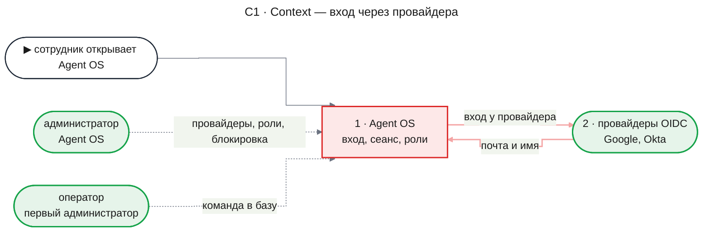
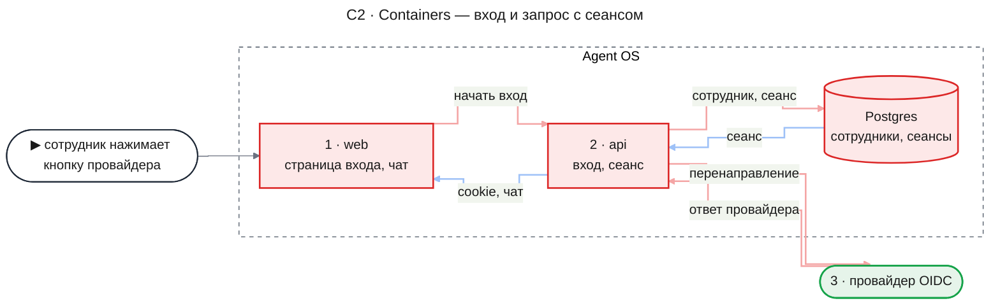
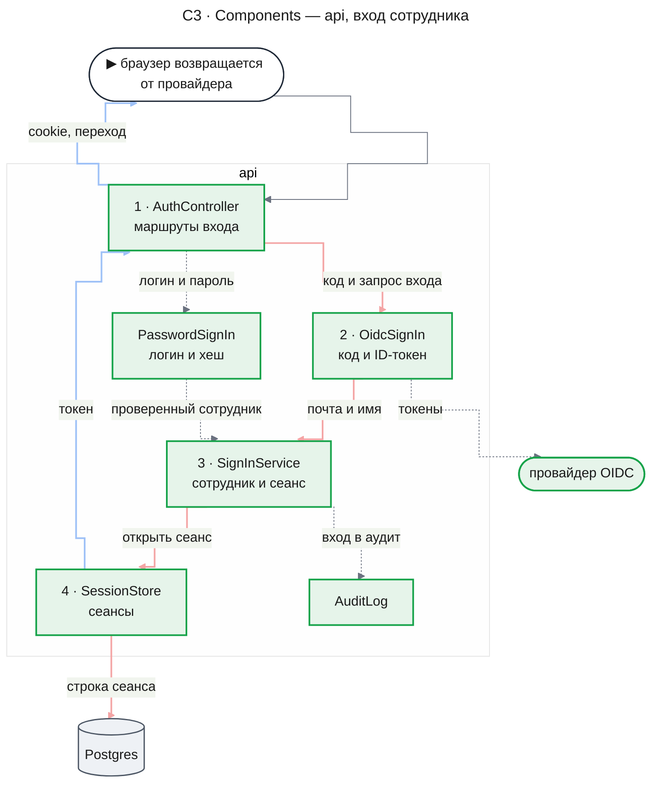
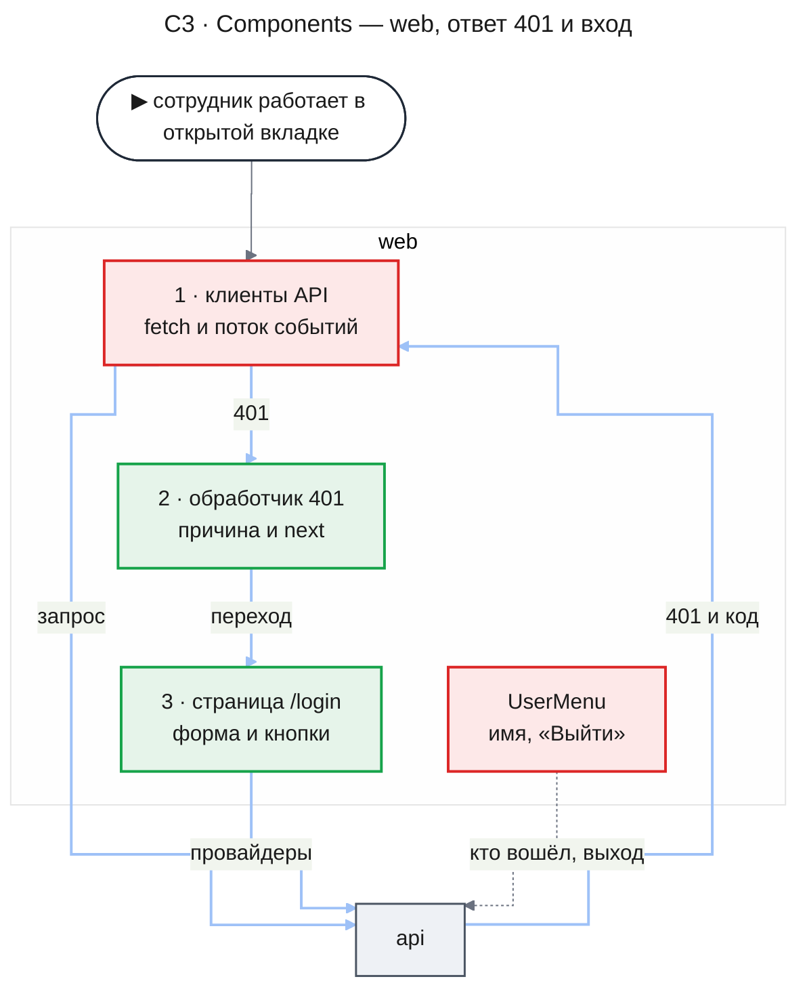
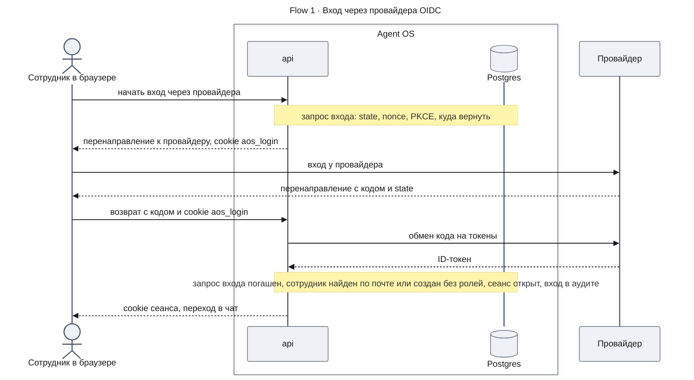
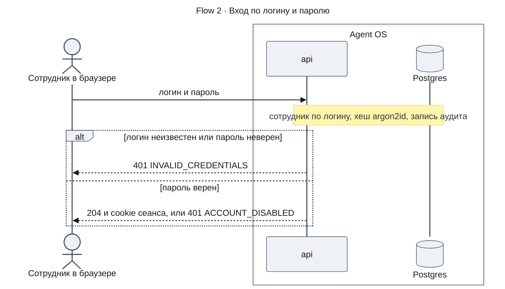
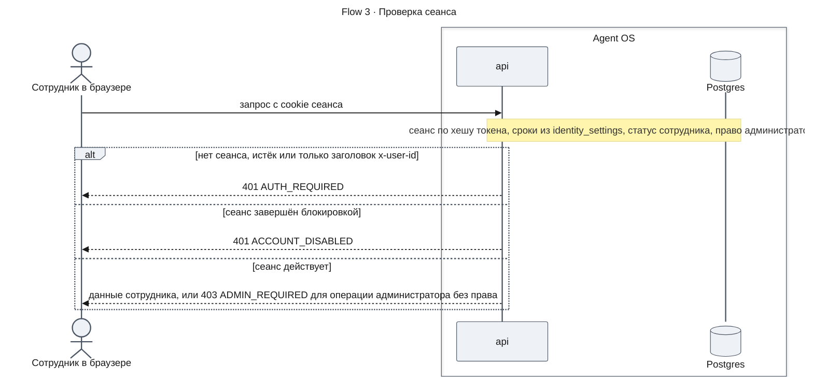
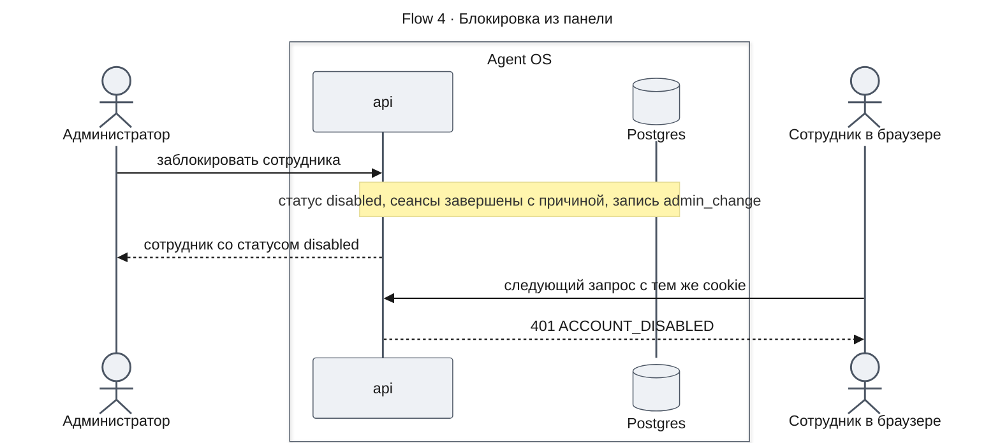

# Корпоративный вход и управление доступом — Design Document — identity

**Status:** Approved · **Date:** 2026-11-15 · **PRD:** [prd.md](./prd.md) · **UXRD:** [uxrd.md](./uxrd.md) · **Depends on:** ничего — первая часть

## Snapshot

**Overview.** Сегодня сервер верит заголовку `x-user-id`, а без него считает каждого тестовым сотрудником `dev-user`. Эта часть даёт настоящий вход: по логину и паролю, который включён всегда, и через провайдеров OIDC, которых подключил администратор, — Google или корпоративный IdP вроде Okta. Сотрудника узнают по логину или по почте от провайдера, и сервер открывает сеанс — случайный токен в cookie и строку в базе; одна проверка на входе в API узнаёт по нему сотрудника, а без сеанса пропускает только вход и проверку здоровья. Первого администратора оператор заводит командой со встроенной ролью «Супер-администратор», а роли сотрудникам назначает администратор. Блокировка сразу завершает сеансы сотрудника, а его агенты останавливаются сами на следующем вызове модели или инструмента.

- **Не меняется**: беседы, агенты и расход принадлежат строке владельца в своих таблицах, и контроллеры берут её из `req.user.id`, как сейчас. Панель администратора и её пункт в меню строит `admin`.
- **Biggest risk**: почте от провайдера платформа доверяет как есть, поэтому провайдер, где человек может назвать любую почту, пустит его под чужой учётной записью; провайдеров подключает только администратор (PRD, Risks).
- **Open questions**: нет.

### Key Decisions

#### KD-1: Провайдер — одна реализация OIDC на `openid-client`; тип `google` — это `oidc` с заранее заданным издателем

Провайдер — строка `identity_providers`: тип, название кнопки, включён ли, и настройки. Код входа один для обоих типов: discovery издателя, поток authorization code с PKCE, `state` и `nonce`, проверка ID-токена, почта и имя из него ([openid-client](https://github.com/panva/openid-client/blob/v6.8.9/README.md)). Тип нужен только форме администратора и проверке настроек:

| Тип | Издатель | Настройки администратора |
|---|---|---|
| `google` | `https://accounts.google.com`, задан в коде | `clientId`, `clientSecret` |
| `oidc` | любой, например Okta | `issuer`, `clientId`, `clientSecret` |

Варианты, которые не взяты:

- **Без поля типа, Google — только подсказка в форме.** Тогда PRD-правило «тип из списка» (AC-03.5) и поля по типу (AC-26.4) жили бы только в вебе, а сервер принимал бы любой издатель под видом Google.
- **Better Auth.** Свои таблицы пользователей и сеансов стали бы вторым местом правды о сотруднике, а социальных провайдеров он настраивает в коде, и правка требовала бы рестарта (AC-03.3).

#### KD-2: Сеанс — случайный токен в cookie `HttpOnly; SameSite=Lax` и строка в базе с хешем токена; сроки сеанса и публичный адрес — настройки в `identity_settings`; изменяющие запросы проверяют `Origin`

Браузер хранит 32 случайных байта в cookie `aos_session`, а база — только SHA-256 от них, поэтому выход и блокировка действуют со следующего запроса. Сеанс кончается после срока без запросов или после общего срока; оба — настройки администратора (по умолчанию 8 и 24 часа). Сервер считает сроки от времени входа и последнего запроса, а не хранит их в сеансе, поэтому новое значение действует со следующего запроса (FR-07).

Настройки части лежат в одной строке `identity_settings`: сроки сеанса и публичный адрес Agent OS, на который провайдеры возвращают сотрудника. Пока адрес не сохранён, первый просмотр или первое сохранение провайдера администратором записывает адрес, по которому его браузер обратился к API (AC-03.4). Если этот адрес не годится в публичный, например `http` за прокси с TLS, операция с провайдером получает 409 `PUBLIC_URL_REQUIRED`, и администратор сохраняет адрес в настройках входа. Вход через провайдера читает только сохранённый адрес и никогда не берёт его из анонимного запроса: пока адреса нет, провайдер недоступен. Проверка сеанса читает эту строку в том же запросе, что сеанс и сотрудника.

Веб и API — один сайт и в разработке (порты `localhost`), и за nginx, поэтому cookie с `SameSite=Lax` уходит с `fetch` и `EventSource`. `Lax` не пускает cookie в межсайтовый `POST`. Кроме того, сервер сверяет `Origin` с `FRONTEND_ORIGIN` у каждого запроса `POST`, `PUT`, `PATCH` и `DELETE`, с cookie и без него, на открытых маршрутах тоже: иначе чужая страница отправила бы форму входа и впустила сотрудника под чужой учётной записью (DC-3).

Варианты, которые не взяты:

- **JWT в cookie без строки в базе.** Блокировка и выход не действовали бы до истечения токена, а AC-07.2 требует отказа со следующего запроса.
- **Токен с CSRF двойной отправкой.** Он требует от веба пересылать второй токен в каждом запросе; проверка `Origin` даёт ту же защиту без изменений веба.

#### KD-3: Одна глобальная проверка сеанса с пометкой открытых маршрутов; сотрудник — строка `identity_users` с UUID, который выдаёт сервер

`SessionGuard` становится глобальным и асинхронным. Он пропускает только маршруты с пометкой `@Public()`, а маршрут с пометкой `@AdminOnly()` пускает только сотрудника с правом администратора. Новый контроллер закрыт, пока его не пометили открытым: забытая пометка даёт отказ, а не дыру (NFR-03). В `req.user` лежит `AuthUser`: `id`, `email`, `name`, `isAdmin` и `sessionId`. `id` — это `identity_users.id`, UUID, который сервер создаёт сам: для локальной учётной записи, при JIT и командой оператора. Строка с префиксом `system:` в UUID не помещается, поэтому AC-04.4 держит тип столбца.

Шесть столбцов `owner_id` и `runtime_inbox.sender` остаются текстом без внешнего ключа и хранят тот же `id`. Обработчики вида `const ownerId = req.user.id` не меняются, а поиск «чужое отвечает как отсутствующее» работает как прежде. Заголовок `x-user-id`, `dev-user`, `DEV_USER` в вебе, `system-owners.ts`, поле `roles` и тест заглушки удаляются; веб узнаёт сотрудника из `GET /api/auth/me`, а разработчик и тесты входят по логину и паролю.

Варианты, которые не взяты:

- **Почта или идентификатор провайдера как идентификатор.** Почта меняется, у сотрудника бывает несколько способов входа (AC-04.2), а строка от провайдера могла бы начаться с `system:`.
- **Внешний ключ из `owner_id` на `identity_users`.** Он привязал бы таблицы `runtime` и `agents` к слою приложения, против правила слоёв (code-system README).
- **Проверка на каждом контроллере, как сейчас.** Новый контроллер был бы открыт по умолчанию.

Решение записано в [ADR-0012](../../adr/ADR-0012-closed-api-and-server-issued-employee-id.md).

#### KD-4: Блокировка завершает сеансы сотрудника; его агенты останавливаются сами на следующем вызове модели или инструмента через проверку `OwnerGate`

`UsersService.disable` ставит сотруднику статус `disabled`, завершает его сеансы с причиной `account_disabled` и пишет аудит; со следующего запроса браузер сотрудника получает отказ. Сверху работа сотрудника не останавливается. `createAgents` получает порт `OwnerGate`, и агент спрашивает его перед каждым вызовом модели (`ModelClient.call`, `ModelClient.completeText`) и инструмента (`ToolRunner`). Для отключённого или неизвестного владельца вызов не начинается, а задача агента завершается со статусом `failed` и причиной `owner_disabled` (DC-8). Агент, который ждёт сообщений, вызовов не делает и остаётся в своём статусе. Открытый поток событий сотрудника доживает до переподключения, которое получает 401. Часть `access` заменяет `OwnerGate` своим `AccessGate`, который так же отказывает отключённому владельцу.

Варианты, которые не взяты:

- **Остановить все задачи сотрудника операцией runtime при блокировке.** Новая операция и новая причина остановки в runtime ради того, что проверка перед каждым вызовом и так даёт: ни одного вызова от имени отключённого.

#### KD-5: Пароль хранится хешем argon2id из `node:crypto`; неверный логин и неверный пароль дают одну причину

Хеш — argon2id со случайной солью 16 байт и параметрами из минимума OWASP: память 19 МиБ, 2 прохода, 1 поток ([OWASP Password Storage](https://cheatsheetseries.owasp.org/cheatsheets/Password_Storage_Cheat_Sheet.html)). Он хранится одной строкой вместе с параметрами, поэтому параметры можно поднять позже, не меняя строк. Argon2 есть в `node:crypto` с Node 24.7, а в документации Node 26 у `crypto.argon2` нет своей отметки стабильности, то есть действует отметка модуля «Stable» ([Node 26 crypto](https://nodejs.org/api/crypto.html)); новой зависимости не нужно.

Неверный логин и неверный пароль отвечают одним кодом `INVALID_CREDENTIALS`, а для неизвестного логина сервер всё равно считает хеш, чтобы время ответа не выдавало, есть ли логин. Каждая попытка пишется в аудит с настоящей причиной. Пароль — от 12 до 256 знаков; другого правила сложности нет. Сброс пароля администратором завершает все сеансы сотрудника, а смена своего пароля — нет.

Варианты, которые не взяты:

- **`scrypt` из `node:crypto` или пакет `argon2`.** `scrypt` OWASP ставит после argon2id, а пакет — нативная зависимость ради того, что уже есть в Node 26.

#### KD-6: Роли назначает только администратор; встроенная роль «Супер-администратор» неизменяема, и первого администратора заводит команда оператора

Роль — строка `identity_roles`, назначение — строка `identity_role_members`; другого источника членства нет. Право администратора дают пометка роли или личная пометка сотрудника. Роль «Супер-администратор» создаёт миграция с пометкой встроенной; её нельзя удалить, переименовать и лишить права администратора (DC-15), потому что на ней держится возврат доступа (FR-32).

Оператор запускает `pnpm --filter api identity:super-admin` с логином, именем и почтой, а пароль команда читает из стандартного ввода, чтобы он не остался в истории оболочки. Команда создаёт или находит по логину локальную учётную запись, задаёт пароль, включает её, назначает встроенную роль и пишет `admin_change` с исполнителем `system`. Она идёт отдельно от сервера, как миграции, с существующим `DATABASE_URL`; так же возвращают доступ, если ни один администратор не может войти.

Варианты, которые не взяты:

- **Строка SQL вместо команды.** Хеш argon2id вручную не написать, а команда делает ровно то, что требует FR-32, без экрана и без настроек окружения.

#### KD-7: Секреты провайдеров хранятся как есть; наружу секрет не выходит, а `AuditLog` пишет запись после изменения и маскирует секреты

Шифрования секретов нет (PRD, Won't Have): ключ шифрования пришлось бы хранить вне базы, а тот, у кого есть база или её копия, получает секреты провайдеров — риск принят (PRD, Risks). Ответ сервера не возвращает секрет, только признак «задан»; секрет не пишется в лог; пароли и токен сеанса хранятся хешами (NFR-01). [ADR-0013](../../adr/ADR-0013-sealed-secret-format.md) (Deprecated) больше не применяется.

`AuditLog.record(tx | null, entry)` пишет запись сразу после изменения: с `tx` — в транзакции вызывающего, без него — в своей; подпись сохранена, потому что её вызывают `mcp-connect` и `access`. Поля с именами секретов и паролей `AuditLog` заменяет пометками `secret_changed` и `password_changed` по тому же списку имён, что логгер (AC-11.2). `AuditService` (сырой DDL вне Drizzle, буфер, который теряется при падении) и перехватчик «метод и маршрут на каждый запрос» удаляются.

## Part

- **Part**: `identity`
- **Covers**: FR-01, FR-02, FR-03, FR-04, FR-06, FR-07, FR-08, FR-11, FR-32, FR-33; NFR-01, NFR-02, NFR-03 в части этой части
- **Depends on**: none — first part
- **Prerequisite ADRs**: [ADR-0001](../../adr/ADR-0001-durable-runtime-owner.md) (состояние в Postgres), [ADR-0003](../../adr/ADR-0003-drizzle-data-layer.md) (Drizzle, схема `app`, миграции отдельной командой), [ADR-0004](../../adr/ADR-0004-agent-framework-packages.md) (пакеты не читают окружение, порты параметрами), [ADR-0012](../../adr/ADR-0012-closed-api-and-server-issued-employee-id.md) (закрытый API и UUID сотрудника)
- **Sibling parts**: `mcp-connect` (FR-12–FR-15), `access` (FR-16–FR-23), `admin` (FR-24–FR-29; FR-31 отложено)

**Out of scope**

- Панель с разделом «Авторизация» — часть `admin`; подключения и модели на «Мой доступ» (`uxrd.md` MA-01, MA-02) — `mcp-connect` и `access`. Из экранов эта часть строит страницу входа, имя, почту и «Выйти» в меню, переход на вход по 401 и страницу «Мой доступ» с одной секцией «Пароль» (MA-03).
- Права на серверы, инструменты и модели и замена `MCP_ACCESS_TABLE` — часть `access`; до неё таблица живёт по правилу из Constraints.

**Constraints**

- PoC без обратной совместимости: заглушка и всё, что от неё зависит, заменяются сразу, строки с `dev-user` не переносятся.
- Один процесс API; runtime остаётся как есть.
- Фича не добавляет переменных окружения: настройки входа лежат в `identity_settings`, провайдеры — в `identity_providers`, база — в существующем `DATABASE_URL`.
- Пока `access` не собрана, `MCP_ACCESS_TABLE` остаётся и ключуется `identity_users.id`; ключ `*` даёт серверы каждому сотруднику, и `.env.example` использует его.
- Логи идут через логгер `packages/common` с идентификаторами сотрудника, сеанса, провайдера и запроса входа; пароли, токены, коды и ответы провайдеров в лог не попадают.

## Building-block Inventory

Follows the [code system](../../code-system/README.md). Поиск перед «new» шёл по `docs/code-system/`, `apps/api/src`, `packages/*/src` (`auth`, `session`, `password`, `hash`, `oidc`, `audit`): входа и паролей в коде нет, есть только заглушка `SessionGuard` и `AuditService`.

| Building block | Pattern | Status | Note |
|---|---|---|---|
| `SessionGuard`, `@Public()`, `@AdminOnly()` | [auth-boundary.md](../../code-system/patterns/auth-boundary.md) (KD-3) | extended | Глобальная проверка вместо заглушки |
| `IdentityModule` в `apps/api/src/identity` | [repository-over-transaction.md](../../code-system/patterns/repository-over-transaction.md) | new | Таблицы `identity_*` в `packages/db`, как `chat_conversations` |
| `OidcSignIn`, `PasswordSignIn` | — | new | Обёртки над `openid-client` и `node:crypto` (KD-1, KD-5) |
| Команда `identity:super-admin` | — | new | Отдельный вход `apps/api`, как `migrate-cli` (KD-6) |
| Логгер `packages/common` | [logging.md](../../code-system/patterns/logging.md) | extended | Новые имена полей |
| `AuditLog` | [repository-over-transaction.md](../../code-system/patterns/repository-over-transaction.md) | new | Вместо `AuditService` (KD-7) |
| `OwnerGate` в `createAgents` | [composition-root.md](../../code-system/patterns/composition-root.md) | extended | Новый порт функции сборки (KD-4) |
| Страница `/login` веба | [shell-route.md](../../code-system/patterns/shell-route.md), Not For | new | Своя страница вне группы `(chat)` |
| Страница «Мой доступ» с секцией MA-03 | [shell-route.md](../../code-system/patterns/shell-route.md) | new | Экран в оболочке; другие части добавляют секции |
| `UserMenu` веба | — | extended | Имя и почта из `GET /api/auth/me` вместо `DEV_USER`, «Мой доступ», «Выйти»; паттерна code-system нет, меню следует chat-shell UXRD SB-11 |
| Клиенты API веба | [web-api-client.md](../../code-system/patterns/web-api-client.md) | extended | Один обработчик ответа 401: переход на вход |

## Acceptance Criteria

### FR-01: Вход по логину и паролю

- From the PRD: AC-01.1, AC-01.2, AC-01.3, AC-01.4, AC-01.5, AC-01.6
- Запрос без действующего сеанса к любому маршруту, кроме открытых (вход и `GET /api/health`), получает 401 с `errorCode` `AUTH_REQUIRED` (DC-1).
- Запрос `POST`, `PUT`, `PATCH` или `DELETE` с `Origin`, отличным от `FRONTEND_ORIGIN` или пустым, получает 403 `ORIGIN_REJECTED` и ничего не меняет — с cookie сеанса и без него, на открытых маршрутах входа тоже (DC-3).
- Ответ 401 на любой запрос веба, в том числе обрыв потока событий без сеанса, переводит вкладку на `/login` с причиной («Сеанс закончился» или «учётная запись отключена», `uxrd.md` MC-3) и адресом текущей страницы; после входа сотрудник возвращается на неё (DC-13).

### FR-02: Вход через провайдера

- From the PRD: AC-02.1, AC-02.5
- Ответ провайдера принимается один раз и только в браузере, который начал вход, не позже 10 минут после начала; иначе вход отклонён с причиной `failed` (DC-4).

### FR-03: Провайдеры входа

- From the PRD: AC-03.1, AC-03.2, AC-03.3, AC-03.4, AC-03.5
- Провайдер создаётся выключенным по типу и названию, и его «Данные для провайдера» известны сразу после создания. Сохранение настроек `oidc` проверяет discovery издателя; при неудаче настройки не сохраняются, а ответ — 422 `PROVIDER_CHECK_FAILED`. Включить провайдера без полных настроек его типа нельзя: 409 `PROVIDER_INCOMPLETE` (DC-6).

### FR-04: Учётная запись сотрудника

- From the PRD: AC-04.1, AC-04.2, AC-04.3, AC-04.4, AC-04.5

### FR-06: Роли

- From the PRD: AC-06.1, AC-06.2
- `IdentityDirectory.rolesOf` читает назначения на момент вызова, поэтому назначенная или снятая роль видна проверке прав `access` со следующего вызова модели (AC-06.2, FR-18).

### FR-07: Сеанс входа, выход и отключение

- From the PRD: AC-07.1, AC-07.2, AC-07.3, AC-07.4, AC-07.5
- Сеанс кончается по сроку без запросов или по общему сроку из настроек (по умолчанию 8 и 24 часа), смотря что раньше; следующий запрос получает `AUTH_REQUIRED` (DC-2).
- Агент отключённого или неизвестного владельца не начинает ни одного вызова модели или инструмента: на следующем вызове его задача завершается со статусом `failed` и причиной `owner_disabled`, и история агента показывает это событие (DC-8).
- Каждый запрос с cookie сеанса, завершённого блокировкой, получает 401 `ACCOUNT_DISABLED`, пока сотрудник отключён и общий срок сеанса не истёк, а после включения — `AUTH_REQUIRED` (DC-9).

### FR-08: Право администратора

- From the PRD: AC-08.1, AC-08.2
- Операция администратора без права получает 403 `ADMIN_REQUIRED` (DC-11).
- Роль «Супер-администратор» нельзя удалить, переименовать и лишить права администратора: 409 `BUILTIN_ROLE` (DC-15).

### FR-32: Первый администратор через базу

- From the PRD: AC-32.1, AC-32.2, AC-32.3

### FR-33: Локальные учётные записи

- From the PRD: AC-33.1, AC-33.2, AC-33.3, AC-33.4
- Сброс пароля администратором завершает все сеансы сотрудника (DC-16).

### FR-11: Аудит входа и изменений администратора

- From the PRD: AC-11.1, AC-11.2, AC-11.3

## Design

### Architecture (C1–C4)

#### C1 · Context

#### C2 · Containers

- `web` получает страницу `/login`, имя, почту и «Выйти» в меню, переход на вход по 401 и смену пароля на «Мой доступ».
- `api` ведёт вход, сеансы и операции администратора и проверяет сеанс каждого запроса.
- `Postgres` получает таблицы `identity_*` и `audit_events`.

#### C3 · Components: api

**api — вход сотрудника.** Оба способа входа сходятся в `SignInService`: он получает сотрудника по паролю или почту и имя от провайдера.

- `OidcSignIn` гасит запрос входа, обменивает код на токены и проверяет ID-токен (KD-1). Конфигурацию клиента он держит в памяти по номеру версии провайдера, поэтому правка провайдера действует со следующего входа (AC-03.3).
- `PasswordSignIn` проверяет логин и хеш (KD-5) и отдаёт сотрудника тому же `SignInService`.
- `SignInService` отказывает выключенному провайдеру, ответу без почты и отключённому сотруднику, находит сотрудника по почте без учёта регистра или создаёт его без ролей, открывает сеанс и пишет аудит.
- `SessionGuard` на каждом запросе ищет сеанс по хешу токена из cookie и читает сотрудника, его право администратора и сроки сеанса из `identity_settings` одним запросом; время последнего запроса он обновляет не чаще раза в 5 минут.
- `IdentityOwnerGate` — реализация `OwnerGate`: одно чтение статуса сотрудника по первичному ключу перед каждым вызовом модели и инструмента (KD-4).

#### C3 · Components: web

**web — сеанс закончился.** Веб узнаёт о сеансе только по ответам API: своих cookie он не читает, а сервер Next к API не ходит.

- Клиенты API веба отдают каждый ответ 401 одному обработчику. Поток событий кода ответа не видит, поэтому при обрыве без переподключения обработчик спрашивает `GET /api/auth/me`, и код его ответа даёт причину.
- Обработчик 401 переводит вкладку на `/login?reason=expired` или `reason=disabled` с `next` — адресом текущей страницы (DC-13).
- Страница `/login` — форма логина и пароля и кнопки из `GET /api/auth/providers` по `uxrd.md`; причина — из `error` или `reason` (`uxrd.md` MC-3). Форма зовёт `POST /api/auth/password`, кнопка ведёт на `GET /api/auth/sign-in/:providerId` с тем же `next`.
- `UserMenu` берёт имя и почту из `GET /api/auth/me` и ведёт пунктом «Мой доступ» на `/account`; «Выйти» зовёт `POST /api/auth/sign-out` и открывает `/login?reason=signed_out`. `DEV_USER` и строка «Режим разработки» удаляются.
- Страница «Мой доступ» (`/account`, экран в оболочке) появляется здесь с одной секцией «Пароль» (`uxrd.md` MA-03): она видна при `hasPassword` и зовёт `POST /api/auth/password/change`. `mcp-connect` и `access` добавляют на ту же страницу свои секции.

### Runtime Flows

#### Flow 1: Вход через провайдера

**Starts when:** сотрудник нажимает кнопку провайдера на странице входа, for AC-02.1, AC-02.5, AC-04.1, AC-04.2, AC-04.5, AC-11.3, DC-4

**Outcome:** в браузере cookie `aos_session`, в базе строка сеанса с хешем токена; у сотрудника записаны имя, почта и время входа, в аудите `sign_in` со способом входа.

**Failure handling:**

- Сотрудник отменил вход или провайдер вернул ошибку → `/login?error=cancelled` или `error=failed`, сеанса нет, запись `sign_in_rejected` с причиной (AC-11.3).
- Неверный `nonce`, издатель или подпись ID-токена, запрос входа не найден, погашен, старше 10 минут или `state` не совпал с cookie → `error=failed` (DC-4).
- В ID-токене нет почты → `error=no_email`, запись `sign_in_rejected` (AC-04.5).
- Провайдер выключен или его нет → `error=provider_unavailable` (AC-03.2).
- Сотрудник отключён → `error=account_disabled` (AC-07.3).

#### Flow 2: Вход по логину и паролю

**Starts when:** сотрудник отправляет форму логина и пароля, for AC-01.2, AC-01.3, AC-07.3, AC-33.1, AC-33.2

**Outcome:** при успехе сеанс открыт тем же `SignInService`, в аудите `sign_in` со способом `password`; при неудаче в аудите `sign_in_rejected` с причиной `unknown_login` или `wrong_password`, а ответ браузеру одинаков (AC-01.3).

#### Flow 3: Запрос с сеансом

**Starts when:** веб шлёт любой запрос к API, for AC-01.4, AC-01.6, AC-07.1, AC-07.5, AC-08.1, DC-1, DC-2, DC-3, DC-9, DC-11

**Outcome:** `req.user` несёт `AuthUser`, и обработчик работает с `req.user.id`, как раньше. Отказ `ADMIN_REQUIRED` пишет в аудит `access_denied` (AC-08.1); отказы `AUTH_REQUIRED` в аудит не идут: у них нет исполнителя. Запрос `POST`, `PUT`, `PATCH` или `DELETE` с чужим или пустым `Origin` получает 403 `ORIGIN_REJECTED` ещё до проверки сеанса, на открытом маршруте тоже (DC-3).

#### Flow 4: Блокировка сотрудника

**Starts when:** администратор блокирует сотрудника в панели, for AC-07.2, AC-07.4, DC-8, DC-9

**Outcome:** сотрудник `disabled`, его сеансы завершены, беседы и данные на месте. Его агент на следующем вызове модели или инструмента получает отказ `OwnerGate`, вызов не начинается, а задача завершается `failed` с причиной `owner_disabled` (DC-8). «Разблокировать» возвращает статус `active` и ничего больше: старые сеансы не оживают, а сотрудник входит заново и видит прежние беседы (AC-07.4).

### Contract Definitions

Все маршруты — под глобальным префиксом `/api`. Тело ошибки — `ApiErrorSchema` (`statusCode`, `message`, `error`, `errorCode` и необязательный `reason` — машинная причина отказа там, где операция её называет). Каждый запрос `POST`, `PUT`, `PATCH` и `DELETE`, открытый маршрут тоже, проверяется по `Origin` (DC-3).

#### Вход и сеанс — для веба

- **`GET /api/health`** (открыт) — 200 с пустым телом, когда процесс принимает запросы.
- **`GET /api/auth/providers`** (открыт) — включённые провайдеры в порядке создания: `id`, `name` (название кнопки), `type`. Форма логина и пароля есть всегда и в списке не значится.
- **`POST /api/auth/password`** (открыт) с `login` и `password` — вход по логину и паролю. Returns 204 и cookie `aos_session`. 401 `INVALID_CREDENTIALS` — неизвестный логин или неверный пароль, одним ответом. 401 `ACCOUNT_DISABLED` — пароль верен, сотрудник отключён.
- **`GET /api/auth/sign-in/:providerId?next=<путь>`** (открыт) — начинает вход у провайдера: 302 к провайдеру и cookie `aos_login` (`HttpOnly; SameSite=Lax`, 10 минут, значение — `state` запроса входа). `next` — путь веба, который начинается с одного `/`; иной заменяется на `/`. Выключенный или неизвестный провайдер, как и несохранённый публичный адрес (KD-2), — 302 на `{FRONTEND_ORIGIN}/login?error=provider_unavailable`.
- **`GET /api/auth/oauth/:providerId/callback`** (открыт) — возврат от провайдера. Успех — 302 на `{FRONTEND_ORIGIN}{next}` с cookie `aos_session`. Отказ — 302 на `{FRONTEND_ORIGIN}/login?error=<причина>&provider=<id>`, где причина — `cancelled`, `failed`, `no_email`, `account_disabled` или `provider_unavailable`. Тексты к причинам — `uxrd.md` MC-3.
- **`GET /api/auth/me`** — текущий сотрудник. Returns `CurrentUser`. Без сеанса — 401.
- **`POST /api/auth/password/change`** с `currentPassword` и `newPassword` — меняет свой пароль; другие сеансы сотрудника остаются. Returns 204. 400 `VALIDATION_FAILED` с `reason`: `wrong_current_password`, `weak_password` (короче 12 или длиннее 256 знаков) или `not_local_account`.
- **`POST /api/auth/sign-out`** (открыт) — завершает сеанс этого cookie, стирает cookie, пишет `sign_out`. Returns 204, в том числе без сеанса.
- **Поток `GET /api/events`** проверяется как любой маршрут при подключении: без сеанса — 401. Открытый поток доживает до своего обрыва, а переподключение после выхода, блокировки или конца срока получает 401.

**CurrentUser**

- `id` (UUID), `email`, `name` (пустая строка, если имени нет).
- `isAdmin` — есть ли право администратора сейчас; `hasPassword` — локальная ли учётная запись, то есть можно ли сменить пароль.

**Error handling**

- `AUTH_REQUIRED` — 401: нет cookie, сеанс не найден или истёк, в том числе при одном заголовке `x-user-id`. Веб переводит на вход с `next` текущей страницы.
- `ACCOUNT_DISABLED` — 401: запрос с cookie сеанса, завершённого блокировкой, пока сотрудник отключён и общий срок сеанса не истёк (DC-9), и вход отключённого сотрудника по верному паролю.
- `ADMIN_REQUIRED` — 403: операция администратора без права, запись `access_denied` в аудите.
- `ORIGIN_REJECTED` — 403: запрос `POST`, `PUT`, `PATCH` или `DELETE` с чужим или пустым `Origin`, с cookie или без.

#### Операции администратора — для `admin`

Все маршруты помечены `@AdminOnly()`; каждое изменение пишет `admin_change` с «было» и «стало».

- **`GET /api/admin/users?query=&cursor=`** — сотрудники по имени, 50 на страницу, поиск по имени, почте и логину без учёта регистра. Returns страницу `AdminUserSummary` и `nextCursor`. 400 `VALIDATION_FAILED` с `reason` `invalid_cursor`, если `cursor` — не `nextCursor` прошлой страницы.
- **`POST /api/admin/users`** с `login`, `name`, `email`, `password` — заводит локальную учётную запись без ролей (FR-33). Returns `AdminUserSummary`. 409 `LOGIN_TAKEN` или `EMAIL_TAKEN`; 400 `VALIDATION_FAILED` с `reason` `weak_password`. Аудит пишет `password_changed` вместо пароля.
- **`GET /api/admin/users/:id`** — `AdminUserSummary` и `adminRight` (`personal` и роли, которые дают право). 404 `USER_NOT_FOUND`.
- **`PUT /api/admin/users/:id/password`** с `password` — сбрасывает пароль локальной учётной записи и завершает все сеансы сотрудника (DC-16). Returns 204. 409 `NOT_LOCAL_ACCOUNT`; 400 `VALIDATION_FAILED` с `reason` `weak_password`.
- **`POST /api/admin/users/:id/block`**, **`/unblock`** — блокирует (Flow 4) или включает сотрудника. Returns `AdminUserSummary`.
- **`PUT /api/admin/users/:id/admin`** с `enabled` — даёт или снимает личное право администратора.
- **`PUT /api/admin/users/:id/roles/:roleId`**, **`DELETE` тот же путь** — назначает или снимает роль. 404 `USER_NOT_FOUND` или `ROLE_NOT_FOUND`.
- **`GET /api/admin/roles`**, **`GET /api/admin/roles/:id`** — роли по названию (число сотрудников, `isAdmin`, `builtin`) и одна роль с её сотрудниками.
- **`POST /api/admin/roles`** с `name` (1–80 знаков после обрезки пробелов), **`PATCH /api/admin/roles/:id`** с `name` и/или `isAdmin`, **`DELETE /api/admin/roles/:id`** — создают, правят и удаляют роль; удаление уносит каскадом её назначения и строки других частей со ссылкой на роль. 409 `ROLE_NAME_TAKEN` (без учёта регистра), `BUILTIN_ROLE`.
- **`GET /api/admin/providers`** — провайдеры в порядке создания: `id`, `type`, `name`, `enabled`.
- **`POST /api/admin/providers`** с `type`, `name` (1–60 знаков) и необязательными `options` — создаёт выключенного провайдера. Returns `ProviderView` с `providerData`, которые администратор переносит к провайдеру до того, как тот выдаст свои данные. Если публичный адрес ещё не сохранён, он становится адресом, по которому браузер обратился к API (AC-03.4); если этот адрес не годится в публичный — 409 `PUBLIC_URL_REQUIRED` (KD-2). 400 `VALIDATION_FAILED` с `reason` `unknown_type` для типа не из списка (AC-03.5). 422 `PROVIDER_CHECK_FAILED`, если переданные настройки `oidc` не прошли проверку (DC-6).
- **`GET /api/admin/providers/:id`** — `ProviderView`; публичный адрес — по правилу создания. 404 `PROVIDER_NOT_FOUND`, 409 `PUBLIC_URL_REQUIRED`.
- **`PATCH /api/admin/providers/:id`** — меняет `name`, `enabled` и `options`; `clientSecret` заменяется, только когда передан. Новые настройки `oidc` проверяются (DC-6), смена типа запрещена. 409 `PROVIDER_INCOMPLETE` при включении провайдера без полных настроек его типа; 409 `PUBLIC_URL_REQUIRED` — по правилу создания.
- **`GET /api/admin/settings/sign-in`** — настройки входа (FR-26). Returns `SignInSettings`.
- **`PUT /api/admin/settings/sign-in`** с `publicUrl`, `idleMinutes`, `absoluteMinutes` — меняет их; новые сроки действуют для существующих сеансов с их следующего запроса (FR-07, AC-07.5), новый адрес — для следующего входа через провайдера. Returns `SignInSettings`. 400 `VALIDATION_FAILED`, если значение вне границ или срок без запросов больше общего; ничего не меняется. Запись `admin_change` с объектом `sign_in_settings`.

`PROVIDER_CHECK_FAILED` несёт в `reason` одно из трёх значений: `insecure_url` — адрес издателя не `https` и не `http://localhost`; `unreachable` — адрес не ответил или ответил не успехом; `invalid_document` — ответ не документ discovery OIDC этого издателя.

**AdminUserSummary**

- `id`, `email`, `name`; `login` — логин локальной учётной записи или `null`; `status` — `active` или `disabled`; `lastSignInAt` — время или `null`.
- `roles` — список ролей сотрудника: `id`, `name`.

**ProviderView**

- `id`, `type` (`google` или `oidc`), `name`, `enabled`, `complete` — заданы ли все настройки типа.
- `options` — `clientId` и, у `oidc`, `issuer` (`null`, пока не заданы), и `clientSecretSet` — задан ли секрет; значения секрета нет ни в одном ответе.
- `providerData` — значения для настройки приложения у провайдера: `redirectUri` (`{publicUrl}/api/auth/oauth/<id>/callback`) и `scopes` (`openid email profile`).

**SignInSettings**

- `publicUrl` — публичный адрес без `/api`: `https://…` или `http://localhost…`, без пути; `null`, пока не сохранён.
- `idleMinutes` — срок без запросов, целое от 15 до 1440; по умолчанию 480.
- `absoluteMinutes` — общий срок с момента входа, целое от 60 до 43200 (30 суток); по умолчанию 1440; не меньше `idleMinutes`.
- `updatedAt` — время последнего изменения или `null`, пока стоят значения по умолчанию.

#### Для `mcp-connect`, `access` и всех частей

- **Секреты других систем** хранятся как есть (KD-7). Часть, которая хранит секрет, не возвращает его ни в одном ответе (только «задан»), не пишет в лог и кладёт в аудит под именем поля из списка секретных имён логгера, чтобы `AuditLog` его скрыл.
- **Публичный адрес для адресов возврата.** `IdentitySettings.publicUrlFor(request)` — для операции администратора: сохранённое значение, а если его нет — адрес, по которому браузер администратора обратился к API, который при этом сохраняется (правило AC-03.4); 409 `PUBLIC_URL_REQUIRED`, если этот адрес не годится в публичный. `IdentitySettings.savedPublicUrl()` — только сохранённое значение или `null`; его читает всякий запрос не от администратора, потому что адрес не берётся из анонимного запроса. `mcp-connect` строит по ним адрес возврата OAuth своих серверов.
- **`AuditLog.record(tx | null, entry)`** — пишет запись сразу после изменения: с `tx` — в транзакции вызывающего, без него — в своей. `entry`: `kind`, `actor` (id сотрудника или `system`), `objectType`, `objectId`, `before`, `after`, `outcome`, `reason`. Поля с именами секретов и паролей в `before` и `after` становятся `secret_changed` и `password_changed`. Виды этой части: `sign_in`, `sign_in_rejected`, `sign_out`, `password_changed`, `password_reset`, `admin_change`, `access_denied`; части добавляют свои.
- **`@Public()`, `@AdminOnly()` и `req.user`** — маршрут любой части закрыт сеансом по умолчанию; `req.user.id` — UUID сотрудника, им же заполняются столбцы владельца. Если части нужен маршрут без сеанса, она помечает его `@Public()` и защищает сама. Проверку `Origin` (DC-3) проходят только `POST`, `PUT`, `PATCH` и `DELETE`, поэтому маршрут `GET` не меняет состояние, если у него нет своей привязки к браузеру, как cookie `aos_login` у возврата от провайдера; это касается и маршрутов OAuth части `mcp-connect`.
- **Сотрудник для `access`** — `IdentityDirectory.rolesOf(userId)`: id ролей сотрудника на момент вызова; `IdentityDirectory.isActive(userId)`: включён ли сотрудник, `false` и для неизвестного id. Таблицы прав `access` ссылаются на `identity_roles` и `identity_users` внешним ключом с каскадом.
- **Проверка перед вызовом агента (`OwnerGate`, порт `createAgents`)** — агент вызывает `check(ownerId)` перед каждым вызовом модели (`ModelClient.call`, `ModelClient.completeText`) и инструмента (`ToolRunner`). Для включённого сотрудника проверка завершается без значения. Для отключённого или неизвестного она отклоняется с `OWNER_DISABLED`: вызов не начинается, шаг агента завершает задачу со статусом `failed` и причиной `owner_disabled`, а вызов `completeText` бросает ошибку вызывающему. Реализация этой части читает `IdentityDirectory.isActive`. Часть `access` заменяет порт своим `AccessGate`, который обязан так же отказывать отключённому и неизвестному владельцу.
- **Вход в тестах** — любая часть входит в тестах через `POST /api/auth/password` локальной учётной записи, а её `id` читает из `GET /api/auth/me`.

**Runtime settings**

- Новых переменных окружения нет; существующий `FRONTEND_ORIGIN` — адрес возврата после входа и единственный разрешённый `Origin`. Настройки администратора — `SignInSettings`.
- Постоянные кода: запрос входа — 10 минут; страница сотрудников — 50; пароль — KD-5.

### Data Model

Все новые таблицы лежат в схеме `app`, объявлены в `packages/db/src/schema.ts` и приходят одной сгенерированной миграцией. Префикс `identity_` принадлежит этой части, `audit_` — модулю аудита `apps/api`.

- **`identity_users`** — сотрудник: UUID, почта (уникальна без учёта регистра), имя, статус `active` или `disabled`, личное право администратора, время последнего входа; у локальной учётной записи ещё логин (уникален без учёта регистра) и хеш пароля.
- **`identity_roles`**, **`identity_role_members`** — роль (уникальное без учёта регистра название, право администратора, пометка встроенной) и её назначения. Удаление роли уносит назначения каскадом. Миграция создаёт роль «Супер-администратор» с пометкой встроенной и правом администратора.
- **`identity_providers`** — провайдер: тип, название, включён ли, номер версии, настройки вместе с секретом клиента как есть. Тип после создания не меняется, а включён может быть только провайдер с полными настройками типа.
- **`identity_login_requests`** — запрос входа: `state`, провайдер, `nonce`, PKCE-верификатор, путь возврата, срок. Строка удаляется при первом возврате от провайдера.
- **`identity_sessions`** — сеанс: SHA-256 токена (уникален), сотрудник, время создания и последнего запроса, причина завершения или пусто; сроков строка не хранит (KD-2). Выход и сброс пароля администратором удаляют строки, блокировка ставит причину (DC-9), а строки после общего срока удаляются при каждом успешном входе.
- **`identity_settings`** — одна строка настроек части (`SignInSettings`, границы проверяет база), время и автор их последнего изменения. Строку создаёт миграция.
- **`audit_events`** — записи аудита (KD-7). Прежняя таблица `public.audit_events` больше не пишется; её строки не переносятся.

**Invariants**

1. У включённого сотрудника нет действующего сеанса, открытого до его последней блокировки или последнего сброса пароля администратором.
2. Отключённый сотрудник не открывает сеанс ни одним способом входа.
3. Идентификатор сотрудника выдаёт сервер, и он не берётся из данных провайдера.
4. Пароль и токен сеанса хранятся только хешем; ни один ответ сервера не содержит пароля и секрета провайдера.
5. Запрос входа принимается не больше одного раза.
6. Агент отключённого владельца не начинает вызова модели или инструмента.
7. Роль «Супер-администратор» существует всегда и всегда даёт право администратора.

## Test Strategy

Интеграционные тесты идут на настоящем API и Postgres, вход через провайдера — на тестовом издателе OIDC в процессе теста; тест сам играет браузер. E2E-тесты, которые ставили `x-user-id`, входят по логину и паролю (Contract Definitions, «Вход в тестах»).

### Main Use Cases

- **UC-1: Закрытая граница и сеансы** — covers AC-01.4, AC-01.6, AC-07.1, AC-07.5, AC-08.1, DC-1, DC-2, DC-3, DC-11, NFR-03
  - Given: приложение с маршрутами всех модулей; сотрудник без права администратора вошёл
  - When: тест обходит все маршруты без cookie и с одним `x-user-id`; сотрудник зовёт операцию администратора и изменяющий запрос с чужим `Origin`; администратор сокращает общий срок; сотрудник выходит
  - Then: каждый маршрут, кроме входа и `GET /api/health`, — 401 `AUTH_REQUIRED`; операция администратора — 403 `ADMIN_REQUIRED` и запись `access_denied`; чужой `Origin` — 403 `ORIGIN_REJECTED`; сеанс старше нового срока и сеанс после выхода — 401 `AUTH_REQUIRED`
- **UC-2: Локальные учётные записи и пароль** — covers AC-01.2, AC-01.3, AC-33.1, AC-33.2, AC-33.3, AC-33.4, AC-04.3, AC-11.3, DC-16, NFR-01
  - Given: администратор завёл Аню и Бориса с начальными паролями
  - When: оба входят; Аня запрашивает беседу Бориса; Борис меняет пароль с неверным, затем с верным текущим; администратор сбрасывает Борису пароль; Борис входит со старым, затем с новым паролем
  - Then: каждый видит только свои беседы, чужая отвечает как несуществующая; первая смена — 400 `wrong_current_password`, вторая проходит; после сброса прежний сеанс получает `AUTH_REQUIRED`; старый пароль и неизвестный логин отвечают одинаково `INVALID_CREDENTIALS` с записью в аудите, новый проходит; в строках базы нет паролей в открытом виде
- **UC-3: Вход через провайдера создаёт учётную запись** — covers AC-02.1, AC-02.5, AC-03.1, AC-03.4, AC-04.1, AC-04.2, AC-04.4, AC-04.5, AC-06.1, AC-11.2, DC-4, NFR-02
  - Given: администратор завёл провайдера `oidc` на тестовом издателе с известным секретом и включил его; у Ани есть локальная учётная запись
  - When: новый сотрудник входит через провайдера; Аня входит через провайдера со своей почтой в другом регистре; повторяют погашенный возврат; издатель возвращает ID-токен без почты
  - Then: новый сотрудник создан без ролей с UUID, имя и почта из ID-токена; Аня получает тот же `id`, что у локальной записи; повтор — `error=failed`, токен без почты — `error=no_email`; публичный адрес стал адресом запроса администратора; ответы, лог и аудит не содержат секрета, только `clientSecretSet` и `secret_changed`
- **UC-4: Блокировка** — covers AC-07.2, AC-07.3, AC-07.4, DC-8, DC-9
  - Given: Борис вошёл, у него работает агент, который вызывает модель
  - When: администратор блокирует Бориса; Борис пробует войти по паролю; администратор разблокирует его, и Борис входит снова
  - Then: запросы с его cookie — 401 `ACCOUNT_DISABLED`; агент не сделал ни одного вызова модели после блокировки и завершён `failed` с причиной `owner_disabled`; вход по паролю — `ACCOUNT_DISABLED`; после разблокировки и входа видны прежние беседы
- **UC-5: Команда оператора и роли** — covers AC-32.1, AC-32.2, AC-32.3, AC-08.2, AC-11.1, DC-15
  - Given: пустая база после миграций
  - When: открывают страницу входа; оператор запускает `identity:super-admin` для логина `igor`; Игорь входит, назначает Ане роль с правом администратора, пробует удалить и переименовать «Супер-администратор»; оператор запускает команду снова с новым паролем
  - Then: на странице входа нет способа создать учётную запись; после входа `isAdmin: true`; Аня получает `isAdmin: true`, а в аудите `admin_change` с Игорем, Аней и ролями до и после; удаление и переименование — 409 `BUILTIN_ROLE`; после повторной команды Игорь входит с новым паролем и снова администратор

Правила без своих интеграционных тестов проверяются таблицами юнит-тестов: проверка настроек провайдера по типу и коды `unknown_type`, `PROVIDER_INCOMPLETE`, `PROVIDER_CHECK_FAILED` (AC-03.5, DC-6), границы `SignInSettings`, расчёт сроков сеанса, путь `next`, маскировка секретов в `AuditLog`. Вручную перед выпуском проверяются вход через настоящие Google и Okta, страница входа, меню, «Мой доступ» и переход на вход по 401 (AC-01.1, AC-01.5, AC-03.2, AC-03.3, DC-13).

## Security Considerations

- **Authentication & Authorization**: закрытый по умолчанию API и `@AdminOnly()` (KD-3), сеанс и проверка `Origin` (KD-2), пароль (KD-5). Запрос входа одноразовый, живёт 10 минут, а его `state` должен совпасть с cookie `aos_login`, поэтому подложить сотруднику чужой ответ провайдера нельзя; вход использует PKCE и `nonce`. Путь возврата — только путь веба. Экрана первого запуска нет (AC-32.3): встроенную роль первому администратору даёт команда оператора с доступом к базе.
- **Input Validation**: тела запросов проверяет zod на границе контроллера, настройки провайдера — схема его типа, ID-токен — `openid-client`. Почта и логин нормализуются (обрезка, нижний регистр) до поиска. Адрес издателя — `https` или `http://localhost` для тестового издателя.
- **Sensitive Data Handling**: секреты провайдеров хранятся как есть (KD-7). Логгер получает новые имена секретных полей: `clientSecret`, `idToken`, `codeVerifier`, `sessionToken`, `currentPassword`, `newPassword` (`password` и `accessToken` уже есть). Код входа не пишет в лог сырой запрос возврата и токены провайдера: лог несёт id провайдера, id запроса входа, id сотрудника, исход и длительность. `AuditLog` заменяет секретные поля на `secret_changed`, а пароли — на `password_changed`.

## Risks and Mitigation

- **Провайдер, где человек может назвать любую почту, пускает его под чужой учётной записью** — принято в PRD (Risks); провайдеров подключает только администратор, каждый вход — в аудите со способом входа.
- **Подбор пароля** — предела попыток нет (PRD, Won't Have); каждая попытка в аудите, а пароль не короче 12 знаков.
- **Агент заблокированного сотрудника, который ждёт сообщений, остаётся в своём статусе** — вызовов он не делает, а на следующем вызове завершится (KD-4).

## Appendix: Fact Disposition

| Fact | Disposition | Handled in |
|------|-------------|------------|
| Заглушка `SessionGuard` с `x-user-id` и `dev-user`, по контроллеру (`apps/api/src/auth/session.guard.ts:SessionGuard`) | transform | KD-3: глобальная асинхронная проверка, `AuthUser` с `isAdmin`; заглушка и её тест удалены |
| Префикс `system:` держит только заголовок (`apps/api/src/auth/system-owners.ts:RESERVED_USER_PREFIX`) | remove | KD-3: id — UUID от сервера; `system-owners.ts` удалён, Invariant 3 |
| Шесть текстовых `owner_id` без FK (`packages/db/src/schema.ts:owner_id`) | out-of-scope | KD-3: столбцы не меняются, хранят UUID сотрудника |
| Обработчики берут `req.user.id` (`apps/api/src/chat/threads.controller.ts:ownerId`) | out-of-scope | KD-3: смысл `req.user.id` сохранён; новые коды 401 и 403 — Contract Definitions |
| SSE привязан к владельцу только при подключении (`apps/api/src/chat/live-hub.ts:LiveHub.register`) | out-of-scope | KD-4: `LiveHub` не меняется; поток доживает до обрыва, переподключение без сеанса получает 401 (DC-13) |
| Остановка без причины и без «всего владельца» (`packages/runtime/src/task-control.ts:TaskControl.stop`) | out-of-scope | KD-4: runtime не меняется; агент отключённого владельца останавливает `OwnerGate` (DC-8) |
| Таблица доступа по строке владельца (`packages/agents/src/config.ts:MCP_ACCESS_TABLE`) | transform | Constraints: ключ — UUID сотрудника и `*` до части `access` |
| Аудит перехватчиком, сырой DDL, буфер (`apps/api/src/audit/audit.service.ts:AuditService`) | remove | KD-7: `AuditLog` над `audit_events` в схеме `app` |
| Маскировка по точному имени и списку значений при старте (`packages/common/src/logger.ts:createLogger`) | transform | Security Considerations: новые имена полей |
| Имя в меню из `DEV_USER`, нет входа и ветки 401 (`apps/web/src/lib/dev-user.ts:DEV_USER`) | remove | KD-3, C3 · web: имя из `GET /api/auth/me`, страница `/login`, обработчик 401 |
| CORS без cookie и CSRF (`apps/api/src/app.setup.ts:configureApp`) | transform | KD-2: разбор cookie, проверка `Origin`; публичный адрес — настройка в базе |
| E2E-помощники ставят `x-user-id` (`apps/api/test/support/api.ts:chatApi`) | transform | Contract Definitions, «Вход в тестах»: `POST /api/auth/password` |
| Миграции отдельной командой (`packages/db/src/migrate.ts:applyMigrations`) | out-of-scope | KD-6: команда оператора — отдельный вход, как миграции |
| Ничего не хранит секрет в базе, настройки через `readXSettings` (`apps/api/src/app.module.ts:AppModule`) | transform | KD-7: секреты провайдеров как есть; новых переменных окружения нет |
| Новые контроллеры открыты, `health` нет; образ с `NODE_ENV=development` (constraints) | transform | KD-3: глобальная проверка, `GET /api/health`; образ не меняется: вход не зависит от `NODE_ENV` |
| Отклонения от code-system: DDL и Nest `Logger` в аудите (conformance) | remove | KD-7 |
| Каталогом не описаны проверка на контроллере и поиск «чужое = нет» (conformance) | transform | Паттерн [auth-boundary.md](../../code-system/patterns/auth-boundary.md) |

Дизайн сохраняет паттерны функции сборки, логирования и репозитория над транзакцией (conformance).

## Update History

| Version | Date | Change |
|---------|------|--------|
| 1.0 | 2026-11-15 | Первая версия |
| 1.1 | 2026-11-15 | Сроки сеанса — настройка администратора; ссылки на ADR-0012 и ADR-0013 |
| 1.2 | 2026-11-15 | Необязательное поле `reason` в `ApiErrorSchema` |
| 2.0 | 2026-11-15 | По PRD 2.0: вход по логину и паролю, провайдеры, первый администратор командой оператора, публичный адрес в базе; убраны bootstrap, вход для разработки, переменные окружения и шифрование секретов |
| 2.1 | 2026-11-15 | По PRD 2.2: убраны SAML, SCIM, предел попыток входа, правило последнего администратора и координация экземпляров; блокирует только администратор; аудит пишется после изменения |
| 2.2 | 2026-11-15 | Провайдеры — только OIDC (`google`, `oidc`); без групп IdP, роли назначает администратор; блокировка завершает сеансы, а агенты останавливаются на своём следующем вызове; пять основных сценариев тестов |
| 2.3 | 2026-11-15 | Убраны упоминания `access_settings`; список соседних частей сверен с их дизайнами |
| 2.4 | 2026-11-16 | Сверка с кодом: `Origin` проверяется у каждого `POST`, `PUT`, `PATCH` и `DELETE`, открытые маршруты тоже, а `GET` без своей привязки к браузеру не меняет состояние; код `PUBLIC_URL_REQUIRED` и `IdentitySettings.publicUrlFor` и `savedPublicUrl` вместо `publicUrl`; причина `invalid_cursor` у списка сотрудников |
