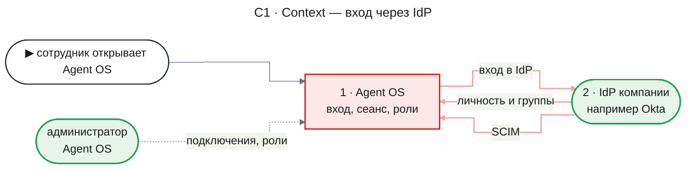
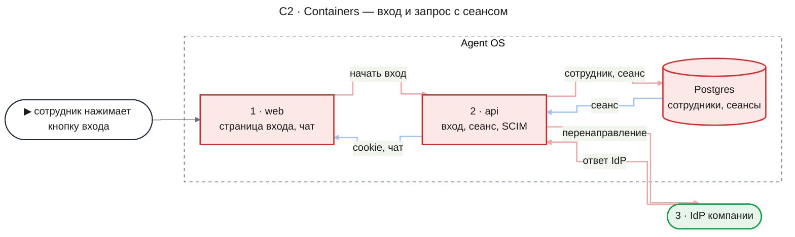
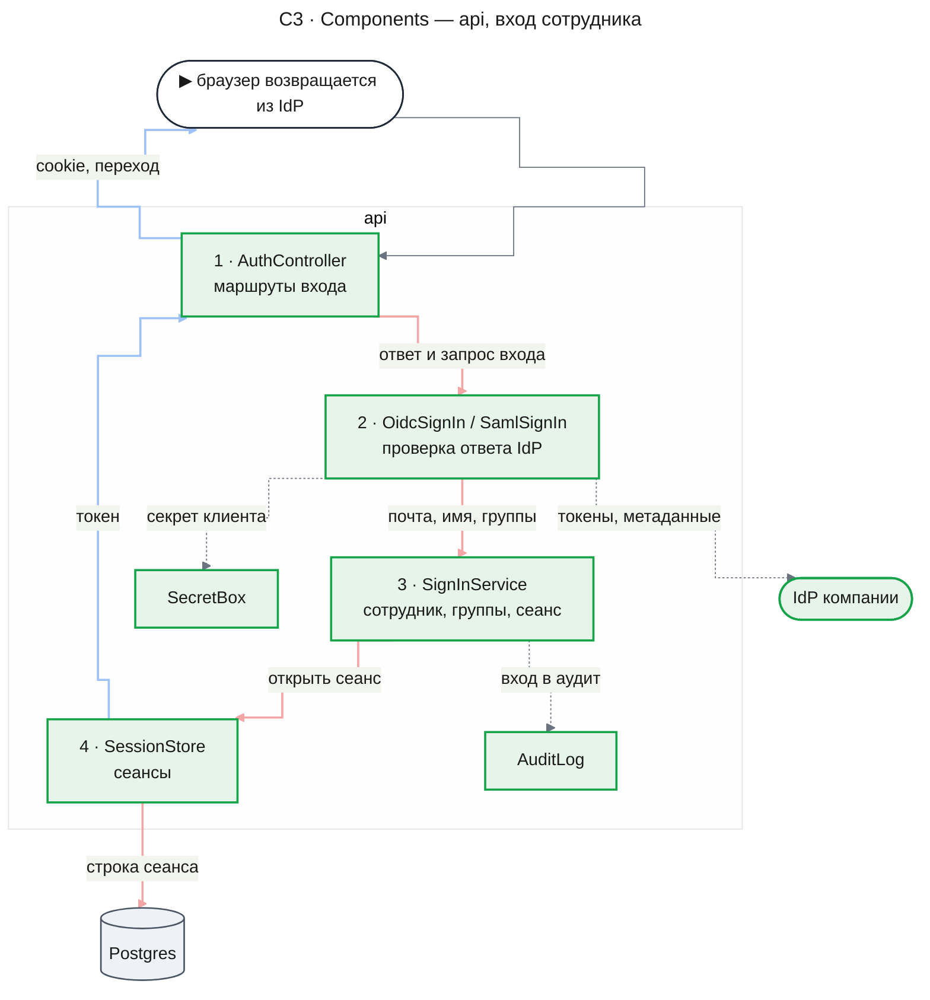
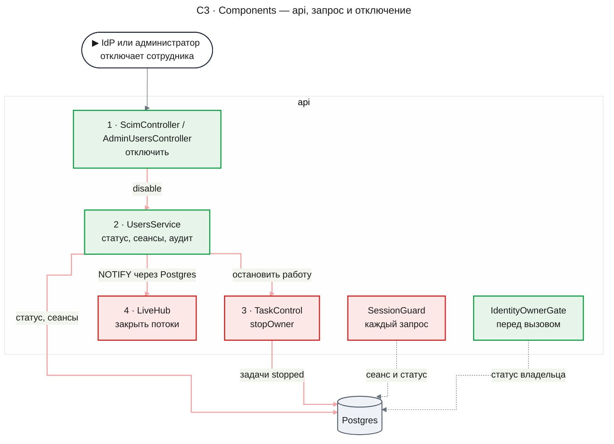
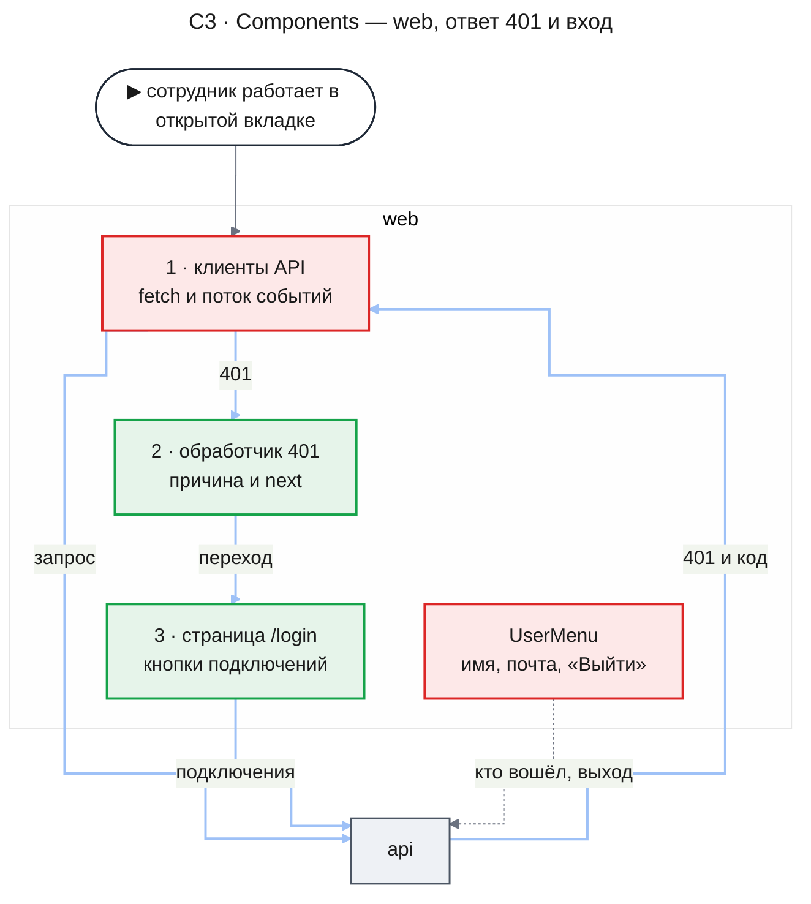
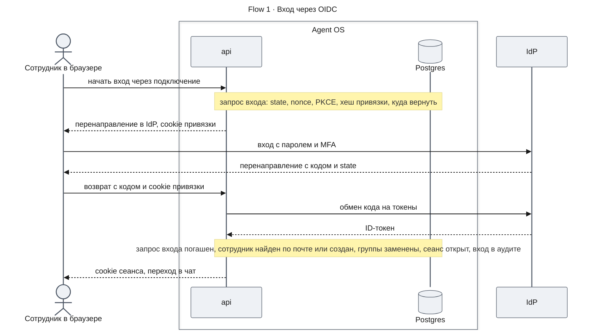
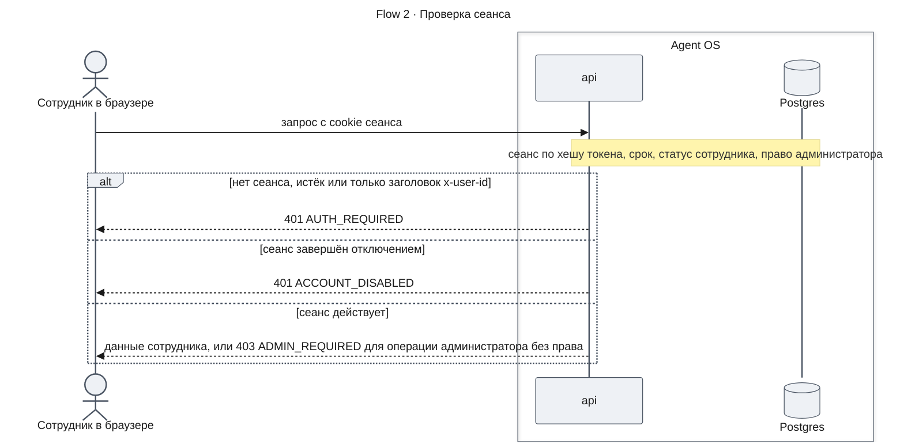
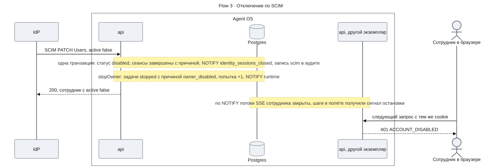
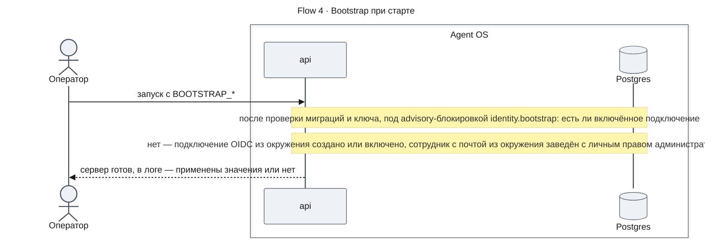
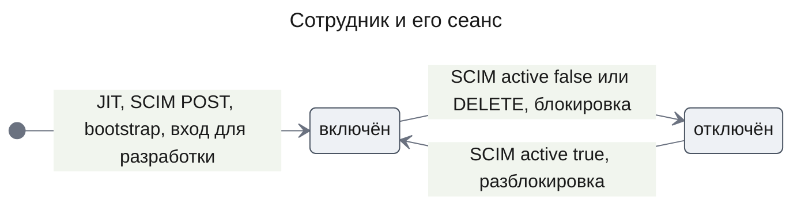

# Корпоративный вход и управление доступом — Design Document — identity

**Status:** Approved · **Date:** 2026-11-15 · **PRD:** [prd.md](./prd.md) · **UXRD:** [uxrd.md](./uxrd.md) · **Depends on:** ничего — первая часть

## Snapshot

**Overview.** Сегодня сервер верит заголовку `x-user-id`, а без него считает каждого тестовым сотрудником `dev-user`. Эта часть даёт настоящий вход: на странице входа сотрудник выбирает подключение, входит в IdP компании по OIDC или SAML, и сервер находит его учётную запись по подтверждённой почте или создаёт её. Сервер открывает сеанс — случайный токен в cookie и строку в базе, — и одна общая проверка на входе в API узнаёт по нему сотрудника, а без сеанса пропускает только вход, SCIM и проверку здоровья. IdP по SCIM заводит и отключает сотрудников и передаёт группы; группы дают роли, а роль или личная пометка — право администратора. Отключение закрывает сеансы и останавливает работу сотрудника без единого нового вызова модели или инструмента, секреты хранятся зашифрованными, а каждый вход и изменение администратора пишутся в аудит.

- **Не меняется**: беседы, агенты и расход по-прежнему принадлежат строке владельца в своих таблицах; контроллеры берут её из `req.user.id`, как сейчас. Панель администратора и пункты меню «Мой доступ» и «Панель администратора» строят `admin` и `mcp-connect`.
- **Biggest risk**: подделанный ответ IdP пускает чужого человека. Защита — проверенные библиотеки, одноразовый запрос входа, привязанный к браузеру, и e2e-тесты на неверную подпись ([Risks and Mitigation](#risks-and-mitigation)).
- **Open questions**: блокирующих нет; один вопрос владельцу без срока — [Open Questions](#open-questions).

### Key Decisions

#### KD-1: Вход и SCIM строятся на `openid-client` (OIDC) и `samlify` (SAML), а сервер SCIM пишется своими руками

Своих таблиц у этих библиотек нет: они только проверяют протокол, а сотрудники, роли, сеансы и аудит остаются в наших таблицах и правилах. `openid-client` 6 ведёт поток authorization code с PKCE, `state` и `nonce`, читает discovery издателя и проверяет ID-токен ([документация](https://github.com/panva/openid-client/blob/v6.8.9/README.md)). `samlify` читает метаданные IdP, проверяет подпись и срок ответа и умеет играть роль IdP, поэтому тот же пакет даёт тестовый IdP для e2e без Okta ([документация](https://github.com/tngan/samlify/blob/master/docs/README.md)). SCIM от Okta — это несколько маршрутов `Users` и `Groups`, и они пишут прямо в наши таблицы.

Варианты, которые не взяты:

- **Better Auth с плагинами SSO и SCIM.** Он даёт вход, сеансы и SCIM целиком, но приносит свою модель: таблицы `user`, `session`, `account`, `ssoProvider` и семь таблиц SCIM со своими идентификаторами и проекцией ролей ([схема SCIM](https://github.com/better-auth/better-auth/blob/v1.7.15/docs/content/docs/plugins/scim/reference.mdx)). Подключение он выбирает по домену почты и организации, а у нас — кнопка на подключение, роли из групп и личное право администратора. Шифрования `oidcConfig` в базе его документация не описывает. Пришлось бы гнуть его модель под нашу и держать два места правды о сотруднике.
- **Стратегии passport.** Это обёртки над теми же `openid-client` и `@node-saml/node-saml` с сеансом Express. Нам нужны сами протоколы, а сеанс и проверка у нас свои (KD-2, KD-3), поэтому слой passport ничего не добавляет.
- **`@node-saml/node-saml` вместо `samlify`.** Он проверяет ответ так же, но не читает метаданные IdP и не умеет быть IdP: разбор XML метаданных и подпись тестовых ответов пришлось бы писать самим. У обоих пакетов были серьёзные уязвимости: у `samlify` — обход подписи до 2.10.0 ([CVE-2025-47949](https://advisories.gitlab.com/npm/samlify/CVE-2025-47949/)) и подмена атрибутов внутри подписанного ответа до 2.13.0 ([CVE-2026-46490](https://nvd.nist.gov/vuln/detail/CVE-2026-46490)), у `node-saml` — обход подписи до 5.1.0 ([CVE-2025-54419](https://access.redhat.com/security/cve/CVE-2025-54419)). Поэтому версия `samlify` — не ниже 2.13.0 (Risks).

#### KD-2: Сеанс — случайный токен в cookie `HttpOnly; SameSite=Lax` и строка в базе с хешем токена; изменяющие запросы проверяют `Origin`

Браузер хранит 32 случайных байта в cookie `aos_session`, а база — только SHA-256 от них. Каждый запрос ищет строку сеанса по хешу, поэтому выход и отключение действуют сразу на всех экземплярах. Сеанс кончается после срока без запросов или после общего срока с момента входа. Оба срока — настройки администратора в базе: по умолчанию 8 и 24 часа, так что сотрудник, которого убрали в IdP без SCIM, теряет доступ не позже общего срока. Сервер считает сроки от времени входа и последнего запроса, а не хранит их в сеансе, поэтому новое значение действует для существующих сеансов с их следующего запроса (FR-07). Секрет cookie не нужен: токен случайный, и подделать его нечего, поэтому переменной для него нет.

Настройки части лежат в одной строке таблицы `identity_settings` — по столбцу с проверкой границ на каждую настройку. Проверка сеанса читает эту строку в том же запросе, что сеанс и сотрудника, поэтому лишнего чтения из базы на запрос нет. Так же часть `access` хранит свою единственную настройку, предел ожидания паузы по квоте: одна строка `access_settings` и операции `/api/admin/settings/<группа>`.

Веб и API в разработке живут на разных портах `localhost`, а в развёртывании — на одном адресе за nginx. В обоих случаях это один сайт, поэтому cookie с `SameSite=Lax` уходит с запросами `fetch` с `credentials: 'include'` и с `EventSource`. `Lax` не пускает cookie в межсайтовый `POST`, а для запросов с соседнего источника того же сайта сервер проверяет заголовок `Origin` у каждого изменяющего запроса с cookie: он должен совпасть с `FRONTEND_ORIGIN` (DC-3).

Варианты, которые не взяты:

- **JWT в cookie без строки в базе.** Отключение и выход не действовали бы до истечения токена, а AC-07.2 требует отказа со следующего запроса.
- **Токен с CSRF двойной отправкой.** Он требует от веба читать и пересылать второй токен в каждом запросе; проверка `Origin` даёт ту же защиту без изменений веба.
- **Сеанс в памяти процесса.** Другой экземпляр не узнал бы о выходе (ADR-0001: состояние живёт в Postgres).

#### KD-3: Одна глобальная проверка сеанса с пометкой открытых маршрутов; сотрудник — строка `identity_users` с UUID, который выдаёт сервер

`SessionGuard` становится глобальным и асинхронным. Он пропускает только маршруты с пометкой `@Public()`, а маршрут с пометкой `@AdminOnly()` пускает только сотрудника с правом администратора. Новый контроллер закрыт, пока его не пометили открытым: забытая пометка даёт отказ, а не дыру (NFR-03). В `req.user` лежит `AuthUser`: `id`, `email`, `name`, `isAdmin` и `sessionId`. `id` — это `identity_users.id`, UUID, который сервер создаёт сам при JIT, при `POST /Users` по SCIM, при входе для разработки и при bootstrap. Строка с префиксом `system:` в UUID не помещается, поэтому AC-04.4 держит тип столбца. Поле `roles` уходит: его никто не читает.

Шесть столбцов `owner_id` и `runtime_inbox.sender` остаются текстом без внешнего ключа и хранят тот же `id`. Обработчики вида `const ownerId = req.user.id` не меняются, а поиск «чужое отвечает как отсутствующее» работает как прежде. Заголовок `x-user-id`, `dev-user`, `DEV_USER` в вебе, `system-owners.ts` и тест заглушки удаляются; веб узнаёт сотрудника из `GET /api/auth/me` (C3 · web), а e2e-помощники получают cookie сеанса (Test Strategy).

Варианты, которые не взяты:

- **Почта или `sub` из IdP как идентификатор.** Почта меняется (AC-05.2), а `sub` у двух подключений одного сотрудника разный (AC-04.2). Строка из IdP, которая попала бы в `owner_id`, могла бы начаться с `system:`.
- **Внешний ключ из `owner_id` на `identity_users`.** Он привязал бы таблицы `runtime` и `agents` к слою приложения, против правила слоёв (code-system README), и запретил бы служебных владельцев.
- **Проверка на каждом контроллере, как сейчас.** Новый контроллер был бы открыт по умолчанию.

Решение записано в [ADR-0012](../../adr/ADR-0012-closed-api-and-server-issued-employee-id.md).

#### KD-4: Отключение — одна операция для SCIM и панели; она останавливает работу сотрудника, а порт `OwnerGate` закрывает гонки перед каждым вызовом модели и инструмента

`UsersService.disable` в одной транзакции ставит сотруднику статус `disabled`, завершает его сеансы с причиной `account_disabled`, шлёт `NOTIFY identity_sessions_closed` и пишет аудит. После фиксации новая операция runtime `TaskControl.stopOwner` останавливает все незавершённые задачи сотрудника с причиной `owner_disabled`. Каждый экземпляр получает NOTIFY: `LiveHub` закрывает потоки SSE сотрудника, а шаги в полёте получают сигнал остановки, как при обычной остановке.

Запрос, который прошёл проверку сеанса за миллисекунду до отключения, ещё может создать задачу. Поэтому `createAgents` получает порт `OwnerGate`, и агенты спрашивают его перед каждым вызовом модели (`ModelClient.call`, `ModelClient.completeText`) и инструмента (`ToolRunner`). Для отключённого или неизвестного владельца порт сам вызывает `stopOwner` и бросает `OWNER_DISABLED`, и вызов не начинается. Так «ни одного вызова после отключения» держит одно место у самого вызова, а не порядок операций (DC-8). Часть `access` строит одну проверку прав перед теми же вызовами (FR-18) и может вобрать этот порт.

Варианты, которые не взяты:

- **Только `stopOwner` без порта.** Задача из гонки выше прожила бы до следующей остановки.
- **Только порт без `stopOwner`.** Агент, который ждёт сообщений, остался бы в статусе «ждёт», а AC-07.2 требует «остановлен».
- **Проверка статуса сотрудника в runtime при захвате шага.** Runtime не знает о сотрудниках, и такая проверка нарушила бы правило слоёв.

#### KD-5: Секреты шифрует `SecretBox` из `packages/common`: AES-256-GCM, номер ключа в каждом значении, назначение значения в AAD; неверный ключ останавливает старт, а `secrets:reset` стирает секреты

Сохранённый секрет — строка из версии формата, номера ключа (первые 8 знаков hex от SHA-256 ключа), случайного IV, шифротекста и тега. Каждое значение шифруется с назначением, например `identity.connection:<id>`, и не расшифровывается в другой строке. Ключ — 32 байта в base64 в `SECRETS_KEY`. Этот же формат — общий контракт: часть `mcp-connect` хранит в нём общие учётные записи серверов и токены сотрудников. Токен SCIM сервер только сверяет, поэтому хранит его SHA-256, а не шифротекст: прочитать его нельзя даже с ключом, и потеря ключа его не касается. Хеш сильнее шифрования и проходит проверку NFR-01: открытого значения в базе нет.

Ротации ключа в PoC нет. При старте сервер сравнивает номер ключа из `SECRETS_KEY` с номером из `identity_settings`. При первом старте он записывает номер, а при несовпадении не стартует и пишет в лог, что ключ не тот, каким зашифрованы секреты, с обоими номерами (DC-7). Если ключ потерян, оператор запускает `pnpm --filter api secrets:reset` с новым ключом. Команда стирает все зашифрованные значения, выключает подключения входа и записывает номер нового ключа, после чего первое подключение возвращает bootstrap (FR-09). Секреты подключений администратор вводит заново. Номер ключа в каждом значении позволит позже добавить ротацию, не меняя строк.

Варианты, которые не взяты:

- **`pgcrypto` в Postgres.** Ключ уходил бы в каждый SQL-запрос и мог бы попасть в лог Postgres.
- **KMS или Vault.** Для одного развёртывания PoC это внешняя система, которой у проекта нет.
- **Старт с неверным ключом.** Ни одно подключение не расшифровалось бы, и войти не смог бы никто, включая администратора.

Решение записано в [ADR-0013](../../adr/ADR-0013-sealed-secret-format.md).

#### KD-6: Членство в ролях из IdP вычисляется из групп сотрудника при чтении; членство из панели хранится отдельно; последнего администратора сторожит advisory-блокировка

У сотрудника хранится набор имён его групп IdP. Вход заменяет набор целиком тем, что прислал IdP, а SCIM `Groups` добавляет и убирает членов (FR-06). Роль хранит сопоставленные имена групп, поэтому членство «из IdP» — это пересечение групп сотрудника с группами роли. Записи «членство из IdP» нет, и после удаления группы роль пропадает со следующего запроса. Назначение в панели — отдельная строка, и IdP её не трогает (AC-06.3, AC-06.4). Право администратора дают пометка роли или личная пометка сотрудника.

Каждое изменение в панели, которое может снять последнего администратора, берёт транзакционную advisory-блокировку `identity.admins`. Под блокировкой сервер считает включённых сотрудников с правом после изменения и при нуле отклоняет изменение кодом `LAST_ADMIN` (AC-08.3). Два администратора, которые одновременно снимают право друг с друга, так не оставят развёртывание без администратора. Изменения от IdP блокировку берут, но не отклоняются: при нуле они пишут в аудит и лог `last_admin_removed` (AC-08.4).

Варианты, которые не взяты:

- **Хранить членство из IdP строками и пересчитывать при каждом изменении групп.** Это второе место правды, которое расходится с группами при сбое посреди пересчёта.
- **Проверка последнего администратора без блокировки.** Две встречные транзакции видели бы по одному оставшемуся администратору.

#### KD-7: Аудит — одна таблица `audit_events` в схеме `app` под Drizzle; запись идёт в транзакции изменения; перехватчик запросов и `AuditService` с DDL удаляются

`AuditLog.record` пишет запись в транзакции той операции, которую описывает: изменение администратора и его запись фиксируются или откатываются вместе. Отказы и входы пишутся в своей короткой транзакции. Запись несёт вид, исполнителя, объект, «было», «стало», исход и причину. Поля с именами секретов `AuditLog` заменяет пометкой `secret_changed` по тому же списку имён, что логгер (AC-11.2). Части `mcp-connect` и `access` пишут свои записи (вызовы, отказы по правам, паузы) через этот же `AuditLog`.

Варианты, которые не взяты:

- **Оставить `AuditService` с буфером на 2 с.** Он создаёт таблицу сырым DDL вне Drizzle (против ADR-0003), теряет буфер при падении и пишет через Nest `Logger` мимо обёртки логгера.
- **Оставить перехватчик «запись на каждый запрос».** Он пишет только метод и маршрут без исхода и не видит отказов: проверка сеанса отвечает раньше него. FR-11 требует другого, а вызовы агентов пишут свои таблицы.

## Terms

- **Подключение входа** — строка `identity_connections`: протокол, название кнопки, данные IdP, включено или нет.
- **Запрос входа** — одноразовая строка между уходом браузера в IdP и возвратом: какое подключение, куда вернуть, чем проверить ответ. Живёт 10 минут.
- **Привязка к браузеру** — cookie `aos_login` со случайным значением, хеш которого лежит в запросе входа. Ответ IdP принимается только в том браузере, который начал вход.
- **Сеанс** — строка `identity_sessions` и cookie `aos_session` (KD-2).
- **Открытый маршрут** — маршрут с пометкой `@Public()`: его проверка сеанса пропускает без сеанса.
- **Назначение секрета** — строка вроде `identity.connection:<id>`, с которой секрет зашифрован; с другой он не расшифруется.
- **`OwnerGate`** — порт агентов «может ли владелец работать», который спрашивают перед каждым вызовом модели и инструмента (KD-4).

## Part

- **Part**: `identity`
- **Covers**: FR-01, FR-02, FR-03, FR-04, FR-05, FR-06, FR-07, FR-08, FR-09, FR-10, FR-11; NFR-01, NFR-02, NFR-03 в части секретов и маршрутов этой части
- **Depends on**: none — first part
- **Prerequisite ADRs**: [ADR-0001](../../adr/ADR-0001-durable-runtime-owner.md) (состояние в Postgres), [ADR-0002](../../adr/ADR-0002-app-schema-migrations.md) (свои таблицы со своим префиксом, миграция отдельной командой), [ADR-0003](../../adr/ADR-0003-drizzle-data-layer.md) (Drizzle, схема `app`), [ADR-0004](../../adr/ADR-0004-agent-framework-packages.md) (пакеты не читают окружение, порты параметрами)
- **Sibling parts**: `mcp-connect` (FR-12–FR-15), `access` (FR-16–FR-23), `admin` (FR-24–FR-31)

**Out of scope**

- Панель администратора и пункт меню «Панель администратора» — часть `admin` поверх операций ниже; пункт «Мой доступ» и точка на аватаре — часть `mcp-connect`. Эта часть строит из экранов только страницу входа, имя, почту и «Выйти» в меню и переход на вход по 401 (PRD, Delivery Parts).
- Права на серверы, инструменты и модели, их проверка и замена `MCP_ACCESS_TABLE` — часть `access`; до неё таблица живёт по правилу из Constraints.
- Маршрут nginx для `/api/events` без буферизации: это существующая настройка доставки потока, а не вход.
- Выход из IdP (single logout) и вход, начатый в IdP (PRD, Won't Have).

**Constraints**

- PoC без обратной совместимости: заглушка и всё, что от неё зависит, заменяются сразу, существующие строки с `dev-user` не переносятся (PRD, Constraints).
- В окружение добавляются только `SECRETS_KEY`, `PUBLIC_URL` и четыре `BOOTSTRAP_*` (Runtime settings); прочие значения — постоянные кода.
- Пакеты не читают окружение (ADR-0004): `SecretBox` и `OwnerGate` приходят в пакеты параметрами, переменные читает `apps/api`.
- Части строятся по порядку `identity` → `mcp-connect` → `access`. Пока `access` не собрана, `MCP_ACCESS_TABLE` остаётся и ключуется `identity_users.id`. Ключ `*` даёт серверы каждому сотруднику, и `.env.example` использует его. E2E-тесты заводят сотрудников с заранее известными id (Test Strategy).
- Логи идут через логгер `packages/common` с идентификаторами сотрудника, сеанса, подключения и запроса входа; токены, коды, ответы IdP и секреты в лог не попадают (Security Considerations).

## Building-block Inventory

Follows the [code system](../../code-system/README.md). Поиск перед «new» шёл по `docs/code-system/`, `apps/api/src`, `packages/*/src` (`auth`, `session`, `encrypt`, `cipher`, `scim`, `saml`, `oidc`, `audit`): входа, шифрования и SCIM в коде нет, есть только заглушка `SessionGuard` и `AuditService`.

| Building block | Pattern | Status | Note |
|---|---|---|---|
| `SessionGuard`, `@Public()`, `@AdminOnly()` | [auth-boundary.md](../../code-system/patterns/auth-boundary.md) — новый (KD-3) | extended | Заглушка заменена глобальной проверкой сеанса |
| `IdentityModule`: сервисы и репозитории `identity_*` в `apps/api/src/identity` | [repository-over-transaction.md](../../code-system/patterns/repository-over-transaction.md) | new | Таблицы приложения объявлены в `packages/db`, как `chat_conversations` |
| `OidcSignIn`, `SamlSignIn` | — | new | Обёртки над `openid-client` и `samlify` (KD-1) |
| `ScimController` | [auth-boundary.md](../../code-system/patterns/auth-boundary.md) | new | Открыт для сеанса, закрыт своим токеном |
| `SecretBox` в `packages/common` | [sealed-secret.md](../../code-system/patterns/sealed-secret.md) — новый (KD-5) | new | Шифрования в коде нет; второй пользователь — `mcp-connect` |
| Логгер `packages/common` | [logging.md](../../code-system/patterns/logging.md) | extended | Новые имена секретных полей; `SECRETS_KEY` в списке значений |
| `AuditLog` | [repository-over-transaction.md](../../code-system/patterns/repository-over-transaction.md) | new | Заменяет `AuditService` и `AuditInterceptor` (KD-7) |
| `TaskControl.stopOwner`, причина остановки | [step-handler.md](../../code-system/patterns/step-handler.md) | extended | Остановка всех задач владельца с причиной; шаг в полёте отсекается, как при обычной остановке (KD-4) |
| `OwnerGate` в `createAgents` | [composition-root.md](../../code-system/patterns/composition-root.md) | extended | Новый порт функции сборки (KD-4) |
| `LiveHub` | [transactional-outbox.md](../../code-system/patterns/transactional-outbox.md) | extended | Наблюдатель по NOTIFY: слушает `identity_sessions_closed`, закрывает потоки сеанса |
| Страница `/login` веба | — | new | Страниц вне оболочки в вебе нет; собирается из компонентов shadcn по `uxrd.md` LG-01–LG-03 |
| `UserMenu` веба | — | extended | Имя и почта из `GET /api/auth/me` вместо `DEV_USER`, пункт «Выйти» (`uxrd.md` KD-3) |
| Клиенты API веба (`lib/threads`, поток событий) | — | extended | Один обработчик ответа 401: переход на вход |
| `readIdentitySettings` → разбор настроек | [composition-root.md](../../code-system/patterns/composition-root.md) | new | Как `readRuntimeSettings` |

## Acceptance Criteria

### FR-01: Вход через OIDC

- From the PRD: AC-01.1, AC-01.2, AC-01.3, AC-01.4, AC-01.5
- Запрос без действующего сеанса к любому маршруту, кроме открытых (вход, SCIM, `GET /api/health`), получает 401 с `errorCode` `AUTH_REQUIRED` (DC-1).
- Сеанс кончается по сроку без запросов или по общему сроку из настроек сеанса (по умолчанию 8 и 24 часа), смотря что раньше; следующий запрос получает `AUTH_REQUIRED` (DC-2).
- Изменяющий запрос с cookie сеанса и с `Origin`, отличным от `FRONTEND_ORIGIN` или пустым, получает 403 `ORIGIN_REJECTED` и ничего не меняет (DC-3).
- Ответ IdP принимается один раз и только в браузере, который начал вход, не позже 10 минут после начала; повтор, чужой браузер или опоздание отклоняют вход с причиной `failed` (DC-4).
- Ответ 401 на любой запрос веба, в том числе обрыв потока событий без сеанса, переводит вкладку на `/login` с причиной («Сеанс закончился» или «учётная запись отключена», `uxrd.md` MC-3) и адресом текущей страницы; после входа сотрудник возвращается на неё (DC-13).

### FR-02: Вход через SAML 2.0

- From the PRD: AC-02.1, AC-02.2

### FR-03: Подключения входа и шифрование секретов

- From the PRD: AC-03.1, AC-03.2, AC-03.3
- OIDC-вход принимает только почту с `email_verified`, равным `true`; иначе вход отклонён с причиной `failed` и записью в аудит (DC-5).
- Подключение создаётся выключенным по протоколу и названию, и его «Данные для IdP» известны сразу после создания. Сохранение данных IdP проверяет их: discovery издателя OIDC или метаданные SAML по адресу. Если проверка не прошла, данные не сохраняются, а ответ — 422 `CONNECTION_CHECK_FAILED` с причиной. Включить подключение без проверенных данных IdP нельзя: 409 `CONNECTION_INCOMPLETE` (DC-6).
- Если номер ключа в `SECRETS_KEY` не совпадает с записанным, сервер не стартует, а лог называет причину и оба номера; `secrets:reset` стирает зашифрованные значения и выключает подключения (DC-7).

### FR-04: Учётная запись сотрудника

- From the PRD: AC-04.1, AC-04.2, AC-04.3, AC-04.4

### FR-05: Синхронизация через SCIM 2.0

- From the PRD: AC-05.1, AC-05.2, AC-05.3, AC-05.4

### FR-06: Роли и членство из двух источников

- From the PRD: AC-06.1, AC-06.2, AC-06.3, AC-06.4

### FR-07: Сеанс входа, выход и отключение

- From the PRD: AC-07.1, AC-07.2, AC-07.3, AC-07.4, AC-07.5
- Задача отключённого или неизвестного владельца не начинает ни одного вызова модели или инструмента: перед вызовом её останавливают с причиной `owner_disabled` (DC-8).
- Открытые потоки SSE сеанса закрываются при выходе и при отключении сотрудника на любом экземпляре; каждый запрос с cookie сеанса, завершённого отключением, получает 401 `ACCOUNT_DISABLED`, пока не наступит общий срок этого сеанса (DC-9).
- Остановленный при отключении агент показывает в истории событие `stopped` с причиной `owner_disabled` (DC-10).

### FR-08: Право администратора

- From the PRD: AC-08.1, AC-08.2, AC-08.3, AC-08.4
- Операция администратора без права получает 403 `ADMIN_REQUIRED` (DC-11).

### FR-09: Первый администратор и аварийный вход

- From the PRD: AC-09.1, AC-09.2, AC-09.3
- Два экземпляра, стартующие вместе с `BOOTSTRAP_*`, создают одно подключение, а не два (DC-12).

### FR-10: Вход для разработки и тестов

- From the PRD: AC-10.1, AC-10.2, AC-10.3

### FR-11: Аудит входа и изменений администратора

- From the PRD: AC-11.1, AC-11.2, AC-11.3

## Design

### Architecture (C1–C4)

#### C1 · Context

Agent OS теперь говорит с IdP компании двумя путями: браузер сотрудника ходит через IdP при входе, а IdP сам шлёт SCIM.

#### C2 · Containers

- `web` получает страницу `/login`, имя, почту и «Выйти» в меню и переход на вход по 401. Cookie он уже шлёт с каждым запросом (`credentials: 'include'`, `withCredentials`).
- `api` ведёт вход, сеансы, SCIM, операции администратора над сотрудниками, ролями и подключениями и проверяет сеанс каждого запроса.
- `Postgres` получает таблицы `identity_*` и `audit_events` (Data Model), а у `runtime_tasks` появляется причина остановки.

#### C3 · Components: api

**api — вход сотрудника.** Оба протокола сходятся в одной точке: `SignInService` получает от протокола подтверждённые почту, имя и группы и дальше не знает, откуда они.

- `OidcSignIn` гасит запрос входа, обменивает код на токены с PKCE и проверяет ID-токен: издатель, получатель, срок, `nonce` и `email_verified`. Конфигурацию discovery он держит в памяти по номеру версии подключения: правка подключения меняет номер, и следующий вход читает новые данные (AC-03.3).
- `SamlSignIn` проверяет подпись ответа ключом из сохранённых метаданных IdP, срок, получателя и `InResponseTo` по запросу входа. Почту, имя и группы он берёт из атрибутов `email`, `name` и `groups`.
- `SignInService` отказывает выключенному подключению и отключённому сотруднику, находит сотрудника по почте без учёта регистра или создаёт его, заменяет его группы IdP, открывает сеанс и пишет вход в аудит. Всё это идёт в одной транзакции.

**api — запрос с сеансом и отключение.** Здесь сходятся две дороги: каждый запрос проходит проверку сеанса, а отключение — из SCIM или из панели — идёт одной операцией.

- `SessionGuard` ищет сеанс по хешу токена из cookie и читает сотрудника, его право администратора и сроки сеанса из `identity_settings` одним запросом. Время последнего запроса он обновляет не чаще раза в 5 минут.
- `TaskControl.stopOwner` останавливает каждую незавершённую задачу владельца по дереву за раз, сверху вниз, теми же правилами блокировок, что `stop`, и пишет у каждой причину. Шаг в полёте отсекается, как при обычной остановке: в своём процессе сразу, в других — по NOTIFY.
- `LiveHub` помнит у каждого потока его сеанс и закрывает потоки по NOTIFY `identity_sessions_closed` и в момент общего срока сеанса, рассчитанного при подключении потока; новое значение срока поток получит при следующем подключении. Открытый поток сеанс не продлевает.
- `IdentityOwnerGate` — реализация `OwnerGate` в `apps/api`: одно чтение статуса по первичному ключу перед каждым вызовом модели и инструмента (KD-4).

#### C3 · Components: web

**web — сеанс закончился.** Веб узнаёт о сеансе только по ответам API: своих cookie он не читает, а сервер Next к API не ходит.

- Клиенты API веба отдают каждый ответ 401 одному обработчику. Поток событий кода ответа не видит, поэтому при обрыве без переподключения обработчик спрашивает `GET /api/auth/me`, и код его ответа даёт причину.
- Обработчик 401 переводит вкладку на `/login?reason=expired` или `reason=disabled` с `next` — адресом текущей страницы (DC-13).
- Страница `/login` — `uxrd.md` Screen 1: кнопки из `GET /api/auth/connections`, причина из `error` или `reason` (LG-02, MC-3), блок разработки при `devSignIn` (LG-03). Кнопка ведёт на `GET /api/auth/sign-in/:connectionId` с тем же `next`.
- `UserMenu` берёт имя и почту из `GET /api/auth/me` (`uxrd.md` UM-01, MC-6), а «Выйти» зовёт `POST /api/auth/sign-out` и открывает `/login?reason=signed_out`. `DEV_USER` и строка «Режим разработки» удаляются.

### Runtime Flows

#### Flow 1: Вход через подключение

**Starts when:** сотрудник нажимает кнопку подключения OIDC на странице входа, for AC-01.2, AC-01.3, AC-04.1, AC-04.2, AC-06.1, AC-06.2, AC-08.4, AC-11.3, DC-4, DC-5

**Outcome:** в браузере cookie `aos_session` со сроком, равным верхней границе общего срока сеанса (действует ли сеанс, решает сервер), в базе строка сеанса с хешем токена. У сотрудника записаны имя, почта, время входа и набор групп из ID-токена. Запись аудита `sign_in` несёт сотрудника, подключение и время. Вход по SAML идёт тем же путём, но IdP возвращает браузер не с кодом, а с подписанным ответом формой `POST` на ACS, и обмена токенами нет.

**Failure handling:**

- Сотрудник отменил вход или IdP вернул ошибку → перенаправление на `/login?error=cancelled` или `error=failed`, сеанса нет, запись `sign_in_rejected` с причиной (AC-01.3, AC-11.3).
- Неверная подпись, истёкший ответ, чужой `InResponseTo`, неверный `nonce` или издатель → `error=failed`, запись `sign_in_rejected` с причиной проверки; текст ответа IdP в лог и аудит не идёт (AC-02.2).
- Запрос входа не найден, уже погашен, старше 10 минут или привязка не совпала → `error=failed` (DC-4).
- `email_verified` не `true` или почты нет → `error=failed` (DC-5).
- Подключение выключено или его нет → `error=connection_unavailable` (AC-03.2).
- Сотрудник отключён → `error=account_disabled` (AC-07.3).
- Новые группы из IdP снимают последнего администратора → вход применяется, а в аудите и логе `last_admin_removed`, как у изменения по SCIM (KD-6, AC-08.4).
- Сбой базы на шаге фиксации → откат всей транзакции; сеанса и записей нет, браузер получает `error=failed`, лог пишет ошибку с идентификатором запроса входа.

#### Flow 2: Запрос с сеансом

**Starts when:** веб шлёт любой запрос к API, for AC-01.4, AC-07.1, AC-08.1, AC-10.3, DC-1, DC-2, DC-3, DC-9, DC-11

**Outcome:** `req.user` несёт `AuthUser`, и обработчик работает с `req.user.id`, как раньше. Отказ `ADMIN_REQUIRED` пишет в аудит запись `access_denied` с сотрудником и маршрутом (AC-08.1). Отказы `AUTH_REQUIRED` в аудит не идут: у них нет исполнителя.

**Failure handling:**

- Изменяющий запрос с cookie и чужим или пустым `Origin` → 403 `ORIGIN_REJECTED` до обработчика (DC-3).
- Сбой базы при поиске сеанса → 500 с общим телом, лог с идентификатором запроса; данные не отдаются.

#### Flow 3: Отключение сотрудника

**Starts when:** Okta шлёт по SCIM `active: false` или администратор блокирует сотрудника, for AC-05.3, AC-07.2, AC-07.4, AC-08.4, DC-8, DC-9, DC-10

**Outcome:** сотрудник `disabled`, его сеансы завершены, все его задачи `stopped` с причиной `owner_disabled`, беседы и данные на месте. Блокировка из панели идёт тем же путём; её запись аудита — `admin_change` с администратором. Включение снова (`active: true` или «Разблокировать») возвращает статус `active` и ничего больше: старые сеансы и задачи не оживают, а сотрудник входит заново и видит прежние беседы (AC-07.4).

**Failure handling:**

- Запрос SCIM без токена или с отменённым → 401 по SCIM, ничего не меняется (AC-05.3).
- Задача, которую запрос сотрудника создал в миллисекунду до отключения, доходит до вызова модели или инструмента → `OwnerGate` вызывает `stopOwner` и не даёт вызову начаться (DC-8).
- `stopOwner` упал после фиксации отключения → лог с ошибкой и id сотрудника; задачи остановит `OwnerGate` перед их следующим вызовом, а сеансы уже закрыты.
- Отключение снимает последнего администратора → изменение от IdP применяется, в аудите и логе `last_admin_removed` (AC-08.4); блокировка из панели в этом случае отклоняется кодом `LAST_ADMIN`, и ничего не меняется (AC-08.3, KD-6).

#### Flow 4: Первый администратор при старте

**Starts when:** оператор запускает сервер с `BOOTSTRAP_*`, for AC-09.1, AC-09.2, AC-09.3, DC-12

**Outcome:** подключение из окружения с названием кнопки по имени хоста издателя есть на странице входа. Сотрудник с почтой `BOOTSTRAP_ADMIN_EMAIL` заведён заранее, и вход по почте попадает в эту же учётную запись с правом администратора. Если включённое подключение уже есть, ничего не меняется, а лог пишет `bootstrap skipped: an enabled connection exists` (AC-09.2). Повторный старт ищет подключение с теми же издателем и `client_id` и включает его с секретом из окружения, а не создаёт второе.

**Failure handling:**

- Задана только часть `BOOTSTRAP_*` → сервер не стартует, лог называет недостающие переменные.
- Discovery издателя из окружения недоступна → подключение всё равно создаётся (его проверит первый вход), лог предупреждает с причиной; так bootstrap не зависит от сети при старте.

### Contract Definitions

Все маршруты — под глобальным префиксом `/api`. Тело ошибки — `ApiErrorSchema` (`statusCode`, `message`, `error`, `errorCode`). Изменяющий запрос с cookie сеанса проверяется по `Origin` (DC-3).

#### Вход и сеанс — для веба

- **`GET /api/health`** (открыт) — 200 с пустым телом, когда процесс принимает запросы.
- **`GET /api/auth/connections`** (открыт) — включённые подключения в порядке создания и признак входа для разработки. Returns `SignInOptions`.
- **`GET /api/auth/sign-in/:connectionId?next=<путь>`** (открыт) — начинает вход: 302 в IdP и cookie `aos_login`. `next` — путь веба, который начинается с одного `/`; иной заменяется на `/`. Выключенное или неизвестное подключение — 302 на `{FRONTEND_ORIGIN}/login?error=connection_unavailable`.
- **`GET /api/auth/oidc/:connectionId/callback`**, **`POST /api/auth/saml/:connectionId/acs`** (открыты) — возврат из IdP. Успех — 302 на `{FRONTEND_ORIGIN}{next}` с cookie `aos_session`. Отказ — 302 на `{FRONTEND_ORIGIN}/login?error=<причина>&connection=<id>`, где причина — `cancelled`, `failed`, `account_disabled` или `connection_unavailable`. Тексты к причинам — `uxrd.md` MC-3.
- **`GET /api/auth/saml/:connectionId`** (открыт) — метаданные SP в XML: Entity ID и ACS для настройки IdP.
- **`GET /api/auth/me`** — текущий сотрудник. Returns `CurrentUser`. Без сеанса — 401.
- **`POST /api/auth/sign-out`** (открыт) — завершает сеанс этого cookie, закрывает его потоки, стирает cookie, пишет `sign_out`. Returns 204, в том числе без сеанса.
- **`POST /api/auth/dev/sign-in`** (открыт, только при `NODE_ENV` `development` или `test`) — вход тестовым сотрудником по имени `name` (1–64 знака: буквы, цифры, `.`, `_`, `-`) с почтой `<name>@dev.local`; `admin: true` даёт ему личное право администратора. Сотрудник с этой почтой находится или создаётся, сеанс открывается как при обычном входе. Returns 204 и cookie. В другом режиме маршрута нет, и ответ — 404, как на несуществующий адрес (AC-10.2).
- **Поток `GET /api/events`** проверяется как любой маршрут при подключении: без сеанса — 401. Открытый поток сервер закрывает при выходе, отключении сотрудника и по общему сроку сеанса; после этого переподключение получает 401.

**SignInOptions**

- `connections` — список: `id`, `name` (название кнопки), `protocol` (`oidc` или `saml`).
- `devSignIn` — `true`, когда открыт вход для разработки.

**CurrentUser**

- `id` — UUID сотрудника.
- `email` — почта из IdP.
- `name` — имя из IdP; пустая строка, если IdP его не прислал (меню тогда показывает почту до «@»).
- `isAdmin` — есть ли право администратора сейчас.

**Error handling**

- `AUTH_REQUIRED` — 401: нет cookie, сеанс не найден или истёк, в том числе при одном заголовке `x-user-id`. Веб переводит на вход с `next` текущей страницы.
- `ACCOUNT_DISABLED` — 401: запрос с cookie сеанса, завершённого отключением. Строка такого сеанса живёт до своего общего срока, и каждый запрос с ней получает этот код; после срока — `AUTH_REQUIRED`.
- `ADMIN_REQUIRED` — 403: операция администратора без права, запись `access_denied` в аудите.
- `ORIGIN_REJECTED` — 403: изменяющий запрос с cookie и чужим или пустым `Origin`.

#### Операции администратора — для `admin`

Все маршруты помечены `@AdminOnly()`; каждое изменение пишет `admin_change` с «было» и «стало» в той же транзакции.

- **`GET /api/admin/users?query=&cursor=`** — сотрудники по имени, 50 на страницу, поиск по имени и почте без учёта регистра. Returns страницу `AdminUserSummary` и `nextCursor`.
- **`GET /api/admin/users/:id`** — `AdminUserSummary` и `adminRight`: `personal` (личная пометка), список ролей, которые дают право, и `groups` — группы IdP сотрудника. 404 `USER_NOT_FOUND`.
- **`POST /api/admin/users/:id/block`**, **`/unblock`** — блокирует (Flow 3) или включает сотрудника. Returns `AdminUserSummary`. 409 `LAST_ADMIN`, если блокировка оставит развёртывание без администратора.
- **`PUT /api/admin/users/:id/admin`** с `enabled` — даёт или снимает личное право администратора. 409 `LAST_ADMIN` при снятии последнего.
- **`PUT /api/admin/users/:id/roles/:roleId`**, **`DELETE` тот же путь** — назначает роль из панели или снимает только назначение из панели; членство из IdP не трогается. 404 `USER_NOT_FOUND` или `ROLE_NOT_FOUND`; 409 `LAST_ADMIN` при снятии.
- **`GET /api/admin/roles`** — роли по названию с группами IdP, числом сотрудников и признаком `isAdmin`.
- **`POST /api/admin/roles`** с `name` (1–80 знаков после обрезки пробелов) — создаёт роль. 409 `ROLE_NAME_TAKEN` (без учёта регистра).
- **`GET /api/admin/roles/:id`** — роль, её группы IdP, `isAdmin` и сотрудники с источником членства: `idp` с группой или `panel`.
- **`PATCH /api/admin/roles/:id`** с `name` и/или `isAdmin` — переименовывает роль или меняет её право администратора. 409 `ROLE_NAME_TAKEN`, `LAST_ADMIN`.
- **`DELETE /api/admin/roles/:id`** — удаляет роль; её сопоставления, назначения и строки других частей, которые ссылаются на роль внешним ключом, уходят каскадом. 409 `LAST_ADMIN`.
- **`PUT /api/admin/roles/:id/groups/:group`**, **`DELETE` тот же путь** — сопоставляет имя группы IdP с ролью или снимает сопоставление. Имя — 1–256 знаков, как его пишет IdP, сравнение без учёта регистра. 409 `LAST_ADMIN` при снятии.
- **`GET /api/admin/connections`** — подключения в порядке создания: `id`, `name`, `protocol`, `enabled`.
- **`POST /api/admin/connections`** — создаёт выключенное подключение по `protocol` и `name` (1–60 знаков); данные IdP можно передать сразу или позже. Returns `ConnectionView` с `idpData`, которые администратор переносит в IdP до того, как IdP выдаст свои данные. 422 `CONNECTION_CHECK_FAILED`, если переданные данные IdP не прошли проверку (DC-6).
- **`GET /api/admin/connections/:id`** — `ConnectionView`. 404 `CONNECTION_NOT_FOUND`.
- **`PATCH /api/admin/connections/:id`** — меняет `name`, `enabled` и данные IdP: у OIDC `issuer`, `clientId`, `clientSecret` (заменяется, только когда передан), у SAML `metadataUrl`. Новые данные IdP проверяются (DC-6), смена протокола запрещена. 409 `CONNECTION_INCOMPLETE` при включении подключения без проверенных данных IdP.
- **`GET /api/admin/settings/sessions`** — сроки сеанса для экрана настроек входа (FR-26, AC-26.3). Returns `SessionSettings`.
- **`PUT /api/admin/settings/sessions`** с `idleMinutes` и `absoluteMinutes` — меняет оба срока; новое значение действует для существующих сеансов с их следующего запроса (FR-07, AC-07.5). Returns `SessionSettings`. 400 `VALIDATION_FAILED`, если значение вне границ или срок без запросов больше общего; ничего не меняется. Запись `admin_change` с объектом `session_settings` и прежними и новыми сроками.
- **`GET /api/admin/scim`** — `url` сервера SCIM и `tokenCreatedAt` (или `null`).
- **`POST /api/admin/scim/token`** — создаёт новый токен и отменяет прежний. Returns `token` — единственный раз (AC-05.4); аудит пишет `scim_token_created` без значения.

**AdminUserSummary**

- `id`, `email`, `name`; `status` — `active` или `disabled`; `lastSignInAt` — время или `null`.
- `roles` — список: `id`, `name` и `sources`, где источник — `panel` или `idp` с именем группы. Роль с двумя источниками — одна строка с обоими.

**SessionSettings**

- `idleMinutes` — срок без запросов, целое от 15 до 1440 (24 часа); по умолчанию 480.
- `absoluteMinutes` — общий срок с момента входа, целое от 60 до 43200 (30 суток); по умолчанию 1440; не меньше `idleMinutes`.
- `updatedAt` — время последнего изменения или `null`, пока стоят значения по умолчанию.

**ConnectionView**

- `id`, `name`, `protocol`, `enabled`.
- `oidc` — `issuer` и `clientId` (`null`, пока не заданы), `clientSecretSet` (задан ли секрет; значения секрета нет ни в одном ответе).
- `saml` — `metadataUrl` (`null`, пока не задан).
- `complete` — заданы ли проверенные данные IdP, то есть можно ли включить подключение.
- `idpData` — значения для настройки приложения в IdP. У OIDC: `redirectUri` (`{PUBLIC_URL}/api/auth/oidc/<id>/callback`), `scopes` (`openid email profile groups`), `groupsClaim` (`groups`). У SAML: `acsUrl` (`{PUBLIC_URL}/api/auth/saml/<id>/acs`), `entityId` (`{PUBLIC_URL}/api/auth/saml/<id>`) и `attributes` (`email`, `name`, `groups`).

**Заметка для `admin`.** Форме SAML (`uxrd.md` AD-07) хватает одного поля «Адрес метаданных IdP». Контракт отличается от UXRD в двух местах, и UXRD нужна правка через ux-designer. Первое: `idpData` несёт кроме адресов ещё `scopes` и `groupsClaim` у OIDC и `attributes` у SAML — без них администратор IdP не настроит передачу групп. Второе: «Данные для IdP» появляются после первого сохранения подключения по протоколу и названию, а не сразу после выбора протокола, потому что адреса содержат id подключения; включить подключение можно после ввода проверенных данных IdP. Адрес SCIM — значение `url` из `GET /api/admin/scim`, то есть `{PUBLIC_URL}/api/scim/v2`.

#### SCIM 2.0 — для IdP

- **База** — `{PUBLIC_URL}/api/scim/v2`, заголовок `Authorization: Bearer <токен>`, тела `application/scim+json` или `application/json`. Неверный или отменённый токен — 401 по SCIM, ничего не меняется (AC-05.3).
- **`Users`** — `GET` списка с фильтром `userName eq`, `GET /:id`, `POST`, `PUT /:id`, `PATCH /:id` (`active`, имя, почта), `DELETE /:id`. `id` ресурса — UUID сотрудника. Почта — основная из `emails` или `userName`. `active: false` и `DELETE` отключают сотрудника (Flow 3), строка остаётся. `POST` с почтой, которая уже есть, — 409 `uniqueness`.
- **`Groups`** — `GET` с фильтром `displayName eq`, `GET /:id`, `POST`, `PUT /:id`, `PATCH /:id` (`members` add, remove, replace; `displayName`), `DELETE /:id`. Изменение членов меняет группы IdP сотрудников (KD-6). Переименование группы меняет имя и у сотрудников, но не у ролей: роль сопоставлена с прежним именем, пока администратор его не поправит.
- Каждая операция SCIM — запись `scim` в аудите с объектом и «было/стало».

#### Для `mcp-connect`, `access` и всех частей

- **`SecretBox`** (`packages/common`, создаётся в `apps/api` из `SECRETS_KEY`) — `seal(value, purpose)` возвращает строку формата KD-5; `open(sealed, purpose)` возвращает значение. Другое назначение, другой ключ или испорченная строка — ошибка `SECRET_UNREADABLE` без значения в тексте. Пакеты получают его параметром функции сборки.
- **Стирание секретов** — часть, которая хранит запечатанные значения, добавляет свои столбцы в стирание `secrets:reset` и описывает в своём дизайне, что становится с её объектами без секрета.
- **`AuditLog.record(tx | null, entry)`** — пишет запись: `kind`, `actor` (id сотрудника, `scim` или `system`), `objectType`, `objectId`, `before`, `after`, `outcome`, `reason`. С `tx` пишет в транзакции вызывающего, без него — в своей. Поля с именами секретов в `before` и `after` становятся `secret_changed`. Виды этой части: `sign_in`, `sign_in_rejected`, `sign_out`, `scim`, `scim_token_created`, `admin_change`, `access_denied`, `last_admin_removed`, `bootstrap`; части добавляют свои.
- **`@Public()`, `@AdminOnly()` и `req.user`** — маршрут любой части закрыт сеансом по умолчанию; `req.user.id` — UUID сотрудника, им же заполняются столбцы владельца. Свой открытый маршрут часть помечает `@Public()` и защищает сама, как SCIM.
- **Сотрудник для `access`** — `IdentityDirectory.rolesOf(userId)`: id ролей сотрудника из обоих источников на момент вызова; `IdentityDirectory.isActive(userId)`. Таблицы прав `access` ссылаются на `identity_roles` и `identity_users` внешним ключом с каскадом.
- **`OwnerGate`** (порт `createAgents`) — `check(ownerId)` завершается, когда владелец может работать. Для отключённого или неизвестного владельца реализация вызывает `TaskControl.stopOwner(ownerId, 'owner_disabled')` и отклоняет вызов с `OWNER_DISABLED`. Часть `access` вправе заменить порт своей проверкой, если та делает то же для отключённого владельца.
- **`TaskControl.stopOwner(ownerId, reason)`** — останавливает все незавершённые задачи владельца; возвращает id остановленных. `reason` — значение `StopReasonSchema`: здесь `owner_disabled`. У задачи появляется `stopReason`, а событие истории `stopped` несёт его в `reason`; ручная остановка оставляет `null`.

**Runtime settings**

- `SECRETS_KEY` — без значения по умолчанию; 32 байта в base64. Пустое или иной длины — сервер не стартует, лог называет переменную. Значение входит в список маскировки логгера.
- `PUBLIC_URL` — по умолчанию `http://localhost:4000`; адрес, по которому браузер и IdP достают API, без `/api`. От него строятся redirect URI, ACS, Entity ID и адрес SCIM; при `https` cookie получают `Secure`.
- `BOOTSTRAP_OIDC_ISSUER`, `BOOTSTRAP_OIDC_CLIENT_ID`, `BOOTSTRAP_OIDC_CLIENT_SECRET`, `BOOTSTRAP_ADMIN_EMAIL` — по умолчанию пусто; заданы все четыре или ни одного (Flow 4). Секрет входит в список маскировки.
- `FRONTEND_ORIGIN` — уже есть; теперь это и адрес возврата после входа, и единственный разрешённый `Origin` изменяющих запросов.
- `NODE_ENV` — уже есть; вход для разработки открыт только при `development` или `test`. Образ `apps/api/Dockerfile` получает `NODE_ENV=production`.
- Постоянные кода: запрос входа — 10 минут; страница сотрудников — 50; срок cookie `aos_session` — верхняя граница общего срока сеанса (30 суток). Сроки сеанса — не переменные окружения, а настройки администратора (`SessionSettings`).

### Data Model

Все новые таблицы лежат в схеме `app`, объявлены в `packages/db/src/schema.ts` и приходят одной сгенерированной миграцией. Префикс `identity_` принадлежит этой части, `audit_` — модулю аудита `apps/api`.

- **`identity_users`** — сотрудник: UUID, почта (уникальна без учёта регистра), имя, статус `active` или `disabled`, личное право администратора, время последнего входа. Столбцы владельца в других таблицах хранят этот UUID без внешнего ключа (KD-3).
- **`identity_user_groups`** — имена групп IdP сотрудника; одна строка на пару «сотрудник — группа».
- **`identity_scim_groups`** — группы, которые IdP завёл по SCIM: SCIM-id и имя. Нужны, чтобы `PATCH /Groups/:id` знал имя группы.
- **`identity_roles`**, **`identity_role_groups`**, **`identity_role_members`** — роль (уникальное без учёта регистра название и право администратора), её сопоставленные имена групп и назначения из панели. Удаление роли уносит обе дочерние таблицы каскадом.
- **`identity_connections`** — подключение: протокол, название, включено ли, номер версии, данные IdP, а у SAML — сохранённые метаданные IdP. Секрет клиента OIDC лежит запечатанным (KD-5). Протокол после создания не меняется, а включено может быть только подключение с заданными данными IdP.
- **`identity_login_requests`** — запрос входа: подключение, хеш привязки к браузеру, `nonce`, PKCE-верификатор или id запроса SAML, путь возврата, срок. Строка удаляется при первом возврате из IdP.
- **`identity_sessions`** — сеанс: SHA-256 токена (уникален), сотрудник, время создания и последнего запроса, причина завершения или пусто. Сроков строка не хранит: их считают по `identity_settings` в момент запроса. Выход удаляет строку; отключение ставит причину, и строка живёт до общего срока, чтобы отвечать `ACCOUNT_DISABLED`. Строки после общего срока удаляются при каждом успешном входе.
- **`identity_settings`** — одна строка настроек части: номер ключа секретов, SHA-256 токена SCIM и время его создания, срок сеанса без запросов и общий срок (по умолчанию 480 и 1440 минут, границы — `SessionSettings`, проверка границ в базе), время и автор их последнего изменения. Строку создаёт первый старт. Это образец для одной строки настроек `access_settings` части `access`.
- **`audit_events`** — записи аудита (KD-7). Прежняя таблица `public.audit_events` больше не пишется; её строки не переносятся.
- **`runtime_tasks`** получает необязательную причину остановки с CHECK по `StopReasonSchema`.

### State Transitions and Invariants

**Invariants**

1. У включённого сотрудника нет действующего сеанса, открытого до его последнего отключения.
2. Отключённый сотрудник не открывает сеанс: вход, SCIM и bootstrap не меняют этого.
3. После изменения из панели в развёртывании есть хотя бы один включённый сотрудник с правом администратора.
4. Идентификатор сотрудника выдаёт сервер, и он не берётся из данных IdP.
5. Секрет хранится в базе только запечатанным или, если сервер его только сверяет, хешем.
6. Запрос входа принимается не больше одного раза.
7. Задача отключённого владельца не начинает вызова модели или инструмента.

## Test Strategy

Тесты входа идут на тестовом IdP внутри набора, без Okta: издатель OIDC в процессе теста и `samlify` в роли IdP SAML, а тест сам играет браузер. E2E-тесты, которые сегодня ставят `x-user-id`, входят через вход для разработки и несут cookie сеанса; сотрудников, которых должна знать `MCP_ACCESS_TABLE`, тест заводит с заранее выбранным UUID до входа.

### Main Use Cases

- **UC-1: Первый вход по OIDC с группами** — covers AC-01.1, AC-01.2, AC-01.5, AC-04.1, AC-04.4, AC-06.1, AC-08.2, AC-11.3
  - Given: два включённых подключения, OIDC «Okta» и SAML «Okta (SAML)»; группа `sre` сопоставлена с ролью «SRE», у которой есть право администратора; Ани в базе нет
  - When: список подключений читают без сеанса, затем Аня входит через «Okta» с группами `sre` и `all`
  - Then: список — две кнопки с этими названиями и `devSignIn: true`; браузер приходит в `next` с cookie; `GET /api/auth/me` отдаёт её имя, почту и `isAdmin: true`; её `id` — UUID; в её ролях «SRE» с источником `idp` и группой `sre`; в аудите `sign_in`
- **UC-2: Вход по SAML в ту же учётную запись** — covers AC-02.1, AC-04.2
  - Given: Аня уже входила по OIDC и создала беседу
  - When: она входит через подключение SAML с той же почтой в другом регистре
  - Then: `GET /api/auth/me` отдаёт тот же `id`, список бесед — её прежняя беседа
- **UC-3: SCIM заводит, меняет и отключает сотрудника с работающим агентом** — covers AC-05.1, AC-05.2, AC-06.2, AC-07.2, AC-07.4, DC-8, DC-9, DC-10
  - Given: токен SCIM создан; Борис заведён по SCIM и входит; у него работает агент, который вызывает модель, и открыт поток событий
  - When: SCIM меняет его почту, убирает его из группы `sre`, затем шлёт `active: false`; позже — `active: true`, и Борис входит снова
  - Then: почта обновлена в той же строке; роли «SRE» у него нет; после отключения поток закрыт, каждый следующий запрос с его cookie — 401 `ACCOUNT_DISABLED`, агент `stopped`, а в его истории `stopped` с причиной `owner_disabled`; тестовая модель после отключения не получила ни одного вызова; после включения и входа видны прежние беседы
- **UC-4: Подключение с секретом** — covers AC-03.1, AC-03.3, AC-11.2, DC-6, NFR-01, NFR-02
  - Given: администратор вошёл
  - When: он создаёт подключение OIDC по названию и пробует его включить; сохраняет издателя без discovery; сохраняет верные данные с известным секретом и включает; читает подключение, заменяет секрет и меняет `client_id`, после чего сотрудник входит
  - Then: новое подключение выключено, и в нём уже есть `idpData` с его redirect URI; включение без данных — 409 `CONNECTION_INCOMPLETE`; издатель без discovery — 422 `CONNECTION_CHECK_FAILED`, данные не сохранены; ответ показывает `clientSecretSet: true` и не содержит секрета; строки базы, лог процесса и аудит не содержат ни старого, ни нового значения; запись аудита о замене несёт `secret_changed`; вход идёт уже с новым `client_id` без рестарта
- **UC-5: Роли из двух источников** — covers AC-06.3, AC-06.4, AC-11.1
  - Given: у Ани роль «Дежурный» из панели и роль «SRE» из IdP и из панели
  - When: администратор меняет сопоставление групп роли «SRE», затем Аня входит без групп `sre` и `oncall`
  - Then: у Ани остаются «Дежурный» и «SRE» с источником `panel`; аудит содержит запись с администратором, ролью, прежним и новым набором групп
- **UC-6: Bootstrap** — covers AC-09.1, AC-09.2, AC-09.3, DC-12
  - Given: пустая база и все четыре `BOOTSTRAP_*`
  - When: два экземпляра стартуют одновременно; потом сотрудник с почтой из окружения входит; потом сервер перезапускают, сначала при включённом подключении, затем после выключения всех подключений в базе
  - Then: создано одно подключение; вошедший — администратор; при включённом подключении ничего не меняется, а в логе запись о пропуске; после выключения подключение из окружения снова включено, и почта снова даёт право администратора
- **UC-7: Вход для разработки** — covers AC-10.1, AC-10.2, AC-10.3
  - Given: сервер в режиме `test`, затем в режиме `production`
  - When: разработчик входит именем `dev-user`; затем запрос несёт только `x-user-id`; затем в продакшене зовут вход для разработки
  - Then: сотрудник `dev-user@dev.local` работает с беседами; запрос с одним заголовком получает 401 `AUTH_REQUIRED`; в продакшене ответ — 404, как на несуществующий адрес, а `devSignIn` — `false`
- **UC-8: Два сотрудника не видят данных друг друга** — covers AC-04.3
  - Given: Аня и Борис вошли, у каждого своя беседа с агентом и расход
  - When: каждый читает список бесед, агентов и расход, а Аня запрашивает беседу Бориса по её адресу
  - Then: каждый видит только своё; ответ на чужую беседу — 404 `THREAD_NOT_FOUND` с тем же телом, что у несуществующей
- **UC-9: Веб: вход, выход и конец сеанса** — covers AC-01.1, AC-07.1, DC-13
  - Given: вкладка веба без сеанса на адресе беседы; API отвечает тестовыми подключениями
  - When: вкладка открывается; сотрудник входит; затем выбирает «Выйти»; затем, после нового входа, API отвечает на запрос 401 `ACCOUNT_DISABLED`
  - Then: сначала видна страница входа с кнопками подключений и без чата; после входа открыта та же беседа, а в меню имя и почта; после выхода — страница входа с текстом «Вы вышли»; после 401 — страница входа с причиной «учётная запись отключена»

### Error and Edge Use Cases

- **UC-E1: Подделанный или просроченный ответ SAML** — covers AC-02.2, AC-11.3
  - Given: подключение SAML и запрос входа
  - When: на ACS приходит ответ с подписью чужого ключа; затем ответ с истёкшим сроком
  - Then: оба раза переход на `/login?error=failed`, сеанса нет, в аудите две записи `sign_in_rejected` с подключением, временем и причиной
- **UC-E2: Повтор, чужой браузер, отмена, непроверенная почта** — covers AC-01.3, DC-4, DC-5
  - Given: начатый вход по OIDC
  - When: возврат приходит с ошибкой `access_denied`; затем верный возврат повторяют второй раз; затем возврат без cookie привязки; затем ID-токен с `email_verified: false`
  - Then: первый — `error=cancelled`, остальные — `error=failed`; сеанс ни разу не открыт
- **UC-E3: Выключенное подключение и отключённый сотрудник** — covers AC-03.2, AC-07.3
  - Given: подключение выключено; отдельно — Борис отключён
  - When: список подключений читают, а вход через выключенное начинают по старой ссылке; Борис входит через включённое
  - Then: выключенного нет в списке, переход — `error=connection_unavailable`; Борис получает `error=account_disabled`
- **UC-E4: Токен SCIM** — covers AC-05.3, AC-05.4
  - Given: администратор создал токен, затем второй
  - When: SCIM зовут без токена, с первым и со вторым; читают `GET /api/admin/scim` и аудит
  - Then: без токена и с первым — 401 и ничего не изменено; со вторым — работает; значение токена есть только в ответе на его создание
- **UC-E5: Последний администратор** — covers AC-08.3, AC-08.4
  - Given: право администратора есть только у Игоря через роль из группы IdP
  - When: администратор пробует в панели снять право с роли, затем заблокировать Игоря; затем IdP убирает Игоря из группы по SCIM
  - Then: оба изменения в панели — 409 `LAST_ADMIN`, ничего не изменено; изменение от IdP применено, в аудите и логе `last_admin_removed`
- **UC-E6: Без права и без сеанса** — covers AC-01.4, AC-08.1, AC-07.1, DC-1, DC-2, DC-3, DC-11, NFR-03
  - Given: приложение с маршрутами всех модулей; сотрудник без права администратора
  - When: тест обходит все зарегистрированные маршруты без cookie; сотрудник зовёт операцию администратора; изменяющий запрос идёт с чужим `Origin`; сотрудник выходит и повторяет запрос; сеанс старше 24 часов (часы теста)
  - Then: каждый маршрут, кроме входа, SCIM (свой отказ 401) и `GET /api/health`, — 401 `AUTH_REQUIRED`; операция администратора — 403 `ADMIN_REQUIRED` и запись `access_denied`; чужой `Origin` — 403 `ORIGIN_REJECTED`; после выхода и для старого сеанса — 401 `AUTH_REQUIRED`
- **UC-E7: Неверный ключ секретов** — covers DC-7
  - Given: база, где секреты запечатаны одним ключом
  - When: сервер стартует с другим `SECRETS_KEY`; затем оператор запускает `secrets:reset` с новым ключом и стартует сервер
  - Then: первый старт отказывает, а лог называет причину и оба номера ключа; после стирания сервер стартует, подключения выключены, секретов в базе нет
- **UC-E8: Администратор сокращает сроки сеанса** — covers AC-07.5, DC-2
  - Given: сроки по умолчанию; Аня вошла 2 часа назад и последний запрос сделала час назад
  - When: администратор ставит общий срок 61 минуту, затем пробует срок без запросов 2000 минут; Аня делает запрос
  - Then: первое изменение сохранено, в аудите `admin_change` с прежними и новыми сроками; второе — 400 `VALIDATION_FAILED`, сроки не изменились; запрос Ани — 401 `AUTH_REQUIRED`

## Security Considerations

- **Authentication & Authorization**: каждый маршрут закрыт сеансом, пока не помечен `@Public()`; открытые — только вход, SCIM со своим токеном и `GET /api/health` (NFR-03, UC-E6). Операции администратора закрыты `@AdminOnly()`. Сеанс — 256 бит случайности, в базе только его хеш; cookie `HttpOnly`, `SameSite=Lax`, `Secure` при `https`. Изменяющие запросы с cookie проверяют `Origin` (KD-2). Запрос входа одноразовый, живёт 10 минут и привязан к браузеру cookie `aos_login` с `SameSite=None; Secure`: ответ SAML приходит межсайтовым `POST`, и только такая cookie до него доходит. OIDC использует PKCE, `state` и `nonce`. Путь возврата — только путь веба, поэтому подменить адрес возврата нельзя. Вход для разработки существует только при `NODE_ENV` `development` или `test`, а образ получает `production` (KD-3).
- **Input Validation**: тела операций администратора и SCIM проверяет zod на границе контроллера. Ответы IdP проверяют `openid-client` и `samlify` со схемой XML: подпись, издатель, получатель, срок, `nonce`, `InResponseTo`. Почта нормализуется (обрезка, нижний регистр) до поиска. Имена групп и ролей ограничены по длине (Contract Definitions). Адрес метаданных SAML и издатель OIDC должны быть `https`; `http` допускается только при `NODE_ENV` `development` или `test`, для тестового IdP.
- **Sensitive Data Handling**: секрет клиента запечатан, токен SCIM и токен сеанса хранятся хешами (KD-5). Ни один ответ сервера после сохранения не содержит секрета. Логгер получает новые имена секретных полей: `clientSecret`, `idToken`, `accessToken` (уже есть), `samlResponse`, `assertion`, `codeVerifier`, `scimToken`, `sessionToken`; к значениям маскировки добавляются `SECRETS_KEY` и `BOOTSTRAP_OIDC_CLIENT_SECRET`. Код входа не пишет в лог сырой запрос возврата, ID-токен и XML ответа IdP: лог несёт id подключения, id запроса входа, id сотрудника, исход и длительность. `AuditLog` заменяет секретные поля на `secret_changed`. Тест NFR-02 ищет известные значения в базе, логе, аудите и ответах (UC-4).

## Risks and Mitigation

- **Уязвимость проверки подписи SAML в библиотеке** — высокое влияние, низкая вероятность при текущей версии. `samlify` не ниже 2.13.0, схема XML включена, `wantAssertionsSigned` обязателен, e2e на чужую подпись (UC-E1); ревью безопасности дизайна и кода входа до выпуска.
- **Валидатор схемы XML для `samlify`** — `samlify` без валидатора не проверяет ответы. Берётся валидатор на `xmllint` в WebAssembly без Java; точный пакет выбирается при реализации, а UC-E1 подтверждает, что проверка включена.
- **IdP без SCIM: смена почты даёт вторую учётную запись** — среднее влияние, низкая вероятность; принято в PRD (Risks), лекарство — SCIM.
- **Сотрудника убрали в IdP, а SCIM не настроен** — он работает до конца сеанса, не дольше общего срока из настроек (по умолчанию 24 часа, KD-2).
- **Потеря `SECRETS_KEY`** — все секреты подключений пропадают; путь восстановления — `secrets:reset` и bootstrap (KD-5), токен SCIM и сеансы не страдают.
- **Задержка остановки на другом экземпляре при `RUNTIME_NOTIFY=off`** — шаг узнаёт об остановке по heartbeat, но новый вызов модели или инструмента его задача уже не начнёт: перед вызовом стоит `OwnerGate` (DC-8).

## Open Questions

Решения не блокирует ни один вопрос; владельцу без срока:

- OIDC-вход требует `email_verified: true`. Okta его присылает, но Microsoft Entra ID его не шлёт. Ослабить правило для такого IdP — решение владельца, когда такой IdP появится.

## Appendix: Fact Disposition

| Fact | Disposition | Handled in |
|------|-------------|------------|
| Заглушка `SessionGuard` с `x-user-id` и `dev-user`, по контроллеру (`apps/api/src/auth/session.guard.ts:SessionGuard`) | transform | KD-3: глобальная асинхронная проверка, `AuthUser` с `isAdmin`; заглушка и её тест удалены |
| Префикс `system:` держит только заголовок (`apps/api/src/auth/system-owners.ts:RESERVED_USER_PREFIX`) | remove | KD-3: id — UUID от сервера; `system-owners.ts` удалён, Invariant 4 |
| Шесть текстовых `owner_id` без FK (`packages/db/src/schema.ts:owner_id`) | out-of-scope | KD-3: столбцы не меняются, хранят UUID сотрудника; Data Model |
| ~25 обработчиков берут `req.user.id` (`apps/api/src/chat/threads.controller.ts:ownerId`) | out-of-scope | KD-3: смысл `req.user.id` сохранён; новые коды 401 и 403 — Contract Definitions |
| SSE привязан к владельцу только при подключении (`apps/api/src/chat/live-hub.ts:LiveHub.register`) | transform | KD-4, C3: поток помнит сеанс и закрывается по NOTIFY и сроку (DC-9); веб уходит на вход по 401 (C3 · web, DC-13); nginx — Out of scope |
| Остановка без причины и без «всего владельца» (`packages/runtime/src/task-control.ts:TaskControl.stop`) | transform | KD-4: `stopOwner` с причиной, `stopReason` у задачи, `OwnerGate` перед вызовами (DC-8, DC-10) |
| Таблица доступа по строке владельца (`packages/agents/src/config.ts:MCP_ACCESS_TABLE`) | transform | Constraints: ключ — UUID сотрудника и `*` до части `access` |
| Аудит перехватчиком, сырой DDL, буфер (`apps/api/src/audit/audit.service.ts:AuditService`) | remove | KD-7: `AuditLog` над `audit_events` в схеме `app` |
| Маскировка по точному имени и списку значений при старте (`packages/common/src/logger.ts:createLogger`) | transform | Security Considerations: новые имена полей, ключ и секрет bootstrap в списке значений |
| Имя в меню из `DEV_USER`, нет входа и ветки 401 (`apps/web/src/lib/dev-user.ts:DEV_USER`) | remove | KD-3, C3 · web: имя из `GET /api/auth/me`, страница `/login`, обработчик 401 |
| CORS без cookie, CSRF, типов SCIM (`apps/api/src/app.setup.ts:configureApp`) | transform | KD-2: разбор cookie, проверка `Origin`, тело `application/scim+json`; `PUBLIC_URL` для адресов IdP |
| E2E-помощники ставят `x-user-id` (`apps/api/test/support/api.ts:chatApi`) | transform | Test Strategy: cookie через вход для разработки, сотрудники с заранее выбранным id |
| Миграции отдельной командой, сервер только проверяет (`packages/db/src/migrate.ts:applyMigrations`) | out-of-scope | Flow 4: bootstrap после проверки миграций под advisory-блокировкой; `secrets:reset` — отдельная команда, как миграции |
| Ничего не шифруется, настройки через `readXSettings` (`apps/api/src/app.module.ts:AppModule`) | transform | KD-5: `SecretBox`, проверка номера ключа; `readIdentitySettings`; `.env.example` получает новые переменные |
| Новые контроллеры открыты, `health` нет, образ с `NODE_ENV=development` (constraints) | transform | KD-3: глобальная проверка, `GET /api/health`, образ с `production` |
| Отклонения от code-system: DDL и Nest `Logger` в аудите (conformance) | remove | KD-7 |
| Каталогом не описаны проверка на контроллере и поиск «чужое = нет» (conformance) | transform | Новый паттерн [auth-boundary.md](../../code-system/patterns/auth-boundary.md) |

Дизайн сохраняет разбор настроек `readXSettings` → `parseXConfig` (`apps/api/src/runtime/runtime-settings.ts`), паттерны функции сборки, логирования и репозитория над транзакцией (conformance), а непроверенные области анализа — `packages/workflows` и программа самопроверки — не трогает: задачи workflow принадлежат тому же владельцу и останавливаются `stopOwner`.

## Update History

| Version | Date | Change |
|---------|------|--------|
| 1.0 | 2026-11-15 | Первая версия |
| 1.1 | 2026-11-15 | Сроки сеанса стали настройкой администратора в `identity_settings` с операциями `/api/admin/settings/sessions`; ссылки на ADR-0012 и ADR-0013; вопросы владельцу о сроках сеанса закрыты |
