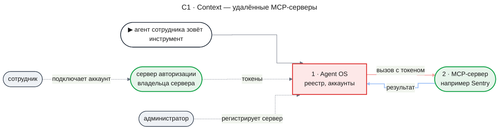
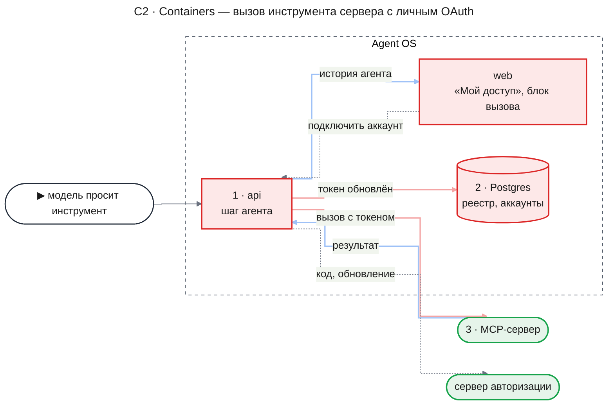
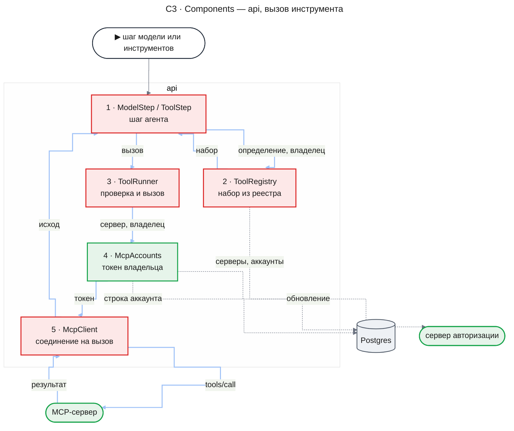
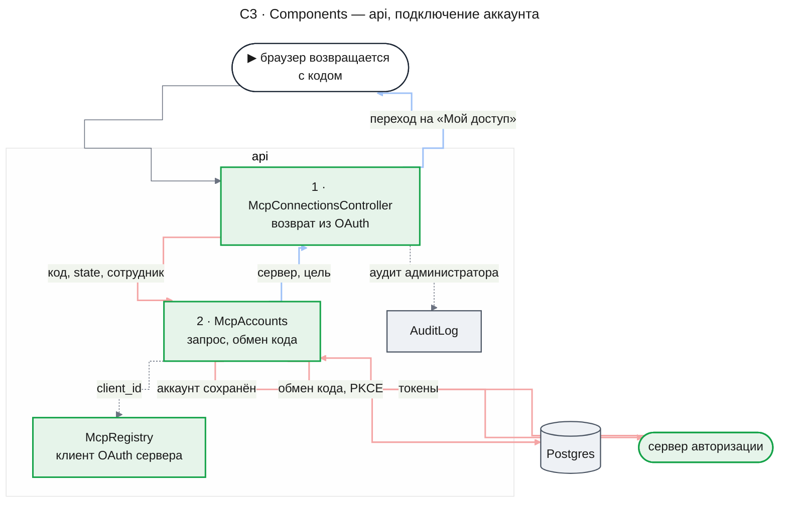
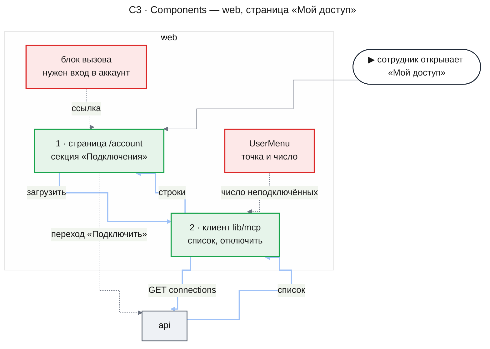
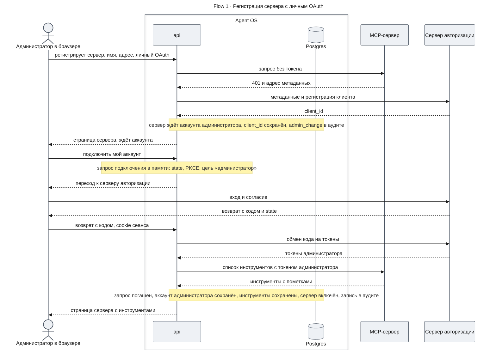
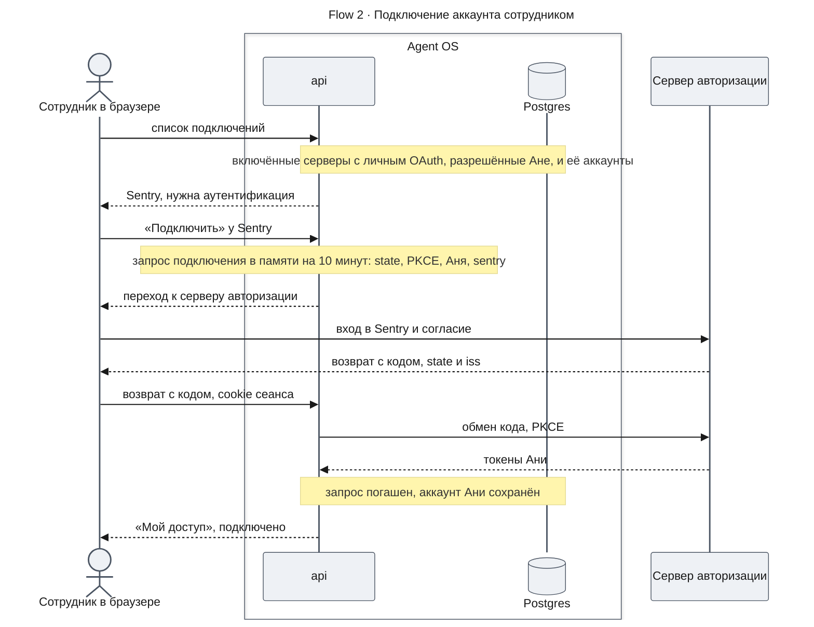
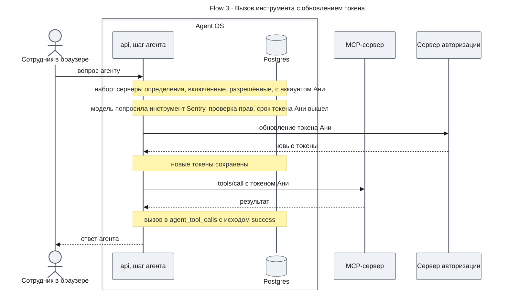
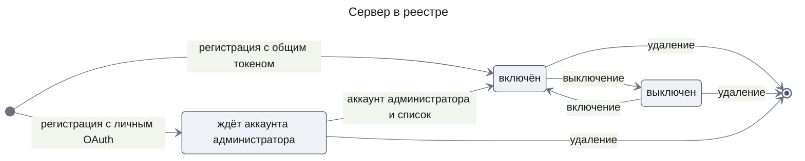

# Корпоративный вход и управление доступом — Design Document — mcp-connect

**Status:** Approved · **Date:** 2026-11-15 · **PRD:** [prd.md](./prd.md) · **UXRD:** [uxrd.md](./uxrd.md) · **Depends on:** [design-identity.md](./design-identity.md#contract-definitions)

## Snapshot

**Overview.** Сегодня список MCP-серверов лежит в JSON-файле: платформа при старте запускает каждый сервер процессом на своей машине, один раз читает его инструменты и держит их в памяти. Эта часть переносит серверы в базу: администратор регистрирует удалённый сервер по адресу, платформа получает его инструменты по HTTP и хранит список в реестре. У сервера один из двух режимов: общий токен, который ввёл администратор, или личный OAuth, когда каждый сотрудник подключает свой аккаунт на странице «Мой доступ», а платформа хранит его токен в базе отдельной записью и сама его обновляет. Перед каждым вызовом модели агент читает реестр и подключённые аккаунты из базы, поэтому любое изменение доходит до работающих агентов без рестарта. Каждый вызов инструмента открывает своё короткое соединение с токеном того сотрудника, которому принадлежит задача.

- **Не меняется**: правило «одна функция доступа при сборке набора и при вызове» (`agent-platform`), пометка «читает» по `readOnlyHint` и подтверждение меняющих вызовов; таблица прав `MCP_ACCESS_TABLE` живёт до части `access` по правилу [design-identity.md](./design-identity.md), Constraints.
- **Biggest risk**: токен одного сотрудника уходит в вызов другого. Защита — соединение на один вызов, собранное по владельцу задачи, и e2e-тест на двух сотрудниках ([Risks and Mitigation](#risks-and-mitigation)).
- **Open questions**: блокирующих нет; вопросы владельцу — [Open Questions](#open-questions).

### Key Decisions

#### KD-1: Реестр серверов, аккаунты сотрудников и вход в OAuth живут в пакете `agents` в его таблицах `agent_mcp_*`; `apps/api` даёт только HTTP и аудит

Пакет `agents` уже владеет MCP-клиентом и шагом агента, который зовёт инструмент. В момент отправки ему нужен токен владельца задачи: прочитать, при необходимости обновить и сохранить. Если этим владеет сам пакет, токен не пересекает границу пакета ни разу, а логика MCP остаётся в одном месте. `apps/api` получает три контроллера (сотрудник, администратор, возврат из OAuth), пишет аудит и передаёт в операции подключения адрес возврата, построенный по `IdentitySettings.publicUrl(request)` ([design-identity.md](./design-identity.md#contract-definitions), раздел «Для `mcp-connect`, `access` и всех частей»).

Пишущая операция пакета возвращает «было» и «стало» без секретов, и контроллер сразу после неё пишет `AuditLog.record(null, …)`. Внешние вызовы (проверка сервера, обмен кода, список инструментов) пакет делает вне транзакции ([repository-over-transaction.md](../../code-system/patterns/repository-over-transaction.md)).

Варианты, которые не взяты:

- **Таблицы `mcp_*` в `apps/api` и порт реестра в `createAgents`.** Порт пришлось бы звать на каждый шаг и на каждый вызов, а токен и его обновление ходили бы туда и обратно через него. Код OAuth жил бы в `apps/api`, а вызов MCP — в пакете: два места для одной логики.
- **Оставить JSON-файл и накладывать на него правки из базы.** PRD требует, чтобы система записи была одна — база (PRD, Constraints).

Решение записано в [ADR-0014](../../adr/ADR-0014-mcp-registry-owned-by-agents.md).

#### KD-2: В памяти процесса реестра нет: набор инструментов собирается из базы перед каждым вызовом модели, а список инструментов сервера меняет только администратор

Сегодня `createMcpClients` при старте читает инструменты каждого сервера в кэш процесса, а `sessionTools` синхронно собирает набор из этого кэша. Теперь список инструментов хранится в строке сервера, а `sessionTools`, `definitionMcpTools` и `display` реестра инструментов становятся асинхронными и читают базу. Набор сессии — серверы определения (`*` — все включённые) в пересечении с включёнными серверами реестра, с функцией доступа и с подключёнными аккаунтами владельца для серверов с личным OAuth (DC-1). Это два коротких чтения на шаг: серверы определения со списками инструментов и аккаунты владельца. Изменение видно со следующего шага.

Имена серверов в определениях больше не сверяются с реестром при старте: реестр пуст при первом старте и меняется на ходу. `checkCatalog` проверяет только форму имени, а имя без сервера в реестре не даёт инструментов (DC-11). Список инструментов платформа читает только по запросу администратора: автоматического обновления нет (PRD, Won't Have).

Варианты, которые не взяты:

- **Кэш процесса со сбросом при каждом изменении реестра и аккаунтов.** Сбрасывать пришлось бы из каждой операции, а выигрыш — два чтения по индексу на шаг, рядом с вызовом модели на секунды.
- **Читать `tools/list` у сервера на каждом шаге.** Сеть на каждом шаге и инструменты, которые администратор не видел: пометку «читает» и права на инструмент он проверяет по списку реестра.

#### KD-3: Каждый вызов инструмента открывает своё соединение Streamable HTTP с токеном владельца задачи и закрывает его после ответа

`McpClient` переписывается под `StreamableHTTPClientTransport` установленного SDK `@modelcontextprotocol/client` 2.4.0. На каждый вызов он создаёт клиент и транспорт с `AuthProvider` — минимальным крючком SDK, у которого `token()` отдаёт токен перед каждым запросом, а `onUnauthorized` вызывается один раз на ответ 401. Затем клиент делает `initialize`, `tools/call` и закрывает соединение. Весь вызов, включая рукопожатие, ограничен `MCP_CALL_TIMEOUT_MS` и сигналом шага. Соединение не переживает вызов, поэтому токен одного сотрудника не может достаться вызову другого (AC-13.2), а состояния «соединение упало, переподключиться» больше нет. Тот же клиент читает список инструментов для администратора.

Варианты, которые не взяты:

- **Пул соединений по паре «сервер — владелец токена».** Экономит одно рукопожатие на вызов, но возвращает машину состояний «устарел — переподключиться», а пул нужно сбрасывать при обновлении токена и отключении аккаунта.
- **Одно соединение на сервер, как сейчас.** С личным OAuth на нём пришлось бы менять токен между вызовами разных сотрудников — ровно риск AC-13.2.

#### KD-4: Платформа регистрируется клиентом OAuth у сервера авторизации динамически (RFC 7591) один раз на сервер, как публичный клиент с PKCE

Sentry MCP, эталонный сервер, публикует метаданные защищённого ресурса и сервера авторизации, `registration_endpoint`, PKCE `S256`, способ аутентификации клиента `none` и параметр `iss` в ответе авторизации (метаданные прочитаны 2026-11-15, регистрация не выполнялась). При регистрации сервера с личным OAuth платформа находит сервер авторизации по ответу 401 и метаданным, регистрирует клиента с одним адресом возврата `<публичный адрес>/api/mcp/oauth/callback` и сохраняет `client_id` в строке сервера. Публичный адрес даёт `IdentitySettings.publicUrl(request)`. Если сервер авторизации выдал секрет клиента, он хранится в той же строке как есть. Все сотрудники подключаются через этого клиента. Функции SDK `discoverOAuthServerInfo`, `registerClient`, `startAuthorization`, `exchangeAuthorization` и `refreshAuthorization` делают протокол: метаданные, `resource` по RFC 8707, проверку `iss` по RFC 9207. Своего кода протокола OAuth в платформе нет.

Варианты, которые не взяты:

- **Документ метаданных клиента (CIMD): `client_id` — адрес JSON на сайте платформы.** SDK и Sentry его поддерживают, но сервер авторизации должен скачать этот адрес по `https`. С `http://localhost` в разработке и с развёртыванием во внутренней сети это не работает, а DCR требует только, чтобы до адреса возврата доходил браузер.
- **Клиент, заранее заведённый администратором у владельца сервера.** Это лишние поля в форме и ручной шаг у каждого владельца, а Sentry не просит его.
- **`auth()` из SDK с провайдером `OAuthClientProvider`.** Он сам выбирает CIMD, если сервер его поддерживает, а при `invalid_grant` начинает новый вход с переходом браузера и пишет `console.warn` мимо логгера (проверено в `public-*.mjs` установленного пакета). Подключение у нас идёт серверным переходом, а потеря токена — исход вызова (KD-5), поэтому берутся отдельные функции SDK.

#### KD-5: Токен берётся в момент отправки и обновляется перед вызовом; аккаунт, который не обновился, удаляется, а вызов получает новый исход `auth_required`

Фича рассчитана на один процесс API. `McpAccounts` читает строку аккаунта по серверу и `ownerId` задачи. Если до конца срока доступа меньше 60 секунд, он обновляет токен и сохраняет новые токены в ту же строку. Ответ 401 от сервера MCP вызывает через `onUnauthorized` то же обновление один раз. Пока обновление пары «сервер — сотрудник» идёт, другие вызовы этой пары ждут его, а не начинают своё: сервер авторизации, который меняет refresh-токен при каждом обновлении, отозвал бы за повтор всю цепочку (DC-4).

Если аккаунта нет, обновление вернуло `invalid_grant` или сервер ответил 401 после обновления, строка аккаунта удаляется. Вызов получает исход `auth_required`, а модель — текст о том, что сотруднику нужно подключить аккаунт на странице «Мой доступ». Агент продолжает работу, а со следующего вызова модели инструментов сервера в наборе нет (AC-14.5, DC-3). Исход новый, потому что право у сотрудника есть и чинит всё он сам: красное «отказано» говорило бы обратное (`uxrd.md` KD-5, [tool-call.md](../../design-system/components/tool-call.md), «Нужен вход в аккаунт»). Сервер с общим токеном, который ответил 401, даёт прежний исход `transport_failure` с причиной в логе `unauthorized` (DC-10): чинит его администратор, а не сотрудник.

Варианты, которые не взяты:

- **Причина отказа `account_not_connected` при исходе `refused`.** Отказ значит «запрещено», а здесь разрешено, но не подключено.
- **Пауза агента до подключения.** PRD её исключает (Won't Have).

#### KD-6: Подключение аккаунта — переход в той же вкладке: `GET` под сеансом уводит к серверу авторизации, возврат тоже идёт под сеансом, а одноразовый запрос подключения привязан к сотруднику

«Подключить» на «Мой доступ» — ссылка на `GET /api/mcp/connections/:server/connect` (`uxrd.md` KD-2). Сервер создаёт запрос подключения в памяти процесса: `state`, PKCE-верификатор, сотрудник, сервер, цель (сотрудник или администратор) и срок 10 минут. Затем он отвечает 302 на адрес авторизации. Рестарт API теряет начатые подключения, и сотрудник жмёт «Подключить» снова. Сервер авторизации возвращает браузер на `/api/mcp/oauth/callback`. Cookie сеанса `SameSite=Lax` браузер шлёт и при межсайтовом переходе верхнего уровня, поэтому возврат закрыт обычной проверкой сеанса ([design-identity.md](./design-identity.md), KD-2) и `@Public()` не нужен. Запрос принимается один раз и только сеансом того же сотрудника. Чужой `state`, подсунутый в браузер Ани, не подключит ей аккаунт злоумышленника (DC-5).

Варианты, которые не взяты:

- **Открытый возврат с cookie привязки к браузеру, как у входа `identity`.** Вход идёт без сеанса, а подключение — всегда с ним, и сеанс уже даёт и сотрудника, и привязку.
- **Всплывающее окно.** UXRD выбрал переход в той же вкладке: его не блокирует браузер, и он одинаково работает на телефоне.

#### KD-7: Тестовые серверы работают одним процессом по HTTP со своим минимальным сервером авторизации; производственный образ их не несёт; реестр разработки наполняет скрипт

`packages/mcp-fixture` получает HTTP-вход на `node:http` с `WebStandardStreamableHTTPServerTransport` и `requireBearerAuth` из `@modelcontextprotocol/server` 2.4.0, без новых зависимостей. Каждый источник (`logs`, `backoffice`, `tracker`) отвечает на своём пути. Его защищает либо постоянный общий токен, либо токены собственного сервера авторизации фикстуры. В SDK сервера авторизации нет, поэтому фикстура пишет его сама: метаданные, динамическая регистрация, авторизация без экрана согласия, обмен кода с PKCE, обновление со сменой refresh-токена. Тест может укоротить срок токена и отозвать refresh-токены аккаунта; в `production` этих ручек нет. Журнал вызовов пишет у каждого вызова источник, инструмент и аккаунт токена. Правила сбоев сохраняют смысл по HTTP: `hang`, `drop_connection`, испорченный ответ и подмена результата. `crash_process` уходит, потому что процессом удалённого сервера платформа больше не управляет. Тесты и скрипт поэтому обходятся без интернета (AC-15.1, AC-15.2).

Скрипт `seed:mcp` — клиент HTTP запущенного API разработки, своих путей в базу у него нет. Разработчик один раз заводит администратора командой `identity:super-admin` и передаёт скрипту его логин, а пароль скрипт читает из стандартного ввода. Скрипт входит через `POST /api/auth/password` и регистрирует через маршруты администратора `logs` и `tracker` с общим токеном и `backoffice` с личным OAuth. Затем он сам играет браузер: идёт по `.../connect`, сервер авторизации фикстуры сразу возвращает код, и возврат подключает аккаунт администратора и получает список инструментов (Flow 1).

Варианты, которые не взяты:

- **Фикстура внутри процесса теста.** Тесты `run_code` уже работают с отдельными процессами. Отдельный процесс фикстуры ближе к удалённому серверу и не делит с API цикл событий.
- **Готовый сервер авторизации (mock OIDC) зависимостью.** Он не даёт ручек «отозвать refresh» и «укоротить срок», а фикстуре нужно пять маршрутов.

## Terms

- **Реестр** — таблица `agent_mcp_servers`: имя, адрес, режим учётных данных, включён ли сервер и его список инструментов (PRD, «Реестр MCP-серверов»).
- **Streamable HTTP** — транспорт MCP поверх HTTP: клиент шлёт JSON-RPC запросом `POST` на один адрес сервера, а ответ приходит телом или потоком.
- **Сервер авторизации** — сервис OAuth владельца MCP-сервера: там сотрудник входит и соглашается, и он выдаёт токены. У Sentry это `https://mcp.sentry.dev`.
- **DCR** (dynamic client registration, RFC 7591) — платформа сама регистрируется клиентом у сервера авторизации запросом и получает `client_id`.
- **PKCE** — одноразовый секрет входа: платформа шлёт его хеш при начале входа и сам секрет при обмене кода, поэтому украденный код без него бесполезен.
- **Аккаунт** — строка `agent_mcp_accounts`: личные учётные данные одного сотрудника на одном сервере — токен и тип токена (PRD, Constraints). Есть строка — «подключено», нет — «нужна аутентификация».
- **Запрос подключения** — одноразовая запись в памяти процесса между уходом браузера к серверу авторизации и возвратом (KD-6).
- **`auth_required`** — новый исход вызова инструмента: сервер требует аккаунт сотрудника, а годного аккаунта нет (KD-5).

## Part

- **Part**: `mcp-connect`
- **Covers**: FR-12, FR-13, FR-14, FR-15; NFR-02 для общих токенов серверов и токенов сотрудников; NFR-05 для страницы «Мой доступ»
- **Depends on**: [design-identity.md#contract-definitions](./design-identity.md#contract-definitions) — правило секретов других систем, `IdentitySettings.publicUrl(request)`, `AuditLog.record`, `@AdminOnly()`, `req.user.id`, `OwnerGate`, вход в тестах через `POST /api/auth/password`, `UserMenu` и обработчик 401 веба
- **Prerequisite ADRs**: [ADR-0001](../../adr/ADR-0001-durable-runtime-owner.md) (состояние в Postgres), [ADR-0002](../../adr/ADR-0002-app-schema-migrations.md) и [ADR-0003](../../adr/ADR-0003-drizzle-data-layer.md) (свои таблицы в схеме `app`, Drizzle), [ADR-0004](../../adr/ADR-0004-agent-framework-packages.md) (пакет не читает окружение, порты параметрами), [ADR-0009](../../adr/ADR-0009-agent-definitions-as-process-data.md) (определения — данные процесса), [ADR-0012](../../adr/ADR-0012-closed-api-and-server-issued-employee-id.md) (закрытый API, UUID сотрудника во владельце)
- **Sibling parts**: `identity` (FR-01–FR-11), `access` (FR-16–FR-23), `admin` (FR-24–FR-31)

**Out of scope**

- Права ролей и личные права на сервер и инструмент, их проверка и замена `MCP_ACCESS_TABLE` — часть `access`. Здесь функция доступа остаётся прежней и спрашивается в трёх местах (Contract Definitions, «Для `access`»).
- Экраны «MCP-серверы» панели (`uxrd.md` AD-08–AD-10) и колонка «Аккаунт» на странице сотрудника — часть `admin` поверх операций этой части. Секция «Модели и расход» страницы «Мой доступ» (`uxrd.md` MA-02) — часть `access`.
- Отзыв токенов у сервера авторизации при отключении аккаунта или удалении сервера: платформа удаляет только свои токены и не зовёт владельца сервера.
- Пометка «читает» по `readOnlyHint` и подтверждение меняющих вызовов остаются как в `agent-platform`.
- Транспорт stdio, файл серверов, `MCP_SERVERS_FILE`, их загрузчики и тесты удаляются целиком; совместимости нет (PRD, Constraints).

**Constraints**

- Только HTTP: `StdioClientTransport`, `McpServerSchema` с `command`/`args`/`env`, `config/mcp-servers.json` и `readMcpServersFile` удаляются (KD-3).
- Система записи — база: реестр и аккаунты в таблицах `agent_mcp_*`, изменения без рестарта (KD-1, KD-2).
- Один процесс API: координации между экземплярами фича не добавляет.
- Список инструментов обновляется только по запросу администратора (KD-2).
- Фича не добавляет настроек окружения (PRD, Constraints). Пакет `agents` окружение не читает: адрес возврата OAuth `apps/api` передаёт в операции подключения, а `MCP_ACCESS_TABLE` приходит разобранной в настройках, как сейчас (ADR-0004).
- Общие токены серверов, секрет клиента OAuth и токены сотрудников хранятся в базе как есть, без шифрования; личные учётные данные — отдельной записью «сотрудник, сервер, токен, тип токена» (PRD, Constraints). Значение не возвращается после сохранения, не пишется в лог и историю агента (NFR-02).
- До части `access` право на сервер даёт `MCP_ACCESS_TABLE` с ключом-UUID и `*` ([design-identity.md](./design-identity.md), Constraints). Имена серверов в таблице больше не сверяются с файлом: имя без сервера в реестре просто ничего не даёт.
- Логи идут через логгер `packages/common` с id сервера, сотрудника, задачи, вызова и запроса подключения; токены, код авторизации, `state` и тела ответов сервера авторизации в лог не попадают (Security Considerations).

## Building-block Inventory

Follows the [code system](../../code-system/README.md). Перед «new» поиск шёл по `docs/code-system/` и по `packages/agents/src`, `apps/api/src`, `packages/mcp-fixture/src`, `apps/web/src` (`mcp`, `oauth`, `token`, `registry`, `connection`, `http`): реестра, OAuth, HTTP-транспорта MCP, страницы подключений и скрипта начальных данных в коде нет.

| Building block | Pattern | Status | Note |
|---|---|---|---|
| `McpClient` в `packages/agents/src/mcp` | — | extended | Переписан под Streamable HTTP, соединение на вызов (KD-3); `McpStartupError` и машина «устарел» удалены |
| `createMcpClients` и кэш инструментов процесса | — | removed | Набор из базы (KD-2) |
| `McpRegistry` — серверы и их инструменты, таблица `agent_mcp_servers` | [repository-over-transaction.md](../../code-system/patterns/repository-over-transaction.md) | new | Операции возвращают «было» и «стало» для аудита (KD-1) |
| `McpAccounts` — подключение, токены, обновление | [repository-over-transaction.md](../../code-system/patterns/repository-over-transaction.md) | new | Таблица `agent_mcp_accounts`; запросы подключения в памяти (KD-4, KD-5, KD-6) |
| `ToolRegistry` | — | extended | `sessionTools`, `definitionMcpTools`, `display` асинхронные, из базы (KD-2) |
| `ToolRunner`, `mcp-outcome`, `mcp-failure` | [step-handler.md](../../code-system/patterns/step-handler.md) | extended | Владелец в вызове, исход `auth_required`, ошибки OAuth и HTTP (KD-5) |
| `parseAgentsConfig`, `checkCatalog` | [composition-root.md](../../code-system/patterns/composition-root.md) | extended | Без файла серверов; имена серверов — только форма (KD-2) |
| `createAgents` | [composition-root.md](../../code-system/patterns/composition-root.md) | extended | Без файла серверов; операции `mcp` (Contract Definitions) |
| Контроллеры `McpConnectionsController`, `AdminMcpServersController` в `apps/api/src/agents` | [auth-boundary.md](../../code-system/patterns/auth-boundary.md) | new | Все маршруты под сеансом; администратор — `@AdminOnly()` |
| `AuditLog`, `IdentitySettings.publicUrl`, `OwnerGate` | контракты `identity` | reused | Аудит изменений реестра; адрес возврата OAuth |
| Логгер `packages/common` | [logging.md](../../code-system/patterns/logging.md) | extended | Имена секретных полей `refreshToken`, `sharedToken`, `tokens` |
| Скрипт `seed:mcp` в `apps/api` | — | new | Регистрирует фикстуры через API разработки от имени администратора (KD-7) |
| `packages/mcp-fixture`: HTTP-вход, сервер авторизации, правила сбоев | — | extended | KD-7; `fixtureServersFile` заменён запуском процесса фикстуры |
| Страница `/account` веба, секция «Подключения» | — | new | `uxrd.md` Screen 3, MA-01 |
| `UserMenu` веба | — | extended | Пункт «Мой доступ», точка и число (`uxrd.md` UM-01) |
| Блок вызова инструмента веба (`tool-fallback.aui.tsx`) | — | extended | Исход `auth_required` со ссылкой на «Мой доступ» (`uxrd.md` RF-01, MC-10) |

## Acceptance Criteria

### FR-12: Реестр MCP-серверов

- From the PRD: AC-12.1, AC-12.2, AC-12.3, AC-12.4, AC-12.5
- Набор MCP-инструментов агента — серверы его определения (`*` — все включённые), которые включены в реестре, разрешены владельцу задачи функцией доступа и, у сервера с личным OAuth, имеют подключённый аккаунт владельца. Набор пересчитывается из базы перед каждым вызовом модели (DC-1).
- Вызов инструмента сервера, которого нет в наборе для проверки (выключен, удалён, не в определении), получает отказ `tool_not_in_definition`; вызов сервера, который владельцу не разрешён, — `no_access`. В обоих случаях сервер не получает ни одного запроса (DC-2).
- Регистрация сервера и замена общего токена сначала проверяют сервер. Если проверка не прошла, ответ — 422 `MCP_SERVER_CHECK_FAILED` с причиной, и ничего не сохраняется (DC-6).
- Сервер с личным OAuth не виден агентам и не стоит в списках подключений, пока администратор не подключил свой аккаунт и платформа не получила список инструментов. Включить его раньше нельзя: 409 `MCP_SERVER_INCOMPLETE` (DC-7).- Определение, которое называет сервер, которого нет в реестре, проходит проверку при старте, а имя не даёт инструментов (DC-11).
### FR-13: Режимы учётных данных

- From the PRD: AC-13.1, AC-13.2, AC-13.3, AC-13.4, AC-13.5, AC-13.6
- Не больше одного обновления токена за раз на пару «сервер — сотрудник»; вызов, который ждал обновления, идёт с новым токеном (DC-4).
- Если сервер с общим токеном ответил 401, вызов получает исход `transport_failure` (DC-10).
- Возврат запроса подключения с целью «администратор» проверяет право администратора сотрудника в момент возврата. Без права запрос отклоняется до обмена кода: аккаунт и список инструментов не сохраняются, в аудите — `access_denied`, браузер приходит на страницу сервера с `error=connect_failed` (DC-13).
### FR-14: Список подключений сотрудника

- From the PRD: AC-14.1, AC-14.2, AC-14.3, AC-14.4, AC-14.5, AC-14.6
- Вызов инструмента сервера с личным OAuth без годного аккаунта владельца (нет строки, обновление не удалось, 401 после обновления) получает исход `auth_required`. Сервер не получает запроса без токена владельца, строка аккаунта удалена, агент продолжает работу (DC-3).
- Запрос подключения принимается один раз, не позже 10 минут после начала и только сеансом сотрудника, который его начал; при поддержке сервером авторизации `iss` в возврате должен совпасть с его издателем. Иначе, а также при отказе или отмене у сервера авторизации, браузер приходит на `/account?error=connect_failed&server=<имя>`, а аккаунт не меняется (DC-5).

### FR-15: Один транспорт и тестовые серверы по HTTP

- From the PRD: AC-15.1, AC-15.2

## Design

### Architecture (C1–C4)

#### C1 · Context

Agent OS теперь ходит к MCP-серверам по сети, а у серверов с личным OAuth сотрудник сам входит к их владельцу.

#### C2 · Containers

- `web` получает страницу `/account` с секцией «Подключения», пункт «Мой доступ» с точкой в меню и исход «нужен вход в аккаунт» в блоке вызова.
- `api` ведёт реестр, подключение аккаунтов и возврат из OAuth, а шаг агента сам ходит к MCP-серверу и к серверу авторизации за обновлением токена.
- `Postgres` получает таблицы `agent_mcp_*` (Data Model); CHECK исхода вызова в `agent_tool_calls` и `agent_code_calls` получает `auth_required`.

#### C3 · Components: api

**api — вызов инструмента.** Набор и токен приходят из базы в том шаге, где вызов исполняется; в памяти процесса между шагами ничего нет.

- `ToolRegistry` собирает набор для модели (с фильтром подключённых аккаунтов) и набор для проверки вызова (без него). Поэтому инструмент неподключённого сервера модели не предлагается, а вызов, который модель попросила до отключения аккаунта, получает `auth_required`, а не `tool_not_in_definition` (DC-1, DC-3). Функция доступа одна и та же в обоих наборах и в списке подключений.
- `ToolRunner` получает `ownerId` из `ToolCaller` на каждом пути вызова: прямом, после подтверждения, после рестарта и из `run_code`. Перед вызовом он, как и прежде, спрашивает `OwnerGate` ([design-identity.md](./design-identity.md), KD-4).
- `McpAccounts` для сервера с общим токеном берёт его из строки сервера, а для личного OAuth — токены из строки аккаунта, с обновлением перед вызовом (KD-5).
- `McpClient` отображает ошибки в исходы: `UnauthorizedError` и `SdkHttpError` с кодом `ClientHttpAuthentication` дают `auth_required` у личного OAuth и `transport_failure` с причиной `unauthorized` у общего токена. SDK отдаёт сбой самого запроса HTTP (отказ соединения, DNS, TLS, обрыв при чтении тела) как ошибку `fetch`, а не как ошибку SDK. Поэтому `mcpFailureReason` учится узнавать и её: такой сбой даёт `transport_failure` с причиной `connection_lost`, таймаут запроса или сигнал шага — `timeout`, неожиданный или нечитаемый ответ — `protocol_error`. Дефектом и падением шага остаётся только ошибка вне этих классов; правило `drop_connection` фикстуры проверяет обрыв (UC-E4).

**api — подключение аккаунта.** Контроллер только переводит HTTP в операции пакета; протокол OAuth и таблицы — в `McpAccounts`.

- `McpConnectionsController` держит маршруты сотрудника и возврат из OAuth, все под сеансом. `AdminMcpServersController` держит операции администратора под `@AdminOnly()` и через ту же `McpAccounts` подключает аккаунт администратора с целью «администратор»: после обмена кода `McpRegistry` читает список инструментов и включает сервер (Flow 1).
- `McpAccounts.finish` гасит запрос подключения, сверяет сотрудника с сеансом, а у запроса с целью «администратор» — ещё и право администратора по сеансу в момент возврата (DC-13). Затем он обменивает код через `exchangeAuthorization` с PKCE и `iss` и сохраняет аккаунт с токенами и типом `oauth`. Отказ по праву администратора контроллер пишет в аудит как `access_denied` (DC-13).
- `McpRegistry` проверяет сервер при регистрации и замене общего токена (DC-6), хранит `client_id` и список инструментов. Инструменты он превращает в `McpTool` той же функцией `toMcpTool`, что и сегодня: имя `mcp__<сервер>__<инструмент>`, `readOnly` только при `readOnlyHint: true`, заголовки для показа.

#### C3 · Components: web

**web — «Мой доступ».** Страница читает список подключений один раз при открытии и после возврата; живого обновления нет (`uxrd.md` UM-01).

- Страница `/account` — `uxrd.md` Screen 3: строка MA-01 на каждый элемент списка, «Подключить» — ссылка на маршрут подключения, «Отключить» — `DELETE` и строка сразу в «Нужна аутентификация». Параметры возврата `connected` и `error` дают уведомление или ошибку под строкой сервера (MC-8) и фокус на кнопке этой строки. Секцию MA-02 добавляет часть `access`.
- `UserMenu` читает тот же список при загрузке страницы: точка на аватаре и число у пункта «Мой доступ» — число строк в статусе `needs_auth` (`uxrd.md` UM-01, MC-6).
- Блок вызова получает вид исхода `auth_required`: «нужен вход в аккаунт», `KeyRound`, `--warning`, строка MC-10 со ссылкой на `/account` и без блока результата ([tool-call.md](../../design-system/components/tool-call.md)).

### Runtime Flows

#### Flow 1: Регистрация сервера с личным OAuth

**Starts when:** администратор регистрирует сервер и подключает свой аккаунт, for AC-12.1, AC-12.2, AC-13.4, DC-6, DC-7

**Outcome:** в реестре сервер включён, у него `client_id` и список инструментов с пометками «читает» и «меняет». У администратора — свой аккаунт на этом сервере, такой же, как у любого сотрудника. Сервер с общим токеном регистрируется короче: платформа делает `initialize` и `tools/list` с введённым токеном, и при успехе сервер сразу сохраняется включённым вместе с токеном.

**Failure handling:**

- Адрес недоступен, ответ не похож на MCP, общий токен отвергнут, у сервера нет метаданных OAuth или `registration_endpoint`, сервер авторизации отказал в регистрации, адрес не `https` в продакшене → 422 `MCP_SERVER_CHECK_FAILED` с причиной, ничего не сохранено (AC-12.2, DC-6).
- Администратор отменил вход у владельца сервера или обмен кода не прошёл → переход на страницу сервера с `error=connect_failed`; сервер остаётся в статусе «ждёт аккаунта администратора» и не виден агентам (DC-7).
- Список инструментов не получен после входа → аккаунт администратора сохранён, сервер ждёт, переход с `error=tools_failed`; администратор жмёт «Обновить список» (AC-12.3).
- Имя уже занято → 409 `MCP_SERVER_NAME_TAKEN` до любого внешнего вызова.

#### Flow 2: Сотрудник подключает аккаунт

**Starts when:** Аня открывает «Мой доступ» и нажимает «Подключить» у Sentry, for AC-14.1, AC-14.3, AC-14.6, DC-5

**Outcome:** у Ани строка аккаунта на `sentry` с токенами типа `oauth` и сроком доступа. Следующий вызов модели любого её агента собирает набор уже с инструментами Sentry (AC-14.3). «Отключить» удаляет строку, и со следующего вызова модели инструментов нет (AC-14.4).

**Failure handling:**

- Сервер авторизации вернул `error` (Аня отказала или отменила) → `/account?error=connect_failed&server=sentry`, аккаунт не меняется.
- `state` не найден, уже погашен, старше 10 минут или принадлежит другому сотруднику; `iss` отсутствует или не совпал при поддержке сервером авторизации → тот же переход, запрос удаляется (DC-5).
- Сервера нет, он выключен, не с личным OAuth или Ане не разрешён → «Подключить» сразу возвращает `error=connect_failed`, к серверу авторизации браузер не уходит.
- Сеанс Ани кончился, пока она входила у владельца сервера → возврат получает 401 от проверки сеанса; Аня входит снова и повторяет подключение (Risks and Mitigation).

#### Flow 3: Вызов инструмента токеном сотрудника

**Starts when:** модель агента Ани просит инструмент Sentry, а срок её токена доступа вышел, for AC-12.5, AC-13.2, AC-13.3, AC-14.2, AC-14.5, DC-1, DC-3, DC-4

**Outcome:** вызов прошёл токеном Ани, Аню ни о чём не спросили (AC-13.3). Строка `agent_tool_calls` принадлежит агенту Ани, и так каждый вызов общего или личного сервера записан на своего сотрудника (AC-13.1). Вызов агента Бориса в тот же момент собирает своё соединение со своим токеном (AC-13.2).

**Failure handling:**

- Обновление вернуло `invalid_grant`, аккаунта нет или сервер ответил 401 после обновления → строка аккаунта удалена, исход `auth_required`, модель получает текст «подключите аккаунт на странице «Мой доступ»», агент продолжает; в списке подключений — «нужна аутентификация» (AC-14.5, DC-3).
- Другой вызов Ани на `sentry` приходит, пока обновление идёт → он ждёт это обновление и идёт с новыми токенами, второго обновления нет (DC-4).
- Сервер авторизации недоступен при обновлении → `transport_failure` с причиной `connection_lost`, аккаунт остаётся: следующий вызов попробует снова.
- Сервер выключили между вызовом модели и вызовом инструмента → `tool_not_in_definition`, запроса к серверу нет (AC-12.4, DC-2).
- Шаг потерян после отправки меняющего вызова → поведение `agent-platform` с намерением не меняется: следующая попытка видит намерение без результата.

### Contract Definitions

Все маршруты — под префиксом `/api` и закрыты сеансом ([design-identity.md](./design-identity.md#contract-definitions)); маршруты `/api/admin/...` помечены `@AdminOnly()`. Тело ошибки — `ApiErrorSchema`. Изменяющий запрос проверяется по `Origin`.

#### Подключения сотрудника — для веба

- **`GET /api/mcp/connections`** — включённые серверы с личным OAuth, которые функция доступа разрешает сотруднику, по имени. Returns список `McpConnection`. Пустой список — «Подключать пока нечего» (AC-14.6).
- **`GET /api/mcp/connections/:server/connect`** — создаёт запрос подключения и отвечает 302 на адрес авторизации сервера. Неизвестный, выключенный, неразрешённый сервер или сервер не с личным OAuth — 302 на `{FRONTEND_ORIGIN}/account?error=connect_failed&server=<имя>`.
- **`GET /api/mcp/oauth/callback`** — возврат от сервера авторизации с `code`, `state` и `iss` или с `error`. Успех у сотрудника — 302 на `{FRONTEND_ORIGIN}/account?connected=<имя>`, у администратора — на `{FRONTEND_ORIGIN}/admin/servers/<имя>?connected=1`. Отказ — 302 на `/account?error=connect_failed&server=<имя>` или `/admin/servers/<имя>?error=connect_failed`; у администратора ещё `error=tools_failed`, когда список инструментов не получен (DC-5). Возврат с целью «администратор» без права администратора у сеанса — `error=connect_failed` и запись `access_denied` (DC-13).
- **`DELETE /api/mcp/connections/:server`** — удаляет аккаунт сотрудника на сервере. Returns 204, в том числе когда аккаунта нет.

**McpConnection**

- `server` — имя сервера в реестре.
- `url` — адрес сервера; веб показывает его хост второй строкой.
- `status` — `connected` или `needs_auth`.

#### Реестр — для `admin`

- **`GET /api/admin/mcp-servers`** — серверы по имени. Returns список `McpServerSummary`.
- **`POST /api/admin/mcp-servers`** — регистрирует сервер по `name`, `url`, `mode` и, при `mode` `shared`, `sharedToken` (1–4096 знаков). Сначала проверяет сервер (Flow 1). Returns 201 и `McpServerView`: при `shared` — включённый с инструментами, при `oauth` — в статусе `awaiting_admin_account`. 409 `MCP_SERVER_NAME_TAKEN`, 422 `MCP_SERVER_CHECK_FAILED`.
- **`GET /api/admin/mcp-servers/:name`** — `McpServerView`. 404 `MCP_SERVER_NOT_FOUND`.
- **`GET /api/admin/mcp-servers/:name/connect`** — подключает аккаунт текущего администратора к серверу с личным OAuth: 302 к серверу авторизации, возврат через `/api/mcp/oauth/callback` с целью «администратор». Сервер не с личным OAuth или неизвестный — 302 на `/admin/servers/<имя>?error=connect_failed`.
- **`PATCH /api/admin/mcp-servers/:name`** — меняет `enabled` и `sharedToken`; новый токен сначала проверяется (DC-6). Имя, адрес и режим после регистрации не меняются: чтобы их сменить, сервер удаляют и регистрируют заново. Returns `McpServerView`. 409 `MCP_SERVER_INCOMPLETE` при включении сервера без списка инструментов (DC-7); 422 `MCP_SERVER_CHECK_FAILED`; 404 `MCP_SERVER_NOT_FOUND`.
- **`POST /api/admin/mcp-servers/:name/tools/refresh`** — читает список инструментов заново общим токеном или аккаунтом текущего администратора и заменяет его целиком. Returns `server` (`McpServerView`), `added` и `removed` — имена новых и убранных инструментов (MC-29). 409 `MCP_ACCOUNT_REQUIRED`, если у администратора нет аккаунта на сервере с личным OAuth: веб ведёт на `.../connect`. 422 `MCP_SERVER_CHECK_FAILED`, и прежний список остаётся.
- **`DELETE /api/admin/mcp-servers/:name`** — удаляет сервер и его аккаунты (AC-13.6). Returns 204. Строки истории вызовов хранят имя сервера текстом и остаются.

После каждого изменения контроллер пишет `admin_change` с `objectType` `mcp_server`, «было» и «стало»; общий токен в записи — `secret_changed`.

**McpServerSummary**

- `name` — 1–32 знака kebab-case, уникально, не меняется после регистрации. Его пишут в `mcpServers` определений, и оно же стоит в `agent_tool_calls.server`.
- `url` — `https` (в режимах `development` и `test` — и `http`), до 2048 знаков.
- `mode` — `shared` или `oauth`.
- `status` — `enabled`, `disabled` или `awaiting_admin_account`.
- `toolCount` — число инструментов в списке.

**McpServerView** — поля `McpServerSummary` и ещё:

- `sharedTokenSet` — задан ли общий токен; значения токена нет ни в одном ответе (AC-13.5).
- `tools` — список по имени: `name`, `title` (или `null`), `description`, `readOnly` — `true` только при `readOnlyHint: true` у сервера.
**Причины `MCP_SERVER_CHECK_FAILED`** (поле `reason` тела ошибки): `unreachable` — нет соединения; `timeout` — нет ответа за `MCP_CALL_TIMEOUT_MS`; `not_mcp` — ответ не MCP; `unauthorized` — общий токен отвергнут; `oauth_not_supported` — нет метаданных OAuth или `registration_endpoint`; `registration_rejected` — сервер авторизации отказал в регистрации клиента; `insecure_url` — адрес сервера или сервера авторизации не `https` вне разработки. Текст причины для панели — `uxrd.md` MC-29.

#### Для `access`

- **Функция доступа** — сегодня `serverAllowed(ownerId, server)` над `MCP_ACCESS_TABLE`. Пакет спрашивает её в трёх местах: набор для модели, проверка вызова (в том числе из `run_code`) и `GET /api/mcp/connections`. Набор и проверка асинхронны, а у проверки есть `ownerId`, имя сервера и имя инструмента. Часть `access` заменяет функцию своей проверкой целиком, и все три места меняются вместе.
- **Набор агента** — определение ∩ включённые серверы ∩ функция доступа ∩ подключённые аккаунты (DC-1). Фильтр подключённых аккаунтов — этой части; `access` его не повторяет.
- **Инструменты реестра** — список `tools` из `McpServerView`. Право на инструмент ссылается на пару «имя сервера — имя инструмента» текстом. Инструмент, убранный при обновлении списка, и сервер после удаления больше ничего не дают по такому праву; сервер, заново зарегистрированный под тем же именем, снова его получает.
- **Аккаунты сотрудника для панели** — операция пакета `mcp.accountsOf(ownerId)`: на каждый сервер с личным OAuth — подключён ли аккаунт сотрудника (колонка «Аккаунт», `uxrd.md` AD-04).

#### Пакет `agents` — для `apps/api`

- **`createAgents`** новых параметров не получает. Операции регистрации сервера с личным OAuth и подключения принимают `redirectUrl` — `<IdentitySettings.publicUrl(request)>/api/mcp/oauth/callback`, который строит контроллер по запросу. `parseAgentsConfig(variables)` больше не принимает файл серверов, а `AgentsConfig` не несёт `mcpServers`. `start()` не стартует процессов MCP, а `stop()` их не закрывает.
- **`Agents.mcp`** — операции реестра (`list`, `get`, `register`, `update`, `refreshTools`, `remove`), и подключения (`connections`, `beginConnect`, `finishConnect`, `disconnect`, `accountsOf`). Пишущая операция реестра возвращает «было» и «стало» без значений секретов, и контроллер пишет по ним `AuditLog.record(null, …)`.
- **`ToolOutcomeSchema`** получает `auth_required`. Исход сохраняется в `agent_tool_calls` и `agent_code_calls`, приходит в историю чата (`refusalReason` — `null`) и в скрипт `run_code`. Веб показывает его по `uxrd.md` RF-01.

**Error handling**

- `MCP_SERVER_NOT_FOUND` — 404: имени нет в реестре.
- `MCP_SERVER_NAME_TAKEN` — 409: имя уже зарегистрировано.
- `MCP_SERVER_CHECK_FAILED` — 422: проверка сервера не прошла; `reason` — из списка выше.
- `MCP_SERVER_INCOMPLETE` — 409: включение сервера с личным OAuth без списка инструментов.
- `MCP_ACCOUNT_REQUIRED` — 409: обновление списка сервера с личным OAuth без аккаунта текущего администратора.

**Runtime settings**

- `MCP_CALL_TIMEOUT_MS` — уже есть, по умолчанию `60000`; теперь ограничивает и вызов с рукопожатием, и проверку сервера, список инструментов, обмен кода и обновление токена.
- Новых переменных окружения нет. Адрес возврата OAuth — `<публичный адрес>/api/mcp/oauth/callback`, где публичный адрес даёт `IdentitySettings.publicUrl(request)`.
- `MCP_SERVERS_FILE` — удаляется.
- Постоянные кода: запрос подключения — 10 минут; обновление, когда до конца срока меньше 60 секунд; имя сервера — 1–32 знака.
- Процесс фикстуры (не сервер API): порт — аргумент запуска, по умолчанию `4100`; общий токен разработки — постоянная фикстуры, не секрет.

### Data Model

Новые таблицы лежат в схеме `app`, объявлены в `packages/db/src/schema.ts` и приходят одной миграцией. Префикс `agent_mcp_` принадлежит пакету `agents`.

- **`agent_mcp_servers`** — сервер: имя (первичный ключ), адрес, режим, включён ли, список инструментов с пометками и временем, общий токен, регистрация клиента OAuth: издатель сервера авторизации, `client_id` и секрет клиента, если он выдан. Токен и секрет лежат как есть. Имя, адрес и режим не меняются после регистрации. У режима `shared` всегда есть токен, у `oauth` его нет; включён может быть только сервер со списком инструментов.
- **`agent_mcp_accounts`** — личные учётные данные сотрудника для сервера, одна запись на пару «сотрудник — сервер»: сотрудник (`owner_id` текстом без внешнего ключа, как у прочих владельцев, ADR-0012), сервер, токен и тип токена — как он получен (PRD, Constraints). Сейчас тип один — `oauth`: токен доступа, refresh-токен и срок доступа как есть. Ещё строка хранит время подключения и обновления. Внешний ключ на сервер с каскадом удаляет записи всех сотрудников вместе с сервером (AC-13.6).
- **Запросы подключения** таблицы не имеют: они живут в памяти процесса до первого возврата или 10 минут (KD-6).
- **`agent_tool_calls`**, **`agent_code_calls`** — CHECK исхода получает `auth_required`; столбец `server` по-прежнему хранит имя текстом.
### State Transitions and Invariants

**Invariants**

1. Вызов сервера с личным OAuth идёт только с токеном аккаунта владельца задачи; соединение не переживает вызов.
2. Агенту и сотруднику видны только включённые серверы, а включённый сервер всегда имеет список инструментов.
3. Набор инструментов и токен берутся из базы в том шаге, где они нужны; в памяти процесса между шагами нет ни реестра, ни токенов.
4. Для пары «сервер — сотрудник» одновременно идёт не больше одного обновления токена.
5. Запрос подключения принимается не больше одного раза и только сеансом того сотрудника, который его начал.
6. Общий токен, секрет клиента и токены сотрудников не возвращаются ни одним ответом и не попадают в лог и историю агента; в аудит идёт только пометка `secret_changed`.

## Test Strategy

Все тесты идут на процессе фикстуры по HTTP с её сервером авторизации, без интернета и без настоящих аккаунтов (AC-15.2). Тест играет браузер: открывает адрес авторизации, получает переход с кодом и отдаёт его возврату платформы с cookie сеанса. Журнал вызовов фикстуры — доказательство «сервер не получил ни одного запроса» и «вызов пришёл с аккаунтом Ани». Тесты входят через `POST /api/auth/password` локальной учётной записью ([design-identity.md](./design-identity.md#contract-definitions)), а права до части `access` задаёт `MCP_ACCESS_TABLE`.

### Main Use Cases

- **UC-1: Сервер с общим токеном** — covers AC-12.1, AC-12.5, AC-13.1, AC-13.5, DC-1
  - Given: работающий агент Ани с определением `['*']`; Аня и Борис в `MCP_ACCESS_TABLE` с сервером `logs`; в реестре ничего нет
  - When: администратор регистрирует `logs` фикстуры с общим токеном; агенты Ани и Бориса вызывают его инструмент; администратор читает сервер
  - Then: ответ — включённый сервер со списком и пометками `readOnly`; следующий вызов модели агента Ани уже видит инструменты `logs` без рестарта; журнал фикстуры — два вызова с общим токеном; строки `agent_tool_calls` принадлежат агентам Ани и Бориса; в ответе `sharedTokenSet: true` и нет значения токена
- **UC-2: Личный OAuth: регистрация, подключение, вызовы двух сотрудников** — covers AC-15.2, AC-13.2, AC-13.4, AC-13.6, AC-14.1, AC-14.2, AC-14.3, AC-14.4, AC-14.6, DC-5, DC-7
  - Given: Ане и Борису разрешён `backoffice`, Глебу — нет; у Ани работает агент
  - When: администратор регистрирует `backoffice` в режиме личного OAuth и пробует включить его до подключения; подключает свой аккаунт; Аня и Глеб читают свои списки подключений; агент Ани вызывает модель; Аня и Борис подключают аккаунты; агенты обоих вызывают инструмент; Аня отключает аккаунт, и её агент вызывает модель снова; Аня подключает аккаунт заново, и администратор удаляет `backoffice`
  - Then: до подключения администратора — статус `awaiting_admin_account`, включение — 409 `MCP_SERVER_INCOMPLETE`, в списках подключений сервера нет; после — сервер включён с инструментами; у Ани `backoffice` в статусе `needs_auth`, у Глеба списка нет; набор агента Ани без инструментов `backoffice`, агент работает; после подключения статус `connected` и инструменты в наборе следующего вызова модели; журнал фикстуры — вызов Ани с аккаунтом Ани, вызов Бориса с аккаунтом Бориса; после отключения — `needs_auth` и инструментов в наборе нет; после удаления сервера в `agent_mcp_accounts` нет ни одной записи по `backoffice` — ни Ани, ни Бориса, ни администратора
- **UC-3: Обновление токена и его потеря** — covers AC-13.3, AC-14.5, DC-3, DC-4
  - Given: Аня подключила `backoffice`; фикстура выдаёт токены на 1 секунду и меняет refresh-токен при каждом обновлении
  - When: после истечения срока два агента Ани одновременно вызывают инструмент; затем фикстура отзывает refresh-токены Ани, и её агент вызывает инструмент снова
  - Then: оба первых вызова проходят, а сервер авторизации фикстуры получил ровно одно обновление; второй раз вызов получает исход `auth_required`, сервер MCP не получил ни одного запроса, аккаунт Ани удалён, её список показывает `needs_auth`, а агент делает следующий вызов модели без инструментов `backoffice`
- **UC-4: Изменения реестра на работающем агенте** — covers AC-12.3, AC-12.4, DC-2, DC-11
  - Given: определение называет `tracker` и `ghost`, которого в реестре нет; API стартует; агент Ани работает
  - When: администратор регистрирует `tracker`; фикстура добавляет инструмент, и администратор обновляет список; администратор выключает `tracker`, а модель агента вызывает его инструмент
  - Then: старт прошёл, `ghost` инструментов не дал; новый инструмент в ответе `added` и в наборе следующего вызова модели; вызов выключенного сервера — отказ `tool_not_in_definition`, журнал фикстуры без вызова
- **UC-5: Начальные данные разработки** — covers AC-15.1
  - Given: чистая база разработки, запущенные API и процесс фикстуры, администратор, заведённый `identity:super-admin`, `MCP_ACCESS_TABLE` с ключом `*`
  - When: разработчик запускает `seed:mcp` с логином администратора и паролем на стандартном вводе, затем входит и просит агента прочитать логи
  - Then: в реестре `logs`, `tracker` с общим токеном и включённый `backoffice` с личным OAuth; агент вызвал инструмент `logs`, и журнал фикстуры содержит вызов
- **UC-6: Веб: «Мой доступ» и блок вызова** — covers AC-14.1, AC-14.3, AC-14.4, AC-14.5
  - Given: API отвечает списком с `sentry` в `needs_auth` и `jira` в `connected`; лента беседы с вызовом исхода `auth_required`
  - When: сотрудник открывает меню и «Мой доступ»; возвращается с `connected=sentry`; жмёт «Отключить» у `jira`; затем возвращается с `error=connect_failed&server=sentry`; открывает беседу
  - Then: на аватаре точка, у «Мой доступ» число 1; после возврата — уведомление «Аккаунт sentry подключён» и фокус на кнопке строки; «Отключить» шлёт `DELETE`, и строка сразу «Нужна аутентификация»; при ошибке — текст MC-8 под строкой; блок вызова показывает «нужен вход в аккаунт» и ссылку на `/account`

### Error and Edge Use Cases

- **UC-E1: Регистрация не прошла** — covers AC-12.2, DC-6
  - Given: администратор вошёл
  - When: он регистрирует сервер с адресом без ответа; `logs` с неверным общим токеном; сервер фикстуры без `registration_endpoint` в режиме личного OAuth; занятое имя
  - Then: 422 `MCP_SERVER_CHECK_FAILED` с причинами `unreachable`, `unauthorized`, `oauth_not_supported`, затем 409 `MCP_SERVER_NAME_TAKEN`; в реестре ничего не прибавилось
- **UC-E2: Подделанный и устаревший возврат** — covers DC-5
  - Given: Аня начала подключение; Борис начал своё
  - When: возврат приходит с `error=access_denied`; затем верный возврат Ани повторяют второй раз; затем Аня отдаёт в своём сеансе код и `state` Бориса; затем возврат с чужим `iss`; затем возврат через 11 минут (часы теста)
  - Then: каждый раз переход на `/account?error=connect_failed&server=backoffice`, аккаунта у Ани не появилось, а запрос Бориса не подключил аккаунт никому
- **UC-E5: Администратор потерял право во время подключения** — covers DC-13
  - Given: администратор начал подключение своего аккаунта к `backoffice`, который ждёт аккаунта администратора
  - When: право администратора с него снимают, и он возвращается с верным кодом
  - Then: переход на страницу сервера с `error=connect_failed`; сервер авторизации фикстуры не получил обмена кода; аккаунта и списка инструментов нет, сервер ждёт; в аудите `access_denied`
- **UC-E3: Секреты не выходят наружу** — covers NFR-02
  - Given: общий токен `logs` и токены Ани от фикстуры с известными значениями; администратор заменил общий токен; агент Ани вызвал оба сервера, один раз с исходом `auth_required`
  - When: тест ищет известные значения в логе процесса, аудите, ответах API и истории агента
  - Then: ни одного совпадения; в аудите замены токена — `secret_changed`
- **UC-E4: Отказ без единого вызова в обоих режимах и из кода; сбои связи** — covers DC-2, DC-10
  - Given: Борису не разрешены ни `logs` (общий токен), ни `backoffice` (личный OAuth); общий токен `tracker` фикстура отзывает; на один вызов `logs` у Ани стоит правило `drop_connection`, затем процесс фикстуры остановлен
  - When: модель агента Бориса просит инструменты `logs` и `backoffice`; скрипт `run_code` Бориса зовёт их же; агент Ани вызывает `tracker`, затем дважды `logs`
  - Then: четыре отказа `no_access`, журнал фикстуры без вызовов от Бориса; вызов `tracker` — `transport_failure`, аккаунты не тронуты; оба вызова `logs` — `transport_failure`, шаг не упал, агент продолжает

## Security Considerations

- **Authentication & Authorization**: открытых маршрутов эта часть не добавляет: подключение, возврат из OAuth и отключение закрыты сеансом, операции реестра — `@AdminOnly()` (NFR-03). Возврат принимает запрос подключения только сеансом того же сотрудника, один раз и в пределах 10 минут, с PKCE, а `iss` сверяется по RFC 9207, когда сервер авторизации его объявляет (KD-6). Подключение с целью «администратор» перепроверяет право администратора в момент возврата, поэтому администратор, у которого право сняли за время входа, не включит сервер и не сохранит список инструментов (DC-13). Адрес авторизации, на который уходит браузер, и адреса сервера авторизации, к которым ходит API, должны быть `https` вне разработки. Право на сервер проверяется при сборке набора, при каждом вызове и в списке подключений одной функцией. Токен сотрудника читается только по паре «сервер — владелец задачи».
- **Input Validation**: тела операций администратора проверяет zod на границе контроллера: имя kebab-case 1–32, адрес `http(s)` до 2048 знаков, режим из двух значений, токен до 4096 знаков. Ответы сервера MCP и метаданные OAuth проверяют SDK и проверка регистрации (DC-6). Адрес сервера вводит администратор, а адреса сервера авторизации приходят из метаданных самого сервера; адреса не `http(s)` отклоняются. Платформа не ограничивает, на какие хосты указывают зарегистрированный сервер и его метаданные: администратор, который регистрирует сервер, доверенный, а контроль исходящего трафика — забота развёртывания на уровне сети. Поэтому MCP-серверы компании на внутренних адресах регистрируются как любые другие. Имя инструмента и описание от сервера показываются как текст.
- **Sensitive Data Handling**: общий токен, секрет клиента и токены сотрудников лежат в базе как есть, без шифрования (PRD, Constraints); доступ к базе — граница доверия развёртывания. Ни один ответ их не возвращает (AC-13.5). Токены не уходят в процесс `run_code`: скрипт зовёт инструменты через процесс API, поэтому маска `secretValuesOf` теперь несёт только `ANTHROPIC_API_KEY`. Логгер получает имена секретных полей `refreshToken`, `sharedToken` и `tokens`. Код OAuth не пишет в лог адрес возврата с `code` и `state`, тела ответов сервера авторизации, заголовок `Authorization` и значения токенов. Лог несёт сервер, сотрудника, id запроса подключения, исход, `expiresIn` в секундах и длительность. `AuditLog` заменяет `sharedToken` на `secret_changed`. Текст ошибки инструмента от сервера по-прежнему доходит до модели, как в `agent-platform`. Тест NFR-02 ищет известные значения во всех местах (UC-E3).

## Risks and Mitigation

- **Токен одного сотрудника уходит в вызов другого** — высокое влияние, низкая вероятность. Соединение на один вызов собирается по `ownerId` задачи (KD-3), токен читается по паре «сервер — владелец», UC-2 проверяет журнал фикстуры на двух сотрудниках.
- **Sentry не примет регистрацию клиента с адресом `http://localhost`** — среднее влияние: в разработке Sentry не подключится. Ручная приёмка проверяет это в два шага. Первый — регистрация Sentry на `http://localhost:4000`: при отказе ответ даёт причину `registration_rejected`. Второй — повтор, когда публичный адрес Agent OS (настройка `identity`) — `https`-туннель. Логика платформы от адреса не зависит (KD-4).
- **Срок жизни refresh-токена Sentry неизвестен** — среднее влияние: сотрудник может часто видеть «нужна аутентификация». Ручная приёмка записывает из лога `expiresIn` токена доступа и проверяет первый вызов после его истечения: вызов должен пройти без вопроса Ане (AC-13.3). Затем она повторяет вызов через сутки и записывает, жив ли refresh-токен. Если он короче рабочего дня, это вопрос к владельцу, а не к коду: статус и исход уже ведут сотрудника на «Мой доступ».
- **Лишнее рукопожатие на каждый вызов** — низкое влияние: один дополнительный запрос `initialize` рядом с вызовом модели на секунды (KD-3). Если замер покажет иное, пул по паре «сервер — владелец» добавляется без смены контрактов.
- **Сеанс кончился, пока сотрудник входил у владельца сервера** — низкое влияние, низкая вероятность при сеансе 8 часов: возврат получит 401, и сотрудник повторит подключение после входа (Flow 2).## Open Questions

Решения не блокирует ни один вопрос; владельцу без срока:

- Пока часть `access` не собрана, право на сервер даёт `MCP_ACCESS_TABLE`, и его смена требует рестарта. Новый сервер в реестре работает без рестарта, если его имя уже есть в таблице. Это ожидаемо до `access`, но владелец увидит это при ручной приёмке.

## Appendix: Fact Disposition

| Fact | Disposition | Handled in |
|------|-------------|------------|
| SDK клиента и сервера 2.4.0, HTTP- и OAuth-библиотек нет; в клиенте есть транспорт HTTP и функции OAuth, в сервере нет сервера авторизации (`packages/agents/package.json`) | transform | KD-3, KD-4, KD-5: функции SDK без новых зависимостей; KD-7: свой сервер авторизации фикстуры |
| Один долгоживущий процесс stdio на сервер без владельца в вызове (`packages/agents/src/mcp/mcp-client.ts:McpClient`) | transform | KD-3: Streamable HTTP, соединение на вызов с токеном владельца |
| Фиксированная карта серверов и кэш инструментов процесса, синхронный `toolsOf` (`packages/agents/src/mcp/mcp-clients.ts:createMcpClients`) | remove | KD-2: набор из базы на каждом шаге |
| Определение сервера `command`/`args`/`env`, файл через `MCP_SERVERS_FILE`, сверка таблицы доступа с файлом, маска `secretValuesOf` из `env` серверов (`packages/agents/src/config.ts:McpServerSchema`) | remove | Constraints; Contract Definitions, «Пакет `agents`»; Security Considerations |
| `serverIds` из конфигурации для реестра, проверки каталога и `*` (`packages/agents/src/create-agents.ts:createAgents`) | transform | KD-2, DC-11: имена серверов — только форма, `*` — все включённые |
| Набор пересчитывается синхронно из кэша на каждом шаге модели и инструментов; снимок `run_code` до фильтра прав (`packages/agents/src/tools/tool-registry.ts:sessionTools`) | transform | KD-2, C3: асинхронный набор из базы; снимок `definitionMcpTools` — включённые серверы определения; подключённые аккаунты фильтруют только набор для модели |
| Одна функция доступа при сборке и при вызове (`packages/agents/src/tools/tool-access.ts:serverAllowed`) | out-of-scope | Contract Definitions, «Для `access`»: та же функция и в списке подключений; заменяет её `access` |
| Вызов без владельца, отображение исходов, `mcpFailureReason` бросает чужие ошибки, исхода «нужен аккаунт» нет (`packages/agents/src/tools/tool-runner.ts:callMcp`) | transform | KD-5, C3: владелец в вызове, исход `auth_required`, ошибки OAuth и HTTP в исходах |
| `readOnlyHint` — единственный признак; инструменты личного OAuth — через аккаунт администратора (`packages/agents/src/mcp/mcp-clients.ts:toMcpTool`) | transform | C3: `toMcpTool` при чтении списка, список в реестре; Flow 1: список через аккаунт администратора |
| Фикстуры только stdio, правила сбоев на уровне сообщений stdio, фикстура в производственном образе (`packages/mcp-fixture/src/server.ts:fixtureEntry`) | transform | KD-7: HTTP, сервер авторизации, `crash_process` убран, образ без фикстуры |
| Файлы серверов и `access`/`mcpAccess` во всех помощниках тестов (`packages/mcp-fixture/src/test-support.ts:fixtureServersFile`) | transform | KD-7, Test Strategy: процесс фикстуры и регистрация в базе вместо файла |
| Строка `ownerId` есть на каждом пути вызова и после рестарта (`packages/agents/src/step/tool-step.ts:callerOf`) | out-of-scope | Используется как есть: токен по владельцу задачи (KD-5) |
| `SessionGuard` — заглушка, `AuditLog` и пометок ещё нет; возврату из OAuth нужен одноразовый `state` (`apps/api/src/auth/session.guard.ts:SessionGuard`) | transform | Depends on: контракты `identity`; KD-6: запрос подключения под сеансом |
| `server` в истории вызовов — текст без внешнего ключа; таблицы по префиксу владельца; пакет не импортирует `apps/api` (`packages/db/src/schema.ts:agentToolCalls`) | transform | KD-1: таблицы `agent_mcp_*`, аудит после операции; имя не меняется, история стабильна (Contract Definitions) |
| «Только stdio, HTTP с первым реальным сервером»; определения сверяются с закрытым списком; авто-обновление в Won't Have (`docs/features/agent-platform/design-agents.md:KD-5`) | transform | KD-2, KD-3; документ `agent-platform` не правится |
| Маска логгера по именам и значениям, зафиксированным при старте; текст ошибки сервера доходит до истории (`packages/common/src/logger.ts:createSecretMasker`) | transform | Security Considerations: новые имена полей, токены не передаются в лог, тексты OAuth не пишутся |
| Страницы подключений, панели, контроллера MCP и скрипта начальных данных нет (codebase) | transform | C3 · web, Contract Definitions, KD-7 (`seed:mcp`) |
| Отклонения от code-system: список серверов — константа сборки; фикстура в образе; кэш внешнего состояния процесса с флагом «устарел»; `pg_notify` — единственный сигнал между экземплярами (conformance) | remove | KD-2 (кэша нет; один процесс, сигнала между экземплярами не нужно), KD-7 (образ без фикстуры) |

Дизайн сохраняет паттерны функции сборки, логирования, обработчика шага и репозитория над транзакцией (conformance) и подтверждение меняющих вызовов `agent-platform`.

## Update History

| Version | Date | Change |
|---------|------|--------|
| 1.0 | 2026-11-15 | Первая версия |
| 1.1 | 2026-11-15 | Подключение с целью «администратор» перепроверяет право при возврате (DC-13); правило исходящего адреса для сервера и адресов из его метаданных (DC-12); ссылка на ADR-0014 |
| 1.2 | 2026-11-15 | Решения владельца: правило исходящего адреса (DC-12) убрано, адреса серверов не ограничиваются, исходящий трафик контролирует развёртывание; токены при отключении и удалении сервера не отзываются у владельца сервера; дизайн утверждён |
| 1.3 | 2026-11-15 | По PRD 2.1 и `identity` 2.0: секреты хранятся без шифрования (`SecretBox`, стирание секретов, DC-9 убраны); аккаунт — запись «сотрудник, сервер, токен, тип токена», удаление сервера удаляет записи (AC-13.6); адрес возврата OAuth от `IdentitySettings.publicUrl(request)`, настроек окружения нет; тесты входят по паролю, `seed:mcp` — клиент API от имени администратора |
| 1.4 | 2026-11-15 | Упрощение владельца: один процесс API — обновление токена без блокировки Postgres, сценарии второго экземпляра убраны; аудит пишется после операции без общей транзакции (хук `onChange` убран); запросы подключения в памяти вместо таблицы; имя, адрес и режим сервера не меняются после регистрации (DC-8 убран); аудит подключения аккаунта сотрудника, `toolsListedAt` и повторная регистрация клиента при смене публичного адреса убраны |
