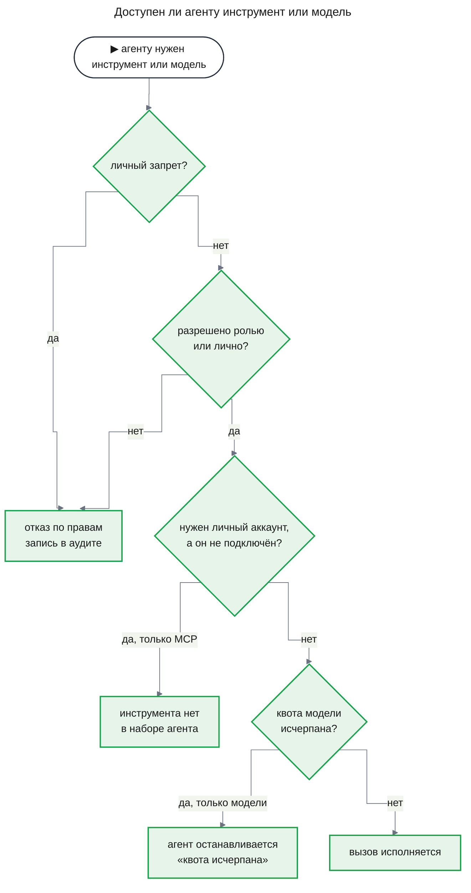
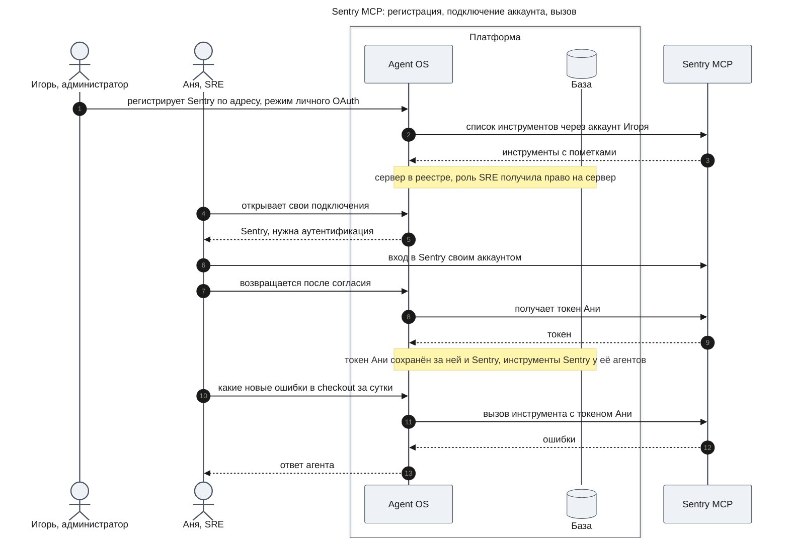
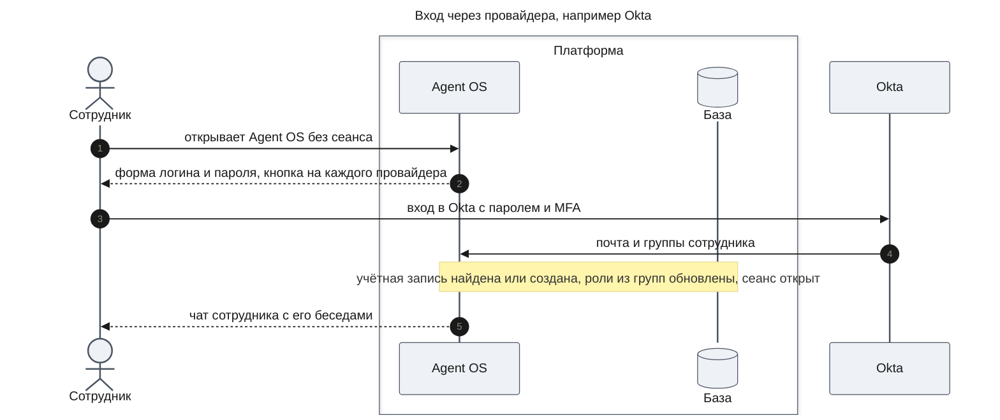
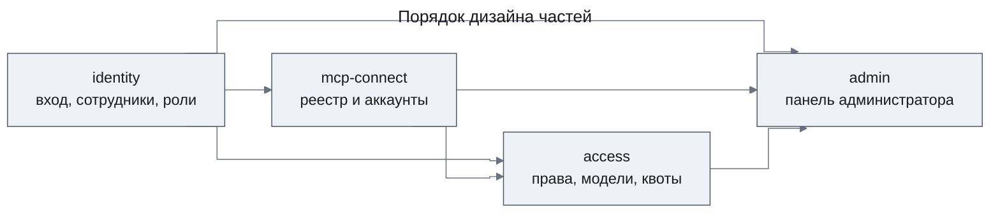

# PRD: Корпоративный вход и управление доступом (enterprise-access)

| Статус | Дата | Глубина | UXRD | Дизайны |
|---|---|---|---|---|
| Утверждён владельцем | 2026-11-15 | full | `uxrd.md` | `design-identity.md`, `design-mcp-connect.md`, `design-access.md`, `design-admin.md` |

## Snapshot

**Overview.** Сегодня в Agent OS нет настоящего входа: в разработке все работают как один тестовый сотрудник, а список MCP-серверов, доступ к ним и цены моделей лежат в JSON-файлах и переменных окружения. Фича даёт вход по логину и паролю, а администратор может добавить провайдеров входа — Google, Facebook, GitHub или корпоративный IdP вроде Okta по OIDC. В панели администратора ведутся провайдеры входа, сотрудники, роли, права на MCP-серверы и их инструменты, разрешённые модели и месячные квоты в долларах. Всё это хранится в базе, а настроек окружения фича не добавляет: даже первого администратора оператор прописывает прямо в базе. Права приходят от ролей и лично сотруднику, личный запрет сильнее любого разрешения, а агент, которому нужна модель с исчерпанной квотой, сам останавливается с причиной «квота исчерпана» и продолжает работу, когда квота снова есть и сотрудник пишет ему.

- **Для**: сотрудники компании, администратор Agent OS, оператор развёртывания.
- **Не входит**: SAML и SCIM, пауза агента по квоте, шифрование секретов в базе, регистрация по логину и паролю и восстановление пароля по почте, токены от Okta для MCP-серверов (Cross App Access), несколько компаний в одном развёртывании, права на `run_code` и workflow, бюджет на задачу.
- **Части**: `identity` → `mcp-connect` → `access` → `admin`.
- **Главный риск**: ошибка в проверке прав даёт агенту инструмент или модель без права. Защита — одна точка проверки, запрет сильнее разрешения и e2e-тесты на отказ ([Risks](#risks)).
- **Открытые вопросы**: нет.

## Terms

Пример везде один: SRE Аня работает с ошибками в Sentry, администратор Agent OS — Игорь.

- **Логин и пароль** — встроенный способ входа. Он включён всегда и по умолчанию единственный. **Локальная учётная запись** — учётная запись с логином и паролем, которую завёл администратор или оператор.
- **Провайдер входа** — внешняя система, через которую сотрудник входит в Agent OS: Google, Facebook, GitHub или корпоративный IdP. Провайдер — это тип и его настройки, которые администратор вводит в разделе «Авторизация». У каждого включённого провайдера своя кнопка на странице входа.
- **IdP** (identity provider) — корпоративная система учётных записей: сотрудник входит в неё один раз, а приложения доверяют её ответу. Пример: Okta.
- **OIDC** — стандартный протокол входа через провайдера: Agent OS отправляет сотрудника на вход к провайдеру, и тот возвращает его личность. Корпоративный IdP вроде Okta присылает ещё и группы сотрудника.
- **Хэш** — необратимый отпечаток значения: по нему можно проверить пароль, но нельзя его восстановить.
- **Сеанс входа** — время, пока браузер сотрудника работает от его имени после входа. Это не сессия агента (`agent-platform`, Terms).
- **JIT** (just-in-time) — учётная запись создаётся в момент первого входа.
- **Группа IdP** — группа сотрудников в IdP, например `sre`. **Роль** — группа сотрудников в Agent OS, которой даны права, например «SRE».
- **Право** — разрешение на MCP-сервер целиком, на один инструмент сервера или на одну модель. Право дают роли или лично сотруднику.
- **Личный запрет** — запрет сотруднику сервера, инструмента или модели. Он сильнее любого разрешения.
- **Действующие права** — то, что сотруднику доступно в итоге: разрешения всех его ролей и личные разрешения минус личные запреты.
- **Право администратора** — доступ к панели администратора и ко всем её операциям. **Супер-администратор** — встроенная роль с этим правом: первому администратору эту роль оператор прописывает прямо в базе (FR-32).
- **Реестр MCP-серверов** — список серверов, которые зарегистрировал администратор.
- **OAuth** — стандарт, по которому сотрудник разрешает приложению работать со своим аккаунтом в другой системе, не отдавая пароль: он входит в ту систему, соглашается, и приложение получает **токен** доступа.
- **Режим учётных данных** — чьим аккаунтом Agent OS ходит на MCP-сервер. **Общая учётная запись** — одна на всех, её вводит администратор. **Личный OAuth** — у каждого сотрудника свой аккаунт, который он подключает сам.
- **Подключение аккаунта** — личный OAuth-доступ сотрудника к одному серверу. **Список подключений** — его перечень у сотрудника.
- **Каталог моделей** — модели, которыми может пользоваться платформа, с ценами.
- **Квота** — предел расхода сотрудника на одну модель в долларах за календарный месяц.
- **Sentry MCP** — MCP-сервер Sentry, системы отслеживания ошибок, по адресу `https://mcp.sentry.dev/mcp`. Сотрудник подключает к нему свой аккаунт Sentry через OAuth. В этой фиче это пример реального сервера, а не встроенная интеграция.

## Background

Сегодня настоящего входа нет. В разработке каждый запрос идёт от тестового сотрудника `dev-user` или от того, кого назвал заголовок `x-user-id`, а в продакшене сервер отказывает всем. Беседы разделены по владельцу, но владелец — просто строка: таблиц сотрудников и ролей нет, а веб показывает зашитого тестового пользователя. Реальную аутентификацию оболочка чата откладывала (`chat-shell`, Won't Have).

Список MCP-серверов лежит в JSON-файле: три тестовых сервера, которые платформа запускает процессами на своей машине. Кому какие серверы доступны, задаёт таблица «сотрудник → серверы» в переменной окружения (`agent-platform` FR-11). Цены моделей лежат во втором JSON-файле, а журнал токенов считает расход сотрудника, но ничего не ограничивает (`agent-platform` FR-02).

Владелец хочет пустить в Agent OS сотрудников по логину и паролю или через провайдеров входа и управлять доступом из панели, а не правкой файлов и окружения: «никаких переменных окружения, всё в базе, упрощай». Эта фича заменяет таблицу доступа из `agent-platform` FR-11 и отменяет правило «превышение расхода ничего не блокирует» из `agent-platform` FR-02. Первым реальным MCP-сервером станет Sentry MCP: администратор регистрирует его по адресу, а каждый сотрудник подключает свой аккаунт Sentry. В 2026 году у MCP появилось расширение Enterprise-Managed Authorization: IdP компании (у Okta это называется Cross App Access) сам выдаёт агенту доступ к MCP-серверу, и сотруднику не нужно входить в каждую систему. Стандарт под ним (ID-JAG) пока черновик IETF, и серверов с его поддержкой мало ([обзор WorkOS](https://workos.com/blog/mcp-enterprise-managed-authorization-id-jag)), поэтому в этой фиче сотрудник подключает аккаунт сам.

Схема показывает путь сотрудника от входа до ответа агента и где в него встраивается фича. Зелёным — новое, красным — то, что меняется.

```mermaid
---
title: "Где встраивается вход и проверка доступа"
config:
  theme: base
  look: classic
  themeVariables:
    primaryColor: "#eef1f5"
    primaryBorderColor: "#4b5563"
    primaryTextColor: "#1a1a1a"
    lineColor: "#6b7280"
  flowchart:
    curve: step
  themeCSS: |
    @keyframes lit_ea{0%,12.86%{stroke:#991b1b;stroke-width:6px}14.29%,100%{stroke:#f4a5a5;stroke-width:2px}}
    @keyframes litr_ea{0%,12.86%{stroke:#1d4ed8;stroke-width:6px}14.29%,100%{stroke:#9ec1f7;stroke-width:2px}}
---
flowchart LR
    entry(["▶ сотрудник открывает Agent OS"])
    web["1 · веб<br/>вход и чат"]
    idp(["провайдер входа<br/>если выбран"])
    api["2 · сервер платформы<br/>сеанс сотрудника"]
    agent["3 · агент<br/>права и квота"]
    mcp(["MCP-серверы<br/>например Sentry"])
    model(["модель<br/>Anthropic"])
    db[("база<br/>сотрудники, права, квоты")]
    admin["панель<br/>администратора"]
    entry --> web
    web e1@-->|"вход"| idp
    idp e2@-->|"личность и группы"| api
    api e3@-->|"задание сотрудника"| agent
    agent e4@-->|"вызов инструмента"| mcp
    mcp e5@-->|"результат"| agent
    agent e6@-->|"ответ"| api
    api e7@-->|"ответ в беседе"| web
    agent -.->|"в пределах квоты"| model
    agent -.->|"права и квоты"| db
    admin -.->|"правит"| db
    classDef entry fill:#ffffff,stroke:#1f2937,stroke-width:1.5px,color:#1a1a1a
    classDef changed fill:#fde8e8,stroke:#dc2626,stroke-width:2px,color:#1a1a1a
    classDef new fill:#e6f4ea,stroke:#16a34a,stroke-width:2px,color:#1a1a1a
    classDef unchanged fill:#eef1f5,stroke:#4b5563,stroke-width:1.5px,color:#1a1a1a
    classDef w1 stroke:#f4a5a5,stroke-width:2px,animation:lit_ea 8.4s linear 0s infinite
    classDef w2 stroke:#f4a5a5,stroke-width:2px,animation:lit_ea 8.4s linear 1.2s infinite
    classDef w3 stroke:#f4a5a5,stroke-width:2px,animation:lit_ea 8.4s linear 2.4s infinite
    classDef w4 stroke:#f4a5a5,stroke-width:2px,animation:lit_ea 8.4s linear 3.6s infinite
    classDef r1 stroke:#9ec1f7,stroke-width:2px,animation:litr_ea 8.4s linear 4.8s infinite
    classDef r2 stroke:#9ec1f7,stroke-width:2px,animation:litr_ea 8.4s linear 6s infinite
    classDef r3 stroke:#9ec1f7,stroke-width:2px,animation:litr_ea 8.4s linear 7.2s infinite
    class entry entry
    class web,api,agent,db changed
    class idp,admin new
    class mcp,model unchanged
    class e1 w1
    class e2 w2
    class e3 w3
    class e4 w4
    class e5 r1
    class e6 r2
    class e7 r3
```

Сервер платформы теперь знает сотрудника по сеансу входа. Агент перед каждым вызовом инструмента и модели спрашивает его действующие права и квоту, а администратор меняет их в панели без рестарта.

## Users and Use Cases

### Users

- **Сотрудник** — аналитик, SRE, инженер или менеджер компании. Ему важно входить привычным аккаунтом или своим логином и паролем и чтобы агенты работали во внешних системах от его имени и не больше, чем ему разрешено.
- **Администратор Agent OS** — сотрудник с правом администратора. Ему важно в одном месте видеть, кто что может и почему, менять это без правки файлов и рестарта и решать, когда сотрудник упёрся в квоту.
- **Администратор IdP** — тот, кто настраивает приложение Agent OS в Okta: группы и назначения. Он работает в Okta, а не в Agent OS.
- **Оператор развёртывания** — тот, кто запускает сервер и имеет доступ к его базе. Сейчас это единственный разработчик. Ему важно завести первого администратора и вернуть доступ, если ни один администратор не может войти.

### Use Cases

- **UC-1**: Аня входит в Agent OS через Okta → видит свой чат и свои беседы под своим именем, так что ей не нужен отдельный пароль.
- **UC-2**: Администратор IdP добавляет нового сотрудника в группу `sre` в Okta → при первом входе через Okta у него появляются учётная запись и роль «SRE», так что Игорь не заводит людей вручную.
- **UC-3**: Сотрудник уходит из компании → Игорь блокирует его в панели: сеансы закрываются, агенты останавливаются, а данные остаются, так что ушедший человек сразу теряет доступ.
- **UC-4**: Игорь регистрирует Sentry MCP по адресу и даёт роли «SRE» право на сервер, а стажёру лично запрещает изменяющий инструмент → у SRE агенты видят инструменты Sentry, а у стажёра этот инструмент закрыт, так что доступ настраивается без файлов и рестарта.
- **UC-5**: Аня подключает свой аккаунт Sentry из списка подключений → её агенты получают инструменты Sentry и видят в Sentry ровно то, что видит она, так что агент не получает больше прав, чем у неё самой.
- **UC-6**: Игорь разрешает роли модели и задаёт месячные квоты → сотрудники работают в пределах квот, а когда квота кончается, агент на этой модели останавливается с причиной, и сотрудник продолжает его сообщением, когда Игорь поднимет квоту, так что расход на дорогие модели под контролем.
- **UC-7**: Игорь выясняет, почему у сотрудника есть доступ к инструменту → видит действующие права с источником каждого: какая роль или «лично», так что ошибку в настройке находят за минуту.
- **UC-8**: Ни один администратор не может войти → оператор прописывает роль «Супер-администратор» локальной учётной записи прямо в базе, и её владелец входит по логину и паролю, так что развёртывание не остаётся без администратора.
- **UC-9**: Игорь в разделе «Авторизация» выбирает тип провайдера Google и вводит его настройки → на странице входа рядом с формой логина и пароля появляется кнопка Google, так что сотрудники входят привычным аккаунтом.
- **UC-10**: Новому подрядчику нет места в IdP компании → Игорь заводит ему локальную учётную запись с начальным паролем, а подрядчик сам меняет пароль после входа, так что работать можно и без корпоративного аккаунта.

### Откуда у сотрудника права

Схема показывает, из чего складываются действующие права Ани.

Членство из IdP приходит при каждом входе через Okta и каждый раз заменяется целиком. Членство из панели хранится отдельно, и IdP его не трогает.

Когда агенту нужен инструмент или модель, платформа решает так:

### Пример: Sentry от регистрации до ответа агента

Диаграмма проводит Sentry MCP через UC-4 и UC-5: Игорь регистрирует сервер, Аня подключает свой аккаунт, и её агент вызывает инструмент Sentry её токеном.

Агенты Бориса из той же роли не видят инструментов Sentry, пока Борис не подключит свой аккаунт, а токен Ани для его вызовов не используется никогда.

## Functional Requirements

### Must Have (MVP)

#### Вход и сотрудники — часть `identity`

Вход через провайдера выглядит так. По логину и паролю сотрудник вводит их в форму на той же странице, и сервер сразу открывает сеанс, без похода к провайдеру.

- **FR-01. Вход по логину и паролю.** Вход по логину и паролю встроен, включён всегда и по умолчанию единственный. Страница входа показывает форму логина и пароля и по кнопке на каждого включённого провайдера (FR-02). Пароли хранятся только как хэш. Без сеанса входа веб показывает только страницу входа, а сервер отказывает в любом запросе к данным. Разработчик и автотесты входят так же: отдельного входа для разработки нет, а заголовок `x-user-id` больше нигде не задаёт сотрудника.
  - AC-01.1: Given администратор не включил ни одного провайдера, when сотрудник открывает Agent OS без сеанса, then видит страницу входа только с формой логина и пароля и ничего из чата.
  - AC-01.2: Given у сотрудника есть локальная учётная запись, when он вводит верные логин и пароль, then открывается его чат, а в меню — его имя.
  - AC-01.3: Given логин или пароль неверны, when сотрудник отправляет форму, then сеанс не открыт, сотрудник видит одну и ту же причину «неверный логин или пароль», что бы из двух ни было неверно, а попытка записана в аудит.
  - AC-01.4: Given запрос к серверу без действующего сеанса, when он просит данные сотрудника, then сервер отвечает отказом «нужен вход», и данных в ответе нет.
  - AC-01.5: Given администратор включил провайдеров Google и Okta, when сотрудник открывает страницу входа, then видит форму логина и пароля и две кнопки с названиями, которые дал им администратор.
  - AC-01.6: Given запрос с заголовком `x-user-id` и без сеанса, when он приходит, then сервер отказывает с причиной «нужен вход».

- **FR-02. Вход через провайдера.** Сотрудник входит через любого включённого провайдера, и результат для него тот же, что по логину и паролю. Вход всегда начинается на странице входа Agent OS.
  - AC-02.1: Given включён провайдер Okta по OIDC, when сотрудник выбирает его кнопку и входит в Okta, then Okta возвращает его в Agent OS, открывается его чат, а в меню — имя и почта от провайдера.  - AC-02.3: Given провайдер отказал во входе или сотрудник отменил вход, when он возвращается в Agent OS, then видит страницу входа с причиной, а сеанс не открыт.
  - AC-02.5: Given включён провайдер любого типа первой версии (FR-03), when сотрудник входит через него, then открывается его чат, а в меню — имя и почта от провайдера, как в AC-02.1.

- **FR-03. Провайдеры входа.** Администратор выбирает тип провайдера из списка, вводит его настройки и название кнопки, включает и выключает провайдера. Типы первой версии: Google, Facebook и GitHub, а для корпоративных IdP — OIDC (Okta и любой другой). Провайдеров может быть несколько. Рядом хранится публичный адрес Agent OS, на который провайдеры возвращают сотрудника: при первом сохранении провайдера им становится адрес, по которому браузер обратился к Agent OS, а дальше администратор меняет его сам. Секрет провайдера после сохранения никому не показывается, его можно только заменить. Выключение провайдера не закрывает уже открытые сеансы: чтобы отрезать человека, его отключают (FR-07).
  - AC-03.1: Given администратор сохранил провайдера с секретом клиента, when провайдера читают снова, then все настройки видны, а вместо секрета — пометка «задан» и возможность заменить его.
  - AC-03.2: Given администратор выключил провайдера, when сотрудник открывает страницу входа, then кнопки этого провайдера нет, а попытка войти через него отклоняется.
  - AC-03.3: Given администратор изменил настройки провайдера, when сотрудник входит через него, then вход идёт по новым настройкам без рестарта сервера.
  - AC-03.4: Given публичный адрес не сохранён, when администратор впервые сохраняет провайдера, then публичным адресом становится адрес, по которому браузер обратился к Agent OS, и провайдер возвращает сотрудника на него.
  - AC-03.5: Given администратор сохраняет провайдера, when тип не из списка первой версии, then сохранение отклоняется.

- **FR-04. Учётная запись сотрудника.** Учётная запись бывает локальной (FR-33) или появляется при первом входе через провайдера (JIT). Сотрудника узнают по почте: почте, которую вернул подключённый провайдер, платформа доверяет как есть. Как бы он ни вошёл — по логину и паролю или через любого провайдера, — это одна учётная запись с одними беседами, если почта та же. Поэтому администратор подключает только тех провайдеров, чьей почте можно доверять; последствия этого правила названы в [Risks](#risks). Если провайдер не вернул почту, сотрудника узнать нельзя, и вход отклоняется. Беседы, агенты, расследования и расход принадлежат учётной записи и видны только ей. Учётная запись сотрудника никогда не получает идентификатор с префиксом `system:`: он зарезервирован за служебными владельцами платформы.
  - AC-04.1: Given сотрудника ещё нет в Agent OS, when он впервые входит через провайдера, then появляется его учётная запись с именем и почтой от провайдера, и он сразу работает в чате.
  - AC-04.2: Given у сотрудника есть локальная учётная запись с почтой `anna@company.ru`, when он входит через Google, и Google возвращает ту же почту, then видит те же беседы.
  - AC-04.3: Given вошли два сотрудника, when каждый запрашивает беседы, агентов и расход, then получает только свои, а запрос к чужой беседе по её адресу получает такой же ответ, как к несуществующей.
  - AC-04.4: Given сотрудник входит впервые, when учётная запись создана, then её идентификатор не начинается с `system:`.
  - AC-04.5: Given провайдер не вернул почту, например Facebook для аккаунта, заведённого по номеру телефона, when сотрудник возвращается в Agent OS, then вход отклонён с причиной «провайдер не вернул почту», сеанс не открыт, а попытка записана в аудит.

- **FR-06. Роли и членство из двух источников.** Роль — именованная группа сотрудников, которой администратор даёт права (FR-16). Сотрудник попадает в роль двумя путями: через группу IdP, сопоставленную с ролью, и назначением в панели. Членство из IdP меняет только вход через провайдера OIDC, который присылает группы: при каждом таком входе оно целиком заменяется тем, что прислал провайдер. Вход по логину и паролю и через Google, Facebook и GitHub его не трогает: эти способы групп не присылают. Членство из панели хранится отдельно, и IdP его не меняет. Одну группу IdP можно сопоставить с несколькими ролями, а с одной ролью — несколько групп.
  - AC-06.1: Given группа Okta `sre` сопоставлена с ролью «SRE», when сотрудник из этой группы входит, then он в роли «SRE» с пометкой «из IdP».
  - AC-06.2: Given сотрудника убрали из группы `sre` в Okta, when он снова входит через Okta, then роли «SRE» у него нет, а права роли пропадают у его работающих агентов со следующего вызова (FR-18).
  - AC-06.3: Given администратор назначил сотруднику роль «Дежурный» в панели, when IdP присылает группы сотрудника без такой группы, then роль «Дежурный» у сотрудника остаётся.
  - AC-06.4: Given сотрудник в роли и из IdP, и из панели, when IdP убирает его из группы, then сотрудник остаётся в роли по назначению из панели.
  - AC-06.5: Given Аня в роли «SRE» из группы Okta, when она входит по логину и паролю или через Google, then роль «SRE» у неё остаётся.

- **FR-07. Сеанс входа, выход и отключение.** Сотрудник выходит из Agent OS сам. У сеанса два срока жизни: без активности и всего, после чего сотрудник входит снова. Оба срока — настройки в базе, администратор меняет их, по умолчанию это 8 часов без активности и 24 часа всего, а новое значение действует для сеанса с его следующего запроса. Отключённый сотрудник теряет доступ сразу: его сеансы закрыты, работающие агенты и workflow остановлены, войти он не может. Отключает сотрудника администратор в панели. Беседы и данные отключённого сотрудника сохраняются, и после повторного включения он видит их снова.
  - AC-07.1: Given сотрудник вошёл, when он выходит, then сеанс закрыт, а следующий запрос из этого браузера получает страницу входа.
  - AC-07.2: Given у сотрудника открыт сеанс и работает агент, when администратор блокирует его в панели, then следующий запрос с его сеансом получает отказ, агент получает статус «остановлен» с причиной «сотрудник отключён», и от его имени больше нет ни одного вызова модели или инструмента.
  - AC-07.3: Given сотрудник отключён, when он пробует войти любым способом, then вход отклонён с причиной «учётная запись отключена».
  - AC-07.4: Given отключённого сотрудника включили снова, when он входит, then видит прежние беседы.
  - AC-07.5: Given администратор поменял срок жизни сеанса без активности или общий, when приходит запрос с сеансом, который старше нового срока, then сервер отказывает с причиной «нужен вход», и сотрудник входит снова.

- **FR-08. Право администратора.** Право администратора открывает панель и все операции администратора. Его дают роли — среди них встроенная роль «Супер-администратор» — или лично сотруднику. Само по себе оно не даёт ни MCP-инструментов, ни моделей. Сервер отказывает в любой операции администратора без права, даже если её вызвали в обход панели. Если не осталось ни одного администратора, оператор возвращает его ролью «Супер-администратор», прописанной в базе (FR-32).
  - AC-08.1: Given у сотрудника нет права администратора, when он вызывает операцию администратора, then получает отказ, а в аудите появляется запись «отказ по правам».
  - AC-08.2: Given право администратора есть у роли, when сотрудник из этой роли входит, then он получает доступ к операциям администратора.

- **FR-32. Первый администратор через базу.** Ни экрана первого запуска, ни настроек развёртывания для этого нет. Первого администратора оператор заводит прямо в базе: локальную учётную запись с логином и паролем и ролью «Супер-администратор». Дальше администратор ведёт всё в панели. Тот же путь возвращает доступ, если ни один администратор не может войти.
  - AC-32.1: Given в базе нет ни одного сотрудника, when оператор заводит в базе локальную учётную запись с логином, паролем и ролью «Супер-администратор», а её владелец входит по логину и паролю, then он получает доступ к операциям администратора.
  - AC-32.2: Given ни один администратор не может войти, when оператор прописывает роль «Супер-администратор» локальной учётной записи в базе, then её владелец после входа по логину и паролю получает доступ к операциям администратора.
  - AC-32.3: Given в базе нет ни одного сотрудника, when кто-то открывает Agent OS, then видит обычную страницу входа, и создать с неё учётную запись нельзя.

- **FR-33. Локальные учётные записи.** Администратор заводит локальную учётную запись — логин, имя, почту и начальный пароль — и может сбросить пароль, задав новый. Сотрудник с локальной учётной записью сам меняет свой пароль, назвав текущий.
  - AC-33.1: Given администратор завёл учётную запись с начальным паролем, when сотрудник входит с этими логином и паролем, then открывается его чат.
  - AC-33.2: Given администратор сбросил пароль, when сотрудник входит со старым паролем, then вход отклонён, а с новым — проходит.
  - AC-33.3: Given сотрудник вошёл, when он меняет пароль и верно называет текущий, then следующий вход проходит только с новым паролем.
  - AC-33.4: Given сотрудник неверно назвал текущий пароль, when он меняет пароль, then пароль не меняется.

- **FR-11. Аудит входа и изменений администратора.** Аудит записывает каждый вход, успешный и отклонённый, выход, закрытие сеансов, смену и сброс пароля и каждое изменение администратора в любой части фичи: кто, когда, какой объект, что было и что стало. Секрет и пароль в запись не попадают: вместо значения пишется «секрет изменён» или «пароль изменён».
  - AC-11.1: Given администратор сменил сопоставление группы с ролью, when смотрят аудит, then в нём есть запись с администратором, временем, ролью, прежним и новым сопоставлением.
  - AC-11.2: Given администратор заменил секрет провайдера, when смотрят аудит, then запись говорит «секрет изменён», а значения секрета в ней нет.
  - AC-11.3: Given вход отклонён, when смотрят аудит, then в нём есть запись со способом входа, временем и причиной.

#### MCP-серверы и аккаунты сотрудников — часть `mcp-connect`

- **FR-12. Реестр MCP-серверов.** Администратор регистрирует удалённый MCP-сервер: имя, адрес и режим учётных данных (FR-13). Платформа сама получает с сервера список инструментов и показывает каждый с пометкой сервера «читает» или «меняет». Инструмент без пометки считается меняющим (`agent-platform` FR-11). Администратор обновляет список инструментов по запросу, выключает и удаляет сервер. Определения агентов ссылаются на серверы по имени в реестре. Любое изменение реестра действует без рестарта.
  - AC-12.1: Given администратор зарегистрировал сервер с общей учётной записью, when регистрация прошла, then в реестре виден список инструментов сервера с пометками.
  - AC-12.2: Given адрес недоступен или учётные данные не подходят, when администратор сохраняет сервер, then сохранение сервера возвращает причину, а сервер не включается.
  - AC-12.3: Given на сервере появился новый инструмент, when администратор обновляет список, then инструмент появляется в реестре.
  - AC-12.4: Given администратор выключил сервер, when агент работает, then инструменты сервера пропадают из его набора со следующего вызова модели, а вызов такого инструмента получает отказ.
  - AC-12.5: Given сервер зарегистрирован и указан в определении агента, when агент работает у сотрудника с правом на сервер, then инструменты сервера доступны агенту без рестарта платформы.

- **FR-13. Режимы учётных данных.** У каждого сервера один из двух режимов. Режим — свойство зарегистрированного сервера, его выбирают в настройках сервера, поэтому позже можно добавить третий режим. В режиме общей учётной записи администратор вводит ключ или токен сервера, и все вызовы идут с ним. В режиме личного OAuth каждый сотрудник подключает свой аккаунт (FR-14), и его вызовы идут с его токеном, а токены других сотрудников не используются никогда. Токен сотрудника привязан к нему и серверу и служит только его вызовам. Платформа сама обновляет токен, а удаляет его, когда сотрудник отключает аккаунт или сервер удаляют. Список инструментов сервера с личным OAuth платформа получает через аккаунт администратора, который тот подключает при регистрации. Поэтому у администратора должен быть аккаунт в каждой такой системе.
  - AC-13.1: Given сервер с общей учётной записью, when агенты двух сотрудников вызывают его инструмент, then оба вызова идут с учётной записью из реестра, а в аудите каждый вызов записан на своего сотрудника.
  - AC-13.2: Given сервер с личным OAuth и подключённые аккаунты Ани и Бориса, when агент Ани вызывает инструмент, then вызов идёт с токеном Ани, а токен Бориса не используется.
  - AC-13.3: Given срок токена Ани истёк, а обновить его можно, when агент Ани вызывает инструмент, then платформа обновляет токен, вызов проходит, и Аню ни о чём не спрашивают.
  - AC-13.4: Given администратор регистрирует сервер с личным OAuth, when он подключает свой аккаунт, then платформа получает список инструментов, и сервер появляется в реестре.
  - AC-13.5: Given администратор сохранил общую учётную запись сервера, when сервер читают снова, then значения нет, только пометка «задан», как в AC-03.1.
  - AC-13.6: Given Аня и Борис подключили аккаунты к серверу, when администратор удаляет сервер, then токенов Ани и Бориса для этого сервера на платформе больше нет.

- **FR-14. Список подключений сотрудника.** У сотрудника есть список подключений: каждый сервер с личным OAuth, на который у него есть право, со статусом «подключено» или «нужна аутентификация». Пока аккаунт не подключён, инструменты сервера его агентам не предлагаются, и агент не встаёт на паузу ради подключения. Сотрудник подключает аккаунт из списка через вход в браузере у владельца сервера, и инструменты появляются у его агентов со следующего вызова модели, без рестарта. Сотрудник может отключить аккаунт, и тогда токен удаляется. Если обновить токен не удалось, статус возвращается в «нужна аутентификация». Так это устроено в Claude Code.
  - AC-14.1: Given Ане дано право на Sentry MCP с личным OAuth, а аккаунт не подключён, when Аня открывает список подключений, then видит Sentry со статусом «нужна аутентификация».
  - AC-14.2: Given аккаунт Ани в Sentry не подключён, when её агент работает, then инструментов Sentry в его наборе нет, и агент работает без них, не дожидаясь подключения.
  - AC-14.3: Given Аня подключила аккаунт через вход в Sentry, when она возвращается в Agent OS, then статус — «подключено», а следующий вызов модели её работающего агента уже видит инструменты Sentry.
  - AC-14.4: Given Аня отключила аккаунт, when её агент работает, then инструменты Sentry пропадают у него со следующего вызова модели, а статус — «нужна аутентификация».
  - AC-14.5: Given обновить токен Ани не удалось, when агент вызывает инструмент Sentry, then вызов получает ошибку «нужно подключить аккаунт», статус в списке — «нужна аутентификация», а агент продолжает работу.
  - AC-14.6: Given у Ани нет права на сервер с личным OAuth, when она открывает список подключений, then этого сервера в списке нет.

- **FR-15. Один транспорт и тестовые серверы по HTTP.** Разработчик и автотесты работают с тестовыми MCP-серверами (логи, трекер, `backoffice`) без ручной регистрации и без настоящих аккаунтов, в том числе для личного OAuth.
  - AC-15.1: Given чистая база разработки, when разработчик запускает скрипт начальных данных, then тестовые серверы есть в реестре, и агент сотрудника с правом вызывает их инструменты.
  - AC-15.2: Given автотесты личного OAuth, when они идут в CI, then проходят без выхода в интернет и без настоящих аккаунтов.

#### Права, модели и квоты — часть `access`

- **FR-16. Права ролей и личные права.** Право разрешает одно из трёх: весь MCP-сервер, один инструмент сервера или одну модель. Право дают роли или лично сотруднику. Действующие права сотрудника — все права его ролей и его личные права за вычетом личных запретов (FR-17). Право на сервер покрывает и инструменты, которые появятся на нём позже.
  - AC-16.1: Given роль «SRE» имеет право на Sentry MCP, а Аня в этой роли и подключила аккаунт, when её агент работает, then ему доступны все инструменты Sentry.
  - AC-16.2: Given у сотрудника нет права на сервер, но есть личное право на один его инструмент, when его агент работает, then из этого сервера ему доступен только этот инструмент.
  - AC-16.3: Given у сотрудника нет ни ролей, ни личных прав, when он пишет в чат, then ответа модели нет, а сотрудник видит, что ему не разрешена ни одна модель и нужно обратиться к администратору.

- **FR-17. Личный запрет сильнее разрешения.** Администратор лично запрещает сотруднику сервер, инструмент или модель. Запрет сильнее любого разрешения — и от роли, и личного. Запрет сервера закрывает все его инструменты.
  - AC-17.1: Given роль даёт право на сервер, а у сотрудника личный запрет на один изменяющий инструмент этого сервера, when его агент работает, then доступны все инструменты сервера, кроме запрещённого, а вызов запрещённого получает отказ по правам.
  - AC-17.2: Given у сотрудника личный запрет сервера и личное право на его инструмент, when его агент работает, then ни один инструмент сервера ему не доступен.
  - AC-17.3: Given роль разрешает модель, а у сотрудника личный запрет этой модели, when агент выбирает эту модель, then выбор отклоняется, как в FR-20.

- **FR-18. Одна проверка действующих прав.** Права проверяет одно место. Ему подчиняются главный чат, фоновые агенты и workflow сотрудника, а также вызовы инструментов из кода (`code-execution` FR-03). MCP-инструменты агента — это серверы из его определения в пересечении с действующими правами сотрудника, которому принадлежит беседа, и с его подключёнными аккаунтами (FR-14). Набор пересчитывается перед каждым вызовом модели, а каждый вызов инструмента проверяется ещё раз. Поэтому изменение прав доходит до работающих агентов без рестарта. Отказ записывается в аудит с исходом «отказ по правам».
  - AC-18.1: Given у сотрудника нет права на инструмент, when модель его агента всё равно просит этот инструмент, then MCP-сервер не получает ни одного вызова, агент получает отказ, а в аудите — ровно одна запись «отказ по правам».
  - AC-18.2: Given агент работает, when администратор снимает право, then инструмента нет в наборе со следующего вызова модели, а вызов, начатый после снятия, получает отказ.
  - AC-18.3: Given агент работает, when администратор даёт право, then инструмент появляется в наборе со следующего вызова модели.
  - AC-18.4: Given права сотруднику даёт роль, when он запускает workflow и агент вызывает инструмент из скрипта `run_code`, then агенты workflow и скрипт получают те же инструменты и те же отказы, что главный чат.

- **FR-19. Каталог моделей с ценами.** Администратор ведёт каталог моделей, которыми может пользоваться платформа, и их цены. Стоимость каждого вызова считается по цене из каталога на момент вызова. Новая цена действует для следующих вызовов, а прошлые стоимости не пересчитываются. Модель вне каталога не используется.
  - AC-19.1: Given администратор добавил модель с ценой и разрешил её сотруднику, when агент сотрудника вызывает эту модель, then вызов идёт, а его стоимость посчитана по этой цене.
  - AC-19.2: Given администратор поменял цену модели, when сотрудник смотрит свой расход за месяц, then вызовы до изменения посчитаны по старой цене, а после — по новой.
  - AC-19.3: Given модели нет в каталоге, when агент её выбирает, then выбор отклоняется с причиной «модель не подключена».

- **FR-20. Разрешённые модели.** Сотрудник пользуется только моделями, которые ему разрешены ролями или лично и не запрещены лично. Модель агента выбирается по правилу `agent-platform` FR-04. Если выбранная модель не разрешена, платформа не подменяет её другой: агент не запускается, а запускавший получает причину. Каждый отказ по модели записывается в аудит.
  - AC-20.1: Given Ане разрешён только Haiku, when чат запускает для неё агента на Sonnet, then агент не запускается, а в историю родителя приходит отказ «модель не разрешена: Sonnet».
  - AC-20.2: Given модель главного чата Ане не разрешена, when Аня пишет в чат, then ответа модели нет, а Аня видит, что модель ей не разрешена и нужно обратиться к администратору.
  - AC-20.3: Given агент работает на модели, when администратор снимает разрешение и агент делает следующий вызов модели, then вызов не идёт, а агент получает статус «сбой» с причиной «модель не разрешена».
  - AC-20.4: Given выбор модели отклонён, when смотрят аудит, then в нём есть запись с сотрудником, моделью и причиной.

- **FR-21. Месячные квоты по моделям.** Квота — необязательная часть разрешения модели (FR-20): у роли или лично сотруднику. Месяц считается так же, как расход сотрудника за месяц (`agent-platform` FR-02). Квоты складываются: если модель с квотой разрешают сотруднику несколько ролей и он сам лично, его действующая квота на модель равна сумме этих квот. Разрешение без квоты — предел без ограничения, и из двух пределов действует больший. Поэтому если хотя бы одно разрешение модели у сотрудника без квоты, расход на неё не ограничен. Новая роль только добавляет сотруднику возможности и никогда их не урезает, а урезать их может только личный запрет.
  - AC-21.1: Given у роли «SRE» квота на Sonnet 50 $, у роли «Дежурный» — 20 $, а лично у Ани — 30 $, when Аня состоит в обеих ролях, then её действующая квота на Sonnet — 100 $.
  - AC-21.2: Given Sonnet Ане разрешён, и ни одно её разрешение Sonnet не несёт квоты, when её расход на Sonnet растёт, then её агенты на Sonnet не останавливаются по квоте.
  - AC-21.3: Given расход Ани на Sonnet за месяц ниже действующей квоты, when её агент вызывает Sonnet, then вызов идёт сразу.
  - AC-21.4: Given начался новый календарный месяц, when Аня работает, then её расход на каждую модель против квоты считается с нуля.
  - AC-21.5: Given роль A разрешает Ане Sonnet без квоты, when Аню добавляют в роль B с квотой на Sonnet 20 $, then расход Ани на Sonnet по-прежнему не ограничен.

- **FR-22. Квота исчерпана — агент останавливается сам.** Перед каждым вызовом модели агент проверяет расход сотрудника на эту модель за месяц против его действующей квоты. Если квота исчерпана, вызов не начинается, а агент получает статус «остановлен» с причиной «квота исчерпана» (`agent-platform` FR-08). Каждый другой агент, которому нужна эта модель, останавливается так же на своём следующем вызове, а агент на модели, где квота ещё есть, работает дальше. Сверху никто агентов не останавливает, и сами они не продолжают. Вызовы, которые уже идут, заканчиваются, и их стоимость учитывается: резерва под вызов нет, поэтому расход может немного превысить квоту. Когда квота снова есть — администратор её поднял или начался новый месяц, — следующее сообщение сотрудника продолжает работу, как после любой остановки (`agent-platform` FR-09). Пока квота исчерпана, новое сообщение получает тот же отказ. Каждый отказ записывается в аудит.
  - AC-22.1: Given расход Ани на Sonnet достиг квоты, when её агент собирается вызвать Sonnet, then вызов не идёт, агент получает статус «остановлен» с причиной «квота исчерпана», Аня видит модель, свой расход и квоту за месяц, а в аудите появляется запись.
  - AC-22.2: Given у Ани идут два вызова Sonnet, и квота исчерпана во время них, when они заканчиваются, then их стоимость входит в расход, а следующий вызов Sonnet не начинается.
  - AC-22.3: Given агент Ани остановлен с причиной «квота исчерпана», when администратор поднял квоту выше расхода и Аня пишет ему, then агент продолжает работу с того места, где остановился.
  - AC-22.7: Given квота Ани на Sonnet исчерпана, и её агент на Sonnet остановлен, а в той же беседе другой её агент работает на Haiku в пределах квоты, when агент на Haiku делает следующий вызов модели, then он продолжает работу.
  - AC-22.11: Given агент Ани остановлен, а квота на Sonnet всё ещё исчерпана, when Аня пишет ему, then ответа модели нет, и Аня снова видит причину «квота исчерпана».

#### Панель администратора — часть `admin`

- **FR-24. Панель администратора.** Панель — отдельный раздел веба только для сотрудников с правом администратора (FR-08). В ней разделы: сотрудники и роли, авторизация, MCP-серверы, права и запреты, модели и квоты. Содержимого бесед и агентов сотрудников в панели нет.
  - AC-24.1: Given администратор вошёл, when он открывает меню, then видит вход в панель, а в панели — все разделы, перечисленные в FR-24.
  - AC-24.2: Given у сотрудника нет права администратора, when он открывает адрес панели напрямую, then видит отказ, а не данные панели, и входа в панель в его меню нет.

- **FR-25. Сотрудники и роли.** Администратор видит список сотрудников со статусом (включён или отключён) и ролями, у каждого членства — источник: «из IdP» или «из панели». Он заводит локальные учётные записи и сбрасывает их пароли (FR-33), блокирует и разблокирует сотрудника, создаёт, переименовывает и удаляет роли, назначает и снимает роли из панели и сопоставляет группы IdP с ролями.
  - AC-25.1: Given у Ани роль «SRE» из IdP и роль «Дежурный» из панели, when администратор открывает Аню, then видит обе роли с источником и может снять только «Дежурный».
  - AC-25.2: Given администратор удалил роль, when работают агенты её сотрудников, then права этой роли пропадают у них со следующего вызова модели.
  - AC-25.3: Given администратор открывает список сотрудников, when он заводит локальную учётную запись или сбрасывает пароль, then вводит логин, имя, почту и пароль в панели, и сотрудник появляется в списке с пометкой «локальная».

- **FR-26. Авторизация.** В разделе «Авторизация» администратор видит вход по логину и паролю как всегда включённый, добавляет провайдера, выбирая тип из списка (FR-03), заполняет его настройки, включает и выключает его. Для каждого провайдера панель показывает данные Agent OS, которые нужно перенести в настройки приложения у провайдера. Здесь же администратор меняет публичный адрес Agent OS и два срока жизни сеанса входа (FR-07).
  - AC-26.1: Given администратор создаёт провайдера OIDC для Okta, when он открывает его, then видит данные Agent OS для Okta и может скопировать каждое значение.
  - AC-26.3: Given администратор открывает настройки входа, when он смотрит сроки жизни сеанса, then видит действующие значения обоих сроков и может изменить каждый.
  - AC-26.4: Given администратор добавляет провайдера, when он выбирает тип из списка первой версии (FR-03), then видит поля настроек именно этого типа.

- **FR-27. MCP-серверы.** Администратор регистрирует сервер по адресу, выбирает режим учётных данных и вводит общую учётную запись или подключает свой аккаунт для личного OAuth. Он видит инструменты сервера с пометками, обновляет список, выключает и удаляет сервер.
  - AC-27.1: Given администратор регистрирует Sentry MCP по адресу в режиме личного OAuth, when он подключает свой аккаунт Sentry, then видит список инструментов Sentry с пометками «читает» и «меняет».

- **FR-28. Права и запреты.** Для роли администратор видит и правит её права. Для сотрудника — его личные права, личные запреты и действующие права с источником каждого: какая роль, «лично» или «закрыто личным запретом». Право на инструмент выбирается из списка инструментов реестра, а не вводится вручную.
  - AC-28.1: Given право на Sentry MCP Аня получает от роли «SRE», а один инструмент ей запрещён лично, when администратор открывает действующие права Ани, then видит Sentry с источником «роль SRE» и этот инструмент с пометкой «закрыто личным запретом».
  - AC-28.2: Given администратор даёт право на инструмент, when он выбирает инструмент, then выбирает его из списка инструментов сервера в реестре.

- **FR-29. Модели, цены и квоты.** Администратор ведёт каталог моделей с ценами, разрешает модели ролям и сотрудникам, задаёт квоты ролей и личные квоты. Для сотрудника он видит действующую квоту на каждую модель с разбивкой по слагаемым и расход за месяц.
  - AC-29.1: Given у Ани квоты из AC-21.1, when администратор открывает Аню, then видит действующую квоту на Sonnet 100 $ с разбивкой «SRE 50 + Дежурный 20 + лично 30» и расход Ани на Sonnet за месяц.

### Should Have

- **FR-23. Сотрудник видит свои модели и квоты.** Рядом с расходом за месяц (`agent-platform` FR-29) сотрудник видит разрешённые ему модели, расход за месяц на каждую, квоту и остаток. Часть `access`.
  - AC-23.1: Given Ане разрешены Haiku без квоты и Sonnet с квотой 100 $, when Аня открывает свой расход, then видит обе модели и расход за месяц на каждую, у Sonnet — квоту и остаток, а у Haiku — пометку «без предела».

### Could Have

- **FR-31. Журнал аудита в панели.** Администратор просматривает аудит в панели с отбором по сотруднику, виду записи и периоду. Часть `admin`.
  - AC-31.1: Given администратор открывает журнал, when он отбирает записи по сотруднику и дню, then видит входы, отказы по правам и по квоте и изменения администратора за этот день.

### Won't Have

- Токены от Okta для MCP-серверов (Cross App Access, MCP Enterprise-Managed Authorization) — позже, отдельной фичей: ни один нужный MCP-сервер их пока не поддерживает.
- Несколько компаний в одном развёртывании — нет: одно развёртывание обслуживает одну компанию.
- Права на `run_code`, workflow, встроенные инструменты и определения агентов — нет: они открыты каждому сотруднику. Права в фиче покрывают MCP, модели и право администратора.
- Бюджет на задачу и расследование (бизнес-ограничение 4 в `.claude/skills/project-context/SKILL.md`) — не в этой фиче: квота ограничивает сотрудника за месяц, а не задачу.
- Запрет на уровне роли — нет: роль только разрешает, запрет всегда личный. Так правило остаётся простым: роли складываются, а запрет — исключение для человека.
- Встроенная роль «все сотрудники» — нет: то же даёт сопоставление общей группы IdP (в Okta — Everyone) с ролью, а локальным учётным записям роль назначают в панели.
- SAML 2.0 и SCIM 2.0 — позже, отдельной фичей: для PoC они не нужны, а Okta и другие корпоративные IdP подключаются как провайдер OIDC.
- Пауза и ожидание решения администратора при исчерпанной квоте — нет: агент останавливается сам, а сотрудник продолжает его сообщением, когда квота снова есть (FR-22).
- Ограничение числа попыток входа — нет: для PoC хватает одной причины отказа и записи каждой попытки в аудит (AC-01.3).
- Регистрация по логину и паролю — нет: формы регистрации нет, а учётную запись с паролем заводит администратор (FR-33).
- Восстановление пароля по почте — нет: платформа не отправляет писем, пароль сбрасывает администратор (FR-33).
- MFA для входа по логину и паролю — нет: кому нужна MFA, входит через провайдера, где она уже есть.
- Выключение входа по логину и паролю — нет: это путь первого администратора и возврата доступа (FR-32).
- Экран первого запуска — нет: первого администратора оператор прописывает в базе (FR-32), а экран, открытый до появления администратора, мог бы занять кто угодно.
- Шифрование секретов в базе — нет: ключ шифрования пришлось бы хранить вне базы, а фича держит всё в базе. Защита базы и её копий — задача развёртывания ([Risks](#risks)).
- Резерв квоты под вызов и оценка стоимости до вызова — нет: превышение квоты на стоимость уже начатых вызовов принято (FR-22).
- Квоты в токенах, на неделю или на все модели сразу — нет: квота — доллары на одну модель за календарный месяц.
- Запрос доступа от сотрудника администратору — позже: в пилоте сотрудник просит доступ у администратора напрямую, а тот видит действующие права сотрудника в панели (FR-28).
- Пауза агента до подключения аккаунта — нет: инструменты неподключённого сервера просто не предлагаются (FR-14).
- Чтение администратором бесед и истории агентов сотрудников — нет: панель показывает права и расход, но не содержимое.
- Биллинг, отчёты и операционные экраны в панели — нет: панель только управляет доступом.
- Автоматическое обновление списка инструментов сервера — позже: список обновляется по запросу администратора (FR-12).
- Перенос бесед и расследований тестового сотрудника `dev-user` на настоящие учётные записи — нет: проект — PoC.

## Non-Functional Requirements

### Security

- **NFR-01**: Пароли хранятся только как хэш. Проверка: тест читает строки базы напрямую и не находит ни одного пароля в открытом виде.
- **NFR-02**: Ни секрет, ни токен не попадает в логи, аудит, ответы сервера после сохранения и историю агентов. Проверка: тест с известными значениями секретов ищет их во всех четырёх местах и находит ноль совпадений.
- **NFR-03**: Без сеанса входа на сервере открыты только вход и проверка здоровья. Проверка: тест обходит все маршруты сервера без сеанса и получает отказ на каждом, кроме этих.

### Performance

- **NFR-04**: Проверка прав и квоты перед вызовом модели держит время до первого токена в бюджете раздела «Performance Requirements» в `.claude/skills/project-context/SKILL.md`. Проверка: замер в тесте с десятью ролями и сотней прав у сотрудника.

### Accessibility and responsiveness

- **NFR-05**: Страница входа, список подключений и панель администратора соответствуют WCAG 2.1 AA, как оболочка чата (`chat-shell` NFR-18). Страница входа и список подключений пригодны к работе от 360 px, панель администратора — от 1280 px.

## Delivery Parts

| Часть | Покрывает | Срез | Зависит от | Почему отдельно |
|------|--------|-----------|------------|-----------|
| `identity` | FR-01–FR-04, FR-06–FR-08, FR-11, FR-32, FR-33 | domain | — | Кто сотрудник и в каких он ролях: вход по логину и паролю и через провайдеров, учётные записи, сеансы, право администратора и аудит изменений. Сюда же страница входа, смена пароля и имя в меню. |
| `mcp-connect` | FR-12–FR-15 | domain | `identity` | Как платформа достаёт до MCP-серверов: реестр, режимы учётных данных и аккаунты сотрудников. Сюда же список подключений сотрудника. |
| `access` | FR-16–FR-23 | domain | `identity`, `mcp-connect` | Что сотруднику можно: права, запреты, модели и квоты — одна проверка в механизме агентов. Сюда же причина «квота исчерпана» в беседе и расход по моделям. |
| `admin` | FR-24–FR-29, FR-31 | frontend | `identity`, `mcp-connect`, `access` | Панель — большой отдельный интерфейс поверх операций администратора трёх частей. |

Каждая из трёх первых частей отдаёт операции администратора над своими объектами, а `admin` строит над ними экраны. Небольшие экраны сотрудника живут в части, чьё требование они выполняют: страница входа и меню — в `identity`, список подключений — в `mcp-connect`, причина «квота исчерпана» и расход по моделям — в `access`. Право администратора и аудит изменений лежат в `identity`, потому что первые операции администратора — провайдеры входа, локальные учётные записи и роли — появляются уже там.

### Part Dependency Diagram

Стрелка ведёт от части к той, что строится на её утверждённом дизайне.

## Success Criteria

- Пилотная группа входит в Agent OS. Цель: все сотрудники пилотной группы вошли — по логину и паролю или через подключённого провайдера; читается в списке сотрудников панели через две недели после выпуска.
- Sentry MCP работает как реальный сервер. Цель: администратор зарегистрировал Sentry MCP, хотя бы один сотрудник подключил свой аккаунт, и его агент ответил на вопрос данными из Sentry; читается в аудите вызовов инструментов в первую неделю после выпуска.
- Ни одного вызова без права. Цель: ноль вызовов MCP-инструментов и моделей сотрудниками без действующего права; читается в аудите и журнале токенов за первые две недели после выпуска.

## Constraints and Risks

### Constraints

- Вход — по логину и паролю и через провайдеров по стандартным протоколам OAuth 2.0 и OIDC. Провайдер — тип и его настройки, и ни один провайдер не зашит в продукт сверх списка типов первой версии (FR-03).
- Одно развёртывание — одна компания.
- Система записи всего, чем управляет фича, — база, а правит её панель: JSON-файлы со списком серверов и ценами и таблица доступа в окружении удаляются.
- Фича не добавляет ни одной настройки окружения: всё, чем она управляет, включая публичный адрес Agent OS и сроки сеанса, хранится в базе.
- Секреты других систем — секреты провайдеров входа, общие учётные записи MCP-серверов и токены сотрудников — хранятся в базе как есть, без шифрования. Пароли хранятся только как хэш (NFR-01).
- Личные учётные данные сотрудника для MCP-сервера хранятся отдельной записью: сотрудник, сервер, токен и тип токена, то есть как он получен. Сейчас тип один — OAuth.
- MCP-серверы подключаются только по HTTP.
- Проект — PoC: без слоёв совместимости, параллельных версий и переноса существующих записей. Удалить локальные данные разработки или нет, решает разработчик.
- Бизнес-ограничения 1–3 из `.claude/skills/project-context/SKILL.md` выполняются с настоящими сотрудниками: права на инструменты, изоляция данных, аудит каждого вызова.
- Бизнес-ограничение 1 просит e2e-тест на отказ для каждого инструмента. Инструменты серверов, которые администратор регистрирует в работе, заранее неизвестны. Поэтому отказ даёт одна проверка (FR-18), а e2e-тест на отказ есть для каждого тестового сервера, каждого режима учётных данных и вызова из кода.
- Логи пишутся через обёртку логгера из `packages/common` (`CLAUDE.md`, «Logging»), а секреты и токены не логируются никогда.

### Assumptions

- Для ручной приёмки есть тестовая организация Okta, где можно завести приложение OIDC, которое присылает группы. Проверяется до дизайна `identity`.
- Автотесты входа по OIDC идут на тестовом провайдере внутри набора тестов, без Okta. Проверяется в дизайне `identity`.
- Для ручной приёмки входа через Google, Facebook и GitHub у каждого есть тестовое приложение, а автотесты проверяют эти типы на тестовом провайдере без выхода в интернет. Проверяется в дизайне `identity`.
- Sentry MCP принимает Agent OS клиентом OAuth без ручной регистрации у Sentry. Адрес `https://mcp.sentry.dev/mcp`, транспорт HTTP и вход через OAuth аккаунтом Sentry подтверждены [документацией Sentry MCP](https://mcp.sentry.dev/), а способ регистрации клиента — нет. Проверяется в дизайне `mcp-connect`.
- Превышение квоты ограничено стоимостью вызовов, которые уже шли в момент исчерпания, и на практике мало. Проверяется по журналу токенов после выпуска.

### Risks

| Риск | Влияние | Вероятность | Что делаем |
|------|--------|-------------|------------|
| Ошибка в проверке прав даёт агенту инструмент или модель без права | Высокое | Среднее | Одна проверка для чата, агентов, workflow и кода (FR-18); запрет сильнее разрешения (FR-17); e2e-тесты на отказ для тестовых серверов, режимов учётных данных и вызова из кода ([Constraints](#constraints)). |
| Тот, у кого есть доступ к базе или её копии, получает токены сотрудников, секреты провайдеров и учётные данные MCP-серверов | Высокое | Низкое | Принято: секреты хранятся без шифрования, а защита базы и её копий — задача развёртывания. API, логи и аудит секретов не отдают (NFR-02). |
| Никто не может войти: провайдер сломан или снят последний администратор | Высокое | Низкое | Вход по логину и паролю включён всегда (FR-01); оператор прописывает роль «Супер-администратор» в базе (FR-32). |
| Утечка секрета или токена сотрудника через платформу | Высокое | Низкое | Секрет после сохранения не показывается (AC-03.1); проверка логов, аудита и ответов (NFR-02). |
| Администратор, который включает Google, Facebook или GitHub, открывает вход каждому владельцу такого аккаунта: первый вход создаёт учётную запись (AC-04.1) | Среднее | Высокое | Принято: новая учётная запись без ролей, поэтому у неё нет ни MCP-инструментов, ни моделей, и чат не отвечает, пока администратор не даст права (AC-16.3, FR-20, FR-21). |
| Подбор пароля к локальной учётной записи | Среднее | Среднее | Принято: ограничения числа попыток нет; одна причина отказа при неверном логине или пароле (AC-01.3) и каждая попытка в аудите (FR-11). |
| Без SCIM сотрудник, удалённый в IdP, сохраняет доступ, пока не кончится его сеанс — не дольше общего срока сеанса (FR-07), — или пока администратор не заблокирует его в панели | Среднее | Среднее | Принято: блокировка в панели действует сразу (AC-07.2). |
| Неверное сопоставление групп даёт широкий доступ | Среднее | Среднее | Действующие права с источником в панели (FR-28); каждое изменение в аудите (FR-11). |
| Квота кончается посреди задачи, и агент останавливается | Среднее | Среднее | Принято: сотрудник видит причину и продолжает агента сообщением, когда квоту поднимут или начнётся новый месяц (FR-22). |
| Почте от провайдера платформа доверяет как есть, поэтому провайдер, где человек может назвать любую почту, пускает его под учётной записью сотрудника с этой почтой, в том числе под локальной | Высокое | Низкое | Провайдеров подключает только администратор, и он выбирает тех, чьей почте можно доверять (FR-03, FR-04); каждый вход записан в аудит (FR-11). |
| Смена почты в IdP при следующем входе даёт вторую учётную запись без прежних бесед | Среднее | Низкое | Принято для PoC: почта сотрудника меняется редко, а лишнюю учётную запись администратор блокирует (FR-07). |
| Агенты одного сотрудника, работающие параллельно, превышают квоту | Низкое | Высокое | Принято: уже начатые вызовы заканчиваются (AC-22.2), новые не начинаются. |
| Токен сотрудника не обновляется, и инструменты пропадают посреди работы | Среднее | Среднее | Статус «нужна аутентификация» и понятная ошибка агенту (AC-14.5). |

## Update History

| Версия | Дата | Изменение |
|---------|------|--------|
| 1.0 | 2026-11-15 | Первая версия |
| 1.1 | 2026-11-15 | Ответы владельца при утверждении: список подключений как в Claude Code, сотрудника узнают по подтверждённой почте, список инструментов через аккаунт администратора; при смешанных квотах действует больший предел; пауза по квоте кончается и по пределу ожидания (24 часа по умолчанию, правится в панели, новый AC-22.10 и AC-30.4); режим учётных данных — свойство сервера; четыре части подтверждены, другие разрезы убраны; продуктовые вопросы закрыты |
| 1.2 | 2026-11-15 | Правки по ревью: критерии частей `identity` и `mcp-connect` проверяют операции, а не экраны панели; пути файлов и имена переменных убраны из Constraints; технические вопросы переданы в дизайны частей, раздел Undetermined Items удалён; FR-15 говорит об исходе, а не о средствах тестов |
| 1.3 | 2026-11-15 | Сроки жизни сеанса входа — настройки в базе, их правит администратор (по умолчанию 8 часов без активности и 24 часа всего): FR-07, новый AC-07.5; FR-26, новый AC-26.3 |
| 2.0 | 2026-11-15 | Вход по логину и паролю встроен и по умолчанию единственный, провайдеры входа (Google, Facebook, GitHub, OIDC, SAML 2.0) подключаются в разделе «Авторизация»; локальные учётные записи (FR-33); первый администратор — роль «Супер-администратор», прописанная в базе (FR-32); удалены FR-09 (первый администратор из окружения и аварийный вход) и FR-10 (вход для разработки), правило про `x-user-id` перенесено в AC-01.6; почте от подключённого провайдера платформа доверяет как есть, без почты вход отклоняется (AC-04.5); вход по логину и паролю и через Google, Facebook, GitHub не меняет членство из IdP (AC-06.5); фича не добавляет настроек окружения, публичный адрес — в базе; секреты других систем хранятся без шифрования, пароли и токены SCIM — как хэш; токен сотрудника для MCP привязан к нему и серверу и удаляется вместе с сервером (AC-13.6), а запись с типом токена — в Constraints |
| 2.1 | 2026-11-15 | Утверждён владельцем; первый вход через любого включённого провайдера, в том числе Google, Facebook и GitHub, создаёт учётную запись без ролей — новый риск об открытом входе; в Won't Have вместо саморегистрации — нет регистрации по логину и паролю |
| 2.2 | 2026-11-15 | Упрощение по решению владельца: SAML и SCIM отложены, Okta входит как провайдер OIDC с группами; удалены FR-05 (SCIM), FR-30 (паузы в панели), AC-02.2, AC-08.3, AC-08.4, AC-26.2, AC-22.4–AC-22.6, AC-22.8–AC-22.10; при исчерпанной квоте вместо паузы останавливается вся работа беседы с причиной «квота исчерпана», а продолжает её сообщение сотрудника, когда квота снова есть (FR-22, новый AC-22.11); нет ограничения попыток входа и правила последнего администратора; новый риск о доступе без SCIM |
| 2.3 | 2026-11-15 | Квота проверяется для каждого агента: агент, которому нужна модель с исчерпанной квотой, останавливается сам на своём вызове, остальные работают, пока сами не упрутся в квоту; беседу целиком сверху не останавливают (FR-22, AC-22.1, AC-22.3, AC-22.7, AC-22.11) |
