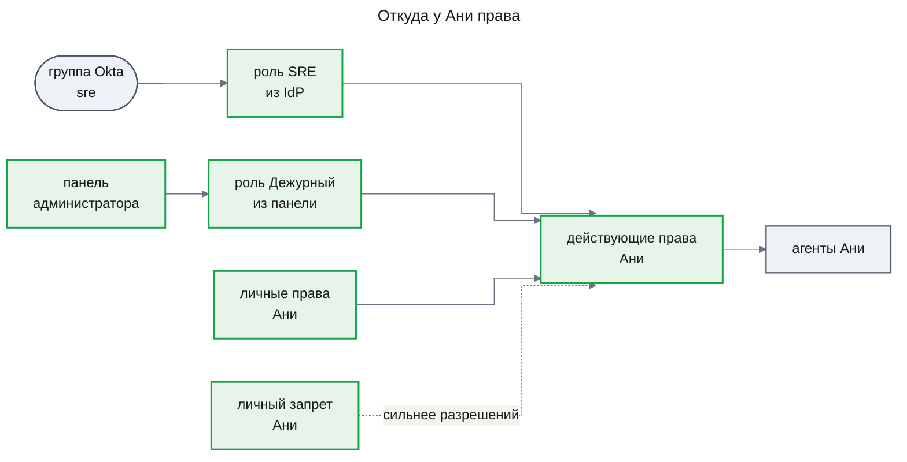
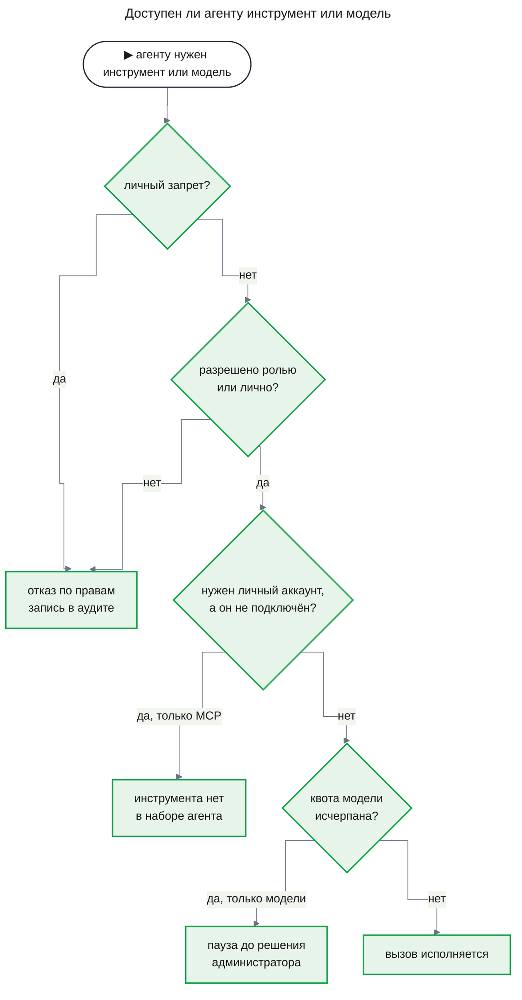
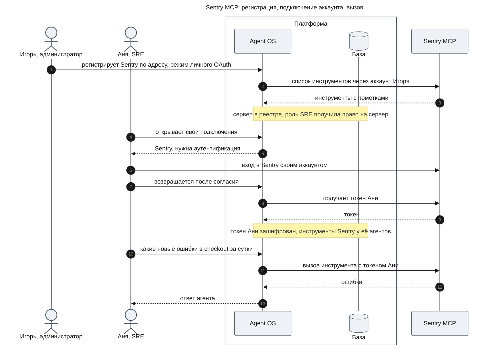
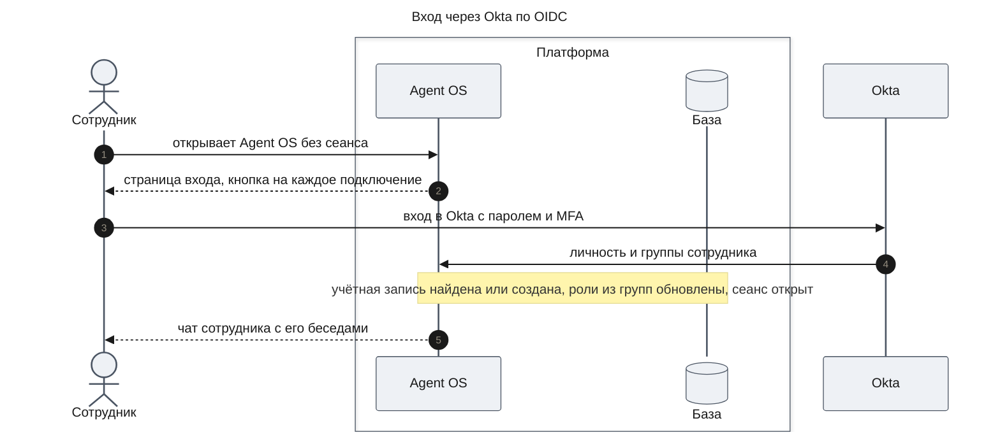
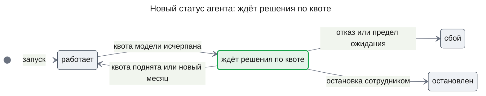
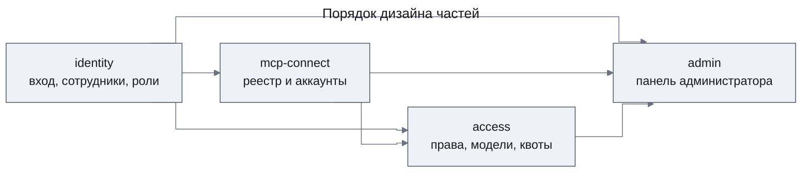

# PRD: Корпоративный вход и управление доступом (enterprise-access)

| Статус | Дата | Глубина | UXRD | Дизайны |
|---|---|---|---|---|
| Черновик | 2026-11-15 | full | `uxrd.md` — после утверждения PRD | — |

## Snapshot

**Overview.** Сегодня в Agent OS нет настоящего входа: в разработке все работают как один тестовый сотрудник, а список MCP-серверов, доступ к ним и цены моделей лежат в JSON-файлах и переменных окружения. Фича пускает сотрудников через корпоративный IdP: первой подключается Okta, другие IdP работают через те же стандарты OIDC, SAML и SCIM. В панели администратора ведутся сотрудники, роли, права на MCP-серверы и их инструменты, разрешённые модели и месячные квоты в долларах, и всё это хранится в базе. Права приходят от ролей (из групп IdP или назначенных в панели) и лично сотруднику, а личный запрет сильнее любого разрешения. Когда квота модели кончается посреди работы, агент встаёт на паузу и ждёт решения администратора.

- **Для**: сотрудники компании, администратор Agent OS, оператор развёртывания.
- **Не входит**: токены от Okta для MCP-серверов (Cross App Access), несколько компаний в одном развёртывании, права на `run_code` и workflow, бюджет на задачу.
- **Части**: `identity` → `mcp-connect` → `access` → `admin`.
- **Главный риск**: ошибка в проверке прав даёт агенту инструмент или модель без права. Защита — одна точка проверки, запрет сильнее разрешения и e2e-тесты на отказ ([Risks](#risks)).
- **Открытые вопросы**: нет.

## Terms

Пример везде один: SRE Аня работает с ошибками в Sentry, администратор Agent OS — Игорь.

- **IdP** (identity provider) — корпоративная система учётных записей: сотрудник входит в неё один раз, а приложения доверяют её ответу. Пример: Okta.
- **OIDC и SAML 2.0** — два стандартных протокола входа через IdP. Agent OS отправляет сотрудника на вход в IdP, а IdP возвращает подтверждённую личность и группы сотрудника. OIDC новее, SAML распространён в старых корпоративных системах.
- **SCIM 2.0** — стандарт, по которому IdP сам заводит, меняет и отключает учётные записи в приложении, не дожидаясь, пока сотрудник войдёт.
- **Подключение входа** — настроенная связь Agent OS с одним IdP по одному протоколу. У каждого включённого подключения своя кнопка на странице входа.
- **Сеанс входа** — время, пока браузер сотрудника работает от его имени после входа. Это не сессия агента (`agent-platform`, Terms).
- **JIT** (just-in-time) — учётная запись создаётся в момент первого входа.
- **Группа IdP** — группа сотрудников в IdP, например `sre`. **Роль** — группа сотрудников в Agent OS, которой даны права, например «SRE».
- **Право** — разрешение на MCP-сервер целиком, на один инструмент сервера или на одну модель. Право дают роли или лично сотруднику.
- **Личный запрет** — запрет сотруднику сервера, инструмента или модели. Он сильнее любого разрешения.
- **Действующие права** — то, что сотруднику доступно в итоге: разрешения всех его ролей и личные разрешения минус личные запреты.
- **Право администратора** — доступ к панели администратора и ко всем её операциям.
- **Реестр MCP-серверов** — список серверов, которые зарегистрировал администратор.
- **OAuth** — стандарт, по которому сотрудник разрешает приложению работать со своим аккаунтом в другой системе, не отдавая пароль: он входит в ту систему, соглашается, и приложение получает **токен** доступа.
- **Режим учётных данных** — чьим аккаунтом Agent OS ходит на MCP-сервер. **Общая учётная запись** — одна на всех, её вводит администратор. **Личный OAuth** — у каждого сотрудника свой аккаунт, который он подключает сам.
- **Подключение аккаунта** — личный OAuth-доступ сотрудника к одному серверу. **Список подключений** — его перечень у сотрудника.
- **Каталог моделей** — модели, которыми может пользоваться платформа, с ценами.
- **Квота** — предел расхода сотрудника на одну модель в долларах за календарный месяц.
- **Пауза по квоте** — новый статус агента «ждёт решения по квоте»: квота модели исчерпана, и агент ждёт администратора.
- **Аварийный вход** — способ вернуть вход и права администратора, когда все подключения входа сломаны.
- **Sentry MCP** — MCP-сервер Sentry, системы отслеживания ошибок, по адресу `https://mcp.sentry.dev/mcp`. Сотрудник подключает к нему свой аккаунт Sentry через OAuth. В этой фиче это пример реального сервера, а не встроенная интеграция.

## Background

Сегодня настоящего входа нет. В разработке каждый запрос идёт от тестового сотрудника `dev-user` или от того, кого назвал заголовок `x-user-id`, а в продакшене сервер отказывает всем. Беседы разделены по владельцу, но владелец — просто строка: таблиц сотрудников и ролей нет, а веб показывает зашитого тестового пользователя. Реальную аутентификацию оболочка чата откладывала (`chat-shell`, Won't Have).

Список MCP-серверов лежит в JSON-файле: три тестовых сервера, которые платформа запускает процессами на своей машине. Кому какие серверы доступны, задаёт таблица «сотрудник → серверы» в переменной окружения (`agent-platform` FR-11). Цены моделей лежат во втором JSON-файле, а журнал токенов считает расход сотрудника, но ничего не ограничивает (`agent-platform` FR-02).

Владелец хочет пустить в Agent OS сотрудников компании через Okta и управлять доступом из панели, а не правкой файлов: «никаких JSON — всё через базу». Эта фича заменяет таблицу доступа из `agent-platform` FR-11 и отменяет правило «превышение расхода ничего не блокирует» из `agent-platform` FR-02. Первым реальным MCP-сервером станет Sentry MCP: администратор регистрирует его по адресу, а каждый сотрудник подключает свой аккаунт Sentry. В 2026 году у MCP появилось расширение Enterprise-Managed Authorization: IdP компании (у Okta это называется Cross App Access) сам выдаёт агенту доступ к MCP-серверу, и сотруднику не нужно входить в каждую систему. Стандарт под ним (ID-JAG) пока черновик IETF, и серверов с его поддержкой мало ([обзор WorkOS](https://workos.com/blog/mcp-enterprise-managed-authorization-id-jag)), поэтому в этой фиче сотрудник подключает аккаунт сам.

Схема показывает путь сотрудника от входа до ответа агента и где в него встраивается фича. Зелёным — новое, красным — то, что меняется.

```mermaid
---
title: "Где встраивается вход и проверка доступа"
config:
  theme: base
  look: classic
  themeVariables:
    primaryColor: "#eef1f5"
    primaryBorderColor: "#4b5563"
    primaryTextColor: "#1a1a1a"
    lineColor: "#6b7280"
  flowchart:
    curve: step
  themeCSS: |
    @keyframes lit_ea{0%,12.86%{stroke:#991b1b;stroke-width:6px}14.29%,100%{stroke:#f4a5a5;stroke-width:2px}}
    @keyframes litr_ea{0%,12.86%{stroke:#1d4ed8;stroke-width:6px}14.29%,100%{stroke:#9ec1f7;stroke-width:2px}}
---
flowchart LR
    entry(["▶ сотрудник открывает Agent OS"])
    web["1 · веб<br/>вход и чат"]
    idp(["IdP компании<br/>например Okta"])
    api["2 · сервер платформы<br/>сеанс сотрудника"]
    agent["3 · агент<br/>права и квота"]
    mcp(["MCP-серверы<br/>например Sentry"])
    model(["модель<br/>Anthropic"])
    db[("база<br/>сотрудники, права, квоты")]
    admin["панель<br/>администратора"]
    entry --> web
    web e1@-->|"вход"| idp
    idp e2@-->|"личность и группы"| api
    api e3@-->|"задание сотрудника"| agent
    agent e4@-->|"вызов инструмента"| mcp
    mcp e5@-->|"результат"| agent
    agent e6@-->|"ответ"| api
    api e7@-->|"ответ в беседе"| web
    agent -.->|"в пределах квоты"| model
    agent -.->|"права и квоты"| db
    admin -.->|"правит"| db
    classDef entry fill:#ffffff,stroke:#1f2937,stroke-width:1.5px,color:#1a1a1a
    classDef changed fill:#fde8e8,stroke:#dc2626,stroke-width:2px,color:#1a1a1a
    classDef new fill:#e6f4ea,stroke:#16a34a,stroke-width:2px,color:#1a1a1a
    classDef unchanged fill:#eef1f5,stroke:#4b5563,stroke-width:1.5px,color:#1a1a1a
    classDef w1 stroke:#f4a5a5,stroke-width:2px,animation:lit_ea 8.4s linear 0s infinite
    classDef w2 stroke:#f4a5a5,stroke-width:2px,animation:lit_ea 8.4s linear 1.2s infinite
    classDef w3 stroke:#f4a5a5,stroke-width:2px,animation:lit_ea 8.4s linear 2.4s infinite
    classDef w4 stroke:#f4a5a5,stroke-width:2px,animation:lit_ea 8.4s linear 3.6s infinite
    classDef r1 stroke:#9ec1f7,stroke-width:2px,animation:litr_ea 8.4s linear 4.8s infinite
    classDef r2 stroke:#9ec1f7,stroke-width:2px,animation:litr_ea 8.4s linear 6s infinite
    classDef r3 stroke:#9ec1f7,stroke-width:2px,animation:litr_ea 8.4s linear 7.2s infinite
    class entry entry
    class web,api,agent,db changed
    class idp,admin new
    class mcp,model unchanged
    class e1 w1
    class e2 w2
    class e3 w3
    class e4 w4
    class e5 r1
    class e6 r2
    class e7 r3
```

Сервер платформы теперь знает сотрудника по сеансу входа. Агент перед каждым вызовом инструмента и модели спрашивает его действующие права и квоту, а администратор меняет их в панели без рестарта.

## Users and Use Cases

### Users

- **Сотрудник** — аналитик, SRE, инженер или менеджер компании. Ему важно входить тем же корпоративным аккаунтом, что и везде, и чтобы агенты работали во внешних системах от его имени и не больше, чем ему разрешено.
- **Администратор Agent OS** — сотрудник с правом администратора. Ему важно в одном месте видеть, кто что может и почему, менять это без правки файлов и рестарта и решать, когда сотрудник упёрся в квоту.
- **Администратор IdP** — тот, кто настраивает приложение Agent OS в Okta: группы, назначения, синхронизацию SCIM. Он работает в Okta, а не в Agent OS.
- **Оператор развёртывания** — тот, кто запускает сервер и задаёт его окружение. Сейчас это единственный разработчик. Ему важно поднять первое развёртывание и вернуть вход, если IdP сломался.

### Use Cases

- **UC-1**: Аня входит в Agent OS через Okta → видит свой чат и свои беседы под своим именем, так что ей не нужен отдельный пароль.
- **UC-2**: Администратор IdP добавляет нового сотрудника в группу `sre` в Okta → учётная запись и роль «SRE» появляются в Agent OS сами, так что Игорь не заводит людей вручную.
- **UC-3**: Сотрудника отключают в Okta → его сеансы закрываются, агенты останавливаются, а данные остаются, так что ушедший человек сразу теряет доступ.
- **UC-4**: Игорь регистрирует Sentry MCP по адресу и даёт роли «SRE» право на сервер, а стажёру лично запрещает изменяющий инструмент → у SRE агенты видят инструменты Sentry, а у стажёра этот инструмент закрыт, так что доступ настраивается без файлов и рестарта.
- **UC-5**: Аня подключает свой аккаунт Sentry из списка подключений → её агенты получают инструменты Sentry и видят в Sentry ровно то, что видит она, так что агент не получает больше прав, чем у неё самой.
- **UC-6**: Игорь разрешает роли модели и задаёт месячные квоты → сотрудники работают в пределах квот, а когда квота кончается, агент ждёт, пока Игорь поднимет квоту или откажет, так что расход на дорогие модели под контролем.
- **UC-7**: Игорь выясняет, почему у сотрудника есть доступ к инструменту → видит действующие права с источником каждого: какая роль или «лично», так что ошибку в настройке находят за минуту.
- **UC-8**: Подключение к Okta сломалось, и войти не может никто, включая администратора → оператор возвращает вход через аварийный вход, так что развёртывание не остаётся без администратора.

### Откуда у сотрудника права

Схема показывает, из чего складываются действующие права Ани.

Членство из IdP приходит при каждом входе и через SCIM и каждый раз заменяется целиком. Членство из панели хранится отдельно, и IdP его не трогает.

Когда агенту нужен инструмент или модель, платформа решает так:

### Пример: Sentry от регистрации до ответа агента

Диаграмма проводит Sentry MCP через UC-4 и UC-5: Игорь регистрирует сервер, Аня подключает свой аккаунт, и её агент вызывает инструмент Sentry её токеном.

Агенты Бориса из той же роли не видят инструментов Sentry, пока Борис не подключит свой аккаунт, а токен Ани для его вызовов не используется никогда.

## Functional Requirements

### Must Have (MVP)

#### Вход и сотрудники — часть `identity`

Вход через Okta по OIDC выглядит так; вход по SAML отличается только протоколом между Agent OS и IdP.

- **FR-01. Вход через OIDC.** Сотрудник входит в Agent OS через корпоративный IdP по OIDC. Страница входа показывает по кнопке на каждое включённое подключение входа. После входа сотрудник попадает в свой чат, а в меню видит своё имя из IdP вместо тестового пользователя. Без сеанса входа веб показывает только страницу входа, а сервер отказывает в любом запросе к данным.
  - AC-01.1: Given включено подключение OIDC к Okta, when сотрудник открывает Agent OS без сеанса, then он видит страницу входа с кнопкой этого подключения и ничего из чата.
  - AC-01.2: Given сотрудник выбрал подключение и вошёл в Okta, when Okta возвращает его в Agent OS, then открывается его чат, а в меню — его имя и почта из IdP.
  - AC-01.3: Given IdP отказал во входе или сотрудник отменил вход, when он возвращается в Agent OS, then видит страницу входа с причиной, а сеанс не открыт.
  - AC-01.4: Given запрос к серверу без действующего сеанса, when он просит данные сотрудника, then сервер отвечает отказом «нужен вход», и данных в ответе нет.
  - AC-01.5: Given включены два подключения, OIDC и SAML, when сотрудник открывает страницу входа, then видит две кнопки с названиями, которые дал им администратор.

- **FR-02. Вход через SAML 2.0.** Сотрудник входит по SAML так же, как по OIDC: результат для него одинаковый. Вход всегда начинается на странице входа Agent OS.
  - AC-02.1: Given включено подключение SAML, when сотрудник входит через него, then открывается его чат, как в AC-01.2.
  - AC-02.2: Given ответ IdP с неверной подписью или с истёкшим сроком, when он приходит в Agent OS, then вход отклонён, сеанс не открыт, а попытка записана в аудит.

- **FR-03. Подключения входа и шифрование секретов.** Администратор заводит, правит, включает и выключает подключения входа: название кнопки, протокол и данные подключения от IdP. Подключений может быть несколько. Секреты платформа хранит зашифрованными ключом из окружения: здесь это секреты подключений входа, а дальше тем же способом — токен SCIM, учётные данные MCP-серверов и токены сотрудников. После сохранения секрет никому не показывается, его можно только заменить. Выключение подключения не закрывает уже открытые сеансы: чтобы отрезать человека, его отключают (FR-07).
  - AC-03.1: Given администратор сохранил подключение OIDC с секретом клиента, when подключение читают снова, then все данные видны, а вместо секрета — пометка «задан» и возможность заменить его.
  - AC-03.2: Given администратор выключил подключение, when сотрудник открывает страницу входа, then кнопки этого подключения нет, а попытка войти через него отклоняется.
  - AC-03.3: Given администратор изменил данные подключения, when сотрудник входит через него, then вход идёт по новым данным без рестарта сервера.

- **FR-04. Учётная запись сотрудника.** Учётная запись появляется при первом входе (JIT) или раньше, через SCIM (FR-05). Сотрудника узнают по почте, которую подтвердил IdP: через какое бы подключение он ни вошёл, это одна учётная запись с одними беседами. Риски такого узнавания названы в [Risks](#risks). Беседы, агенты, расследования и расход принадлежат учётной записи и видны только ей. Учётная запись сотрудника никогда не получает идентификатор с префиксом `system:`: он зарезервирован за служебными владельцами платформы.
  - AC-04.1: Given сотрудника ещё нет в Agent OS, when он впервые входит через IdP, then появляется его учётная запись с именем и почтой из IdP, и он сразу работает в чате.
  - AC-04.2: Given сотрудник входил через подключение OIDC, when он входит через подключение SAML с той же почтой, then видит те же беседы.
  - AC-04.3: Given вошли два сотрудника, when каждый запрашивает беседы, агентов и расход, then получает только свои, а запрос к чужой беседе по её адресу получает такой же ответ, как к несуществующей.
  - AC-04.4: Given сотрудник входит впервые, when учётная запись создана, then её идентификатор не начинается с `system:`.

- **FR-05. Синхронизация через SCIM 2.0.** IdP сам заводит, обновляет и отключает сотрудников и передаёт их группы. Доступ по SCIM открывает токен, который администратор создаёт в панели. Токен показывается один раз, а новый токен отменяет прежний.
  - AC-05.1: Given в Okta включена синхронизация с токеном SCIM, when сотрудника назначают приложению Agent OS, then его учётная запись появляется до первого входа.
  - AC-05.2: Given в Okta поменяли имя или почту сотрудника, when Okta передаёт изменение, then в Agent OS имя и почта обновлены.
  - AC-05.3: Given запрос SCIM без токена или с отменённым токеном, when он приходит, then сервер отвечает отказом и ничего не меняет.
  - AC-05.4: Given администратор создал новый токен SCIM, when сервер отвечает на создание и на любые следующие запросы, then токен возвращается только в ответе на его создание и больше ни в одном ответе.

- **FR-06. Роли и членство из двух источников.** Роль — именованная группа сотрудников, которой администратор даёт права (FR-16). Сотрудник попадает в роль двумя путями: через группу IdP, сопоставленную с ролью, и назначением в панели. Членство из IdP обновляется при каждом входе и при каждой передаче групп через SCIM и целиком заменяется тем, что прислал IdP. Членство из панели хранится отдельно, и IdP его не меняет. Одну группу IdP можно сопоставить с несколькими ролями, а с одной ролью — несколько групп.
  - AC-06.1: Given группа Okta `sre` сопоставлена с ролью «SRE», when сотрудник из этой группы входит, then он в роли «SRE» с пометкой «из IdP».
  - AC-06.2: Given сотрудника убрали из группы `sre` в Okta, when он входит снова или Okta передаёт группы через SCIM, then роли «SRE» у него нет, а права роли пропадают у его работающих агентов со следующего вызова (FR-18).
  - AC-06.3: Given администратор назначил сотруднику роль «Дежурный» в панели, when IdP присылает группы сотрудника без такой группы, then роль «Дежурный» у сотрудника остаётся.
  - AC-06.4: Given сотрудник в роли и из IdP, и из панели, when IdP убирает его из группы, then сотрудник остаётся в роли по назначению из панели.

- **FR-07. Сеанс входа, выход и отключение.** Сотрудник выходит из Agent OS сам. Отключённый сотрудник теряет доступ сразу: его сеансы закрыты, работающие агенты и workflow остановлены, войти он не может. Отключает сотрудника IdP через SCIM или администратор в панели. Беседы и данные отключённого сотрудника сохраняются, и после повторного включения он видит их снова.
  - AC-07.1: Given сотрудник вошёл, when он выходит, then сеанс закрыт, а следующий запрос из этого браузера получает страницу входа.
  - AC-07.2: Given у сотрудника открыт сеанс и работает агент, when Okta деактивирует его через SCIM или администратор блокирует его в панели, then следующий запрос с его сеансом получает отказ, агент получает статус «остановлен» с причиной «сотрудник отключён», и от его имени больше нет ни одного вызова модели или инструмента.
  - AC-07.3: Given сотрудник отключён, when он пробует войти через IdP, then вход отклонён с причиной «учётная запись отключена».
  - AC-07.4: Given отключённого сотрудника включили снова, when он входит, then видит прежние беседы.

- **FR-08. Право администратора.** Право администратора открывает панель и все операции администратора. Его дают роли или лично сотруднику. Само по себе оно не даёт ни MCP-инструментов, ни моделей. Сервер отказывает в любой операции администратора без права, даже если её вызвали в обход панели. Изменение в панели, после которого не остаётся ни одного включённого сотрудника с правом администратора, отклоняется. Изменения от IdP платформа не отклоняет: IdP компании главнее, и уволенный администратор должен терять доступ. Если IdP убрал последнего администратора, платформа записывает это в аудит и лог, а вход администратора возвращают через группу в IdP или аварийный вход (FR-09).
  - AC-08.1: Given у сотрудника нет права администратора, when он вызывает операцию администратора, then получает отказ, а в аудите появляется запись «отказ по правам».
  - AC-08.2: Given право администратора есть у роли, when сотрудник из этой роли входит, then он получает доступ к операциям администратора.
  - AC-08.3: Given право администратора есть только у одного включённого сотрудника, when в панели снимают право с него или с его роли или блокируют его, then изменение отклоняется с причиной «не останется ни одного администратора».
  - AC-08.4: Given право администратора есть только у одного сотрудника, и даёт его роль из группы IdP, when IdP убирает его из группы или деактивирует его через SCIM, then изменение применяется, а в аудите и логе появляется запись «не осталось ни одного администратора».

- **FR-09. Первый администратор и аварийный вход.** Пока в базе нет ни одного включённого подключения входа, сервер при запуске берёт из окружения первое подключение OIDC и почту первого администратора (значения `BOOTSTRAP_*`). Подключение появляется на странице входа, а сотрудник с этой почтой после входа получает право администратора. Когда включённое подключение есть, эти значения не действуют. Тот же путь возвращает вход, если все подключения сломаны: оператор выключает их средствами развёртывания и перезапускает сервер с `BOOTSTRAP_*`.
  - AC-09.1: Given база пуста, а в окружении заданы `BOOTSTRAP_*`, when сервер запускается, а сотрудник с почтой первого администратора входит, then он получает доступ к операциям администратора.
  - AC-09.2: Given в базе есть включённое подключение, when сервер запускается с `BOOTSTRAP_*`, then подключения и права не меняются, а в логе есть запись, что значения не применены.
  - AC-09.3: Given оператор выключил все подключения, when сервер запускается с `BOOTSTRAP_*`, then на странице входа есть подключение из окружения, а сотрудник с почтой из окружения после входа получает право администратора.

- **FR-10. Вход для разработки и тестов.** В режиме разработки страница входа позволяет войти тестовым сотрудником без IdP, так что разработчик и автотесты работают без Okta. В продакшене этого пути нет. Заголовок `x-user-id` больше нигде не задаёт сотрудника.
  - AC-10.1: Given сервер в режиме разработки, when разработчик входит тестовым сотрудником, then он работает как обычный вошедший сотрудник с правами из базы.
  - AC-10.2: Given сервер в продакшене, when кто-то обращается ко входу для разработки, then получает такой же ответ, как для несуществующего адреса, а на странице входа такого пути нет.
  - AC-10.3: Given запрос с заголовком `x-user-id` и без сеанса, when он приходит в любом режиме, then сервер отказывает с причиной «нужен вход».

- **FR-11. Аудит входа и изменений администратора.** Аудит записывает каждый вход, успешный и отклонённый, выход, закрытие сеансов, каждую операцию SCIM и каждое изменение администратора в любой части фичи: кто, когда, какой объект, что было и что стало. Секрет в запись не попадает: вместо значения пишется «секрет изменён».
  - AC-11.1: Given администратор сменил сопоставление группы с ролью, when смотрят аудит, then в нём есть запись с администратором, временем, ролью, прежним и новым сопоставлением.
  - AC-11.2: Given администратор заменил секрет подключения, when смотрят аудит, then запись говорит «секрет изменён», а значения секрета в ней нет.
  - AC-11.3: Given вход отклонён, when смотрят аудит, then в нём есть запись с подключением, временем и причиной.

#### MCP-серверы и аккаунты сотрудников — часть `mcp-connect`

- **FR-12. Реестр MCP-серверов.** Администратор регистрирует удалённый MCP-сервер: имя, адрес и режим учётных данных (FR-13). Платформа сама получает с сервера список инструментов и показывает каждый с пометкой сервера «читает» или «меняет». Инструмент без пометки считается меняющим (`agent-platform` FR-11). Администратор обновляет список инструментов по запросу, выключает и удаляет сервер. Определения агентов ссылаются на серверы по имени в реестре. Любое изменение реестра действует без рестарта.
  - AC-12.1: Given администратор зарегистрировал сервер с общей учётной записью, when регистрация прошла, then в реестре виден список инструментов сервера с пометками.
  - AC-12.2: Given адрес недоступен или учётные данные не подходят, when администратор сохраняет сервер, then сохранение сервера возвращает причину, а сервер не включается.
  - AC-12.3: Given на сервере появился новый инструмент, when администратор обновляет список, then инструмент появляется в реестре.
  - AC-12.4: Given администратор выключил сервер, when агент работает, then инструменты сервера пропадают из его набора со следующего вызова модели, а вызов такого инструмента получает отказ.
  - AC-12.5: Given сервер зарегистрирован и указан в определении агента, when агент работает у сотрудника с правом на сервер, then инструменты сервера доступны агенту без рестарта платформы.

- **FR-13. Режимы учётных данных.** У каждого сервера один из двух режимов. Режим — свойство зарегистрированного сервера, его выбирают в настройках сервера, поэтому позже можно добавить третий режим. В режиме общей учётной записи администратор вводит ключ или токен сервера, и все вызовы идут с ним. В режиме личного OAuth каждый сотрудник подключает свой аккаунт (FR-14), и его вызовы идут с его токеном, а токены других сотрудников не используются никогда. Токены сотрудников платформа хранит зашифрованными (FR-03) и сама обновляет. Список инструментов сервера с личным OAuth платформа получает через аккаунт администратора, который тот подключает при регистрации. Поэтому у администратора должен быть аккаунт в каждой такой системе.
  - AC-13.1: Given сервер с общей учётной записью, when агенты двух сотрудников вызывают его инструмент, then оба вызова идут с учётной записью из реестра, а в аудите каждый вызов записан на своего сотрудника.
  - AC-13.2: Given сервер с личным OAuth и подключённые аккаунты Ани и Бориса, when агент Ани вызывает инструмент, then вызов идёт с токеном Ани, а токен Бориса не используется.
  - AC-13.3: Given срок токена Ани истёк, а обновить его можно, when агент Ани вызывает инструмент, then платформа обновляет токен, вызов проходит, и Аню ни о чём не спрашивают.
  - AC-13.4: Given администратор регистрирует сервер с личным OAuth, when он подключает свой аккаунт, then платформа получает список инструментов, и сервер появляется в реестре.
  - AC-13.5: Given администратор сохранил общую учётную запись сервера, when сервер читают снова, then значения нет, только пометка «задан», как в AC-03.1.

- **FR-14. Список подключений сотрудника.** У сотрудника есть список подключений: каждый сервер с личным OAuth, на который у него есть право, со статусом «подключено» или «нужна аутентификация». Пока аккаунт не подключён, инструменты сервера его агентам не предлагаются, и агент не встаёт на паузу ради подключения. Сотрудник подключает аккаунт из списка через вход в браузере у владельца сервера, и инструменты появляются у его агентов со следующего вызова модели, без рестарта. Сотрудник может отключить аккаунт, и тогда токен удаляется. Если обновить токен не удалось, статус возвращается в «нужна аутентификация». Так это устроено в Claude Code.
  - AC-14.1: Given Ане дано право на Sentry MCP с личным OAuth, а аккаунт не подключён, when Аня открывает список подключений, then видит Sentry со статусом «нужна аутентификация».
  - AC-14.2: Given аккаунт Ани в Sentry не подключён, when её агент работает, then инструментов Sentry в его наборе нет, и агент работает без них, не дожидаясь подключения.
  - AC-14.3: Given Аня подключила аккаунт через вход в Sentry, when она возвращается в Agent OS, then статус — «подключено», а следующий вызов модели её работающего агента уже видит инструменты Sentry.
  - AC-14.4: Given Аня отключила аккаунт, when её агент работает, then инструменты Sentry пропадают у него со следующего вызова модели, а статус — «нужна аутентификация».
  - AC-14.5: Given обновить токен Ани не удалось, when агент вызывает инструмент Sentry, then вызов получает ошибку «нужно подключить аккаунт», статус в списке — «нужна аутентификация», а агент продолжает работу.
  - AC-14.6: Given у Ани нет права на сервер с личным OAuth, when она открывает список подключений, then этого сервера в списке нет.

- **FR-15. Один транспорт и тестовые серверы по HTTP.** Разработчик и автотесты работают с тестовыми MCP-серверами (логи, трекер, `backoffice`) без ручной регистрации и без настоящих аккаунтов, в том числе для личного OAuth.
  - AC-15.1: Given чистая база разработки, when разработчик запускает скрипт начальных данных, then тестовые серверы есть в реестре, и агент сотрудника с правом вызывает их инструменты.
  - AC-15.2: Given автотесты личного OAuth, when они идут в CI, then проходят без выхода в интернет и без настоящих аккаунтов.

#### Права, модели и квоты — часть `access`

- **FR-16. Права ролей и личные права.** Право разрешает одно из трёх: весь MCP-сервер, один инструмент сервера или одну модель. Право дают роли или лично сотруднику. Действующие права сотрудника — все права его ролей и его личные права за вычетом личных запретов (FR-17). Право на сервер покрывает и инструменты, которые появятся на нём позже.
  - AC-16.1: Given роль «SRE» имеет право на Sentry MCP, а Аня в этой роли и подключила аккаунт, when её агент работает, then ему доступны все инструменты Sentry.
  - AC-16.2: Given у сотрудника нет права на сервер, но есть личное право на один его инструмент, when его агент работает, then из этого сервера ему доступен только этот инструмент.
  - AC-16.3: Given у сотрудника нет ни ролей, ни личных прав, when он пишет в чат, then ответа модели нет, а сотрудник видит, что ему не разрешена ни одна модель и нужно обратиться к администратору.

- **FR-17. Личный запрет сильнее разрешения.** Администратор лично запрещает сотруднику сервер, инструмент или модель. Запрет сильнее любого разрешения — и от роли, и личного. Запрет сервера закрывает все его инструменты.
  - AC-17.1: Given роль даёт право на сервер, а у сотрудника личный запрет на один изменяющий инструмент этого сервера, when его агент работает, then доступны все инструменты сервера, кроме запрещённого, а вызов запрещённого получает отказ по правам.
  - AC-17.2: Given у сотрудника личный запрет сервера и личное право на его инструмент, when его агент работает, then ни один инструмент сервера ему не доступен.
  - AC-17.3: Given роль разрешает модель, а у сотрудника личный запрет этой модели, when агент выбирает эту модель, then выбор отклоняется, как в FR-20.

- **FR-18. Одна проверка действующих прав.** Права проверяет одно место. Ему подчиняются главный чат, фоновые агенты и workflow сотрудника, а также вызовы инструментов из кода (`code-execution` FR-03). MCP-инструменты агента — это серверы из его определения в пересечении с действующими правами сотрудника, которому принадлежит беседа, и с его подключёнными аккаунтами (FR-14). Набор пересчитывается перед каждым вызовом модели, а каждый вызов инструмента проверяется ещё раз. Поэтому изменение прав доходит до работающих агентов без рестарта. Отказ записывается в аудит с исходом «отказ по правам».
  - AC-18.1: Given у сотрудника нет права на инструмент, when модель его агента всё равно просит этот инструмент, then MCP-сервер не получает ни одного вызова, агент получает отказ, а в аудите — ровно одна запись «отказ по правам».
  - AC-18.2: Given агент работает, when администратор снимает право, then инструмента нет в наборе со следующего вызова модели, а вызов, начатый после снятия, получает отказ.
  - AC-18.3: Given агент работает, when администратор даёт право, then инструмент появляется в наборе со следующего вызова модели.
  - AC-18.4: Given права сотруднику даёт роль, when он запускает workflow и агент вызывает инструмент из скрипта `run_code`, then агенты workflow и скрипт получают те же инструменты и те же отказы, что главный чат.

- **FR-19. Каталог моделей с ценами.** Администратор ведёт каталог моделей, которыми может пользоваться платформа, и их цены. Стоимость каждого вызова считается по цене из каталога на момент вызова. Новая цена действует для следующих вызовов, а прошлые стоимости не пересчитываются. Модель вне каталога не используется.
  - AC-19.1: Given администратор добавил модель с ценой и разрешил её сотруднику, when агент сотрудника вызывает эту модель, then вызов идёт, а его стоимость посчитана по этой цене.
  - AC-19.2: Given администратор поменял цену модели, when сотрудник смотрит свой расход за месяц, then вызовы до изменения посчитаны по старой цене, а после — по новой.
  - AC-19.3: Given модели нет в каталоге, when агент её выбирает, then выбор отклоняется с причиной «модель не подключена».

- **FR-20. Разрешённые модели.** Сотрудник пользуется только моделями, которые ему разрешены ролями или лично и не запрещены лично. Модель агента выбирается по правилу `agent-platform` FR-04. Если выбранная модель не разрешена, платформа не подменяет её другой: агент не запускается, а запускавший получает причину. Каждый отказ по модели записывается в аудит.
  - AC-20.1: Given Ане разрешён только Haiku, when чат запускает для неё агента на Sonnet, then агент не запускается, а в историю родителя приходит отказ «модель не разрешена: Sonnet».
  - AC-20.2: Given модель главного чата Ане не разрешена, when Аня пишет в чат, then ответа модели нет, а Аня видит, что модель ей не разрешена и нужно обратиться к администратору.
  - AC-20.3: Given агент работает на модели, when администратор снимает разрешение и агент делает следующий вызов модели, then вызов не идёт, а агент получает статус «сбой» с причиной «модель не разрешена».
  - AC-20.4: Given выбор модели отклонён, when смотрят аудит, then в нём есть запись с сотрудником, моделью и причиной.

- **FR-21. Месячные квоты по моделям.** Квота — необязательная часть разрешения модели (FR-20): у роли или лично сотруднику. Месяц считается так же, как расход сотрудника за месяц (`agent-platform` FR-02). Квоты складываются: если модель с квотой разрешают сотруднику несколько ролей и он сам лично, его действующая квота на модель равна сумме этих квот. Разрешение без квоты — предел без ограничения, и из двух пределов действует больший. Поэтому если хотя бы одно разрешение модели у сотрудника без квоты, расход на неё не ограничен. Новая роль только добавляет сотруднику возможности и никогда их не урезает, а урезать их может только личный запрет.
  - AC-21.1: Given у роли «SRE» квота на Sonnet 50 $, у роли «Дежурный» — 20 $, а лично у Ани — 30 $, when Аня состоит в обеих ролях, then её действующая квота на Sonnet — 100 $.
  - AC-21.2: Given Sonnet Ане разрешён, и ни одно её разрешение Sonnet не несёт квоты, when её расход на Sonnet растёт, then её агенты на Sonnet не встают на паузу по квоте.
  - AC-21.3: Given расход Ани на Sonnet за месяц ниже действующей квоты, when её агент вызывает Sonnet, then вызов идёт сразу.
  - AC-21.4: Given начался новый календарный месяц, when Аня работает, then её расход на каждую модель против квоты считается с нуля.
  - AC-21.5: Given роль A разрешает Ане Sonnet без квоты, when Аню добавляют в роль B с квотой на Sonnet 20 $, then расход Ани на Sonnet по-прежнему не ограничен.

- **FR-22. Пауза по квоте.** Перед каждым вызовом модели платформа сравнивает расход сотрудника на эту модель за месяц с его действующей квотой. Если квота исчерпана, вызов не начинается, а агент получает новый статус «ждёт решения по квоте». Вызовы, которые уже идут, заканчиваются, и их стоимость учитывается: резерва под вызов нет, поэтому расход может немного превысить квоту. На паузу встают все агенты сотрудника, которым нужна эта модель, а агенты на других моделях работают дальше. Пауза кончается одним из пяти способов:
  - администратор поднял или снял квоту — агенты сами продолжают с того же места;
  - начался новый календарный месяц, и расход против квоты считается с нуля — агенты сами продолжают;
  - сотрудник остановил агента (`agent-platform` FR-08);
  - администратор отказал — агенты получают статус «сбой» с причиной «квота исчерпана»;
  - истёк предел ожидания, а решения администратора не было — агент получает статус «сбой» с той же причиной.

  Предел ожидания отсчитывается от начала паузы каждого агента. Это одна настройка развёртывания: она хранится в базе, администратор меняет её в панели (FR-30), а по умолчанию она равна 24 часам. Сообщения агенту на паузе ждут в очереди и доставляются после паузы (`agent-platform` FR-07). Пауза переживает рестарт сервера, а её начало и конец записываются в аудит. Администратор видит паузы в панели (FR-30).
  - AC-22.1: Given расход Ани на Sonnet достиг квоты, when её агент собирается вызвать Sonnet, then вызов не идёт, агент получает статус «ждёт решения по квоте», а Аня в беседе и в списке агентов видит модель, свой расход и квоту за месяц и что решение за администратором.
  - AC-22.2: Given у Ани идут два вызова Sonnet, и квота исчерпана во время них, when они заканчиваются, then оба результата доходят до агентов, их стоимость входит в расход, а следующий вызов Sonnet не начинается.
  - AC-22.3: Given агент Ани на паузе, when администратор поднимает её личную квоту или квоту её роли выше расхода, then агент сам продолжает работу с того же места, и Ане не нужно ничего писать.
  - AC-22.4: Given агент Ани на паузе, when администратор отказывает, then агент получает статус «сбой» с причиной «квота исчерпана», родитель получает уведомление, а Аня видит причину в беседе.
  - AC-22.5: Given агент Ани на паузе, when Аня его останавливает, then агент получает статус «остановлен».
  - AC-22.6: Given агент на паузе, when сервер перезапускают, then агент по-прежнему ждёт решения по квоте.
  - AC-22.7: Given один агент Ани на паузе по Sonnet, а другой работает на Haiku в пределах квоты, when оба продолжают, then агент на Haiku работает без паузы.
  - AC-22.8: Given агент на паузе, when начинается новый календарный месяц, then агент сам продолжает работу.
  - AC-22.9: Given пауза началась и закончилась, when смотрят аудит, then в нём есть запись начала и запись конца с тем, как пауза кончилась.
  - AC-22.10: Given предел ожидания — 24 часа, а агент Ани на паузе, when проходят 24 часа без решения администратора, then агент получает статус «сбой» с причиной «квота исчерпана», родитель получает уведомление, а Аня видит причину в беседе.

Статусы агента из `agent-platform` получают ещё один. На схеме — только переходы, которые касаются нового статуса.

#### Панель администратора — часть `admin`

- **FR-24. Панель администратора.** Панель — отдельный раздел веба только для сотрудников с правом администратора (FR-08). В ней разделы: сотрудники и роли, подключения входа и SCIM, MCP-серверы, права и запреты, модели и квоты, паузы по квоте. Содержимого бесед и агентов сотрудников в панели нет.
  - AC-24.1: Given администратор вошёл, when он открывает меню, then видит вход в панель, а в панели — все разделы, перечисленные в FR-24.
  - AC-24.2: Given у сотрудника нет права администратора, when он открывает адрес панели напрямую, then видит отказ, а не данные панели, и входа в панель в его меню нет.

- **FR-25. Сотрудники и роли.** Администратор видит список сотрудников со статусом (включён или отключён) и ролями, у каждого членства — источник: «из IdP» или «из панели». Он блокирует и разблокирует сотрудника, создаёт, переименовывает и удаляет роли, назначает и снимает роли из панели и сопоставляет группы IdP с ролями.
  - AC-25.1: Given у Ани роль «SRE» из IdP и роль «Дежурный» из панели, when администратор открывает Аню, then видит обе роли с источником и может снять только «Дежурный».
  - AC-25.2: Given администратор удалил роль, when работают агенты её сотрудников, then права этой роли пропадают у них со следующего вызова модели.

- **FR-26. Подключения входа и SCIM.** Администратор создаёт, правит, включает и выключает подключения OIDC и SAML и создаёт токен SCIM. Для каждого подключения панель показывает данные Agent OS, которые нужно перенести в настройки приложения в IdP.
  - AC-26.1: Given администратор создаёт подключение SAML, when он открывает его, then видит данные Agent OS для IdP и может скопировать каждое значение.
  - AC-26.2: Given администратор создаёт токен SCIM, when токен создан, then панель показывает его один раз, как в AC-05.4.

- **FR-27. MCP-серверы.** Администратор регистрирует сервер по адресу, выбирает режим учётных данных и вводит общую учётную запись или подключает свой аккаунт для личного OAuth. Он видит инструменты сервера с пометками, обновляет список, выключает и удаляет сервер.
  - AC-27.1: Given администратор регистрирует Sentry MCP по адресу в режиме личного OAuth, when он подключает свой аккаунт Sentry, then видит список инструментов Sentry с пометками «читает» и «меняет».

- **FR-28. Права и запреты.** Для роли администратор видит и правит её права. Для сотрудника — его личные права, личные запреты и действующие права с источником каждого: какая роль, «лично» или «закрыто личным запретом». Право на инструмент выбирается из списка инструментов реестра, а не вводится вручную.
  - AC-28.1: Given право на Sentry MCP Аня получает от роли «SRE», а один инструмент ей запрещён лично, when администратор открывает действующие права Ани, then видит Sentry с источником «роль SRE» и этот инструмент с пометкой «закрыто личным запретом».
  - AC-28.2: Given администратор даёт право на инструмент, when он выбирает инструмент, then выбирает его из списка инструментов сервера в реестре.

- **FR-29. Модели, цены и квоты.** Администратор ведёт каталог моделей с ценами, разрешает модели ролям и сотрудникам, задаёт квоты ролей и личные квоты. Для сотрудника он видит действующую квоту на каждую модель с разбивкой по слагаемым и расход за месяц.
  - AC-29.1: Given у Ани квоты из AC-21.1, when администратор открывает Аню, then видит действующую квоту на Sonnet 100 $ с разбивкой «SRE 50 + Дежурный 20 + лично 30» и расход Ани на Sonnet за месяц.

- **FR-30. Паузы по квоте.** Администратор видит сотрудников, чьи агенты ждут решения по квоте: сотрудник, модель, расход и квота, число агентов на паузе, с какого времени. Отсюда он поднимает личную квоту или квоту роли либо отказывает. Здесь же он меняет предел ожидания паузы (FR-22).
  - AC-30.1: Given агенты Ани на паузе по Sonnet, when администратор открывает раздел пауз, then видит строку Ани с моделью, расходом, квотой, числом агентов и временем начала, без текста бесед.
  - AC-30.2: Given администратор поднял личную квоту Ани из этой строки, when изменение сохранено, then агенты Ани продолжают работу (AC-22.3), а строка пропадает.
  - AC-30.3: Given администратор отказал из строки Ани, when отказ сохранён, then агенты Ани получают статус «сбой» (AC-22.4), а строка пропадает.
  - AC-30.4: Given администратор поменял предел ожидания, when новый агент встаёт на паузу, then его пауза кончается по новому пределу, если решения администратора не было.

### Should Have

- **FR-23. Сотрудник видит свои модели и квоты.** Рядом с расходом за месяц (`agent-platform` FR-29) сотрудник видит разрешённые ему модели, расход за месяц на каждую, квоту и остаток. Часть `access`.
  - AC-23.1: Given Ане разрешены Haiku без квоты и Sonnet с квотой 100 $, when Аня открывает свой расход, then видит обе модели и расход за месяц на каждую, у Sonnet — квоту и остаток, а у Haiku — пометку «без предела».

### Could Have

- **FR-31. Журнал аудита в панели.** Администратор просматривает аудит в панели с отбором по сотруднику, виду записи и периоду. Часть `admin`.
  - AC-31.1: Given администратор открывает журнал, when он отбирает записи по сотруднику и дню, then видит входы, отказы по правам, паузы и изменения администратора за этот день.

### Won't Have

- Токены от Okta для MCP-серверов (Cross App Access, MCP Enterprise-Managed Authorization) — позже, отдельной фичей: ни один нужный MCP-сервер их пока не поддерживает.
- Несколько компаний в одном развёртывании — нет: одно развёртывание обслуживает одну компанию.
- Права на `run_code`, workflow, встроенные инструменты и определения агентов — нет: они открыты каждому сотруднику. Права в фиче покрывают MCP, модели и право администратора.
- Бюджет на задачу и расследование (бизнес-ограничение 4 в `.claude/skills/project-context/SKILL.md`) — не в этой фиче: квота ограничивает сотрудника за месяц, а не задачу.
- Запрет на уровне роли — нет: роль только разрешает, запрет всегда личный. Так правило остаётся простым: роли складываются, а запрет — исключение для человека.
- Встроенная роль «все сотрудники» — нет: то же даёт сопоставление общей группы IdP (в Okta — Everyone) с ролью.
- Вход, начатый в IdP (IdP-initiated SAML), — позже: такой ответ IdP приходит без запроса Agent OS, и его труднее защитить от подмены входа. Плитка приложения в Okta и так может открыть страницу входа Agent OS.
- Свои пароли и своя MFA — нет: это делает IdP. Без IdP входят только в режиме разработки (FR-10).
- Резерв квоты под вызов и оценка стоимости до вызова — нет: превышение квоты на стоимость уже начатых вызовов принято (FR-22).
- Квоты в токенах, на неделю или на все модели сразу — нет: квота — доллары на одну модель за календарный месяц.
- Письма и сообщения администратору о паузах — нет: администратор видит паузы в панели (FR-30).
- Запрос доступа от сотрудника администратору — позже: в пилоте сотрудник просит доступ у администратора напрямую, а тот видит действующие права сотрудника в панели (FR-28).
- Пауза агента до подключения аккаунта — нет: инструменты неподключённого сервера просто не предлагаются (FR-14).
- Чтение администратором бесед и истории агентов сотрудников — нет: панель показывает права, расход и паузы, но не содержимое.
- Биллинг, отчёты и операционные экраны в панели — нет: панель только управляет доступом.
- Автоматическое обновление списка инструментов сервера — позже: список обновляется по запросу администратора (FR-12).
- Перенос бесед и расследований тестового сотрудника `dev-user` на настоящие учётные записи — нет: проект — PoC.

## Non-Functional Requirements

### Security

- **NFR-01**: Секреты подключений входа, токен SCIM, общие учётные записи MCP-серверов и токены сотрудников хранятся в базе только зашифрованными. Проверка: тест читает строки базы напрямую и не находит ни одного секрета в открытом виде.
- **NFR-02**: Ни секрет, ни токен не попадает в логи, аудит, ответы сервера после сохранения и историю агентов. Проверка: тест с известными значениями секретов ищет их во всех четырёх местах и находит ноль совпадений.
- **NFR-03**: Без сеанса входа на сервере открыты только вход, SCIM со своим токеном и проверка здоровья. Проверка: тест обходит все маршруты сервера без сеанса и получает отказ на каждом, кроме этих.

### Performance

- **NFR-04**: Проверка прав и квоты перед вызовом модели держит время до первого токена в бюджете раздела «Performance Requirements» в `.claude/skills/project-context/SKILL.md`. Проверка: замер в тесте с десятью ролями и сотней прав у сотрудника.

### Accessibility and responsiveness

- **NFR-05**: Страница входа, список подключений и панель администратора соответствуют WCAG 2.1 AA, как оболочка чата (`chat-shell` NFR-18). Страница входа и список подключений пригодны к работе от 360 px, панель администратора — от 1280 px.

## Delivery Parts

| Часть | Покрывает | Срез | Зависит от | Почему отдельно |
|------|--------|-----------|------------|-----------|
| `identity` | FR-01–FR-11 | domain | — | Кто сотрудник и в каких он ролях: вход, учётные записи, SCIM, сеансы, право администратора, шифрование секретов и аудит изменений. Сюда же страница входа и имя в меню. |
| `mcp-connect` | FR-12–FR-15 | domain | `identity` | Как платформа достаёт до MCP-серверов: реестр, режимы учётных данных и аккаунты сотрудников. Сюда же список подключений сотрудника. |
| `access` | FR-16–FR-23 | domain | `identity`, `mcp-connect` | Что сотруднику можно: права, запреты, модели, квоты и пауза — одна проверка в механизме агентов. Сюда же сообщение о паузе в беседе и расход по моделям. |
| `admin` | FR-24–FR-31 | frontend | `identity`, `mcp-connect`, `access` | Панель — большой отдельный интерфейс поверх операций администратора трёх частей. |

Каждая из трёх первых частей отдаёт операции администратора над своими объектами, а `admin` строит над ними экраны. Небольшие экраны сотрудника живут в части, чьё требование они выполняют: страница входа и меню — в `identity`, список подключений — в `mcp-connect`, сообщение о паузе и расход по моделям — в `access`. Право администратора и аудит изменений лежат в `identity`, потому что первые операции администратора — подключения входа и роли — появляются уже там.

### Part Dependency Diagram

Стрелка ведёт от части к той, что строится на её утверждённом дизайне.

## Success Criteria

- Пилотная группа входит через Okta. Цель: все сотрудники пилотной группы вошли через Okta, и ни одну учётную запись не завели вручную; читается в списке сотрудников панели через две недели после выпуска.
- Sentry MCP работает как реальный сервер. Цель: администратор зарегистрировал Sentry MCP, хотя бы один сотрудник подключил свой аккаунт, и его агент ответил на вопрос данными из Sentry; читается в аудите вызовов инструментов в первую неделю после выпуска.
- Ни одного вызова без права. Цель: ноль вызовов MCP-инструментов и моделей сотрудниками без действующего права; читается в аудите и журнале токенов за первые две недели после выпуска.

## Constraints and Risks

### Constraints

- Вход — только по стандартам OIDC, SAML 2.0 и SCIM 2.0. Okta подключается первой, другие IdP — через те же протоколы, без API конкретного IdP.
- Одно развёртывание — одна компания.
- Система записи всего, чем управляет фича, — база, а правит её панель: JSON-файлы со списком серверов и ценами и таблица доступа в окружении удаляются.
- Фича добавляет в окружение только ключ шифрования секретов, секрет cookie сеанса, публичный адрес развёртывания и разовые значения `BOOTSTRAP_*` (FR-09). `DATABASE_URL`, `ANTHROPIC_API_KEY` и прочие настройки сервера, которыми фича не управляет, остаются как есть.
- MCP-серверы подключаются только по HTTP.
- Проект — PoC: без слоёв совместимости, параллельных версий и переноса существующих записей. Удалить локальные данные разработки или нет, решает разработчик.
- Бизнес-ограничения 1–3 из `.claude/skills/project-context/SKILL.md` выполняются с настоящими сотрудниками: права на инструменты, изоляция данных, аудит каждого вызова.
- Бизнес-ограничение 1 просит e2e-тест на отказ для каждого инструмента. Инструменты серверов, которые администратор регистрирует в работе, заранее неизвестны. Поэтому отказ даёт одна проверка (FR-18), а e2e-тест на отказ есть для каждого тестового сервера, каждого режима учётных данных и вызова из кода.
- Логи пишутся через обёртку логгера из `packages/common` (`CLAUDE.md`, «Logging»), а секреты и токены не логируются никогда.

### Assumptions

- Для ручной приёмки есть тестовая организация Okta, где можно завести приложение OIDC, приложение SAML и синхронизацию SCIM. Проверяется до дизайна `identity`.
- Автотесты входа по OIDC и SAML идут на тестовом IdP внутри набора тестов, без Okta. Проверяется в дизайне `identity`.
- Sentry MCP принимает Agent OS клиентом OAuth без ручной регистрации у Sentry. Адрес `https://mcp.sentry.dev/mcp`, транспорт HTTP и вход через OAuth аккаунтом Sentry подтверждены [документацией Sentry MCP](https://mcp.sentry.dev/), а способ регистрации клиента — нет. Проверяется в дизайне `mcp-connect`.
- Превышение квоты ограничено стоимостью вызовов, которые уже шли в момент исчерпания, и на практике мало. Проверяется по журналу токенов после выпуска.

### Risks

| Риск | Влияние | Вероятность | Что делаем |
|------|--------|-------------|------------|
| Ошибка в проверке прав даёт агенту инструмент или модель без права | Высокое | Среднее | Одна проверка для чата, агентов, workflow и кода (FR-18); запрет сильнее разрешения (FR-17); e2e-тесты на отказ для тестовых серверов, режимов учётных данных и вызова из кода ([Constraints](#constraints)). |
| Никто не может войти: IdP сломан или снят последний администратор | Высокое | Низкое | Аварийный вход (FR-09); изменение, после которого нет администратора, отклоняется (AC-08.3). |
| Утечка секрета или токена сотрудника | Высокое | Низкое | Шифрование в базе (NFR-01); секрет после сохранения не показывается (AC-03.1); проверка логов, аудита и ответов (NFR-02). |
| Подделанный ответ SAML пускает чужого человека | Высокое | Низкое | Проверка подписи и срока (AC-02.2); проверенная библиотека и ревью безопасности дизайна `identity`. |
| Неверное сопоставление групп даёт широкий доступ | Среднее | Среднее | Действующие права с источником в панели (FR-28); каждое изменение в аудите (FR-11). |
| Пауза по квоте останавливает работу, пока администратора нет | Среднее | Среднее | Сотрудник видит причину и может остановить агента (AC-22.1, AC-22.5); пауза не длится дольше предела ожидания (AC-22.10). |
| Сотрудника узнают по почте, и подключение к IdP, который не проверяет почту, пускает человека под чужой учётной записью | Высокое | Низкое | Подключения входа заводит только администратор (FR-03); каждый вход записан в аудит (FR-11). |
| Без SCIM смена почты в IdP при следующем входе даёт вторую учётную запись без прежних бесед | Среднее | Низкое | Включить SCIM: тогда почта обновляется в той же учётной записи (AC-05.2). |
| Агенты одного сотрудника, работающие параллельно, превышают квоту | Низкое | Высокое | Принято: уже начатые вызовы заканчиваются (AC-22.2), новые не начинаются. |
| Токен сотрудника не обновляется, и инструменты пропадают посреди работы | Среднее | Среднее | Статус «нужна аутентификация» и понятная ошибка агенту (AC-14.5). |

## Update History

| Версия | Дата | Изменение |
|---------|------|--------|
| 1.0 | 2026-11-15 | Первая версия |
| 1.1 | 2026-11-15 | Ответы владельца при утверждении: список подключений как в Claude Code, сотрудника узнают по подтверждённой почте, список инструментов через аккаунт администратора; при смешанных квотах действует больший предел; пауза по квоте кончается и по пределу ожидания (24 часа по умолчанию, правится в панели, новый AC-22.10 и AC-30.4); режим учётных данных — свойство сервера; четыре части подтверждены, другие разрезы убраны; продуктовые вопросы закрыты |
| 1.2 | 2026-11-15 | Правки по ревью: критерии частей `identity` и `mcp-connect` проверяют операции, а не экраны панели; пути файлов и имена переменных убраны из Constraints; технические вопросы переданы в дизайны частей, раздел Undetermined Items удалён; FR-15 говорит об исходе, а не о средствах тестов |
