# UXRD: Корпоративный вход и управление доступом (enterprise-access)

| Статус | Дата | PRD | Дизайны |
|---|---|---|---|
| Черновик | 2026-11-28 | [prd.md](./prd.md) | `design-identity.md`, `design-mcp-connect.md`, `design-access.md`, `design-admin.md`, `design-access-levels.md` |

## Snapshot

**Overview.** Сотрудник начинает со страницы входа: на ней всегда есть форма логина и пароля, а под ней — по кнопке на каждого провайдера, которого включил администратор (Google или Okta по OIDC). После входа он попадает в свой чат и видит в меню своё имя. Из меню он открывает «Мой доступ»: серверы, к которым нужно подключить личный аккаунт, модели с расходом и квотой и, у локальной учётной записи, смену пароля. Отказы по правам видны в беседе блоком вызова с причиной, а агент, чья модель исчерпала квоту, заканчивается сбоем с причиной «квота исчерпана» и продолжает по сообщению сотрудника, когда квоту поднимут. Администратор работает в панели — разделе той же оболочки с разделами сотрудники, роли, авторизация, MCP-серверы и модели; роли и права он назначает сам. Что делает инструмент MCP-сервера — доступен ли он вообще, читает ли или меняет, — администратор задаёт на вкладке «Инструменты» страницы сервера. Кому инструменты доступны, он задаёт уровнем на каждый сервер одной строкой: «Нет», «Только чтение», «Все» или «Выборочно». Уровни роли правятся на её странице, уровни всех ролей одного сервера — на вкладке «Доступ» этого сервера, а личный уровень — на странице сотрудника. Отдельные инструменты отмечаются, только когда выбран уровень «Выборочно», и все изменения сохраняются одной кнопкой внизу.

- **Не меняется**: беседа, лента, карточки агентов, дерево агентов и статусы (agent-platform UXRD) — фича добавляет только причины отказа и остановки. Расход за месяц под именем (agent-platform UXRD, SP-01) остаётся как есть.
- **Главный UX-риск**: сотрудник не замечает, что аккаунт сервера не подключён, и агент молча работает без его инструментов. Защищают точка на аватаре и число в пункте «Мой доступ» (KD-2).
- **Открытые вопросы**: нет.

### Key Decisions

| ID | Решение | Почему |
|---|---|---|
| KD-1 | Панель администратора — раздел той же оболочки по адресам `/admin/…`. Сайдбар в панели показывает ссылку «К чату» и разделы панели вместо списка бесед; шапка, блок пользователя и тема прежние | Администратор переходит между чатом и панелью без смены приложения, а панель собирается из частей оболочки |
| KD-2 | Свой доступ сотрудник видит на одной странице «Мой доступ» (`/account`). Строка сервера устроена как в Claude Code: имя, статус «Нужна аутентификация» или «Подключено» и одна кнопка; аккаунт подключают переходом в той же вкладке с возвратом. Пока есть неподключённые аккаунты, на аватаре точка, а в пункте меню — их число | Сотрудник находит, почему у агента нет инструментов, в одном месте; переход в той же вкладке не блокируют браузеры |
| KD-3 | Меню пользователя (chat-shell UXRD, SB-11) показывает имя и почту сотрудника и получает «Мой доступ», «Панель администратора» (только администратору) и «Выйти». Строка «Режим разработки» и правило «в меню нет „Выйти“» из chat-shell UXRD уходят | Вход стал настоящим (AC-01.2, AC-07.1) |
| KD-4 | Агент или чат, который упёрся в исчерпанную квоту, заканчивается существующим статусом «Сбой» с причиной «квота исчерпана» — строкой события с моделью, расходом и квотой (QS-01). Нового статуса, блока и экрана нет; поднимают квоту обычным полем квоты в праве роли или сотрудника | Сбой с причиной и продолжение сообщением сотрудник уже знает по agent-platform (FR-09) |
| KD-5 | Отказы показываются существующими элементами: отказ в инструменте — блок вызова с исходом «отказано» и причиной; неразрешённая модель чата — блок ошибки ответа (chat-shell UXRD, TH-08); запуск агента на неразрешённой модели — блок вызова запуска. Новый только исход вызова «нужен вход в аккаунт» со ссылкой на «Мой доступ» | Право у сотрудника есть, и чинит всё он сам, а красный «отказано» говорил бы обратное |
| KD-6 | Секрет после сохранения не показывается: поле секрета показывает «Задан» и «Заменить» ([secret-field](../../design-system/components/secret-field.md)) | Так требуют AC-03.1 и AC-13.5 |
| KD-7 | Что делает инструмент, правится только на вкладке «Инструменты» сервера. Роли сотрудника, его личные уровни и личные права на модели правятся на странице сотрудника, а права роли на модели — на вкладке «Модели» роли. Уровень роли к серверу правится с двух сторон, и обе показывают одно сохранённое значение: вкладка «Инструменты» роли — все серверы одной роли, вкладка «Доступ» сервера — все роли одного сервера. Отдельные инструменты в «Выборочно» роли отмечаются только на её странице; вкладка «Доступ» сервера ведёт туда ссылкой «Выбрать инструменты». Квоты показаны такими, какими их задал администратор (AC-29.2) | Администратор настраивает то роль целиком, то новый сервер сразу для нескольких ролей (FR-39), а длинный список инструментов с отметками живёт в одном месте |
| KD-8 | Вход — одна страница: форма логина и пароля всегда сверху, кнопки провайдеров под ней. Смена своего пароля — секция «Мой доступ», заведение учётной записи и сброс пароля — диалоги в «Сотрудниках», провайдер — тип из списка и форма этого типа в «Авторизации» | Вход по логину и паролю включён всегда (FR-01), а редкие действия живут на существующих экранах без новых маршрутов |
| KD-9 | Доступ к MCP-серверу задаётся одной строкой на сервер ([редактор уровней доступа](../../design-system/components/access-level-editor.md)): выбор уровня, у каждого пункта — фраза о том, получит ли роль инструменты, которые появятся позже, и итог «{n} из {N}». Инструменты сервера раскрываются в той же строке, только когда выбран уровень «Выборочно»: группа «Меняют» раскрыта, «Читают» свёрнута | Ролей и серверов бывают десятки, а инструментов у сервера — сотни. Один выбор на сервер покрывает почти все случаи, а список растёт вниз и не зависит от числа ролей. Меняющие инструменты опаснее, поэтому их группа открыта |
| KD-10 | Выбор «Выборочно» начинает с того, что давал прежний уровень: после «Все» отмечены все инструменты, после «Только чтение» — читающие. Инструмент, выключенный для всех, отметить можно: отметка помечена «выключен для всех», в итог не входит и начнёт действовать, когда инструмент включат (AC-36.3). Отмеченный инструмент, которого на сервере больше нет, стоит в группе «Нет на сервере», и его можно только снять (AC-37.7) | «Выборочно» чаще всего значит «всё, кроме одного», и начать с прежнего набора быстрее, чем отмечать заново. Отметка выключенного инструмента хранится и вернётся при включении, поэтому экран её показывает |
| KD-11 | Уровни и отметки копятся на экране и сохраняются одной панелью внизу вкладки, все сразу или ни одно (AC-37.5): на роли, на вкладке «Доступ» сервера и у сотрудника. Уход со страницы с изменениями спрашивает подтверждение, а переход между вкладками той же страницы изменения не теряет и подтверждения не спрашивает. Настройки инструментов на сервере сохраняются каждый контрол сразу, как переключатель сервера; перевод инструмента в «Читает» — после подтверждения, которое называет последствие | Уровни правят пачкой и проверяют до применения (FR-37). Настройка инструмента — одно решение за раз, а подтверждение опасного решения нужно в момент решения, а не в общей кнопке |
| KD-12 | «Роли» устроены как остальные разделы панели: список с поиском, где первыми стоят встроенные «Супер-администратор» и «Все сотрудники» с меткой «встроенная», и страница роли со своим адресом. Страница роли — вкладки «Инструменты», «Модели», «Права», «Участники»; страница сотрудника — «Инструменты», «Модели», «Права», «Роли»; страница сервера — «Инструменты» и «Доступ» под сведениями о сервере. Вкладка входит в адрес страницы | Каждый раздел панели — список и страница записи, поэтому администратор ходит по ролям так же, как по сотрудникам и серверам. Редактору уровней с раскрытыми инструментами нужна вся ширина основной области, а узкому экрану хватает той же раскладки. Вкладки держат список серверов отдельно от моделей и прав |

## Terms

Термины продукта — в PRD, раздел Terms; здесь — термины интерфейса.

- **Оболочка** — каркас веба из chat-shell: сайдбар слева, шапка и основная область.
- **Мой доступ** — страница сотрудника с подключениями аккаунтов, моделями и, у локальной учётной записи, сменой пароля.
- **Панель** — раздел оболочки для администратора, адреса `/admin/…`.
- **Метка источника** — подпись «локальная» у учётной записи или «встроенная» у роли.
- **Поле секрета** — поле формы, которое после сохранения показывает только «Задан».
- **Итог** — число в строке сервера: сколько инструментов сервера даёт выбранный уровень сейчас, из всех инструментов сервера, например «41 из 78». Выключенные для всех в итог не входят.
- **Панель сохранения** — полоса внизу вкладки с числом несохранённых изменений и кнопками «Отменить» и «Сохранить».
- **Сирота** — отмеченный в «Выборочно» инструмент, которого на сервере больше нет; его можно только снять.

## Design System

Фича следует [дизайн-системе](../../design-system/README.md). Страница входа и «Мой доступ» — комфортная плотность; панель администратора — компактная ([foundations → Spacing & Density](../../design-system/foundations.md#spacing--density)).

### Component Inventory

Перед решением «new» поиск шёл по `docs/design-system/components/` и `apps/web/src/components/` (`ui`, `shell`, `agents`, `assistant-ui`).

| Компонент | Спецификация | Статус | Примечание |
|---|---|---|---|
| Вызов инструмента | [tool-call.md](../../design-system/components/tool-call.md) | extended | Исход «нужен вход в аккаунт» (KD-5); новые причины отказа — MC-10 |
| Статус агента | [agent-status.md](../../design-system/components/agent-status.md) | reused | «Сбой» с причинами «квота исчерпана» и «сотрудник отключён» (KD-4) |
| Таблица данных | [data-table.md](../../design-system/components/data-table.md) | new | Таблиц в приложении нет; дерево агентов привязано к агентам |
| Форма настроек | [settings-form.md](../../design-system/components/settings-form.md) | new | Форм, кроме поля переименования (chat-shell UXRD, SB-08), нет. Ей собраны форма входа (LG-03), смена пароля (MA-03) и предупреждение у публичного провайдера |
| Секрет | [secret-field.md](../../design-system/components/secret-field.md) | new | Поля, которое не возвращает значение, нет |
| Метка состояния | [state-badge.md](../../design-system/components/state-badge.md) | new | Статус агента описывает только агентов; «новый» и «исправлено» у инструмента — вариант «Источник», действующий доступ сотрудника к инструменту — вариант «Состояние» |
| Редактор уровней доступа | [access-level-editor.md](../../design-system/components/access-level-editor.md) | new | Таблица данных не раскрывает внутри строки список с флажками и группами и не копит изменения до общего сохранения; панель сохранения взята у [редактора записи](../../design-system/components/record-editor.md) |
| Блок пользователя и меню | chat-shell UXRD, SB-11 | extended | Имя, почта, «Мой доступ», «Панель администратора», «Выйти» (KD-3) |
| Сайдбар, шапка, уведомления | chat-shell UXRD, SB-01, HD-01, HD-03, TST-01 | reused | В панели сайдбар несёт разделы (KD-1) |
| Ошибка ответа | chat-shell UXRD, TH-08 | extended | Текст о неразрешённой модели (MC-11) |
| Экран «не найдено» | chat-shell UXRD, TH-06 | reused | Основа экранов AD-02 и AD-15 |
| Строка события | agent-platform UXRD, MC-14 | extended | Сбой по квоте (QS-01, MC-14) |
| Кнопка, поле, диалог, меню, тултип, скелетон, аватар | shadcn `button`, `input`, `dialog`, `alert-dialog`, `dropdown-menu`, `tooltip`, `skeleton`, `avatar` | reused | — |
| Таблица, вкладки, переключатель, радиогруппа, выпадающий список, подпись поля, поле формы, флажок, поповер, список с поиском, раскрываемый блок | shadcn `table`, `tabs`, `switch`, `radio-group`, `select`, `label`, `field`, `checkbox`, `popover`, `command`, `collapsible` | reused | Добавляются из shadcn без изменений |

## User Flows

### Primary User Flow

**Implements:** UC-1, UC-5, UC-9; AC-01.1, AC-01.2, AC-01.5, AC-02.1, AC-02.5, AC-04.1, AC-04.2, AC-14.1, AC-14.3, AC-33.1, AC-35.3

Сотрудник открывает Agent OS и видит форму логина и пароля и кнопки провайдеров. Он вводит логин и пароль — или нажимает кнопку провайдера и входит у провайдера — и попадает в свой чат: в меню его имя. На аватаре точка — у него есть сервер, где нужен личный аккаунт. В меню он выбирает «Мой доступ», нажимает «Подключить» у Sentry, входит в Sentry и возвращается на ту же страницу со статусом «Подключено».

```mermaid
---
title: "Flow 1 · Вход и подключение аккаунта"
config:
  theme: base
  look: classic
  themeVariables:
    primaryColor: "#eef1f5"
    primaryBorderColor: "#4b5563"
    primaryTextColor: "#1a1a1a"
    lineColor: "#6b7280"
  flowchart:
    curve: step
  themeCSS: |
    @keyframes litr_ea1{0%,15%{stroke:#1d4ed8;stroke-width:6px}16.67%,100%{stroke:#9ec1f7;stroke-width:2px}}
---
flowchart LR
    entry(["▶ сотрудник открывает Agent OS"])
    login["1 · страница входа<br/>форма и кнопки"]
    idp(["провайдер входа<br/>например Okta"])
    chat["2 · свой чат<br/>имя в меню"]
    access["3 · Мой доступ<br/>нужна аутентификация"]
    owner(["владелец сервера<br/>вход в аккаунт"])
    done["4 · Мой доступ<br/>подключено"]
    fail["страница входа<br/>с причиной"]
    admin["панель<br/>только администратору"]
    entry --> login
    login e1@-->|"«Войти через Okta»"| idp
    idp e2@-->|"вошёл"| chat
    chat e3@-->|"меню, «Мой доступ»"| access
    access e4@-->|"«Подключить»"| owner
    owner e5@-->|"согласие"| done
    idp -.->|"отказ или отмена"| fail
    login -.->|"логин и пароль"| chat
    chat -.->|"меню, «Панель»"| admin
    classDef entry fill:#ffffff,stroke:#1f2937,stroke-width:1.5px,color:#1a1a1a
    classDef changed fill:#fde8e8,stroke:#dc2626,stroke-width:2px,color:#1a1a1a
    classDef new fill:#e6f4ea,stroke:#16a34a,stroke-width:2px,color:#1a1a1a
    classDef unchanged fill:#eef1f5,stroke:#4b5563,stroke-width:1.5px,color:#1a1a1a
    classDef r1 stroke:#9ec1f7,stroke-width:2px,animation:litr_ea1 6s linear 0s infinite
    classDef r2 stroke:#9ec1f7,stroke-width:2px,animation:litr_ea1 6s linear 1.2s infinite
    classDef r3 stroke:#9ec1f7,stroke-width:2px,animation:litr_ea1 6s linear 2.4s infinite
    classDef r4 stroke:#9ec1f7,stroke-width:2px,animation:litr_ea1 6s linear 3.6s infinite
    classDef r5 stroke:#9ec1f7,stroke-width:2px,animation:litr_ea1 6s linear 4.8s infinite
    class entry entry
    class chat changed
    class login,access,done,fail,admin new
    class idp,owner unchanged
    class e1 r1
    class e2 r2
    class e3 r3
    class e4 r4
    class e5 r5
```



Если сотрудник открыл ссылку на беседу без сеанса, после входа он попадает по этой ссылке, а не в новый чат.

### Alternative Flows

**Flow 2. Новый сервер: инструменты и доступ ролей.** Implements: UC-4; AC-12.1, AC-12.2, AC-13.4, AC-27.1, AC-27.2, AC-35.1, AC-35.2, AC-35.4, AC-36.4–AC-36.6, AC-39.2, AC-17.1, AC-40.1

Администратор нажимает «Зарегистрировать сервер», вводит имя и адрес и выбирает режим учётных данных. Для общей учётной записи он вводит токен доступа, и платформа сразу проверяет сервер. Для личного OAuth он подключает свой аккаунт тем же переходом, что сотрудник в Flow 1; если сервер не даёт клиенту зарегистрироваться самому, как GitHub, он сначала заводит приложение на стороне сервера с адресом возврата из формы и вводит его данные. Открывается страница сервера на вкладке «Инструменты»: администратор просматривает группы «Меняют» и «Читают», выключает ненужное и исправляет класс там, где сервер ошибся. На вкладке «Доступ» он нажимает «Дать доступ ролям», отмечает «SRE» и «Дежурный», выбирает каждой уровень и нажимает «Сохранить». Затем на странице стажёра он ставит личный уровень «Выборочно» и запрещает в нём меняющий инструмент.

```mermaid
---
title: "Flow 2 · Новый сервер: инструменты и доступ ролей"
config:
  theme: base
  look: classic
  themeVariables:
    primaryColor: "#eef1f5"
    primaryBorderColor: "#4b5563"
    primaryTextColor: "#1a1a1a"
    lineColor: "#6b7280"
  flowchart:
    curve: step
  themeCSS: |
    @keyframes lit_ea2{0%,15%{stroke:#991b1b;stroke-width:6px}16.67%,100%{stroke:#f4a5a5;stroke-width:2px}}
---
flowchart LR
    entry(["▶ «Зарегистрировать сервер»"])
    form["1 · форма<br/>имя, адрес, режим"]
    mode{"режим"}
    shared["токен доступа<br/>проверка сервера"]
    oauth["2 · вход в аккаунт<br/>администратора"]
    server["3 · «Инструменты»<br/>выключение и класс"]
    role["4 · «Доступ»<br/>уровни ролей сохранены"]
    person["5 · стажёр<br/>личный запрет"]
    entry --> form
    form e1@--> mode
    mode e2@-->|"личный OAuth"| oauth
    oauth e3@--> server
    server e4@-->|"«Дать доступ ролям»"| role
    role e5@-->|"личный уровень"| person
    mode -->|"общая учётная запись"| shared
    shared --> server
    classDef entry fill:#ffffff,stroke:#1f2937,stroke-width:1.5px,color:#1a1a1a
    classDef new fill:#e6f4ea,stroke:#16a34a,stroke-width:2px,color:#1a1a1a
    classDef w1 stroke:#f4a5a5,stroke-width:2px,animation:lit_ea2 6s linear 0s infinite
    classDef w2 stroke:#f4a5a5,stroke-width:2px,animation:lit_ea2 6s linear 1.2s infinite
    classDef w3 stroke:#f4a5a5,stroke-width:2px,animation:lit_ea2 6s linear 2.4s infinite
    classDef w4 stroke:#f4a5a5,stroke-width:2px,animation:lit_ea2 6s linear 3.6s infinite
    classDef w5 stroke:#f4a5a5,stroke-width:2px,animation:lit_ea2 6s linear 4.8s infinite
    class entry entry
    class form,mode,shared,oauth,server,role,person new
    class e1 w1
    class e2 w2
    class e3 w3
    class e4 w4
    class e5 w5
```



**Flow 3. Базовый доступ без опасного инструмента.** Implements: UC-11; AC-36.1, AC-38.4, AC-39.1, AC-39.2

Игорь открывает страницу сервера трекера. На вкладке «Инструменты» он находит поиском «Удалить задачу» и выключает переключатель «Доступен» — изменение сохраняется сразу, и инструмент не получает никто, даже супер-администратор. На вкладке «Доступ» он нажимает «Дать доступ ролям», отмечает «Все сотрудники» и добавляет её: роль встаёт в список с уровнем «Только чтение». Он нажимает «Сохранить», и каждый сотрудник получает читающие инструменты трекера. Если сохранение не прошло, изменение остаётся на экране для повтора.

```mermaid
---
title: "Flow 3 · Базовый доступ без опасного инструмента"
config:
  theme: base
  look: classic
  themeVariables:
    primaryColor: "#eef1f5"
    primaryBorderColor: "#4b5563"
    primaryTextColor: "#1a1a1a"
    lineColor: "#6b7280"
  flowchart:
    curve: step
  themeCSS: |
    @keyframes lit_ea3{0%,22.5%{stroke:#991b1b;stroke-width:6px}25%,100%{stroke:#f4a5a5;stroke-width:2px}}
---
flowchart LR
    entry(["▶ страница сервера трекера"])
    tools["1 · «Инструменты»<br/>поиск инструмента"]
    off["2 · «Доступен» выключен<br/>сохранено сразу"]
    access["3 · «Доступ»<br/>«Дать доступ ролям»"]
    level["4 · «Все сотрудники»<br/>«Только чтение»"]
    saved["сохранено<br/>доступ у каждого"]
    failed["не сохранено<br/>изменение на экране"]
    entry --> tools
    tools e1@-->|"«Удалить задачу»"| off
    off e2@--> access
    access e3@-->|"«Добавить»"| level
    level e4@-->|"«Сохранить»"| saved
    level -.->|"отказ"| failed
    classDef entry fill:#ffffff,stroke:#1f2937,stroke-width:1.5px,color:#1a1a1a
    classDef new fill:#e6f4ea,stroke:#16a34a,stroke-width:2px,color:#1a1a1a
    classDef w1 stroke:#f4a5a5,stroke-width:2px,animation:lit_ea3 4.8s linear 0s infinite
    classDef w2 stroke:#f4a5a5,stroke-width:2px,animation:lit_ea3 4.8s linear 1.2s infinite
    classDef w3 stroke:#f4a5a5,stroke-width:2px,animation:lit_ea3 4.8s linear 2.4s infinite
    classDef w4 stroke:#f4a5a5,stroke-width:2px,animation:lit_ea3 4.8s linear 3.6s infinite
    class entry entry
    class tools,off,access,level,saved,failed new
    class e1 w1
    class e2 w2
    class e3 w3
    class e4 w4
```



Пути без своей схемы:

- **Квота исчерпана** (UC-6; AC-22.1, AC-22.3, AC-22.11). Агент или чат, который при следующем вызове модели упирается в исчерпанную квоту, заканчивается сбоем; в его ленте встаёт строка QS-01 с моделью, расходом и квотой. Агенты на моделях, где квота есть, работают дальше. Администратор поднимает квоту полем «Изменить квоту» в праве роли или сотрудника (GR-01), сотрудник пишет агенту или в беседу, и работа продолжается с того места. Пока квота исчерпана, новое сообщение снова даёт строку QS-01.
- **Новый сотрудник** (UC-2; AC-06.1, AC-25.1, AC-38.1). Первый вход через провайдера создаёт учётную запись, которая состоит только в роли «Все сотрудники» и сразу получает её базовый доступ. Остальные роли администратор назначает на вкладке «Роли» страницы сотрудника (AD-04).
- **Выход** (AC-07.1). «Выйти» в меню закрывает сеанс и открывает страницу входа с текстом MC-3 «Вы вышли».
- **Локальная учётная запись** (UC-10; AC-25.3, AC-33.1–AC-33.3). Администратор заводит учётную запись с начальным паролем (AD-16) и передаёт логин и пароль сам. Сотрудник входит формой и меняет пароль на «Мой доступ» (MA-03). Забытый пароль администратор сбрасывает кнопкой «Сбросить пароль» на странице сотрудника (AD-04).
- **Провайдер входа** (UC-9; AC-26.4, AC-03.4). Администратор в «Авторизации» выбирает тип и название кнопки и создаёт провайдера, переносит «Данные для провайдера» к провайдеру, заполняет настройки и включает. Кнопка появляется на странице входа.

### Error Flows

- **Неверный логин или пароль** (AC-01.3). Логин остаётся, пароль очищается, над формой — одна причина MC-3, не говорящая, что из двух неверно.
- **Вход через провайдера не удался** (AC-02.3, AC-03.2, AC-04.5). Сотрудник возвращается на страницу входа с причиной над формой (MC-3): отменён, провайдер не вернул почту или вход не прошёл. Выключенный провайдер кнопки не имеет, а старая ссылка на него ведёт сюда же.
- **Забыл пароль**. Ссылок «Забыли пароль?» и «Зарегистрироваться» нет: подпись под формой говорит обратиться к администратору (MC-1; AC-32.3).
- **Учётная запись отключена** (UC-3; AC-07.2–AC-07.4). Сеансы закрываются сразу: следующий запрос открытой вкладки ведёт на страницу входа с причиной «отключена». Работающий агент заканчивается сбоем на своём следующем шаге; после повторного включения сотрудник видит строку события «Сбой: сотрудник отключён» (MC-14).
- **Сеанс закончился** (AC-01.4, AC-07.5). Отказ «нужен вход» переводит вкладку на страницу входа с текстом «Сеанс закончился»; после входа сотрудник возвращается на ту же страницу.
- **Чужая беседа по ссылке** (AC-04.3). Экран «Беседа не найдена» (chat-shell UXRD, TH-06).
- **Подключение аккаунта не завершилось** (AC-14.5). Отказ или отмена у владельца сервера возвращает на «Мой доступ» с ошибкой в строке сервера; токен, который не обновился, даёт исход вызова «нужен вход в аккаунт».
- **Нет права на инструмент или модель** (AC-12.4, AC-16.3, AC-17.1, AC-17.3, AC-18.1, AC-19.3, AC-20.1–AC-20.3) — Screen 4, RF-01.
- **Панель без права** (AC-24.2, AC-08.1) — экран «Нет доступа» (AD-02).

Критерии без видимой поверхности: AC-01.6, AC-03.3, AC-03.5, AC-04.4, AC-06.2, AC-08.2, AC-11.1–AC-11.3, AC-12.5, AC-13.1–AC-13.3, AC-13.6, AC-14.2, AC-15.1, AC-15.2, AC-16.1, AC-18.2–AC-18.4, AC-19.1, AC-20.4, AC-21.1–AC-21.5, AC-22.2, AC-22.7, AC-32.1, AC-32.2, AC-34.1, AC-34.4, AC-36.2, AC-37.6. AC-31.1 отложен вместе с журналом аудита (FR-31, Could).

## Screens

### Screen 1: Вход (`/login`)

```
┌──────────────────────────────────────────────────────────────┐
│                         ◆ Agent OS                           │
│                       Вход в Agent OS                        │ h1
│      ┌────────────────────────────────────────────────┐      │
│      │ ⓧ Неверный логин или пароль.                   │      │ LG-02
│      └────────────────────────────────────────────────┘      │
│      Логин                                                   │ LG-03
│      [ anya                                           ]      │
│      Пароль                                                  │
│      [ ••••••••                                     👁 ]      │
│      [                    Войти                       ]      │
│      Забыли пароль — обратитесь к администратору Agent OS.   │
│      ──────────────────────── или ─────────────────────      │
│      [            Войти через Google                  ]      │ LG-01
│      [            Войти через Okta                    ]      │
└──────────────────────────────────────────────────────────────┘
```

**Раскладка**: страница без сайдбара и шапки, фон `--background`. Колонка 400 px по центру, на трети высоты сверху; на мобильном — во всю ширину с полями 16 px.

- **LG-03. Форма логина и пароля** — всегда первая ([settings-form](../../design-system/components/settings-form.md), комфортная плотность): «Логин», «Пароль» со скрытым вводом и кнопкой «Показать пароль», основная кнопка «Войти» во всю ширину и подпись MC-1. После нажатия «Войти» кнопка показывает «Входим…», поля недоступны. Пустое поле — ошибка поля MC-3, запрос не уходит.
- **LG-01. Кнопки провайдеров** — под разделителем «или», по одной на включённого провайдера, в порядке создания; `outline`, 44 px, во всю ширину, подпись MC-2. Без провайдеров нет ни разделителя, ни кнопок. После нажатия — `LoaderCircle` и «Переходим…», остальное недоступно до ухода со страницы.
- **LG-02. Причина** — блок с подложкой `--destructive-subtle`, иконкой `CircleX` и текстом MC-3 над формой. У «Вы вышли» и «Сеанс закончился» подложка `--muted` и иконка `Info`.

| Состояние | Что показано | AC |
|---|---|---|
| Только логин и пароль | Форма без разделителя и кнопок | AC-01.1, AC-32.3 |
| С провайдерами | Форма и кнопки провайдеров | AC-01.5, AC-03.2 |
| Неверный логин или пароль | LG-02 с одной причиной; фокус в поле пароля | AC-01.3, AC-33.2 |
| Отказ провайдера, отмена, нет почты | LG-02 с причиной после возврата от провайдера | AC-02.3, AC-04.5 |
| Учётная запись отключена | LG-02 — после провайдера, а после формы только при верном пароле; иначе общая причина | AC-07.3 |
| Вышел, сеанс закончился | LG-02 в нейтральном виде | AC-07.1, AC-07.5 |

### Screen 2: Блок пользователя и меню (UM-01)

```
Сайдбар внизу                       Меню открыто
┌───────────────────────────┐      ┌───────────────────────────────┐
│ (АС•) Аня Смирнова       ⌃ │      │ Аня Смирнова                  │
│       Расход за ноябрь:    │      │ anya@corp.example             │
│       3,42 $               │      │───────────────────────────────│
└───────────────────────────┘      │ 🔑 Мой доступ           • 1    │
                                   │ 🛡 Панель администратора        │
                                   │───────────────────────────────│
                                   │ Тема  ☀ Светлая ☾ Тёмная 🖥 …  │
                                   │───────────────────────────────│
                                   │ ↪ Выйти                        │
                                   └───────────────────────────────┘
```

Меняет chat-shell UXRD, SB-11 (KD-3); остальное поведение SB-11 и темы TM-01 прежнее.

- **Блок**: аватар с инициалами, имя сотрудника; без имени — логин или почта до «@».
- **Точка на аватаре** — 6 px `--warning` в правом верхнем углу, пока хоть одна строка «Мой доступ» в статусе «Нужна аутентификация»; так же в свёрнутом сайдбаре (chat-shell UXRD, SB-12).
- **Меню**: шапка — имя и почта; «Мой доступ» (`KeyRound`, справа точка `--warning` и число неподключённых), «Панель администратора» (`ShieldCheck`, только администратору), группа «Тема», «Выйти» (`LogOut`, без подтверждения). Число и точка читаются при загрузке страницы.

| Состояние | Что показано | AC |
|---|---|---|
| Сотрудник | Без «Панель администратора» | AC-01.2, AC-24.2 |
| Администратор | С «Панель администратора» | AC-24.1 |
| Нужна аутентификация | Точка на аватаре, число у «Мой доступ» | AC-14.1 |

### Screen 3: Мой доступ (`/account`)

```
┌─────────────────────┬──────────────────────────────────────────────────────┐
│ (сайдбар оболочки)  │ ◧  Мой доступ                                         │
│                     │──────────────────────────────────────────────────────│
│                     │  Подключения                                          │ MA-01
│                     │  Sentry             ⚿ Нужна аутентификация [Подключить]│
│                     │  mcp.sentry.dev                                       │
│                     │  Jira               ✓ Подключено            [Отключить]│
│                     │  Модели и расход за ноябрь                            │ MA-02
│                     │  Модель    Расход     Квота         Остаток           │
│                     │  Haiku     3,10 $     без предела   —                 │
│                     │  Sonnet    100,40 $   100 $         0,00 $ Исчерпана  │
│                     │  Пароль                                               │ MA-03
│                     │  Текущий пароль  [ ••••••       ]                     │
│                     │  Новый пароль    [ ••••••••     ]                     │
│                     │  [ Сменить пароль ]                                   │
└─────────────────────┴──────────────────────────────────────────────────────┘
```

**Раскладка**: страница оболочки, как «Агенты» (agent-platform UXRD, KD-1): заголовок в шапке, композера нет. Секции идут одна под другой в колонке ленты (chat-shell UXRD, D-01).

**MA-01. Подключения** — строка на каждый сервер с личным OAuth, на который у сотрудника есть право: имя и адрес слева, [метка состояния](../../design-system/components/state-badge.md) и одна кнопка `outline` `sm` справа. Серверы с общей учётной записью и серверы, ждущие аккаунта администратора, не показываются.

| Состояние строки | Что показано | AC |
|---|---|---|
| Нужна аутентификация | Метка и «Подключить» | AC-14.1, AC-14.4 |
| Подключено | Метка и «Отключить»; после возврата — уведомление MC-8 | AC-14.3 |
| Не подключилось | Под строкой Caption `--destructive` MC-8 | AC-14.5 |
| Отключение | Без подтверждения; строка сразу в «Нужна аутентификация» | AC-14.4 |
| Отключение не прошло | Уведомление-ошибка MC-8 | — |

Нет ни одного сервера — MC-8 «Подключать пока нечего» (AC-14.6). Ошибку подключения без имени сервера некуда поставить под строку, поэтому она стоит под подписью секции: Caption `--destructive` с текстом MC-8 без имени сервера, с ролью `alert`. Список не прочитан — MC-8 «Не удалось загрузить подключения» и «Повторить».

**MA-02. Модели и расход** — [таблица данных](../../design-system/components/data-table.md), комфортная плотность, на ширине < 768 px — вариант «Две строки». Строка на разрешённую модель: «Модель», «Расход», «Квота», «Остаток»; без квоты — «без предела»; квота исчерпана — остаток «0,00 $» и метка «Квота исчерпана» `--warning`. Нет моделей — MC-9 (AC-23.1). Таблица не прочитана — MC-9 «Не удалось загрузить модели» и «Повторить».

**MA-03. Пароль** — только у локальной учётной записи. [Форма настроек](../../design-system/components/settings-form.md): «Текущий пароль», «Новый пароль» (от 12 до 256 знаков) со скрытым вводом и кнопкой показа, кнопка «Сменить пароль».

| Состояние | Что показано | AC |
|---|---|---|
| Пароль сменён | Поля очищены, уведомление MC-35 | AC-33.3 |
| Текущий пароль неверен | Ошибка поля MC-35; пароль не меняется | AC-33.4 |
| Слабый пароль | Ошибка поля «Новый пароль» MC-35 | — |

### Screen 4: Беседа и агенты — отказы и сбой по квоте

Нового экрана нет: элементы встают в беседу и на страницу агента из agent-platform UXRD.

```
│  ▸ ⊘ Обновить задачу · update_issue · sentry          отказано  14:22 │ RF-01
│      Нет доступа к инструменту                                        │
│  ▸ ⚿ Найти ошибки · search_issues · sentry   нужен вход в аккаунт 14:23│
│      Подключите аккаунт Sentry в разделе «Мой доступ»                 │
│  ⓧ Сбой: квота Sonnet исчерпана — 100,40 $ из 100 $ за ноябрь · 14:25 │ QS-01
│     Напишите, чтобы продолжить, когда квоту поднимут или начнётся новый месяц. │
```

**QS-01. Сбой по квоте** (KD-4) — [статус агента](../../design-system/components/agent-status.md), вариант «Строка события», с текстом MC-14 и второй строкой-подсказкой Caption `--muted-foreground`. Встаёт в ленту того, кто упёрся в предел: в беседу, если это главный чат, или на страницу агента. Статус этого агента — «Сбой» в шапке, дереве и карточке хода, а отчёт родителю несёт причину «квота исчерпана». Агенты на других моделях работают дальше. Композер работает как у любого агента после сбоя (agent-platform UXRD, MC-12): сообщение продолжает работу, а пока квота исчерпана, под ним встаёт новая строка QS-01.

**RF-01. Отказы в ленте** (KD-5):

| Что случилось | Что видит сотрудник | AC |
|---|---|---|
| Нет права на сервер или инструмент, личный запрет | Блок вызова, исход «отказано», причина MC-10 | AC-17.1, AC-18.1 |
| Инструмент выключен для всех, а модель всё равно его вызвала | Исход «отказано», причина MC-10 «Инструмент выключен администратором» — и у супер-администратора | AC-36.1 |
| Сервер выключили, а модель вызвала его инструмент | Исход «отказано», причина «Инструмент не входит в набор агента» (agent-platform UXRD, MC-22) | AC-12.4 |
| Токен не обновился | Исход «нужен вход в аккаунт», строка MC-10 со ссылкой «Мой доступ» | AC-14.5 |
| Модель чата не разрешена или не подключена; нет ни одной модели | Блок ошибки ответа TH-08 с MC-11 | AC-16.3, AC-20.2, AC-19.3, AC-34.3 |
| Запуск агента на неразрешённой или неподключённой модели | Блок вызова «Запустить агента», исход «отказано», причина MC-10 | AC-20.1, AC-17.3, AC-19.3 |
| Модель запретили или убрали из каталога посреди работы | Статус «Сбой», строка события MC-14, отчёт родителю с причиной | AC-20.3 |
| Квота модели исчерпана | QS-01, статус «Сбой» | AC-22.1, AC-22.11 |
| Квоту подняли, сотрудник написал | Работа продолжается с того места | AC-22.3 |

### Screen 5: Панель администратора — каркас и «Нет доступа»

```
┌─────────────────────┬────────────────────────────────────────────────────────────┐
│ ◆ Agent OS          │ ◧  Сотрудники   [ Найти по имени… ] [ + Завести учётную запись ] │ AD-01
│ ← К чату            │────────────────────────────────────────────────────────────│
│ ПАНЕЛЬ              │  Сотрудник              Статус      Роли           Вход    │
│ ▌👥 Сотрудники      │  Аня Смирнова           ✓ Включён   SRE · Дежурный 14:20   │
│  🛡 Роли            │  anya@corp.example                                         │
│  🔑 Авторизация     │  Борис Ким  локальная   ⊖ Отключён  SRE            3 нояб. │
│  🗄 MCP-серверы     │  boris · boris@corp.example                                │
│  ▣ Модели           │                     [ Показать ещё ]                       │
│ (ИГ) Игорь Петров   │                                                            │
└─────────────────────┴────────────────────────────────────────────────────────────┘
```

**AD-01. Каркас панели** (KD-1). Сайдбар оболочки (chat-shell UXRD, SB-01) показывает «К чату» (`ArrowLeft`), подпись «Панель» и пять разделов с иконками: «Сотрудники», «Роли», «Авторизация», «MCP-серверы», «Модели»; выбранный отмечен, как активная беседа (SB-06, Active). Шапка: `h1` раздела или записи на месте названия беседы (HD-03), перед именем записи — ссылка на раздел, справа — основная кнопка раздела. Основная область — поля 24 px, компактная плотность, формы не шире 640 px. Действия строк таблиц видны всегда, а не по наведению; меню «⋯» строки или записи называется «Действия: {запись}» (MC-20).

| Раздел FR-24 | Где в панели |
|---|---|
| Сотрудники и роли | «Сотрудники» (AD-03, AD-04, AD-16) и «Роли» (AD-05, AD-06) |
| Авторизация | «Авторизация» (AD-07, AD-14, страница провайдера) |
| MCP-серверы | «MCP-серверы» (AD-08 — AD-10) |
| Доступ к MCP-инструментам | Вкладки «Инструменты» и «Доступ» сервера (AD-10), «Инструменты» роли (AD-06) и сотрудника (AD-04) |
| Модели и квоты | «Модели» (AD-11); права и квоты — на вкладках «Модели» роли и сотрудника |

Журнал аудита (FR-31, Could) отложен: пункта «Журнал» и экрана AD-13 нет.

**AD-02. Нет доступа** — экран, как «Беседа не найдена» (chat-shell UXRD, TH-06): `ShieldOff` 24 px, MC-19 и «В чат», сайдбар обычный. Открывается на любом `/admin/…` без права администратора (AC-24.2).

**AD-15. Запись не найдена** — тот же экран: `SearchX`, MC-34 и «К списку», сайдбар панели. Открывается на `/admin/users/<id>`, `/admin/roles/<id>`, `/admin/servers/<имя>` и `/admin/sign-in/<id>`, если записи нет.

| Состояние каркаса | Что показано |
|---|---|
| Право ещё не известно | В сайдбаре на месте разделов — строки-скелетоны 32 px, в основной области — скелетон таблицы; данных панели нет |
| Загрузка, ошибка раздела | Состояния Loading и Error таблицы: ошибка — «Не удалось загрузить …» этого списка или записи и «Повторить» (MC-20) |
| Нет связи | Строка связи (agent-platform UXRD, CN-01) |

### Screen 6: Сотрудники (`/admin/users`, `/admin/users/<id>`)

**AD-03. Список** — таблица данных, строки-ссылки, 50 на страницу и «Показать ещё», по имени. Колонки: «Сотрудник» (имя, у локальной — [метка](../../design-system/components/state-badge.md) «локальная»; второй строкой — логин и почта), «Статус», «Роли», «Последний вход». Поиск по имени, логину и почте. «Завести учётную запись» открывает AD-16. Ничего не найдено — «Никого не нашли».

**AD-16. Диалог учётной записи** — [форма диалога](../../design-system/components/settings-form.md): «Логин», «Имя», «Почта», «Начальный пароль» (от 12 до 256 знаков, скрытый ввод с кнопкой показа), кнопка «Завести». После сохранения сотрудник в списке с меткой «локальная», уведомление MC-22. Занятый логин или почта и слабый пароль — ошибки полей MC-22 (AC-25.3, AC-33.1).

**AD-04. Сотрудник** — шапка с именем, почтой и меткой статуса; справа «Заблокировать» (`alert-dialog`, MC-23) или «Разблокировать». У локальной учётной записи ещё «Сбросить пароль»: диалог с полем «Новый пароль» (от 12 до 256 знаков) и кнопкой «Сбросить»; слабый пароль — ошибка поля MC-23 (AC-33.2). Блокировка, разблокировка и сброс пароля заканчиваются уведомлением MC-23. Под шапкой — вкладки «Инструменты», «Модели», «Права», «Роли» (KD-12); страница открывается на «Инструментах». Ширина ≥ 1280 px:

```
│ Сотрудники / Аня Смирнова  ✓ Включён                                           [ Заблокировать ] │
│  Инструменты •   Модели   Права   Роли                                                           │
│  [ Найти сервер…           ]  (● Все ○ С доступом)                                               │ EA-01
│  Сервер          Лично                     Итог        Откуда                                    │
│  jira •          [ Выборочно         ▾ ]   19 из 32    SRE — Только чтение · лично  [Инструменты ▴]│
│    ┌──────────────────────────────────────────────────────────────────────────────────────────┐ │
│    │ [ Найти инструмент…        ]                                                             │ │
│    │ ▾ Меняют · доступно 1 из 14                                                              │ │
│    │     Создать задачу   create_issue      ● доступен · лично              [ Разрешён   ▾ ]  │ │
│    │     Удалить задачу   delete_issue      ⊖ выключен для всех             [ —          ▾ ]  │ │
│    │ ▸ Читают · доступно 18 из 18                                                             │ │
│    └──────────────────────────────────────────────────────────────────────────────────────────┘ │
│  sentry          [ Нет               ▾ ]   78 из 78    SRE — Все ·                  [Инструменты ▾]│
│                                                        Все сотрудники — Только чтение               │
│  github          [ Запрещено         ▾ ]   —           ⊘ запрещён лично ·           [Инструменты ▾]│
│                                                        SRE — Все                                    │
│  ● Изменено серверов: 1                                                [ Отменить ] [ Сохранить ] │
```

- **EA-01. Инструменты** — [редактор уровней доступа](../../design-system/components/access-level-editor.md), вариант «Серверы сотрудника» (FR-40): строка на каждый зарегистрированный сервер по имени, колонки «Сервер», «Лично», «Итог», «Откуда». Личный уровень — «Нет», «Только чтение», «Все», «Выборочно» или «Запрещено» (FR-17), у каждого пункта — фраза MC-37. «Итог» — действующий доступ: сколько инструментов сервера сотрудник получает от всех своих ролей, «Все сотрудники» и личного уровня, без личных запретов и выключенных для всех. «Откуда» называет, что даёт доступ: каждую роль с её уровнем, «Все сотрудники» и «лично». Раскрытие «Инструменты» есть у каждого сервера с инструментами: у инструмента — [метка](../../design-system/components/state-badge.md) действующего доступа и её источник, а при личном «Выборочно» — ещё выбор «—», «Разрешён», «Запрещён»; он начинает с прежнего личного уровня, как отметки роли (KD-10). Новый инструмент стоит в «Меняют», пока администратор не отметил его просмотренным (ST-01). Итог, метки и «Откуда» сразу считают выбранное на экране, а точка у строки говорит, что это ещё не сохранено. Сохранение — панель сохранения, как у роли (LV-03, KD-11).

| Состояние | Что показано | AC |
|---|---|---|
| Доступ от ролей и лично | У инструментов источники «SRE», «Дежурный», «лично»; итог объединяет их | AC-37.4, AC-40.2 |
| Личное разрешение без ролей | Итог «1 из 32», «Откуда» — «лично» | AC-16.2 |
| Личный запрет инструмента в «Выборочно» | Инструмент с меткой «запрещён лично», остальные — по ролям | AC-17.1, AC-40.1 |
| Личный «Запрещено» | Итог «—»; в «Откуда» первой — метка «запрещён лично», роли — после неё; у инструментов — «запрещён лично» | AC-17.2, AC-38.3 |
| Сотрудник — супер-администратор | Над таблицей Caption с `Info` MC-40; итог у каждого включённого сервера — все инструменты, кроме выключенных; «Откуда» — «Супер-администратор». Личные уровни правятся, но не действуют, пока у него эта роль | AC-34.2 |
| Сервер выключен или ждёт аккаунта администратора | Метка сервера; итог «—» | AC-12.4 |
| Серверов нет | MC-40 «Серверов пока нет» со ссылкой «MCP-серверы» | — |
| Загрузка, не прочитано | Скелетон редактора; MC-40 «Не удалось загрузить доступ сотрудника» и «Повторить», другие вкладки работают | — |
| Сохраняем, сохранено, не сохранено | Как у роли (LV-03); у другого сотрудника личные уровни не меняются | AC-40.3 |

- **Модели** — личные права и запреты на модели: таблица «Модель», «Вид» (метка «Право» или «Запрет»), «Квота» такой, какой её задали (AC-29.2); меню «⋯» — «Изменить квоту» (у права) и «Убрать». «Разрешить модель» и «Запретить модель» открывают GR-01 (AC-17.3). Пусто — MC-24 «Личных прав на модели нет».
- **Права** — «Право администратора»: «есть: роль {роль}», «есть: лично» или «нет», кнопка «Дать лично» или «Снять лично». «Дать лично» спрашивает подтверждение (`alert-dialog`, MC-24); «Снять лично» снимает право сразу.
- **Роли** — первой строкой «Все сотрудники» с Caption MC-23 «у каждого сотрудника» и без кнопки (AC-38.2); дальше роли сотрудника, у каждой «Снять роль». «Назначить роль» — список с поиском по ролям, которых у него нет (AC-06.1, AC-25.1). Других ролей нет — под «Все сотрудники» MC-23 «Других ролей нет».

Подтверждения на странице спрашивают только «Заблокировать» и «Дать лично». «Снять роль», «Убрать» у права или запрета на модель и «Снять лично» срабатывают одним нажатием.

Заблокированный сотрудник — метка «Отключён» и «Разблокировать» (AC-07.2, AC-07.4).

### Screen 7: Роли (`/admin/roles`, `/admin/roles/<id>`)

**AD-05. Список** (KD-12) — таблица, строки-ссылки, над ней поиск «Найти роль» по названию. Колонки «Роль», «Сотрудников», «Администраторы». Первыми стоят встроенные роли с меткой «встроенная»: «Супер-администратор», за ней «Все сотрудники» — у неё в «Сотрудниках» стоит «все». Остальные роли идут по названию. «Супер-администратора» по названию находит оператор (FR-32), поэтому эту роль нельзя переименовать и удалить, а её право администратора включено и недоступно. «Все сотрудники» тоже нельзя переименовать и удалить (FR-38). «Создать роль» открывает AD-17. Ничего не найдено — MC-26 «Ролей не нашли».

```
│ ◧  Роли                                                              [ + Создать роль ] │
│  [ Найти роль…                    ]                                                     │
│  Роль                                      Сотрудников       Администраторы             │
│  Супер-администратор   встроенная          2                 да                         │
│  Все сотрудники        встроенная          все               —                          │
│  Аналитик                                  14                —                          │
│  Дежурный                                  4                 —                          │
│  SRE                                       6                 —                          │
```

**AD-17. Новая роль** — [форма диалога](../../design-system/components/settings-form.md): «Название роли» и необязательное «Скопировать из роли» — список с поиском по всем ролям, кроме «Супер-администратора», по умолчанию «Не копировать». Подсказка MC-38 под списком говорит, что получит копия: уровни доступа к серверам и разрешения моделей с квотами, но не сотрудников, не право администратора и не права обучать (FR-37, AC-37.8). «Создать» открывает новую роль на вкладке «Инструменты» и показывает уведомление MC-38. «Создать копию» в меню «⋯» роли открывает тот же диалог, где уже выбрана эта роль, а название — «{роль} (копия)».

**AD-06. Роль** (KD-12) — шапка с названием, меткой «встроенная» у встроенных ролей и меню «⋯»: «Переименовать», «Создать копию», «Удалить» (`alert-dialog`, MC-26). У «Супер-администратора» меню нет, у «Все сотрудники» в нём только «Создать копию» (AC-38.2). Под шапкой — вкладки «Инструменты», «Модели», «Права», «Участники»; страница открывается на «Инструментах», а вкладка с несохранёнными изменениями несёт точку. Ширина ≥ 1280 px:

```
│ Роли / Аналитик                                                                       ⋯ │
│  Инструменты •   Модели   Права   Участники                                             │
│  Уровень — сколько инструментов сервера получает роль. «Только чтение» и «Все» дают     │
│  и инструменты, которые появятся на сервере позже, «Выборочно» — только отмеченные.     │
│  [ Найти сервер…            ]  (● Все ○ С доступом)                                     │ LV-01
│  Сервер                    Доступ                        Итог                           │
│  github                    [ Только чтение      ▾ ]      41 из 78                       │
│  jira •                    [ Выборочно          ▾ ]      6 из 32      [ Инструменты ▴ ] │
│    ┌──────────────────────────────────────────────────────────────────────────────┐    │ LV-02
│    │ [ Найти инструмент…        ]                                                 │    │
│    │ ▾ ▣ Меняют · отмечено 2 из 14                                                │    │
│    │     ☑ Создать задачу      create_issue                               новый   │    │
│    │     ☐ Удалить задачу      delete_issue                  ⊖ выключен для всех  │    │
│    │     ☑ Изменить задачу     update_issue                                       │    │
│    │ ▸ ▣ Читают · отмечено 4 из 18                                                │    │
│    │ Нет на сервере                                                               │    │
│    │     ☑ old_search                                          ⊖ Нет на сервере   │    │
│    └──────────────────────────────────────────────────────────────────────────────┘    │
│  notion  ⊖ Выключен        [ Нет                ▾ ]      —                              │
│  sentry  ⚿ Ждёт аккаунта   [ Все                ▾ ]      —                              │
│          администратора                                                                │
│  ● Изменено серверов: 1                                      [ Отменить ]  [ Сохранить ] │ LV-03
```

Выбор уровня открыт:

```
[ Выборочно               ▾ ]
┌─────────────────────────────────────────────┐
│ Нет                                          │
│ Ни одного инструмента                        │
│ Только чтение                                │
│ Все читающие инструменты, и новые читающие — │
│ после просмотра администратором              │
│ Все                                          │
│ Все инструменты, и новые тоже                │
│ ✓ Выборочно                                  │
│ Только отмеченные; новые не даются           │
└─────────────────────────────────────────────┘
```

- **LV-01. Инструменты** — [редактор уровней доступа](../../design-system/components/access-level-editor.md), вариант «Серверы роли» (FR-37, KD-9): строка на каждый зарегистрированный сервер по имени, в том числе выключенный и ждущий аккаунта администратора — с меткой. Над отбором — описание MC-38. Отбор — поиск по имени сервера и «Все» / «С доступом»; у пунктов уровня — фразы MC-37.
- **LV-02. Выборочно** — раскрытая строка сервера (KD-10): поиск инструмента, «Меняют» раскрыта, «Читают» свёрнута, у каждой группы тройной флажок и «отмечено {k} из {m}». У инструмента — название, техническое имя и метки «новый» (AC-36.6) и «выключен для всех» (AC-36.3). Новый инструмент стоит в «Меняют», пока администратор не отметил его просмотренным на странице сервера (ST-01); сироты — в группе «Нет на сервере» (AC-37.7).
- **LV-03. Панель сохранения** — KD-11: «Изменено серверов: {N}», «Отменить», «Сохранить»; «Сохранить» применяет все изменения или ни одно (AC-37.5). Уход со страницы с изменениями — диалог MC-37.
- **LV-04. «Супер-администратор»** — вместо редактора Caption с `Info` MC-38 и таблица только для чтения «Сервер», «Итог»: у включённого сервера — все инструменты, кроме выключенных для всех, у выключенного — метка и «—». Имя сервера — ссылка на его страницу (FR-34).
- **«Все сотрудники»** — редактор, как у любой роли, и над ним [предупреждение формы настроек](../../design-system/components/settings-form.md) MC-38: уровни этой роли действуют для каждого сотрудника, в том числе для того, кто войдёт впервые (FR-38, AC-38.4).

| Состояние вкладки «Инструменты» | Что показано | AC |
|---|---|---|
| Загрузка | Вкладки и скелетон редактора | — |
| Уровни не прочитаны | MC-38 «Не удалось загрузить доступ роли» и «Повторить»; другие вкладки работают | — |
| Серверов нет | MC-38 «Серверов пока нет» со ссылкой «MCP-серверы» | — |
| «Только чтение» | Итог считает только читающие. Новый инструмент в итог не входит, пока его не отметили просмотренными; после этого читающий инструмент добавляется к итогу, а уровень прежний | AC-36.6, AC-37.1, AC-37.2 |
| «Выборочно», на сервере появился инструмент | В LV-02 инструмент в «Меняют» с меткой «новый» и без отметки | AC-37.3 |
| Инструмент выключен для всех | В LV-02 «выключен для всех»; отметка хранится, итог её не считает | AC-36.3 |
| Сервер ждёт аккаунта администратора | Метка; итог «—»; пункт «Выборочно» недоступен с причиной MC-37 | — |
| Сервер выключен | Метка «Выключен»; уровень правится, итог считает, что роль получит после включения | AC-12.4 |
| Есть изменения | Точки у строк и у вкладки, панель «Изменено серверов: {N}» | — |
| Сохраняем | Панель «Сохраняем…», редактор недоступен | — |
| Сохранено | Точки исчезают, панель «Сохранено» на 4 s | AC-38.4 |
| Не сохранено | Ошибка формы MC-37 над панелью; ни одно изменение не применено, всё осталось на экране | AC-37.5 |
| Уход с изменениями | Диалог MC-37 | — |

Другие вкладки роли:

- **Модели** — таблица «Модель», «Квота» с разрешениями модели; меню «⋯» — «Изменить квоту», «Убрать» (одним нажатием); «Разрешить модель» открывает GR-01. Нет ни одного — MC-38 «Роли не разрешена ни одна модель». Так же у обеих встроенных ролей: модели нужно разрешать и супер-администратору (FR-34).
- **Права** — «Право администратора» — переключатель. Включение спрашивает подтверждение (`alert-dialog`, MC-26) с числом сотрудников роли, а у роли без сотрудников — вариантом без числа; право сохраняется после «Дать право». Выключение сохраняется сразу, без подтверждения. Под ним — права обучать (self-learning UXRD, RT-01). У «Супер-администратора» все права включены и недоступны; у «Все сотрудники» все выключены и недоступны, а под ними Caption MC-38 (FR-38, AC-38.2).
- **Участники** — только чтение: таблица «Сотрудник» (имя-ссылка, почта второй строкой), 50 строк и «Показать ещё»; назначают роль на странице сотрудника (KD-7). Пусто — MC-26 «В роли нет сотрудников». У «Все сотрудники» вместо таблицы — MC-38 о том, что в роли каждый включённый сотрудник сам по себе (AC-38.2).

Удалённая роль — возврат к списку и уведомление «Роль удалена» (AC-25.2).

**GR-01. Диалог права на модель** — один для разрешения модели роли, личного разрешения и личного запрета ([settings-form](../../design-system/components/settings-form.md), форма диалога). Поле «Модель» — из каталога. В разрешении есть ещё «Квота за месяц, $» в долларах (пусто — без квоты; от 0,01 до 1 000 000, не больше двух знаков после запятой). Тем же полем правится «Изменить квоту» — так администратор поднимает исчерпанную квоту (KD-4). Модель, на которую право или запрет уже есть, недоступна с подписью «уже есть»; отказы сервера — ошибка формы MC-25.

### Screen 8: Авторизация (`/admin/sign-in`, `/admin/sign-in/new`, `/admin/sign-in/<id>`)

```
│ ◧  Авторизация                                  [ + Добавить провайдера ] │
│  Способы входа                                                             │
│  Кнопка              Тип             Включено                              │
│  Логин и пароль      встроенный      Всегда включён                        │
│  Google              Google          [●━]                                  │
│  Okta                OIDC            [━○]                                  │
│                                                                            │
│  Настройки входа                                                           │
│  Публичный адрес Agent OS   [ https://agent-os.corp                ]       │
│  Без активности             [ 8    ] часов                                 │
│  Всего с момента входа      [ 24   ] часов                                 │
│  [ Сохранить ]                                                             │
```

**AD-07. Способы входа** — первая строка «Логин и пароль», тип «встроенный», метка «Всегда включён» вместо переключателя; не ссылка (FR-01). Дальше провайдеры в порядке создания: строки-ссылки, «Кнопка», «Тип», «Включено»; переключатель сохраняется сразу, его доступное имя — «Включено: {название}». Основная кнопка — «Добавить провайдера».

**AD-14. Настройки входа** — одна [форма настроек](../../design-system/components/settings-form.md) с одной кнопкой «Сохранить» (FR-26, AC-26.3):

- «Публичный адрес Agent OS» — куда провайдеры возвращают сотрудника. Пока адрес не сохранён, в поле стоит адрес, по которому браузер обращается к серверу, и он сохраняется вместе с первым провайдером (AC-03.4). Поле проверяет только полный адрес со схемой; схему проверяет сервер.
- «Без активности» — часы, шаг 0,25, от 0,25 до 24, по умолчанию 8. «Всего с момента входа» — целые часы от 1 до 720, по умолчанию 24, не меньше срока без активности. Сервер хранит минуты: минуты = часы × 60.

Под формой — подсказка MC-33, что новые сроки действуют для уже вошедших с их следующего запроса, а новый адрес нужно перенести к провайдерам. Значения вне границ и срок без активности больше общего — ошибки полей MC-33, ничего не отправляется; отказ сервера — ошибка формы; сохранено — уведомление MC-33 (AC-07.5).

**Новый провайдер** (`/admin/sign-in/new`) — «Тип» (радиогруппа Google или OIDC) и «Название кнопки» (у Google заполнено словом «Google»). «Создать» сохраняет выключенного провайдера и открывает его страницу; «Данные для провайдера» появляются после этого сохранения.

**Провайдер** (`/admin/sign-in/<id>`) — шапка с названием и меткой, под ней переключатель с подписью по положению: «Включено» или «Выключено»; форма страницы:

1. «Тип» — только чтение.
2. «Название кнопки».
3. **Настройки провайдера** (AC-26.4); секреты — [поля секрета](../../design-system/components/secret-field.md) (KD-6):

| Тип | Поля |
|---|---|
| Google | «Client ID», «Client secret» |
| OIDC | «Issuer», «Client ID», «Client secret» |

4. **Данные для провайдера** — значения для копирования от сервера: «Адрес возврата»; у OIDC ещё «Scopes» (AC-26.1).

У Google под полем «Тип» новой формы и под шапкой страницы провайдера стоит [предупреждение](../../design-system/components/settings-form.md) MC-27: любой владелец аккаунта Google войдёт и получит учётную запись с базовым доступом роли «Все сотрудники» (PRD, Risks).

| Состояние | Что показано | AC |
|---|---|---|
| Секрет задан | «{поле}: Задан» и «Заменить» | AC-03.1 |
| Настройки не заданы | Включение отклонено: переключатель возвращается, под ним MC-27 | AC-03.2 |
| Публичный адрес не сохранён | Включение отклонено: переключатель возвращается, под ним MC-27 о публичном адресе | AC-03.4 |
| Проверка настроек не прошла | Ошибка формы MC-27 с причиной; ничего не сохранено | — |
| Выключен | Кнопки нет на странице входа | AC-03.2 |

### Screen 9: MCP-серверы (`/admin/servers`, `/admin/register-server`, `/admin/servers/<имя>`)

Сервер адресуется именем, а регистрация живёт по отдельному адресу, поэтому сервер с любым допустимым именем, в том числе `new`, открывается по `/admin/servers/<имя>`.

**AD-08. Список** — таблица, строки-ссылки, по имени: «Сервер» (имя, адрес второй строкой), «Учётные данные», «Инструментов», «Статус» («Включён», «Выключен», «Ждёт аккаунта администратора»). Основная кнопка — «Зарегистрировать сервер». Пусто — MC-29.

**AD-09. Регистрация** — форма страницы: «Имя» (1–32 знака kebab-case, не меняется после регистрации), «Адрес» (`https://…` или `http://localhost…`), «Учётные данные» (радиогруппа с подсказками), у общей учётной записи — поле секрета «Токен доступа» (до 4096 знаков), у личного OAuth — поля приложения; кнопка «Зарегистрировать». Ошибки полей и занятое имя — MC-29.

- Общая учётная запись: «Проверяем сервер…», затем страница сервера; отказ проверки — ошибка формы «Не удалось зарегистрировать: {причина}» (MC-29), ничего не сохранено.
- Личный OAuth: под радиогруппой два необязательных поля для готового приложения (FR-35) — «Client ID» (текст Mono) с подсказкой MC-29 о том, когда они нужны, и «Client Secret» ([поле секрета](../../design-system/components/secret-field.md): введённое не возвращается, KD-6). Под ними, как только введено имя, — [значение для копирования](../../design-system/components/settings-form.md) «Redirect URI — укажите его в приложении»; адрес содержит имя сервера и меняется вместе с ним (AC-27.2, AC-35.1). «Client Secret» без «Client ID» — ошибка поля «Client ID» (MC-29), ничего не отправляется. Смена режима очищает токен и оба поля приложения. Сервер, который не даёт клиенту зарегистрироваться, а данных приложения нет, отклоняет регистрацию причиной `oauth_not_supported`: она называет оба выхода — ввести данные приложения или выбрать общую учётную запись (AC-35.4).
- Личный OAuth, после «Зарегистрировать»: сервер сохраняется в статусе «Ждёт аккаунта администратора» и сразу ведёт ко входу у владельца сервера; после возврата — страница сервера с инструментами. Неудачный вход — страница сервера с «Подключить мой аккаунт» и ошибкой MC-29; полученный аккаунт без списка инструментов — ошибка MC-29 с «Обновить список». Ошибка возврата показывается один раз.

**AD-10. Сервер** (KD-12) — сведения о сервере и под ними вкладки «Инструменты» — что делает каждый инструмент (FR-36) — и «Доступ» — какие роли его получают (FR-39). Страница открывается на «Инструментах». Ширина ≥ 1280 px:

```
│ MCP-серверы / jira   ✓ Включён                                     [ Обновить список ]   ⋯ │
│ [●━] Включён                                                                               │
│ https://jira.corp/mcp · Общая учётная запись                                               │
│ Токен доступа: Задан  [ Заменить ]                                                         │
│  Инструменты   Доступ                                                                      │
│  Выключенный инструмент не получает ни один агент, даже у супер-администратора. Права      │ ST-01
│  ролей на него сохраняются и снова действуют, когда его включат.                           │
│  ⚠ Новые инструменты: 2. Пока вы их не просмотрели, они считаются меняющими: роли          │
│    с уровнем «Только чтение» их не получают, а вызовы требуют подтверждения.               │
│                                       [ Показать новые ]  [ Отметить просмотренными ]      │
│  [ Найти инструмент…        ]                                                              │
│  ▾ Меняют · 14, выключено 1                                                                │
│     Создать задачу   create_issue   новый                         [●━] Доступен [Меняет ▾] │
│     Создаёт задачу в проекте по названию и описанию…  Ещё    новый — считается меняющим    │
│     Удалить задачу   delete_issue                                 [━○] Доступен [Меняет ▾] │
│     Удаляет задачу без возможности восстановить…  Ещё                                      │
│  ▸ Читают · 18                                                                             │
```

Вкладка «Доступ»:

```
│  Инструменты   Доступ •                                                                    │
│  Роли с доступом к jira. Личный доступ сотрудников — на их страницах.                      │ ST-02
│  [ Найти роль…              ]                                       [ + Дать доступ ролям ] │
│  Роль                      Доступ                         Итог                             │
│  Супер-администратор       Все · уровни не задаются       31 из 32                         │
│  Все сотрудники •          [ Только чтение       ▾ ]      18 из 32                         │
│  у каждого сотрудника                                                                      │
│  SRE                       [ Все                 ▾ ]      31 из 32                         │
│  сотрудников: 6                                                                            │
│  Дежурный                  [ Выборочно           ▾ ]      3 из 32     Выбрать инструменты  │
│  сотрудников: 4                                                                            │
│  ● Изменено ролей: 1                                          [ Отменить ]  [ Сохранить ]  │
```

«Дать доступ ролям» открыт:

```
[ + Дать доступ ролям ]
┌──────────────────────────────┐
│ [ Найти роль…            ]   │
│ ☑ Аналитик                   │
│ ☐ Менеджер                   │
│ ☑ Поддержка                  │
│            [ Добавить (2) ]  │
└──────────────────────────────┘
```

**Сведения о сервере.** Шапка: имя, метка, «Обновить список», меню «⋯» с «Удалить» (`alert-dialog`, MC-29; после удаления — список и уведомление «Сервер удалён»). Под шапкой — переключатель с подписью по положению: «Включён» или «Выключен». Имя, адрес и режим после регистрации только читаются; меняются только переключатель и, у общей учётной записи, «Токен доступа» (поле секрета с «Сохранить» и «Проверяем сервер…»). «Сохранить» токена недоступна, пока не введена замена; сохранённый токен — уведомление «Сохранено» (MC-20), отказ проверки — ошибка формы «Не удалось сохранить: {причина}». У личного OAuth с готовым приложением под адресом стоят «Client ID» (Mono, только чтение) и «Client Secret: Задан» ([метка](../../design-system/components/state-badge.md) «Нейтрально»); значение секрета не показывается (KD-6, AC-35.5). Чтобы сменить адрес, режим или данные приложения, сервер удаляют и регистрируют заново (подсказка MC-29). У выключенного сервера над вкладками — Caption с `Info` MC-36: настройки инструментов и доступ можно задать заранее (AC-12.4).

| Состояние сведений | Что показано | AC |
|---|---|---|
| Загрузка | Скелетон каркаса (AD-01) и скелетон вкладки | — |
| Обновление списка | «Обновляем…», затем уведомление MC-29; добавленные инструменты встают в «Меняют» с меткой «новый», а прежние новые свою метку сохраняют | AC-12.3, AC-36.6 |
| Включение без списка инструментов | Переключатель возвращается, под ним MC-29 | — |
| Проверка токена не прошла | Ошибка формы MC-29; ничего не изменено | AC-12.2 |
| Секрет задан | «Токен доступа: Задан»; у готового приложения — «Client Secret: Задан» | AC-13.5, AC-35.5 |

**ST-01. Инструменты** — [редактор уровней доступа](../../design-system/components/access-level-editor.md), вариант «Настройки инструментов» (FR-36). Над списком — описание MC-36: выключенный инструмент не получает никто, даже супер-администратор, а права ролей на него сохраняются. Пока у сервера есть инструменты с меткой «новый», над поиском стоит [предупреждение](../../design-system/components/settings-form.md) MC-36 с их числом и двумя кнопками (AC-36.6). «Показать новые» (`outline` `sm`) оставляет в группах только новые. «Отметить просмотренными» (`default` `sm`) одним шагом снимает метку со всех новых инструментов сервера, без подтверждения: предупреждение уходит, а инструменты встают в группы по пометке сервера. До этого метка не уходит, сколько бы раз ни обновляли список. Группы — «Меняют» раскрыта и «Читают» свёрнута, в заголовке — число инструментов и сколько из них выключено; инструменты идут в порядке, который отдал сервер. У инструмента — название, техническое имя, метка «новый», описание от сервера одной строкой с «Ещё» и два контрола, каждый сохраняется сразу (KD-11):

- **«Доступен»** — переключатель. Выключение убирает инструмент у всех, включение возвращает права, которые на него были (AC-36.1–AC-36.3). Строка выключенного инструмента остаётся на месте, её название — `--muted-foreground`.
- **Класс** — выбор «Читает» / «Меняет». Значение по умолчанию — пометка сервера, без пометки — «Меняет». Когда администратор исправил класс, рядом стоят метка «исправлено», Caption «сервер: читает», «сервер: меняет» или «сервер: без пометки» и кнопка «Вернуть как у сервера». У нового инструмента, чей класс администратор не задавал, класс «Меняет», что бы ни пометил сервер, и рядом Caption MC-41 «новый — считается меняющим»; «Вернуть как у сервера» у нового инструмента оставляет «Меняет» и подтверждения не спрашивает. Перевод в «Читает» — и выбором, и возвратом к пометке сервера — спрашивает подтверждение MC-36, которое называет последствие: вызовы пойдут без подтверждения сотрудника, а роли с «Только чтение» получат инструмент (AC-36.5). Перевод в «Меняет» сохраняется сразу (AC-36.4). Инструмент со сменённым классом остаётся на месте до следующего открытия вкладки, а Caption под названием говорит, в какой он теперь группе.

| Состояние | Что показано | AC |
|---|---|---|
| Список не прочитан | MC-36 «Не удалось загрузить инструменты» и «Повторить»; сведения о сервере работают | — |
| Инструменты получены | Группы «Меняют» и «Читают»; инструмент без пометки сервера — в «Меняют» | AC-12.1, AC-27.1, AC-13.4 |
| Ждёт аккаунта администратора | Пустое состояние MC-36 «Инструментов пока нет» с объяснением и кнопкой «Подключить мой аккаунт» (`default`) | AC-13.4 |
| Инструментов нет у включённого сервера | То же без кнопки, с подсказкой MC-36 про «Обновить список» | — |
| Ничего не найдено | MC-36 «Нет инструментов по этому поиску» и «Сбросить поиск» | — |
| Есть новые | Предупреждение MC-36 с «Показать новые» и «Отметить просмотренными»; новые инструменты — в «Меняют» с меткой «новый» и Caption MC-41; новый инструмент с классом, который задал администратор, — в группе этого класса с «исправлено» | AC-36.6 |
| Отмечаем просмотренными | Кнопка «Отмечаем…», обе кнопки предупреждения `aria-disabled`; список работает | — |
| Отмечено | Предупреждение и метки «новый» уходят, инструменты встают в группы по пометке сервера или по классу администратора; отбор «Показать новые» сброшен; объявление MC-41 | AC-36.6 |
| Не отмечено | Предупреждение и метки на месте, под кнопками Caption `--destructive` с причиной MC-41, как у отказа контрола | — |
| Подтверждение класса | `alert-dialog` MC-36; «Отмена» оставляет прежний класс | AC-36.5 |
| Контрол сохраняется, отказ | Как «Сохранение на месте» формы настроек: контрол возвращается, под строкой — причина MC-20 | — |

**ST-02. Доступ** — редактор уровней доступа, вариант «Роли сервера» (FR-39, KD-7). Над таблицей — описание MC-39: личный доступ сотрудников здесь не показан (FR-40). Строки: «Супер-администратор» первой, с уровнем «Все» без выбора; затем «Все сотрудники», если у неё есть доступ; затем остальные роли с доступом по названию. Роли с уровнем «Нет» в таблице нет. Под названием роли — число сотрудников, у «Все сотрудники» — «у каждого сотрудника». У роли с «Выборочно» вместо раскрытия стоит ссылка «Выбрать инструменты»: она открывает роль на вкладке «Инструменты» с раскрытой строкой этого сервера. «Дать доступ ролям» открывает поповер с поиском и флажками ролей, у которых сейчас «Нет», включая «Все сотрудники»; «Добавить ({n})» ставит их в таблицу с уровнем «Только чтение». Изменения сохраняет панель «Изменено ролей: {N}» (KD-11).

| Состояние | Что показано | AC |
|---|---|---|
| Роли с доступом | «Супер-администратор» с «Все», роли с их уровнями | AC-39.1 |
| Ни у одной роли нет доступа | Строка «Супер-администратор» и под ней MC-39 «Другим ролям доступ не дан» | AC-39.2 |
| Добавили роли | Новые строки с «Только чтение» и точкой, панель «Изменено ролей: {N}» | AC-39.2 |
| Роль переведена в «Нет» | Строка остаётся с точкой до сохранения, после сохранения уходит | — |
| Все роли уже с доступом | «Дать доступ ролям» `aria-disabled` с причиной MC-39 | — |
| Сервер ждёт аккаунта администратора | Пункт «Выборочно» недоступен с причиной MC-37 | — |
| Не прочитано | MC-39 «Не удалось загрузить доступ» и «Повторить» | — |
| Сохраняем, сохранено, не сохранено | Как у роли (LV-03) | AC-39.2 |
| Ссылка «Выбрать инструменты» при несохранённых изменениях | Диалог ухода MC-37 | — |

### Screen 10: Модели (`/admin/models`)

**AD-11.** Таблица каталога: «Модель» (название, ID Mono), «Вход», «Выход», «Запись в кэш», «Чтение из кэша» — $ за миллион токенов; цены длинных запросов — вложенной строкой «свыше {порог} входных токенов». Меню «⋯» — «Изменить», «Убрать из каталога» (`alert-dialog`, MC-30). «Добавить модель» и «Изменить» — форма диалога: «ID модели» (вида `anthropic/<имя>`, только при добавлении), «Название» (1–80 знаков), четыре цены, флажок «Другие цены для длинных запросов» с «Порог, входных токенов» и четырьмя ценами. Подсказка MC-30: новые цены — для следующих вызовов (AC-19.2). Добавление, сохранение и удаление модели заканчиваются уведомлением MC-30. Удаление убирает и права, и личные запреты на модель. Цена в таблице — все значащие знаки, без лишних нулей: «3 $», «0,125 $».

## Accessibility

- **Целевой уровень**: WCAG 2.1 AA — PRD NFR-05. Роли, имена и клавиатура компонентов — в их спецификациях.
- **Заголовки**: один `h1` на страницу — «Вход в Agent OS», «Мой доступ», раздел или запись панели.
- **Новая клавиша одна** — Ctrl+S / Cmd+S в редакторе уровней доступа (ниже). Порядок Tab в панели: skip link → «К чату» → разделы → блок пользователя → шапка → сведения о записи → вкладки → содержимое вкладки → панель сохранения.

| Событие | Куда фокус |
|---|---|
| Открытие страницы входа | Поле «Логин»; с причиной — блок причины, затем «Логин» |
| Неверный логин или пароль | Поле «Пароль» |
| Вход в чат | Как открытие беседы (chat-shell UXRD, «Порядок фокуса») |
| Возврат на «Мой доступ» после подключения | Кнопка в строке этого сервера |
| Открытие любой страницы панели — из меню, сайдбара, строки, формы; сохранение формы страницы | `h1` |
| Закрытие диалога | Кнопка, которая его открыла; после удаления записи — `h1` списка |
| Строка таблицы ушла | Следующая строка, без неё — предыдущая, без строк — `h1` |
| Выбор вкладки | Остаётся на вкладке; Tab ведёт в её содержимое |
| «Выбрать инструменты» на вкладке «Доступ» | Выбор уровня этого сервера на вкладке «Инструменты» роли; строка раскрыта |
| Редактор уровней: выбор уровня, раскрытие, «Отменить», «Сохранить», ошибка | По [спецификации](../../design-system/components/access-level-editor.md#accessibility) |
| Поповер «Дать доступ ролям»: «Добавить» | Выбор уровня первой добавленной роли; Esc — кнопка «Дать доступ ролям» |
| Подтверждение класса: «Отмена» или «Перевести» | Выбор класса этого инструмента |
| «Показать новые», «Показать все» | Первый инструмент списка |
| «Отметить просмотренными» прошло | Поле «Найти инструмент»; не прошло — остаётся на кнопке |
| Диалог ухода, «Остаться» | Элемент, с которого начался уход |

**Вкладки и редактор уровней (AD-04, AD-06, AD-10).** Вкладки — shadcn `tabs`: стрелки переходят между вкладками, Tab уводит в содержимое; полоса вкладок называется «Разделы: {запись}», а вкладка с несохранёнными изменениями добавляет к имени «есть несохранённые изменения». Таблицы редактора подписаны для скринридера: «Доступ роли {роль} к MCP-серверам» (MC-38), «Роли с доступом к {сервер}» (MC-39), «Доступ {имя} к MCP-серверам» (MC-40), список инструментов сервера — «Инструменты {сервер}» (MC-36). Имена контролов называют сервер, роль или инструмент, а флажок группы объявляет смешанное состояние — по спецификации редактора.

**Объявления**: строка QS-01 объявляется вежливо (MC-17) там, где стоит; уведомления панели — как в оболочке (chat-shell UXRD, TST-01). Причина на странице входа, ошибки формы, ошибки загрузки и отказ переключателя — `alert`. Панель сохранения объявляет вежливо число изменений — через секунду после последнего, а не на каждое нажатие, — и «Сохранено» (MC-37). Переключатель «Доступен» и класс инструмента после сохранения объявляют вежливо, что изменилось (MC-36). «Отметить просмотренными» объявляет вежливо, сколько инструментов отмечено, а отказ — `alert` (MC-41).

**Имена и поля панели**:

- Вторая группа цен в диалоге модели называется «$ за 1 млн токенов для длинных запросов», чтобы скринридер отличал её от первой.
- Поля «Начальный пароль», «Новый пароль» при сбросе и поля секрета в панели отказываются от менеджеров паролей: браузер и менеджер не подставляют в них сохранённый пароль администратора.

## Responsive Behavior

| Брейкпоинт | Ширина | Экран | Что меняется |
|---|---|---|---|
| Mobile | < 768 px | Вход | Колонка во всю ширину, поля 16 px |
| Mobile | < 768 px | Мой доступ | Кнопка строки подключения — под именем; модели — две строки |
| Mobile | < 768 px | Панель | Действия шапки — отдельной строкой под заголовком; ссылка на раздел перед именем записи скрыта, раздел остаётся в сайдбаре; широкие таблицы прокручиваются внутри своего блока |
| Mobile | < 768 px | Сотрудник, роль, сервер — вкладки и редактор уровней | Полоса вкладок прокручивается вбок внутри себя. Строка сервера или роли — в две линии: имя с меткой, под ним выбор уровня во всю ширину и итог; «Откуда» и «Выбрать инструменты» — третьей линией. У инструмента контролы встают под названием, техническое имя — второй строкой. Поиск во всю ширину, радиогруппа под ним; в панели — «Изменено: {N}» |
| Tablet | 768–1023 px | Вход, Мой доступ | Как на десктопе |
| Desktop | 1024–1279 px | Панель | Как на 1280; широкие таблицы прокручиваются внутри блока. Редактор уровней не прокручивается вбок: «Откуда» и метки инструментов переносятся |
| Desktop | ≥ 1280 px | Панель | Целевая ширина (PRD NFR-05) |

Вход и «Мой доступ» работают от 360 px без горизонтальной прокрутки страницы. Панель на узком экране не перестраивает таблицы в другой вид, но страница вбок не прокручивается; редактор уровней от 360 px работает целиком — выбор, раскрытие, флажки и панель сохранения. Действия строк видны на любой ширине. Цели касания при грубом указателе — 44 px.

## Content and Microcopy

Тон и знаки — как в chat-shell UXRD, Content and Microcopy. Имена серверов, инструментов, ролей, групп и моделей не переводятся. Деньги (agent-platform UXRD, MC-2) — в долларах со знаком « $» после числа, дробная часть после запятой, разряды разделены узким неразрывным пробелом (U+202F). Расход и остаток — всегда два знака: «3,10 $», «0,00 $». Квота — до двух знаков без лишних нулей: «100 $», «100,5 $». Цена каталога — все значащие знаки без лишних нулей: «0,125 $».

| ID | Где | Текст | Примечание |
|---|---|---|---|
| MC-1 | Вход — заголовок, форма (LG-03) | «Вход в Agent OS»; вкладка «Вход — Agent OS»; «Логин», «Пароль», «Показать пароль», «Скрыть пароль»; «Войти», «Входим…»; «Забыли пароль — обратитесь к администратору Agent OS.»; «или» | — |
| MC-2 | Вход — кнопка провайдера (LG-01) | «Войти через {название}»; «Переходим в {название}…» | — |
| MC-3 | Вход — причина (LG-02), поля | «Неверный логин или пароль.»; «Вход отменён. Попробуйте ещё раз.»; «{название} не сообщил вашу почту, поэтому войти нельзя. Войдите другим способом или обратитесь к администратору Agent OS.»; «Не удалось войти через {название}. Попробуйте ещё раз или обратитесь к администратору Agent OS.»; «Ваша учётная запись отключена. Обратитесь к администратору Agent OS.»; «Сеанс закончился. Войдите снова.»; «Вы вышли из Agent OS.»; «Введите логин», «Введите пароль» | Неверный логин и неверный пароль — один текст |
| MC-6 | Меню пользователя (UM-01) | «{имя}» / «{почта}»; «Мой доступ»; «Панель администратора»; «Выйти»; скринридер «Меню пользователя {имя}», «нужна аутентификация: {N}» | — |
| MC-7 | Мой доступ — заголовки | «Мой доступ»; вкладка «Мой доступ — Agent OS»; «Подключения»; «Серверы, к которым агенты ходят от вашего имени. Пока аккаунт не подключён, агенты работают без инструментов этого сервера.»; «Модели и расход за {месяц}» | — |
| MC-8 | Мой доступ — подключения (MA-01) | «Нужна аутентификация», «Подключено»; «Подключить», «Отключить»; «Переходим в {сервер}…»; «Аккаунт {сервер} подключён», «Аккаунт {сервер} отключён»; «Не удалось подключить аккаунт {сервер}: вход отменён или не завершён. Попробуйте ещё раз.»; без имени сервера, над списком — «Не удалось подключить аккаунт. Попробуйте ещё раз.»; «Не удалось отключить аккаунт {сервер}. Попробуйте ещё раз.»; «Подключать пока нечего» / «Когда администратор даст вам доступ к серверу с личным входом, он появится здесь.»; «Не удалось загрузить подключения» + «Повторить» | — |
| MC-9 | Мой доступ — модели (MA-02) | «Модель», «Расход», «Квота», «Остаток»; «без предела»; «Квота исчерпана»; «Вам не разрешена ни одна модель. Обратитесь к администратору Agent OS.»; «Не удалось загрузить модели» + «Повторить» | — |
| MC-10 | Вызов инструмента (RF-01) | Отказ: «Нет доступа к инструменту»; «Инструмент выключен администратором»; «Модель не разрешена: {модель}»; «Модель не подключена: {модель}». Исход «нужен вход в аккаунт», строка «Подключите аккаунт {сервер} в разделе «Мой доступ»» | Добавляется к agent-platform MC-22. Модель названа, только если запуск агента указал её сам; иначе — «Модель не разрешена», «Модель не подключена». «Мой доступ» в строке — ссылка на `/account` |
| MC-11 | Ошибка ответа чата (TH-08) | «Модель {модель} вам не разрешена. Обратитесь к администратору Agent OS.»; «Модель {модель} не подключена. Обратитесь к администратору Agent OS.»; «Вам не разрешена ни одна модель. Обратитесь к администратору Agent OS.» | Кнопка — chat-shell MC-34 |
| MC-14 | Строки события и отчёт | «Сбой: квота {модель} исчерпана — {расход} из {квота} за {месяц} · {время}» и под ней «Напишите, чтобы продолжить, когда квоту поднимут или начнётся новый месяц.» (QS-01); «Сбой: модель не разрешена · {время}»; «Сбой: модель не подключена · {время}»; «Сбой: не разрешена ни одна модель · {время}»; «Сбой: сотрудник отключён · {время}»; в отчёте «Причина: квота исчерпана», «Причина: модель не разрешена», «Причина: модель не подключена», «Причина: не разрешена ни одна модель», «Причина: сотрудник отключён»; короткая строка QS-01 «Сбой: квота исчерпана · {время}» с той же подсказкой | Добавляется к agent-platform MC-14 и MC-18. Короткая строка — когда суммы уже не описывают этот сбой: месяц сбоя прошёл, квоту подняли или сняли, расход не прочитан |
| MC-17 | Объявления | «Работа завершена сбоем: исчерпана квота {модель}»; к короткой строке QS-01 — «Работа завершена сбоем: исчерпана квота» | — |
| MC-18 | Панель — каркас (AD-01) | «К чату»; «Панель»; «Сотрудники», «Роли», «Авторизация», «MCP-серверы», «Модели»; вкладка раздела «{раздел} — Панель — Agent OS», записи — «{запись} — {раздел} — Панель — Agent OS», пока право не известно — «Панель — Agent OS» | — |
| MC-19 | Нет доступа (AD-02) | «Нет доступа» / «Панель администратора открыта только администраторам Agent OS.» / «В чат»; вкладка «Нет доступа — Agent OS» | — |
| MC-20 | Панель — общие | «Сохранить», «Сохраняем…», «Отмена», «Сохранено»; «Не удалось сохранить: {причина}»; «Не удалось сохранить: нет связи с сервером»; «Изменить», «Убрать», «Удалить»; «Повторить»; «Показать ещё»; «Список изменился. Откройте раздел заново.»; «уже есть»; меню строки или записи «Действия: {запись}» | «Список изменился…» — на «Показать ещё», когда сервер не принял курсор (`invalid_cursor`) |
| MC-22 | Сотрудники (AD-03, AD-16) | «Сотрудник», «Статус», «Роли», «Последний вход»; «локальная»; «Найти по имени, логину или почте»; «Включён», «Отключён»; «никогда»; «Никого не нашли»; «Завести учётную запись»; «Новая учётная запись»: «Логин», «Имя», «Почта», «Начальный пароль», подсказка «Передайте логин и пароль сотруднику сами — он сменит пароль на странице «Мой доступ».», «Завести»; ошибки «Введите логин», «Введите имя», «Введите почту», «Пароль — от 12 до 256 знаков», «Такой логин уже есть», «Сотрудник с такой почтой уже есть»; «Учётная запись {логин} заведена»; «Не удалось загрузить сотрудников» | — |
| MC-23 | Сотрудник (AD-04) | «Заблокировать», «Разблокировать»; «Заблокировать {имя}?» / «Сеансы сотрудника закроются сразу, а работающие агенты закончатся на своём следующем шаге. Беседы и данные сохранятся.»; «Сбросить пароль», «Новый пароль для {имя}» / «Новый пароль» + «Сбросить», ошибка «Пароль — от 12 до 256 знаков», «Пароль сброшен — передайте новый сотруднику»; «Сотрудник заблокирован», «Сотрудник разблокирован»; вкладки «Инструменты», «Модели», «Права», «Роли»; «Все сотрудники» / «у каждого сотрудника»; «Назначить роль», «Найти роль», «Снять роль», «Других ролей нет»; «Не удалось загрузить сотрудника» | — |
| MC-24 | Сотрудник — модели и право администратора (AD-04) | «Модель», «Вид», «Квота»; «Право», «Запрет»; «без квоты»; «Разрешить модель», «Запретить модель»; «Изменить квоту»; «Личных прав на модели нет»; «Не удалось загрузить права»; «Право администратора»: «есть: роль {роль}», «есть: лично», «нет»; «Дать лично», «Снять лично»; подтверждение «Дать {имя} право администратора?» / «Сотрудник сможет управлять учётными записями, ролями, правами, способами входа, MCP-серверами и моделями.» / «Дать право» | «Не удалось загрузить права» — и на вкладке «Модели» роли |
| MC-25 | Диалог права на модель (GR-01) | «Разрешить модель», «Запретить модель»; «Модель»; «Квота за месяц, $», «Пусто — без квоты»; «Разрешить», «Запретить»; «Выберите модель», «Квота — от 0,01 до 1 000 000 $, не больше двух знаков после запятой»; «Такое право уже есть», «Такой запрет уже есть»; «Этой модели больше нет в каталоге. Закройте окно и выберите модель снова.»; «Так нельзя: запрет даётся только лично, а квота — только у разрешения модели.» | Коды `GRANT_EXISTS`, `GRANT_TARGET_UNKNOWN`, `GRANT_INVALID` |
| MC-26 | Роли (AD-05, AD-06) | «Роль», «Сотрудников», «Администраторы»; «все», «да»; «Найти роль», «Ролей не нашли»; «Создать роль», «Название роли», «Такая роль уже есть», «Введите название»; «Переименовать», «Создать копию»; вкладки «Инструменты», «Модели», «Права», «Участники»; «Право администратора»; «Модель», «Квота», «без квоты»; «Удалить роль «{роль}»?» / «Сотрудники роли сразу потеряют её доступ и права.»; «Роль удалена»; «встроенная»; «Сотрудник», «В роли нет сотрудников»; подтверждение «Дать роли «{роль}» право администратора?» / «Все сотрудники роли станут администраторами: {N}.», у роли без сотрудников — «Сейчас в роли нет сотрудников; каждый, кого в неё добавят, станет администратором.» / «Дать право»; «Не удалось загрузить роли», «Не удалось загрузить роль» | — |
| MC-27 | Авторизация (AD-07, провайдер) | «Авторизация»; «Способы входа», «Добавить провайдера»; «Кнопка», «Тип», «Включено»; переключатель «Включено» / «Выключено», в строке таблицы — имя «Включено: {название}»; «Логин и пароль», «встроенный», «Всегда включён»; «Новый провайдер»; «Google», «OIDC» / «Okta и любой корпоративный IdP по OIDC»; «Название кнопки», «Сотрудники увидят «Войти через {название}»», «Название — от 1 до 60 знаков»; «Настройки провайдера»; «Client ID», «Client secret», «Issuer»; «Данные для провайдера», «Перенесите эти значения в настройки приложения Agent OS у провайдера»; «Адрес возврата», «Scopes»; «Создать»; «Нельзя включить: сначала заполните настройки провайдера.»; «Сначала сохраните публичный адрес Agent OS в настройках входа.»; ошибка поля «Issuer» — «Введите полный адрес, например https://agent-os.example»; «Не удалось загрузить способы входа», «Не удалось загрузить провайдера»; предупреждение «Включённый Google пускает любого владельца аккаунта Google: первый вход создаёт учётную запись с базовым доступом роли «Все сотрудники». Держите доступ этой роли узким.»; «Не удалось проверить настройки провайдера: {причина}. Настройки не сохранены.», причины: `insecure_url` — «адрес не https», `unreachable` — «адрес не ответил или ответил ошибкой», `invalid_document` — «по этому адресу нет описания OIDC для этого Issuer» | Коды `PROVIDER_CHECK_FAILED`, `PUBLIC_URL_REQUIRED`. «Issuer» принимает `https://…` и `http://localhost…`; `insecure_url` пропускает `http://localhost` |
| MC-28 | Секрет | «Задан», «Заменить», «Отменить замену», «Новое значение» | — |
| MC-29 | MCP-серверы (AD-08 — AD-10) | «Сервер», «Учётные данные», «Инструментов», «Статус»; «Зарегистрировать сервер», «Регистрация», «Зарегистрировать»; «Имя», «По этому имени сервер указывают в определениях агентов. После регистрации имя не меняется.»; «Адрес»; «Общая учётная запись» / «Один токен на всех: все вызовы идут с ним.», «Личный OAuth» / «Каждый сотрудник подключает свой аккаунт. Чтобы получить список инструментов, подключите свой.»; «Токен доступа»; «Client ID», «Client Secret», подсказка «Нужны, только если сервер не даёт клиенту зарегистрироваться самому — например, GitHub. Создайте приложение на стороне сервера и вставьте его данные.»; «Redirect URI — укажите его в приложении»; «Проверяем сервер…»; «Не удалось зарегистрировать: {причина}»; «Включён», «Выключен», «Ждёт аккаунта администратора»; «Подключить мой аккаунт»; «Обновить список», «Обновляем…», «Список обновлён: новых {N}, убрано {M}»; подсказка у адреса и режима «Чтобы сменить адрес или режим, удалите сервер и зарегистрируйте его заново.»; «Инструментов пока нет»; «Удалить сервер «{имя}»?» / «Агенты сразу потеряют его инструменты. Это действие нельзя отменить. Подключённые аккаунты сотрудников на этом сервере будут удалены.»; «Сервер удалён»; «Серверов пока нет» / «Зарегистрируйте первый MCP-сервер по адресу.»; «Не удалось загрузить MCP-серверы», «Не удалось загрузить сервер». Причины проверки: `unreachable` — «сервер не отвечает по этому адресу»; `timeout` — «сервер не ответил вовремя, попробуйте ещё раз»; `not_mcp` — «по этому адресу не MCP-сервер»; `unauthorized` — «сервер не принял токен доступа»; `oauth_not_supported` — «сервер не поддерживает личный OAuth или не даёт клиенту зарегистрироваться самому. Введите Client ID и Client Secret приложения, созданного на стороне сервера, или выберите общую учётную запись»; `registration_rejected` — «сервер авторизации отказал Agent OS в регистрации клиента»; `insecure_url` — «адрес сервера или его сервера авторизации не https». Поля: «Имя — от 1 до 32 знаков: строчные латинские буквы, цифры и дефис, например sentry-prod»; «Сервер с таким именем уже есть»; «Введите адрес, который начинается с https://»; «Введите токен — до 4096 знаков»; «Введите Client ID: Client Secret без него не работает». «Нельзя включить: сначала подключите свой аккаунт и получите список инструментов.»; `connect_failed` — «Не удалось подключить ваш аккаунт: вход отменён или не завершён. Попробуйте ещё раз.»; `tools_failed` — «Аккаунт подключён, но список инструментов получить не удалось. Нажмите «Обновить список».» | Коды `MCP_SERVER_CHECK_FAILED`, `MCP_SERVER_NAME_TAKEN`, `MCP_SERVER_INCOMPLETE`. Причину проверки форма регистрации ставит после «Не удалось зарегистрировать: », форма токена — после «Не удалось сохранить: ». «Адрес» принимает `https://…` и `http://localhost…`, хотя текст ошибки называет только https |
| MC-30 | Модели (AD-11) | «Добавить модель», «Изменить», «Убрать из каталога»; «Модель», «Вход», «Выход», «Запись в кэш», «Чтение из кэша», «$ за 1 млн токенов», «$ за 1 млн токенов для длинных запросов»; «свыше {порог} входных токенов»; «ID модели», «Название», «Другие цены для длинных запросов», «Порог, входных токенов»; «Новые цены действуют для следующих вызовов. Прошлые стоимости не пересчитываются.»; «Убрать модель «{название}» из каталога?» / «Все права и личные запреты на эту модель будут удалены. Агенты больше не смогут её выбрать, а работающие на ней завершатся сбоем «модель не подключена».»; «ID — в виде `anthropic/<имя>`»; «Модель с таким ID уже есть в каталоге»; «Название — от 1 до 80 знаков»; «Порог — целое число больше нуля»; «Введите цену — число от 0»; «Модель добавлена», «Модель сохранена», «Модель убрана из каталога»; «Каталог пуст» / «Добавьте модель, чтобы агенты могли работать.»; «Не удалось загрузить каталог моделей» | — |
| MC-33 | Авторизация — настройки входа (AD-14) | «Настройки входа»; «Публичный адрес Agent OS», «Без активности», «Всего с момента входа», «часов»; подсказки «От 0,25 до 24 часов.», «От 1 до 720 часов (30 суток), не меньше срока без активности.», «Новые сроки действуют и для уже вошедших сотрудников — с их следующего запроса. Новый адрес перенесите в «Данные для провайдера» у каждого провайдера.»; ошибки «Введите полный адрес, например https://agent-os.example», «Введите от 0,25 до 24 часов с шагом 0,25», «Введите целое число от 1 до 720», «Общий срок не может быть меньше срока без активности»; «Настройки входа сохранены»; «Не удалось загрузить настройки входа» | `SignInSettings` |
| MC-34 | Запись не найдена (AD-15) | «Запись не найдена» / «Возможно, её удалили, или ссылка указана неверно.» / «К списку» | — |
| MC-35 | Мой доступ — пароль (MA-03) | «Пароль»; «Текущий пароль», «Новый пароль»; «Сменить пароль»; «Пароль изменён»; «Неверный текущий пароль», «Введите текущий пароль», «Пароль — от 12 до 256 знаков»; ошибка формы «Не удалось сохранить: попробуйте ещё раз.» | — |
| MC-36 | Сервер — вкладки и «Инструменты» (AD-10, ST-01) | Вкладки «Инструменты», «Доступ»; описание «Выключенный инструмент не получает ни один агент, даже у супер-администратора. Права ролей на него сохраняются и снова действуют, когда его включат.»; список для скринридера «Инструменты {сервер}»; «Найти инструмент»; «Меняют · {m}», «Читают · {m}», «выключено: {k}»; «новый»; «Ещё», «Свернуть»; «Доступен»; «Читает», «Меняет»; «исправлено»; «сервер: читает», «сервер: меняет», «сервер: без пометки»; «Вернуть как у сервера»; «Теперь в группе «Читают»», «Теперь в группе «Меняют»»; предупреждение «Новые инструменты: {N}. Пока вы их не просмотрели, они считаются меняющими: роли с уровнем «Только чтение» их не получают, а вызовы требуют подтверждения.» + «Показать новые», «Показать все» и кнопка MC-41; подтверждение «Перевести «{инструмент}» в читающие?» / «Его вызовы пойдут без подтверждения сотрудника, а роли с уровнем «Только чтение» получат его со следующего шага агента.» / «Перевести», «Отмена»; объявления «{инструмент}: выключен для всех», «{инструмент}: включён», «{инструмент}: читает», «{инструмент}: меняет»; «Инструментов пока нет» / «Список появится, когда вы подключите свой аккаунт {сервер}: сервер отдаёт инструменты только вошедшему. Доступ ролям можно дать уже сейчас на вкладке «Доступ».» + «Подключить мой аккаунт»; у включённого сервера без инструментов — «Сервер не отдал ни одного инструмента. Когда они появятся, нажмите «Обновить список».»; «Нет инструментов по этому поиску» + «Сбросить поиск»; у выключенного сервера «Сервер выключен. Настройки инструментов и доступ можно задать заранее — они начнут действовать, когда сервер включат.»; «Не удалось загрузить инструменты» | Имена инструментов не переводятся; инструмент без названия от сервера называется техническим именем |
| MC-37 | Редактор уровней — уровни и сохранение (LV-01–LV-03, ST-02, EA-01) | Уровни роли с фразами: «Нет» — «Ни одного инструмента»; «Только чтение» — «Все читающие инструменты, и новые читающие — после просмотра администратором»; «Все» — «Все инструменты, и новые тоже»; «Выборочно» — «Только отмеченные; новые не даются»; недоступный «Выборочно» — «Сервер ещё не отдал список инструментов». Личные уровни: «Нет» — «Лично ничего: доступ дают роли»; «Только чтение» — «Лично все читающие, и новые читающие — после просмотра администратором»; «Все» — «Лично все инструменты, и новые тоже»; «Выборочно» — «Лично разрешить или запретить отдельные инструменты»; «Запрещено» — «Ни одного инструмента, что бы ни давали роли». Колонки «Сервер», «Роль», «Доступ», «Лично», «Итог», «Откуда»; «{n} из {N}», «—»; «Найти сервер», «Все», «С доступом», «Показано {n} из {N}»; «Нет серверов по этому поиску» + «Сбросить отбор»; «Инструменты»; «Найти инструмент»; «Меняют · отмечено {k} из {m}», «Читают · отмечено {k} из {m}»; «новый», «выключен для всех», «Нет на сервере»; панель «Изменений нет», «Изменено серверов: {N}», «Изменено ролей: {N}», на ширине < 768 px — «Изменено: {N}»; «Отменить», «Сохранить», «Сохраняем…», «Сохранено»; ошибка «Не удалось сохранить: {причина}. Ни одно изменение не применено — они остались на экране.», причины «нет связи с сервером» и для любого другого отказа «попробуйте ещё раз»; диалог ухода «Уйти без сохранения?» / «Несохранённые изменения доступа пропадут: {N}.» / «Остаться», «Уйти»; имена для скринридера «Доступ: {сервер}», «Доступ роли {роль}», «Личный доступ: {сервер}», «Инструменты {сервер}», «Меняют: {сервер}», «Читают: {сервер}», «Все меняющие инструменты {сервер}», «Все читающие инструменты {сервер}», «{название} ({техническое имя})», вкладка «есть несохранённые изменения»; объявление «Изменений: {N}» | Названия уровней одинаковы на всех экранах; «—» — уровень не даёт ни одного инструмента |
| MC-38 | Роль — страница и вкладки (AD-06, AD-17, LV-01, LV-04) | Описание вкладки «Уровень — сколько инструментов сервера получает роль. «Только чтение» и «Все» дают и инструменты, которые появятся на сервере позже, «Выборочно» — только отмеченные.»; подпись таблицы «Доступ роли {роль} к MCP-серверам»; «Серверов пока нет» / «Зарегистрируйте сервер в разделе «MCP-серверы», и он появится здесь.»; «Не удалось загрузить доступ роли»; у «Супер-администратора» — «Этой роли доступны все инструменты всех включённых MCP-серверов, кроме выключенных для всех. Уровни ей не задаются.»; у «Все сотрудники» — предупреждение «Уровни этой роли действуют для каждого сотрудника, в том числе для того, кто войдёт впервые.», под правами «У роли «Все сотрудники» этих прав нет и быть не может: она есть у каждого сотрудника.», на «Участниках» «В этой роли каждый включённый сотрудник — сам по себе. Её не назначают и не снимают.»; «Разрешить модель»; «Роли не разрешена ни одна модель»; диалог «Новая роль»: «Название роли», «Скопировать из роли (необязательно)», «Не копировать», подсказка «Копия получит уровни доступа к серверам и разрешения моделей с квотами. Сотрудников, право администратора и права обучать она не получит.», «Создать»; «{роль} (копия)»; «Роль «{роль}» создана» | «MCP-серверы» — ссылка на раздел; имя сервера в LV-04 — ссылка на его страницу |
| MC-39 | Сервер — «Доступ» (ST-02) | Описание «Роли с доступом к {сервер}. Личный доступ сотрудников — на их страницах.»; подпись таблицы «Роли с доступом к {сервер}»; «Найти роль»; у «Супер-администратора» — «Все · уровни не задаются»; «у каждого сотрудника»; «сотрудников: {N}»; «Выбрать инструменты»; «Дать доступ ролям»: «Найти роль», «Добавить ({n})», причина недоступности «Доступ есть у всех ролей»; «Другим ролям доступ не дан» / «Нажмите «Дать доступ ролям», чтобы дать сервер нескольким ролям сразу.»; «Нет ролей по этому поиску»; «Не удалось загрузить доступ» | «Выбрать инструменты» — ссылка на вкладку «Инструменты» роли |
| MC-40 | Сотрудник — «Инструменты» (EA-01) | Подпись таблицы «Доступ {имя} к MCP-серверам»; «Откуда»: «{роль} — {уровень}», «Все сотрудники — {уровень}», «лично», «Супер-администратор»; метки «доступен», «нет», «запрещён лично», «выключен для всех»; «Меняют · доступно {k} из {m}», «Читают · доступно {k} из {m}»; личный выбор «—», «Разрешён», «Запрещён», имя «Лично: {название}»; у супер-администратора «{имя} — супер-администратор: ему доступны все инструменты включённых серверов, кроме выключенных для всех. Личные уровни на него не действуют, пока у него эта роль.»; «Серверов пока нет» / «Зарегистрируйте сервер в разделе «MCP-серверы»»; «Не удалось загрузить доступ сотрудника» | Названия уровней в «Откуда» — как в MC-37 |
| MC-41 | Сервер — просмотр новых инструментов (ST-01) | «Отметить просмотренными», «Отмечаем…»; у класса нового инструмента — «новый — считается меняющим»; объявление «Отмечено просмотренными: {N}»; отказ «Не удалось отметить просмотренными: {причина}», причины — как в MC-20 | Кнопка стоит в предупреждении MC-36 |

## Update History

| Версия | Дата | Изменение |
|---------|------|--------|
| 1.0 | 2026-11-15 | Первая версия |
| 1.1 | 2026-11-15 | По дизайну `identity`: подключение создаётся выключенным, данные для IdP — после создания |
| 1.2 | 2026-11-15 | Срок сеанса в настройках входа |
| 1.3 | 2026-11-15 | По дизайну `access`: тексты сбоя «модель не подключена» и «не разрешена ни одна модель» |
| 1.4 | 2026-11-15 | По дизайну `admin`: адреса серверов по имени, тексты ошибок серверов, прав и моделей, экран «Запись не найдена», скелетон панели |
| 2.0 | 2026-11-15 | По PRD 2.0: форма логина и пароля, провайдеры входа, локальные учётные записи и смена пароля, роль «Супер-администратор», раздел «Авторизация» |
| 2.1 | 2026-11-15 | По PRD 2.2: без SAML и SCIM; пауза по квоте заменена остановкой агента с причиной «квота исчерпана» (QS-01); без экрана пауз, ограничения попыток и правила последнего администратора; публичный адрес и сроки сеанса — одна форма; `PROVIDER_CHECK_FAILED`; правило пароля 12–256 знаков |
| 2.2 | 2026-11-15 | По PRD 2.4: провайдеры только Google и OIDC; без групп IdP — роли назначает администратор, в данных для провайдера OIDC нет claim с группами; без объяснения действующего доступа — страница сотрудника с ролями, личными правами и правом администратора; адрес и режим сервера только читаются; блокировка не обещает мгновенной остановки агентов; квота и отключение кончают агента сбоем; «Супер-администратор» первым в списке ролей |
| 2.3 | 2026-11-16 | Сверка с собранным UI: пять разделов панели, журнал отложен; тексты ошибок загрузки, пустых состояний, уведомлений, `PUBLIC_URL_REQUIRED`, `invalid_cursor` и цены; подтверждение права администратора; тексты удаления модели и сервера; запись денег; подписи переключателей по положению; узкая ширина панели; адреса `http://localhost`; короткая строка сбоя по квоте; заголовки вкладок; фокус на `h1` и поля без менеджеров паролей |
| 2.4 | 2026-11-27 | По PRD 2.5: матрица доступа на странице сервера (AD-10, AM-01–AM-04, Flow 3, KD-9–KD-11); права роли на MCP — сводкой со ссылкой, диалог права у роли — только модель; поля готового приложения OAuth и Redirect URI в регистрации сервера |
| 2.5 | 2026-11-27 | По PRD 2.6: матрица доступа убрана; уровни доступа строкой на сервер — редактор уровней с «Выборочно» в строке (KD-9–KD-11); вкладки роли, сотрудника и сервера (KD-12); список ролей с поиском и встроенной «Все сотрудники», копия роли (AD-17); настройки инструментов на сервере (ST-01) и доступ ролей к серверу (ST-02); личный и действующий доступ сотрудника (EA-01); диалог права — только модели; Flow 3 — базовый доступ без опасного инструмента |
| 2.6 | 2026-11-28 | По PRD 2.7: новый инструмент считается меняющим до «Отметить просмотренными» на вкладке «Инструменты» сервера (ST-01, MC-41); метка «новый» копится между обновлениями; фраза уровня «Только чтение» (MC-37) |
