# UXRD: Корпоративный вход и управление доступом (enterprise-access)

| Статус | Дата | PRD | Дизайны |
|---|---|---|---|
| Черновик | 2026-11-15 | [prd.md](./prd.md) | `design-identity.md`, `design-mcp-connect.md`, `design-access.md`, `design-admin.md` |

## Snapshot

**Overview.** Сотрудник начинает со страницы входа: на ней всегда есть форма логина и пароля, а под ней — по кнопке на каждого провайдера, которого включил администратор (Google или Okta по OIDC). После входа он попадает в свой чат и видит в меню своё имя. Из меню он открывает «Мой доступ»: серверы, к которым нужно подключить личный аккаунт, модели с расходом и квотой и, у локальной учётной записи, смену пароля. Отказы по правам видны в беседе блоком вызова с причиной, а агент, чья модель исчерпала квоту, заканчивается сбоем с причиной «квота исчерпана» и продолжает по сообщению сотрудника, когда квоту поднимут. Администратор работает в панели — разделе той же оболочки с разделами сотрудники, роли, авторизация, MCP-серверы и модели; роли и права он назначает сам.

- **Не меняется**: беседа, лента, карточки агентов, дерево агентов и статусы (agent-platform UXRD) — фича добавляет только причины отказа и остановки. Расход за месяц под именем (agent-platform UXRD, SP-01) остаётся как есть.
- **Главный UX-риск**: сотрудник не замечает, что аккаунт сервера не подключён, и агент молча работает без его инструментов. Защищают точка на аватаре и число в пункте «Мой доступ» (KD-2).
- **Открытые вопросы**: нет.

### Key Decisions

| ID | Решение | Почему |
|---|---|---|
| KD-1 | Панель администратора — раздел той же оболочки по адресам `/admin/…`. Сайдбар в панели показывает ссылку «К чату» и разделы панели вместо списка бесед; шапка, блок пользователя и тема прежние | Администратор переходит между чатом и панелью без смены приложения, а панель собирается из частей оболочки |
| KD-2 | Свой доступ сотрудник видит на одной странице «Мой доступ» (`/account`). Строка сервера устроена как в Claude Code: имя, статус «Нужна аутентификация» или «Подключено» и одна кнопка; аккаунт подключают переходом в той же вкладке с возвратом. Пока есть неподключённые аккаунты, на аватаре точка, а в пункте меню — их число | Сотрудник находит, почему у агента нет инструментов, в одном месте; переход в той же вкладке не блокируют браузеры |
| KD-3 | Меню пользователя (chat-shell UXRD, SB-11) показывает имя и почту сотрудника и получает «Мой доступ», «Панель администратора» (только администратору) и «Выйти». Строка «Режим разработки» и правило «в меню нет „Выйти“» из chat-shell UXRD уходят | Вход стал настоящим (AC-01.2, AC-07.1) |
| KD-4 | Агент или чат, который упёрся в исчерпанную квоту, заканчивается существующим статусом «Сбой» с причиной «квота исчерпана» — строкой события с моделью, расходом и квотой (QS-01). Нового статуса, блока и экрана нет; поднимают квоту обычным полем квоты в праве роли или сотрудника | Сбой с причиной и продолжение сообщением сотрудник уже знает по agent-platform (FR-09) |
| KD-5 | Отказы показываются существующими элементами: отказ в инструменте — блок вызова с исходом «отказано» и причиной; неразрешённая модель чата — блок ошибки ответа (chat-shell UXRD, TH-08); запуск агента на неразрешённой модели — блок вызова запуска. Новый только исход вызова «нужен вход в аккаунт» со ссылкой на «Мой доступ» | Право у сотрудника есть, и чинит всё он сам, а красный «отказано» говорил бы обратное |
| KD-6 | Секрет после сохранения не показывается: поле секрета показывает «Задан» и «Заменить» ([secret-field](../../design-system/components/secret-field.md)) | Так требуют AC-03.1 и AC-13.5 |
| KD-7 | Каждая настройка доступа правится в одном месте: роли, личные права и запреты — на странице сотрудника, права роли — на странице роли. Квоты показаны такими, какими их задал администратор (AC-29.2) | Два экрана не расходятся, а итоговых расчётов, которые надо держать в согласии, нет |
| KD-8 | Вход — одна страница: форма логина и пароля всегда сверху, кнопки провайдеров под ней. Смена своего пароля — секция «Мой доступ», заведение учётной записи и сброс пароля — диалоги в «Сотрудниках», провайдер — тип из списка и форма этого типа в «Авторизации» | Вход по логину и паролю включён всегда (FR-01), а редкие действия живут на существующих экранах без новых маршрутов |

## Terms

Термины продукта — в PRD, раздел Terms; здесь — термины интерфейса.

- **Оболочка** — каркас веба из chat-shell: сайдбар слева, шапка и основная область.
- **Мой доступ** — страница сотрудника с подключениями аккаунтов, моделями и, у локальной учётной записи, сменой пароля.
- **Панель** — раздел оболочки для администратора, адреса `/admin/…`.
- **Метка источника** — подпись «локальная» у учётной записи или «встроенная» у роли.
- **Поле секрета** — поле формы, которое после сохранения показывает только «Задан».

## Design System

Фича следует [дизайн-системе](../../design-system/README.md). Страница входа и «Мой доступ» — комфортная плотность; панель администратора — компактная ([foundations → Spacing & Density](../../design-system/foundations.md#spacing--density)).

### Component Inventory

Перед решением «new» поиск шёл по `docs/design-system/components/` и `apps/web/src/components/` (`ui`, `shell`, `agents`, `assistant-ui`).

| Компонент | Спецификация | Статус | Примечание |
|---|---|---|---|
| Вызов инструмента | [tool-call.md](../../design-system/components/tool-call.md) | extended | Исход «нужен вход в аккаунт» (KD-5); новые причины отказа — MC-10 |
| Статус агента | [agent-status.md](../../design-system/components/agent-status.md) | reused | «Сбой» с причинами «квота исчерпана» и «сотрудник отключён» (KD-4) |
| Таблица данных | [data-table.md](../../design-system/components/data-table.md) | new | Таблиц в приложении нет; дерево агентов привязано к агентам |
| Форма настроек | [settings-form.md](../../design-system/components/settings-form.md) | new | Форм, кроме поля переименования (chat-shell UXRD, SB-08), нет. Ей собраны форма входа (LG-03), смена пароля (MA-03) и предупреждение у публичного провайдера |
| Секрет | [secret-field.md](../../design-system/components/secret-field.md) | new | Поля, которое не возвращает значение, нет |
| Метка состояния | [state-badge.md](../../design-system/components/state-badge.md) | new | Статус агента описывает только агентов |
| Блок пользователя и меню | chat-shell UXRD, SB-11 | extended | Имя, почта, «Мой доступ», «Панель администратора», «Выйти» (KD-3) |
| Сайдбар, шапка, уведомления | chat-shell UXRD, SB-01, HD-01, HD-03, TST-01 | reused | В панели сайдбар несёт разделы (KD-1) |
| Ошибка ответа | chat-shell UXRD, TH-08 | extended | Текст о неразрешённой модели (MC-11) |
| Экран «не найдено» | chat-shell UXRD, TH-06 | reused | Основа экранов AD-02 и AD-15 |
| Строка события | agent-platform UXRD, MC-14 | extended | Сбой по квоте (QS-01, MC-14) |
| Кнопка, поле, диалог, меню, тултип, скелетон, аватар | shadcn `button`, `input`, `dialog`, `alert-dialog`, `dropdown-menu`, `tooltip`, `skeleton`, `avatar` | reused | — |
| Таблица, вкладки, переключатель, радиогруппа, выпадающий список, подпись поля, поле формы, флажок | shadcn `table`, `tabs`, `switch`, `radio-group`, `select`, `label`, `field`, `checkbox` | reused | Добавляются из shadcn без изменений |

## User Flows

### Primary User Flow

**Implements:** UC-1, UC-5, UC-9; AC-01.1, AC-01.2, AC-01.5, AC-02.1, AC-02.5, AC-04.1, AC-04.2, AC-14.1, AC-14.3, AC-33.1

Сотрудник открывает Agent OS и видит форму логина и пароля и кнопки провайдеров. Он вводит логин и пароль — или нажимает кнопку провайдера и входит у провайдера — и попадает в свой чат: в меню его имя. На аватаре точка — у него есть сервер, где нужен личный аккаунт. В меню он выбирает «Мой доступ», нажимает «Подключить» у Sentry, входит в Sentry и возвращается на ту же страницу со статусом «Подключено».


Если сотрудник открыл ссылку на беседу без сеанса, после входа он попадает по этой ссылке, а не в новый чат.

### Alternative Flows

**Flow 2. Регистрация сервера и права.** Implements: UC-4; AC-12.1, AC-12.2, AC-13.4, AC-27.1, AC-28.2, AC-17.1

Администратор нажимает «Зарегистрировать сервер», вводит имя и адрес и выбирает режим учётных данных. Для общей учётной записи он вводит токен доступа, и платформа сразу проверяет сервер; для личного OAuth он подключает свой аккаунт тем же переходом, что сотрудник в Flow 1. Открывается страница сервера со списком инструментов. Затем на странице роли он даёт право на сервер, а на странице сотрудника — личный запрет на инструмент.

```mermaid
---
title: "Flow 2 · Регистрация сервера и права"
config:
  theme: base
  look: classic
  themeVariables:
    primaryColor: "#eef1f5"
    primaryBorderColor: "#4b5563"
    primaryTextColor: "#1a1a1a"
    lineColor: "#6b7280"
  flowchart:
    curve: step
  themeCSS: |
    @keyframes lit_ea2{0%,15%{stroke:#991b1b;stroke-width:6px}16.67%,100%{stroke:#f4a5a5;stroke-width:2px}}
---
flowchart LR
    entry(["▶ «Зарегистрировать сервер»"])
    form["1 · форма<br/>имя, адрес, режим"]
    mode{"режим"}
    shared["токен доступа<br/>проверка сервера"]
    oauth["2 · вход в аккаунт<br/>администратора"]
    server["3 · страница сервера<br/>инструменты"]
    role["4 · роль<br/>право на сервер"]
    person["5 · сотрудник<br/>личный запрет"]
    entry --> form
    form e1@--> mode
    mode e2@-->|"личный OAuth"| oauth
    oauth e3@--> server
    server e4@-->|"«Добавить право»"| role
    role e5@-->|"«Добавить запрет»"| person
    mode -->|"общая учётная запись"| shared
    shared --> server
    classDef entry fill:#ffffff,stroke:#1f2937,stroke-width:1.5px,color:#1a1a1a
    classDef new fill:#e6f4ea,stroke:#16a34a,stroke-width:2px,color:#1a1a1a
    classDef w1 stroke:#f4a5a5,stroke-width:2px,animation:lit_ea2 6s linear 0s infinite
    classDef w2 stroke:#f4a5a5,stroke-width:2px,animation:lit_ea2 6s linear 1.2s infinite
    classDef w3 stroke:#f4a5a5,stroke-width:2px,animation:lit_ea2 6s linear 2.4s infinite
    classDef w4 stroke:#f4a5a5,stroke-width:2px,animation:lit_ea2 6s linear 3.6s infinite
    classDef w5 stroke:#f4a5a5,stroke-width:2px,animation:lit_ea2 6s linear 4.8s infinite
    class entry entry
    class form,mode,shared,oauth,server,role,person new
    class e1 w1
    class e2 w2
    class e3 w3
    class e4 w4
    class e5 w5
```



Пути без своей схемы:

- **Квота исчерпана** (UC-6; AC-22.1, AC-22.3, AC-22.11). Агент или чат, который при следующем вызове модели упирается в исчерпанную квоту, заканчивается сбоем; в его ленте встаёт строка QS-01 с моделью, расходом и квотой. Агенты на моделях, где квота есть, работают дальше. Администратор поднимает квоту полем «Изменить квоту» в праве роли или сотрудника (GR-01), сотрудник пишет агенту или в беседу, и работа продолжается с того места. Пока квота исчерпана, новое сообщение снова даёт строку QS-01.
- **Новый сотрудник** (UC-2; AC-06.1, AC-25.1). Первый вход через провайдера создаёт учётную запись без ролей; администратор назначает роли на странице сотрудника (AD-04).
- **Выход** (AC-07.1). «Выйти» в меню закрывает сеанс и открывает страницу входа с текстом MC-3 «Вы вышли».
- **Локальная учётная запись** (UC-10; AC-25.3, AC-33.1–AC-33.3). Администратор заводит учётную запись с начальным паролем (AD-16) и передаёт логин и пароль сам. Сотрудник входит формой и меняет пароль на «Мой доступ» (MA-03). Забытый пароль администратор сбрасывает кнопкой «Сбросить пароль» на странице сотрудника (AD-04).
- **Провайдер входа** (UC-9; AC-26.4, AC-03.4). Администратор в «Авторизации» выбирает тип и название кнопки и создаёт провайдера, переносит «Данные для провайдера» к провайдеру, заполняет настройки и включает. Кнопка появляется на странице входа.

### Error Flows

- **Неверный логин или пароль** (AC-01.3). Логин остаётся, пароль очищается, над формой — одна причина MC-3, не говорящая, что из двух неверно.
- **Вход через провайдера не удался** (AC-02.3, AC-03.2, AC-04.5). Сотрудник возвращается на страницу входа с причиной над формой (MC-3): отменён, провайдер не вернул почту или вход не прошёл. Выключенный провайдер кнопки не имеет, а старая ссылка на него ведёт сюда же.
- **Забыл пароль**. Ссылок «Забыли пароль?» и «Зарегистрироваться» нет: подпись под формой говорит обратиться к администратору (MC-1; AC-32.3).
- **Учётная запись отключена** (UC-3; AC-07.2–AC-07.4). Сеансы закрываются сразу: следующий запрос открытой вкладки ведёт на страницу входа с причиной «отключена». Работающий агент заканчивается сбоем на своём следующем шаге; после повторного включения сотрудник видит строку события «Сбой: сотрудник отключён» (MC-14).
- **Сеанс закончился** (AC-01.4, AC-07.5). Отказ «нужен вход» переводит вкладку на страницу входа с текстом «Сеанс закончился»; после входа сотрудник возвращается на ту же страницу.
- **Чужая беседа по ссылке** (AC-04.3). Экран «Беседа не найдена» (chat-shell UXRD, TH-06).
- **Подключение аккаунта не завершилось** (AC-14.5). Отказ или отмена у владельца сервера возвращает на «Мой доступ» с ошибкой в строке сервера; токен, который не обновился, даёт исход вызова «нужен вход в аккаунт».
- **Нет права на инструмент или модель** (AC-12.4, AC-16.3, AC-17.1, AC-17.3, AC-18.1, AC-19.3, AC-20.1–AC-20.3) — Screen 4, RF-01.
- **Панель без права** (AC-24.2, AC-08.1) — экран «Нет доступа» (AD-02).

Критерии без видимой поверхности: AC-01.6, AC-03.3, AC-03.5, AC-04.4, AC-06.2, AC-08.2, AC-11.1–AC-11.3 вне журнала, AC-12.5, AC-13.1–AC-13.3, AC-13.6, AC-14.2, AC-15.1, AC-15.2, AC-16.1, AC-18.2–AC-18.4, AC-19.1, AC-20.4, AC-21.1–AC-21.5, AC-22.2, AC-22.7, AC-32.1, AC-32.2.

## Screens

### Screen 1: Вход (`/login`)

```
┌──────────────────────────────────────────────────────────────┐
│                         ◆ Agent OS                           │
│                       Вход в Agent OS                        │ h1
│      ┌────────────────────────────────────────────────┐      │
│      │ ⓧ Неверный логин или пароль.                   │      │ LG-02
│      └────────────────────────────────────────────────┘      │
│      Логин                                                   │ LG-03
│      [ anya                                           ]      │
│      Пароль                                                  │
│      [ ••••••••                                     👁 ]      │
│      [                    Войти                       ]      │
│      Забыли пароль — обратитесь к администратору Agent OS.   │
│      ──────────────────────── или ─────────────────────      │
│      [            Войти через Google                  ]      │ LG-01
│      [            Войти через Okta                    ]      │
└──────────────────────────────────────────────────────────────┘
```

**Раскладка**: страница без сайдбара и шапки, фон `--background`. Колонка 400 px по центру, на трети высоты сверху; на мобильном — во всю ширину с полями 16 px.

- **LG-03. Форма логина и пароля** — всегда первая ([settings-form](../../design-system/components/settings-form.md), комфортная плотность): «Логин», «Пароль» со скрытым вводом и кнопкой «Показать пароль», основная кнопка «Войти» во всю ширину и подпись MC-1. После нажатия «Войти» кнопка показывает «Входим…», поля недоступны. Пустое поле — ошибка поля MC-3, запрос не уходит.
- **LG-01. Кнопки провайдеров** — под разделителем «или», по одной на включённого провайдера, в порядке создания; `outline`, 44 px, во всю ширину, подпись MC-2. Без провайдеров нет ни разделителя, ни кнопок. После нажатия — `LoaderCircle` и «Переходим…», остальное недоступно до ухода со страницы.
- **LG-02. Причина** — блок с подложкой `--destructive-subtle`, иконкой `CircleX` и текстом MC-3 над формой. У «Вы вышли» и «Сеанс закончился» подложка `--muted` и иконка `Info`.

| Состояние | Что показано | AC |
|---|---|---|
| Только логин и пароль | Форма без разделителя и кнопок | AC-01.1, AC-32.3 |
| С провайдерами | Форма и кнопки провайдеров | AC-01.5, AC-03.2 |
| Неверный логин или пароль | LG-02 с одной причиной; фокус в поле пароля | AC-01.3, AC-33.2 |
| Отказ провайдера, отмена, нет почты | LG-02 с причиной после возврата от провайдера | AC-02.3, AC-04.5 |
| Учётная запись отключена | LG-02 — после провайдера, а после формы только при верном пароле; иначе общая причина | AC-07.3 |
| Вышел, сеанс закончился | LG-02 в нейтральном виде | AC-07.1, AC-07.5 |

### Screen 2: Блок пользователя и меню (UM-01)

```
Сайдбар внизу                       Меню открыто
┌───────────────────────────┐      ┌───────────────────────────────┐
│ (АС•) Аня Смирнова       ⌃ │      │ Аня Смирнова                  │
│       Расход за ноябрь:    │      │ anya@corp.example             │
│       3,42 $               │      │───────────────────────────────│
└───────────────────────────┘      │ 🔑 Мой доступ           • 1    │
                                   │ 🛡 Панель администратора        │
                                   │───────────────────────────────│
                                   │ Тема  ☀ Светлая ☾ Тёмная 🖥 …  │
                                   │───────────────────────────────│
                                   │ ↪ Выйти                        │
                                   └───────────────────────────────┘
```

Меняет chat-shell UXRD, SB-11 (KD-3); остальное поведение SB-11 и темы TM-01 прежнее.

- **Блок**: аватар с инициалами, имя сотрудника; без имени — логин или почта до «@».
- **Точка на аватаре** — 6 px `--warning` в правом верхнем углу, пока хоть одна строка «Мой доступ» в статусе «Нужна аутентификация»; так же в свёрнутом сайдбаре (chat-shell UXRD, SB-12).
- **Меню**: шапка — имя и почта; «Мой доступ» (`KeyRound`, справа точка `--warning` и число неподключённых), «Панель администратора» (`ShieldCheck`, только администратору), группа «Тема», «Выйти» (`LogOut`, без подтверждения). Число и точка читаются при загрузке страницы.

| Состояние | Что показано | AC |
|---|---|---|
| Сотрудник | Без «Панель администратора» | AC-01.2, AC-24.2 |
| Администратор | С «Панель администратора» | AC-24.1 |
| Нужна аутентификация | Точка на аватаре, число у «Мой доступ» | AC-14.1 |

### Screen 3: Мой доступ (`/account`)

```
┌─────────────────────┬──────────────────────────────────────────────────────┐
│ (сайдбар оболочки)  │ ◧  Мой доступ                                         │
│                     │──────────────────────────────────────────────────────│
│                     │  Подключения                                          │ MA-01
│                     │  Sentry             ⚿ Нужна аутентификация [Подключить]│
│                     │  mcp.sentry.dev                                       │
│                     │  Jira               ✓ Подключено            [Отключить]│
│                     │  Модели и расход за ноябрь                            │ MA-02
│                     │  Модель    Расход     Квота         Остаток           │
│                     │  Haiku     3,10 $     без предела   —                 │
│                     │  Sonnet    100,40 $   100 $         0,00 $ Исчерпана  │
│                     │  Пароль                                               │ MA-03
│                     │  Текущий пароль  [ ••••••       ]                     │
│                     │  Новый пароль    [ ••••••••     ]                     │
│                     │  [ Сменить пароль ]                                   │
└─────────────────────┴──────────────────────────────────────────────────────┘
```

**Раскладка**: страница оболочки, как «Агенты» (agent-platform UXRD, KD-1): заголовок в шапке, композера нет. Секции идут одна под другой в колонке ленты (chat-shell UXRD, D-01).

**MA-01. Подключения** — строка на каждый сервер с личным OAuth, на который у сотрудника есть право: имя и адрес слева, [метка состояния](../../design-system/components/state-badge.md) и одна кнопка `outline` `sm` справа. Серверы с общей учётной записью и серверы, ждущие аккаунта администратора, не показываются.

| Состояние строки | Что показано | AC |
|---|---|---|
| Нужна аутентификация | Метка и «Подключить» | AC-14.1, AC-14.4 |
| Подключено | Метка и «Отключить»; после возврата — уведомление MC-8 | AC-14.3 |
| Не подключилось | Под строкой Caption `--destructive` MC-8 | AC-14.5 |
| Отключение | Без подтверждения; строка сразу в «Нужна аутентификация» | AC-14.4 |

Нет ни одного сервера — MC-8 «Подключать пока нечего» (AC-14.6).

**MA-02. Модели и расход** — [таблица данных](../../design-system/components/data-table.md), комфортная плотность, на ширине < 768 px — вариант «Две строки». Строка на разрешённую модель: «Модель», «Расход», «Квота», «Остаток»; без квоты — «без предела»; квота исчерпана — остаток «0,00 $» и метка «Квота исчерпана» `--warning`. Нет моделей — MC-9 (AC-23.1).

**MA-03. Пароль** — только у локальной учётной записи. [Форма настроек](../../design-system/components/settings-form.md): «Текущий пароль», «Новый пароль» (от 12 до 256 знаков) со скрытым вводом и кнопкой показа, кнопка «Сменить пароль».

| Состояние | Что показано | AC |
|---|---|---|
| Пароль сменён | Поля очищены, уведомление MC-35 | AC-33.3 |
| Текущий пароль неверен | Ошибка поля MC-35; пароль не меняется | AC-33.4 |
| Слабый пароль | Ошибка поля «Новый пароль» MC-35 | — |

### Screen 4: Беседа и агенты — отказы и сбой по квоте

Нового экрана нет: элементы встают в беседу и на страницу агента из agent-platform UXRD.

```
│  ▸ ⊘ Обновить задачу · update_issue · sentry          отказано  14:22 │ RF-01
│      Нет доступа к инструменту                                        │
│  ▸ ⚿ Найти ошибки · search_issues · sentry   нужен вход в аккаунт 14:23│
│      Подключите аккаунт Sentry в разделе «Мой доступ»                 │
│  ⓧ Сбой: квота Sonnet исчерпана — 100,40 $ из 100 $ за ноябрь · 14:25 │ QS-01
│     Напишите, чтобы продолжить, когда квоту поднимут или начнётся новый месяц. │
```

**QS-01. Сбой по квоте** (KD-4) — [статус агента](../../design-system/components/agent-status.md), вариант «Строка события», с текстом MC-14 и второй строкой-подсказкой Caption `--muted-foreground`. Встаёт в ленту того, кто упёрся в предел: в беседу, если это главный чат, или на страницу агента. Статус этого агента — «Сбой» в шапке, дереве и карточке хода, а отчёт родителю несёт причину «квота исчерпана». Агенты на других моделях работают дальше. Композер работает как у любого агента после сбоя (agent-platform UXRD, MC-12): сообщение продолжает работу, а пока квота исчерпана, под ним встаёт новая строка QS-01.

**RF-01. Отказы в ленте** (KD-5):

| Что случилось | Что видит сотрудник | AC |
|---|---|---|
| Нет права на сервер или инструмент, личный запрет | Блок вызова, исход «отказано», причина MC-10 | AC-17.1, AC-18.1 |
| Сервер выключили, а модель вызвала его инструмент | Исход «отказано», причина «Инструмент не входит в набор агента» (agent-platform UXRD, MC-22) | AC-12.4 |
| Токен не обновился | Исход «нужен вход в аккаунт», строка MC-10 со ссылкой «Мой доступ» | AC-14.5 |
| Модель чата не разрешена или не подключена; нет ни одной модели | Блок ошибки ответа TH-08 с MC-11 | AC-16.3, AC-20.2, AC-19.3 |
| Запуск агента на неразрешённой или неподключённой модели | Блок вызова «Запустить агента», исход «отказано», причина MC-10 | AC-20.1, AC-17.3, AC-19.3 |
| Модель запретили или убрали из каталога посреди работы | Статус «Сбой», строка события MC-14, отчёт родителю с причиной | AC-20.3 |
| Квота модели исчерпана | QS-01, статус «Сбой» | AC-22.1, AC-22.11 |
| Квоту подняли, сотрудник написал | Работа продолжается с того места | AC-22.3 |

### Screen 5: Панель администратора — каркас и «Нет доступа»

```
┌─────────────────────┬────────────────────────────────────────────────────────────┐
│ ◆ Agent OS          │ ◧  Сотрудники   [ Найти по имени… ] [ + Завести учётную запись ] │ AD-01
│ ← К чату            │────────────────────────────────────────────────────────────│
│ ПАНЕЛЬ              │  Сотрудник              Статус      Роли           Вход    │
│ ▌👥 Сотрудники      │  Аня Смирнова           ✓ Включён   SRE · Дежурный 14:20   │
│  🛡 Роли            │  anya@corp.example                                         │
│  🔑 Авторизация     │  Борис Ким  локальная   ⊖ Отключён  SRE            3 нояб. │
│  🗄 MCP-серверы     │  boris · boris@corp.example                                │
│  ▣ Модели           │                     [ Показать ещё ]                       │
│  📜 Журнал          │                                                            │
│ (ИГ) Игорь Петров   │                                                            │
└─────────────────────┴────────────────────────────────────────────────────────────┘
```

**AD-01. Каркас панели** (KD-1). Сайдбар оболочки (chat-shell UXRD, SB-01) показывает «К чату» (`ArrowLeft`), подпись «Панель» и разделы с иконками; выбранный отмечен, как активная беседа (SB-06, Active). Шапка: `h1` раздела или записи на месте названия беседы (HD-03), перед именем записи — ссылка на раздел, справа — основная кнопка раздела. Основная область — поля 24 px, компактная плотность, формы не шире 640 px.

| Раздел FR-24 | Где в панели |
|---|---|
| Сотрудники и роли | «Сотрудники» (AD-03, AD-04, AD-16) и «Роли» (AD-05, AD-06) |
| Авторизация | «Авторизация» (AD-07, AD-14, страница провайдера) |
| MCP-серверы | «MCP-серверы» (AD-08 — AD-10) |
| Права и запреты | Страница сотрудника (AD-04) и «Права» роли (AD-06) |
| Модели и квоты | «Модели» (AD-11); квоты — в правах роли и сотрудника |

Журнал (Could, FR-31) — пункт «Журнал» (AD-13), если он собран.

**AD-02. Нет доступа** — экран, как «Беседа не найдена» (chat-shell UXRD, TH-06): `ShieldOff` 24 px, MC-19 и «В чат», сайдбар обычный. Открывается на любом `/admin/…` без права администратора (AC-24.2).

**AD-15. Запись не найдена** — тот же экран: `SearchX`, MC-34 и «К списку», сайдбар панели. Открывается на `/admin/users/<id>`, `/admin/roles/<id>`, `/admin/servers/<имя>` и `/admin/sign-in/<id>`, если записи нет.

| Состояние каркаса | Что показано |
|---|---|
| Право ещё не известно | В сайдбаре на месте разделов — строки-скелетоны 32 px, в основной области — скелетон таблицы; данных панели нет |
| Загрузка, ошибка раздела | Состояния Loading и Error таблицы |
| Нет связи | Строка связи (agent-platform UXRD, CN-01) |

### Screen 6: Сотрудники (`/admin/users`, `/admin/users/<id>`)

**AD-03. Список** — таблица данных, строки-ссылки, 50 на страницу и «Показать ещё», по имени. Колонки: «Сотрудник» (имя, у локальной — [метка](../../design-system/components/state-badge.md) «локальная»; второй строкой — логин и почта), «Статус», «Роли», «Последний вход». Поиск по имени, логину и почте. «Завести учётную запись» открывает AD-16. Ничего не найдено — «Никого не нашли».

**AD-16. Диалог учётной записи** — [форма диалога](../../design-system/components/settings-form.md): «Логин», «Имя», «Почта», «Начальный пароль» (от 12 до 256 знаков, скрытый ввод с кнопкой показа), кнопка «Завести». После сохранения сотрудник в списке с меткой «локальная», уведомление MC-22. Занятый логин или почта и слабый пароль — ошибки полей MC-22 (AC-25.3, AC-33.1).

**AD-04. Сотрудник** — одна страница без вкладок (KD-7). Шапка с именем, почтой и меткой статуса; справа «Заблокировать» (`alert-dialog`, MC-23) или «Разблокировать». У локальной учётной записи ещё «Сбросить пароль»: диалог с полем «Новый пароль» (от 12 до 256 знаков) и кнопкой «Сбросить»; слабый пароль — ошибка поля MC-23 (AC-33.2).

```
│ Сотрудники / Аня Смирнова  ✓ Включён                   [ Заблокировать ] │
│  Роли                                                                    │
│  SRE                                                      [ Снять роль ] │
│  Дежурный                                                 [ Снять роль ] │
│  [ + Назначить роль ]                                                    │
│  Личные права и запреты                  [ + Право ]  [ + Запрет ]       │
│  ⊘ Запрет    Sentry → update_issue                                    ⋯  │
│  ✓ Право     Sonnet · квота 30 $                                      ⋯  │
│  Право администратора   нет                        [ Дать лично ]        │
```

Секции сверху вниз:

- **Роли** — роли сотрудника, у каждой «Снять роль»; «Назначить роль» — выпадающий список ролей, которых у него нет (AC-06.1, AC-25.1).
- **Личные права и запреты** — вид («Право» или «Запрет»), цель (сервер, «сервер → инструмент» или модель), квота у модели такой, какой её задали (AC-29.2); меню «⋯» — «Изменить квоту» (у права на модель) и «Убрать». «Право» и «Запрет» открывают GR-01.
- **Право администратора** — «есть: роль {роль}», «есть: лично» или «нет», кнопка «Дать лично» или «Снять лично».

Заблокированный сотрудник — метка «Отключён» и «Разблокировать» (AC-07.2, AC-07.4).

### Screen 7: Роли (`/admin/roles`, `/admin/roles/<id>`)

**AD-05. Список** — таблица, строки-ссылки: «Роль», «Сотрудников», «Администраторы». Встроенная роль «Супер-администратор» стоит первой с меткой «встроенная», остальные — по названию. По названию её находит оператор (FR-32), поэтому у неё нет «Переименовать» и «Удалить», а «Право администратора» включено и недоступно. «Создать роль» — диалог с полем «Название роли».

**AD-06. Роль** — шапка с названием и меню «⋯»: «Переименовать», «Удалить» (`alert-dialog`, MC-26). Секции:

- **Право администратора** — переключатель, сохраняется сразу.
- **Права** — «Цель», «Вид», «Квота»; меню «⋯» — «Изменить квоту», «Убрать»; «Добавить право» открывает GR-01. Право на сервер или инструмент, которого нет в реестре, — GR-02.
- **Сотрудники** — только чтение: имена со ссылками; назначают роль на странице сотрудника (KD-7).

Удалённая роль — возврат к списку и уведомление «Роль удалена» (AC-25.2).

**GR-01. Диалог права** — один для права роли, личного права и запрета ([settings-form](../../design-system/components/settings-form.md), форма диалога). «Что» — «Сервер целиком», «Инструмент сервера», «Модель»; сервер — из реестра; инструмент — из списка инструментов сервера с пометкой «читает» или «меняет», не вручную (AC-28.2); модель — из каталога и, только в праве, «Квота за месяц, $» (пусто — без квоты; от 0,01 до 1 000 000 $, до двух знаков после запятой). Тем же полем правится «Изменить квоту» — так администратор поднимает исчерпанную квоту (KD-4). Уже существующая цель недоступна с подписью «уже есть»; отказы сервера — ошибка формы MC-25.

**GR-02. Строка-сирота** — право на сервер или инструмент, которого больше нет в реестре: цель текстом Mono `--muted-foreground`, метка «Нет в реестре», в меню только «Убрать».

### Screen 8: Авторизация (`/admin/sign-in`, `/admin/sign-in/new`, `/admin/sign-in/<id>`)

```
│ ◧  Авторизация                                  [ + Добавить провайдера ] │
│  Способы входа                                                             │
│  Кнопка              Тип             Включено                              │
│  Логин и пароль      встроенный      Всегда включён                        │
│  Google              Google          [●━]                                  │
│  Okta                OIDC            [━○]                                  │
│                                                                            │
│  Настройки входа                                                           │
│  Публичный адрес Agent OS   [ https://agent-os.corp                ]       │
│  Без активности             [ 8    ] часов                                 │
│  Всего с момента входа      [ 24   ] часов                                 │
│  [ Сохранить ]                                                             │
```

**AD-07. Способы входа** — первая строка «Логин и пароль», тип «встроенный», метка «Всегда включён» вместо переключателя; не ссылка (FR-01). Дальше провайдеры в порядке создания: строки-ссылки, «Кнопка», «Тип», «Включено»; переключатель сохраняется сразу. Основная кнопка — «Добавить провайдера».

**AD-14. Настройки входа** — одна [форма настроек](../../design-system/components/settings-form.md) с одной кнопкой «Сохранить» (FR-26, AC-26.3):

- «Публичный адрес Agent OS» — куда провайдеры возвращают сотрудника. Пока адрес не сохранён, в поле стоит адрес, по которому браузер обращается к серверу, и он сохраняется вместе с первым провайдером (AC-03.4). Поле проверяет только полный адрес со схемой; схему проверяет сервер.
- «Без активности» — часы, шаг 0,25, от 0,25 до 24, по умолчанию 8. «Всего с момента входа» — целые часы от 1 до 720, по умолчанию 24, не меньше срока без активности. Сервер хранит минуты: минуты = часы × 60.

Под формой — подсказка MC-33, что новые сроки действуют для уже вошедших с их следующего запроса, а новый адрес нужно перенести к провайдерам. Значения вне границ и срок без активности больше общего — ошибки полей MC-33, ничего не отправляется; отказ сервера — ошибка формы; сохранено — уведомление MC-33 (AC-07.5).

**Новый провайдер** (`/admin/sign-in/new`) — «Тип» (радиогруппа Google или OIDC) и «Название кнопки» (у Google заполнено словом «Google»). «Создать» сохраняет выключенного провайдера и открывает его страницу; «Данные для провайдера» появляются после этого сохранения.

**Провайдер** (`/admin/sign-in/<id>`) — шапка с названием, меткой и переключателем; форма страницы:

1. «Тип» — только чтение.
2. «Название кнопки».
3. **Настройки провайдера** (AC-26.4); секреты — [поля секрета](../../design-system/components/secret-field.md) (KD-6):

| Тип | Поля |
|---|---|
| Google | «Client ID», «Client secret» |
| OIDC | «Issuer», «Client ID», «Client secret» |

4. **Данные для провайдера** — значения для копирования от сервера: «Адрес возврата»; у OIDC ещё «Scopes» и «Claim с группами» (AC-26.1).

У Google под полем «Тип» новой формы и под шапкой страницы провайдера стоит [предупреждение](../../design-system/components/settings-form.md) MC-27: любой владелец аккаунта Google войдёт и получит учётную запись без ролей (PRD, Risks).

| Состояние | Что показано | AC |
|---|---|---|
| Секрет задан | «{поле}: Задан» и «Заменить» | AC-03.1 |
| Настройки не заданы | Включение отклонено: переключатель возвращается, под ним MC-27 | AC-03.2 |
| Проверка настроек не прошла | Ошибка формы MC-27 с причиной; ничего не сохранено | — |
| Выключен | Кнопки нет на странице входа | AC-03.2 |

### Screen 9: MCP-серверы (`/admin/servers`, `/admin/register-server`, `/admin/servers/<имя>`)

Сервер адресуется именем, а регистрация живёт по отдельному адресу, поэтому сервер с любым допустимым именем, в том числе `new`, открывается по `/admin/servers/<имя>`.

**AD-08. Список** — таблица, строки-ссылки, по имени: «Сервер» (имя, адрес второй строкой), «Учётные данные», «Инструментов», «Статус» («Включён», «Выключен», «Ждёт аккаунта администратора»). Основная кнопка — «Зарегистрировать сервер». Пусто — MC-29.

**AD-09. Регистрация** — форма страницы: «Имя» (1–32 знака kebab-case, не меняется после регистрации), «Адрес», «Учётные данные» (радиогруппа с подсказками), у общей учётной записи — поле секрета «Токен доступа» (до 4096 знаков); кнопка «Зарегистрировать». Ошибки полей и занятое имя — MC-29.

- Общая учётная запись: «Проверяем сервер…», затем страница сервера; отказ проверки — ошибка формы с причиной MC-29, ничего не сохранено.
- Личный OAuth: сервер сохраняется в статусе «Ждёт аккаунта администратора» и сразу ведёт ко входу у владельца сервера; после возврата — страница сервера с инструментами. Неудачный вход — страница сервера с «Подключить мой аккаунт» и ошибкой MC-29; полученный аккаунт без списка инструментов — ошибка MC-29 с «Обновить список». Ошибка возврата показывается один раз.

**AD-10. Сервер**

```
│ MCP-серверы / sentry   ✓ Включён   [●━]         [ Обновить список ]   ⋯  │
│ https://mcp.sentry.dev/mcp · Личный OAuth                                │
│  Инструмент                         Описание                      Действие│
│  Найти ошибки   search_issues       Ищет ошибки по запросу        читает  │
│  Обновить задачу  update_issue      Меняет статус задачи          меняет  │
```

Шапка: имя, метка, переключатель «Включён», «Обновить список», меню «⋯» с «Удалить» (`alert-dialog`). Имя, адрес и режим после регистрации только читаются; меняются только переключатель и, у общей учётной записи, «Токен доступа» (поле секрета с «Сохранить» и «Проверяем сервер…»). Чтобы сменить адрес или режим, сервер удаляют и регистрируют заново (подсказка MC-29). Инструменты: название и имя Mono, описание, «Действие» — «читает» или «меняет»; инструмент без пометки — «меняет».

| Состояние | Что показано | AC |
|---|---|---|
| Инструменты получены | Таблица с пометками | AC-12.1, AC-27.1, AC-13.4 |
| Обновление списка | «Обновляем…», затем уведомление MC-29 | AC-12.3 |
| Выключен | Метка и переключатель «выкл.» | AC-12.4 |
| Включение без списка инструментов | Переключатель возвращается, под ним MC-29 | — |
| Проверка токена не прошла | Ошибка формы MC-29; ничего не изменено | AC-12.2 |
| Секрет задан | «Токен доступа: Задан» | AC-13.5 |

### Screen 10: Модели (`/admin/models`)

**AD-11.** Таблица каталога: «Модель» (название, ID Mono), «Вход», «Выход», «Запись в кэш», «Чтение из кэша» — $ за миллион токенов; цены длинных запросов — вложенной строкой «свыше {порог} входных токенов». Меню «⋯» — «Изменить», «Убрать из каталога» (`alert-dialog`, MC-30). «Добавить модель» и «Изменить» — форма диалога: «ID модели» (вида `anthropic/<имя>`, только при добавлении), «Название» (1–80 знаков), четыре цены, флажок «Другие цены для длинных запросов» с «Порог, входных токенов» и четырьмя ценами. Подсказка MC-30: новые цены — для следующих вызовов (AC-19.2).

### Screen 11: Журнал (`/admin/audit`, Could)

**AD-13.** Отборы «Сотрудник», «Вид», «Период»; таблица только для чтения, новые сверху, 50 на страницу: «Время», «Кто», «Событие», «Объект», «Было», «Стало»; вместо секрета и пароля — «секрет изменён» и «пароль изменён» (AC-31.1, AC-11.1–AC-11.3).

## Accessibility

- **Целевой уровень**: WCAG 2.1 AA — PRD NFR-05. Роли, имена и клавиатура компонентов — в их спецификациях.
- **Заголовки**: один `h1` на страницу — «Вход в Agent OS», «Мой доступ», раздел или запись панели.
- **Новых сочетаний клавиш нет.** Порядок Tab в панели: skip link → «К чату» → разделы → блок пользователя → шапка → вкладки → содержимое.

| Событие | Куда фокус |
|---|---|
| Открытие страницы входа | Поле «Логин»; с причиной — блок причины, затем «Логин» |
| Неверный логин или пароль | Поле «Пароль» |
| Вход в чат | Как открытие беседы (chat-shell UXRD, «Порядок фокуса») |
| Возврат на «Мой доступ» после подключения | Кнопка в строке этого сервера |
| Переход в раздел панели, сохранение формы страницы | `h1` |
| Закрытие диалога | Кнопка, которая его открыла; после удаления — `h1` списка |
| Строка таблицы ушла | Следующая строка, без неё — предыдущая, без строк — `h1` |

**Объявления**: строка QS-01 объявляется вежливо (MC-17) там, где стоит; уведомления панели — как в оболочке (chat-shell UXRD, TST-01). Причина на странице входа, ошибки формы и отказ переключателя — `alert`.

## Responsive Behavior

| Брейкпоинт | Ширина | Экран | Что меняется |
|---|---|---|---|
| Mobile | < 768 px | Вход | Колонка во всю ширину, поля 16 px |
| Mobile | < 768 px | Мой доступ | Кнопка строки подключения — под именем; модели — две строки |
| Tablet | 768–1023 px | Вход, Мой доступ | Как на десктопе |
| Desktop | 1024–1279 px | Панель | Как на 1280; широкие таблицы прокручиваются внутри блока |
| Desktop | ≥ 1280 px | Панель | Целевая ширина (PRD NFR-05) |

Вход и «Мой доступ» работают от 360 px без горизонтальной прокрутки страницы; панель под телефон не раскладывается. Цели касания при грубом указателе — 44 px.

## Content and Microcopy

Тон и знаки — как в chat-shell UXRD, Content and Microcopy. Имена серверов, инструментов, ролей, групп и моделей не переводятся. Деньги: расход — два знака после запятой, квота — без лишних нулей (agent-platform UXRD, MC-2).

| ID | Где | Текст | Примечание |
|---|---|---|---|
| MC-1 | Вход — заголовок, форма (LG-03) | «Вход в Agent OS»; вкладка «Вход — Agent OS»; «Логин», «Пароль», «Показать пароль», «Скрыть пароль»; «Войти», «Входим…»; «Забыли пароль — обратитесь к администратору Agent OS.»; «или» | — |
| MC-2 | Вход — кнопка провайдера (LG-01) | «Войти через {название}»; «Переходим в {название}…» | — |
| MC-3 | Вход — причина (LG-02), поля | «Неверный логин или пароль.»; «Вход отменён. Попробуйте ещё раз.»; «{название} не сообщил вашу почту, поэтому войти нельзя. Войдите другим способом или обратитесь к администратору Agent OS.»; «Не удалось войти через {название}. Попробуйте ещё раз или обратитесь к администратору Agent OS.»; «Ваша учётная запись отключена. Обратитесь к администратору Agent OS.»; «Сеанс закончился. Войдите снова.»; «Вы вышли из Agent OS.»; «Введите логин», «Введите пароль» | Неверный логин и неверный пароль — один текст |
| MC-6 | Меню пользователя (UM-01) | «{имя}» / «{почта}»; «Мой доступ»; «Панель администратора»; «Выйти»; скринридер «Меню пользователя {имя}», «нужна аутентификация: {N}» | — |
| MC-7 | Мой доступ — заголовки | «Мой доступ»; вкладка «Мой доступ — Agent OS»; «Подключения»; «Серверы, к которым агенты ходят от вашего имени. Пока аккаунт не подключён, агенты работают без инструментов этого сервера.»; «Модели и расход за {месяц}» | — |
| MC-8 | Мой доступ — подключения (MA-01) | «Нужна аутентификация», «Подключено»; «Подключить», «Отключить»; «Переходим в {сервер}…»; «Аккаунт {сервер} подключён», «Аккаунт {сервер} отключён»; «Не удалось подключить аккаунт {сервер}: вход отменён или не завершён. Попробуйте ещё раз.»; «Подключать пока нечего» / «Когда администратор даст вам доступ к серверу с личным входом, он появится здесь.» | — |
| MC-9 | Мой доступ — модели (MA-02) | «Модель», «Расход», «Квота», «Остаток»; «без предела»; «Квота исчерпана»; «Вам не разрешена ни одна модель. Обратитесь к администратору Agent OS.» | — |
| MC-10 | Вызов инструмента (RF-01) | Отказ: «Нет доступа к инструменту»; «Модель не разрешена: {модель}»; «Модель не подключена: {модель}». Исход «нужен вход в аккаунт», строка «Подключите аккаунт {сервер} в разделе «Мой доступ»» | Добавляется к agent-platform MC-22 |
| MC-11 | Ошибка ответа чата (TH-08) | «Модель {модель} вам не разрешена. Обратитесь к администратору Agent OS.»; «Модель {модель} не подключена. Обратитесь к администратору Agent OS.»; «Вам не разрешена ни одна модель. Обратитесь к администратору Agent OS.» | Кнопка — chat-shell MC-34 |
| MC-14 | Строки события и отчёт | «Сбой: квота {модель} исчерпана — {расход} из {квота} за {месяц} · {время}» и под ней «Напишите, чтобы продолжить, когда квоту поднимут или начнётся новый месяц.» (QS-01); «Сбой: модель не разрешена · {время}»; «Сбой: модель не подключена · {время}»; «Сбой: не разрешена ни одна модель · {время}»; «Сбой: сотрудник отключён · {время}»; в отчёте «Причина: квота исчерпана», «Причина: модель не разрешена», «Причина: модель не подключена», «Причина: не разрешена ни одна модель», «Причина: сотрудник отключён» | Добавляется к agent-platform MC-14 и MC-18 |
| MC-17 | Объявления | «Работа завершена сбоем: исчерпана квота {модель}» | — |
| MC-18 | Панель — каркас (AD-01) | «К чату»; «Панель»; «Сотрудники», «Роли», «Авторизация», «MCP-серверы», «Модели», «Журнал»; вкладка «{раздел} — Панель — Agent OS» | — |
| MC-19 | Нет доступа (AD-02) | «Нет доступа» / «Панель администратора открыта только администраторам Agent OS.» / «В чат» | — |
| MC-20 | Панель — общие | «Сохранить», «Сохраняем…», «Отмена», «Сохранено»; «Не удалось сохранить: {причина}»; «Изменить», «Убрать», «Удалить»; «Повторить»; «Показать ещё»; «уже есть» | — |
| MC-22 | Сотрудники (AD-03, AD-16) | «Сотрудник», «Статус», «Роли», «Последний вход»; «локальная»; «Найти по имени, логину или почте»; «Включён», «Отключён»; «никогда»; «Никого не нашли»; «Завести учётную запись»; «Новая учётная запись»: «Логин», «Имя», «Почта», «Начальный пароль», подсказка «Передайте логин и пароль сотруднику сами — он сменит пароль на странице «Мой доступ».», «Завести»; ошибки «Введите логин», «Введите имя», «Введите почту», «Пароль — от 12 до 256 знаков», «Такой логин уже есть», «Сотрудник с такой почтой уже есть»; «Учётная запись {логин} заведена» | — |
| MC-23 | Сотрудник (AD-04) | «Заблокировать», «Разблокировать»; «Заблокировать {имя}?» / «Сеансы сотрудника закроются сразу, а работающие агенты закончатся на своём следующем шаге. Беседы и данные сохранятся.»; «Сбросить пароль», «Новый пароль для {имя}» / «Новый пароль» + «Сбросить», ошибка «Пароль — от 12 до 256 знаков», «Пароль сброшен — передайте новый сотруднику»; «Роли», «Назначить роль», «Снять роль» | — |
| MC-24 | Сотрудник — права (AD-04) | «Личные права и запреты»; «Право», «Запрет»; «квота {квота}»; «Изменить квоту»; «Право администратора»: «есть: роль {роль}», «есть: лично», «нет»; «Дать лично», «Снять лично» | — |
| MC-25 | Диалог права (GR-01, GR-02) | «Добавить право», «Добавить запрет»; «Что»: «Сервер целиком», «Инструмент сервера», «Модель»; «Квота за месяц, $», «Пусто — без квоты»; «Добавить»; «читает», «меняет»; «Выберите сервер», «Выберите инструмент», «Выберите модель», «Квота — от 0,01 до 1 000 000 $, не больше двух знаков после запятой»; «Такое право уже есть», «Такой запрет уже есть»; «Этого сервера, инструмента или модели больше нет. Закройте окно и выберите цель снова.»; «Так нельзя: запрет даётся только лично, а квота — только у разрешения модели.»; «Нет в реестре» | Коды `GRANT_EXISTS`, `GRANT_TARGET_UNKNOWN`, `GRANT_INVALID` |
| MC-26 | Роли (AD-05, AD-06) | «Роль», «Сотрудников», «Администраторы»; «Создать роль», «Название роли», «Такая роль уже есть», «Введите название»; «Переименовать»; «Право администратора»; «Права», «Цель», «Вид», «Квота», «без квоты»; «Удалить роль «{роль}»?» / «Сотрудники роли сразу потеряют её права.»; «Роль удалена»; «встроенная» | — |
| MC-27 | Авторизация (AD-07, провайдер) | «Авторизация»; «Способы входа», «Добавить провайдера»; «Кнопка», «Тип», «Включено»; «Логин и пароль», «встроенный», «Всегда включён»; «Google», «OIDC» / «Okta и любой корпоративный IdP по OIDC»; «Название кнопки», «Сотрудники увидят «Войти через {название}»», «Название — от 1 до 60 знаков»; «Настройки провайдера»; «Client ID», «Client secret», «Issuer»; «Данные для провайдера», «Перенесите эти значения в настройки приложения Agent OS у провайдера»; «Адрес возврата», «Scopes», «Claim с группами»; «Создать»; «Нельзя включить: сначала заполните настройки провайдера.»; предупреждение «Включённый Google пускает любого владельца аккаунта Google: первый вход создаёт учётную запись без ролей. Пока вы не дадите ей права, чат ей не отвечает.»; «Не удалось проверить настройки провайдера: {причина}. Настройки не сохранены.», причины: `insecure_url` — «адрес не https», `unreachable` — «адрес не ответил или ответил ошибкой», `invalid_document` — «по этому адресу нет описания OIDC для этого Issuer» | Код `PROVIDER_CHECK_FAILED`; `insecure_url` пропускает `http://localhost` |
| MC-28 | Секрет | «Задан», «Заменить», «Отменить замену», «Новое значение» | — |
| MC-29 | MCP-серверы (AD-08 — AD-10) | «Сервер», «Учётные данные», «Инструментов», «Статус»; «Зарегистрировать сервер», «Зарегистрировать»; «Имя», «По этому имени сервер указывают в определениях агентов. После регистрации имя не меняется.»; «Адрес»; «Общая учётная запись» / «Один токен на всех: все вызовы идут с ним.», «Личный OAuth» / «Каждый сотрудник подключает свой аккаунт. Чтобы получить список инструментов, подключите свой.»; «Токен доступа»; «Проверяем сервер…»; «Не удалось зарегистрировать: {причина}»; «Включён», «Выключен», «Ждёт аккаунта администратора»; «Подключить мой аккаунт»; «Обновить список», «Обновляем…», «Список обновлён: новых {N}, убрано {M}»; подсказка у адреса и режима «Чтобы сменить адрес или режим, удалите сервер и зарегистрируйте его заново.»; «Инструмент», «Описание», «Действие»; «Удалить сервер «{имя}»?» / «Агенты сразу потеряют его инструменты. Это действие нельзя отменить.»; «Серверов пока нет» / «Зарегистрируйте первый MCP-сервер по адресу.». Причины проверки: `unreachable` — «сервер не отвечает по этому адресу»; `timeout` — «сервер не ответил вовремя, попробуйте ещё раз»; `not_mcp` — «по этому адресу не MCP-сервер»; `unauthorized` — «сервер не принял токен доступа»; `oauth_not_supported` — «сервер не поддерживает личный OAuth. Выберите общую учётную запись»; `registration_rejected` — «сервер авторизации отказал Agent OS в регистрации клиента»; `insecure_url` — «адрес сервера или его сервера авторизации не https». Поля: «Имя — от 1 до 32 знаков: строчные латинские буквы, цифры и дефис, например sentry-prod»; «Сервер с таким именем уже есть»; «Введите адрес, который начинается с https://»; «Введите токен — до 4096 знаков». «Нельзя включить: сначала подключите свой аккаунт и получите список инструментов.»; `connect_failed` — «Не удалось подключить ваш аккаунт: вход отменён или не завершён. Попробуйте ещё раз.»; `tools_failed` — «Аккаунт подключён, но список инструментов получить не удалось. Нажмите «Обновить список».» | Коды `MCP_SERVER_CHECK_FAILED`, `MCP_SERVER_NAME_TAKEN`, `MCP_SERVER_INCOMPLETE` |
| MC-30 | Модели (AD-11) | «Добавить модель», «Изменить», «Убрать из каталога»; «Модель», «Вход», «Выход», «Запись в кэш», «Чтение из кэша», «$ за 1 млн токенов»; «свыше {порог} входных токенов»; «ID модели», «Название», «Другие цены для длинных запросов», «Порог, входных токенов»; «Новые цены действуют для следующих вызовов. Прошлые стоимости не пересчитываются.»; «Убрать модель «{название}» из каталога?» / «Все права на эту модель будут удалены. Агенты больше не смогут её выбрать, а работающие на ней завершатся сбоем «модель не подключена».»; «ID — в виде `anthropic/<имя>`»; «Модель с таким ID уже есть в каталоге»; «Название — от 1 до 80 знаков»; «Порог — целое число больше нуля»; «Каталог пуст» / «Добавьте модель, чтобы агенты могли работать.» | — |
| MC-32 | Журнал (AD-13, Could) | «Журнал»; «Сотрудник», «Вид», «Период»; «Вход», «Отказ по правам», «Изменение администратора»; «Время», «Кто», «Событие», «Объект», «Было», «Стало»; «секрет изменён», «пароль изменён»; «Записей нет» | — |
| MC-33 | Авторизация — настройки входа (AD-14) | «Настройки входа»; «Публичный адрес Agent OS», «Без активности», «Всего с момента входа», «часов»; подсказки «От 0,25 до 24 часов.», «От 1 до 720 часов (30 суток), не меньше срока без активности.», «Новые сроки действуют и для уже вошедших сотрудников — с их следующего запроса. Новый адрес перенесите в «Данные для провайдера» у каждого провайдера.»; ошибки «Введите полный адрес, например https://agent-os.example», «Введите от 0,25 до 24 часов с шагом 0,25», «Введите целое число от 1 до 720», «Общий срок не может быть меньше срока без активности»; «Настройки входа сохранены» | `SignInSettings` |
| MC-34 | Запись не найдена (AD-15) | «Запись не найдена» / «Возможно, её удалили, или ссылка указана неверно.» / «К списку» | — |
| MC-35 | Мой доступ — пароль (MA-03) | «Пароль»; «Текущий пароль», «Новый пароль»; «Сменить пароль»; «Пароль изменён»; «Неверный текущий пароль», «Введите текущий пароль», «Пароль — от 12 до 256 знаков» | — |

## Update History

| Версия | Дата | Изменение |
|---------|------|--------|
| 1.0 | 2026-11-15 | Первая версия |
| 1.1 | 2026-11-15 | По дизайну `identity`: подключение создаётся выключенным, данные для IdP — после создания |
| 1.2 | 2026-11-15 | Срок сеанса в настройках входа |
| 1.3 | 2026-11-15 | По дизайну `access`: тексты сбоя «модель не подключена» и «не разрешена ни одна модель» |
| 1.4 | 2026-11-15 | По дизайну `admin`: адреса серверов по имени, тексты ошибок серверов, прав и моделей, экран «Запись не найдена», скелетон панели |
| 2.0 | 2026-11-15 | По PRD 2.0: форма логина и пароля, провайдеры входа, локальные учётные записи и смена пароля, роль «Супер-администратор», раздел «Авторизация» |
| 2.1 | 2026-11-15 | По PRD 2.2: без SAML и SCIM; пауза по квоте заменена остановкой агента с причиной «квота исчерпана» (QS-01); без экрана пауз, ограничения попыток и правила последнего администратора; публичный адрес и сроки сеанса — одна форма; `PROVIDER_CHECK_FAILED`; правило пароля 12–256 знаков |
| 2.2 | 2026-11-15 | По PRD 2.4: провайдеры только Google и OIDC; без групп IdP — роли назначает администратор; без объяснения действующего доступа — страница сотрудника с ролями, личными правами и правом администратора; адрес и режим сервера только читаются; блокировка не обещает мгновенной остановки агентов; квота и отключение кончают агента сбоем; «Супер-администратор» первым в списке ролей |
