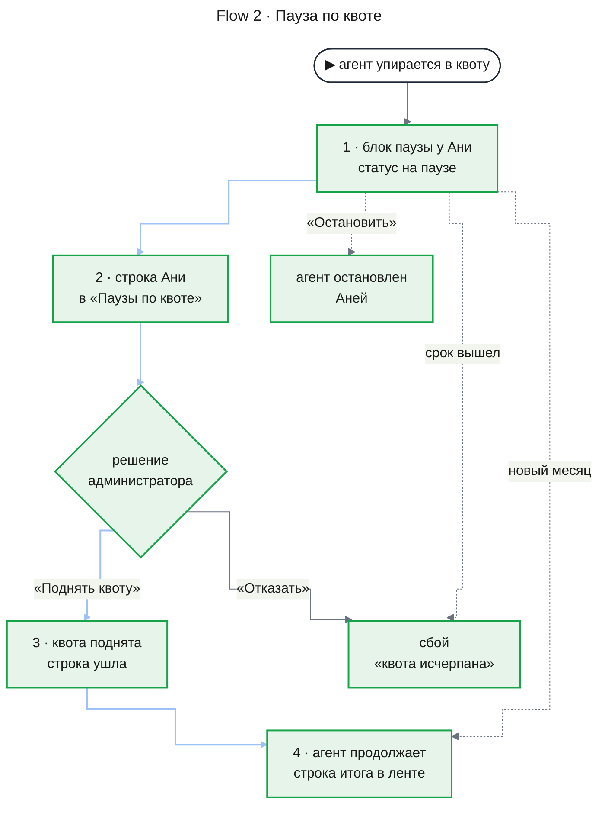

# UXRD: Корпоративный вход и управление доступом (enterprise-access)

| Статус | Дата | PRD | Дизайны |
|---|---|---|---|
| Черновик | 2026-11-15 | [prd.md](./prd.md) | — |

## Snapshot

**Overview.** Сотрудник начинает со страницы входа: на ней по кнопке на каждое подключение к IdP, а после входа он попадает в свой чат и видит в меню своё имя. Из меню он открывает страницу «Мой доступ»: там серверы, к которым нужно подключить личный аккаунт, и разрешённые модели с расходом и квотой. Отказы по правам и пауза по квоте видны прямо в беседе и у агента: блок вызова с причиной, новый статус «Ждёт решения по квоте» и блок, который говорит, сколько потрачено и когда работа продолжится. Администратор работает в панели — разделе той же оболочки, где вместо списка бесед стоят разделы: сотрудники, роли, вход и SCIM, MCP-серверы, модели, паузы по квоте. На странице сотрудника панель объясняет его доступ: итог и источник каждого права и квоту как сумму слагаемых.

- **Не меняется**: беседа, лента, карточки агентов и дерево агентов (agent-platform UXRD) — фича добавляет в них только статус, блок паузы и причины отказа. Расход за месяц под именем (agent-platform UXRD, SP-01) остаётся как есть.
- **Главный UX-риск**: сотрудник не замечает, что аккаунт сервера не подключён, и агент молча работает без его инструментов. Защищают точка на аватаре и число в пункте «Мой доступ» (KD-2).
- **Открытые вопросы**: нет.

### Key Decisions

| ID | Решение | Почему |
|---|---|---|
| KD-1 | Панель администратора — раздел той же оболочки по адресам `/admin/…`. Сайдбар в панели показывает ссылку «К чату» и разделы панели вместо списка бесед; шапка, блок пользователя и тема остаются прежними | Администратор переходит между чатом и панелью без смены приложения, а разработчик собирает панель из тех же частей оболочки |
| KD-2 | Свой доступ сотрудник видит на одной странице «Мой доступ» (`/account`): подключения аккаунтов и модели с расходом. Строка сервера устроена как в Claude Code: имя, статус «Нужна аутентификация» или «Подключено» и одна кнопка. Аккаунт подключают переходом к владельцу сервера в той же вкладке с возвратом на страницу. Пока есть неподключённые аккаунты, на аватаре стоит точка, а в пункте меню — их число | Сотрудник находит, почему у агента нет инструментов, в одном месте. Переход в той же вкладке не блокируют браузеры и он одинаково работает на телефоне |
| KD-3 | Меню пользователя (chat-shell UXRD, SB-11) показывает имя и почту из IdP и получает пункты «Мой доступ», «Панель администратора» (только администратору) и «Выйти». Строка «Режим разработки» и правило «в меню нет „Выйти“» из chat-shell UXRD уходят | Вход стал настоящим: у сотрудника есть имя, доступ и выход (AC-01.2, AC-07.1) |
| KD-4 | Пауза по квоте — седьмой статус агента «Ждёт решения по квоте» (`Hourglass`, роль `--warning`) и блок паузы в ленте того, кто ждёт: чата в беседе или агента на его странице. Над деревом агентов стоит полоса с моделью, расходом и квотой. Когда пауза кончается, блок меняется на месте в строку итога. Роль `--warning` получает это значение в foundations | Сотрудник видит причину и срок там же, где ждёт работы (AC-22.1). Фиолетовый `--approval` зовёт самого сотрудника, а здесь решает администратор |
| KD-5 | Отказы показываются уже существующими элементами. Отказ в инструменте — блок вызова с исходом «отказано» и причиной. Неразрешённая модель чата — блок ошибки ответа (chat-shell UXRD, TH-08) с текстом о модели. Запуск агента на неразрешённой модели — блок вызова запуска с исходом «отказано». Новый только исход вызова «нужен вход в аккаунт» со ссылкой на «Мой доступ» | Сотрудник уже знает эти блоки по agent-platform; новый исход нужен, потому что право есть и чинит всё сам сотрудник, а красный «отказано» говорил бы обратное |
| KD-6 | Секрет после сохранения не показывается: поле секрета показывает «Задан» и «Заменить». Токен SCIM виден один раз — в окне с копированием, которое нельзя открыть снова ([secret-field](../../design-system/components/secret-field.md)) | Так требуют AC-03.1, AC-05.4 и AC-13.5: секрет нельзя прочитать после сохранения даже администратору |
| KD-7 | Каждая настройка доступа правится в одном месте. Роли сотруднику назначают, его личные права и запреты задают на странице сотрудника, а права и группы роли — на странице роли. Вкладка «Доступ» страницы сотрудника объясняет итог: строка на каждый сервер и модель с итогом и источником, отличающиеся инструменты — под сервером, квота — суммой слагаемых | Одно место правки не даёт двум экранам разойтись, а объяснение отвечает на вопрос UC-7 без поиска по ролям |

## Terms

Термины продукта — в PRD, раздел Terms; здесь — термины интерфейса.

- **Оболочка** — каркас веба из chat-shell: сайдбар слева, шапка и основная область.
- **Мой доступ** — страница сотрудника с его подключениями аккаунтов и моделями.
- **Панель** — раздел оболочки для администратора, адреса `/admin/…`.
- **Блок паузы** — блок в ленте, пока агент ждёт решения по квоте.
- **Метка источника** — подпись «из IdP», «из панели», «лично», «роль SRE» рядом с ролью или правом.
- **Поле секрета** — поле формы, которое после сохранения показывает только «Задан».
- **Слагаемые квоты** — квоты ролей сотрудника и его личная квота на одну модель; их сумма — его действующая квота.

## Design System

Фича следует [дизайн-системе](../../design-system/README.md). Страница входа и «Мой доступ» — комфортная плотность; панель администратора — компактная, как аудит и бюджеты в [foundations → Spacing & Density](../../design-system/foundations.md#spacing--density).

### Component Inventory

Перед решением «new» поиск шёл по `docs/design-system/components/` и `apps/web/src/components/` (`ui`, `shell`, `agents`, `assistant-ui`). В `components/ui` есть `button`, `input`, `dialog`, `alert-dialog`, `dropdown-menu`, `tooltip`, `skeleton`, `avatar`, `sidebar`, `sonner`; таблицы, вкладок, переключателя, радиогруппы и выпадающего списка нет — они берутся из shadcn (Source) без своей спецификации.

| Компонент | Спецификация | Статус | Примечание |
|---|---|---|---|
| Статус агента | [agent-status.md](../../design-system/components/agent-status.md) | extended | Статус «Ждёт решения по квоте» (KD-4) |
| Вызов инструмента | [tool-call.md](../../design-system/components/tool-call.md) | extended | Исход «нужен вход в аккаунт» (KD-5); новые причины отказа — MC-10 |
| Дерево агентов | [agent-tree.md](../../design-system/components/agent-tree.md) | extended | Корни на паузе по квоте раскрыты при загрузке |
| Карточка хода | [agent-run-card.md](../../design-system/components/agent-run-card.md) | extended | Строка с моделью, расходом и квотой, пока агент на паузе (MC-15) |
| Пауза по квоте | [quota-pause.md](../../design-system/components/quota-pause.md) | new | Ближе всех карточка решения, но она ждёт решения самого сотрудника и несёт кнопки |
| Таблица данных | [data-table.md](../../design-system/components/data-table.md) | new | Дерево агентов — единственный список в колонках, оно привязано к агентам; таблиц в приложении нет |
| Форма настроек | [settings-form.md](../../design-system/components/settings-form.md) | new | Форм, кроме поля переименования (chat-shell UXRD, SB-08), в приложении нет |
| Секрет | [secret-field.md](../../design-system/components/secret-field.md) | new | Поля, которое не возвращает значение, и окна показа один раз нет |
| Метка состояния | [state-badge.md](../../design-system/components/state-badge.md) | new | Статус агента описывает только агентов; для аккаунта, сотрудника и сервера метки нет |
| Блок пользователя и меню | chat-shell UXRD, SB-11 | extended | Имя, почта, «Мой доступ», «Панель администратора», «Выйти» (KD-3) |
| Сайдбар, шапка, уведомления | chat-shell UXRD, SB-01, HD-01, HD-03, TST-01 | reused | В панели сайдбар несёт разделы (KD-1) |
| Ошибка ответа | chat-shell UXRD, TH-08 | extended | Текст о неразрешённой модели (MC-11) |
| Экран «не найдено» | chat-shell UXRD, TH-06 | reused | Основа экрана «Нет доступа» (AD-02) |
| Композер, страница агента | agent-platform UXRD, Screen 1, Screen 3 | extended | Строка управления для нового статуса (QP-03) |
| Кнопка, поле, диалог, меню, тултип, скелетон, аватар | shadcn `button`, `input`, `dialog`, `alert-dialog`, `dropdown-menu`, `tooltip`, `skeleton`, `avatar` | reused | — |
| Таблица, вкладки, переключатель, радиогруппа, выпадающий список, подпись поля | shadcn `table`, `tabs`, `switch`, `radio-group`, `select`, `label` | reused | Добавляются в приложение из shadcn без изменений |

## User Flows

### Primary User Flow

**Implements:** UC-1, UC-5; AC-01.1, AC-01.2, AC-01.5, AC-02.1, AC-04.1, AC-04.2, AC-14.1, AC-14.3

Сотрудник открывает Agent OS и видит страницу входа. Он нажимает кнопку своего подключения, входит в IdP и возвращается в свой чат: в меню его имя. На аватаре точка — у него есть сервер, где нужен личный аккаунт. В меню он выбирает «Мой доступ», нажимает «Подключить» у Sentry, входит в Sentry и возвращается на ту же страницу со статусом «Подключено».

```mermaid
---
title: "Flow 1 · Вход и подключение аккаунта"
config:
  theme: base
  look: classic
  themeVariables:
    primaryColor: "#eef1f5"
    primaryBorderColor: "#4b5563"
    primaryTextColor: "#1a1a1a"
    lineColor: "#6b7280"
  flowchart:
    curve: step
  themeCSS: |
    @keyframes litr_ea1{0%,15%{stroke:#1d4ed8;stroke-width:6px}16.67%,100%{stroke:#9ec1f7;stroke-width:2px}}
---
flowchart LR
    entry(["▶ сотрудник открывает Agent OS"])
    login["1 · страница входа<br/>кнопка на подключение"]
    idp(["IdP компании"])
    chat["2 · свой чат<br/>имя в меню"]
    access["3 · Мой доступ<br/>нужна аутентификация"]
    owner(["владелец сервера<br/>вход в аккаунт"])
    done["4 · Мой доступ<br/>подключено"]
    fail["страница входа<br/>с причиной"]
    admin["панель<br/>только администратору"]
    entry --> login
    login e1@-->|"«Войти через Okta»"| idp
    idp e2@-->|"вошёл"| chat
    chat e3@-->|"меню, «Мой доступ»"| access
    access e4@-->|"«Подключить»"| owner
    owner e5@-->|"согласие"| done
    idp -.->|"отказ или отмена"| fail
    chat -.->|"меню, «Панель»"| admin
    classDef entry fill:#ffffff,stroke:#1f2937,stroke-width:1.5px,color:#1a1a1a
    classDef changed fill:#fde8e8,stroke:#dc2626,stroke-width:2px,color:#1a1a1a
    classDef new fill:#e6f4ea,stroke:#16a34a,stroke-width:2px,color:#1a1a1a
    classDef unchanged fill:#eef1f5,stroke:#4b5563,stroke-width:1.5px,color:#1a1a1a
    classDef r1 stroke:#9ec1f7,stroke-width:2px,animation:litr_ea1 6s linear 0s infinite
    classDef r2 stroke:#9ec1f7,stroke-width:2px,animation:litr_ea1 6s linear 1.2s infinite
    classDef r3 stroke:#9ec1f7,stroke-width:2px,animation:litr_ea1 6s linear 2.4s infinite
    classDef r4 stroke:#9ec1f7,stroke-width:2px,animation:litr_ea1 6s linear 3.6s infinite
    classDef r5 stroke:#9ec1f7,stroke-width:2px,animation:litr_ea1 6s linear 4.8s infinite
    class entry entry
    class chat changed
    class login,access,done,fail,admin new
    class idp,owner unchanged
    class e1 r1
    class e2 r2
    class e3 r3
    class e4 r4
    class e5 r5
```



Если сотрудник открыл ссылку на беседу без сеанса, после входа он попадает по этой ссылке, а не в новый чат.

### Alternative Flows

**Flow 2. Пауза по квоте.** Implements: UC-6; AC-22.1, AC-22.3, AC-22.4, AC-22.5, AC-22.8, AC-22.10, AC-30.1, AC-30.2, AC-30.3

Агент Ани упирается в квоту Sonnet. Статус агента меняется на «Ждёт решения по квоте», а в его ленте встаёт блок паузы с расходом, квотой и сроком. У администратора в разделе «Паузы по квоте» появляется строка Ани. Он поднимает квоту, строка уходит, а агент сам продолжает: блок паузы становится строкой «Квота поднята — работа продолжена».



Пока пауза идёт, сообщения сотрудника ждут в лотке (agent-platform UXRD, KD-3) и уходят после неё. Агенты Ани на других моделях работают как обычно.

**Flow 3. Регистрация сервера и права.** Implements: UC-4; AC-12.1, AC-12.2, AC-13.4, AC-27.1, AC-28.2, AC-17.1

Администратор нажимает «Зарегистрировать сервер», вводит имя и адрес и выбирает режим учётных данных. Для общей учётной записи он вводит токен доступа, и платформа сразу проверяет сервер. Для личного OAuth он подключает свой аккаунт тем же переходом, что сотрудник в Flow 1. Открывается страница сервера со списком инструментов. Затем на странице роли он даёт право на сервер, а на странице сотрудника — личный запрет на один инструмент.


Ещё четыре пути без своей схемы:

- **Почему у сотрудника есть доступ** (UC-7; AC-28.1, AC-29.1). Администратор находит сотрудника в списке и открывает вкладку «Доступ»: у каждого сервера, инструмента и модели — итог и источник, у модели — квота суммой слагаемых и расход.
- **Пауза из панели** (UC-6; AC-30.4). Администратор меняет предел ожидания в разделе «Паузы по квоте»; новый предел действует для пауз, которые начнутся после сохранения.
- **Выход** (AC-07.1). «Выйти» в меню закрывает сеанс и открывает страницу входа с текстом MC-3 «Вы вышли».
- **Вход для разработки** (AC-10.1, AC-10.2). В режиме разработки под кнопками подключений стоит поле «Сотрудник» и кнопка «Войти без IdP»; в продакшене этого блока нет.

### Error Flows

- **Вход не удался** (AC-01.3, AC-02.2, AC-03.2). Сотрудник возвращается на страницу входа с причиной над кнопками (MC-3); сеанса нет. Выключенное подключение кнопки не имеет, а старая ссылка на него ведёт сюда же.
- **Учётная запись отключена** (UC-3; AC-07.2, AC-07.3, AC-07.4). Следующий запрос открытой вкладки ведёт на страницу входа с причиной «отключена». Работающие агенты получают статус «Остановлен»; когда сотрудника включат снова, он увидит строку события «Остановлен: сотрудник отключён» (MC-14).
- **Сеанс закончился** (AC-01.4). Любой отказ «нужен вход» переводит вкладку на страницу входа с текстом «Сеанс закончился»; после входа сотрудник возвращается на ту же страницу.
- **Чужая беседа по ссылке** (AC-04.3). Экран «Беседа не найдена» (chat-shell UXRD, TH-06), как для несуществующей.
- **Подключение аккаунта не завершилось** (AC-14.5). Отказ или отмена у владельца сервера возвращает на «Мой доступ» с ошибкой в строке сервера (MA-01). Токен, который не обновился, превращает вызов в исход «нужен вход в аккаунт», а строку — в «Нужна аутентификация».
- **Нет права на инструмент или модель** (AC-12.4, AC-16.3, AC-17.1, AC-17.3, AC-18.1, AC-19.3, AC-20.1, AC-20.2, AC-20.3). Что видит сотрудник — Screen 4, RF-01.
- **Последний администратор** (AC-08.3). Действие в панели, после которого не осталось бы администратора, не применяется; причина MC-21 стоит у этого действия.
- **Панель без права** (AC-24.2, AC-08.1). Экран «Нет доступа» (AD-02).

Критерии без видимой поверхности, которые этот документ не показывает: AC-03.3, AC-04.4, AC-05.1, AC-05.2, AC-05.3, AC-06.2, AC-08.2, AC-08.4, AC-09.2, AC-10.3, AC-11.1–AC-11.3 вне журнала, AC-12.5, AC-13.1–AC-13.3, AC-14.2, AC-15.1, AC-15.2, AC-16.1, AC-18.2–AC-18.4, AC-19.1, AC-20.4, AC-21.1–AC-21.5 вне панели, AC-22.2, AC-22.6, AC-22.7, AC-22.9.

## Screens

### Screen 1: Вход (`/login`)

```
┌──────────────────────────────────────────────────────────────┐
│                         ◆ Agent OS                           │
│                       Вход в Agent OS                        │ h1
│            Войдите корпоративной учётной записью.            │
│      ┌────────────────────────────────────────────────┐      │
│      │ ⓧ Не удалось войти через Okta. Попробуйте ещё  │      │ LG-02
│      │   раз или обратитесь к администратору.         │      │
│      └────────────────────────────────────────────────┘      │
│      [            Войти через Okta                    ]      │ LG-01
│      [            Войти через Okta (SAML)             ]      │
│      ─────────────── Для разработки ───────────────────      │ LG-03
│      Сотрудник                                               │
│      [ dev-user                                       ]      │
│      [            Войти без IdP                       ]      │
└──────────────────────────────────────────────────────────────┘
```

**Раскладка**: страница без сайдбара и шапки, фон `--background`. Колонка 400 px по центру по горизонтали, на трети высоты сверху; на мобильном — во всю ширину с полями 16 px.

- **LG-01. Кнопки подключений** — по одной на включённое подключение, в порядке, в котором их завёл администратор; `outline`, высота 44 px, во всю ширину колонки, подпись MC-2. Акцентной заливки нет: ни одна кнопка не главнее другой. После нажатия кнопка показывает `LoaderCircle` и MC-2 «Переходим…», остальные недоступны до ухода со страницы.
- **LG-02. Причина** — блок с подложкой `--destructive-subtle`, иконкой `CircleX` и текстом MC-3 над кнопками. У нейтральных причин («Вы вышли», «Сеанс закончился») подложка `--muted` и иконка `Info` `--muted-foreground`.
- **LG-03. Вход для разработки** — только в режиме разработки: разделитель с подписью, поле «Сотрудник» с `dev-user` по умолчанию и кнопка `outline` «Войти без IdP» ([settings-form](../../design-system/components/settings-form.md), форма страницы).

| Состояние | Что показано | AC |
|---|---|---|
| Default | Заголовок, кнопки подключений | AC-01.1, AC-01.5, AC-03.2, AC-09.1, AC-09.3 |
| С причиной | LG-02 над кнопками | AC-01.3, AC-02.2, AC-07.3, AC-07.1 |
| Переход в IdP | Нажатая кнопка с MC-2 «Переходим…» | — |
| Нет подключений | Вместо кнопок — текст MC-4; блок разработки, если режим разработки | — |
| Разработка | LG-03 под кнопками | AC-10.1, AC-10.2 |

### Screen 2: Блок пользователя и меню (UM-01)

```
Сайдбар внизу                       Меню открыто
┌───────────────────────────┐      ┌───────────────────────────────┐
│ (АС•) Аня Смирнова       ⌃ │      │ Аня Смирнова                  │
│       Расход за ноябрь:    │      │ anya@corp.example             │
│       3,42 $               │      │───────────────────────────────│
└───────────────────────────┘      │ 🔑 Мой доступ           • 1    │
                                   │ 🛡 Панель администратора        │
                                   │───────────────────────────────│
                                   │ Тема  ☀ Светлая ☾ Тёмная 🖥 …  │
                                   │───────────────────────────────│
                                   │ ↪ Выйти                        │
                                   └───────────────────────────────┘
```

Меняет chat-shell UXRD, SB-11 (KD-3); остальное поведение SB-11 и темы TM-01 прежнее.

- **Блок**: аватар с инициалами из имени, имя из IdP. Без имени — почта до «@».
- **Точка на аватаре** — 6 px `--warning` в правом верхнем углу, пока хоть одна строка «Мой доступ» в статусе «Нужна аутентификация». В полосе сайдбара точка та же.
- **Меню**: шапка — имя и почта (Caption, `--muted-foreground`); пункты «Мой доступ» (иконка `KeyRound`, справа точка `--warning` и число неподключённых, табличные цифры), «Панель администратора» (иконка `ShieldCheck`, только у сотрудника с правом администратора), группа «Тема», «Выйти» (иконка `LogOut`).
- Число и точка читаются при загрузке страницы и после возврата с подключения; живого обновления нет.

| Состояние | Что показано | AC |
|---|---|---|
| Сотрудник | Без пункта «Панель администратора» | AC-01.2, AC-24.2 |
| Администратор | С пунктом «Панель администратора» | AC-24.1 |
| Нужна аутентификация | Точка на аватаре, число у «Мой доступ» | AC-14.1 |
| Выход | «Выйти» без подтверждения ведёт на страницу входа | AC-07.1 |

### Screen 3: Мой доступ (`/account`)

```
┌─────────────────────┬──────────────────────────────────────────────────────┐
│ (сайдбар оболочки)  │ ◧  Мой доступ                                         │
│                     │──────────────────────────────────────────────────────│
│                     │  Подключения                                          │ MA-01
│                     │  Серверы, к которым агенты ходят от вашего имени. …   │
│                     │  Sentry             ⚿ Нужна аутентификация [Подключить]│
│                     │  mcp.sentry.dev                                       │
│                     │  Jira               ✓ Подключено            [Отключить]│
│                     │                                                      │
│                     │  Модели и расход за ноябрь                            │ MA-02
│                     │  Модель    Расход     Квота         Остаток           │
│                     │  Haiku     3,10 $     без предела   —                 │
│                     │  Sonnet    64,20 $    100 $         35,80 $           │
└─────────────────────┴──────────────────────────────────────────────────────┘
```

**Раскладка**: страница оболочки, как «Агенты» (agent-platform UXRD, KD-1): заголовок «Мой доступ» в шапке, композера нет. Секции стоят одна под другой в колонке ленты (chat-shell UXRD, D-01), заголовки секций — Heading.

**MA-01. Подключения** — список, строка на каждый сервер с личным OAuth, на который у сотрудника есть право. Строка 52 px: имя сервера (UI 500) и адрес (Caption, `--muted-foreground`) слева, [метка состояния](../../design-system/components/state-badge.md) и одна кнопка `outline` `sm` справа. Серверы с общей учётной записью здесь не показываются: сотруднику нечего с ними делать.

| Состояние строки | Что показано | AC |
|---|---|---|
| Нужна аутентификация | Метка «Нужна аутентификация», кнопка «Подключить» | AC-14.1, AC-14.4 |
| Переход | Кнопка с `LoaderCircle` и MC-8 «Переходим…» | — |
| Подключено | Метка «Подключено», кнопка «Отключить»; после возврата — уведомление MC-8 | AC-14.3 |
| Не подключилось | Под строкой Caption `--destructive` MC-8; метка «Нужна аутентификация» | AC-14.5 |
| Отключение | «Отключить» без подтверждения: аккаунт вернуть можно тем же «Подключить». Строка сразу в «Нужна аутентификация» | AC-14.4 |

Нет ни одного сервера — текст MC-8 «Подключать пока нечего» (AC-14.6). Ошибка загрузки — текст и «Повторить».

**MA-02. Модели и расход** — [таблица данных](../../design-system/components/data-table.md) в комфортной плотности, на ширине < 768 px — вариант «Две строки»: строка на каждую разрешённую модель; колонки «Модель», «Расход», «Квота», «Остаток». Квоты нет — «без предела» и «—» в остатке. Квота исчерпана — остаток «0,00 $» и метка «Квота исчерпана» `--warning`. Нет ни одной модели — текст MC-9. На мобильном каждая модель занимает две строки: название, под ним «расход из квоты · остаток» (AC-23.1).

### Screen 4: Беседа и агенты — отказы и пауза по квоте

Ни одного нового экрана: элементы встают в беседу, на страницу агента и на «Агенты» из agent-platform UXRD.

```
Беседа: чат ждёт решения по квоте
│       Сводка ошибок checkout за сутки                                 │
│  ┌ ⧗ Квота Sonnet на ноябрь исчерпана ─────────────── Ждёт с 14:20 ┐ │ QP-01
│  │ Расход 100,40 $ из 100 $                                         │ │
│  │ Решение за администратором Agent OS. Работа продолжится сама, …  │ │
│  │ Если решения не будет до 15 нояб., 14:20, работа завершится сбоем.│ │
│  └──────────────────────────────────────────────────────────────────┘ │
│  │ Сообщение подождёт: работа продолжится после решения…        [↑] │  │

Агенты: полоса над деревом
│ ◧  Агенты                                                             │
│  ┌ ⧗ Квота Sonnet исчерпана: 100,40 $ из 100 $ за ноябрь. Ждут: 2 ┐ │ QP-02
│  ▾ Сводка ошибок · checkout   ⧗ Ждёт решения по квоте   Sonnet  14:20 │

Отказ в инструменте
│  ▸ ⊘ Обновить задачу · update_issue · sentry          отказано  14:22 │ RF-01
│      Нет доступа к инструменту                                        │
│  ▸ ⚿ Найти ошибки · search_issues · sentry   нужен вход в аккаунт 14:23│
│      Подключите аккаунт Sentry в разделе «Мой доступ»                 │
```

**QP-01. Блок паузы** — [пауза по квоте](../../design-system/components/quota-pause.md), вариант «Блок в ленте». Встаёт в конец ленты того, кто ждёт: беседы, если ждёт чат, или страницы агента. Если ждёт фоновый агент, карточка хода в беседе показывает новый статус и под названием строку MC-15 с моделью, расходом и квотой. Когда пауза кончается, блок меняется на строку итога (MC-13), а строка карточки уходит.

**QP-02. Полоса на «Агенты»** — тот же компонент, вариант «Полоса над списком», между шапкой и деревом; одна полоса на модель с текстом MC-15.

**QP-03. Управление на паузе** дополняет таблицу agent-platform UXRD, Screen 3, «Управление по статусу»:

| Статус | Кнопка в шапке | Композер | AC |
|---|---|---|---|
| Ждёт решения по квоте | «Остановить» | «Отправить» кладёт в лоток; «Прервать» нет, как у «Ждёт подтверждения»; плейсхолдер MC-16 | AC-22.5 |

В беседе, где ждёт сам чат, композер ведёт себя так же: чат ждёт решения, конца месяца или срока, а сотрудник может продолжить в новой беседе.

**RF-01. Отказы и вход в аккаунт в ленте** (KD-5):

| Что случилось | Что видит сотрудник | AC |
|---|---|---|
| Нет права на сервер или инструмент, личный запрет | Блок вызова, исход «отказано», причина MC-10 | AC-17.1, AC-18.1 |
| Сервер выключили, а модель вызвала его инструмент | Блок вызова, исход «отказано», причина «Инструмент не входит в набор агента» (agent-platform UXRD, MC-22) | AC-12.4 |
| Токен не обновился | Блок вызова, исход «нужен вход в аккаунт», строка MC-10 со ссылкой «Мой доступ» | AC-14.5 |
| Модель чата не разрешена или не подключена; нет ни одной модели | Блок ошибки ответа TH-08 с текстом MC-11 и «Перегенерировать» | AC-16.3, AC-20.2, AC-19.3 |
| Запуск агента на неразрешённой или неподключённой модели | Блок вызова «Запустить агента», исход «отказано», причина MC-10 | AC-20.1, AC-17.3, AC-19.3 |
| Разрешение модели сняли или модель убрали из каталога посреди работы | Статус «Сбой», строка события MC-14 («модель не разрешена» или «модель не подключена»), у родителя — отчёт с причиной | AC-20.3 |

**Состояния паузы**:

| Состояние | Что показано | AC |
|---|---|---|
| Пауза началась | Статус «Ждёт решения по квоте» в шапке, дереве и карточке хода; QP-01 в ленте; QP-02 на «Агенты» | AC-22.1 |
| Квота поднята | Строка итога «Квота поднята — работа продолжена»; статус «Работает»; лента продолжается | AC-22.3 |
| Новый месяц | Строка итога «Новый месяц — работа продолжена» | AC-22.8 |
| Отказ администратора | Строка итога «Администратор отказал», статус «Сбой», строка события и отчёт у родителя с причиной «квота исчерпана» | AC-22.4 |
| Срок вышел | Строка итога «Решения не было», остальное как при отказе | AC-22.10 |
| Модель больше не разрешена или убрана из каталога | Строки итога MC-13 нет: блок паузы сменяется строкой события MC-14 «Сбой: модель не разрешена» или «Сбой: модель не подключена»; статус «Сбой» | AC-20.3 |
| Остановлено | Строка итога «Остановлен вами» | AC-22.5 |

### Screen 5: Панель администратора — каркас и «Нет доступа»

```
┌─────────────────────┬────────────────────────────────────────────────────────────┐
│ ◆ Agent OS          │ ◧  Сотрудники                         [ Найти по имени… ] │ AD-01
│ ← К чату            │────────────────────────────────────────────────────────────│
│ ПАНЕЛЬ              │  Сотрудник              Статус      Роли           Вход    │
│ ▌👥 Сотрудники      │  Аня Смирнова           ✓ Включён   SRE · Дежурный 14:20   │
│  🛡 Роли            │  anya@corp.example                                         │
│  🔑 Вход и SCIM     │  Борис Ким              ⊖ Отключён  SRE            3 нояб. │
│  🗄 MCP-серверы     │  boris@corp.example                                        │
│  ▣ Модели           │                                                            │
│  ⧗ Паузы по квоте 1 │                     [ Показать ещё ]                       │
│  📜 Журнал          │                                                            │
│ (ИГ) Игорь Петров   │                                                            │
└─────────────────────┴────────────────────────────────────────────────────────────┘
```

**AD-01. Каркас панели** (KD-1). Сайдбар оболочки (chat-shell UXRD, SB-01) показывает сверху ссылку «К чату» (иконка `ArrowLeft`), подпись группы «Панель» и пункты разделов с иконками; выбранный раздел отмечен, как активная беседа (SB-06, Active). У «Паузы по квоте» справа число строк, ждущих решения, табличные цифры, `--warning`; число читается при загрузке страницы. Блок пользователя — UM-01. Шапка: `h1` раздела на месте названия беседы (HD-03), справа — основная кнопка раздела. На странице записи `h1` — её имя, а перед ним ссылка на раздел: «Сотрудники /». Основная область — поля 24 px, компактная плотность; формы не шире 640 px.

Разделы FR-24 и где они в панели:

| Раздел FR-24 | Пункт сайдбара и место |
|---|---|
| Сотрудники и роли | «Сотрудники» (AD-03, AD-04) и «Роли» (AD-05, AD-06) |
| Подключения входа и SCIM | «Вход и SCIM» (AD-07) |
| MCP-серверы | «MCP-серверы» (AD-08 — AD-10) |
| Права и запреты | Вкладка «Доступ» сотрудника (AD-04) и «Права» роли (AD-06) |
| Модели и квоты | «Модели» (AD-11), квоты — в «Правах» роли и «Доступе» сотрудника |
| Паузы по квоте | «Паузы по квоте» (AD-12) |

Журнал (Could, FR-31) — пункт «Журнал» (AD-13), если он собран.

**AD-02. Нет доступа** — экран, как «Беседа не найдена» (chat-shell UXRD, TH-06): иконка `ShieldOff` 24 px, текст MC-19 и кнопка «В чат». Сайдбар — обычный, со списком бесед. Экран открывается на любом адресе `/admin/…` без права администратора, и если право сняли, пока панель была открыта (AC-24.2).

**Состояния каркаса**: загрузка раздела — скелетон таблицы; ошибка загрузки раздела — состояние Error таблицы; потеря связи — строка связи (agent-platform UXRD, CN-01).

### Screen 6: Сотрудники (`/admin/users`, `/admin/users/<id>`)

**AD-03. Список** — таблица данных, строки-ссылки, 50 на страницу и «Показать ещё». Колонки: «Сотрудник» (имя, почта второй строкой), «Статус» (метка «Включён» или «Отключён»), «Роли» (названия через « · », усечение в конце), «Последний вход». Порядок — по имени. Поле поиска в шапке ищет по имени и почте по мере ввода. Пусто — MC-22; ничего не найдено — «Никого не нашли».

**AD-04. Сотрудник** — шапка с именем, почтой и меткой статуса; справа «Заблокировать» (`outline`) или «Разблокировать». «Заблокировать» спрашивает подтверждение (`alert-dialog`, MC-23). Под шапкой вкладки «Роли» и «Доступ».

```
│ Сотрудники / Аня Смирнова  ✓ Включён                   [ Заблокировать ] │
│ anya@corp.example                                                        │
│ [ Роли ]  Доступ                                                         │
│  Роль        Источник                                                    │
│  SRE         из IdP · группа sre                                         │
│  Дежурный    из панели                                    [ Снять роль ] │
│  [ + Назначить роль ]                                                    │
```

- **Вкладка «Роли»** — таблица с колонками «Роль» (ссылка на роль) и «Источник» ([метка](../../design-system/components/state-badge.md), вариант «Источник»). Роль из IdP снять нельзя: у неё нет кнопки. Роль и из IdP, и из панели — одна строка с двумя метками и «Снять роль», которая снимает только назначение из панели. «Назначить роль» открывает выпадающий список ролей, которых у сотрудника нет из панели.

```
│  Роли   [ Доступ ]                                                       │
│  Личные права и запреты                  [ + Право ]  [ + Запрет ]       │
│  ⊘ Запрет    Sentry → update_issue                                    ⋯  │
│  ✓ Право     Sonnet · квота 30 $                                      ⋯  │
│  Право администратора   нет                        [ Дать лично ]        │
│                                                                          │
│  Доступ к MCP-серверам                                                   │
│  Сервер или инструмент   Итог         Источник                  Аккаунт  │
│  Sentry                  ✓ Доступен   роль SRE                  ✓ Подкл. │
│    update_issue          ⊘ Закрыт     закрыто личным запретом            │
│  incidents               ✓ Доступен   роль SRE · роль Дежурный  общая    │
│  backoffice              ⊖ Нет доступа —                                 │
│                                                                          │
│  Модели и квоты                                                          │
│  Модель   Итог        Источник            Квота за ноябрь          Расход │
│  Haiku    ✓ Доступна  роль SRE            без предела              3,10 $ │
│  Sonnet   ✓ Доступна  SRE · Дежурный · лично  100 $ = SRE 50 +    64,20 $ │
│                                           Дежурный 20 + лично 30          │
│  Opus     ⊘ Закрыта   закрыто личным запретом  —                   —      │
```

- **Вкладка «Доступ»** (KD-7) — три части сверху вниз:
  - **Личные права и запреты** — таблица с действиями: вид (метка «Право» `--success` или «Запрет» `--destructive`), цель, квота у модели; меню «⋯» — «Изменить квоту» (только у права на модель) и «Убрать». «Право» и «Запрет» открывают диалог права (GR-01). Ниже — строка «Право администратора»: «есть: роль {роль}», «есть: лично» или «нет», и кнопка «Дать лично» или «Снять лично».
  - **Доступ к MCP-серверам** — таблица на каждый зарегистрированный сервер. Под сервером вложенными строками стоят только инструменты, итог которых отличается от сервера: личное право на инструмент, личный запрет. Колонка «Аккаунт» — у серверов с личным OAuth «Подключён» или «Не подключён», у общей учётной записи — «общая».
  - **Модели и квоты** — таблица на каждую модель каталога: итог, источник, действующая квота за месяц с разбивкой по слагаемым, расход за месяц и остаток. Разбивка — «{итог} = {роль} {квота} + … + лично {квота}» в одной ячейке с переносом. Если хоть одно разрешение без квоты — «без предела» и под ним источник без квоты: «роль SRE без квоты».

| Состояние | Что показано | AC |
|---|---|---|
| Роли с источником | Метки «из IdP · группа …» и «из панели»; «Снять роль» только у ролей из панели | AC-06.1, AC-06.3, AC-06.4, AC-25.1 |
| Доступ объяснён | Итог и источник каждой строки, «закрыто личным запретом» у запрета | AC-28.1, AC-16.2, AC-17.2 |
| Квота по слагаемым | «100 $ = SRE 50 + Дежурный 20 + лично 30» и расход | AC-29.1, AC-21.1, AC-21.5 |
| Последний администратор | Снятие права, роли или блокировка отклонены; MC-21 у действия | AC-08.3 |
| Заблокирован | Метка «Отключён», кнопка «Разблокировать» | AC-07.2, AC-07.4 |

### Screen 7: Роли (`/admin/roles`, `/admin/roles/<id>`)

**AD-05. Список** — таблица, строки-ссылки, по названию. Колонки: «Роль», «Группы IdP», «Сотрудников», «Администраторы» (`ShieldCheck` или «—»). Основная кнопка «Создать роль» открывает диалог с одним полем «Название роли». Пусто — MC-26.

**AD-06. Роль** — шапка с названием и меню «⋯»: «Переименовать» (диалог с тем же полем) и «Удалить» (`alert-dialog`, MC-26). Ниже секции:

- **Группы IdP** — метки групп с кнопкой «×» и «Добавить группу» (поле «Имя группы в IdP» с кнопкой «Добавить»). Имя вводится текстом, как оно пишется в IdP.
- **Право администратора** — переключатель, сохраняется сразу ([settings-form](../../design-system/components/settings-form.md), «Сохранение на месте»).
- **Права** — таблица с действиями: «Цель» (сервер, «сервер → инструмент» или модель), «Вид» («Сервер», «Инструмент», «Модель»), «Квота» (у модели — сумма или «без квоты»). Меню «⋯» — «Изменить квоту», «Убрать». «Добавить право» открывает GR-01.
- **Сотрудники** — таблица только для чтения: имя (ссылка на сотрудника) и источник членства. Назначают роль на странице сотрудника (KD-7).

| Состояние | Что показано | AC |
|---|---|---|
| Роль удалена | Возврат к списку, уведомление «Роль удалена» | AC-25.2 |
| Удаление оставило бы без администратора | Диалог показывает MC-21, роль остаётся | AC-08.3 |

**GR-01. Диалог права** — один диалог для права роли, личного права и личного запрета ([settings-form](../../design-system/components/settings-form.md), форма диалога). Поле «Что» — радиогруппа «Сервер целиком», «Инструмент сервера», «Модель». Дальше:

- сервер — выпадающий список серверов реестра;
- инструмент — сначала сервер, затем список его инструментов из реестра: название, техническое имя Mono и пометка «читает» или «меняет»; ввести инструмент вручную нельзя (AC-28.2);
- модель — список моделей каталога и, только в праве, поле «Квота за месяц, $» (необязательное: пусто — без квоты).

Цель, которая уже есть у этой роли или сотрудника, в списке недоступна с подписью «уже есть».

### Screen 8: Вход и SCIM (`/admin/sign-in`)

```
│ ◧  Вход и SCIM                                   [ + Добавить подключение ] │
│  Подключения входа                                                         │
│  Кнопка              Протокол    Включено                                  │
│  Okta                OIDC        [●━]                                      │
│  Okta (SAML)         SAML 2.0    [━○]                                      │
│                                                                            │
│  SCIM                                                                      │
│  Адрес SCIM   https://agent-os.corp/api/scim/v2                      [⧉]   │
│  Токен        создан 12 нояб.                      [ Создать новый токен ] │
│                                                                            │
│  Срок сеанса                                                               │
│  Без активности          [ 8    ] часов                                    │
│  От 0,25 до 24 часов. …                                                    │
│  Всего с момента входа   [ 24   ] часов                                    │
│  От 1 до 720 часов (30 суток), не меньше срока без активности. …           │
│  [ Сохранить ]                                                             │
```

**AD-07.** Сверху — таблица подключений: строки-ссылки на форму подключения, переключатель «Включено» сохраняется сразу. Ниже — секция SCIM: адрес `{PUBLIC_URL}/api/scim/v2` для копирования и состояние токена с кнопкой «Создать токен» или «Создать новый токен». Новый токен при существующем сначала спрашивает подтверждение (MC-27), затем открывает [показ один раз](../../design-system/components/secret-field.md) (KD-6).

**AD-14. Срок сеанса** — последняя секция страницы, [форма настроек](../../design-system/components/settings-form.md) страницы с двумя полями и своей кнопкой «Сохранить». Поля показывают текущие значения сервера (FR-26, AC-26.3):

- «Без активности» — сколько сеанс живёт без запросов. Часы, шаг 0,25 (15 минут), от 0,25 до 24; по умолчанию 8.
- «Всего с момента входа» — сколько сеанс живёт в целом. Целые часы от 1 до 720 (30 суток); по умолчанию 24.

Администратор вводит часы, а сервер хранит минуты: минуты = часы × 60, при чтении — минуты ÷ 60 (`idleMinutes`, `absoluteMinutes` в design-identity, `SessionSettings`). Под каждым полем — подсказка с границами (MC-33), под секцией — что новое значение действует для уже вошедших сотрудников с их следующего запроса.

| Состояние | Что показано | AC |
|---|---|---|
| Значения по умолчанию | 8 и 24 часа | AC-26.3 |
| Вне границ | Ошибка поля MC-33; сохранение не отправляется, ничего не меняется | AC-26.3 |
| Без активности больше общего | Ошибка поля «Всего с момента входа» MC-33; сохранение не отправляется | AC-26.3 |
| Сервер отказал | Ошибка формы «Не удалось сохранить: {причина}»; прежние сроки действуют | AC-26.3 |
| Сохранено | Уведомление MC-33; новые сроки действуют для всех сеансов с их следующего запроса | AC-26.3, AC-07.5 |

**Новое подключение** (`/admin/sign-in/new`) — форма страницы с двумя полями: «Протокол» (радиогруппа OIDC или SAML 2.0) и «Название кнопки» с подсказкой, как её увидят сотрудники. Основная кнопка «Создать» сохраняет выключенное подключение и открывает его страницу. «Данные для IdP» содержат номер подключения, поэтому появляются только после этого первого сохранения.

**Подключение** (`/admin/sign-in/<id>`) — форма страницы:

1. «Протокол» — только для чтения: после создания не меняется.
2. «Название кнопки».
3. Данные от IdP: у OIDC — «Issuer», «Client ID», «Client secret» (поле секрета); у SAML — «Адрес метаданных IdP».
4. «Данные для IdP» — значения для копирования, которые администратор переносит в приложение в IdP. Значения приходят от сервера (`idpData` в design-identity). У OIDC — «Sign-in redirect URI», «Scopes» и «Claim с группами». У SAML — «ACS URL», «Entity ID» и «Атрибуты»: имена атрибутов почты, имени и групп, каждое для копирования.

| Состояние | Что показано | AC |
|---|---|---|
| Секрет задан | «Client secret: Задан» и «Заменить» | AC-03.1 |
| Данные для IdP | Значения с кнопкой копирования, сразу после создания | AC-26.1 |
| Данные от IdP не заданы | Подключение выключено. Включение переключателем в таблице отклонено: переключатель возвращается, под ним причина MC-27 | AC-03.2 |
| Подключение выключено | Переключатель «выкл.»; кнопки нет на странице входа | AC-03.2 |
| Токен создан | Показ один раз, затем «создан {дата}» без значения | AC-05.4, AC-26.2 |
| Пусто | Вместо таблицы — MC-27 | — |

### Screen 9: MCP-серверы (`/admin/servers`, `/admin/servers/new`, `/admin/servers/<id>`)

**AD-08. Список** — таблица, строки-ссылки, по имени. Колонки: «Сервер» (имя, адрес второй строкой), «Учётные данные» («Общая учётная запись» или «Личный OAuth»), «Инструментов», «Статус» (метка «Включён», «Выключен» или «Ждёт аккаунта администратора»). Основная кнопка — «Зарегистрировать сервер». Пусто — MC-29.

**AD-09. Регистрация** — форма страницы: «Имя» (с подсказкой, что имя не меняется после регистрации: по нему сервер указывают в определениях агентов), «Адрес», «Учётные данные» — радиогруппа с подсказкой под каждым вариантом. У общей учётной записи — поле секрета «Токен доступа». Основная кнопка — «Зарегистрировать».

- Общая учётная запись: кнопка показывает «Проверяем сервер…». Успех — страница сервера со списком инструментов. Отказ — ошибка формы с причиной (MC-29), сервер не включён, поля сохраняют введённое.
- Личный OAuth: «Зарегистрировать» сохраняет сервер в статусе «Ждёт аккаунта администратора» и сразу ведёт ко входу у владельца сервера. После возврата платформа получает инструменты, и открывается страница сервера. Если вход отменили, страница сервера показывает статус «Ждёт аккаунта администратора» и кнопку «Подключить мой аккаунт»; агентам такой сервер не виден.

**AD-10. Сервер**

```
│ MCP-серверы / sentry   ✓ Включён   [●━]         [ Обновить список ]   ⋯  │
│ https://mcp.sentry.dev/mcp · Личный OAuth                                │
│  Инструменты                                                             │
│  Инструмент                         Описание                      Действие│
│  Найти ошибки   search_issues       Ищет ошибки по запросу        читает  │
│  Обновить задачу  update_issue      Меняет статус задачи          меняет  │
```

Шапка: имя, метка статуса, переключатель «Включён», кнопка «Обновить список», меню «⋯» с «Настройки» и «Удалить». «Настройки» открывают ту же форму, что регистрация, с адресом, режимом и полем секрета; имя — только для чтения. Таблица инструментов: название и техническое имя Mono, описание от сервера (усечение, полное в подсказке), «Действие» — «читает» `--muted-foreground` или «меняет» `--foreground` UI 500. Инструмент без пометки сервера — «меняет» и подсказка MC-29.

| Состояние | Что показано | AC |
|---|---|---|
| Инструменты получены | Таблица с пометками | AC-12.1, AC-27.1, AC-13.4 |
| Обновление списка | Кнопка «Обновляем…»; затем уведомление MC-29 с числом новых и убранных | AC-12.3 |
| Ошибка обновления | Ошибка формы над таблицей; прежний список остаётся | — |
| Выключен | Метка «Выключен», переключатель «выкл.» | AC-12.4 |
| Секрет задан | «Токен доступа: Задан» | AC-13.5 |
| Удаление | `alert-dialog` MC-29, после — список серверов | — |

### Screen 10: Модели (`/admin/models`)

**AD-11.** Таблица каталога, строки с действиями: «Модель» (название, ID Mono второй строкой), «Вход», «Выход», «Запись в кэш», «Чтение из кэша» — в долларах за миллион токенов, табличные цифры. Если у модели есть цены для длинных запросов, под строкой — вложенная строка «свыше {порог} входных токенов» с теми же колонками. Меню «⋯» — «Изменить» и «Убрать из каталога» (`alert-dialog`, MC-30).

«Добавить модель» и «Изменить» открывают форму диалога: «ID модели» (только при добавлении), «Название», четыре цены, флажок «Другие цены для длинных запросов» и под ним «Порог, входных токенов» и четыре цены. Подсказка под ценами — MC-30 о том, что новые цены действуют для следующих вызовов (AC-19.2). Пусто — MC-30.

### Screen 11: Паузы по квоте (`/admin/quota-pauses`)

```
│ ◧  Паузы по квоте                                                         │
│  Предел ожидания  [ 24 ] часов  [ Сохранить ]                             │
│  Агент на паузе завершается сбоем, если решения нет за это время. …        │
│                                                                          │
│  Сотрудник      Модель   Расход / квота     Агентов  На паузе с           │
│  Аня Смирнова   Sonnet   100,40 $ / 100 $   2        14:20                │
│                                          [ Поднять квоту ]  [ Отказать ]  │
```

**AD-12.** Сверху — поле «Предел ожидания» в часах с кнопкой «Сохранить» ([settings-form](../../design-system/components/settings-form.md), «Сохранение на месте»): целое от 1 до 720, подсказка MC-31. Ниже — таблица с действиями, строка на сотрудника и модель, старые сверху. Время начала — самой ранней паузы в строке. Текста бесед нет. Список читается при открытии страницы.

- **«Поднять квоту»** открывает **QD-01** — форму диалога. В ней строка на каждое слагаемое квоты сотрудника по этой модели: «Лично» и каждая его роль с квотой. В каждой строке поле суммы; у роли подпись, что изменение коснётся всех её сотрудников, с их числом. Строка «Лично» есть всегда: без личного права поле пустое, и сохранение с суммой создаёт личное право с квотой. Пустое поле, которое было пустым, ничего не создаёт. Очищенное поле снимает эту квоту, и расход на модель становится без предела: у поля подсказка MC-31, а сумма показывает «без предела». Под строками — живая сумма «Новая квота: {сумма} · расход {расход}».
- Если новая квота не выше расхода, под суммой стоит предупреждение MC-31, а сохранение всё равно доступно. Тогда строка остаётся с новой квотой, агенты остаются на паузе, а уведомление — MC-31 «Квота сохранена — агенты на паузе».
- **«Отказать»** спрашивает подтверждение (`alert-dialog`, MC-31).
- Строка уходит после отказа и после квоты выше расхода или без предела; фокус — по правилу Accessibility, «Строка таблицы ушла».

| Состояние | Что показано | AC |
|---|---|---|
| Есть паузы | Строки с моделью, расходом, квотой, числом агентов и временем | AC-30.1 |
| Квота поднята выше расхода или снята | Строка ушла, уведомление MC-31 | AC-30.2 |
| Квота сохранена не выше расхода | Строка осталась с новой квотой, уведомление MC-31 | — |
| Отказ | Строка ушла, уведомление MC-31 | AC-30.3 |
| Предел изменён | Уведомление «Сохранено» | AC-30.4 |
| Пусто | MC-31 «Никто не ждёт решения по квоте» | — |

### Screen 12: Журнал (`/admin/audit`, Could)

**AD-13.** Над таблицей три отбора: «Сотрудник» (поиск по имени), «Вид» (вход, отказ по правам, пауза, изменение администратора), «Период» (день или диапазон дат). Таблица только для чтения, новые сверху, 50 на страницу: «Время», «Кто», «Событие», «Объект», «Было», «Стало». Вместо значения секрета — «секрет изменён». Пусто — «Записей нет» (AC-31.1, AC-11.1–AC-11.3).

## Accessibility

- **Целевой уровень**: WCAG 2.1 AA — PRD NFR-05. Роли, имена и клавиатура компонентов — в их спецификациях.
- **Заголовки**: у каждой страницы один `h1` — «Вход в Agent OS», «Мой доступ», название раздела или записи панели. Вкладка браузера — MC-1, MC-7, MC-18.
- **Новых сочетаний клавиш нет.** Порядок Tab в панели: skip link → «К чату» → разделы → блок пользователя → шапка (ссылка на раздел, кнопки) → вкладки → содержимое.

**Порядок фокуса между экранами**:

| Событие | Куда фокус |
|---|---|
| Открытие страницы входа | Первая кнопка подключения; с причиной — блок причины, затем первая кнопка |
| Возврат из IdP в чат | Как открытие беседы (chat-shell UXRD, «Порядок фокуса») |
| Возврат на «Мой доступ» после подключения | Кнопка в строке этого сервера |
| Переход в раздел панели | `h1` раздела |
| Сохранение формы страницы | `h1` записи |
| Закрытие диалога | Кнопка, которая его открыла; после удаления записи — `h1` списка |
| Строка таблицы ушла | Следующая строка; без неё — предыдущая; без строк — `h1` |
| Показ токена один раз | «Копировать»; после закрытия — «Создать новый токен» |

**Объявления** — одна вежливая (`polite`) live-область на страницу; тексты — MC-17:

- пауза по квоте началась и закончилась — в беседе и на странице агента, где стоит блок паузы;
- аккаунт подключён — при возврате на «Мой доступ»;
- уведомления панели (chat-shell UXRD, TST-01) — как в оболочке.

Причина на странице входа, ошибки формы и отказ переключателя — `alert`. Смена статуса в дереве и строки таблиц не объявляются.

- **Сниженное движение**: как в [foundations → Motion](../../design-system/foundations.md#motion); схлопывание строк и блока паузы — мгновенно.

## Responsive Behavior

| Брейкпоинт | Ширина | Экран | Что меняется |
|---|---|---|---|
| Mobile | < 768 px | Вход | Колонка во всю ширину, поля 16 px |
| Mobile | < 768 px | Мой доступ | Кнопка строки подключения уходит под имя; модели — две строки на модель |
| Mobile | < 768 px | Беседа, агент, «Агенты» | Блок паузы и полоса во всю ширину ленты |
| Tablet | 768–1023 px | Вход, Мой доступ | Как на десктопе |
| Desktop | 1024–1279 px | Панель | Раскладка как на 1280; широкие таблицы прокручиваются вбок внутри своего блока |
| Desktop | ≥ 1280 px | Панель | Целевая ширина (PRD NFR-05) |

Вход и «Мой доступ» работают от 360 px без горизонтальной прокрутки страницы. Панель под телефон не раскладывается: ниже 1280 px она остаётся рабочей, но целевой ширины не держит. Цели касания при грубом указателе — 44 px по [foundations → Spacing & Density](../../design-system/foundations.md#spacing--density).

## Content and Microcopy

Тон и знаки — как в chat-shell UXRD, Content and Microcopy. Имена серверов, инструментов, ролей, групп и моделей приходят от сервера и не переводятся. Деньги: расход — два знака после запятой, квота — без лишних нулей, разряды — узким неразрывным пробелом (agent-platform UXRD, MC-2).

| ID | Где (экран / компонент / состояние) | Текст | Примечание |
|---|---|---|---|
| MC-1 | Вход — заголовок, вкладка | «Вход в Agent OS»; «Войдите корпоративной учётной записью.»; вкладка «Вход — Agent OS» | — |
| MC-2 | Вход — кнопка подключения (LG-01) | «Войти через {название}»; после нажатия «Переходим в {название}…» | Название задаёт администратор |
| MC-3 | Вход — причина (LG-02) | «Вход отменён. Попробуйте ещё раз.»; «Не удалось войти через {название}. Попробуйте ещё раз или обратитесь к администратору Agent OS.»; «Ваша учётная запись отключена. Обратитесь к администратору Agent OS.»; «Сеанс закончился. Войдите снова.»; «Вы вышли из Agent OS.» | Без названия: «Не удалось войти. …» |
| MC-4 | Вход — нет подключений | «Вход ещё не настроен» / «Обратитесь к администратору развёртывания.» | — |
| MC-5 | Вход — для разработки (LG-03) | «Для разработки»; «Сотрудник»; «Войти без IdP»; ошибка поля «Введите имя сотрудника» | Значение по умолчанию `dev-user` |
| MC-6 | Меню пользователя (UM-01) | Шапка «{имя}» / «{почта}»; «Мой доступ»; «Панель администратора»; «Выйти»; скринридер блока «Меню пользователя {имя}»; скринридер точки и числа «нужна аутентификация: {N}» | Тема — chat-shell MC-15 без строк «dev-user» и «Режим разработки» |
| MC-7 | Мой доступ — заголовки | «Мой доступ»; вкладка «Мой доступ — Agent OS»; «Подключения»; «Серверы, к которым агенты ходят от вашего имени. Пока аккаунт не подключён, агенты работают без инструментов этого сервера.»; «Модели и расход за {месяц}» | — |
| MC-8 | Мой доступ — подключения (MA-01) | «Нужна аутентификация», «Подключено»; «Подключить», «Отключить»; «Переходим в {сервер}…»; уведомления «Аккаунт {сервер} подключён», «Аккаунт {сервер} отключён»; ошибка «Не удалось подключить аккаунт {сервер}: вход отменён или не завершён. Попробуйте ещё раз.»; пусто «Подключать пока нечего» / «Когда администратор даст вам доступ к серверу с личным входом, он появится здесь.»; «Не удалось загрузить подключения» + «Повторить» | — |
| MC-9 | Мой доступ — модели (MA-02) | Колонки «Модель», «Расход», «Квота», «Остаток»; «без предела»; «Квота исчерпана»; пусто «Вам не разрешена ни одна модель. Обратитесь к администратору Agent OS.» | — |
| MC-10 | Вызов инструмента — причины (RF-01) | Отказ: «Нет доступа к инструменту»; «Модель не разрешена: {модель}»; «Модель не подключена: {модель}». Исход «нужен вход в аккаунт», строка «Подключите аккаунт {сервер} в разделе «Мой доступ»», ссылка «Мой доступ» | Добавляется к agent-platform MC-22; «Нет доступа к серверу» — оттуда |
| MC-11 | Ошибка ответа чата (TH-08) | «Модель {модель} вам не разрешена. Обратитесь к администратору Agent OS.»; «Модель {модель} не подключена. Обратитесь к администратору Agent OS.»; «Вам не разрешена ни одна модель. Обратитесь к администратору Agent OS.» | Кнопка — chat-shell MC-34 |
| MC-12 | Статус агента | «Ждёт решения по квоте» | Добавляется к agent-platform MC-3 |
| MC-13 | Блок паузы (QP-01) | «Квота {модель} на {месяц} исчерпана»; «Ждёт с {время}»; «Расход {расход} из {квота}»; «Решение за администратором Agent OS. Работа продолжится сама, когда он поднимет квоту, или {1 число следующего месяца}.»; «Если решения не будет до {срок}, работа завершится сбоем.». Итоги: «Квота поднята — работа продолжена · {время}»; «Новый месяц — работа продолжена · {время}»; «Администратор отказал — работа завершена · {время}»; «Решения не было — работа завершена · {время}»; «Остановлен вами · {время}» | «1 декабря» |
| MC-14 | Строки события и отчёт | «Сбой: квота исчерпана · {время}»; «Сбой: модель не разрешена · {время}»; «Сбой: модель не подключена · {время}»; «Сбой: не разрешена ни одна модель · {время}»; «Остановлен: сотрудник отключён · {время}»; в отчёте «Причина: квота исчерпана», «Причина: модель не разрешена», «Причина: модель не подключена», «Причина: не разрешена ни одна модель», «Причина: сотрудник отключён» | Добавляется к agent-platform MC-14 и MC-18 |
| MC-15 | Полоса на «Агенты» (QP-02), карточка хода | Полоса: «Квота {модель} исчерпана: {расход} из {квота} за {месяц}. Ждут решения администратора: {N}.»; карточка хода: «Квота {модель} исчерпана: {расход} из {квота} · решение за администратором» | — |
| MC-16 | Композер на паузе | «Сообщение подождёт: работа продолжится после решения по квоте» | Добавляется к agent-platform MC-12 |
| MC-17 | Объявления | «Работа приостановлена: исчерпана квота {модель}»; «Работа продолжена»; «Работа завершена: квота исчерпана»; «Аккаунт {сервер} подключён» | — |
| MC-18 | Панель — каркас (AD-01) | «К чату»; «Панель»; «Сотрудники», «Роли», «Вход и SCIM», «MCP-серверы», «Модели», «Паузы по квоте», «Журнал»; вкладка «{раздел} — Панель — Agent OS»; скринридер числа «ждут решения: {N}» | — |
| MC-19 | Нет доступа (AD-02) | «Нет доступа» / «Панель администратора открыта только администраторам Agent OS.» / «В чат»; вкладка «Нет доступа — Agent OS» | — |
| MC-20 | Панель — общие | «Сохранить», «Сохраняем…», «Отмена», «Сохранено»; «Не удалось сохранить: {причина}»; «Изменить», «Убрать», «Удалить»; «Загружаем…»; «Повторить»; «Показать ещё»; «уже есть» | — |
| MC-21 | Последний администратор | «Нельзя: не останется ни одного администратора.» | — |
| MC-22 | Сотрудники — список (AD-03) | Колонки «Сотрудник», «Статус», «Роли», «Последний вход»; поиск «Найти по имени или почте»; «Включён», «Отключён»; «никогда»; пусто «Сотрудников пока нет» / «Они появятся после первого входа или синхронизации SCIM.»; «Никого не нашли» | — |
| MC-23 | Сотрудник (AD-04) | Вкладки «Роли», «Доступ»; «Заблокировать», «Разблокировать»; диалог «Заблокировать {имя}?» / «Сеансы сотрудника закроются, работающие агенты остановятся. Беседы и данные сохранятся.» + «Заблокировать», «Отмена»; колонки «Роль», «Источник»; «из IdP · группа {группа}», «из панели»; «Назначить роль», «Снять роль» | — |
| MC-24 | Сотрудник — доступ (AD-04) | «Личные права и запреты»; «Право», «Запрет»; «Изменить квоту»; «Право администратора»: «есть: роль {роль}», «есть: лично», «нет»; «Дать лично», «Снять лично»; «Доступ к MCP-серверам», «Модели и квоты»; колонки «Сервер или инструмент», «Итог», «Источник», «Аккаунт», «Модель», «Квота за {месяц}», «Расход», «Остаток»; «Доступен», «Доступна», «Нет доступа», «Закрыт», «Закрыта»; «роль {роль}», «лично», «закрыто личным запретом»; «Подключён», «Не подключён», «общая»; «{итог} = {роль} {квота} + … + лично {квота}»; «без предела», «роль {роль} без квоты» | — |
| MC-25 | Диалог права (GR-01) | «Добавить право», «Добавить запрет»; «Что»: «Сервер целиком», «Инструмент сервера», «Модель»; «Сервер», «Инструмент», «Модель»; «Квота за месяц, $» (необязательно), подсказка «Пусто — без квоты»; «Добавить»; «читает», «меняет»; ошибки «Выберите сервер», «Выберите инструмент», «Выберите модель», «Квота — число больше нуля» | — |
| MC-26 | Роли (AD-05, AD-06) | Колонки «Роль», «Группы IdP», «Сотрудников», «Администраторы»; «Создать роль», «Название роли», «Такая роль уже есть», «Введите название»; «Переименовать»; «Группы IdP», «Добавить группу», «Имя группы в IdP»; «Право администратора»; «Права», колонки «Цель», «Вид», «Квота», «без квоты»; «Сотрудники»; удаление «Удалить роль «{роль}»?» / «Сотрудники роли сразу потеряют её права.»; «Роль удалена»; пусто «Ролей пока нет» / «Создайте роль и сопоставьте её с группой IdP.» | — |
| MC-27 | Вход и SCIM (AD-07) | «Подключения входа», «Добавить подключение»; колонки «Кнопка», «Протокол», «Включено»; «Протокол», «OIDC», «SAML 2.0»; «Название кнопки», подсказка «Сотрудники увидят «Войти через {название}»»; «Issuer», «Client ID», «Client secret»; «Адрес метаданных IdP»; «Данные для IdP», подсказка «Перенесите эти значения в настройки приложения Agent OS в IdP»; «Создать»; «Sign-in redirect URI», «Scopes», «Claim с группами», «ACS URL», «Entity ID», «Атрибуты»; отказ включения «Нельзя включить: сначала заполните данные от IdP.»; «SCIM», «Адрес SCIM», «Токен», «создан {дата}», «Токена нет», «Создать токен», «Создать новый токен»; подтверждение «Создать новый токен?» / «Прежний токен сразу перестанет работать, и синхронизация остановится, пока вы не замените его в IdP.» + «Создать»; пусто «Подключений входа нет» / «Добавьте подключение, чтобы сотрудники могли войти.» | Показ токена — MC-28 |
| MC-33 | Вход и SCIM — срок сеанса (AD-14) | «Срок сеанса»; «Без активности», «Всего с момента входа», «часов»; подсказки «От 0,25 до 24 часов. Сеанс закрывается, если сотрудник столько времени ничего не делал.» и «От 1 до 720 часов (30 суток), не меньше срока без активности.»; под секцией «Новые сроки действуют и для уже вошедших сотрудников — с их следующего запроса.»; ошибки «Введите от 0,25 до 24 часов с шагом 0,25», «Введите целое число от 1 до 720», «Общий срок не может быть меньше срока без активности»; уведомление «Сроки сеанса сохранены» | Часы с запятой; хранятся минуты |
| MC-28 | Секрет | «Задан», «Заменить», «Отменить замену», плейсхолдер «Новое значение»; показ один раз: «Токен SCIM» / «Скопируйте токен сейчас: после закрытия окна его нельзя будет посмотреть снова.» / «Копировать», «Скопировано», «Готово» | — |
| MC-29 | MCP-серверы (AD-08 — AD-10) | Колонки «Сервер», «Учётные данные», «Инструментов», «Статус»; «Зарегистрировать сервер», «Зарегистрировать»; «Имя», подсказка «По этому имени сервер указывают в определениях агентов. После регистрации имя не меняется.»; «Адрес»; «Учётные данные»: «Общая учётная запись» / «Один токен на всех: все вызовы идут с ним.», «Личный OAuth» / «Каждый сотрудник подключает свой аккаунт. Чтобы получить список инструментов, подключите свой.»; «Токен доступа»; «Проверяем сервер…»; «Не удалось зарегистрировать: {причина}»; «Включён», «Выключен», «Ждёт аккаунта администратора»; «Подключить мой аккаунт»; «Обновить список», «Обновляем…», уведомление «Список обновлён: новых {N}, убрано {M}»; «Не удалось обновить список: {причина}»; «Настройки»; колонки «Инструмент», «Описание», «Действие»; подсказка «Сервер не пометил инструмент — считается меняющим»; удаление «Удалить сервер «{имя}»?» / «Агенты сразу потеряют его инструменты. Это действие нельзя отменить.»; пусто «Серверов пока нет» / «Зарегистрируйте первый MCP-сервер по адресу.» | — |
| MC-30 | Модели (AD-11) | «Добавить модель», «Изменить», «Убрать из каталога»; колонки «Модель», «Вход», «Выход», «Запись в кэш», «Чтение из кэша», подпись над ценами «$ за 1 млн токенов»; «свыше {порог} входных токенов»; «ID модели», «Название», «Другие цены для длинных запросов», «Порог, входных токенов»; подсказка «Новые цены действуют для следующих вызовов. Прошлые стоимости не пересчитываются.»; «Убрать модель «{название}» из каталога?» / «Агенты больше не смогут её выбрать.»; пусто «Каталог пуст» / «Добавьте модель, чтобы агенты могли работать.» | — |
| MC-31 | Паузы по квоте (AD-12, QD-01) | «Предел ожидания», «часов», подсказка «Агент на паузе завершается сбоем, если решения нет за это время. Новый предел действует для пауз, которые начнутся после сохранения.»; ошибка «Целое число от 1 до 720»; колонки «Сотрудник», «Модель», «Расход / квота», «Агентов», «На паузе с»; «Поднять квоту», «Отказать»; диалог «Квота {модель} для {имя}»; «Лично»; «Роль {роль} — изменит квоту всем сотрудникам роли: {N}»; «Новая квота: {сумма} · расход {расход}»; «без предела»; подсказка очищенного поля «Пусто — без предела»; «Квота не выше расхода — агенты останутся на паузе.»; подтверждение «Отказать: {имя}, {модель}?» / «Агенты на паузе ({N}) завершатся сбоем «квота исчерпана».» + «Отказать»; уведомления «Квота поднята — агенты продолжают», «Квота сохранена — агенты на паузе», «Отказано — агенты завершены»; пусто «Никто не ждёт решения по квоте» | — |
| MC-32 | Журнал (AD-13, Could) | «Журнал»; отборы «Сотрудник», «Вид», «Период»; виды «Вход», «Отказ по правам», «Пауза», «Изменение администратора»; колонки «Время», «Кто», «Событие», «Объект», «Было», «Стало»; «секрет изменён»; пусто «Записей нет» | — |

## Update History

| Версия | Дата | Изменение |
|---------|------|--------|
| 1.0 | 2026-11-15 | Первая версия |
| 1.1 | 2026-11-15 | По дизайну `identity`: подключение входа сначала создаётся выключенным по протоколу и названию, «Данные для IdP» — после создания; отказ включения без данных от IdP; в «Данных для IdP» — scopes и claim групп OIDC, атрибуты SAML; адрес SCIM с `/api` |
| 1.2 | 2026-11-15 | Срок сеанса на экране «Вход и SCIM» (AD-14, MC-33): срок без активности и общий срок в часах, границы, ошибки и уведомление |
| 1.3 | 2026-11-15 | По дизайну `access`: тексты сбоя «модель не подключена» и «не разрешена ни одна модель» в MC-14; конец паузы из-за модели — в состояниях паузы; модель, убранная из каталога, — в RF-01 |
