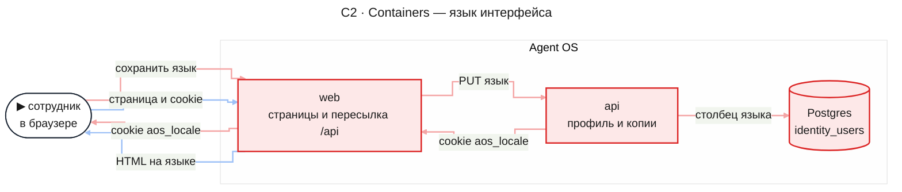
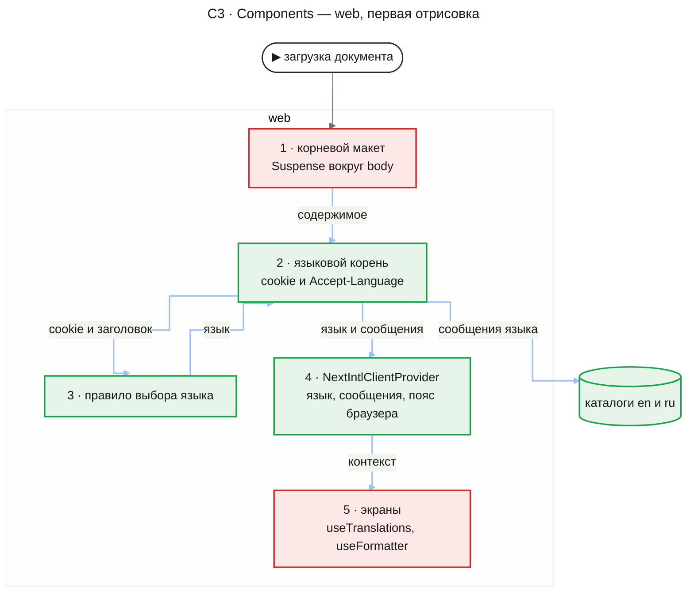
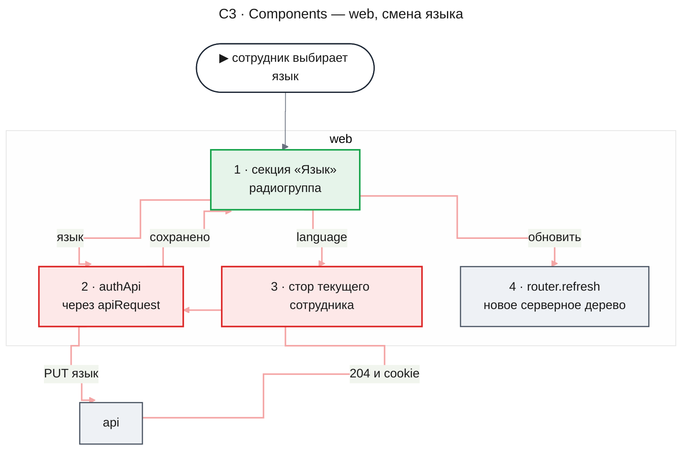
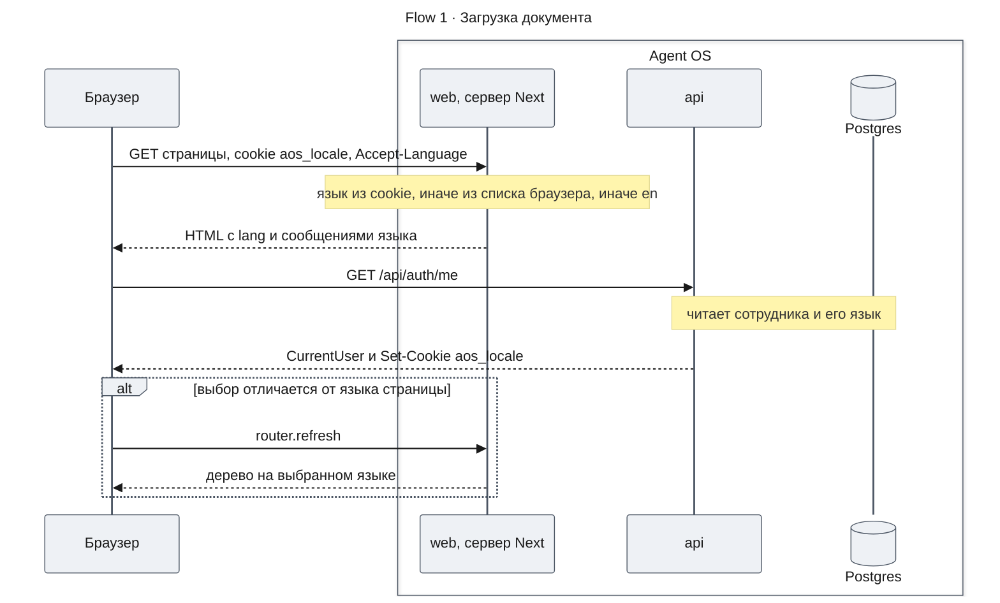
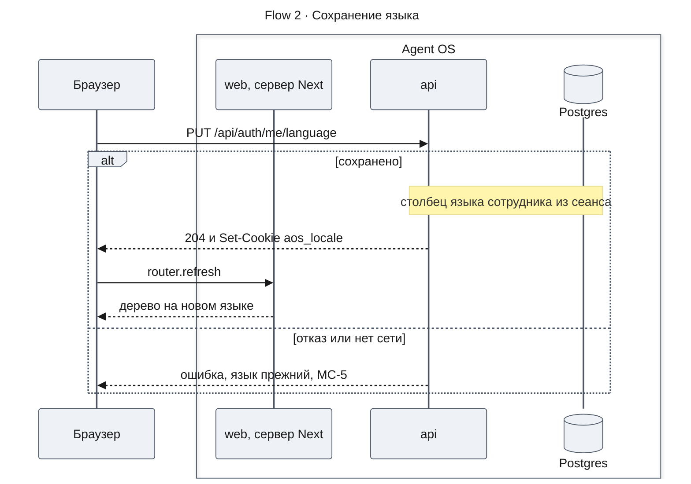
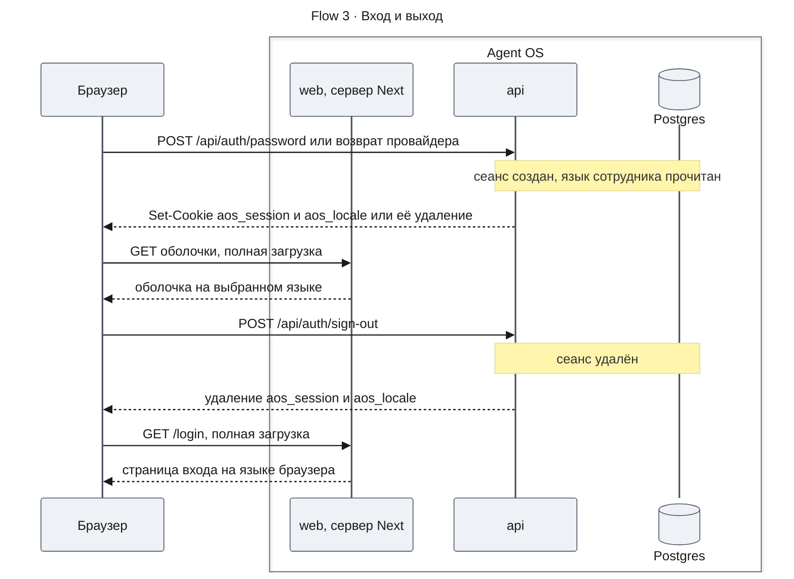
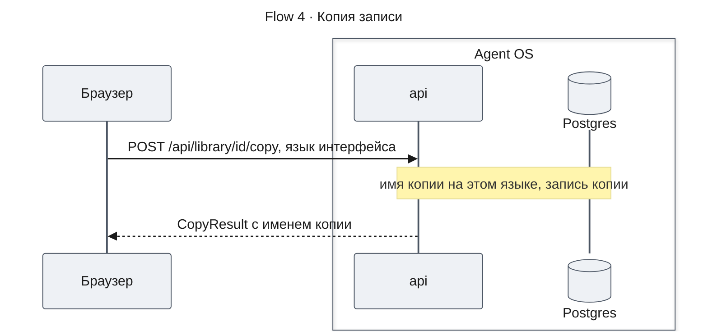

# Переводы интерфейса (i18n) Design Document — web

**Status:** Draft · **Date:** 2026-11-21 · **PRD:** [prd.md](./prd.md) · **UXRD:** [uxrd.md](./uxrd.md) · **Depends on:** [design-web-image.md](../web-image/design-web-image.md) — пересылка `/api` на адресе веба

## Snapshot

**Overview.** Сегодня каждый текст веба записан по-русски прямо в коде экранов, а даты и суммы форматируются по русским правилам. После этой части все тексты лежат в двух каталогах сообщений — английском и русском, — и экраны берут их через библиотеку next-intl. Язык страницы решает сервер Next при каждой загрузке документа: сначала копия выбора сотрудника в cookie, затем язык браузера из заголовка запроса, затем английский; поэтому страница с первого кадра на нужном языке. Выбор хранится в профиле сотрудника в базе, а API держит его копию в cookie на адресе веба. Сервер переводит только одно — имя копии записи; отказы по-прежнему переводит веб по коду причины.

- **Не меняется**: русский интерфейс читается как сейчас; модель получает те же промпты и описания инструментов; язык не входит в адрес страницы.
- **Главный риск**: обновление дерева после сохранения языка (`router.refresh`) должно сохранить фокус и состояние экрана — это проверяет спайк до работы над экранами ([Risks and Mitigation](#risks-and-mitigation)).
- **Открытые вопросы**: нет.

### Key Decisions

#### KD-1: Библиотека — next-intl без языковых адресов и только её клиентский слой

Нужны сообщения ICU с формами множественного числа и выбором по виду, форматирование дат и чисел через `Intl`, хуки для 144 клиентских модулей и та же функция перевода вне React. next-intl даёт всё это (`useTranslations`, `useFormatter`, `createTranslator`) и проверку ключей компилятором через объявление типа каталога. Её режим «без i18n-маршрутизации» — обычный путь для App Router, когда язык не в адресе. Берём только клиентский слой: `NextIntlClientProvider` получает язык и сообщения явными свойствами от серверного компонента, который сам читает cookie и заголовок. Плагин `next-intl/plugin`, файл `i18n/request.ts` и промежуточный слой next-intl в `proxy.ts` не нужны, потому что ни один серверный компонент не рисует переведённый текст: весь текст сегодня — в клиентских компонентах, а серверных только два файла (корневой макет и страница входа), и их текст переезжает в клиентские компоненты.

Проверено: next-intl 4.x объявляет совместимость с `next` 16 и `react` 19; клиентская точка входа пакета (`index.react-client`) не импортирует `next-intl/config` — его импортируют только плагин и серверные функции (прочитано в пакете 4.14.9). В серверном компоненте тот же импорт `next-intl` разрешается в `index.react-server`, и его `NextIntlClientProvider` — серверная версия, которая читает `next-intl/config` и без плагина падает. Отсюда правило: **`NextIntlClientProvider` импортирует только модуль с `'use client'` — клиентская обёртка из C3; серверный языковой корень из `next-intl` не импортирует ничего.** Что связка работает под Turbopack и `cacheComponents: true`, подтверждает первый спайк.

Отвергнуты:

- **Полная настройка next-intl с плагином и `getRequestConfig`.** Плагин оборачивает `next.config` и подставляет вместо `next-intl/config` обязательный файл `i18n/request.ts`. Это две лишние части ради серверного API, которым приложение не пользуется. Выигрыша под `cacheComponents` нет: серверные функции next-intl читают заголовки запроса, поэтому язык всё равно выбирался бы при запросе внутри `<Suspense>`, как в языковом корне ([next-intl, Configuration](https://next-intl.dev/docs/usage/configuration)).
- **Голый `use-intl`** — то же ядро и те же хуки, но без серверного слоя. next-intl оставляет возможность добавить серверный слой позже, не меняя хуков и каталогов; с `use-intl` для этого пришлось бы подключать вторую библиотеку.
- **i18next** — свой формат сообщений: формы множественного числа задаются суффиксами ключей, а ICU доступен только через дополнительный плагин ([i18next, JSON format](https://www.i18next.com/misc/json-format)).
- **Lingui** — сообщения пишутся в коде макросами и собираются в каталоги отдельным шагом CLI. Пропущенный перевод ловит этот шаг, а не `tsc`, и сборке нужен плагин макросов.
- **Свой контекст с `Intl.PluralRules`** — повторяет библиотеку без ICU-синтаксиса.

Выбор библиотеки проходит тест ADR: весь будущий текст интерфейса пишется против её API и формата каталогов, а замена задевает каждый компонент. Решение записано в [ADR-0020](../../adr/ADR-0020-next-intl-client-layer.md).

#### KD-2: Язык решает сервер Next по cookie `aos_locale`, которую пишет API

Профиль читает только API, а сервер Next к API не ходит ([web-api-client.md](../../code-system/patterns/web-api-client.md), Not For). Поэтому API держит копию выбора в cookie `aos_locale` рядом с cookie сеанса `aos_session` и с теми же атрибутами: ставит её при входе паролем и через провайдера, при сохранении языка и в каждом ответе `GET /api/auth/me`, а удаляет при выходе и когда выбора нет. Сервер Next при загрузке документа читает cookie и заголовок `Accept-Language` и выбирает язык одним правилом: значение cookie, если оно `en` или `ru`; иначе первый английский или русский язык из списка браузера с любым региональным вариантом (UXRD KD-4); иначе английский. Чтение стоит в корневом макете, внутри `<Suspense>` вокруг содержимого `<body>`, поэтому страницы ошибки и «не найдено» тоже получают язык.

Цена под `cacheComponents`: статическая оболочка каждого маршрута сводится к `<html>`, `<head>` и пустому `<body>`. Группа `(chat)` и сегодня читает cookie при запросе, а её запасной вид пустой, поэтому для оболочки ничего не меняется; страница входа теряет заранее отрисованный заголовок, и он приходит потоком в том же ответе. Атрибут `lang` на `<html>` из макета не прочитать без того, чтобы весь документ стал запросным, поэтому статический `lang="en"` правит строчный скрипт, который сервер выводит первым в потоке, и эффект провайдера при каждой смене языка — так же, как приложение уже держит цвет темы скриптом `THEME_COLOR_SCRIPT` ([Next 16.4.6, migrating-to-cache-components](../../../apps/web/node_modules/next/dist/docs/01-app/02-guides/migrating-to-cache-components.md), «Good to know» о `lang`).

**Зависимость от общего адреса.** Решение опирается на фичу `web-image` в одном месте: ответ API с `Set-Cookie: aos_locale` должен оседать на адресе веба, где его видит сервер Next. Так будет, когда браузер ходит к `/api` на адрес веба. Остальное от адреса не зависит: запросы идут через общий клиент `apiRequest`. Без общего адреса cookie осела бы на адресе API, сервер Next её не увидел бы, и выбор языка не действовал бы вовсе — ни при загрузке, ни после переключения. Поэтому сохранение языка (шаги 3 и 4 порядка работы) строится, когда пересылка `web-image` уже работает. Отвергнуты: чтение `GET /api/auth/me` сервером Next при каждой загрузке — нарушает правило «сервер Next к API не ходит», связывает отрисовку с доступностью API и требует внутреннего адреса API в коде веба; cookie, которую пишет сам браузер после чтения профиля (как `sidebar_state`), — первая загрузка после входа через провайдера рисовалась бы на языке браузера и мигала бы; язык браузера на клиенте после гидратации — мигание на каждой загрузке (UXRD KD-3).

#### KD-3: Новый язык применяется обновлением серверного дерева, без перезагрузки

После подтверждения сохранения (UXRD KD-2) API уже поставил новую cookie, и веб вызывает `router.refresh()`. Сервер заново рисует корневой макет с новым языком и сообщениями, а React сохраняет смонтированные компоненты: сторы оболочки, открытый экран и фокус на выбранном варианте остаются. Тот же вызов чинит устаревшую cookie: если `GET /api/auth/me` вернул выбранный язык, отличный от языка страницы (выбор сменили на другом устройстве), веб обновляет дерево один раз. Отвергнуты: полная перезагрузка страницы — теряет фокус и прокрутку вопреки UXRD; загрузка второго каталога в браузере и клиентское состояние языка — два места, решающих язык, и второй путь доставки каталогов.

#### KD-4: Выбор — столбец в профиле и одна операция сотрудника над собой

В таблице сотрудников `identity_users` появляется необязательный столбец языка с проверкой по набору `en` | `ru` из `packages/contracts`, как уже сделан статус сотрудника. Пустое значение значит «выбора нет» (UXRD, «Выбора нет»). `CurrentUserSchema` получает поле `language`; оно идёт тем же путём, что `hasPassword`: выборка сеанса, `SessionGuard`, `req.user`, ответ `GET /api/auth/me`. Запись — новый маршрут `PUT /api/auth/me/language` рядом с `POST /api/auth/password/change`: он меняет только сотрудника из `req.user` и ставит cookie. Миграция одна, сгенерированная `drizzle-kit` по [ADR-0003](../../adr/ADR-0003-drizzle-data-layer.md), без заполнения существующих строк. Аудита нет: язык не влияет на доступ. Отвергнуты: общий `PATCH` профиля — второго изменяемого поля нет; хранение выбора только в cookie — не переходит на другое устройство (AC-02.2).

#### KD-5: Каталоги по областям экранов, типизированные ключи, а вне React — ключи вместо текста

Каталог каждого языка — набор JSON-файлов по областям; область — пространство имён next-intl. Английский каталог задаёт тип сообщений для `useTranslations`, а русский объявлен этим же типом, поэтому `tsc` в `typecheck` отвергает пропущенный русский ключ. Лишний русский ключ `tsc` пропускает; он безвреден, потому что его никто не читает, и отдельной проверки для него нет. Сервер передаёт клиенту русский каталог, наложенный поверх английского, так что текст без перевода показывается по-английски (NFR-02). Сторы и службы вне React — лента, живые данные, оповещения оболочки, расход — больше не собирают текст: они отдают ключ сообщения со значениями, а переводит компонент, который их показывает (`Announcer`, уведомление, меню пользователя). Так текст следует за сменой языка, а не застывает в момент события. Отвергнуты: один файл на язык — шаги работы по областям правили бы один файл; глобальная функция перевода в модуле — состояние уровня модуля, которое тесты и смена языка должны держать в синхроне.

#### KD-6: Встроенные имена узнаются по совпадению с русским именем засева; подписи встроенных инструментов — в каталоге веба

Таблица встроенных имён на двух языках — «Главный чат», «Глубокий ресерч», «Супер-администратор» и их английские имена из UXRD MC-7 — переезжает в `packages/contracts`: из неё API засевает записи и строит имя копии, а веб показывает имя. Веб переводит имя, когда оно равно русскому имени засева для своего `builtinKey` (у роли — когда равно имени встроенной роли; роль переименовать нельзя, и её имя уникально). Имя, которое дал администратор, не совпадает и показывается как есть (AC-06.4). Подписи девяти встроенных инструментов и их аргументов живут в каталоге веба под именем инструмента; встроенные инструменты в пакетах больше не задают `title` и `argLabels`, а поля `toolTitle` и `argLabels` в `ToolDisplayShape` остаются только для MCP-инструментов. Имя копии API строит на языке из тела запроса копирования. Отвергнуты: флаг «переименована» в контракте — нужен в `RecordSummary`, `RunOrigin` и всех видах, где видно имя, а таблица имён в API нужна всё равно; перевод по ключу без сравнения — затирает имя администратора; подписи инструментов в пакетах на двух языках — i18n в пакетах вопреки решению владельца.

#### KD-7: Тесты компонентов остаются на русском через одну обёртку; полноту проверяет правило ESLint

Ответ на открытый вопрос PRD: тесты рисуют компоненты с русским каталогом. Одна тестовая обёртка даёт провайдер с языком `ru`; её используют `renderWithRuntime` и локальные помощники рендера, а файлы, которые зовут `render` из Testing Library напрямую, переходят на неё. Существующие поиски по русским надписям продолжают работать, а `tsc` следит, что английский каталог полон. Полноту перевода проверяет правило `no-restricted-syntax` в `apps/web/eslint.config.mjs`: строка, шаблон или текст JSX с кириллицей, а также локаль `'ru-RU'` вне каталогов и тестов — ошибка шага `lint`, который CI уже запускает. Отвергнуты: перевод тестов на английский — переписывание тысяч проверок без нового пойманного дефекта; поиск по ключам сообщений — тест перестаёт видеть то, что видит сотрудник; отдельный скрипт проверки — второй шаг CI там, где хватает правила линтера.

## Terms

- **Каталог сообщений** — все тексты интерфейса на одном языке (PRD, Terms); здесь — JSON-файлы в `apps/web`.
- **Пространство имён** — первая часть ключа сообщения, здесь — область экранов (`library`, `admin`).
- **ICU** — синтаксис сообщений с подстановками, формами множественного числа (`plural`) и выбором по значению (`select`).
- **Статическая оболочка** — часть страницы, которую Next с `cacheComponents` рисует при сборке; всё, что читает запрос, приходит потоком внутри `<Suspense>`.
- **Строчный скрипт** — `<script>` с кодом прямо в HTML; браузер выполняет его, как только дочитал, до гидратации React.

## Part

- **Prerequisite ADRs**: [ADR-0003](../../adr/ADR-0003-drizzle-data-layer.md) — схема `app` и миграции.

**Out of scope**

- Тексты для модели: промпты встроенных записей, описания инструментов, промпты знаний и сжатия истории не меняются, в том числе русские названия кнопок в промпте главного чата и имена «Сбор · …» (PRD, Assumptions and Risks).
- Названия и подписи MCP-инструментов: они приходят с сервера MCP и показываются как есть.
- Отказы на сервере: API по-прежнему отдаёт код, причину и английский текст.
- Язык развёртывания по умолчанию (FR-08) отложен.
- Вид страниц: раскладка, токены и спецификации компонентов не меняются, кроме статуса агента, который сегодня усекает подпись вопреки спецификации ([agent-status.md](../../design-system/components/agent-status.md)).

**Constraints**

- **Одна версия.** Русские строки уходят из кода сразу: `lib/i18n/plural-ru.ts`, текстовые модули вроде `lib/admin/admin-texts.ts` и объекты `TEXT` в компонентах удаляются вместе с тестами, которые проверяли их напрямую; второго способа показать текст не остаётся.
- **Настройки в базе.** Выбор — столбец профиля; новых переменных окружения и файлов настроек нет, каталоги — исходный код.
- **Язык вне адреса.** Нет сегмента `[locale]`, и язык не решается в `proxy.ts`: промежуточный слой next-intl не ставится (`proxy.ts` фичи `web-image` ставит только cookie DSN).
- **Сервер не переводит отказы.** Единственный текст, который API пишет на языке сотрудника, — имя копии.
- **Полнота** — правило ESLint (KD-7) и визуальный проход ([L1-сценарии](#l1-сценарии-в-браузере)).
- **WCAG 2.1 AA, 3.1.1 и 3.1.2** (NFR-03) — язык документа с первой отрисовки и пометка английского текста сервера ([Отказы сервера](#отказы-сервера)).

## Building-block Inventory

Follows the [code system](../../code-system/README.md).

| Building block | Pattern | Status | Note |
|---|---|---|---|
| Языковой корень в корневом макете | [interface-text.md](../../code-system/patterns/interface-text.md) — новый | new | в каталоге и коде нет механизма, который доходит до страницы входа и страниц ошибок (`ShellServices` живёт только в `(chat)`) |
| Правило выбора языка | [pure-decision.md](../../code-system/patterns/pure-decision.md) | new | чистая функция от cookie и `Accept-Language` с табличным тестом |
| Каталоги `en` и `ru` | [interface-text.md](../../code-system/patterns/interface-text.md) | new | заменяют объекты `TEXT`, `admin-texts.ts` и литералы в JSX |
| Перевод ошибок `describeAdminError`, `describeLibraryError`, `refusalText`, `chatFailureText`, `loginReasonOf`, `failureReasonText` | [web-api-client.md](../../code-system/patterns/web-api-client.md) | extended | те же функции областей, текст берут из каталога |
| Форматтеры дат, чисел, денег, длительности в `lib/agents/format.ts`, `lib/access/money.ts` | — | extended | вместо объектов `Intl` с `'ru-RU'` — форматы next-intl и сообщения каталога |
| `groupThreadsByDate` | [pure-decision.md](../../code-system/patterns/pure-decision.md) | extended | возвращает ключ группы, а не подпись |
| Стор оповещений `announcer-store.ts` и `Announcer` | [shell-store.md](../../code-system/patterns/shell-store.md) | extended | хранит ключ и значения, `Announcer` переводит |
| Стор текущего сотрудника `current-user.ts` | [shell-store.md](../../code-system/patterns/shell-store.md) | extended | поле `language`; сверка с языком страницы после чтения |
| Секция «Язык» на «Мой доступ» | — | new | данные уже в `CurrentUser`; устройство как у `password-section.tsx`; `SavingSwitch` не подходит: это переключатель, привязанный к ошибкам панели |
| `authApi` | [web-api-client.md](../../code-system/patterns/web-api-client.md) | extended | операция сохранения языка |
| Страница «не найдено» `app/not-found.tsx` | — | new | раскладка как у `app/error.tsx` |
| Маршрут языка, столбец, cookie в `apps/api` identity | [auth-boundary.md](../../code-system/patterns/auth-boundary.md) | extended | владелец из `req.user`; cookie пишет помощник `session-cookie.ts` |
| Имя копии `planCopy` / `copyName` | [pure-decision.md](../../code-system/patterns/pure-decision.md) | extended | вход получает язык |

## Acceptance Criteria

### FR-01: Интерфейс на двух языках

- From the PRD: AC-01.1, AC-01.2, AC-01.3.
- Правило ESLint не находит строк с кириллицей в `apps/web/src` вне каталогов и тестов, и сборка CI зелёная (DC-1).

### FR-02: Выбор языка в профиле

- From the PRD: AC-02.1, AC-02.2, AC-02.3.
- Когда сервер отказал в сохранении или сети нет, отметка возвращается, под радиогруппой ошибка MC-5, язык страницы прежний (DC-2).
- Когда выбор сменили на другом устройстве, открытая вкладка после ближайшего чтения профиля переходит на новый язык без перезагрузки (DC-3).

### FR-03: Язык до выбора

- From the PRD: AC-03.1, AC-03.2.
- При списке языков браузера «de, ru» интерфейс русский; при «fr» — английский (UXRD KD-4) (DC-4).
- После «Выйти» страница входа на языке браузера, даже если сотрудник выбрал другой (DC-5).

### FR-04: Даты, числа, суммы

- From the PRD: AC-04.1, AC-04.2.

### FR-05: Отказы сервера

- From the PRD: AC-05.1, AC-05.2.
- Английский текст сервера внутри русского интерфейса помечен `lang="en"` (DC-6).

### FR-06: Встроенные записи и инструменты

- From the PRD: AC-06.1, AC-06.2, AC-06.3, AC-06.4.
- Карточка `draft_record` и в блоке вызова, и в карточке решения подписана MC-9 «Подготовить черновик» / “Prepare draft” (DC-7).

### FR-07: Имя копии

- From the PRD: AC-07.1, AC-07.2, AC-07.3.

## Design

### Architecture (C1–C4)

#### C2 · Containers

Сохранение пишет выбор в профиль и cookie; каждая следующая загрузка документа читает cookie на сервере Next.

Пересылку `/api` через веб строит фича `web-image`; эта часть только пользуется ею (KD-2).

#### C3 · Components: web

**web — первая отрисовка документа**

Языковой корень — асинхронный серверный компонент внутри `<Suspense>` в `<body>`. Он выводит строчный скрипт с `document.documentElement.lang` и клиентскую обёртку над `NextIntlClientProvider` — модуль с `'use client'`, единственное место, которое импортирует провайдер (KD-1). Обёртка задаёт часовой пояс браузера (foundations, «Часовой пояс — браузера»), общие форматы дат и денег, пишет ошибки next-intl через логгер `lib/logger.ts` и ставит `lang` на `<html>` при каждой смене языка. Правило выбора — чистая функция без чтения запроса: её вход — значение cookie и строка `Accept-Language`. Языковой корень оборачивает `TooltipProvider`, страницы и `Toaster`, поэтому переведены и уведомления; `ThemeProvider` остаётся снаружи.

**web — смена языка на «Мой доступ»**

Секция показывает отмеченный язык из `CurrentUser.language` и ничего не читает сама (UXRD LN-01, «Секция не загружается отдельно»). Пока идёт сохранение и обновление дерева, радиогруппа недоступна, но не теряет фокус: она помечена недоступной и не принимает выбор, а не отключена атрибутом `disabled`, который снял бы фокус. Объявление MC-6 звучит, когда язык страницы сменился, — уже из нового каталога; MC-5 — из прежнего.

### Runtime Flows

#### Flow 1: Загрузка документа

**Starts when:** сотрудник открывает или перезагружает любую страницу веба, for AC-02.2, AC-02.3, AC-03.1, AC-03.2, DC-3, DC-4

Запрос `GET /api/auth/me` идёт через пересылку веба; на схеме он нарисован прямо к API, потому что веб его не меняет. Без сеанса API отвечает 401, и общий обработчик уводит на страницу входа, как сегодня.

#### Flow 2: Сохранение языка

**Starts when:** сотрудник отмечает язык в секции «Язык», for AC-02.1, DC-2

При отказе стор текущего сотрудника не меняется, отметка возвращается на прежний вариант, а обновления дерева нет.

#### Flow 3: Вход и выход

**Starts when:** сотрудник входит паролем или через провайдера, или нажимает «Выйти», for AC-02.2, DC-5

Вход паролем и выход уже кончаются полной загрузкой документа (`window.location.assign`), а возврат провайдера — переходом 302, поэтому новая cookie действует с первого кадра. Если сеанс истёк без выхода, cookie `aos_locale` живёт, пока браузер не закроют, как и cookie сеанса, и страница входа до тех пор показывается на выбранном языке ([Risks and Mitigation](#risks-and-mitigation)).

#### Flow 4: Копия записи

**Starts when:** сотрудник копирует запись в библиотеке или в панели, for AC-07.1, AC-07.2, AC-07.3

Веб шлёт язык страницы, а не выбор из профиля: у сотрудника без выбора язык решает браузер, которого API не знает. Имя копии хранится как строка и больше не переводится (AC-07.3).

### Тексты и форматы

**Каталоги.** Файлы лежат в `apps/web` по одному на область и язык: общие слова (`common`), оболочка и сайдбар, беседа и элементы assistant-ui, агенты и лента, библиотека, «Мой доступ», панель администратора, вход, ошибки и отказы, встроенные инструменты, форматы, страницы ошибок. Ключ называет место и смысл по-английски в camelCase (`library.editor.saveFailed`), а не идентификатор UXRD; ключи инструментов — их имена (`tools.start_agent.title`, `tools.start_agent.args.prompt`). Правила английского текста — UXRD, «Правила английского каталога».

**Фразы из кусков** становятся целыми сообщениями. `kindWord` и `capitalize` уходят: вид записи — `select` внутри фразы, поэтому русский род и порядок слов остаются верными. Строчные куски причин, которые вызывающий делал заглавными, становятся отдельными сообщениями для каждого места. Количество с существительным — `plural`; `pluralRu` и `plural-ru.ts` удаляются. Имя месяца, «Модель по умолчанию» с хвостом и текст сервера после русского начала — подстановки в одном сообщении.

**Форматы** задаются один раз и передаются провайдеру: время `14:32`, день `Nov 12` / `12 нояб.`, день другого года с годом, день со временем, месяц словом, деньги через `Intl.NumberFormat` с валютой USD (`$64.20` / `64,20 $`), целая сумма без копеек — всё по таблице foundations «Даты, числа и деньги»; на Node 26 вывод `Intl` для `en` и `ru` совпадает с ней. Правило «сегодня — только время, иначе день и время» остаётся чистой функцией, которая получает форматтер. Длительности и размеры файлов — сообщения каталога с числом («{min} min {sec} s», «{size} KB»), потому что `Intl.DurationFormat` даёт другой вид. Сортировка и нижний регистр берут язык страницы вместо `'ru'`; модульные объекты `Intl` с `'ru-RU'` удаляются, потому что не следуют за сменой языка.

**Мелкие решения.** Подсказки-заготовки беседы (`welcome-suggestions.ts`) переводятся: сотрудник видит их и отправляет как своё сообщение, это не промпт платформы. `draft_record` подписан из каталога по MC-9, а замена `TOOL_LABEL` в `tool-fallback.aui.tsx` удаляется. Логическое значение аргумента (`value-rows.ts`) — «да» / “yes” из каталога. Описание сайта в метаданных корневого макета удаляется, а заголовок вкладки страницы входа ставит `useDocumentTitle`, как у экранов оболочки.

### Отказы сервера

Функции областей остаются единственным местом, где код ошибки становится текстом ([web-api-client.md](../../code-system/patterns/web-api-client.md)). Каждая получает функцию перевода пространства имён ошибок и ищет сообщение по коду, а для кодов с причиной (`VALIDATION_FAILED`, `RECORD_REJECTED`, `RECORD_NAME_TAKEN`, `START_REFUSED`) — по коду и причине. Перед поиском функция проверяет, что ключ есть, потому что код пришёл с сервера.

Для кода без сообщения показывается одно сообщение каталога «Не удалось сохранить: {текст сервера}» / “Couldn't save: {server text}” с английским текстом API внутри элемента `lang="en"` (UXRD, Accessibility). Без текста сервера — сообщение «нет связи с сервером». Служебное имя ключа не показывается никогда (NFR-02). Функции отдают узел React, а не строку, чтобы пометка языка дошла до формы и до уведомления.

### Встроенные записи и инструменты

- **Имя встроенной записи.** Одна функция веба получает `builtinKey` и имя из `RecordSummary`, `RunOrigin` или другого вида и возвращает имя на языке страницы, если имя равно русскому имени засева, иначе имя как есть. Её зовут все места, где видно имя записи: библиотека, редактор, выбор исполнителя, карточка хода, карточка решения, лента, заголовок вкладки, панель.
- **Имя роли.** Та же проверка по имени работает в любом виде с именем роли — `RoleSummarySchema`, `RoleRefSchema` в списке сотрудников, адресаты прав, — поэтому флаг `builtin` в `RoleRefSchema` не нужен. Метка «встроенная» — сообщение каталога.
- **Подписи инструментов.** Для вызова и запроса подтверждения с `server === null` веб берёт подпись и подписи аргументов из каталога по имени инструмента. Инструмента без сообщения нет в каталоге — показывается его имя, аргумента без подписи — ключ аргумента, как сегодня. MCP-инструмент (`server !== null`) показывает `toolTitle` и `argLabels` из ответа без изменений.

### Страницы ошибки и «не найдено»

`app/error.tsx` и новая `app/not-found.tsx` стоят внутри корневого макета, а значит под языковым корнем: до входа они на языке браузера, после входа — на выбранном (UXRD Screen 2). Обе ничего не читают у API и не зависят от сторов оболочки, поэтому показываются, даже когда упала сама оболочка. Сегодня неизвестный адрес показывает английскую страницу Next по умолчанию. Новую страницу задаёт UXRD, Screen 2, «Страница «не найдено» (NF-01)», с текстами MC-10–MC-12: MC-10 — заголовок вкладки и заголовок первого уровня, MC-11 — пояснение, MC-12 — ссылка в виде кнопки на начальный адрес.

### Порядок работы по областям

Вход для планировщика: после каждого шага приложение собирается и работает. Пока область не переведена, её русские строки остаются, а правило ESLint включается последним шагом.

1. **Спайки** — три первых L1-сценария: корень с `<Suspense>` и чтением запроса собирается с `cacheComponents` под Turbopack; `router.refresh` меняет язык, не теряя фокус и состояние; провайдер next-intl работает без плагина.
2. **Основа** — языковой корень, правило выбора, пустые каталоги, тестовая обёртка, `lang` на `<html>`. Интерфейс ещё целиком русский.
3. **Сервер** — набор языков и поле `CurrentUserSchema`, столбец и миграция, маршрут языка, cookie во входе, выходе и `GET /api/auth/me`, язык в копии и таблица встроенных имён.
4. **Секция «Язык»** — с этого шага язык выбирается и сохраняется; переведённых областей пока нет.
5. **Общие части** — форматы, отказы, примитивы `components/ui`, `Announcer`, уведомления, встроенные имена и инструменты.
6. **Области по одной** — вход и страницы ошибок; оболочка и беседа; агенты и лента; библиотека; «Мой доступ»; панель администратора.
7. **Замыкание** — правило ESLint, удаление `plural-ru.ts` и пустых текстовых модулей, визуальный проход на двух языках.

### Contract Definitions

- **`PUT /api/auth/me/language`** — сохраняет язык интерфейса сотрудника из сеанса; тело `{ language }`, где `language` — `en` или `ru`. Отвечает 204 с `Set-Cookie: aos_locale`. Без сеанса — 401 `AUTH_REQUIRED`; другое значение — 400 `VALIDATION_FAILED`. Маршрут не принимает id и меняет только сотрудника из `req.user`.
- **`GET /api/auth/me`** — к ответу добавлено поле `language`; ответ ставит cookie `aos_locale`, когда язык выбран, и удаляет её, когда не выбран.
- **`POST /api/auth/password`, возврат `GET /api/auth/oauth/:providerId/callback`** — вместе с `aos_session` ставят `aos_locale` по выбору сотрудника или удаляют её, если выбора нет.
- **`POST /api/auth/sign-out`** — удаляет `aos_locale` вместе с `aos_session`.
- **`POST /api/library/:id/copy`** — тело получает обязательное поле `language` (`en` или `ru`): язык, на котором API пишет отметку о копии и, для непереименованной встроенной записи, её имя. Другое значение или его отсутствие — 400 `VALIDATION_FAILED`. Остальные ответы прежние.

**`CurrentUser`**

- `language` — `en`, `ru` или `null`, когда сотрудник ещё не выбирал; `null` веб читает как «выбора нет», а не «не прочитано» — непрочитанный сотрудник в сторе по-прежнему `user: null`.

**Cookie `aos_locale`**

- Значение `en` или `ru`; пишет и удаляет только API, читает только сервер Next. Атрибуты как у `aos_session`: `HttpOnly`, `SameSite=Lax`, `Path=/`, `Secure` при `https` в `FRONTEND_ORIGIN`, без срока, поэтому живёт до закрытия браузера. Сервер Next игнорирует любое другое значение.

**Встроенные имена (`packages/contracts`)**

- Ключи `chat` и `deep-research` записей и встроенная роль; у каждого имя `ru` — то, которым запись засеяна, — и имя `en` из UXRD MC-7. API засевает записи из этой таблицы, а миграция с ролью уже содержит то же русское имя.

**`ToolDisplayShape`**

- Форма не меняется. `toolTitle` и `argLabels` приходят только у MCP-инструментов; у встроенных (`server === null`) их больше нет, и веб, который уже читает их как необязательные, берёт подписи из каталога.

### Data Model

У `identity_users` появляется необязательный текстовый столбец языка с проверкой `CHECK` по набору `en` | `ru` из `packages/contracts`. Существующие строки получают `null`, то есть «выбора нет»; заполнения нет. Миграция `0001` генерируется `drizzle-kit` и применяется при старте, как `0000_baseline.sql`.

## Test Strategy

Тесты компонентов рисуют интерфейс на русском (KD-7), поэтому существующие проверки по русским надписям остаются. Меняются: файлы с прямым `render` переходят на обёртку с провайдером; тесты функций текста и форматов строят функцию перевода из русского каталога; тесты `plural-ru.ts` удаляются вместе с ним; ожидания `' — копия'` и подписей встроенных инструментов поправляются по новым правилам. `i18n.test.tsx` остаётся как есть: на русском экране он ловит забытые английские слова-заглушки. Новые проверки — только ниже.

- **UC-1: Правило выбора языка** — covers AC-02.3, AC-03.1, AC-03.2, DC-4
  - Given: значение cookie и строка `Accept-Language` из таблицы — `ru` с английским браузером, пустая cookie с «de, ru;q=0.8», «en-GB», «fr», мусор в cookie, пустой заголовок
  - When: правило выбирает язык
  - Then: `ru`, `ru`, `en`, `en`, язык браузера, `en` — один табличный тест
- **UC-2: Сотрудник меняет только свой язык** — covers AC-02.1, AC-02.2
  - Given: два сотрудника без выбора
  - When: первый сохраняет `ru`, аноним шлёт тот же запрос, первый шлёт `de`
  - Then: `GET /api/auth/me` первого — `ru` и cookie `aos_locale=ru`, второго — `null`; аноним получает 401, `de` — 400 `VALIDATION_FAILED`; вход первого с нового клиента ставит `aos_locale=ru` — один тест API с Postgres
- **UC-3: Имя копии на языке копирующего** — covers AC-07.1, AC-07.2, AC-07.3
  - Given: своя запись, непереименованный «Главный чат», переименованная встроенная запись, занятые имена копий
  - When: правило копии строит имя для `en` и `ru`
  - Then: «— copy» и «— копия» с номером при занятом имени; “Main chat — copy”; имя администратора с отметкой — строки в существующем табличном тесте правила копии
- **UC-4: Форматы на двух языках** — covers AC-04.1, AC-04.2
  - Given: время сегодня, день этого и прошлого года, сумма, целая квота, число, счёт 1, 2, 5, 21
  - When: форматтеры и сообщения с `plural` выводят их на `en` и `ru`
  - Then: значения таблицы foundations и формы слова — один табличный тест вместо русских ожиданий нынешних тестов форматов
- **UC-5: Отказ без известного кода** — covers AC-05.1, AC-05.2, DC-6
  - Given: ответ с кодом из каталога и ответ с неизвестным кодом и английским текстом
  - When: функция области переводит отказ на `ru`
  - Then: сообщение каталога; для неизвестного — русская фраза с английским текстом в элементе `lang="en"`, а не ключ — строки в существующем тесте отказов библиотеки
- **UC-6: Остальные критерии в браузере** — covers AC-01.1, AC-01.2, AC-01.3, AC-06.1, AC-06.2, AC-06.3, AC-06.4, DC-1, DC-2, DC-3, DC-5, DC-7
  - Given: собранное приложение против настоящего API
  - When: проходят L1-сценарии ниже и правило ESLint в CI
  - Then: сигналы сценариев и зелёный шаг `lint`

### L1-сценарии в браузере

Готовый интерфейс принимается в настоящем браузере после `next build && next start` против настоящего API, на общем адресе из фичи `web-image`. Три первых сценария — спайки: они идут до перевода экранов.

| Сценарий | Шаги | Проверяемый сигнал |
|---|---|---|
| Корень под `cacheComponents` (спайк) | Собрать приложение с языковым корнем, открыть `/login` и `/` | Сборка без ошибки о данных запроса вне `<Suspense>`; в исходном HTML `lang` и текст на языке браузера |
| Обновление без потери фокуса (спайк) | Отметить язык на «Мой доступ» | В Network `PUT`, затем запрос RSC, без загрузки документа; `document.activeElement` — выбранный вариант; прокрутка прежняя; открытый поток событий не переподключался |
| next-intl без плагина (спайк) | Сборка Turbopack и dev-сервер | Хуки работают, в консоли нет ошибок next-intl |
| Первый кадр на выбранном языке | Сотрудник с выбором `ru` и английским браузером входит паролем и через провайдера, затем перезагружает | Исходный HTML оболочки уже русский, `lang="ru"`; ни один кадр записи экрана не показывает английский |
| Язык браузера | Профиль браузера с «de, ru», затем с «fr»; без выбора | Вход и оболочка на русском, затем на английском |
| Выход | Сотрудник с выбором `ru`, браузер английский, «Выйти» | Страница входа и «Вы вышли» на английском |
| Отказ сохранения | Остановить API, отметить язык | Отметка вернулась, MC-5 на прежнем языке, фокус в радиогруппе |
| Другое устройство | Сменить язык во второй вкладке другого профиля браузера, открыть экран в первой | Первая вкладка переходит на новый язык один раз после чтения профиля |
| Ошибка и «не найдено» | Открыть `/no-such-page` до и после входа | Страница «не найдено» приложения на языке браузера, затем на выбранном |
| Визуальный проход | Каждая область на обоих языках на ширинах её UXRD, в светлой и тёмной теме | 0 непереведённых надписей, кроме исключений AC-01.1; кнопки, статусы и шапки таблиц не усечены (NFR-01) |

## Security Considerations

- **Authentication & Authorization**: маршрут языка закрыт `SessionGuard` и меняет только сотрудника из `req.user`; id в пути или теле нет, поэтому чужой профиль не адресуется ([auth-boundary.md](../../code-system/patterns/auth-boundary.md)). Изменяющий запрос проходит проверку `Origin`, как остальные.
- **Input Validation**: язык в теле сохранения и копирования проверяется схемой по набору `en` | `ru`; в имя копии попадает только суффикс из таблицы API, а не значение из запроса. Сервер Next принимает из cookie и заголовка только `en` и `ru`, всё прочее отбрасывает правило выбора. Значение `lang` в строчном скрипте берётся из этого закрытого набора, поэтому в скрипт не попадает текст запроса.
- **Sensitive Data Handling**: cookie `aos_locale` — не секрет, но `HttpOnly`, как и сеансовая. В лог идут код языка, источник выбора и ошибки next-intl; тексты сообщений с данными сотрудников не логируются.

## Risks and Mitigation

- **`router.refresh` теряет фокус или показывает пустой запасной вид** — средняя вероятность, нарушает UXRD KD-2. Спайк проверяет это до работы над экранами; если обновление теряет состояние, решение возвращается к загрузке второго каталога в браузере (KD-3, отвергнутый вариант).
- **Пропущенные строки** — высокая вероятность без проверки. Правило ESLint ловит кириллицу в коде веба, `tsc` — пропущенный русский ключ, визуальный проход — текст с сервера.
- **Выбор сменили на другом устройстве** — редкий случай: открытая вкладка рисуется на прежнем языке до чтения профиля и переходит один раз (DC-3).
- **Сеанс истёк без выхода** — страница входа на выбранном языке, пока браузер не закрыт, а не на языке браузера; после выхода и при следующем входе правило верное. Принято: cookie сеанса устроена так же, а `SessionGuard` сегодня ничего не удаляет при отказе.
- **`web-image` не построена или пересылка теряет `Set-Cookie`** — выбор языка не действует: страница всегда на языке браузера. Пересылка обязана передавать `Set-Cookie` уже ради сеанса; L1-сценарий «Первый кадр» это проверяет.
- **Часовой пояс при серверной отрисовке** — клиентская обёртка берёт пояс браузера, но на сервере, где клиентские компоненты рисуются для первого HTML, это пояс сервера; дата в HTML могла бы разойтись с гидратированной. Сегодня в серверный HTML попадает одна дата: имя месяца в заголовке «Модели и расход за {месяц}» на «Мой доступ», пока данные грузятся (`models-section.tsx`, месяц UTC из `new Date()` через `utcMonthOf`). Остальные даты и время приходят из данных, которые браузер читает после отрисовки, поэтому на сервере их нет. Мера: это имя месяца форматируется с поясом `UTC`, как и считается сам месяц, поэтому сервер и браузер выводят одно и то же.
- **Вес каталога** — каждая загрузка документа несёт сообщения одного языка, около полутора тысяч строк. Принято: переходы внутри оболочки идут без новой загрузки документа.
- **Русские имена от модели** — промпты называют русские кнопки и дают русские имена «Сбор · …»; это известное ограничение PRD, а не пропуск.

## Open Questions

Нет.

## Update History

| Version | Date | Change |
|---------|------|--------|
| 1.0 | 2026-11-21 | Initial version |
| 1.1 | 2026-11-21 | KD-5: `tsc` ловит только пропущенный ключ; KD-1: провайдер только в модуле `'use client'`, причины отказа от вариантов, i18next и Lingui; риск часового пояса при серверной отрисовке; страница «не найдено» по UXRD NF-01, открытых вопросов нет |
