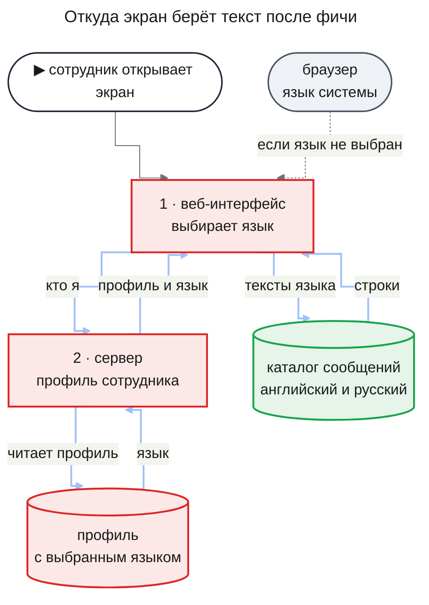
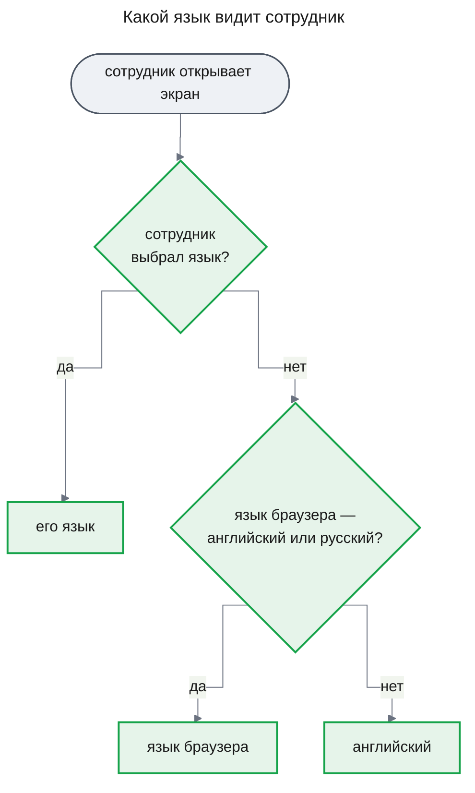

# PRD: Переводы интерфейса (i18n)

| Date | Depth |
|---|---|
| 2026-11-21 | full |

## Snapshot

**Overview.** Сегодня весь интерфейс Agent OS только русский: каждая надпись, подсказка и сообщение об ошибке записаны в коде по-русски, а даты и числа всегда выводятся по русским правилам. Сотрудник, который не читает по-русски, пользоваться платформой не может. После фичи интерфейс работает на английском и русском. Сотрудник выбирает язык в своём профиле, и выбор действует на любом его устройстве; пока он не выбрал, интерфейс берёт язык браузера, а если это не английский и не русский — английский. Даты, числа, суммы и слова при числах следуют правилам выбранного языка.

- **Не входит**: тексты для модели (промпты, описания инструментов), названия от сторонних MCP-серверов, имена и содержимое, которые создали сотрудники, язык развёртывания по умолчанию.
- **Не меняется**: русский интерфейс читается как сейчас; модель получает те же инструкции при любом языке интерфейса.
- **Части**: одна — `web`.
- **Главный риск**: пропущенные строки — в английском интерфейсе останутся русские надписи там, где их не нашли ([Assumptions and Risks](#assumptions-and-risks)).
- **Открытые вопросы**: один, для Design Doc ([Undetermined Items](#undetermined-items)).

## Terms

- **Язык интерфейса** — язык, на котором платформа показывает свои надписи, подсказки, сообщения, даты и числа. Он не меняет того, что получает модель, и не переводит то, что написали люди.
- **Каталог сообщений** — все тексты интерфейса на одном языке. У каждого текста есть постоянное имя, а каталог хранит его перевод. Каталоги — часть исходного кода, а не настройка.
- **Запасной язык** — язык, на котором показывается текст, если перевода на выбранный язык нет. Здесь это английский.
- **Язык браузера** — язык, который сотрудник указал в настройках браузера или системы. Браузер сообщает его каждому сайту.
- **Формы множественного числа** — разные формы слова при разных числах. В английском их две ("1 agent", "2 agents"), в русском три («1 агент», «2 агента», «5 агентов»).
- **Встроенные записи** — агент «Главный чат», глубокий агент «Глубокий ресерч» и роль «Супер-администратор». Их создаёт сама платформа, а не сотрудник. Встроенный агент `general-purpose` и сабагенты глубокого ресерча тоже встроенные, но их служебные имена читает модель, поэтому они не переводятся.
- **Карточка инструмента** — блок в беседе, который показывает, какой инструмент вызвал агент и с какими аргументами, например выполнение кода.
- **Код причины** — короткий машинный признак, которым сервер сообщает, почему действие не выполнено, например «имя занято». По коду веб показывает человеку понятный текст.
- **Промпт** — инструкция, которую платформа передаёт модели. Сотрудник её не видит.

## Background

Сегодня каждый текст, который сотрудник видит в вебе, записан прямо в коде экрана по-русски: заголовки, кнопки, подсказки, всплывающие уведомления, подписи для программ чтения с экрана, тексты ошибок. Таких строк больше тысячи, и они есть на всех экранах — в чате, библиотеке, агентах, профиле, панели администратора, на странице входа. Страница объявляет браузеру, что она на русском, а даты, числа и слова при числах всегда оформляются по-русски. Отдельного места, где лежали бы все тексты, нет, поэтому сменить язык нельзя.

Часть надписей приходит с сервера. Названия встроенных записей хранятся по-русски, подписи карточек встроенных инструментов задаёт сервер, а при копировании записи сервер дописывает к имени « — копия». Об отказах сервер сообщает кодом причины и английским текстом; для известных кодов веб показывает свой русский текст.

Владелец хочет, чтобы платформой пользовались и сотрудники, которые не читают по-русски. Agent OS — внутренний инструмент компании, весь закрытый входом, поэтому язык выбирает сам сотрудник, а не адрес страницы.

Так экран получает текст после фичи. Красным отмечено то, что меняется, зелёным — новое.

На сервере меняется одно: в профиле сотрудника появляется выбранный язык, и сотрудник может его сохранить. Новое — каталоги сообщений на двух языках: экран берёт из них все свои тексты вместо русских строк в коде. Отказы сервера веб по-прежнему переводит по коду причины, но теперь на выбранный язык.

Какой язык показать, веб решает по одному правилу.

До входа платформа ещё не знает сотрудника, поэтому страница входа сразу переходит ко второму вопросу.

## Users and Use Cases

### Users

- **Сотрудник, который не читает по-русски** — работает в чате, библиотеке и с агентами. Ему важно понимать каждую надпись, подсказку и ошибку без переводчика.
- **Сотрудник, привыкший к русскому интерфейсу** — ему важно, что русский интерфейс остаётся прежним и что он выбирает язык сам, даже если браузер у него английский.
- **Администратор** — настраивает роли, модели и MCP-серверы в панели администратора. Панель переводится так же, как остальной интерфейс.

### Use Cases

- **UC-1**: сотрудник с английским браузером входит впервые → весь интерфейс, от страницы входа до панели администратора, на английском, так что он работает без помощи коллег.
- **UC-2**: сотрудник выбирает в профиле русский → интерфейс переходит на русский на этом и на любом другом его устройстве, так что ничего не нужно настраивать заново.
- **UC-3**: сотрудник смотрит даты бесед, свой расход и количества в списках → видит их в привычном формате своего языка, так что не путает день с месяцем и не ошибается в сумме.
- **UC-4**: сервер отказывает сотруднику в действии, например имя занято или нет прав → сотрудник читает причину на своём языке и понимает, что делать дальше.
- **UC-5**: сотрудник копирует запись из библиотеки → имя копии написано на его языке, так что он сразу находит её в списке.
- **UC-6**: администратор управляет ролями в панели → разделы панели и встроенная роль названы на его языке.

## Functional Requirements

### Must Have (MVP)

- **FR-01. Интерфейс на английском и русском.** Каждый экран веба показывает свои тексты на языке интерфейса: чат и боковая панель, библиотека, агенты, профиль, панель администратора, страница входа, страницы ошибок, всплывающие уведомления и подписи для программ чтения с экрана. Русский интерфейс читается как сейчас.
  - AC-01.1: Given язык интерфейса — английский, when сотрудник проходит по всем областям экранов, then каждый текст, который пишет сама платформа, — английский. Как есть остаются только имена и содержимое, созданные людьми, названия от сторонних MCP-серверов, тексты, которые написала модель или вернул инструмент, а также описания встроенных записей и служебные имена `general-purpose` и сабагентов глубокого ресерча: их читает модель.
  - AC-01.2: Given язык интерфейса — русский, when сотрудник проходит по тем же областям, then каждый текст платформы — русский, кроме тех же исключений.
  - AC-01.3: Given язык интерфейса — английский, when программа чтения с экрана читает кнопку, на которой есть только значок, then она называет кнопку по-английски.
- **FR-02. Выбор языка в профиле.** На странице профиля «Мой доступ» сотрудник выбирает английский или русский. Выбор хранится за сотрудником на сервере, поэтому действует на любом устройстве и после повторного входа.
  - AC-02.1: Given сотрудник на странице профиля, when он выбирает русский, then интерфейс сразу переходит на русский, без повторного входа.
  - AC-02.2: Given сотрудник выбрал русский на одном компьютере, when он входит с другого устройства, then интерфейс на русском.
  - AC-02.3: Given сотрудник выбрал английский, а язык его браузера — русский, when он открывает любой экран, then интерфейс на английском: выбор сотрудника важнее языка браузера.
- **FR-03. Язык, пока сотрудник не выбрал.** До входа и пока сотрудник не выбрал язык, интерфейс показывается на языке браузера, если это английский или русский, а иначе — на английском.
  - AC-03.1: Given сотрудник не выбирал язык, а язык браузера — русский, when он открывает страницу входа или любой экран после входа, then интерфейс на русском.
  - AC-03.2: Given сотрудник не выбирал язык, а язык браузера — немецкий, when он открывает страницу входа или любой экран после входа, then интерфейс на английском.
- **FR-04. Даты, числа, суммы и слова при числах по правилам языка.** Даты и время, числа, денежные суммы и количества оформляются по правилам языка интерфейса: порядок дня и месяца, названия месяцев, разделитель дробной части, форма слова при числе.
  - AC-04.1: Given язык интерфейса — английский, when сотрудник смотрит дату беседы, свой расход за месяц и число записей в списке, then дата, сумма и число оформлены по английским правилам; на русском — по русским.
  - AC-04.2: Given в списке 1, 2, 5 или 21 элемент, when сотрудник видит подпись с количеством, then слово при числе стоит в правильной форме для этого числа на обоих языках.
- **FR-05. Отказы сервера на языке интерфейса.** Когда сервер отказывает с известным кодом причины, сотрудник читает причину на языке интерфейса. Когда известного кода нет — непредвиденный сбой или подробности проверки введённых данных, — сотрудник видит текст сервера по-английски на обоих языках интерфейса.
  - AC-05.1: Given язык интерфейса — английский, when сервер отказывает в сохранении записи, потому что имя занято, then сотрудник читает причину по-английски; на русском — по-русски.
  - AC-05.2: Given язык интерфейса — русский, when сервер отказывает без известного кода причины, then сотрудник видит английский текст сервера, а всё вокруг него остаётся на русском.
- **FR-06. Встроенные записи и карточки встроенных инструментов на языке интерфейса.** Названия встроенных записей и подписи карточек встроенных инструментов — что делает инструмент и как называются его аргументы — показываются на языке интерфейса. Если администратор переименовал встроенную запись, на любом языке показывается имя, которое он дал.
  - AC-06.1: Given язык интерфейса — английский, when сотрудник открывает библиотеку или главный чат, then встроенные агент и глубокий агент названы по-английски; на русском — как сейчас.
  - AC-06.2: Given язык интерфейса — английский, when администратор открывает список ролей, then встроенная роль названа по-английски.
  - AC-06.3: Given язык интерфейса — английский, when агент в беседе вызывает встроенный инструмент, then название действия и подписи аргументов в карточке инструмента — английские.
  - AC-06.4: Given администратор переименовал «Главный чат», when сотрудник с английским интерфейсом открывает главный чат, then видит имя, которое дал администратор.
- **FR-07. Имя копии на языке того, кто копирует.** Когда сотрудник копирует запись, отметка о копии в имени — на его языке интерфейса. Копия встроенной записи получает и название встроенной записи на его языке. Дальше имя копии принадлежит сотруднику и при смене языка не меняется.
  - AC-07.1: Given язык интерфейса — английский, when сотрудник копирует свою запись, then отметка о копии в имени копии — английская; на русском — « — копия», как сейчас.
  - AC-07.2: Given язык интерфейса — английский, when сотрудник копирует встроенный агент «Главный чат», который не переименовывали, then имя копии целиком английское.
  - AC-07.3: Given сотрудник с русским интерфейсом сделал копию и поделился ею, when её открывает коллега с английским интерфейсом, then имя копии русское, как его создали.

### Could Have

- **FR-08. Язык развёртывания по умолчанию.** Администратор задаёт в панели язык, который видят сотрудники, ещё не выбравшие свой.
  - AC-08.1: Given администратор задал русский языком развёртывания, а сотрудник не выбирал язык, when сотрудник открывает интерфейс, then интерфейс на русском.

### Won't Have

- Перевод текстов для модели — промптов, описаний инструментов, промптов знаний и сжатия истории — не эта фича: модель получает те же инструкции при любом языке интерфейса, а их правка меняет её поведение. Следствия описаны в [Assumptions and Risks](#assumptions-and-risks).
- Перевод того, что вернул инструмент и что написала модель, включая названия, которые модель даёт агентам, — не эта фича: это содержимое беседы, а не надписи платформы.
- Перевод названий и описаний от сторонних MCP-серверов — не эта фича: их задаёт чужой сервер.
- Перевод имён и содержимого, созданных сотрудниками, — не эта фича: это данные людей, и они показываются так, как их написали.
- Тексты тестового MCP-сервера с синтетическими данными — не эта фича: это тестовый источник, а не интерфейс.
- Язык в адресе страницы — не эта фича: платформа закрыта входом, ссылки на языковые версии страниц никому не нужны.
- Перевод отказов на сервере — не эта фича: английский текст сервера остаётся запасным, переводит веб по коду причины (FR-05).
- Перевод описаний встроенных записей и служебных имён `general-purpose` и сабагентов глубокого ресерча — не эта фича: их читает модель, а её инструкции не меняются.
- Выбор языка на странице входа — не эта фича: до входа язык решает браузер, после входа — выбор сотрудника.
- Языки, кроме английского и русского, — позже, если понадобятся.
- Письма и уведомления вне веба — не эта фича: в платформе их нет.

## Non-Functional Requirements

### Вёрстка

- **NFR-01**: На обоих языках каждый экран удобен на тех же ширинах окна, что и сегодня: текст не наезжает на соседние элементы, не выталкивает кнопки за край, а обрезанный текст можно прочитать целиком. Проверяется визуальным проходом по всем областям экранов.

### Надёжность

- **NFR-02**: Если у текста нет перевода на выбранный язык, сотрудник видит этот текст по-английски — никогда служебное имя текста и никогда пустое место.

### Доступность

- **NFR-03**: Страница сообщает браузеру и программам чтения с экрана свой текущий язык, поэтому программа читает интерфейс с произношением этого языка.

## Delivery Parts

| Part | Covers | Cut along | Depends on | Rationale |
|------|--------|-----------|------------|-----------|
| `web` | FR-01, FR-02, FR-03, FR-04, FR-05, FR-06, FR-07 | frontend | — | Все требования видит сотрудник в вебе, а серверная часть — сохранение выбора и язык имени копии — мала и нужна только этому вебу, поэтому её держит тот же Design Doc. |

- Deferred: FR-08 — не в этой версии; пока хватает языка браузера и выбора сотрудника.

Отдельная часть `api` владела бы одним сохранением выбора и языком имени копии: один признак в профиле и одна операция, без своих решений, зато с отдельным кругом проектирования.

## Success Criteria

- Полнота перевода: автоматическая проверка находит 0 русских строк в коде веб-интерфейса вне каталогов сообщений и тестов. Читается из вывода проверки в каждой сборке, начиная со слияния фичи.
- Перевод на экране: визуальный проход по каждой области экранов на обоих языках находит 0 непереведённых надписей и 0 нарушений вёрстки по NFR-01. Читается из отчёта прохода до слияния фичи.

## Constraints and Risks

### Constraints

- Платформа — PoC с одной версией всего: русский интерфейс не хранится рядом с новым как отдельная версия.
- Выбор языка хранится в профиле сотрудника в базе. Новых переменных окружения и файлов настроек нет; каталоги сообщений — исходный код.
- Язык не входит в адрес страницы.
- Сервер не переводит отказы: английский текст сервера и его тексты проверки данных остаются запасными, а переводит веб — по коду причины. Единственный текст, который сервер пишет на языке сотрудника, — имя копии (FR-07).
- Полноту перевода подтверждают автоматическая проверка и визуальный проход ([Success Criteria](#success-criteria)).

### Assumptions and Risks

**Пропущенные строки.** Русский текст, который не нашли, останется в английском интерфейсе. Автоматическая проверка ловит русский текст в коде веба, а визуальный проход — то, что приходит с сервера.

**Длина текста.** Английский и русский текст одного смысла разной длины, поэтому тесные места — значки статуса, боковая панель, столбцы таблиц — могут поплыть. Против этого работают NFR-01 и визуальный проход.

**Фразы из кусков.** Часть сообщений сегодня собирается из кусков, например имя записи, её вид и «не запустился». По кускам такую фразу не перевести: порядок слов и формы в языках разные. Каждая такая фраза становится целым сообщением со своими формами для чисел.

**Модель говорит по-русски о кнопках.** Тексты для модели не меняются, а в них названы русские надписи интерфейса: «Кто видит», «Поделиться», «Мой доступ», «Сохранить». Поэтому в английском интерфейсе модель может назвать кнопку или страницу по-русски. По той же причине агенты-сборщики глубокого ресерча получают от модели русские названия «Сбор · …», а вывод инструмента показывается как есть, вместе с пометкой «[вывод обрезан]». Это известное ограничение этой версии.

**Тесты ищут русский текст.** Тесты компонентов находят элементы по русским надписям, а языком по умолчанию становится английский. Как они продолжат работать, решает Design Doc ([Undetermined Items](#undetermined-items)).

**Допущение о языке по умолчанию.** Решение исходит из того, что новому сотруднику нужен английский, если браузер не говорит иного. Сотрудник с английским браузером, который предпочитает русский, один раз выбирает русский в профиле.

## Undetermined Items

- Как тесты компонентов, которые находят элементы по русским надписям, продолжают работать, когда языком по умолчанию стал английский; blocks подход к тестам в Design Doc части `web`; resolved by технический дизайнер в Design Doc, утверждает владелец.

## Update History

| Version | Date | Change |
|---------|------|--------|
| 1.0 | 2026-11-21 | Первая версия. Язык вне адреса страницы, перевод ответов сервера только в вебе и проверка полноты автоматической проверкой с визуальным проходом приняты по рекомендации анализа требований. |
