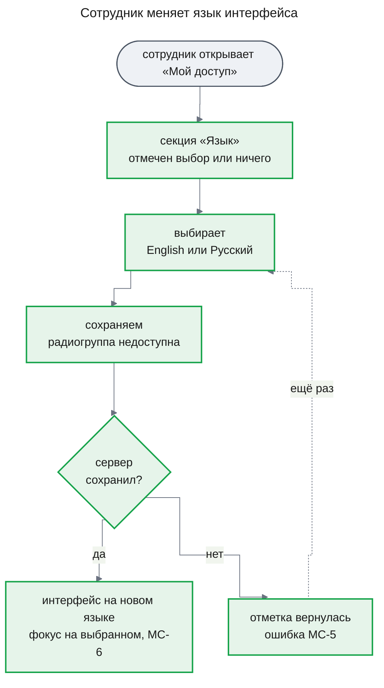
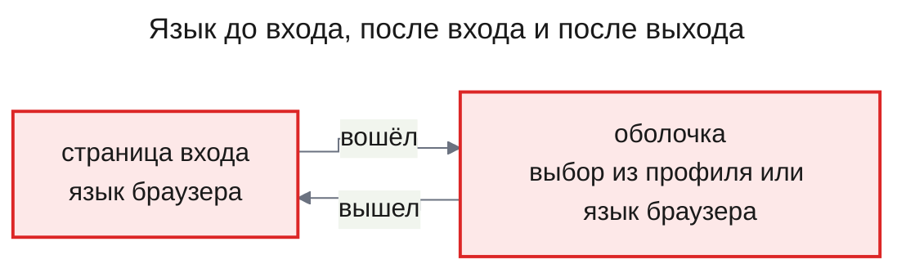

# UXRD: Переводы интерфейса (i18n)

| Date | PRD |
|---|---|
| 2026-11-21 | [prd.md](./prd.md) |

## Snapshot

**Overview.** Сотрудник выбирает язык интерфейса — английский или русский — в новой секции «Язык» на странице «Мой доступ», и интерфейс сразу переходит на этот язык, не уводя его со страницы. Пока он не выбрал и пока не вошёл, интерфейс говорит на языке браузера, а если это не английский и не русский — по-английски; на странице входа переключателя нет. Неизвестный адрес вместо английской страницы по умолчанию показывает новую страницу «не найдено», устроенную как страница ошибки. Остальное в документе — правила для всех экранов: как выглядят даты, числа и суммы на каждом языке, что делают подписи разной длины в тесных местах, как страница сообщает свой язык программам чтения с экрана и как по-английски звучат встроенные названия.

- **Не меняется**: раскладка экранов и русские тексты; тема и её место в меню пользователя.
- **Главный UX-риск**: вспышка чужого языка при загрузке. Выбор хранится на сервере, а оболочка сегодня узнаёт сотрудника уже после первой отрисовки; KD-3 требует, чтобы страница с первого кадра была на нужном языке.

### Key Decisions

| ID | Решение | Почему |
|---|---|---|
| KD-1 | Язык выбирают в секции «Язык» внизу «Мой доступ»: радиогруппа из двух вариантов, каждый назван на своём языке — «English» и «Русский». Выбор сохраняется сразу, без кнопки. Пока выбора нет, не отмечен ни один вариант, а подсказка говорит, что интерфейс следует языку браузера | Вариант, названный на своём языке, узнаёт и тот, кто не читает текущий язык интерфейса. Язык задают один раз, поэтому секция стоит последней и не спорит с подключениями и расходом |
| KD-2 | Интерфейс переключается, когда сервер подтвердил сохранение. Сотрудник остаётся на странице, фокус остаётся на выбранном варианте, программа чтения с экрана слышит новый язык уже на новом языке. Если сохранить не удалось, язык не меняется | Интерфейс никогда не показывает язык, которого нет в профиле, и не мигает туда-обратно при отказе |
| KD-3 | Каждая страница с первой отрисовки на своём языке: экран не появляется на одном языке, чтобы потом смениться другим. Это верно и для страниц после входа с выбором из профиля, и для страниц до входа | Мелькание всего текста страницы при каждой загрузке — та же усталость глаз, от которой защищает тема без вспышки (chat-shell UXRD, TM-01) |
| KD-4 | «Язык браузера» — первый английский или русский язык в списке языков браузера, с любым региональным вариантом (`en-GB`, `ru-RU`). В списке нет ни того, ни другого — английский | Браузер сообщает не один язык, а список по предпочтению; сотрудник, у которого первым стоит немецкий, а вторым русский, читает по-русски лучше, чем по-английски |
| KD-5 | Дата никогда не пишется одними цифрами, часы 24-часовые на обоих языках; остальное оформление — по правилам языка ([foundations → Language & Formats](../../design-system/foundations.md#language--formats)) | Месяц словом не даёт перепутать день и месяц (UC-3), а одинаковое время позволяет сравнивать запуски и логи между коллегами |
| KD-6 | Подписи платформы на кнопках, в метках, статусах и шапках таблиц не усекаются; что усекается — имена, пункты сайдбара, название инструмента в блоке вызова, — перечисляет таблица «Длина текста». Ни одна ширина не подобрана под текст одного языка ([foundations → Language & Formats](../../design-system/foundations.md#language--formats), «Длина текста») | Обрезанная кнопка или статус теряют смысл, а обрезанное имя читается в подсказке; так экраны держат NFR-01 на обоих языках без проверки каждого места отдельно |
| KD-7 | Английский каталог — американский английский, регистр как в предложении, короткие простые фразы на «you». Слова «MCP», «Agent OS», имена моделей и стандартные названия полей (Client ID, Issuer) одинаковы в обоих языках | Сотрудник видит одни и те же термины, на каком бы языке ни работал коллега, а русский интерфейс уже пишет эти слова латиницей |

## Design System

Фича следует [дизайн-системе](../../design-system/README.md). В основы добавлен раздел [Language & Formats](../../design-system/foundations.md#language--formats): форматы дат, чисел и сумм на двух языках, слова при числах и поведение длинных подписей (KD-5, KD-6; AC-04.1, AC-04.2). Правила времени, длительности и денег в спецификациях вызова инструмента, карточки хода, отчёта агента, статуса агента, дерева агентов и таблицы данных теперь ссылаются на этот раздел.

### Component Inventory

| Компонент | Спецификация | Статус | Примечание |
|---|---|---|---|
| Форма настроек | [settings-form.md](../../design-system/components/settings-form.md) | extended | «Сохранение на месте» охватывает и радиогруппу, которая сохраняет выбор сразу, с состоянием «сохраняем» и возвратом отметки при отказе |
| Радиогруппа | shadcn `radio-group` | reused | — |
| Вызов инструмента | [tool-call.md](../../design-system/components/tool-call.md) | extended | Подписи встроенного инструмента и его аргументов — на языке интерфейса (MC-9) |
| Карточка решения | [decision-card.md](../../design-system/components/decision-card.md) | extended | Подпись встроенного инструмента — на языке интерфейса (MC-9) |

## User Flows

### Primary User Flow

**Implements:** UC-2; AC-02.1, AC-02.2, AC-02.3



Выбор сразу действует на всех устройствах сотрудника: другое устройство и другие открытые вкладки показывают новый язык при следующей загрузке страницы (AC-02.2). Выбор важнее языка браузера (AC-02.3). Вернуться к «как в браузере» нельзя: PRD задаёт выбор из двух языков, а не его отмену.

### Alternative Flows

Так язык идёт за сотрудником от входа до выхода.



- **Первый вход** (UC-1; AC-03.1, AC-03.2, AC-01.1). Сотрудник с английским браузером видит по-английски и страницу входа, и всё после неё, вплоть до панели администратора.
- **Выбор расходится с браузером.** Сотрудник, выбравший русский при английском браузере, видит страницу входа по-английски, а после входа — по-русски. Так же после «Выйти»: сообщение «Вы вышли» на странице входа — на языке браузера (FR-03).
- **Копия записи** (UC-5; AC-07.1, AC-07.2, AC-07.3). Отметка о копии в имени — на языке того, кто копирует (MC-8). Дальше имя копии принадлежит сотруднику: смена языка его не трогает, и коллега видит его таким, каким его создали.
- **Встроенные записи** (UC-6; AC-06.1, AC-06.2, AC-06.4). Встроенные главный чат, глубокий агент и роль названы на языке интерфейса (MC-7); у роли остаётся метка источника «встроенная» — “built-in”. Имя, которое дал администратор, показывается как есть на любом языке.
- **Беседа после переключения.** Подписи платформы в ленте — статусы, исходы вызовов, кнопки — показываются на новом языке, в том числе в старых беседах и у агентов, которые ещё работают. Подписи встроенных инструментов и их аргументов — MC-9 (AC-06.3). Текст модели и результаты инструментов остаются как были (AC-01.1, AC-01.2).

### Error Flows

- **Язык не сохранился.** Отметка возвращается на прежний вариант, под радиогруппой — ошибка MC-5 на прежнем языке; интерфейс не меняется (KD-2).
- **Сервер отказал с известной причиной** (UC-4, AC-05.1). Сотрудник читает причину на языке интерфейса: её текст берётся из каталога по коду причины.
- **Сервер отказал без известной причины** (AC-05.2). Текст сервера показывается по-английски внутри фразы на языке интерфейса — «Не удалось сохранить: {текст сервера}» — и помечен как английский (раздел Accessibility).
- **Нет перевода** (NFR-02). Текст без перевода на выбранный язык показывается по-английски, никогда служебным именем и никогда пустым местом.

## Screens

### Screen 1: Мой доступ — секция «Язык» (LN-01)

Секция добавляется на страницу «Мой доступ» (enterprise-access UXRD, Screen 3) последней, под «Паролем»; у учётной записи без пароля — под «Моделями и расходом».

```
┌─────────────────────┬──────────────────────────────────────────────┐
│ (сайдбар оболочки)  │ ◧  Мой доступ                                │
│                     │──────────────────────────────────────────────│
│                     │  Подключения                          MA-01  │
│                     │  …                                           │
│                     │  Модели и расход за ноябрь            MA-02  │
│                     │  …                                           │
│                     │  Пароль                               MA-03  │
│                     │  …                                           │
│                     │  Язык                                 LN-01  │
│                     │  ( ) English     (•) Русский                 │
│                     │  Действует на всех ваших устройствах.        │
└─────────────────────┴──────────────────────────────────────────────┘

Выбора ещё нет:
│  Language                                                          │
│  ( ) English     ( ) Русский                                       │
│  Not chosen yet: the interface follows your browser language.      │
```

**Раскладка**:

- Заголовок секции — Heading, как у соседних секций; промежуток между секциями — как на странице.
- Варианты стоят в одну строку с промежутком 24 px, на любой ширине. При грубом указателе каждый вариант — цель касания не меньше 44×44 ([foundations → Spacing & Density](../../design-system/foundations.md#spacing--density)).
- Подсказка — Caption `--muted-foreground` под вариантами; ошибка — Caption `--destructive` на месте подсказки ([settings-form](../../design-system/components/settings-form.md), «Сохранение на месте»).
- Секция не добавляет ни цвета, ни рамки, ни иконки: акцентом окрашена только отметка выбранного варианта, как у любой радиогруппы.

**Screen states**:

| State | What shows | AC |
|---|---|---|
| Выбора нет | Не отмечен ни один вариант; подсказка MC-3. Интерфейс на языке браузера (KD-4) | AC-03.1, AC-03.2 |
| Выбран | Отмечен выбранный язык; подсказка MC-4 | AC-02.2, AC-02.3 |
| Сохраняем | Новый вариант уже отмечен, радиогруппа недоступна до ответа | — |
| Сохранено | Вся страница и оболочка на новом языке; подсказка MC-4; объявление MC-6 | AC-02.1 |
| Не сохранилось | Отметка вернулась на прежний вариант или снялась, если выбора не было; ошибка MC-5; радиогруппа снова доступна | — |

Секция не загружается отдельно: выбранный язык уже известен странице, потому что страница на нём нарисована (KD-3).

### Screen 2: Страница входа, ошибки и «не найдено»

Страница входа (enterprise-access UXRD, Screen 1), страница ошибки и страница «не найдено», которые видит ещё не вошедший сотрудник, показываются на языке браузера (KD-4). Переключателя языка на них нет: до входа язык решает браузер (PRD, Won't Have).

| State | What shows | AC |
|---|---|---|
| Язык браузера — английский или русский | Страница на этом языке | AC-03.1 |
| Язык браузера другой | Страница по-английски | AC-03.2 |

Страница ошибки и страница «не найдено» после входа показываются на языке, выбранном в профиле, как и любая страница оболочки.

#### Страница «не найдено» (NF-01)

Её видит тот, кто открыл адрес, которого в Agent OS нет, — например, по ссылке с опечаткой. Сейчас на таком адресе стоит английская страница по умолчанию, не похожая на приложение. Новая страница повторяет страницу ошибки — заголовок и одна кнопка по центру окна — и добавляет между ними строку пояснения.

```
┌────────────────────────────────────────────────────────────┐
│                                                            │
│                    Страница не найдена                     │
│      Такого адреса в Agent OS нет: проверьте ссылку.       │
│                   [ Перейти на главную ]                   │
│                                                            │
└────────────────────────────────────────────────────────────┘

По-английски:
│                       Page not found                       │
│  This address doesn't exist in Agent OS: check the link.   │
│                    [ Go to home page ]                     │
```

**Раскладка** — как у страницы ошибки:

- Сайдбара и шапки оболочки нет: страница занимает всё окно на фоне `--background`, содержимое стоит по центру по обеим осям, текст выровнен по центру.
- Сверху вниз: заголовок MC-10 — тем же стилем, что «Что-то пошло не так»; пояснение MC-11 — UI `--muted-foreground`; кнопка MC-12 — та же основная кнопка, что «Обновить страницу». Промежутки между ними и отступ от краёв окна — как на странице ошибки.
- На 360 px пояснение переносится на вторую строку; заголовок и кнопка не усекаются (KD-6).

**Куда ведёт кнопка.** MC-12 открывает начальный адрес Agent OS. Вошедший сотрудник попадает в новый чат. Не вошедший попадает на страницу входа: так оболочка поступает с любым своим адресом, если сеанса нет. Страница сама не знает, вошёл ли посетитель, поэтому у кнопки одна подпись на оба случая.

| State | What shows | AC |
|---|---|---|
| Адрес не найден | MC-10, MC-11 и MC-12 на языке страницы; заголовок вкладки — MC-10 | AC-01.1, AC-01.2 |

Страница ничего не загружает, поэтому других состояний у неё нет.

**Доступность.** Заголовок MC-10 — заголовок первого уровня. MC-12 — ссылка в виде кнопки: программа чтения с экрана называет её ссылкой, и её можно открыть в новой вкладке.

## Accessibility

- **Target level**: WCAG 2.1 AA ([foundations](../../design-system/foundations.md)) и NFR-03; для этой фичи — критерии 3.1.1 «Язык страницы» и 3.1.2 «Язык частей».
- **Язык страницы.** Документ объявляет язык интерфейса — `en` или `ru` — с первой отрисовки и меняет его в момент переключения (KD-2, KD-3). Заголовок вкладки браузера тоже на языке интерфейса.
- **Части на другом языке помечены, когда платформа знает их язык.** Названия вариантов «English» и «Русский» помечены каждый своим языком, поэтому программа чтения с экрана произносит их правильно в любом интерфейсе. Английский текст сервера внутри русского интерфейса (AC-05.2) помечен как английский.
- **Части неизвестного языка не помечаются.** Имена, которые дали люди, переименованные встроенные записи, названия от MCP-серверов, текст модели и результаты инструментов читаются с языком страницы: платформа не знает их языка (исключение 3.1.2 для текста неопределённого языка). Термины KD-7 и имена собственные тоже не помечаются.
- **Кнопки без подписи** (AC-01.3). Доступное имя и подсказка иконочной кнопки берутся из каталога на языке интерфейса.
- **Focus order across screens**: после переключения фокус остаётся на выбранном варианте, а страница не прокручивается. После отказа фокус остаётся в радиогруппе, на варианте, который снова отмечен, а без прежнего выбора — на первом варианте.
- **Announcements**: после сохранения — вежливое (`polite`) объявление MC-6 на новом языке; отказ — MC-5 как `alert` на прежнем языке.

## Responsive Behavior

Секция «Язык» одинакова на всех ширинах страницы: два коротких варианта помещаются в строку и на 360 px. Каждый экран проверяется на обоих языках на тех ширинах, на которых его задаёт UXRD его фичи (NFR-01); длинные подписи ведут себя по KD-6.

## Content and Microcopy

Тексты интерфейса живут в каталогах сообщений; здесь — тексты новой секции и страницы «не найдено», английские встроенные названия и правила английского каталога.

### Правила английского каталога

- **Язык и регистр.** Американский английский. Регистр как в предложении везде: заголовки, кнопки, пункты меню, шапки таблиц — “My access”, “Show more”, “Sign in”. Русский каталог уже пишет так же.
- **Тон.** Коротко, просто, на «you», без «please» и восклицательных знаков. Ошибка говорит, что случилось и что делать: “Couldn't save: try again.” Сокращения вроде “couldn't” и “don't” допустимы.
- **Подписи действий** — глагол без артикля, как в русском каталоге: “Start agent”, “Run code”.
- **Одно имя на понятие** — словарь ниже; синонимы не используются.
- **Знаки.** Многоточие «…» у идущего действия (“Saving…”), кавычки “ ” в английском и « » в русском. Отметка о копии — через длинное тире с пробелами, как в русском.
- **Целые фразы.** Фраза с числом или именем — одно сообщение с формами языка ([foundations → Language & Formats](../../design-system/foundations.md#language--formats), «Слова при числах»).

Словарь основных слов.

| Русский | English |
|---|---|
| агент | agent |
| глубокий агент | deep agent |
| задание (перед запуском глубокого агента) | brief |
| задача · поручение | task · delegation |
| беседа, чат | chat |
| библиотека | library |
| инструмент | tool |
| запуск | run |
| расход | spending |
| квота | quota |
| роль | role |
| право · запрет | permission · block |
| подключение аккаунта | connection |
| Мой доступ | My access |
| Панель администратора | Admin panel |

### Тексты

Названия встроенных записей и подписи встроенных инструментов в русском столбце — те, что показываются сейчас; русский интерфейс их не меняет.

| ID | Где | Русский | English |
|---|---|---|---|
| MC-1 | LN-01 — заголовок секции | Язык | Language |
| MC-2 | LN-01 — варианты | English · Русский | English · Русский |
| MC-3 | LN-01 — подсказка, выбора нет | Пока не выбран: интерфейс на языке браузера. | Not chosen yet: the interface follows your browser language. |
| MC-4 | LN-01 — подсказка, язык выбран | Действует на всех ваших устройствах. | Applies on all your devices. |
| MC-5 | LN-01 — ошибка сохранения | Не удалось сохранить язык: попробуйте ещё раз. | Couldn't save the language: try again. |
| MC-6 | LN-01 — объявление после сохранения | Язык интерфейса: русский | Interface language: English |
| MC-7 | Встроенные записи | Главный чат · Глубокий ресерч · Супер-администратор | Main chat · Deep research · Super administrator |
| MC-8 | Отметка о копии в имени | {имя} — копия · {имя} — копия 2 | {name} — copy · {name} — copy 2 |
| MC-9 | Встроенные инструменты — подписи и аргументы | см. таблицу ниже | см. таблицу ниже |
| MC-10 | NF-01 — заголовок и заголовок вкладки | Страница не найдена | Page not found |
| MC-11 | NF-01 — пояснение | Такого адреса в Agent OS нет: проверьте ссылку. | This address doesn't exist in Agent OS: check the link. |
| MC-12 | NF-01 — кнопка | Перейти на главную | Go to home page |

MC-2 не переводится: каждый язык назван на самом себе (KD-1). MC-6 звучит на новом языке, MC-5 — на прежнем.

Подписи встроенных инструментов (MC-9) и их аргументов, по одному инструменту в строке.

| Инструмент | Русский | English |
|---|---|---|
| `start_agent` | Запустить агента — Название, Агент, Задание | Start agent — Title, Agent, Task |
| `message_agent` | Написать агенту — Агент, Сообщение | Message agent — Agent, Message |
| `list_agents` | Показать агентов | List agents |
| `stop_agent` | Остановить агента — Агент | Stop agent — Agent |
| `run_code` | Выполнить код — Описание, Класс запуска, Скрипт | Run code — Description, Run type, Script |
| `read_tool_result` | Прочитать сохранённый результат — Вызов, С строки, Строк | Read saved result — Call, From line, Lines |
| `search_tool_result` | Найти в сохранённом результате — Вызов, Что найти | Search saved result — Call, Search for |
| `start_deep_agent` | Запустить глубокого агента — Глубокий агент, Вопрос, Границы, Результат | Start deep agent — Deep agent, Question, Scope, Result |
| `task_create` | Новая задача — Тема, Описание, Текст в работе | New task — Subject, Description, In-progress text |
| `task_update` | Изменение задачи — Задача, Статус, Тема, Описание, Текст в работе, Исполнитель, Ждёт, Блокирует | Update task — Task, Status, Subject, Description, In-progress text, Owner, Waits for, Blocks |
| `task_get` | Задача — Задача | Task — Task |
| `task_list` | Список задач | Task list |
| `list_records` | Список библиотеки | Library list |
| `read_record` | Чтение записи — Запись | Read record — Record |
| `create_record` | Создание записи — Вид, Имя, Описание, Содержимое, Системная | Create record — Kind, Name, Description, Content, System |
| `edit_record` | Правка записи — Запись, Вид, Имя, Описание, Содержимое, Системная | Edit record — Record, Kind, Name, Description, Content, System |
| `delete_record` | Удаление записи — Запись | Delete record — Record |

## Update History

| Version | Date | Change |
|---------|------|--------|
| 1.0 | 2026-11-21 | Первая версия |
| 1.1 | 2026-11-21 | Страница «не найдено»: раскладка, кнопка и тексты MC-10–MC-12 |
| 1.2 | 2026-11-22 | Сверено с каталогами: глубокий агент в словаре, подписи инструментов глубокого агента, задач и записей |
