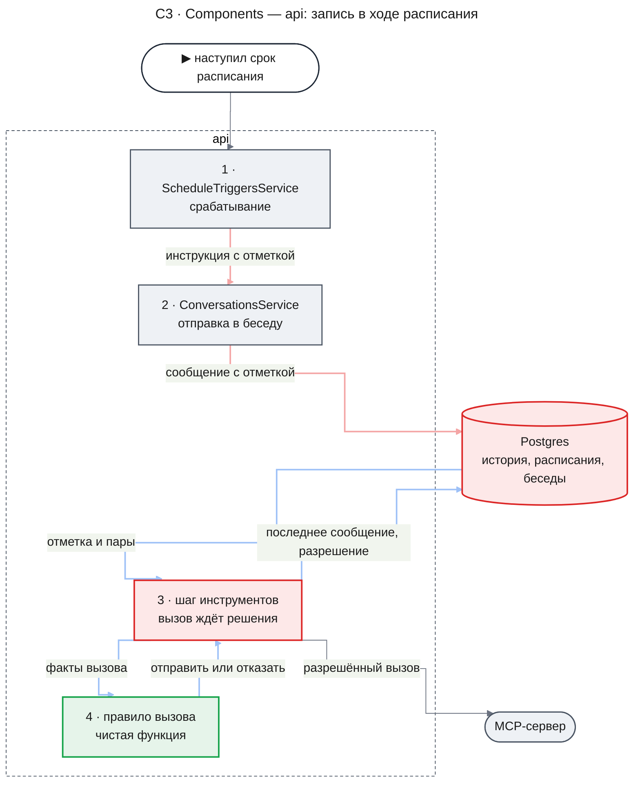
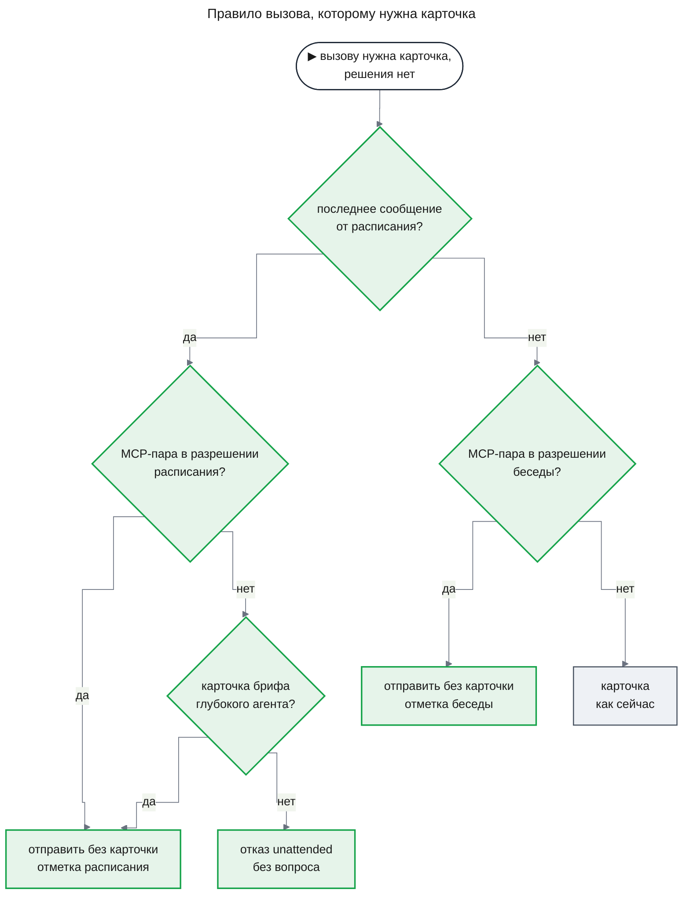
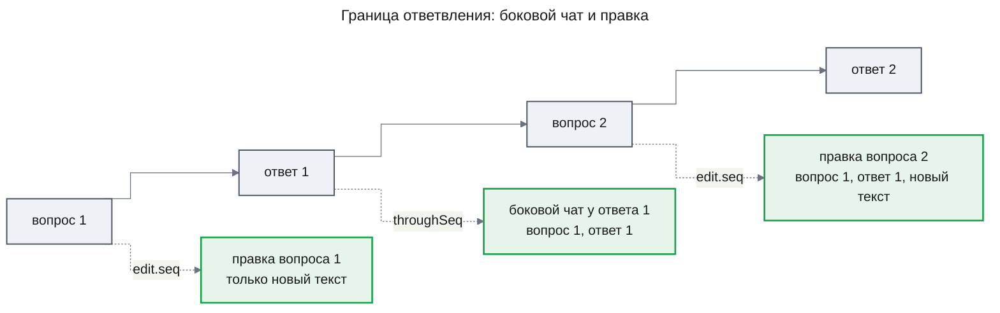
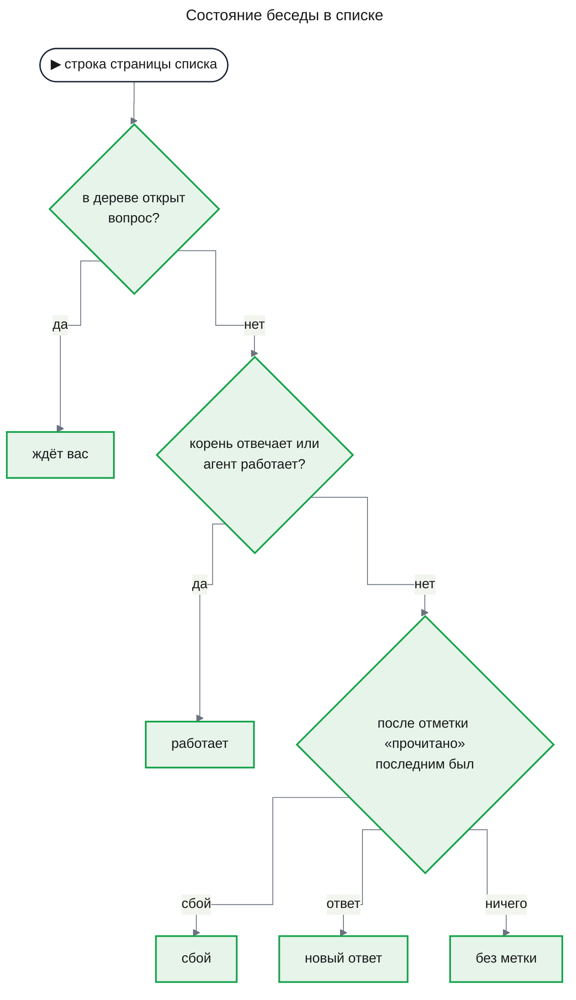
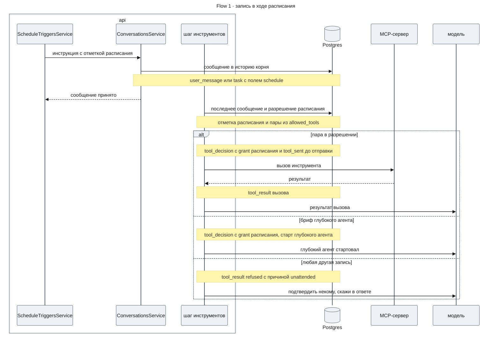
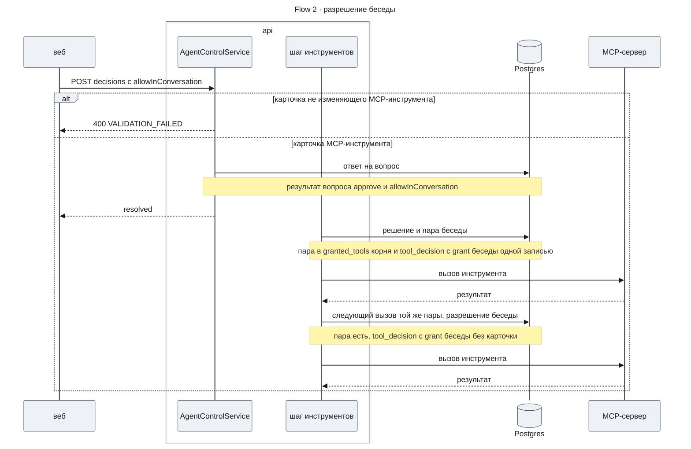
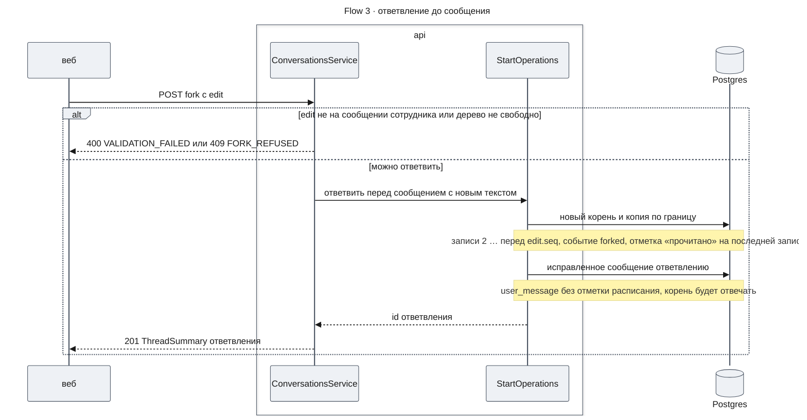
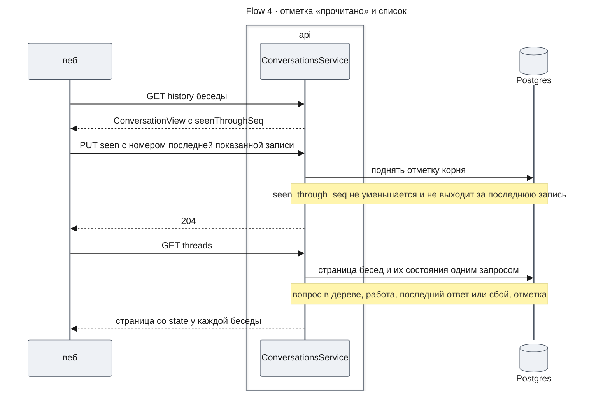

# Улучшения по итогам сравнения с bb — Design Document — server

**Status:** На утверждении · **Date:** 2026-11-27 · **PRD:** [prd.md](./prd.md) · **UXRD:** [uxrd.md](./uxrd.md) · **Depends on:** нет

## Snapshot

**Overview.** Ход, начатый расписанием, сегодня застревает на первой записи во внешнюю систему: он ждёт карточки, которую никто не откроет. После этой части шаг инструментов, прежде чем показать карточку, смотрит на последнее сообщение беседы. Если его отправило расписание, вызов из разрешения расписания уходит без карточки, бриф глубокого агента — тоже, а любая другая запись сразу отклоняется с объяснением для модели. В обычной беседе так же без карточки уходит пара «сервер + инструмент», которую сотрудник разрешил этой беседе третьим ответом карточки. Ещё часть убирает повторы вызова провайдера модели, учит ответвление останавливаться на выбранном сообщении и отдаёт в списке бесед состояние каждой беседы с отметкой «прочитано до».

- **Не меняется**: расписание только отправляет сообщение; права по ролям проверяются до любого разрешения; правило повтора одного вызова, схема runtime, карточки обычной беседы.
- **Главный риск**: разрешённая запись идёт без человека и может завести лишнее в каждом срабатывании ([Risks](#risks-and-mitigation)).
- **Открытые вопросы**: нет.

### Key Decisions

#### KD-1: Ход расписания узнаёт шаг инструментов по последнему сообщению беседы, в момент вызова

Шаг инструментов решает только тогда, когда вызову нужна карточка, а решения по нему нет. Тогда он читает последнюю запись `task` или `user_message` истории корня беседы (`caller.rootId`): её поле `schedule` (`ScheduleMark`) говорит, что ход начало расписание. Чтение идёт прямо по таблице истории, а не по видимой истории после сжатия, и по корню, а не по истории самого агента, поэтому сабагент глубокого агента получает тот же ответ, что и корень. Сотрудник, написавший в беседу посреди хода, меняет ответ со следующего вызова (AC-03.5), а сам планировщик ничего не узнаёт и ничего не проверяет. Хранить признак в `ToolCaller` нельзя: объект строится один раз на агента, а правило пакета `agents` требует читать то, от чего зависят права, на каждом шаге. Признак в задаче runtime или в инструкции расписания отвергнут: он не видит сообщения сотрудника посреди хода.

#### KD-2: Разрешения лежат на строках своих владельцев парами «сервер + инструмент»

Разрешение расписания — новое поле `allowed_tools` строки `schedules`; разрешение беседы — новое поле `granted_tools` корневой строки `conversations`. Оба хранят список пар `{server, tool}` — ту же пару, по которой права и аудит уже узнают MCP-инструмент. Шаг читает список расписания по `scheduleId` отметки и владельцу вызова, поэтому правка расписания действует со следующего вызова, а отметка удалённого или чужого расписания не разрешает ничего. Ответвление копирует историю, но не поля корня ([fork-history.ts](../../../packages/agents/src/operations/fork-history.ts)), поэтому разрешение беседы ему не достаётся, как требует FR-04. Новая таблица отвергнута: у обоих списков нет своей жизни отдельно от строки, к которой они относятся. Разрешение, выведенное из записей истории, отвергнуто: ответвление унаследовало бы его вместе с историей.

#### KD-3: Отметку разрешения несёт запись решения по вызову, отказ — результат вызова

Аудит вызова — его записи в истории агента (бизнес-ограничение 3 в `.claude/skills/project-context/SKILL.md`): у каждого вызова не больше одной записи `tool_decision` и ровно одна `tool_result`, это держит уникальный индекс `messages_call_once_idx`. Вызов по разрешению получает запись `tool_decision` «подтверждено» с новым полем `grant`: чьё разрешение сработало — расписания (с его id) или беседы. Отказ в ходе расписания — `tool_result` с исходом `refused` и новой причиной `unattended`. Таблицу `audit_events` эта часть не пишет: там лежат отказы по правам и ошибки модели, и вторая запись на тот же вызов нарушила бы «ровно одну запись» (NFR-01) и могла бы удвоиться при повторе шага.

#### KD-4: В ходе расписания бриф уходит без карточки, а запись вне разрешения отклоняется без вопроса

Без карточки уходят две вещи: изменяющий MCP-инструмент из разрешения и бриф глубокого агента (карточка вида `AGENTS_BRIEF_CONFIRMATION`). Отправка без вопроса уже есть у дерева обучения (`ToolRunner.sendUnasked`): она умеет и внешний вызов, и вызов в коммите шага, поэтому бриф и MCP-вызов идут ею, а не новым путём. Всё остальное, что ждёт карточки, — MCP-инструмент вне разрешения, изменяющий скрипт, `run_code` с записью, запись библиотеки — закрывается отказом без вопроса: запись библиотеки без подтверждённого содержимого не исполняется вообще, а изменяющий скрипт сделал бы записи, которых никто не видел. Бриф узнаётся по виду своей карточки, который уже пересекает границу с вебом; отдельный признак в объявлении инструмента отвергнут как опция ради одного инструмента.

#### KD-5: Вызов провайдера не повторяется — повторы удаляются целиком, разбор ошибки остаётся

Решение владельца (PRD, Constraints): любой сбой провайдера заканчивает вызов после первого запроса. Удаляются оба цикла повторов — `ModelClient.generate` и пачки `AgentsEmbeddings` — со всем, что живёт только ради них: число и паузы повторов, причина повтора и чтение `retry-after`, функция паузы, источник случайности часов `Clock.random`. Разбор ошибки в причину, которую видит сотрудник, остаётся без изменений: `classifyRejection`, причины `provider_*`, `chatReason` и тело ответа в логе ([model-providers/design-core.md](../model-providers/design-core.md), «Как разбирается ошибка провайдера»). Повтор одного «перегруженного» ответа отвергнут: владелец выбрал простоту, а сотрудник продолжает работу следующим сообщением (`agent-platform` FR-09).

#### KD-6: Ответвление до сообщения — тот же маршрут с границей или с правкой сообщения

`POST /api/threads/:threadId/fork` получает необязательное тело с одним из двух полей. Боковой чат передаёт `throughSeq` — сообщение, по которое ответвление наследует историю включительно. Правка передаёт `edit` — номер исправляемого сообщения и новый текст: ответвление наследует всё, что стоит в истории перед этим сообщением, и сразу получает исправленный текст вместо него. Правка называет само исправляемое сообщение, а не запись перед ним: перед сообщением может стоять результат вызова или событие сбоя, и веб не должен знать служебные записи истории. Правка первого сообщения не наследует ничего: исправленный текст становится первой записью `task` ответвления, без которой корня беседы не бывает. Ответвление до сообщения не копирует список задач и `last_input_tokens` (готовый режим `copyHistory` без `withTasks`): они отражают конец исходной беседы, а не границу. Отдельный маршрут правки отвергнут: правка — это ответвление с границей плюс отправка, и второй путь создания ответвления дублировал бы первый.

#### KD-7: Состояние беседы выводится при чтении списка, отметку «прочитано до» ставит веб

Состояние не хранится: список выводит его на каждую страницу одним запросом по id её бесед — открытый вопрос в дереве, работа корня и агентов, последний ответ или сбой в истории корня, — и чистой функцией рядом с `chatStatus` ([pure-decision.md](../../code-system/patterns/pure-decision.md)). Хранится только отметка «прочитано до» — новое поле `seen_through_seq` корневой строки `conversations`, номер последней прочитанной записи истории корня. Её поднимает отдельный маршрут, который веб зовёт, когда показывает записи открытой беседы, поэтому «пока беседа открыта, новые ответы прочитаны» держит веб, а сервер только не даёт отметке уменьшиться. Отметка как побочный эффект чтения истории отвергнута: чтение истории повторяется на каждом обновлении ленты, и GET с записью труднее понять и проверить.

## Terms

- **Пара** — «MCP-сервер + инструмент», `{server, tool}`; единица разрешения расписания и беседы.
- **Последнее сообщение беседы** — последняя запись `task` или `user_message` в истории корня; по нему решается, ход расписания это или обычный (PRD, «Ход расписания»).
- **Запись решения** — запись истории `tool_decision`: подтверждён ли вызов и, после этой части, чьим разрешением.
- **Граница ответвления** — номер `seq` последней записи истории источника, которую наследует ответвление.
- **Отметка «прочитано до»** — номер `seq` последней записи истории корня, которую сотрудник видел.

## Part

- **Prerequisite ADRs**: [ADR-0022](../../adr/ADR-0022-one-database-and-nestjs-modules.md) (одна база, репозитории в `packages/db`, модули NestJS), [ADR-0023](../../adr/ADR-0023-live-task-objects-one-stepping-process.md) (живые объекты задач).

**Out of scope**

- Планировщик (`ScheduleTriggersService`) не меняется: он отправляет сообщение с отметкой, как сейчас.
- Порядок проверок шага до карточки не меняется: права, схема аргументов, правило третьего одинакового вызова идут первыми.
- Карточки обычной беседы, решение по карточке, правила отказа в ответвлении (`ForkRefusalReason`) и копия истории целиком остаются как есть.
- Экраны полосы агентов, `@`, «отправить позже» и «в основной чат» (FR-09, FR-10, FR-12, FR-13) берут нужное из существующих контрактов: дерево агентов и решения в `ConversationView`, отправку `POST /api/threads/:threadId/messages`, создание расписания `POST /api/schedules`.
- Отзыва разрешения беседы нет (PRD, Won't Have).

**Constraints**

- PoC без обратной совместимости: удалённые повторы уходят вместе с тестами, новые поля приходят одной версией контрактов, миграция `0000_schema.sql` и её снимки перегенерируются на месте, а dev-база пересоздаётся; существующие строки не переносятся.
- Новых таблиц, настроек и переменных окружения нет: три новых поля лежат на существующих строках (KD-2, KD-7).
- Каждый запрос к таблицам — в репозиториях `packages/db`; правило вызова и состояние беседы — чистые функции; сервисы — injectable NestJS.
- Список бесед держит цель проекта: 200 бесед, p95 не больше 300 мс (`project-context`). Страница добавляет один запрос на 20 строк, без запросов на строку; цель проверяет существующий тест производительности списка.
- Логи идут через логгер `common` с id вызова, агента, корня, расписания и пары; секретов в них нет.

## Building-block Inventory

Follows the [code system](../../code-system/README.md).

| Building block | Pattern | Status | Note |
|---|---|---|---|
| ветка подтверждения в `runToolStep` | [step-handler.md](../../code-system/patterns/step-handler.md) | extended | перед карточкой зовёт правило вызова (KD-1, KD-4) |
| правило вызова с подтверждением | [pure-decision.md](../../code-system/patterns/pure-decision.md) | new | искали в `repeat-rule.ts`, `call-check.ts`, `ToolRunner`: правила по происхождению хода нет |
| `History` | — | extended | чтение последнего сообщения беседы |
| `CallRecords` | — | extended | запись решения с `grant`; пара беседы добавляется той же записью |
| `interruptedResults` (`call-records.ts`) | — | extended | вызов с намерением `tool_sent` закрывается «неизвестно» с текстом о потерянном ответе (FR-01) |
| `ToolRunner.sendUnasked` | — | reused | отправка без вопроса, теперь с отметкой разрешения |
| `AgentDeps` | — | extended | получает `SchedulesRepository` |
| `ControlOperations.resolveConfirmation` | — | extended | третий ответ: проверка, что карточка — MCP-инструмента |
| `StartOperations.fork`, `copyHistory` | — | extended | граница и сообщение (KD-6) |
| `MessagesRepository` | [repository-over-transaction.md](../../code-system/patterns/repository-over-transaction.md) | extended | последнее сообщение беседы |
| `ConversationsRepository` | [repository-over-transaction.md](../../code-system/patterns/repository-over-transaction.md) | extended | добавить пару беседы, поднять отметку; `stateFacts` — факты состояния страницы, с последним ответом или сбоем, одним запросом |
| `SchedulesRepository` | [repository-over-transaction.md](../../code-system/patterns/repository-over-transaction.md) | reused | `findOwned` отдаёт новое поле |
| `SchedulesService`, `SchedulesController` | — | extended | разрешение в теле и виде, `GET /api/schedules/tools` |
| `ToolRegistry.toolsFor` | [tool-declaration.md](../../code-system/patterns/tool-declaration.md) | reused | изменяющие MCP-инструменты владельца для `GET /api/schedules/tools` |
| состояние беседы | [pure-decision.md](../../code-system/patterns/pure-decision.md) | new | рядом с `chatStatus`; искали `chatStatus`, `forkRefusal`, `AgentView.status`: ни одно не знает «прочитано» |
| `ConversationsService`, `ThreadsController` | — | extended | состояние в списке, отметка в виде беседы, маршрут отметки, тело ответвления |
| `ModelClient`, `AgentsEmbeddings`, `provider-rejection.ts` | — | extended | циклы повторов удалены, разбор ошибки остаётся (KD-5) |
| `Clock` пакета `runtime` | — | extended | `random` удалён: последний вызов уходит с повторами |

## Acceptance Criteria

### FR-01: Потерянный ответ на вызов

- From the PRD: AC-01.1. Поведение уже в коде: шаг закрывает вызов в состоянии `sending` исходом «неизвестно» с текстом о потерянном ответе (`ANSWER_LOST_TEXT` в `call-records.ts`), а интеграционный тест INT-3 E в `packages/agents/test/agent-platform-agents.int.e2e-spec.ts` проверяет, что вызов не ушёл второй раз и модель видит этот текст.
- Прерывание, остановка и копия ответвления закрывают вызов с намерением `tool_sent` тем же исходом «неизвестно» и тем же текстом о потерянном ответе, что и шаг после рестарта: этот исход даёт `interruptedEnding` в `call-records.ts`.

### FR-02: Сбой провайдера без повторов

- From the PRD: AC-02.1.
- Служба эмбеддингов на сбой провайдера отвечает «недоступно» с причиной после одного запроса пачки.

### FR-03: Ход расписания пишет только разрешённое

- From the PRD: AC-03.1, AC-03.2, AC-03.3, AC-03.4, AC-03.5.
- Отметка удалённого расписания не разрешает ни одного вызова: изменяющий MCP-вызов в таком ходе отклоняется, как не разрешённый.
- Сохранение расписания с парой, которой нет среди изменяющих MCP-инструментов владельца, отвечает 400 `VALIDATION_FAILED`, и расписание не меняется.

### FR-04: Разрешение беседы

- From the PRD: AC-04.1, AC-04.2.
- Ответвление беседы с разрешением показывает карточку на тот же инструмент.
- Третий ответ на карточке, которая не принадлежит изменяющему MCP-инструменту, отвечает 400 `VALIDATION_FAILED`, и карточка остаётся открытой.

### FR-05: Ответвление до сообщения

- From the PRD: AC-05.1, AC-05.2.
- Правка первого сообщения создаёт ответвление, чья история начинается исправленным текстом, и агент на него отвечает.
- Граница бокового чата не на сообщении беседы и правка не сообщения сотрудника отвечают 400 `VALIDATION_FAILED`, и ничего не создаётся.

### FR-06: Состояние беседы и отметка «прочитано»

- From the PRD: AC-06.1, AC-06.2.
- Ответ, пришедший, пока беседа открыта, состояния «новый ответ» не даёт после того, как веб отметил показанные записи.

## Design

### Architecture (C1–C4)

Контейнеры не меняются: веб, api с пакетами в одном процессе, Postgres, MCP-серверы и провайдеры моделей. Меняются компоненты внутри api.

#### C3 · Components: api

**api — ход расписания доходит до записи**

`ScheduleTriggersService` и `ConversationsService.send` не меняются: они кладут сообщение с отметкой расписания в историю корня. Когда вызову нужна карточка, а решения нет, шаг инструментов читает последнее сообщение беседы через `History` и, по нему, строку расписания через `SchedulesRepository.findOwned` или корневую строку беседы через `ConversationsRepository`. Правило вызова — чистая функция ([pure-decision.md](../../code-system/patterns/pure-decision.md)) — решает по уже прочитанному; runtime будит шаг, как всегда. Postgres красный, потому что у `schedules` и `conversations` появляются поля (Data Model). Тот же путь проходит вызов в обычной беседе: шаг читает разрешение беседы вместо разрешения расписания.

#### How the call rule works

Правило решает судьбу вызова, которому нужна карточка и у которого ещё нет решения сотрудника. Дерево обучения сюда не доходит: оно, как и сейчас, отправляет вызов без вопроса раньше.

Права по ролям и правило третьего одинакового вызова срабатывают раньше правила, поэтому разрешение не обходит отнятое право (AC-03.4) и не пропускает повтор. Карточку строит инструмент (`ToolRunner.confirmationRequest`) до правила: проверка брифа перед карточкой может отказать сама, а содержимое карточки уходит в отправку без вопроса как подтверждённое, так же как у дерева обучения. Разрешить можно только пару MCP-инструмента: у `run_code`, скрипта и записи библиотеки пары нет, поэтому они всегда идут в отказ или в карточку. Правило получает id корня и отдаёт отметку разрешения в том виде, в каком её пишет намерение вызова (`SendGrant`): у беседы — с корнем и парой, которую намерение добавляет в разрешение. Отказ `unattended` закрывает вызов, и модель читает объяснение: подтвердить некому, закончи без этой записи и скажи в ответе, что она требует разрешения владельца.

#### How the fork boundary works

Ответвление наследует историю источника по границу включительно. У бокового чата граница — сообщение `throughSeq`: запись `task`, `user_message` или ответ модели без вызовов инструментов в истории корня источника. У правки граница — запись прямо перед исправляемым сообщением `edit.seq`, которое должно быть записью `task` или `user_message` без отметки расписания; правка первого сообщения не наследует ничего. Любой другой номер — ошибка запроса.

Граница правки может прийти на служебную запись — результат вызова перед сообщением, доставленным посреди хода, или событие сбоя. Вызов, который на границе ещё открыт, копия закрывает исходом «прервано» или «неизвестно» — так копия целиком поступает и сейчас. Отказ ответвления решается по текущему дереву источника, а не по границе, поэтому правила отказа те же (AC-05.2).

#### How the conversation state works

Список бесед выводит одно состояние на беседу из четырёх фактов о ней: открыт ли вопрос где-то в её дереве, работает ли корень или кто-то из её агентов, какая последняя запись ответа или сбоя в истории корня и где отметка «прочитано до».

Открытый вопрос — незаконченная задача-вопрос с корнем этой беседы: так карточка сабагента делает беседу «ждёт вас», хотя корень при этом «работает» (AC-06.2). «Работает» — корень не ждёт сообщения и не закончен, или под ним есть незаконченная задача; это те же факты дерева, по которым ответвление отказывает (`answering`, `tasks_running`). Ответ — запись `model_answer` без вызовов инструментов, сбой — запись `event` со значением `failed`; из них берётся последняя с номером больше отметки. Поэтому сбой, после которого сотрудник продолжил беседу и получил ответ, показывается как «новый ответ», а прочитанный сбой метки не даёт.

### Runtime Flows

#### Flow 1: ход расписания доходит до записи

**Starts when:** наступает срок расписания или владелец нажимает «Запустить сейчас», for AC-03.1, AC-03.2, AC-03.3, AC-03.4

Отметка расписания пишется в историю тем же действием планировщика, что и сейчас. Решение, его отметка и намерение `tool_sent` коммитятся до отправки, поэтому разрешённый вызов после рестарта не уходит второй раз, а заканчивается по FR-01. Если владелец отнял право на инструмент, вызов отклоняется по правам до этой развилки, причиной `no_access` и записью `access_denied`, как в чате (AC-03.4). Отметка удалённого расписания находит пустой список, и MCP-вызов идёт в ветку отказа.

#### Flow 2: разрешение беседы с карточки

**Starts when:** сотрудник отвечает на карточку изменяющего MCP-инструмента «разрешить в этой беседе», for AC-04.1, AC-04.2

Пара попадает в разрешение беседы той же записью, что и решение по вызову, поэтому повтор шага не теряет разрешение и не спрашивает карточку снова. Список разрешения — множество: та же пара второй раз не добавляется. Вызовы того же ответа модели, стоявшие после открытой карточки, идут в следующем шаге и уже видят разрешение. Другой инструмент и та же пара в другой беседе или в ответвлении разрешения не находят и получают карточку (AC-04.2).

#### Flow 3: правка сообщения через ответвление

**Starts when:** веб отправляет исправленный текст сообщения, for AC-05.1, AC-05.2; боковой чат — тот же поток с `throughSeq` и без сообщения

Ответвление и сообщение создаются вместе: либо есть ответвление с исправленным сообщением, либо нет ничего. Чип записи в сообщении проверяется до создания, по правилу отправки. При правке первого сообщения копии нет: исправленный текст становится первой записью `task` ответвления, и корень отвечает на него, как новая беседа на первое сообщение. Ответвление до сообщения не копирует список задач и `last_input_tokens` (KD-6); ответвление целиком копирует их, как сейчас.

#### Flow 4: состояние в списке и отметка «прочитано»

**Starts when:** сотрудник открывает беседу или загружает список бесед, for AC-06.1, AC-06.2

Разделитель перед первым непрочитанным веб ставит по `seenThroughSeq`, полученному до своей отметки. Пока беседа открыта, веб отмечает каждую новую показанную запись, поэтому ответ в открытой беседе не становится «новым». Отметку видят все устройства: она в строке беседы.

### Contract Definitions

Все маршруты — под `/api`, за `SessionGuard`; чужая беседа, расписание или решение отвечают так же, как отсутствующие.

- **`POST /api/schedules`, `PUT /api/schedules/:id`** — тело `ScheduleBody` получает обязательное поле `allowedTools`: список пар, может быть пустым; повторённая пара хранится один раз. Возвращает `ScheduleView`. Пара, которой нет в ответе `GET /api/schedules/tools` этого владельца, — 400 `VALIDATION_FAILED`, и ничего не пишется.
- **`GET /api/schedules`, `GET /api/schedules/:id`** — `ScheduleView` получает поле `allowedTools`: пары, сохранённые в расписании, даже если владелец потерял право на какую-то из них (такой вызов отклонят по правам).
- **`GET /api/schedules/tools`** — изменяющие MCP-инструменты, на которые у владельца есть право, в порядке сервера и имени. Возвращает `ScheduleToolsResponse`. Инструментов только для чтения в ответе нет.
- **`POST /api/decisions/:decisionId`** — тело `DecisionRequest` получает необязательное поле `allowInConversation`: `true` вместе с `approve: true` выполняет вызов и разрешает его пару беседе. Допустимо только для карточки вида `AGENTS_TOOL_CONFIRMATION` с непустым `server`; иначе, и вместе с `approve: false`, — 400 `VALIDATION_FAILED`. Остальные ответы — как сейчас: `resolved`, `already_resolved`, 404 `DECISION_NOT_FOUND`.
- **`POST /api/threads/:threadId/fork`** — тело `ForkRequest`, необязательное, не больше одного из полей `throughSeq` и `edit`. Без полей ответвляет беседу целиком, как сейчас. С `throughSeq` ответвление наследует историю по это сообщение включительно. С `edit` — `{seq, text, recordId?}` — ответвление наследует историю перед сообщением `seq`, получает `text` (с чипом `recordId`, как у отправки) сообщением сотрудника вместо него, и агент отвечает. Возвращает 201 `ThreadSummary` ответвления; `forkedFrom.throughSeq` — последняя унаследованная запись, `0` у правки первого сообщения. Ошибки: 400 `VALIDATION_FAILED` — оба поля сразу, `throughSeq` не на сообщении или `edit.seq` не на сообщении сотрудника, в том числе на сообщении с отметкой расписания; 409 `FORK_REFUSED` с прежними причинами; 409 `START_REFUSED` и ошибки чипа — как у отправки сообщения; 404 `THREAD_NOT_FOUND`.
- **`PUT /api/threads/:threadId/seen`** — тело `{throughSeq}`, целое не меньше 0: поднимает отметку «прочитано до» корня беседы. Отметка не уменьшается, а номер больше последней записи истории становится номером последней записи. Возвращает 204. Ошибки: 400 `VALIDATION_FAILED`, 404 `THREAD_NOT_FOUND`.
- **`GET /api/threads`** — каждая беседа страницы — `ThreadSummary` с полем `state`. Порядок, размер страницы и курсор не меняются.
- **`GET /api/threads/:threadId/history`** — `ConversationView` получает поле `seenThroughSeq`: отметка «прочитано до» на момент чтения. У решения в `decisions` поле `resolution` получает `allowInConversation`: `true`, когда ответ был «разрешить в этой беседе», иначе поля нет. Значение берётся из ответа на вопрос, где сервер его уже хранит, поэтому новой записи не нужно; по нему карточка после перечитывания показывает итог «Разрешено в этой беседе».
- **Причина отказа вызова** — `ToolRefusalReason` получает значение `unattended`: вызов в ходе расписания, который некому подтвердить. Веб показывает его в блоке вызова, как остальные причины.

**ToolPair**

- `server` — имя MCP-сервера.
- `tool` — имя инструмента на сервере.

**ScheduleToolsResponse**

- `tools` — список; у каждого элемента `server`, `tool`, `toolTitle` (название из описания инструмента, может отсутствовать) и `description`. Страница расписания берёт отсюда названия для отмеченных пар.

**ConversationState** (поле `state` строки списка)

- `waiting_for_you` — в дереве беседы открыт вопрос сотруднику.
- `working` — корень отвечает или работает агент под ним.
- `new_answer` — после отметки «прочитано» последним пришёл ответ.
- `failed` — после отметки «прочитано» последним был сбой.
- `null` — беседа прочитана и ничего не делает.

### Data Model

Три новых поля на существующих строках; таблиц и CHECK-ограничений не прибавляется.

| Строка | Поле | Что хранит | Кто пишет |
|---|---|---|---|
| `schedules` | `allowed_tools` | пары, которые ход расписания вызывает без карточки; по умолчанию пусто | сохранение расписания |
| `conversations`, корень | `granted_tools` | пары, разрешённые беседе; по умолчанию пусто | шаг инструментов вместе с решением |
| `conversations`, корень | `seen_through_seq` | номер последней прочитанной записи истории корня; по умолчанию 0 | маршрут отметки и создание ответвления |

Запись решения `tool_decision` в истории (jsonb) получает необязательное поле `grant`: `{kind: 'schedule', scheduleId}` или `{kind: 'conversation'}`. Удалённое расписание уносит свой список с физическим удалением строки. Ответвление начинает с пустым `granted_tools` и с отметкой «прочитано» на своей последней записи в момент создания. Миграция `0000_schema.sql`, оба снимка и журнал перегенерируются на месте; dev-база пересоздаётся, данные не переносятся.

### Удаляемое: повторы вызова провайдера

| Что | Где |
|---|---|
| цикл повторов вызова модели, счёт попыток в логах, приёмник частей на каждую попытку | `ModelClient.generate` |
| цикл повторов пачки эмбеддингов | `AgentsEmbeddings.sendBatch` |
| число и паузы повторов, причина повтора, чтение `retry-after`, функции задержки и паузы, поле повторяемости ошибки, аргумент времени разбора | `packages/agents/src/model/provider-rejection.ts` |
| `Clock.random` и его подстановки в тестовых часах | `packages/runtime/src/clock.ts`, двойники часов в тестах |
| заголовок `retry-after` и текст о повторах в двойнике ошибки провайдера | `packages/agents/src/testing.ts` |

В файле `provider-rejection.ts` остаётся только разбор ошибки провайдера. Тесты, которые меняются:

- `provider-rejection.spec.ts`: строки «503 и 529 на всех пяти попытках», «408, затем 429, затем ответ» и «обрыв сети, пять попыток» становятся строками с одним запросом к провайдеру и причиной `provider_unavailable`; блок о задержке перед повтором и разборе `retry-after` удаляется.
- `model-client.spec.ts`: строка «попытка передала часть и упала, повтор с offset 0» становится строкой «часть передана, затем сбой — `model_error` и одна строка журнала по оценке».
- `embeddings.spec.ts`: строка «503 на всех пяти попытках» становится «один запрос, без пауз»; поле пауз в строках таблицы и запись пауз в двойнике часов уходят.
- `apps/api/test/agent-platform-chat.int.e2e-spec.ts`: падающая модель заголовков получает один вызов вместо трёх.
- `mastra-turn.spec.ts`: меняется только название проверки о том, что клиент хода отклоняется ошибкой провайдера.

Сценарий «ошибка провайдера, затем успех» был в двух местах — в строке «408, затем 429, затем ответ» и в строке «попытка передала часть и упала». Интеграционные тесты, которые ждут только сбоя, остаются как есть и идут быстрее.

## Test Strategy

Проверки встают в существующие наборы тестов тех же областей; новых наборов нет.

- **UC-1: потерянный ответ после рестарта** — covers AC-01.1
  - Given: агент отправил изменяющий вызов, намерение записано.
  - When: шаг теряется до ответа и продолжается после рестарта; в другом случае ход прерывают после отправки, до ответа.
  - Then: вызов не отправлен второй раз, исход «неизвестно», модель видит текст о потерянном ответе в обоих случаях. Рестарт проверяет существующий INT-3 E; прерывание добавляется к нему тем же сценарием.
- **UC-2: сбой провайдера — один запрос** — covers AC-02.1
  - Given: провайдер отвечает 503, 529, 429, 408 или обрывом сети.
  - When: агент вызывает модель или служба эмбеддингов шлёт пачку.
  - Then: провайдер получил ровно один запрос, причина — `provider_unavailable`, ход закончился сбоем. То, что следующее сообщение продолжает беседу, уже проверяют тесты `agent-platform` FR-09.
- **UC-3: ход расписания делает разрешённую запись** — covers AC-03.1
  - Given: расписанию Ани разрешена пара `backoffice` + изменяющий инструмент.
  - When: наступает срок, затем Аня нажимает «Запустить сейчас»; скриптовая модель вызывает этот инструмент.
  - Then: оба вызова отправлены на сервер без карточки, у их записи решения отметка этого расписания.
- **UC-4: ход расписания не делает неразрешённое** — covers AC-03.2
  - Given: расписанию не разрешён второй изменяющий инструмент.
  - When: скриптовая модель в ходе расписания вызывает его и `run_code` с записью.
  - Then: оба вызова закрыты отказом `unattended`, вопросов в дереве нет, ход закончился ответом, сервер не получил ни одного изменяющего вызова. `run_code` представляет всю ветку «запись без пары»: изменяющий скрипт и запись библиотеки идут тем же путём. Все ветки правила проверяет табличный тест `packages/agents/src/agent/call-rule.spec.ts`.
- **UC-5: бриф без карточки** — covers AC-03.3
  - Given: ход расписания.
  - When: модель отправляет бриф глубокому агенту.
  - Then: вопроса нет, глубокий агент стартовал.
- **UC-6: право отнято** — covers AC-03.4
  - Given: пара разрешена расписанию, право на неё у Ани отнято.
  - When: ход расписания вызывает инструмент.
  - Then: отказ `no_access` и запись `access_denied`, как в чате.
- **UC-7: владелец написал в беседу расписания** — covers AC-03.5
  - Given: беседа расписания «эта беседа» с разрешённой парой.
  - When: Аня пишет в беседу, и ход вызывает разрешённый инструмент; затем наступает срок, пока беседа ждёт решения.
  - Then: открыта карточка; сообщение расписания стоит в очереди и ответом на карточку не становится. Так переписывается сценарий UC-2 [дизайна расписаний](../schedules-search-memory/design-schedules.md#test-strategy), где ход расписания сам поднимал карточку.
- **UC-8: разрешение расписания не видно другому** — covers NFR-02
  - Given: Аня и Борис, у Ани расписание с разрешением.
  - When: Борис читает и правит расписание Ани, читает `GET /api/schedules/tools`.
  - Then: расписание Ани — 404 для Бориса, список инструментов — только права Бориса.
- **UC-9: разрешение беседы** — covers AC-04.1, AC-04.2
  - Given: карточка изменяющего MCP-вызова в беседе Ани.
  - When: Аня отвечает «разрешить в этой беседе»; модель вызывает ту же пару, другой инструмент; Аня ответвляет беседу и вызывает ту же пару там; Аня шлёт третий ответ на карточку брифа.
  - Then: оба вызова пары ушли, у обоих отметка беседы; другой инструмент и ответвление получили карточку; третий ответ на карточку брифа — 400. Решение Бориса по карточке Ани — 404.
- **UC-10: ответвление до сообщения и правка** — covers AC-05.1, AC-05.2
  - Given: беседа Ани из шести сообщений.
  - When: Аня ответвляет до третьего; правит первое сообщение; правит сообщение, доставленное посреди хода; ответвляет, пока агент отвечает; Борис ответвляет беседу Ани до сообщения.
  - Then: в первом ответвлении три сообщения, исходная не изменилась; во втором история начинается исправленным текстом и агент на него ответил; в третьем унаследовано всё перед исправленным сообщением, затем исправленный текст; четвёртое — 409 `answering`; у Бориса — 404.
- **UC-11: состояния и отметка** — covers AC-06.1, AC-06.2
  - Given: у Ани беседа с законченным ответом, беседа с карточкой сабагента и беседа, где агент работает.
  - When: Аня читает список; отмечает первую беседу прочитанной из второго сеанса; Борис ставит отметку в беседу Ани.
  - Then: состояния `new_answer`, `waiting_for_you`, `working`; после отметки у первой беседы `state` — `null`; у Бориса — 404. Порядок состояний и прочитанный сбой проверяет табличный тест чистой функции, цель 300 мс — существующий тест производительности списка.

## Security Considerations

- **Authentication & Authorization**: шаг читает расписание только по паре «id отметки + владелец вызова», поэтому чужая отметка ничего не разрешает. Разрешение беседы лежит на корне дерева вызова и доступно только его агентам. Права по ролям проверяются на каждом вызове до разрешения; сохранение расписания пускает только пары из прав владельца. Новые и изменённые маршруты отвечают на чужой объект как на отсутствующий (NFR-02).
- **Input Validation**: тела проверяют схемы `@agent-os/contracts`; сервис расписаний сверяет пары с правами владельца, контроль решений — вид карточки для третьего ответа, ответвление — что граница указывает на сообщение.
- **Sensitive Data Handling**: логи шага пишут id вызова, агента, корня, расписания, пару, вид разрешения и причину отказа; аргументы вызова логируются, как сейчас, токены и ключи — никогда.

## Risks and Mitigation

- **Разрешённая запись повторяется в каждом срабатывании** — среднее влияние, средняя вероятность. Разрешаются только отмеченные пары, у каждого такого вызова отметка в записи решения, а третий одинаковый вызов в сессии отклоняет правило повтора до разрешения.
- **Модель не говорит в ответе, что запись не сделана** — низкое влияние. Отказ `unattended` виден в блоке вызова и в истории беседы.
- **Короткая перегрузка провайдера обрывает долгий ход** — среднее влияние. Владелец принял эту цену; сотрудник продолжает следующим сообщением.
- **Ответвление до сообщения начинает без списка задач** — низкое влияние. Модель видит историю до границы и может завести задачи снова; копия задач после границы противоречила бы этой истории.
- **Запрос состояний замедляет список** — низкое влияние. Один запрос на страницу из 20 бесед по первичным ключам истории и дерева; цель проверяет существующий тест производительности.
- **Присутствие человека решает последнее сообщение корня** — принято владельцем. Сообщение, написанное прямо сабагенту дерева, начатого расписанием, режим расписания не выключает, а сообщение расписания, доставленное посреди хода, переключает остаток этого хода.
- **Неподключённый инструмент нельзя разрешить расписанию** — принято владельцем. Изменяющего инструмента, на который у владельца есть право, но чей аккаунт не подключён, нет в `GET /api/schedules/tools`, пока аккаунт не подключат.

## Update History

| Version | Date | Change |
|---------|------|--------|
| 1.0 | 2026-11-27 | Первая версия |
| 1.1 | 2026-11-27 | `resolution.allowInConversation` в решениях `ConversationView`; находка I004 принята как есть — исполнителю нужны пути и список тестов; расширение FR-01 на прерывание, остановку и копию ответвления остаётся |
| 1.2 | 2026-11-27 | По коду: `ANSWER_LOST_TEXT` и `interruptedEnding` в `call-records.ts`, `provider-rejection.ts`, 400 третьего ответа в `AgentControlService`, `stateFacts`, `SendGrant` правила, отказ правки сообщения расписания, `call-rule.spec.ts`; два принятых владельцем риска |
