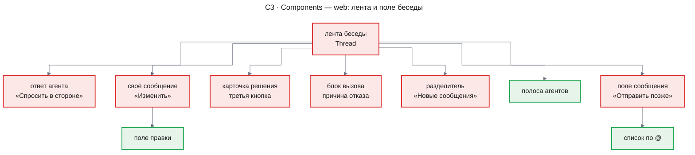
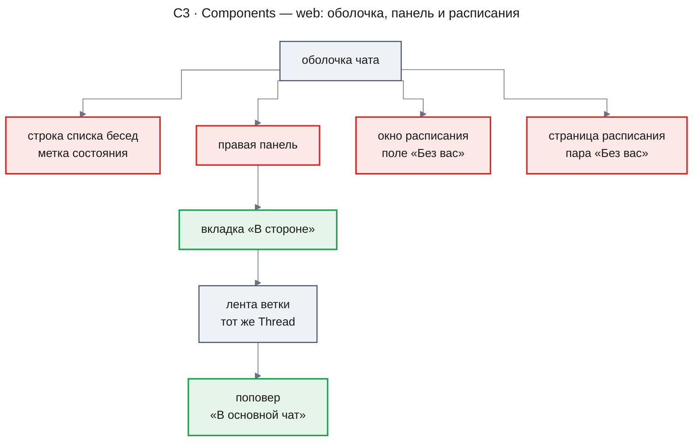
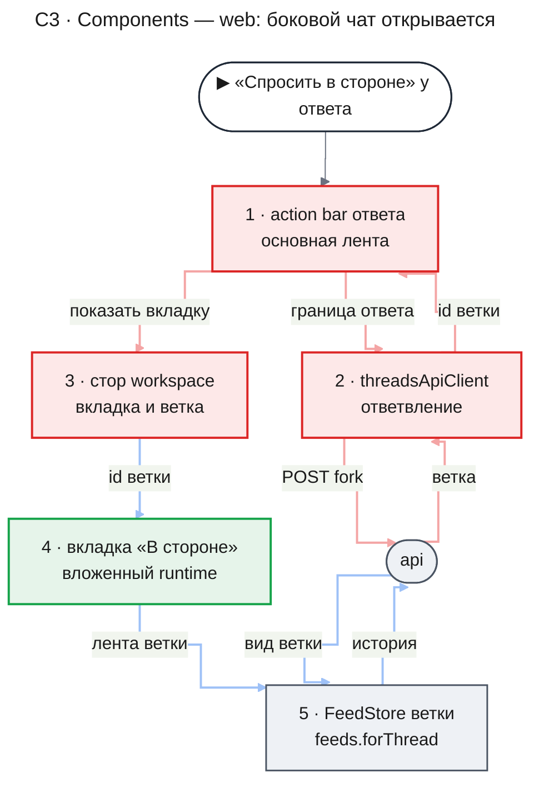
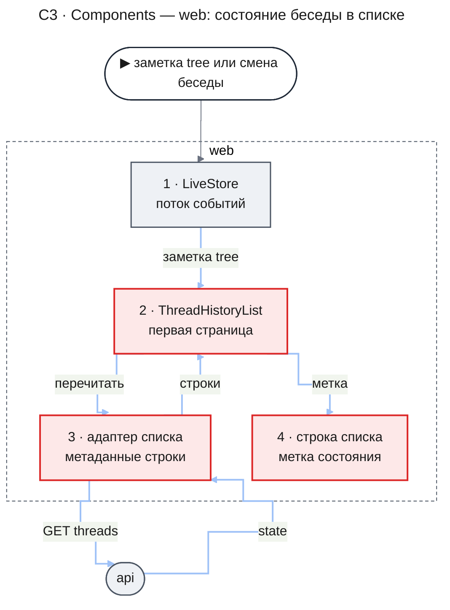
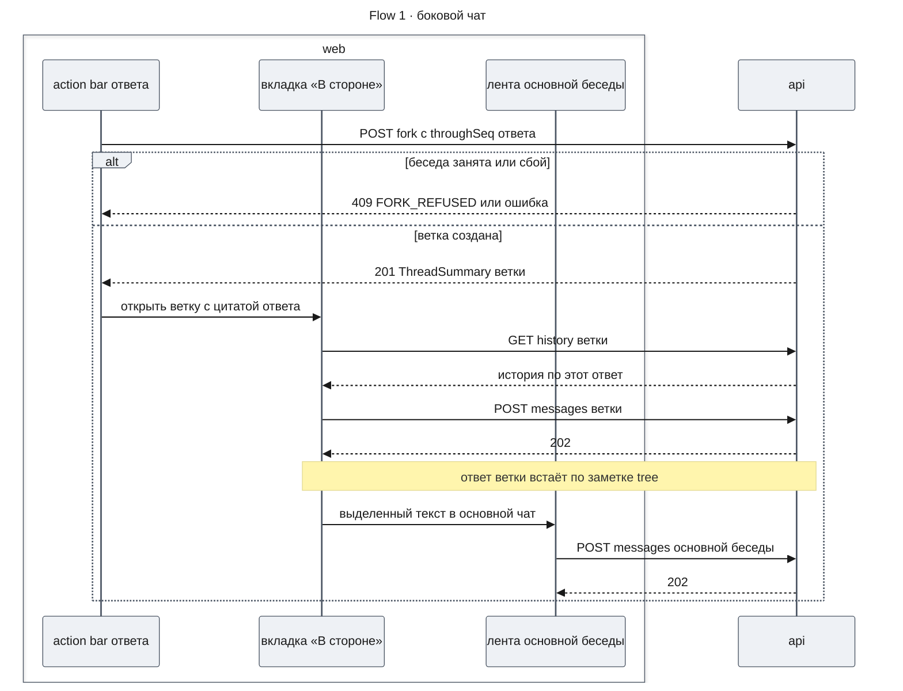
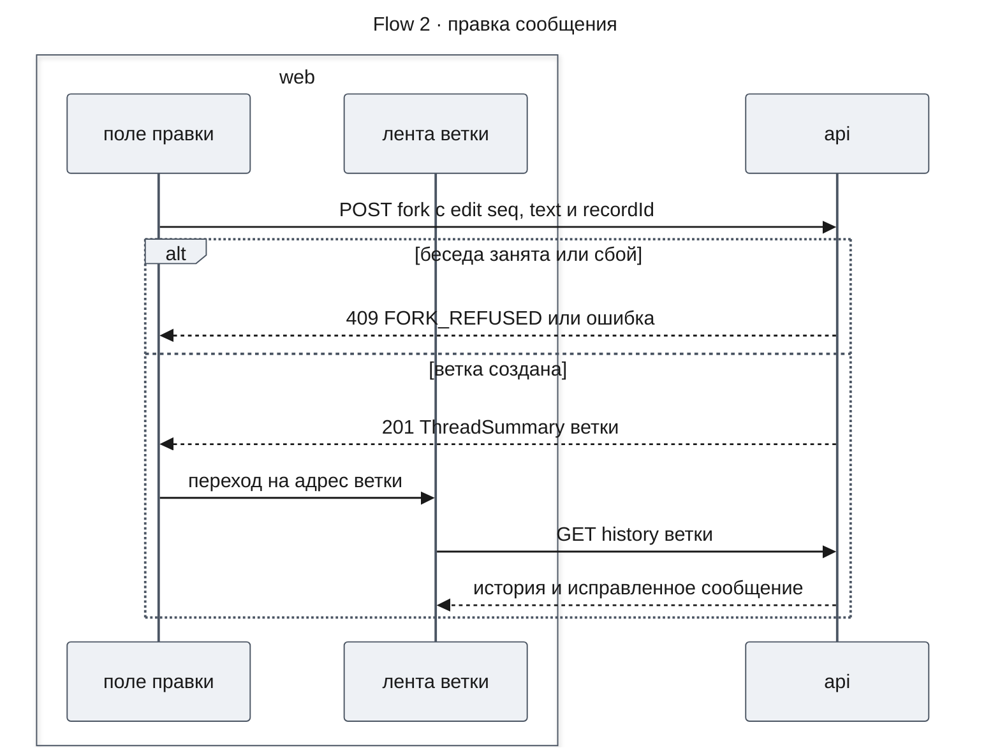
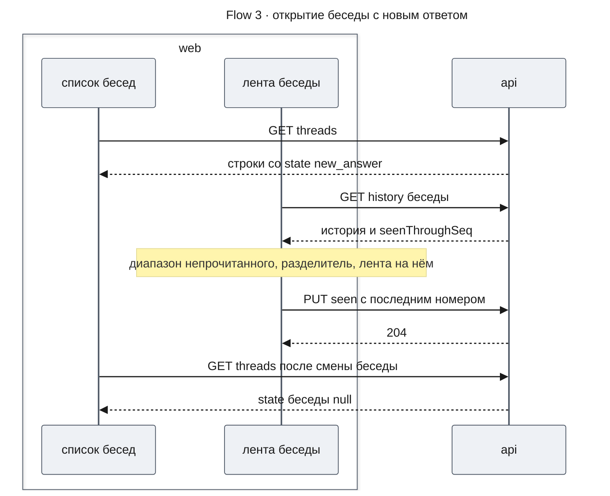
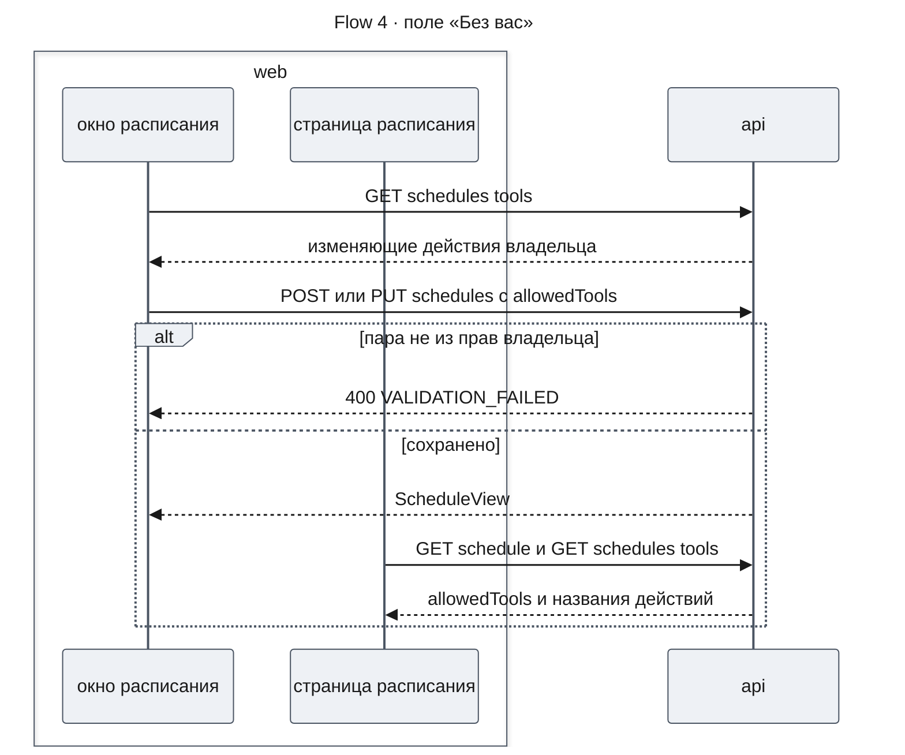
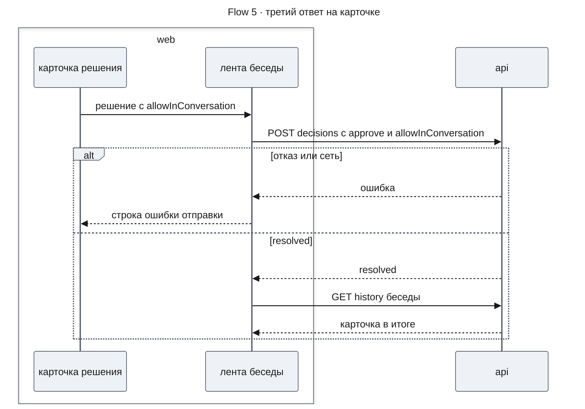

# Улучшения по итогам сравнения с bb — Design Document — web

**Status:** На утверждении · **Date:** 2026-11-27 · **PRD:** [prd.md](./prd.md) · **UXRD:** [uxrd.md](./uxrd.md) · **Depends on:** [design-server.md](./design-server.md#contract-definitions)

## Snapshot

**Overview.** Эта часть встраивает в уже знакомые экраны всё, что сотрудник видит от фичи: отметки «Без вас» в окне расписания, третью кнопку карточки подтверждения, боковой чат, правку своего сообщения, «Отправить позже», метки состояния в списке бесед, разделитель «Новые сообщения», полосу агентов и выбор агента через `@`. Новых экранов, адресов, сторов и настроек нет: каждое изменение расширяет компонент, который уже стоит на этом месте, а данные идут через контракт части `server`. Боковой чат — вторая лента беседы во вкладке правой панели, собранная так же, как лента страницы агента. Правка — поле на месте пузыря, которое создаёт ветку и переводит сотрудника в неё. Отметку «прочитано» ставит сама лента, пока она на экране, а список бесед перечитывает первую страницу по событиям потока.

- **Не меняется**: поток событий и его одна цель, правила ветвления, лоток очереди, меню «+» и карточки других видов.
- **Главный риск**: ответ в боковом чате не печатается по словам, а встаёт целиком — поток событий следит только за беседой из адреса (KD-1).
- **Открытые вопросы**: нет.

### Key Decisions

#### KD-1: Боковой чат — вторая лента во вкладке панели, без потока текста ответа

Ветка должна открыться справа, а основная беседа — остаться на экране (AC-09.1). Лента в вебе уже не привязана к адресу: страница агента ставит свой runtime assistant-ui поверх своего хранилища ленты внутри runtime оболочки ([agent-screen.tsx](../../../apps/web/src/components/agents/agent-screen.tsx)), а `feeds.forThread` отдаёт хранилище ленты любой беседы. Вкладка «В стороне» делает то же для ветки: вложенный `AssistantRuntimeProvider` с `useFeedRuntime` над `feeds.forThread(id ветки)` и тот же `Thread`.

Глубокое ограничение одно: поток `GET /api/events` следит за одной целью — беседой из адреса, — и части текста ответа приходят только ей. Ветка перечитывается по заметкам `tree`, поэтому её ответ встаёт целиком, а пока ход идёт, поле ветки показывает «Прервать», как любая беседа. Переход в ветку отвергнут: основная беседа ушла бы с экрана. Поток с двумя целями отвергнут: он менял бы контракт потока у сервера и `LiveStore` ради печати одного ответа. Переключать единственную цель на ветку, пока вкладка открыта, нельзя: основная беседа перестала бы печатать свой ответ, в том числе на текст, перенесённый из бокового чата.

#### KD-2: Ветку для бокового чата и правки создаёт одна функция клиента, а правка — своё поле на месте пузыря

`threadsApiClient.forkThread` получает необязательное тело `ForkRequest` сервера: без тела — ответвление целиком, как сейчас, с `throughSeq` — боковой чат, с `edit` — правка. Правка — многострочное поле вместо пузыря с «Отмена» и «Отправить»; после 201 веб переходит в ветку тем же путём, что пункт «Ответвить чат»: адрес ветки, фокус в поле, объявление create-and-test UXRD MC-18. Правка assistant-ui (`onEdit` у `useExternalStoreRuntime` и `ActionBarPrimitive.Edit`) отвергнута: библиотека считает правку заменой сообщения в той же беседе и ведёт ветки внутри неё, а здесь исходная беседа не меняется и сотрудник уходит в другую. Отдельная функция правки повторила бы ответвление, которое сервер сделал одним маршрутом (server KD-6).

#### KD-3: Кнопки ветки показывает одно чистое правило «беседу можно ответвить»

Правило стоит рядом с `isBusy` в `to-feed.ts` ([pure-decision.md](../../code-system/patterns/pure-decision.md)): беседа `forkable`, корень не работает и не ждёт решения, и ни один агент её дерева не работает и не ждёт. Это те же факты, по которым сервер отказывает в ответвлении (`answering`, `awaiting_confirmation`, `tasks_running`), поэтому скрытая кнопка не обещает отказа (UXRD KD-7). «Спросить в стороне» стоит только у ответа без вызовов инструментов, и решается это по каждой записи истории: под записью ответа без вызовов кнопка есть, даже если раньше в том же видимом ответе были записи с вызовами. Только такой ответ сервер принимает границей `throughSeq` ([design-server.md, How the fork boundary works](./design-server.md#how-the-fork-boundary-works)). Проверка одного `chat.status` отвергнута — она показала бы кнопки, пока работает сабагент; показ всегда с расчётом на 409 противоречит UXRD KD-7.

#### KD-4: «Прочитано» отмечает показанная лента, а диапазон непрочитанного она фиксирует при открытии

`Thread` ленты беседы — основной и вкладки «В стороне» — шлёт `PUT /api/threads/:threadId/seen` с номером последней записи каждый раз, когда этот номер вырос; одна просьба в полёте и одна после неё, как перечитывание стора ([shell-store.md](../../code-system/patterns/shell-store.md)). При открытии лента запоминает диапазон непрочитанного: от `seenThroughSeq` первого чтения до последней записи этого чтения. Разделитель «Новое» встаёт перед первым сообщением диапазона, кроме тех, что сотрудник сам отправил из поля, и не двигается, пока беседа открыта; сообщение расписания в диапазон входит (UXRD IM-10). Без верхней границы разделитель встал бы в новой беседе перед ответом, пришедшим при открытой беседе: её отметка ещё 0.

Отметка в эффекте адреса `ConversationView` отвергнута: она не видит вкладку «В стороне», а её ответы UXRD IM-06 считает прочитанными. Отметка в `FeedStore` после каждого чтения отвергнута: хранилища лент живут в памяти вкладки и перечитываются по заметкам и после ухода с беседы, поэтому отметили бы прочитанным то, чего сотрудник не видел.

#### KD-5: Состояние беседы идёт по цепочке метаданных списка, а первая страница перечитывается по любой заметке `tree`

Поле `state` строки `GET /api/threads` проходит те же места, что `forkable`: адаптер списка, `ThreadListEntry`, строка. Сегодня заметка `tree` перечитывает первую страницу, только когда беседы нет в списке; после части — для любой беседы, с тем же интервалом в секунду и только пока загружена одна страница. Ещё первую страницу перечитывают смена открытой беседы и создание бокового чата: ответвление без сообщения не создаёт задачи рантайма, а заметку `tree` шлёт только изменение задач. Строка открытой беседы и строка ветки, спрошенной из неё (id ветки лежит в сторе `workspace`), не показывают «новый ответ» и «сбой», пока открыта эта беседа — и при закрытой панели, потому что ветка остаётся в сторе; уход в другую беседу возвращает метки ветки. Поэтому ответ, пришедший до отметки, метку на экране не зажигает. Счёт состояния в вебе отвергнут: он повторил бы правило сервера (server KD-7).

#### KD-6: Третий ответ и «Отправить позже» — по одному параметру на существующих путях

Путь решения `onDecide` → `feed.decide` → `api.decide` получает третий признак `allowInConversation`. Кнопка стоит у карточки «Действие» с непустым `server` — по тому же признаку сервер принимает третий ответ; `run_code` и скрипт агента приходят без сервера. «Отправить позже» открывает тот же `ScheduleDialog`, что строка «Запланировать» меню «+», а режим создания получает предустановку «позже»: правило «Один раз» на ближайший целый час, ответ «В эту беседу», заголовок и кнопка MC-5. Эта опция неизбежна: окно берёт начальные значения один раз при открытии, а значения по умолчанию — «по будням» в новую беседу — противоречат AC-10.1; второе окно повторило бы форму.

#### KD-7: `@` и «В основной чат» — маленькие компоненты над примитивами, которые уже есть

Список по `@` строится из тех же строк агентов, что группа «Агенты» меню «+», и ставит чип тем же `composerSeed.put`. Поле остаётся `ComposerPrimitive.Input` assistant-ui: роль `combobox` оно берёт, только пока список открыт, а закрытым остаётся `textbox` «Сообщение»; список — `listbox` над полем, клавиши — в его `onKeyDown`. `Combobox` и `Autocomplete` из base-ui отвергнуты: они ставят свой ввод вместо поля assistant-ui, и Enter с отправкой пошли бы мимо формы композера; библиотека упоминаний — новая зависимость ради одного списка.

«В основной чат» у выделения — shadcn `popover` на base-ui `Popover`, который добавляется в `components/ui`; якорь — прямоугольник выделения, фокус поповер не берёт. В установленной base-ui 1.9.0 позиционер принимает якорь виртуальным элементом, а `initialFocus` — значение `false` (объявления типов пакета). Своя кнопка поверх сообщения отвергнута: корень сообщения держит paint containment и обрезает всё за своими краями, а поповер рисуется в портале.

## Terms

- **Ветка** — ответвление беседы (PRD, Terms): новая беседа сотрудника с копией истории исходной.
- **Боковой чат** — ветка, открытая во вкладке «В стороне» правой панели.
- **Лента** — хранилище `FeedStore` одной беседы и компонент `Thread`, который его рисует.
- **Вложенный runtime** — свой `AssistantRuntimeProvider` внутри runtime оболочки; так уже устроена страница агента.
- **Заметка `tree`** — событие потока `GET /api/events` «дерево беседы изменилось»; приходит во все потоки сотрудника.
- **Отметка «прочитано до»** — `seenThroughSeq`: номер последней записи истории, которую сотрудник видел (server KD-7).
- **Диапазон непрочитанного** — записи после отметки, которые уже были в истории, когда сотрудник открыл беседу.

## Part

- **Prerequisite ADRs**: [ADR-0020](../../adr/ADR-0020-next-intl-client-layer.md) (тексты интерфейса через next-intl на клиенте).

**Out of scope**

- Поток событий `GET /api/events`, `LiveStore` и одна цель `watch` не меняются (KD-1).
- Контракт части `server` принят как есть.
- Лоток очереди, меню «+», карточки брифа, записи, похожего агента и плана, разделитель ветки и кнопка «Ветки» остаются прежними.
- Кнопка шапки «Схема» не меняется.
- Страница агента не получает кнопок ветки, отметки «прочитано», разделителя и полосы агентов: всё это — для ленты беседы.
- Черновиков и очереди отправки нет (PRD, Won't Have); «Отправить позже» создаёт обычное расписание.

**Constraints**

- PoC без обратной совместимости: тест, который проверяет отсутствие правки у сообщения, переписывается, а условие «перечитывать только для беседы не из списка» удаляется вместе с его тестом.
- Простота: новых сторов, адресов и настроек нет. Новые — четыре компонента (поле правки, полоса агентов, список по `@`, поповер у выделения), базовый `popover` и два маленьких контекста React: `MessageEditProvider` (какое сообщение правится) и `NewDividerContext` (где стоит разделитель «Новое»). Новые опции — предустановка «позже» (KD-6) и у `Thread` — `textTarget` и `focusTarget` (откуда поле берёт текст и какая у него цель фокуса); стор панели получает id ветки.
- Комфорт долгих сессий: только токены дизайн-системы, без чистого белого и чёрного; метки списка статичны, растворение 150 ms, под reduced motion — мгновенно (UXRD KD-5, Accessibility).
- От 360 px: раскладка по UXRD Responsive Behavior; ширины и шторку проверяет браузер (Test Strategy).
- Тексты en и ru — под одинаковыми ключами в тех областях каталога, где уже лежат тексты этих мест ([interface-text.md](../../code-system/patterns/interface-text.md)); пропущенный русский ключ ловит `tsc`.
- Логи — через `src/lib/logger.ts`: отказ ответвления, сбой отметки, сбой чтения действий — с id беседы, записи и решения, без текстов сообщений.

## Building-block Inventory

Follows the [code system](../../code-system/README.md) и [web.md](../../code-system/packages/web.md). Искали в `components/assistant-ui`, `components/agents`, `components/shell`, `components/schedules`, `components/ui`, `lib/feed`, `lib/threads`, `lib/shell`: поля правки, списка упоминаний, обработки выделения, поповера и полосы агентов в вебе нет.

| Building block | Pattern | Status | Note |
|---|---|---|---|
| `ScheduleDialog` | — | extended | поле «Без вас»; предустановка «позже» (KD-6) |
| поле «Без вас» `AllowedToolsField` (`components/schedules/allowed-tools.tsx`) | — | new | по образцу группы отметок `ServersField` |
| `schedulesApi` | [web-api-client.md](../../code-system/patterns/web-api-client.md) | extended | чтение `GET /api/schedules/tools`; `allowedTools` в теле |
| страница расписания `Settings` | [read-on-open.md](../../code-system/patterns/read-on-open.md) | extended | пара «Без вас» |
| строка причины блока вызова | — | extended | причина `unattended` и для инструментов записей (IM-03) |
| `DecisionCard`, `FeedStore.decide` | — | extended | третья кнопка и признак ответа (KD-6) |
| `threadsApiClient` | [web-api-client.md](../../code-system/patterns/web-api-client.md) | extended | тело ответвления; отметка «прочитано» |
| `Thread`, `ThreadComponents` | — | extended | кнопки ветки и «В основной чат» в action bar; отметка; разделитель через `NewDividerContext`; полоса; опции `textTarget`, `focusTarget` |
| поле правки, `MessageEditProvider` (`message-edit.tsx`) | — | new | искали правку в `thread.aui.tsx` и `use-feed-runtime.ts`: правка assistant-ui не подключена (KD-2); контекст держит одно правящееся сообщение |
| `useForkThread`, `useOpenBranch` (`components/shell/use-open-branch.ts`) | — | new | вынесено из `ThreadHistoryList`: один путь ответвления для меню списка, правки и бокового чата |
| `useSeenMark` (`lib/feed/use-seen-mark.ts`) | — | new | отметка «прочитано» показанной ленты (KD-4) |
| `toFeed` и правила ленты | [pure-decision.md](../../code-system/patterns/pure-decision.md) | extended | `canFork`, `newDividerSeq`, `stripAgents`, `isComposerMessage`, `selectThreadId`, признак ответа без вызовов |
| разделитель ленты в `event-line.tsx` | — | extended | вариант «Новое» |
| выравнивание цели поиска `search-target.tsx` | — | extended | вторая цель — разделитель; цель поиска важнее |
| полоса агентов | — | new | рядом с `QueueTray`, статус — `AgentStatus` вариант «Метка» |
| `focusFeedCard` (`queue-tray.tsx`) | — | extended | один переход к карточке для «К запросу» лотка и для полосы |
| `RunCard` | — | extended | якорь для перехода из полосы |
| стор `workspace` | [shell-store.md](../../code-system/patterns/shell-store.md) | extended | вкладка `aside`, id ветки и id беседы, к которой она открыта |
| `SchemaPanel` | — | extended | вкладка «В стороне» |
| `WorkspacePanel`, `WorkspaceDrawer` | — | extended | заголовок, подписи и фокус шторки следуют за вкладкой «В стороне» |
| вкладка «В стороне» `AsideChatTab`, кнопка `AskAsideButton` (`aside-chat.tsx`) | — | new | вложенный runtime по образцу `AgentScreen` (KD-1) |
| цели фокуса `focus.ts` | — | extended | поле ветки — своя цель |
| `components/ui/popover.tsx` | — | new | shadcn popover на base-ui (KD-7) |
| `ToMainChatButton`, поповер «В основной чат», `messageTextOf` (`to-main-chat.tsx`) | — | new | `messageTextOf` даёт текст ответа и для цитаты бокового чата |
| список по `@` | — | new | строки агентов `useChatAgents` общие с меню «+» (KD-7) |
| `ComposerActions`, `ComposerAction` | — | extended | кнопка «Отправить позже» открывает то же окно; `useComposerSchedule` общий у «Запланировать» и «Отправить позже» |
| адаптер списка, `ThreadListEntry`, строка списка | — | extended | `state` и метка |
| `agent-status.tsx` | — | extended | состояния беседы по спецификации |
| `ThreadHistoryList` | — | extended | правило перечитывания первой страницы (KD-5) |

## Acceptance Criteria

### FR-07: Разрешение в окне расписания

- From the PRD: AC-07.1, AC-07.2.
- Действие, которое было отмечено, но которого больше нет в ответе `GET /api/schedules/tools`, в поле не показано и при сохранении уходит из `allowedTools` (IM-01).
- Пока список действий не прочитан, окно не сохраняется: иначе сохранённая пара без права вернула бы 400, которое владелец не может исправить. Пока список читается, на месте групп стоит их скелетон; после сбоя — ошибка формы с «Повторить»; основная кнопка недоступна, пока список не прочитан (UXRD IM-01).

### FR-08: Третий ответ на карточке

- From the PRD: AC-08.1.
- После третьего ответа карточка — и после перечитывания, и в другой копии — показывает итог «Разрешено в этой беседе» (MC-4) по `resolution.allowInConversation`.

### FR-09: Боковой чат

- From the PRD: AC-09.1, AC-09.2, AC-09.3.
- Новое «Спросить в стороне» заменяет ветку на вкладке, а прежняя остаётся в списке бесед (IM-06).
- Отказ сервера в ответвлении показывает уведомление create-and-test UXRD MC-18, а вкладка не открывается.
- Ответ ветки встаёт на вкладке целиком, когда ход его записал и пришла заметка `tree`; по словам он не печатается (KD-1).

### FR-10: Отправить позже

- From the PRD: AC-10.1, AC-10.2.

### FR-11: Состояния в списке бесед и разделитель

- From the PRD: AC-11.1, AC-11.2.
- В беседе, которую сотрудник сам начал и не покидал, разделителя нет: своё сообщение и ответ, пришедший при открытой беседе, в диапазон непрочитанного не входят.
- Ответ, пришедший, пока беседа открыта, не даёт метки «новый ответ» ни в открытой строке, ни после ухода с беседы.

### FR-12: Полоса агентов

- From the PRD: AC-12.1, AC-12.2.

### FR-13: `@` в поле сообщения

- From the PRD: AC-13.1.
- В поле без «+» — у вкладки «В стороне», на странице агента — `@` остаётся простым знаком (IM-12).

### FR-14: Правка отправленного сообщения

- From the PRD: AC-14.1, AC-14.2.
- Исправленный текст уходит с чипом исходного сообщения, поэтому отвечает тот же агент.
- При отказе ответвления поле правки сохраняет текст, а сотрудник видит уведомление create-and-test UXRD MC-18.

## Design

### Architecture (C1–C4)

Контейнеры не меняются: браузер с вебом, сервер Next, который только пересылает `/api`, и api. Ниже — что меняется на экранах и внутри веба.

#### C3 · Components: web

**web — что меняется в ленте и поле беседы**

Кнопки action bar лента получает через `ThreadComponents` — тот же контекст подстановок, которым страница агента и оболочка уже меняют части `Thread`: основная беседа подставляет «Спросить в стороне» и «Изменить», вкладка «В стороне» — «В основной чат», страница агента — ничего. Полоса агентов стоит над лотком очереди и берёт агентов из уже прочитанного вида беседы: прямые дети корня со статусами и открытые решения; агент идёт ждущим, когда ждёт он сам или любой агент под ним. Выбор агента прокручивает ленту к карточке и переводит на неё фокус тем же способом, что «К запросу» лотка: у ждущего — к карточке решения по `data-decision-id`, у работающего — к карточке хода, которая для этого получает такой же якорь. Блок вызова меняется только порядком выбора строки причины: у причины `unattended` строка — MC-2 и для инструментов записей библиотеки, у которых иначе стоит «Не сохранено:» с текстом сервера.

**web — что меняется в оболочке, панели и расписаниях**

Поле «Без вас» повторяет устройство группы отметок `ServersField` библиотеки: набор полей с подписью, подсказкой и ошибкой, под ним по группе на систему с ролью `group`. Список действий окно и страница читают при открытии (`useResource`); окно отправляет пересечение отмеченного с этим списком, страница берёт оттуда названия, а пару без названия показывает техническим именем «{инструмент} · {сервер}».

**web — боковой чат открывается**

Хранилище ветки перечитывается по заметкам `tree`, как любая лента (KD-1). Стор `workspace` держит вкладку `aside`, id ветки и id беседы, для которой она открыта. Вкладка видна, только пока открыта эта беседа, поэтому уход из неё — в том числе по ссылке-названию ветки на вкладке — убирает вкладку без отдельного шага. Внутри вкладки — вложенный runtime над хранилищем ветки и `Thread` без «+»: через `textTarget` поле ветки получает цитату один раз при открытии, а через `focusTarget` — свою цель фокуса, потому что поиск цели `composer` возвращает первое поле в документе — основное. Неотправленный текст поля при размонтировании возвращается в `composerSeed`, поэтому переживает переход вкладки между панелью и шторкой на 1024 px. После созданной ветки основная беседа перечитывается, и шапка показывает новое число веток. История ветки, которая не читается, показывает свои уведомления `aside-not-found` и `aside-load-error` — только текст и «Повторить»; после удачного повтора фокус возвращается в поле ветки.

Три места оболочки знают только одну ленту, и каждое учитывает вкладку. Автооткрытие панели на «Схеме» и «Задачах» не перебивает открытую вкладку «В стороне». Тень шапки чата следует только за прокруткой основной ленты. Шторка панели ниже 1024 px при вкладке «В стороне» ставит фокус в поле ветки, а не на заголовок панели, а при закрытии возвращает его на «Спросить в стороне» того ответа, если он на экране, иначе в основное поле; лента ветки сама прокручивается и занимает всю высоту тела панели. На этой вкладке заголовок панели, её `aria-label`, подсказка закрытия и подпись изменения ширины говорят о боковом чате (ключи `shell.schema.asideTab`, `asideClose`, `asideResize`).

**web — состояние беседы в списке**

Перечитывание идёт тем же редким способом, что сегодня: одна просьба в полёте, не чаще раза в секунду, и только пока загружена одна страница — перечитывание сбрасывает подгруженные страницы. Строка ставит метку в слот перед местом «⋯» (статусная иконка с растворением 150 ms из `agent-status.tsx`, вид по спецификации [agent-status.md → Состояния беседы](../../design-system/components/agent-status.md#состояния-беседы)) и добавляет скрытый текст состояния к ссылке, как сейчас пометку ветки. Подсказка с состоянием появляется только при наведении: с клавиатуры состояние уже слышно в имени строки.

### Runtime Flows

Все потоки идут одной дорогой: компонент веба → api → компонент веба. «Отправить позже» до сохранения не выходит из окна, а сохранение — существующий `POST /api/schedules` ([design-schedules.md](../schedules-search-memory/design-schedules.md)); список по `@` и полоса агентов к api не ходят. Поэтому для них потоков нет.

#### Flow 1: боковой чат

**Starts when:** сотрудник выбирает «Спросить в стороне» у ответа агента, for AC-09.1, AC-09.2, AC-09.3

Отказ показывает уведомление create-and-test UXRD MC-18 и пишет предупреждение в лог; вкладка не открывается. Перенос в основной чат зовёт отправку ленты основной беседы в тихом режиме, который уже есть у кнопок карточек: при занятом агенте текст ждёт в лотке очереди, а сбой остаётся строкой MC-7 в поповере или уведомлением, если перенос шёл из action bar, и не возвращает текст в основное поле. Поповер появляется только для выделения внутри сообщения ленты ветки и закрывается, когда выделение снято. При прокрутке ленты он идёт за выделением (`contextElement` — сообщение) и прячется, когда выделение уходит из вида.

#### Flow 2: правка сообщения

**Starts when:** сотрудник отправляет исправленный текст в поле правки, for AC-14.1, AC-14.2

`edit.seq` — номер исправляемого сообщения, `recordId` — чип, с которым оно было отправлено. Пока запрос идёт, поле и кнопки недоступны; отказ оставляет поле с текстом и показывает уведомление MC-18. Править можно одно сообщение за раз: открытое поле правки закрывает любое другое. В ветке поток событий следит уже за ней, поэтому ответ на исправленный текст печатается, как в любой беседе.

#### Flow 3: открытие беседы с новым ответом

**Starts when:** сотрудник открывает беседу, у которой в списке стоит «новый ответ», for AC-11.1, AC-11.2

Лента открывается на разделителе в верхней трети тем же выравниванием, что открывает цель поиска: ждёт, пока история нарисована, и выравнивает снова, пока сотрудник не тронул прокрутку. Цель поиска важнее разделителя. Пока беседа открыта, каждая новая показанная запись поднимает отметку тем же `PUT`. Сбой отметки пишется в лог и не показывается: следующий рост номера отправит отметку снова.

#### Flow 4: поле «Без вас»

**Starts when:** владелец открывает окно расписания, for AC-07.1, AC-07.2

Отказ сервера показывается ошибкой формы через `describeSchedulesError`, как остальные отказы окна, а поля сохраняют отмеченное. Страница перечитывается после сохранения так же, как сейчас.

#### Flow 5: третий ответ на карточке

**Starts when:** сотрудник выбирает «Разрешить в этой беседе» на карточке изменяющего MCP-инструмента, for AC-08.1

Нажатая кнопка показывает вращающийся индикатор, остальные недоступны, как у двух прежних ответов. Ниже 480 px три кнопки стоят столбцом во всю ширину, как уже стоят кнопки карточки записи. Итог карточка берёт из перечитанного решения: при `resolution.allowInConversation` — MC-4, иначе прежний «Подтверждено».

### Contract Definitions

Веб потребляет контракт [design-server.md, Contract Definitions](./design-server.md#contract-definitions) и не меняет его. Каждый вызов — функция модуля области поверх `apiRequest`, ответ разбирается схемой из `@agent-os/contracts` ([web-api-client.md](../../code-system/patterns/web-api-client.md)).

- **`GET /api/schedules/tools`** — новая функция `schedulesApi`; окно и страница расписания читают её при открытии. Сбой чтения пишется в лог, и окно не сохраняется, пока список не прочитан (FR-07).
- **`POST /api/schedules`, `PUT /api/schedules/:id`** — тело всегда несёт `allowedTools`: пересечение отмеченного с прочитанным списком. 400 `VALIDATION_FAILED` — ошибка формы.
- **`GET /api/schedules/:id`** — пара «Без вас» читает `allowedTools`.
- **`POST /api/decisions/:decisionId`** — третий ответ шлёт `approve: true` и `allowInConversation: true`; ответ и ошибки — как у двух прежних ответов: строка ошибки отправки, кнопки снова доступны.
- **`GET /api/threads/:threadId/history`, `Confirmation.resolution.allowInConversation`** — карточка в итоге с этим признаком показывает MC-4.
- **`POST /api/threads/:threadId/fork`** — `threadsApiClient.forkThread(threadId, body?)`; меню «Ответвить чат» шлёт без тела, боковой чат — `{throughSeq}`, правка — `{edit: {seq, text, recordId?}}`. 201 `ThreadSummary` — открыть ветку. 409 `FORK_REFUSED` — уведомление с причиной (`forkRefusalText`), любая другая ошибка — уведомление «Не удалось ответвить чат»; обе пишутся в лог.
- **`PUT /api/threads/:threadId/seen`** — новая функция `threadsApiClient`, тело `{throughSeq}`; 204 ничего не меняет на экране, ошибка только пишется в лог.
- **`GET /api/threads`** — `state` строки доходит до метки; `null` — без метки.
- **`GET /api/threads/:threadId/history`** — `seenThroughSeq` задаёт нижний край диапазона непрочитанного при открытии.
- **`POST /api/threads/:threadId/messages`** — «В основной чат» отправляет текст в основную беседу существующей отправкой ленты, без чипа.
- **Причина отказа `unattended`** — ключ `errors.refusal.unattended` с текстом MC-2 в обоих языках; без ключа строка читалась бы общим «Платформа отказала в вызове».

## Test Strategy

Проверки встают в существующие наборы тестов этих экранов и в чистые тесты ленты; новых наборов нет. Тест, который проверяет, что у сообщения есть только «Копировать», и тест, что заметка `tree` по беседе из списка ничего не перечитывает, переписываются под новое поведение.

- **UC-1: поле и пара «Без вас»** — covers AC-07.1, AC-07.2
  - Given: сервер отдаёт владельцу создание тикета и не отдаёт отправку письма.
  - When: владелец открывает окно, отмечает создание тикета и сохраняет; затем открывает правку расписания, где сохранена пара, которой больше нет в списке.
  - Then: в окне только создание тикета; тело создания несёт эту пару; страница показывает её строкой «{действие} · {система}»; тело правки пропавшей пары не несёт.
- **UC-2: три ответа только у MCP-инструмента** — covers AC-08.1
  - Given: карточка вызова MCP-инструмента и карточка брифа.
  - When: сотрудник выбирает «Разрешить в этой беседе».
  - Then: у первой три кнопки, у брифа — две прежние; запрос решения несёт `allowInConversation: true`; перечитанная карточка с `resolution.allowInConversation` показывает итог MC-4.
- **UC-3: отказ в ходе расписания** — covers отображение причины `unattended` (server AC-03.2)
  - Given: блок вызова с исходом «отказано» и причиной `unattended`, в том числе у инструмента записи библиотеки.
  - Then: под заголовком — строка MC-2.
- **UC-4: боковой чат** — covers AC-09.1, AC-09.2, AC-09.3
  - Given: свободная беседа с ответом агента без вызовов.
  - When: сотрудник выбирает «Спросить в стороне», затем у ответа на вкладке — «В основной чат».
  - Then: запрос ответвления несёт номер этого ответа; вкладка «В стороне» показывает ленту ветки с цитатой в поле, основная лента на месте; основная беседа получает текст ответа сообщением. Пока агент основной беседы работает, кнопки «Спросить в стороне» нет.
- **UC-5: отправить позже** — covers AC-10.1
  - Given: беседа с сообщениями, в поле «Собери статус».
  - When: сотрудник выбирает «Отправить позже».
  - Then: окно с заголовком MC-5, этим текстом, правилом «Один раз» и ответом «В эту беседу»; запроса отправки сообщения нет.
- **UC-6: состояния в списке** — covers AC-11.1
  - Given: беседы со всеми четырьмя состояниями и прочитанная.
  - When: приходит заметка `tree` по беседе из списка.
  - Then: строки различаются скрытым текстом состояния, у прочитанной его нет; первая страница перечитана; у открытой беседы и у ветки на вкладке «В стороне» «новый ответ» не показан.
- **UC-7: разделитель и отметка** — covers AC-11.2
  - Given: чистая функция ленты получает диапазон непрочитанного; беседа с непрочитанным ответом и новая беседа расписания.
  - When: лента строится; беседа открывается.
  - Then: разделитель стоит перед первым сообщением диапазона, которое сотрудник не отправлял из поля, — в беседе расписания перед сообщением расписания; его нет в новой беседе сотрудника и для ответа после открытия; при открытии ушёл `PUT seen` с последним номером.
- **UC-8: полоса агентов** — covers AC-12.1, AC-12.2
  - Given: один агент беседы работает, у глубокого агента ждёт сабагент.
  - When: строится полоса; сотрудник выбирает глубокого агента.
  - Then: в полосе оба, ждущий первым; фокус — на карточке решения сабагента; когда все закончили, полосы нет.
- **UC-9: `@`** — covers AC-13.1
  - Given: сотруднику доступен агент «Разбор логов».
  - When: он набирает `@раз`, выбирает агента Enter и отправляет.
  - Then: в поле тот же чип, что после меню «+», `@раз` из текста убран, сообщение ушло с id этой записи.
- **UC-10: правка** — covers AC-14.1, AC-14.2
  - Given: беседа с вопросом 2 сотрудника, затем такая же беседа, где агент работает.
  - When: сотрудник меняет вопрос 2 и отправляет; во второй беседе ищет «Изменить».
  - Then: запрос ответвления несёт `edit` с номером вопроса 2, новым текстом и чипом; веб перешёл на адрес ветки; при 409 поле осталось с текстом; во второй беседе кнопки нет, как и у сообщения от расписания.

### Проверка в браузере

jsdom не показывает раскладку, прокрутку и поток событий, поэтому эти сценарии идут на `next build && next start` против настоящего api по навыку проверки части `tooling` (PRD FR-17). Первые три — пробы поведения библиотек, в котором нет уверенности. Проверка прошла не до работы над UI, а дважды: после фазы 3 и после фазы 9.

| Сценарий | Шаги | Что должно быть видно |
|---|---|---|
| Проба: лента ветки во вкладке | Открыть боковой чат, задать вопрос, дождаться ответа; ниже 1024 px — то же в шторке | Ответ встаёт в ленте ветки; в консоли нет ошибок runtime; повтор строки связи и переход по списку бесед работают |
| Проба: поповер у выделения | Выделить текст ответа на вкладке и в шторке, прокрутить ленту | Поповер над выделением, не обрезан, фокус остался в тексте; закрывается со снятием выделения |
| Проба: список по `@` | Набрать `@` в поле при узком окне и в шторке мобильного вида | Список над полем не обрезан, не выше пяти строк ниже 480 px |
| Боковой чат на 360 px | Открыть боковой чат | Шторка во всю ширину, без прокрутки страницы вбок; закрытие возвращает основную беседу |
| Разделитель | Получить ответ в закрытой беседе, открыть её | Лента стоит с разделителем в верхней трети; метка в строке ушла |
| Полоса агентов | Запустить ресерч с сабагентами, выбрать агента в полосе | Лента прокручена к его карточке, фокус на ней; карточка далеко вверху тоже находится |
| Метки списка | Держать список открытым, пока беседы работают и заканчивают | Метки сменяются без движения и рывков строки; в DevTools — запросы `GET /api/threads` не чаще раза в секунду |
| Карточка и поле «Без вас» на 360 px | Открыть карточку MCP-инструмента и окно расписания | Три кнопки столбцом; техническое имя под названием действия |

## Security Considerations

- **Authentication & Authorization**: веб показывает только то, что вернул api; права, владение беседой и расписанием и пары разрешения проверяет сервер (NFR-01, NFR-02). Скрытая кнопка — удобство, а не защита: отказ сервера показывается уведомлением.
- **Input Validation**: текст правки и цитата уходят как набраны; тела проверяют схемы контрактов на сервере. Перенесённый текст рисуется тем же Markdown ленты, что любое сообщение.
- **Sensitive Data Handling**: логи несут id беседы, записи, решения и расписания и код отказа; тексты сообщений, цитаты и аргументы вызовов в лог не пишутся.

## Risks and Mitigation

- **Ответ бокового чата не печатается, а встаёт целиком** — среднее влияние, наверняка. Пока ход идёт, поле ветки показывает «Прервать»; печать ответа ветки потребовала бы потока с двумя целями (KD-1).
- **После переподключения потока ветка не перечитывается сразу** — низкое влияние. Первое `ready` перечитывает только беседу из адреса и пропускает хранилище, созданное в этой вкладке и ещё без вида: такая беседа есть на сервере только с первого сообщения, чтение дало бы 404 и вернуло сотрудника в «Новый чат», а ленту прочитает принятая отправка. Ветку догонит следующая заметка `tree`.
- **Компонент внутри вложенного runtime зовёт список бесед оболочки** — среднее влияние, низкая вероятность. Вложенный runtime не знает списка; первая проба в браузере проходит действия оболочки из вкладки.
- **Метки страниц 2 и дальше устаревают** — низкое влияние. Перечитывание сбросило бы подгруженные страницы, поэтому они обновляются при возврате во вкладку и по «Повторить», как сейчас.
- **Перечитывание списка во время долгих ходов** — низкое влияние. Не чаще раза в секунду, одна просьба в полёте.
- **Переход к карточке далеко вверху ленты не долетает** — низкое влияние. Сообщения ленты рисуются лениво; сценарий полосы в браузере это проверяет, а образец выравнивания цели поиска есть рядом.

## Update History

| Version | Date | Change |
|---------|------|--------|
| 1.0 | 2026-11-27 | Первая версия |
| 1.1 | 2026-11-27 | Ответ бокового чата — целиком; итог MC-4 по `resolution.allowInConversation`; состояния чтения поля «Без вас» |
| 1.2 | 2026-11-27 | По построенному коду: заголовок и фокус панели на вкладке «В стороне», поведение бокового чата, правило меток ветки, два контекста и опции `Thread`, недостающие блоки Inventory, `onReady` после переподключения, роль поля при `@`, как прошла проверка в браузере |
