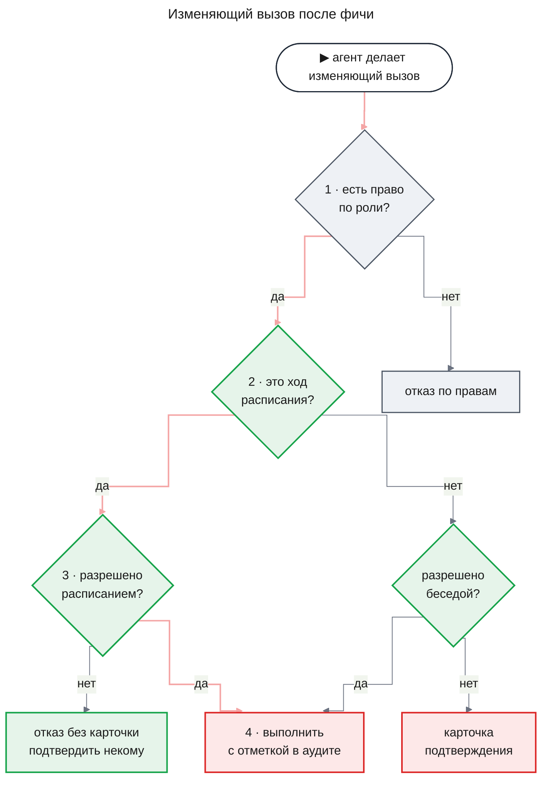
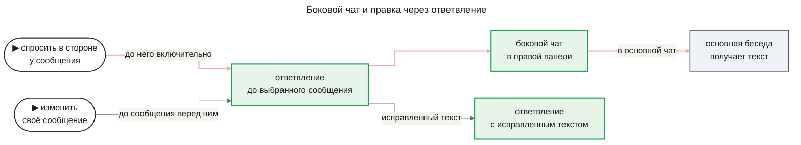
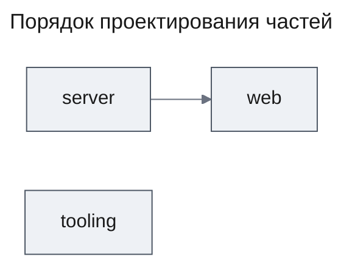

# PRD: Улучшения по итогам сравнения с bb (improvements)

| Date | Depth |
|---|---|
| 2026-11-27 | full |

## Snapshot

**Overview.** Сравнение Agent OS с открытым проектом bb показало места, где работа агента обрывается или сотруднику неудобно. Расписание, которое дошло до записи во внешнюю систему, сегодня бесконечно ждёт подтверждения, которого никто не даст. После фичи владелец заранее отмечает, какие записи расписанию можно делать без него, а остальное агент не делает и называет в ответе; в обычной беседе одну и ту же запись можно разрешить до конца беседы. Сбой провайдера модели сразу заканчивает ход понятной ошибкой, а модель после рестарта узнаёт, что ответ на её вызов потерян. В чате появляются боковой чат, отправка позже, правка отправленного сообщения, состояния бесед в списке, полоса работающих агентов и выбор агента через `@`; три практики разработки держат код простым.

- **Меняется правило**: изменяющее действие выполняется после явного подтверждения в интерфейсе **или** по разрешению, которое владелец дал заранее этому расписанию или этой беседе; такое действие помечено в аудите.
- **Не входит**: отложенный результат инструмента, резерв бюджета перед вызовом модели, тестовая база из шаблона, черновики и очередь отправки.
- **Главный риск**: разрешённая запись идёт без человека и может сделать лишнее, например завести дубль тикета в каждом срабатывании ([Assumptions and Risks](#assumptions-and-risks)).
- **Открытые вопросы**: нет.

## Terms

- **Изменяющий вызов (запись)** — вызов инструмента, который меняет что-то во внешней системе: создать тикет, отправить письмо. Сюда же относятся изменяющий скрипт, `run_code` с правом записи и изменение записи библиотеки агентов.
- **Карточка подтверждения** — карточка в ленте беседы, где сотрудник подтверждает или отклоняет изменяющий вызов, бриф глубокого агента или изменение записи библиотеки.
- **Ход** — работа агента в ответ на одно сообщение беседы, вместе с агентами, которых он при этом запустил.
- **Ход расписания** — ход, начатый сообщением, которое отправило расписание: в срок или кнопкой «Запустить сейчас». Ход расписания решается по последнему сообщению беседы: как только владелец сам написал в беседу, следующий ход — обычный.
- **Разрешение расписания** — список пар «MCP-сервер + изменяющий инструмент», которые владелец заранее разрешил ходам этого расписания.
- **Разрешение беседы** — такая же пара, разрешённая одной беседе ответом на карточке.
- **Ответвление** — новая беседа сотрудника с копией истории исходной; исходная не меняется (`create-and-test` FR-11).
- **Боковой чат** — ответвление, открытое в правой панели рядом с основной беседой.
- **Провайдер модели** — внешний сервис, который отвечает моделью: Anthropic, Gemini, OpenAI-совместимый.
- **Аудит** — запись о каждом вызове инструмента: кто, когда, что и с каким исходом (бизнес-ограничение 3 в `.claude/skills/project-context/SKILL.md`).

## Background

Идеи взяты из сравнения с [bb](https://github.com/get-bb/bb); каждая сделана в самом маленьком полезном виде. Изменения делятся на три группы: надёжность хода, удобство чата и практики разработки.

Главная перемена касается записей. Сегодня каждый изменяющий вызов ждёт карточки. Ход расписания никто не смотрит, поэтому он застревает на первой же записи. После фичи вызов проходит такую развилку:

Разрешить расписанию или беседе можно только изменяющий MCP-инструмент, и только его карточка получает третий ответ «разрешить в этой беседе». Изменяющий скрипт, `run_code` с записью и изменение записи библиотеки в ходе расписания отклоняются, а вне его спрашивают карточкой с двумя ответами, как сегодня. Бриф глубокого агента в ходе расписания уходит без карточки, чтобы ресерч по расписанию работал.

Боковой чат и правка сообщения строятся на одном новом умении — ответвлении до выбранного сообщения, а не всей беседы целиком:

Журнал беседы только дописывается, поэтому правка не переписывает исходную беседу: исправленный вопрос живёт в ответвлении. Ответвиться можно по прежним правилам — только когда агент в беседе свободен.

## Users and Use Cases

### Users

- **Сотрудник** — аналитик, SRE или менеджер, который ведёт беседы с агентами и ставит расписания. Ему важно, чтобы работа без него доходила до конца, ничего лишнего не записав, и чтобы в нескольких беседах было видно, где что.
- **Разработчик Agent OS** — владелец и агенты Claude Code, которые пишут код. Им важно, чтобы правила простоты и проверки были записаны и проверялись сами.

### Use Cases

- **UC-1**: Аня ставит утреннюю сводку ошибок, которая заводит тикет в Jira на новую ошибку, и разрешает расписанию создание тикета → утром тикет заведён без неё, а в аудите видно, что по разрешению расписания. Покрывает FR-03, FR-07.
- **UC-2**: Та же сводка решает отправить письмо, которое расписанию не разрешено → агент не ждёт Аню: сводка готова, а в ответе сказано, что письмо требует её разрешения. Покрывает FR-03.
- **UC-3**: Аня разбирает инцидент и обновляет пять тикетов подряд → на первой карточке она разрешает это действие в беседе, и остальные четыре проходят без карточек. Покрывает FR-04, FR-08.
- **UC-4**: Провайдер модели перегружен → ход сразу заканчивается понятной ошибкой, и Аня пишет «продолжай», когда провайдер снова отвечает. Покрывает FR-02.
- **UC-5**: Сервер перезапустили, пока агент создавал тикет → агент проверяет, создан ли тикет, а не заводит второй. Покрывает FR-01.
- **UC-6**: Посреди разбора Аня хочет уточнить термин, не засоряя беседу → она спрашивает в стороне и переносит нужную строку ответа в основную беседу. Покрывает FR-05, FR-09.
- **UC-7**: Аня поняла, что задала вопрос неточно → она правит его и получает ответ на исправленный вопрос, а исходная беседа цела. Покрывает FR-05, FR-14.
- **UC-8**: Аня хочет, чтобы статус собрался после обеда → она отправляет сообщение позже, на 15:00. Покрывает FR-10.
- **UC-9**: Аня ведёт несколько бесед → в списке она видит, какая работает, какая ждёт её, где сбой и где новый ответ, и открывает беседу сразу на новом ответе. Покрывает FR-06, FR-11.
- **UC-10**: Ресерч Ани запустил агентов, и один из них ждёт подтверждения → полоса в беседе показывает его и ведёт к его карточке. Покрывает FR-12.
- **UC-11**: Аня набирает `@` и выбирает агента, не открывая меню. Покрывает FR-13.
- **UC-12**: Агент Claude Code пишет код и проверяет экран → линт ловит запрос к базе вне `packages/db`, правила в `CLAUDE.md` отсекают лишние тесты и сложность, а навык поднимает приложение и ведёт по экранам этой фичи. Покрывает FR-15, FR-16, FR-17.

## Functional Requirements

### Must Have (MVP)

#### Надёжность хода — часть `server`

- **FR-01. Потерянный ответ на вызов.** Если ход остановился — рестарт, прерывание — после того как изменяющий вызов отправлен, но до ответа, вызов заканчивается исходом «неизвестно», и модель читает: ответ потерян, вызов никто не отклонял, действие могло выполниться, проверь, прежде чем повторять. Это поведение уже есть в коде, и его проверяет интеграционный тест «INT-3 E»: части `server` остаётся только подтвердить его.
  - AC-01.1: Given агент отправил вызов создания тикета, when ход остановился до ответа и продолжился после рестарта, then вызов не отправлен второй раз, его исход «неизвестно», а модель видит текст о потерянном ответе.

- **FR-02. Сбой провайдера без повторов.** Любой сбой провайдера модели — перегрузка, ограничение частоты, недоступность, обрыв сети — заканчивает вызов после первого же запроса. Ход заканчивается сбоем с той причиной, которую сотрудник видит сегодня (`model-providers` FR-09), а беседа принимает следующее сообщение, как сейчас. Служба эмбеддингов так же отвечает «недоступно» с причиной после одного запроса (`model-providers` FR-07).
  - AC-02.1: Given провайдер отвечает перегрузкой, when агент вызывает модель, then провайдер получил ровно один запрос, ход закончился сбоем с причиной, а следующее сообщение сотрудника в беседе принято.

#### Записи без карточки — часть `server`

- **FR-03. Ход расписания пишет только разрешённое.** У расписания хранится его разрешение (FR-07). В ходе расписания разрешённый изменяющий MCP-инструмент выполняется без карточки, и аудит отмечает, что вызов сделан по разрешению этого расписания. Любой другой изменяющий вызов платформа сразу отклоняет без карточки и вопроса; модель получает объяснение: подтвердить некому, закончи без этого и скажи в ответе, что требует разрешения владельца. Бриф глубокого агента уходит без карточки, а глубокий агент и его сабагенты, запущенные этим ходом, подчиняются тому же правилу. Права по ролям действуют как всегда, а расписание по-прежнему только отправляет сообщение (`schedules-search-memory` FR-07).
  - AC-03.1: Given расписанию разрешено создание тикета в Jira, when ход расписания — в срок или по «Запустить сейчас» — вызывает этот инструмент, then тикет создан без карточки, а в аудите у вызова отметка разрешения этого расписания.
  - AC-03.2: Given расписанию не разрешена отправка письма, when ход расписания вызывает её, изменяющий скрипт, `run_code` с записью или изменение записи библиотеки, then вызов не выполнен, карточки нет, ход не ждёт владельца, аудит записал отказ, а модель получила объяснение отказа.
  - AC-03.3: Given ход расписания решает запустить глубокий агент, when он отправляет бриф, then карточки нет, и глубокий агент стартует.
  - AC-03.4: Given инструмент разрешён расписанию, но у владельца отняли право на него, when ход расписания его вызывает, then вызов отклонён по правам, как в чате.
  - AC-03.5: Given владелец написал сообщение в беседу расписания, when следующий ход вызывает разрешённый расписанию инструмент, then беседа показывает карточку, как сегодня.

- **FR-04. Разрешение беседы.** Ответ «разрешить в этой беседе» на карточке изменяющего MCP-инструмента выполняет этот вызов и разрешает ту же пару «сервер + инструмент» до конца беседы: дальше этот инструмент в беседе и в агентах, которых она запускает, выполняется без карточки, с отметкой разрешения беседы в аудите. Ответвление разрешений не наследует. В ходе расписания действует только разрешение расписания (FR-03).
  - AC-04.1: Given карточка вызова создания тикета, when сотрудник отвечает «разрешить в этой беседе», then тикет создан, следующий вызов того же инструмента в этой беседе выполняется без карточки, а в аудите у обоих вызовов отметка разрешения беседы.
  - AC-04.2: Given в беседе разрешено создание тикета, when агент вызывает обновление тикета или создание тикета в другой беседе, then показывается карточка, как сегодня.

#### Ответвление и состояние бесед — часть `server`

- **FR-05. Ответвление до сообщения.** Платформа ответвляет беседу не только целиком, но и до выбранного сообщения: унаследованная история кончается на этом сообщении. Для правки первого сообщения ответвление не наследует ни одного сообщения. Всё остальное — название, когда нельзя ответвиться, что не копируется — как у ответвления целиком (`create-and-test` FR-11).
  - AC-05.1: Given беседа из шести сообщений, when сотрудник ответвляет её до третьего, then в ответвлении три первых сообщения, а исходная беседа не изменилась.
  - AC-05.2: Given агент в беседе отвечает или ждёт подтверждения, when сотрудник ответвляет её до сообщения, then ответвление не создаётся, как и ответвление целиком.

- **FR-06. Состояние беседы и отметка «прочитано».** Список бесед сообщает у каждой беседы сотрудника одно состояние: «работает», «ждёт вас» (карточка в беседе или у одного из её агентов), «новый ответ» или «сбой». Отметка «прочитано до» одна на беседу; её ставит открытие беседы, а пока беседа открыта, новые ответы считаются прочитанными. «Новый ответ» и «сбой» снимаются, когда сотрудник открыл беседу. Отметка хранится на сервере и видна с любого устройства.
  - AC-06.1: Given агент закончил ответ, а сотрудник беседу после этого не открывал, when он запрашивает список бесед, then у беседы состояние «новый ответ»; после открытия беседы на любом устройстве состояние пропадает.
  - AC-06.2: Given у агента беседы открыта карточка подтверждения, when сотрудник запрашивает список, then у беседы состояние «ждёт вас», а у беседы, где агент работает, — «работает».

#### Экраны — часть `web`

- **FR-07. Разрешение в окне расписания.** В окне расписания владелец отмечает пары «MCP-сервер + изменяющий инструмент», которые расписание может вызывать без него. Выбор — из всех изменяющих инструментов, на которые у владельца есть право. Страница расписания показывает отмеченные пары.
  - AC-07.1: Given у владельца есть право на создание тикета и нет права на отправку письма, when он открывает окно расписания, then в выборе есть создание тикета, нет отправки письма и нет инструментов только для чтения.
  - AC-07.2: Given владелец отметил создание тикета и сохранил расписание, when он открывает страницу расписания, then видит эту пару и может снять её правкой расписания.

- **FR-08. Третий ответ на карточке.** Карточка изменяющего MCP-инструмента предлагает, кроме «подтвердить» и «отклонить», ответ «разрешить в этой беседе» (FR-04). Карточки брифа, скрипта, `run_code` и записи библиотеки остаются с двумя ответами.
  - AC-08.1: Given карточка вызова MCP-инструмента, then у неё три ответа; given карточка брифа или изменения записи библиотеки, then у неё два прежних ответа.

- **FR-09. Боковой чат.** У сообщения в беседе есть действие «спросить в стороне». Оно ответвляет беседу до этого сообщения включительно (FR-05) и открывает ответвление в правой панели, а в поле сообщения ответвления стоит цитата выбранного сообщения. Выбранный текст из бокового чата сотрудник отправляет «в основной чат», и там он становится обычным сообщением. Боковой чат — обычное ответвление: оно в списке бесед и среди ответвлений исходной беседы. Действие доступно, пока основная беседа свободна.
  - AC-09.1: Given основная беседа свободна, when сотрудник выбирает «спросить в стороне» у ответа агента, then справа открывается ответвление, чья история кончается этим ответом, в его поле сообщения стоит цитата, а основная беседа остаётся на экране.
  - AC-09.2: Given в боковом чате есть ответ, when сотрудник выбирает часть его текста и отправляет её в основной чат, then этот текст стоит следующим сообщением основной беседы, и агент отвечает на него, как на набранное руками.
  - AC-09.3: Given агент основной беседы отвечает, then действие «спросить в стороне» недоступно.

- **FR-10. Отправить позже.** Рядом с отправкой есть действие «отправить позже» в беседе, где уже есть сообщения. Оно открывает окно расписания, заполненное текстом из поля сообщения и выбранным агентом, с правилом «один раз» и местом результата «эта беседа». Сразу ничего не отправляется.
  - AC-10.1: Given в поле сообщения текст «Собери статус», when сотрудник выбирает «отправить позже», then открывается окно расписания с этим текстом, правилом «один раз» и результатом «эта беседа», а в беседе нового сообщения нет.
  - AC-10.2: Given сотрудник сохранил такое расписание на 15:00, when наступает 15:00, then текст появляется в беседе сообщением расписания, и агент на него отвечает (`schedules-search-memory` FR-04).

- **FR-11. Состояния в списке бесед и разделитель.** Каждая строка списка бесед показывает состояние беседы (FR-06); прочитанная законченная беседа отметки не несёт. Беседа с новым ответом открывается на разделителе перед первым непрочитанным сообщением.
  - AC-11.1: Given одна беседа ждёт подтверждения, а другая работает, then строки этих бесед отмечены по-разному, и обе отличаются от беседы с новым ответом и беседы со сбоем.
  - AC-11.2: Given в беседе непрочитанный ответ, when сотрудник её открывает, then лента стоит на разделителе перед этим ответом, а отметка в списке пропадает.

- **FR-12. Полоса агентов.** Когда агенты, запущенные из беседы, работают или ждут сотрудника, беседа показывает одну полосу со списком этих агентов и состоянием каждого. Выбор агента в полосе ведёт к его карточке в ленте, где сотрудник отвечает, как сегодня. Когда таких агентов нет, полосы нет.
  - AC-12.1: Given один агент беседы работает, а другой ждёт подтверждения, then в беседе одна полоса с обоими агентами и их состоянием, а выбор второго переводит к его карточке.
  - AC-12.2: Given все агенты беседы закончили, then полосы нет.

- **FR-13. `@` в поле сообщения.** Набранный в поле сообщения `@` открывает тот же список агентов библиотеки, что меню «+», а выбор даёт тот же чип агента.
  - AC-13.1: Given сотруднику доступен агент «Разбор логов», when он набирает `@` и выбирает этого агента, then в поле стоит тот же чип, что после выбора в меню «+», и сообщение уходит этому агенту.

- **FR-14. Правка отправленного сообщения.** У своего сообщения есть действие «изменить». Исправленный текст платформа отправляет в ответвление до предыдущего сообщения (FR-05), и сотрудник оказывается в этом ответвлении. Исходная беседа не меняется. Действие доступно по правилам ответвления.
  - AC-14.1: Given в беседе вопрос 1, ответ 1, вопрос 2, ответ 2, when сотрудник меняет вопрос 2, then он в ответвлении с вопросом 1, ответом 1 и исправленным вопросом 2, агент отвечает на исправленный вопрос, а в исходной беседе все четыре сообщения без изменений.
  - AC-14.2: Given агент в беседе отвечает, then действие «изменить» недоступно.

#### Практики разработки — часть `tooling`

- **FR-15. Запрос к базе только из `packages/db`.** Линт запрещает импорт `drizzle-orm` в коде `apps/api` и `packages/agents`; тесты из запрета исключены. Так закрывается последний пробел правила «ни одного запроса к таблицам вне `packages/db`»: в `packages/runtime` запрет уже есть.
  - AC-15.1: Given файл кода в `apps/api` или `packages/agents` импортирует `drizzle-orm`, when запускается линт, then линт падает на этом импорте, а такой же импорт в тестовом файле ошибки не даёт.
  - AC-15.2: Given текущий код, when запускается линт, then он проходит: сегодня таких импортов в коде нет.

- **FR-16. Правила тестов и простоты в `CLAUDE.md`.** Корневой `CLAUDE.md` получает около десяти строк: вопросы, на которые надо ответить до того, как писать тест, шаблоны мусорных тестов и признаки лишней сложности для ревью.
  - AC-16.1: Given корневой `CLAUDE.md`, then в нём есть эти вопросы, шаблоны и признаки, не больше двенадцати строк, и они не повторяют правила, которые в файле уже есть.

- **FR-17. Навык проверки в браузере.** Один навык проекта описывает, как поднять api и web, войти и проверить в браузере каждый экран, который меняет эта фича, — по короткому рецепту на экран.
  - AC-17.1: Given агент без контекста загрузил навык, when он выполняет его рецепты, then поднимает api и web, входит и для каждого экрана части `web` знает, как туда попасть и что должно быть видно.

### Won't Have

- Отложенный результат инструмента — не в этой фиче: сегодня он не нужен ни одному инструменту.
- Резерв бюджета перед вызовом модели — нет: квота уже проверяется перед каждым вызовом, перерасход ограничен вызовами, идущими в одно время, а резерв требует строк резервирования и их уборки после сбоя.
- Тестовая база из шаблона — нет: наборы тестов уже применяют миграции один раз и идут последовательно.
- Черновики, порядок и отзыв сообщений в очереди — нет: из меню отправки нужно только «отправить позже», а сообщение во время работы агента уже доходит до него само.
- Правила, по которым беседа просыпается от событий своих агентов, — нет: полосы и карточек хватает.
- Упоминание через `@` бесед и MCP-источников — нет: `@` выбирает только агента.
- Отзыв разрешения беседы — нет: разрешение живёт до конца беседы, а новая беседа начинается без разрешений.
- Перегенерация ответа и вложения — остаются скрытыми.
- Плагины и навыки для агентов платформы, скрипты, вызывающие агентов, с кэшем вызовов, инструменты поиска, чтения и запуска по беседам, общий фоновый обходчик, дневной лимит расхода, стенд оценки, очистка удалённых бесед — нет: эти идеи bb рассмотрены и отклонены.

## Non-Functional Requirements

### Security

- **NFR-01**: Разрешение не выходит за свои границы: разрешение расписания действует только в его ходах, разрешение беседы — только в этой беседе и её агентах, и ни одно не обходит права по ролям. Каждый вызов, выполненный по разрешению или отклонённый в ходе расписания, даёт ровно одну запись аудита с отметкой, чьё разрешение сработало или почему отказ.
- **NFR-02**: Разрешение расписания, отметку «прочитано» и ответвление до сообщения другой сотрудник не читает и не меняет; каждый новый или изменённый эндпоинт покрыт e2e-тестом с двумя сотрудниками (бизнес-ограничение 2).

## Delivery Parts

| Part | Covers | Cut along | Depends on | Rationale |
|------|--------|-----------|------------|-----------|
| `server` | FR-01, FR-02, FR-03, FR-04, FR-05, FR-06 | backend | — | Правила хода, разрешения, ответвление и состояние бесед — один слой рантайма и API, который web читает как контракт |
| `web` | FR-07, FR-08, FR-09, FR-10, FR-11, FR-12, FR-13, FR-14 | frontend | `server` | Все новые действия и экраны чата — один слой интерфейса поверх контракта `server` |
| `tooling` | FR-15, FR-16, FR-17 | release-unit | — | Практики разработки не меняют поведения продукта и собираются небольшой задачей без Design Doc |

### Part Dependency Diagram

## Success Criteria

- Ходы расписаний не застревают — за первые две недели после выпуска ни одна беседа срабатывания не стоит в состоянии «ждёт вас» без сообщения владельца; читается из списка бесед владельца.
- Навыка проверки хватает — проверка части `web` в браузере проходит по навыку без подсказок владельца; читается из отчёта этой проверки.

## Constraints and Risks

### Constraints

- **PoC.** Без обратной совместимости и переключателей; код, оставшийся без вызова, удаляется в том же изменении (корневой `CLAUDE.md`). Повторы вызова модели удаляются вместе с их тестами.
- **Решение владельца по провайдерам.** Вызов провайдера модели и эмбеддингов не повторяется: упало — значит упало.
- **Настройки — в базе.** Новых настроек и переменных окружения нет: разрешение расписания — часть расписания, разрешение беседы — часть беседы.
- **Расписание только отправляет.** Расписание не узнаёт состояний ходов и ничего не проверяет заранее; правило FR-03 исполняет беседа.
- **Бизнес-ограничение 1 меняется.** Права по ролям и аудит остаются, а правило подтверждения записи получает исключение: запись по заранее данному разрешению расписания или беседы.

### Assumptions and Risks

Разрешённая запись идёт без человека и может сделать лишнее, например заводить тикет в каждом срабатывании. Это ограничивают три вещи: разрешаются только отмеченные пары, у каждого такого вызова есть отметка в аудите, а третий одинаковый вызов в сессии харнесс отклоняет (`agent-harness` FR-06).

Без повторов короткая перегрузка провайдера обрывает долгий ход, например глубокий ресерч. Сотрудник продолжает работу следующим сообщением (`agent-platform` FR-09); владелец принял эту цену ради простоты.

Модель класса Haiku может не сказать в ответе, что запись не сделана, хотя текст отказа просит об этом. Отказ при этом виден в аудите и в истории вызовов беседы.

## Update History

| Version | Date | Change |
|---------|------|--------|
| 1.0 | 2026-11-27 | Первая версия |
