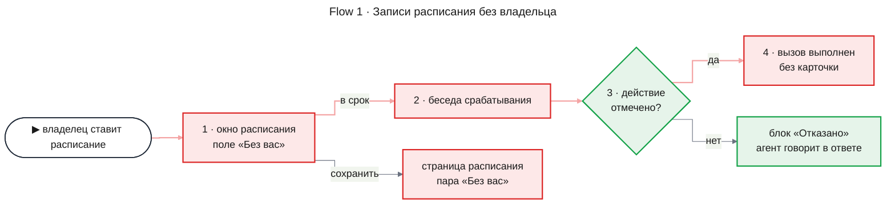

# UXRD: Улучшения по итогам сравнения с bb (improvements)

| Дата | PRD | Опирается на |
|---|---|---|
| 2026-11-27 | [prd.md](./prd.md) | [chat-shell UXRD](../chat-shell/uxrd.md) — список бесед, лента, композер, правая панель; [schedules-search-memory UXRD](../schedules-search-memory/uxrd.md) — окно и страница расписания; [create-and-test UXRD](../create-and-test/uxrd.md) — ветки FK-01–FK-04 |

## Snapshot

**Overview.** Фича не добавляет экранов: каждое изменение встаёт в уже знакомое место. В окне расписания владелец отмечает, какие действия агент может делать без него, а запись, которую расписание не разрешило, видна в беседе отказом с причиной. На карточке подтверждения появляется третья кнопка «Разрешить в этой беседе». Под ответом агента есть «Спросить в стороне», и боковой чат открывается вкладкой правой панели; у своего сообщения есть «Изменить», и ответ на исправленный текст приходит в ветке. Рядом с отправкой — «Отправить позже», в строках списка бесед — тихие метки состояния, над полем сообщения — полоса работающих агентов, а `@` в поле открывает список агентов.

- **Не меняется**: правила веток (когда можно ответвить, что копируется, разделитель и кнопка «Ветки») — create-and-test UXRD, FK-01–FK-04. Карточки решения других видов, лоток очереди и меню «+» остаются прежними.
- **Главный UX-риск**: владелец не заглянет в ответ расписания и не узнает, что запись не сделана. Отказ стоит в беседе блоком вызова с причиной (IM-03), а беседа получает метку «новый ответ» (IM-09).

### Key Decisions

| ID | Решение | Почему |
|---|---|---|
| KD-1 | Разрешение расписания — поле «Без вас» в окне расписания: отметки изменяющих действий, сгруппированные по системам. Страница расписания показывает отмеченное одной парой. Неразрешённая запись в беседе срабатывания — блок вызова «Отказано» с причиной, карточек там нет | Разрешение — часть расписания (PRD, Constraints), поэтому оно живёт там, где расписание правят. Отказ на месте вызова виден там же, где сотрудник читает ответ |
| KD-2 | «Разрешить в этой беседе» — третья кнопка той же карточки; итог называет действие, которое дальше идёт без вопроса | Решение принимают там, где уже решают. Итог со словом-действием говорит, что именно разрешено, — только этот инструмент и только в этой беседе |
| KD-3 | Боковой чат — вкладка «В стороне» правой панели. «Спросить в стороне» стоит под ответом агента. Текст переносится в основную беседу кнопкой у выделения или целым сообщением из action bar | Уточняют обычно то, что сказал агент. Правая панель уже держит то, что читают рядом с беседой, и основная беседа остаётся на месте. Кнопка в action bar даёт перенос без мыши и на тач-экране |
| KD-4 | Правка идёт на месте сообщения, а строка под полем правки говорит, что ответ придёт в новой ветке | Так правят в ChatGPT. Строка заранее объясняет, почему после отправки сотрудник окажется в другой беседе |
| KD-5 | Состояние беседы — статичная иконка или точка справа в строке списка. Ничто в списке не вращается и не пульсирует, счётчиков нет, у прочитанной законченной беседы метки нет | Список открыт часами краем глаза; движение там отвлекает, а сама работа видна в открытой беседе. Форма иконки различает состояния без яркого цвета |
| KD-6 | Полоса агентов — одна строка над полем сообщения, над лотком очереди. Выбор агента прокручивает ленту к его карточке | Место над полем уже значит «то, что сейчас в работе», и полоса не отнимает высоту ленты сверх одной строки |
| KD-7 | «Спросить в стороне» и «Изменить» не показаны, пока агент беседы отвечает, ждёт решения или выполняет задачи | Оба действия ответвляют беседу, а ответвить её тогда нельзя (PRD FR-05). Скрытая кнопка не обещает того, что сразу получит отказ |

## Design System

Фича следует [дизайн-системе](../../design-system/README.md); беседа, панель и диалоги — комфортная плотность. Новых цветов, иконок вне Lucide и движений нет.

### Component Inventory

| Компонент | Спецификация | Статус | Примечание |
|---|---|---|---|
| Карточка решения | [decision-card.md](../../design-system/components/decision-card.md) | extended | Третья кнопка и итог «Разрешено в этой беседе» у MCP-инструмента (IM-04) |
| Статус агента | [agent-status.md](../../design-system/components/agent-status.md) | extended | Состояния беседы для строки списка (IM-09). Искали метку состояния: она для записей, не агентов, и не несёт статусных цветов |
| Разделитель ленты | [feed-divider.md](../../design-system/components/feed-divider.md) | extended | Вариант «Новое» (IM-10); ветка без унаследованных сообщений (IM-13) |
| Лоток очереди | [message-queue.md](../../design-system/components/message-queue.md) | extended | Вариант «Агенты беседы» — полоса агентов (IM-11) |
| Вызов инструмента | [tool-call.md](../../design-system/components/tool-call.md) | extended | Причина «Отказано» в ходе расписания (IM-03) |
| Карточка хода | [agent-run-card.md](../../design-system/components/agent-run-card.md) | reused | Цель перехода из полосы (IM-11) |
| Форма настроек | [settings-form.md](../../design-system/components/settings-form.md), вариант «Форма диалога» | reused | Поле «Без вас» — отметки shadcn `checkbox` (IM-01) |
| Правило расписания | [schedule-rule.md](../../design-system/components/schedule-rule.md) | reused | Предустановка «Один раз» у «Отправить позже» (IM-08) |
| Подпись записи | [record-label.md](../../design-system/components/record-label.md), вариант «Чип» | reused | Чип агента после выбора через `@` (IM-12) |
| Окно и страница расписания | schedules-search-memory UXRD, SH-02, SH-05 | extended | Поле и пара «Без вас» (IM-01, IM-02); заголовок «Отправить позже» (IM-08) |
| Action bar сообщения | chat-shell UXRD, TH-10 | extended | «Спросить в стороне», «В основной чат», «Изменить» (IM-05, IM-07, IM-13) |
| Композер | chat-shell UXRD, TH-04; create-and-test UXRD, CT-01 | extended | «Отправить позже» (IM-08), список агентов по `@` (IM-12) |
| Строка списка бесед | chat-shell UXRD, SB-06; create-and-test UXRD, FK-02 | extended | Метка состояния (IM-09) |
| Правая панель | chat-shell UXRD, WS-01–WS-03 | extended | Вкладка «В стороне» (IM-06) |
| Поповер у выделения | [shadcn `popover`](https://ui.shadcn.com/docs/components/popover) | reused | Одна кнопка «В основной чат» (IM-07) |
| Уведомления | chat-shell UXRD, TST-01 | reused | Отказ ветки (create-and-test UXRD, MC-18) |

## User Flows

### Primary User Flow

**Расписание пишет только разрешённое.** Implements: UC-1, UC-2; AC-03.1, AC-03.2, AC-07.1, AC-07.2



«Запустить сейчас» идёт тем же путём. Бриф глубокого агента в беседе срабатывания карточки не получает: под сообщением сразу встаёт карточка хода глубокого агента (AC-03.3). Когда владелец сам написал в беседу срабатывания, следующий ход снова показывает карточки, как в любой беседе (AC-03.5).

**Боковой чат.** Implements: UC-6; AC-09.1, AC-09.2, AC-05.1

```mermaid
---
title: "Flow 2 · Спросить в стороне и вернуть ответ"
config:
  theme: base
  look: classic
  themeVariables:
    primaryColor: "#eef1f5"
    primaryBorderColor: "#4b5563"
    primaryTextColor: "#1a1a1a"
    lineColor: "#6b7280"
  flowchart:
    curve: step
  themeCSS: |
    @keyframes lit_imf2{0%,18%{stroke:#991b1b;stroke-width:6px}20%,100%{stroke:#f4a5a5;stroke-width:2px}}
---
flowchart LR
    entry(["▶ ответ агента"])
    ask["1 · «Спросить в стороне»"]
    tab["2 · вкладка «В стороне»<br/>ветка и цитата"]
    talk["3 · вопрос и ответ<br/>в ветке"]
    pick["4 · «В основной чат»"]
    main["5 · сообщение<br/>основной беседы"]
    entry e1@--> ask
    ask e2@--> tab
    tab e3@--> talk
    talk e4@-->|"выделенный текст"| pick
    pick e5@--> main
    classDef entry fill:#ffffff,stroke:#1f2937,stroke-width:1.5px,color:#1a1a1a
    classDef changed fill:#fde8e8,stroke:#dc2626,stroke-width:2px,color:#1a1a1a
    classDef new fill:#e6f4ea,stroke:#16a34a,stroke-width:2px,color:#1a1a1a
    classDef unchanged fill:#eef1f5,stroke:#4b5563,stroke-width:1.5px,color:#1a1a1a
    classDef w1 stroke:#f4a5a5,stroke-width:2px,animation:lit_imf2 6s linear 0s infinite
    classDef w2 stroke:#f4a5a5,stroke-width:2px,animation:lit_imf2 6s linear 1.2s infinite
    classDef w3 stroke:#f4a5a5,stroke-width:2px,animation:lit_imf2 6s linear 2.4s infinite
    classDef w4 stroke:#f4a5a5,stroke-width:2px,animation:lit_imf2 6s linear 3.6s infinite
    classDef w5 stroke:#f4a5a5,stroke-width:2px,animation:lit_imf2 6s linear 4.8s infinite
    class entry entry
    class ask,tab,pick new
    class talk,main unchanged
    class e1 w1
    class e2 w2
    class e3 w3
    class e4 w4
    class e5 w5
```



Перенесённый текст уходит в основную беседу сразу, без поля сообщения. Если агент основной беседы в это время работает, сообщение ждёт в лотке очереди, как набранное руками.

**Правка сообщения.** Implements: UC-7; AC-14.1, AC-05.1

```mermaid
---
title: "Flow 3 · Изменить своё сообщение"
config:
  theme: base
  look: classic
  themeVariables:
    primaryColor: "#eef1f5"
    primaryBorderColor: "#4b5563"
    primaryTextColor: "#1a1a1a"
    lineColor: "#6b7280"
  flowchart:
    curve: step
  themeCSS: |
    @keyframes lit_imf3{0%,30%{stroke:#991b1b;stroke-width:6px}33.3%,100%{stroke:#f4a5a5;stroke-width:2px}}
---
flowchart LR
    entry(["▶ своё сообщение"])
    edit["1 · «Изменить»<br/>поле на месте сообщения"]
    fork["2 · ветка до<br/>предыдущего сообщения"]
    answer["3 · ответ на<br/>исправленный текст"]
    entry e1@--> edit
    edit e2@-->|"«Отправить»"| fork
    fork e3@--> answer
    classDef entry fill:#ffffff,stroke:#1f2937,stroke-width:1.5px,color:#1a1a1a
    classDef new fill:#e6f4ea,stroke:#16a34a,stroke-width:2px,color:#1a1a1a
    classDef unchanged fill:#eef1f5,stroke:#4b5563,stroke-width:1.5px,color:#1a1a1a
    classDef w1 stroke:#f4a5a5,stroke-width:2px,animation:lit_imf3 3.6s linear 0s infinite
    classDef w2 stroke:#f4a5a5,stroke-width:2px,animation:lit_imf3 3.6s linear 1.2s infinite
    classDef w3 stroke:#f4a5a5,stroke-width:2px,animation:lit_imf3 3.6s linear 2.4s infinite
    class entry entry
    class edit,fork new
    class answer unchanged
    class e1 w1
    class e2 w2
    class e3 w3
```



Сотрудник оказывается в ветке, а исходная беседа остаётся в списке без изменений.

### Alternative Flows

- **Разрешить в беседе** (UC-3; AC-04.1, AC-04.2, AC-08.1). На карточке изменяющего MCP-инструмента сотрудник выбирает «Разрешить в этой беседе». Вызов выполняется, карточка получает итог MC-4, и следующие вызовы того же инструмента в этой беседе и её агентах идут обычными блоками вызова, без карточек. Другой инструмент и та же запись в другой беседе снова спрашивают карточкой. Ветка начинает без разрешений.
- **Отправить позже** (UC-8; AC-10.1, AC-10.2). «Отправить позже» открывает окно расписания IM-08. После сохранения поле сообщения очищается, как после любого расписания из беседы (schedules-search-memory UXRD, KD-1), а в срок текст приходит в беседу с подписью расписания (SH-07).
- **Несколько бесед** (UC-9; AC-06.1, AC-06.2, AC-11.1, AC-11.2). Строки списка несут метки IM-09. Беседа с новым ответом открывается на разделителе IM-10, и её метка уходит.
- **Агенты беседы** (UC-10; AC-12.1, AC-12.2). Полоса IM-11 появляется с первым агентом, который работает или ждёт, и уходит вместе с последним.
- **Агент через `@`** (UC-11; AC-13.1). Список IM-12 даёт тот же чип, что меню «+».

### Error Flows

- **Ветку не сделать.** Агент начал работать между показом кнопки и нажатием «Спросить в стороне» или «Отправить» правки. Ветки нет, сотрудник видит уведомление create-and-test UXRD, MC-18; поле правки сохраняет текст (AC-05.2, AC-09.3, AC-14.2).
- **Ветка не создалась** по другой причине — то же уведомление «Не удалось ответвить чат».
- **Перенос в основной чат не ушёл** — строка ошибки MC-7 в поповере или уведомление, если перенос шёл из action bar; повтор — та же кнопка.
- **Решение не отправилось** — строка ошибки карточки решения («Ошибка отправки»), три кнопки снова доступны.
- **Окно расписания не сохранилось** — ошибки формы SH-02 (schedules-search-memory UXRD, MC-3).

## Screens

### Screen 1: Окно и страница расписания

```
┌─ Новое расписание ──────────────────────────────── ✕ ┐  SH-02
│ …Название, Инструкция, Агент, Когда…                 │
│ Куда писать ответ                                    │
│ (•) Каждый раз в новую беседу                        │
│ Без вас                                              │  IM-01
│ Отмеченное агент сделает по расписанию без вашего    │
│ подтверждения. Остальные записи не сделает и скажет  │
│ об этом в ответе.                                    │
│ Jira                                                 │
│ [✓] Создать задачу         create_issue              │
│ [ ] Изменить задачу        update_issue              │
│ Gmail                                                │
│ [ ] Отправить письмо       send_email                │
│                  [ Создать расписание ] [ Отмена ]   │
└──────────────────────────────────────────────────────┘

Страница расписания
│ Ответ        Каждый раз в новую беседу               │
│ Без вас      Создать задачу · Jira                   │  IM-02
│ Создано      24 нояб. в беседе «Сбои оплаты»         │
```

**IM-01. Поле «Без вас»** — последнее поле окна расписания (SH-02), после «Куда писать ответ». Подпись, подсказка и под ними группы: заголовок группы — имя системы (Caption, `--muted-foreground`), строки группы — отметки shadcn `checkbox`. Подпись отметки — название действия (UI) и рядом техническое имя (Caption, `--muted-foreground`), как в карточке решения. В списке только изменяющие MCP-инструменты, на которые у владельца есть право; инструментов для чтения нет (AC-07.1). По умолчанию ничего не отмечено. Если таких инструментов нет, вместо групп стоит строка MC-1. Действие, которое отмечено, но на которое у владельца пропало право, в списке не показано и при сохранении уходит из разрешения.

**IM-02. Пара «Без вас»** на странице расписания (SH-05) — после «Ответ»: отмеченные действия строками «{действие} · {система}», без отметок — «Только читает» (MC-1). Снять отметку можно только в окне по «Изменить» (AC-07.2).

| Состояние | Что показано | AC |
|---|---|---|
| Список действий грузится | Скелетон групп на месте поля; основная кнопка недоступна | — |
| Список не загрузился | Ошибка формы (settings-form) MC-1 и «Повторить»; основная кнопка недоступна, пока список не прочитан | — |
| Сохранение идёт | Отметки недоступны вместе с остальными полями | — |
| Нет изменяющих инструментов | Строка MC-1 вместо групп | AC-07.1 |

### Screen 2: Беседа срабатывания

```
◷ По расписанию «Сводка ошибок за ночь»
┌ ✓ Создать задачу · Jira                   09:01 ┐  разрешено, без карточки
└─────────────────────────────────────────────────┘
┌ ⊘ Отправить письмо · Gmail    Отказано    09:02 ┐  IM-03
│ Расписанию это не разрешено — подтвердить было  │
│ некому                                          │
└─────────────────────────────────────────────────┘
Агент чата
Сводка готова, тикет PAY-412 заведён. Письмо команде
не отправлено: на это нужно ваше разрешение.
```

**IM-03. Ход расписания в ленте.** Разрешённое действие — обычный [блок вызова](../../design-system/components/tool-call.md) с исходом «успех», без карточки (AC-03.1). Любая другая запись — изменяющий MCP-инструмент, скрипт, запуск кода с записью, изменение записи библиотеки — блок вызова с исходом «Отказано» и строкой причины MC-2 (AC-03.2). Отказ по правам выглядит как в чате, с прежней причиной (AC-03.4). Беседа срабатывания в списке не получает метку «ждёт вас» от записи; ход кончается ответом или сбоем, как любой ход.

### Screen 3: Карточка подтверждения

```
┌──────────────────────────────────────────────────────┐
│ ✋ Ждёт подтверждения                         14:36  │
│ Чат хочет выполнить:                                 │
│ Создать задачу                                       │
│ create_issue · jira                                  │
│ Аргументы …                                          │
│ [ Подтвердить ] [ Разрешить в этой беседе ] [Отклонить]│  IM-04
└──────────────────────────────────────────────────────┘
После ответа:
│ ✓ Разрешено в этой беседе: «Создать задачу» без      │
│   подтверждения · 14:37                              │
```

**IM-04. Третий ответ** — у [карточки решения](../../design-system/components/decision-card.md), вариант «Действие», когда действие — изменяющий MCP-инструмент. Порядок кнопок: «Подтвердить» (`default`), «Разрешить в этой беседе» (`outline`), «Отклонить» (`ghost`). Итог — MC-4. У запуска кода, скрипта агента, брифа и записи библиотеки кнопки прежние (AC-08.1).

### Screen 4: Боковой чат

```
Основная беседа                              │ [ Схема ] [ В стороне ]      × │ IM-06
  Агент чата                                 │ Ветка · Разбор инцидента       │
  Сбой шлюза — это когда упал upstream…      │ ─ ⑂ Ответвлено от «Разбор… ─   │
  [⧉] [ Спросить в стороне ]          IM-05  │                                │
                                             │ Вы: что такое upstream?        │
  Вы: а что по стейджу?                      │ Агент чата: Upstream — сервис, │
                                             │ который ▓стоит за шлюзом▓      │
                                             │   [ В основной чат ]     IM-07 │
                                             │   [⧉] [ В основной чат ]       │
                                             │ ┌────────────────────────────┐ │
                                             │ │ Спросите что-нибудь…   [↑] │ │
                                             │ └────────────────────────────┘ │
```

**IM-05. «Спросить в стороне»** — текстовая кнопка `ghost` `sm` в action bar ответа агента, справа от «Копировать», с иконкой `MessageSquareQuote`. Видна по правилам action bar (chat-shell UXRD, TH-10) и только когда беседу можно ответвить (KD-7, AC-09.3). В беседе, которую не ответвляют (беседа проверки и обучения), кнопки нет.

Нажатие ответвляет беседу до этого ответа включительно и открывает ветку на вкладке IM-06. Ветка встаёт в начало «Сегодня» в списке бесед, но активной остаётся основная беседа: на экране меняется только правая панель (AC-09.1). В поле сообщения ветки стоит цитата: начало ответа строкой Markdown-цитаты, до 200 знаков с «…» на границе слова, и пустая строка под ней. Фокус — в конце поля.

**IM-06. Вкладка «В стороне»** правой панели (chat-shell UXRD, WS-01) — последняя вкладка, выбрана при открытии. Внутри — ветка как беседа: название ветки ссылкой на её страницу (UI 500), лента и поле сообщения. Лента открыта на разделителе ветки (FK-03), унаследованная история — выше, прокруткой. Вкладка держит одну ветку: новое «Спросить в стороне» заменяет её содержимое, а прежняя ветка остаётся в списке бесед и в «Ветках» исходной беседы. Action bar сообщений на вкладке — только «Копировать» и, у ответов агента, «В основной чат» (IM-07); «Спросить в стороне» и «Изменить» здесь нет. Вкладка уходит, когда сотрудник уходит из основной беседы. Пока ветка открыта на вкладке, её ответы считаются прочитанными.

**IM-07. «В основной чат».** Когда сотрудник выделяет текст в сообщении на вкладке «В стороне», над выделением встаёт поповер с одной кнопкой `outline` `sm` «В основной чат». У ответов агента на вкладке та же кнопка стоит в action bar и переносит ответ целиком. Нажатие отправляет текст следующим сообщением основной беседы (AC-09.2); выделение остаётся, а кнопка на 2 с показывает `Check` и «Отправлено». Поповер закрывается, когда выделение снято.

| Состояние | Что показано | AC |
|---|---|---|
| Ветка создаётся | Панель открыта, на вкладке скелетон ленты | — |
| Основная беседа занята | «Спросить в стороне» нет | AC-09.3 |
| Перенос не ушёл | В поповере под кнопкой строка ошибки MC-7 (Caption, `--destructive`) | — |

### Screen 5: Поле сообщения

```
┌──────────────────────────────────────────────────────┐
│ [ ◇ Разбор логов ✕ ]                                 │
│ Собери статус по @раз                                │
│ ┌ Разбор логов ─────────────────────┐                │  IM-12
│ │ ◇ Разбор логов                    │                │
│ │   Ищет причину падения по логам   │                │
│ │ ◇ Разбор оплат                    │                │
│ └───────────────────────────────────┘                │
│ [+]                                    [◷] [ ↑ ]     │  IM-08
└──────────────────────────────────────────────────────┘
```

**IM-08. «Отправить позже»** — иконочная кнопка `ghost` 32×32 с `Clock` слева от «Отправить», с подсказкой и доступным именем MC-5. Она есть в беседе, где уже есть сообщения, когда в поле есть текст, а в поле нет чипа действия. Нажатие открывает окно расписания (SH-02) с заголовком MC-5 и заполненными полями: инструкция — текст поля, агент — из чипа или «Агент чата», «Когда» — «Один раз» на ближайший целый час, «Куда писать ответ» — «В эту беседу», «Без вас» — пусто. Основная кнопка — «Запланировать». До сохранения в беседе ничего не меняется (AC-10.1); после сохранения — уведомление MC-5 окна расписания (schedules-search-memory UXRD, MC-5).

**IM-12. Список по `@`.** `@` в начале поля или после пробела открывает над полем список: те же строки агентов, что группа «Агенты» меню «+», с теми же иконками и описаниями. Текст после `@` сужает список по имени. Выбор ставит тот же чип записи, что меню «+», заменяет прежний чип и убирает из поля `@` с набранным после него текстом (AC-13.1). Esc и пробел без выбора закрывают список, текст остаётся как есть. Если ничего не подошло — строка MC-8. Где у поля нет «+», `@` — просто знак.

### Screen 6: Список бесед и разделитель

```
┌ Сегодня ──────────────────────┐
│ Разбор инцидента            ◌ │  работает          IM-09
│ ⑂ Ветка · Разбор инцидента  ✋ │  ждёт вас
│ Сводка ошибок · 27 нояб.    • │  новый ответ
│ Квартальный отчёт           ⓧ │  сбой
│ План отпуска                  │  прочитано
└───────────────────────────────┘

─────────────── Новые сообщения ───────────────     IM-10
◷ По расписанию «Сводка ошибок за ночь»
```

**IM-09. Метка состояния в строке** (chat-shell UXRD, SB-06) — [состояние беседы](../../design-system/components/agent-status.md#состояния-беседы) в варианте «Иконка», в слоте 16 px перед местом «⋯»; название усекается раньше на ширину слота. Четыре метки различаются формой (AC-11.1). Активная строка показывает «работает» и «ждёт вас», а «новый ответ» и «сбой» у открытой беседы не появляются (AC-11.2). Метка меняется растворением 150 ms и не двигает строку.

**IM-10. Разделитель «Новое»** — [разделитель ленты](../../design-system/components/feed-divider.md), вариант «Новое», перед первым непрочитанным сообщением. Беседа открывается с ним в верхней трети ленты (AC-11.2). Разделитель стоит, пока беседа открыта; при следующем открытии он стоит перед новым непрочитанным, если оно есть, иначе его нет. Без непрочитанного беседа открывается как раньше, на последнем сообщении.

### Screen 7: Полоса агентов

```
┌ Агенты · 2  [ Сбор метрик ✋ Ждёт подтверждения ] [ Разбор логов ⟳ Работает ] ┐  IM-11
└────────────────────────────────────────────────────────────────────────────────┘
┌ ◷ Ждут доставки · 1 ─────────────────────────────────────────────────────┐
│ Вы          а что по стейджу?                                             │
└───────────────────────────────────────────────────────────────────────────┘
┌──────────────────────────────────────────────────────────────────────────┐
│ Спросите что-нибудь…                                   [Прервать][◷][↑] │
```

**IM-11. Полоса агентов** — [лоток очереди](../../design-system/components/message-queue.md), вариант «Агенты беседы», над лотком очереди и полем сообщения. В полосе — агенты, которых запустила эта беседа, пока каждый работает или ждёт сотрудника; сначала ждущие. Статус — метка статуса агента «Работает» или «Ждёт подтверждения»; глубокий агент, у которого ждёт сабагент, стоит как ждущий. Выбор агента прокручивает ленту и переводит фокус: у ждущего — на его карточку решения, у работающего — на его карточку хода (AC-12.1). Без таких агентов полосы нет (AC-12.2).

### Screen 8: Правка сообщения

```
                         ┌──────────────────────────────────┐
                [✎] [⧉]  │ Почему с 14:00 падают оплаты?    │   IM-13
                         └──────────────────────────────────┘
Правка:
┌──────────────────────────────────────────────────────────┐
│ Почему с 14:00 падают оплаты на стейдже?                 │
└──────────────────────────────────────────────────────────┘
  Ответ придёт в новой ветке — эта беседа не изменится.
                                   [ Отмена ]  [ Отправить ]
```

**IM-13. «Изменить».** Иконочная кнопка `Pencil` в action bar своего сообщения, слева от «Копировать» (chat-shell UXRD, TH-10), с подсказкой MC-9. Её нет у сообщений от расписания и от агентов, а также пока беседу нельзя ответвить (KD-7, AC-14.2). Нажатие ставит на место пузыря многострочное поле той же ширины с текстом сообщения, курсор — в конце; под полем — строка MC-9 (Caption, `--muted-foreground`) и кнопки «Отмена» (`ghost`) и «Отправить» (`default`). Enter отправляет, Shift+Enter переносит строку, Esc и «Отмена» возвращают пузырь. Пустое поле не отправляется. Править можно одно сообщение за раз.

«Отправить» ответвляет беседу до предыдущего сообщения и отправляет туда исправленный текст. Сотрудник оказывается в ветке: унаследованная история, разделитель ветки, исправленное сообщение и ответ на него (AC-14.1). У правки первого сообщения унаследованной истории нет, и разделитель стоит первым в ленте.

| Состояние | Что показано | AC |
|---|---|---|
| Отправка | Поле и кнопки недоступны, в «Отправить» — вращающаяся `LoaderCircle` | — |
| Отказ ветки | Поле остаётся с текстом, уведомление create-and-test UXRD, MC-18 | AC-14.2 |

## Accessibility

- **Целевой уровень**: WCAG 2.1 AA — уровень продукта из PRD chat-shell, принятый в [foundations](../../design-system/foundations.md); PRD этой фичи своего уровня не задаёт.
- **Порядок фокуса**:
  - «Спросить в стороне» переводит фокус в поле сообщения ветки на вкладке IM-06; закрытие панели — на «Спросить в стороне» того ответа, если он ещё виден, иначе в поле основной беседы.
  - Поповер IM-07 не перехватывает фокус. Для клавиатуры перенос идёт кнопкой «В основной чат» в action bar ответа, которая достижима по Tab.
  - «Изменить» ставит фокус в поле правки; «Отмена» и Esc возвращают его на «Изменить». После отправки фокус — как при открытии беседы.
  - Список IM-12 — `listbox` поля-`combobox`: фокус остаётся в поле, ↑ и ↓ ведут по строкам, Enter и Tab выбирают.
  - Выбор агента в полосе IM-11 переводит фокус на карточку, как «К запросу» в лотке очереди.
  - Отметки IM-01 — `group` с именем «Без вас»; каждая группа системы — `group` с именем системы.
- **Объявления**:
  - Вход в ветку после правки — create-and-test UXRD, MC-18.
  - Открытие бокового чата — `status` MC-6 один раз.
  - Перенос в основной чат — `status` «Отправлено в основной чат».
  - Метки IM-09 не объявляются; у ссылки строки после названия — скрытый текст состояния («, ждёт вас»).
  - Разделитель IM-10 читается как текст между сообщениями.
- **Reduced motion**: появление и уход полосы и метки — мгновенно.

## Responsive Behavior

Все изменения работают от 360 px без прокрутки страницы вбок.

| Место | < 480 px | < 1024 px | ≥ 1024 px |
|---|---|---|---|
| Карточка IM-04 | Три кнопки столбцом во всю ширину | Кнопки в ряд, ряд переносится целыми кнопками | Кнопки в ряд |
| Боковой чат IM-06 | Шторка во всю ширину поверх беседы; закрытие возвращает основную беседу | Шторка справа 400 px поверх беседы | Вкладка панели рядом с лентой |
| Полоса IM-11 | Одна строка; агенты, которым не хватило места, прокручиваются внутри полосы вбок | Как < 480 px | Как < 480 px |
| Поле IM-08, IM-12 | Кнопка 44×44; список `@` во всю ширину поля, не выше 5 строк | Как ≥ 1024 px | Список шириной по самой длинной строке |
| Поле «Без вас» IM-01 | Техническое имя — под названием действия | Как ≥ 1024 px | В строку с названием |
| Строка списка IM-09 | В мобильной шторке строка 44 px, метка на месте | — | — |

Цели касания — 44 px при грубом указателе.

## Content and Microcopy

Тон и форматы — как в chat-shell UXRD и [foundations → Language & Formats](../../design-system/foundations.md#language--formats). Слов «инструмент», «MCP», «форк» сотрудник не видит: «действие», «система», «ветка». Названия действий и систем приходят от сервера и не переводятся. Английские тексты пишутся по смыслу под теми же ключами.

| ID | Где | Текст |
|---|---|---|
| MC-1 | Поле и пара «Без вас» (IM-01, IM-02) | Подпись «Без вас»; подсказка «Отмеченное агент сделает по расписанию без вашего подтверждения. Остальные записи не сделает и скажет об этом в ответе.»; нет инструментов — «У вас нет действий, которые меняют данные в системах.»; ошибка — «Не удалось загрузить действия» + «Повторить»; на странице — «{действие} · {система}», без отметок «Только читает» |
| MC-2 | Блок вызова в ходе расписания (IM-03) | Причина «Расписанию это не разрешено — подтвердить было некому» |
| MC-3 | Карточка (IM-04) | Кнопка «Разрешить в этой беседе» |
| MC-4 | Карточка — итог (IM-04) | «Разрешено в этой беседе: «{действие}» без подтверждения · {время}» |
| MC-5 | Отправить позже (IM-08) | Кнопка и подсказка «Отправить позже»; заголовок окна «Отправить позже»; основная кнопка «Запланировать» |
| MC-6 | Боковой чат (IM-05, IM-06) | «Спросить в стороне»; вкладка «В стороне»; объявление «Боковой чат открыт справа» |
| MC-7 | Перенос (IM-07) | «В основной чат»; «Отправлено»; объявление «Отправлено в основной чат»; «Не удалось отправить. Попробуйте ещё раз.» |
| MC-8 | Список `@` (IM-12) | «Агентов не нашлось»; нет агентов — меню «+», «Нет доступных агентов» |
| MC-9 | Правка (IM-13) | Подсказка «Изменить»; «Ответ придёт в новой ветке — эта беседа не изменится.»; «Отмена», «Отправить» |
| MC-10 | Состояние беседы (IM-09) | Метки «Работает», «Ждёт вас», «Новый ответ», «Сбой»; скрытый текст строки «, работает», «, ждёт вас», «, новый ответ», «, сбой» |
| MC-11 | Разделитель (IM-10) | «Новые сообщения» |
| MC-12 | Полоса (IM-11) | «Агенты · {N}» с формами числа; метки статуса — agent-platform UXRD, MC-3; имя области «Агенты беседы» |

## Update History

| Version | Date | Change |
|---------|------|--------|
| 1.0 | 2026-11-27 | Первая версия |
| 1.1 | 2026-11-27 | Загрузка и ошибка списка действий в поле «Без вас» |
