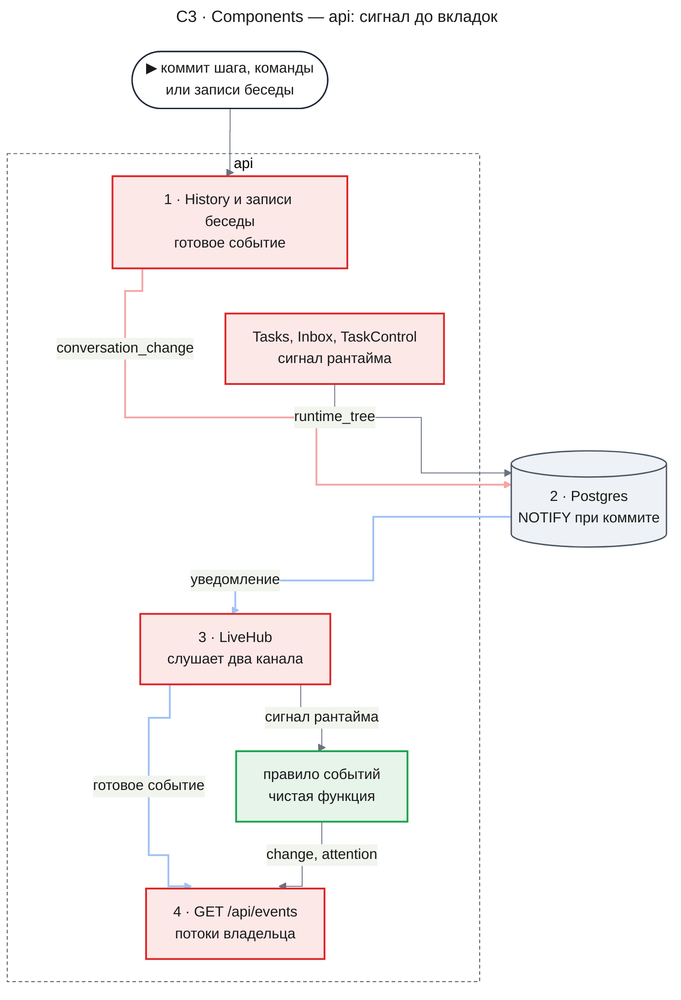
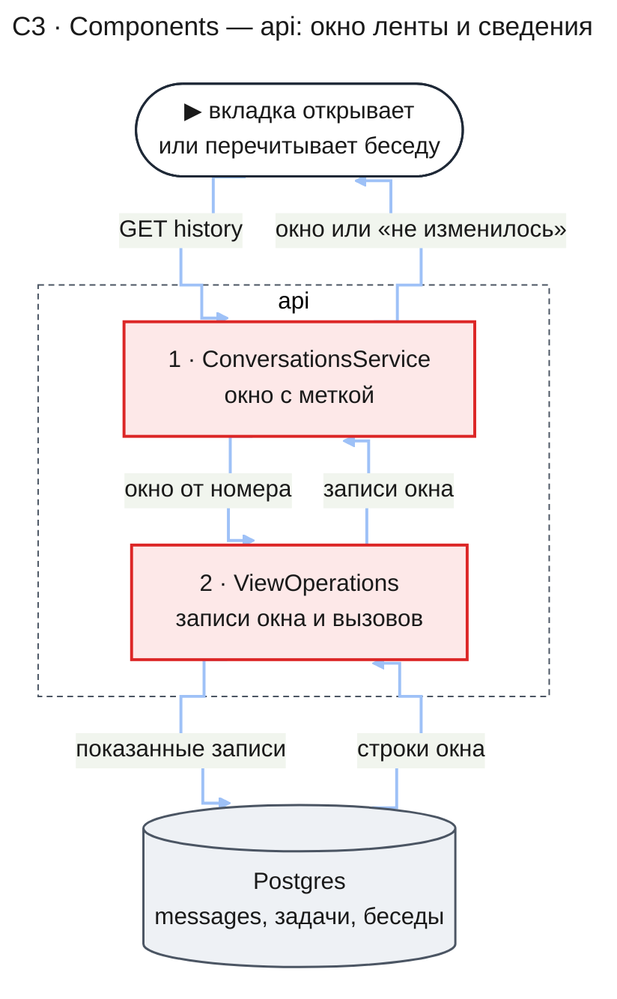
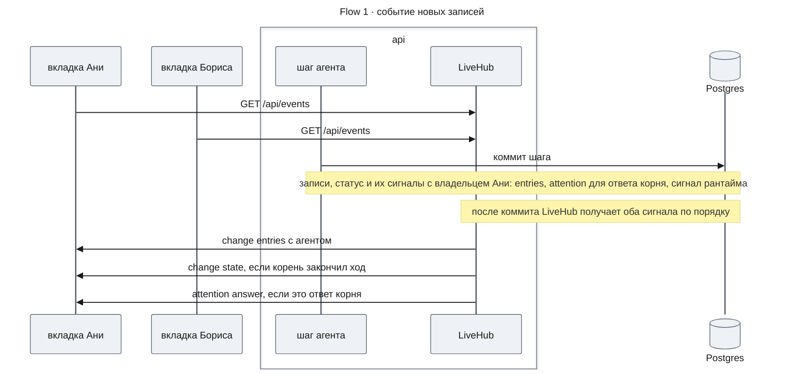
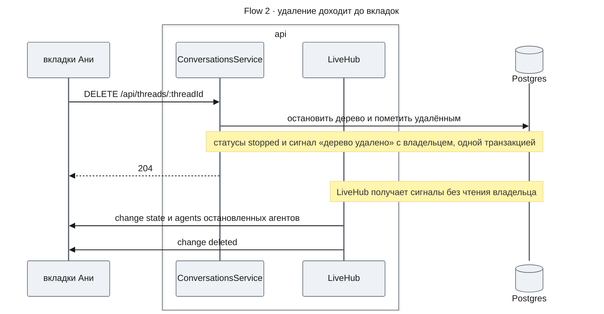
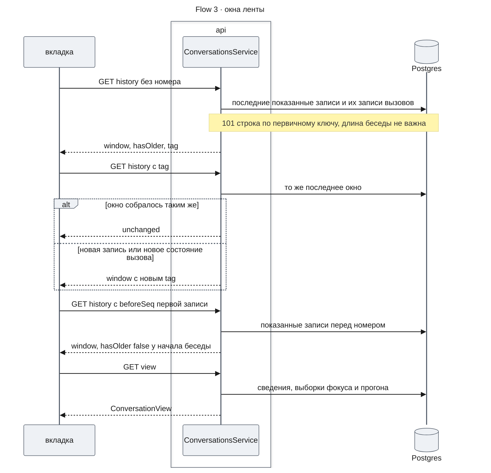
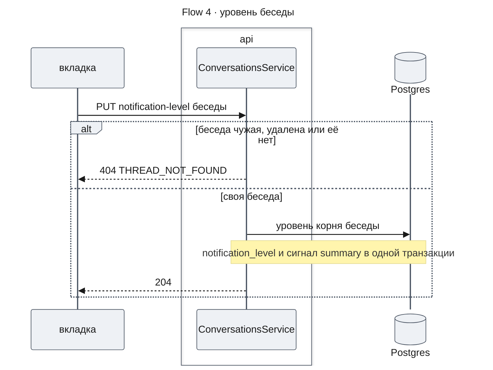

# Живой экран без лишних запросов, быстрые длинные беседы и уведомления — Design Document — server

**Status:** На утверждении · **Date:** 2026-11-28 · **PRD:** [prd.md](./prd.md) · **UXRD:** [uxrd.md](./uxrd.md) · **Depends on:** нет

## Snapshot

**Overview.** Вкладке, которая держит беседу открытой, нужно знать, что именно изменилось, чтобы перечитать одну часть экрана, а не все. Эта часть отдаёт вебу три вещи. Первая — живое событие, которое называет беседу, вид изменения и агента: рантайм сообщает о строках задач, слой агентов и api — о записях истории, названии, отметке «прочитано» и уровне уведомлений, а `LiveHub` раздаёт это вкладкам владельца, не спрашивая базу. Вторая — лента окнами по 100 записей: последнее окно, окно перед прочитанным и после него, у каждого окна метка, а сведения о беседе (состояние, очередь, решения, фокус, карточка прогона) читаются отдельным маршрутом без сбора всей истории. Третья — уровень уведомлений сотрудника и беседы, который хранит сервер.

- **Не меняется**: что показывают лента, список бесед и состояния в нём; правило состояния беседы и отметка «прочитано» (`improvements` FR-06); поток частей текста `delta`.
- **Главный риск**: место записи, которое забыло послать сигнал, оставит часть экрана устаревшей до следующего изменения ([Risks](#risks-and-mitigation)).
- **Открытые вопросы**: нет.

### Key Decisions

#### KD-1: О задачах говорит рантайм, о беседе — слой агентов и api, а виды изменения выводит `LiveHub`

Рантайм — общий движок и ничего не знает о беседах, поэтому его сигнал на канале `runtime_tree` называет только факт о строке задачи: задача создана, записан её статус, ей пришло или доставлено сообщение, дерево помечено удалённым. Сигнал несёт id корня, задачи и владельца, тип задачи и новый статус. Всё, что знает только верхний слой — записи истории агента, название, порядок в списке, отметка «прочитано», уровень уведомлений, — пишет новый канал `conversation_change`, и там лежит уже готовое событие для веба. `LiveHub` слушает оба канала и переводит сигнал рантайма в события чистой функцией ([pure-decision.md](../../code-system/patterns/pure-decision.md)) по таблице в «How the change kinds are derived». Отвергнуто: виды беседы в рантайме — движок узнал бы о беседах; одно событие «дерево изменилось» с перечитыванием на стороне веба — то, что фича убирает; вывод вида сравнением фактов до и после — нужна память о прошлом состоянии каждой беседы, а у `LiveHub` её нет.

#### KD-2: Сигнал несёт владельца, поэтому `LiveHub` не читает базу, и удаление доходит до вкладок

Каждый сигнал обоих каналов несёт id владельца, взятый из строки задачи или беседы в месте записи. `LiveHub` больше не ищет владельца по корню на каждое уведомление, а это чтение и теряло удаление: удалённая беседа владельца не имеет. Удаление дерева само шлёт сигнал рантайма «дерево удалено» в той же транзакции, что и пометка, и вкладки получают `deleted`. Сигнал помещается в предел NOTIFY в 8000 байт с запасом: в нём несколько uuid и короткие строки. Postgres складывает одинаковые сигналы одной транзакции в один. Поэтому две записи в историю одного агента за коммит дают одно событие `entries`, а записи разных агентов и разные факты одной транзакции приходят отдельно и в порядке записи. Отвергнуто: оставить поиск владельца и кэшировать его в `LiveHub` — кэш живёт дольше беседы и нарушает правило «в памяти только потоки» (ADR-0001).

#### KD-3: Уведомление вызывает событие `attention`, которое пишется вместе с фактом, а не выводится из состояния

Для уведомления браузера сервер шлёт отдельное событие `attention` трёх видов. Решение открылось — рантайм создал задачу-вопрос в дереве беседы. Ответ готов — в историю корня записан ответ модели без вызовов инструментов. Ход упал — в историю корня записано событие `failed`. Это те же факты, из которых правило состояния беседы выводит «ждёт вас», «новый ответ» и «сбой» (`conversationState`). Но событие рождается один раз, в коммите факта, поэтому правило не дублируется и не срабатывает повторно, пока состояние держится. Конец сабагента пишется в его собственную историю и `attention` не даёт (AC-08.3). Отвергнуто: веб сравнивает состояния беседы до и после — он не знает прошлого состояния бесед, которых нет на загруженной странице списка; сервер хранит последнее объявленное состояние — новое поле ради копии того, что уже выводится.

#### KD-4: Окно — 100 показанных записей с конца, назад или вперёд от номера записи; беседа открывается последним окном

Окно — до `HISTORY_WINDOW_SIZE` = 100 показанных записей истории по порядку. Это объём, на котором задан бюджет API сообщений беседы (`chat-shell` NFR-05). Без параметров маршрут отдаёт последнее окно, с `beforeSeq` — окно перед этой записью, с `afterSeq` — окно после неё. Ответ говорит, есть ли записи раньше (`hasOlder`) и позже (`hasNewer`). Курсор — сам номер `seq`: веб уже знает номера записей и сравнивает с ними отметку «прочитано» и найденную поиском запись. Беседа открывается последним окном. Непрочитанное влезает в одно окно ровно тогда, когда первый непрочитанный ответ лежит в последнем окне, и тогда веб ставит разделитель внутри окна, а иначе стоит на последней записи. Поэтому у сервера нет своего правила «первого непрочитанного», которое разошлось бы с правилом разделителя веба. Переход из поиска к давней записи `s` — два чтения, `beforeSeq = s + 1` и `afterSeq = s`, а не догрузка окна за окном с конца. Чтение вперёд добавляет серверу второе направление запроса, а веб должен уметь показывать ленту, которая не доходит до последней записи. Без него переход к записи в начале беседы из 5000 записей занял бы до 50 последовательных чтений. Отвергнуто: непрозрачный курсор, как у списка бесед, — он прячет номер, который веб уже держит; отдельное окно «вокруг записи» — то же, что два чтения, третьим режимом маршрута.

#### KD-5: Метка окна — отпечаток собранного ответа

Сервер собирает окно целиком и строит метку из того, что в нём отдаёт: записей с состояниями их вызовов, выведенных записей остановки и признаков `hasOlder` и `hasNewer`. Если метка совпала с переданной, ответ — «не изменилось» без записей. Отпечаток не может ответить «не изменилось» на изменённое окно. Окно меняется и без новой записи в его отрезке: состояние вызова в ответе модели берётся из более поздних записей вызова, у остановленного агента в конце окна появляются выведенные записи, а продолжение заменяет их настоящими с теми же номерами. Метка из последнего номера и числа записей пропустила бы все три случая. Метка экономит передачу и отрисовку, но не сборку окна. Сборка ограничена 100 записями и их записями вызовов, поэтому её цена не зависит от длины беседы.

#### KD-6: Сведения о беседе — отдельный маршрут без ленты и дерева; фокус и карточка прогона читаются выборкой

`GET /api/threads/:threadId/view` отдаёт сведения о беседе без записей ленты и без дерева агентов. Дерево читается существующим `GET /api/threads/:threadId/agents`, поэтому новая запись не заставляет перечитывать его (AC-06.1). У агента то же: `GET /api/agents/:agentId/view` — сведения, `GET /api/agents/:agentId/history` — окна. Фокус и сводка прогона тренера дают тот же результат без чтения всей истории. Фокус ищет с конца удачные результаты инструментов записей и брифов корня, пока не найдёт запись, о которой результат. Сводка прогона берёт удачные результаты четырёх инструментов тренера и первое сообщение сотрудника после каждого плана и предложения. Чистые функции `focusOf` и `testRunSummary` не меняются, им приходят только нужные записи. Отвергнуто: фокус из записей окна — он пропал бы, когда последнее действие с записью старше окна; фокус и сводка в ответе окна — PRD требует читать карточку прогона отдельно от окна (FR-04).

#### KD-7: Уровень сотрудника — поле его строки, уровень беседы — поле корня беседы

Уровень по умолчанию — новое поле `notification_level` строки `identity_users`, не пустое, «все события» по умолчанию. Так хранится язык сотрудника: значение, которое он выбирает сам, лежит в его строке с CHECK по набору из контрактов. Уровень беседы — новое поле `notification_level` корневой строки `conversations`; пустое значение значит «как по умолчанию». Так хранится отметка «прочитано». Строка беседы появляется с первым сообщением, но уровень выбирают в меню строки списка, где беседа уже есть. Ответвление начинает без своего уровня, как без разрешений беседы. Применяет уровни веб, сервер их только хранит и отдаёт. Отвергнуто: таблица `settings` — там значения администратора для всей платформы; отдельная таблица уровней бесед — у значения нет жизни отдельно от строки беседы; хранение в браузере — PRD требует один уровень на всех устройствах (AC-05.2).

## Terms

- **Показанная запись** — запись истории, которую лента показывает: все виды, кроме служебных записей вызова (`tool_confirmation`, `tool_decision`, `tool_sent`, `run_attempt`). Номера показанных записей идут с пропусками.
- **Выведенная запись остановки** — запись, которой нет в таблице: у остановленного агента лента показывает его открытые вызовы закрытыми и событие остановки с номерами после последней настоящей записи.
- **Сигнал рантайма** — NOTIFY на канале `runtime_tree` о факте строки задачи.
- **Событие изменения** — SSE-событие `change` вкладке: беседа, вид изменения, иногда агент.
- **Событие внимания** — SSE-событие `attention`: решение открылось, ответ готов или ход упал.

## Part

- **Prerequisite ADRs**: [ADR-0001](../../adr/ADR-0001-durable-runtime-owner.md) (runtime — владелец задач, в памяти API только потоки), [ADR-0022](../../adr/ADR-0022-one-database-and-nestjs-modules.md) (одна база, репозитории в `packages/db`), [ADR-0023](../../adr/ADR-0023-live-task-objects-one-stepping-process.md) (порядок записей в транзакции).

**Out of scope**

- Поток частей текста `delta` и `DeltaPublisher` остаются как есть.
- Правило состояния беседы (`conversationState`, `stateFacts`), список бесед, отметка «прочитано» и её маршрут не меняются; маршрут отметки только шлёт сигнал.
- Маршруты документов, задач агента, прогона глубокого агента и счётчика `GET /api/agents/awaiting` не меняются.
- Правило Dispatcher, который будит свой цикл по `runtime_tree` и не читает данные сигнала, не меняется.
- Что веб перечитывает на каждый вид, как ставит разделитель, когда показывает уведомление и как применяет уровни, решает часть `web`.

**Constraints**

- PoC без обратной совместимости. Событие `tree`, чтение ленты `afterSeq` с первой записи, общий ответ истории с лентой и сведениями, `HISTORY_PAGE_SIZE`, `rootOwner` и их тесты удаляются; контракты меняются одной версией. Часть `web` строится сразу после этой на той же ветке, и обе сливаются вместе.
- Новых таблиц и переменных окружения нет: два поля на существующих строках. Миграция `0000_schema.sql` и снимки перегенерируются на месте, dev-база пересоздаётся.
- Сигналы `runtime_tree` и `conversation_change` шлёт только код `packages/db`: один метод отправки на любом канале в открытой транзакции. Им пользуются рантайм, слой агентов и api; `DeltaPublisher` не меняется.
- Чтение окна держит бюджет `chat-shell` NFR-05 при любой длине беседы (NFR-02): запрос окна идёт по первичному ключу истории, сведения читают выборки по беседе без сбора всех записей.
- Логи идут через логгер `common`: `LiveHub` пишет канал, вид, id беседы, агента и владельца на каждое событие; чтение окна пишет направление, номер, число записей и «не изменилось».

## Building-block Inventory

Follows the [code system](../../code-system/README.md).

| Building block | Pattern | Status | Note |
|---|---|---|---|
| отправка сигнала в `packages/db` | [repository-over-transaction.md](../../code-system/patterns/repository-over-transaction.md) | extended | `notify` с готовыми данными на любом канале вместо `{rootId}` на одном |
| `Tasks`, `Inbox`, `TaskControl.deleteTree` | — | extended | сигнал называет факт строки задачи и владельца; удаление дерева шлёт сигнал |
| `History.append` | — | extended | событие `entries` агента и, для корня, `attention` ответа или сбоя |
| `ControlOperations` (название, порядок), `ConversationsService` (отметка, уровень) | — | extended | событие `summary` или `seen` в своей записи |
| правило событий из сигнала рантайма | [pure-decision.md](../../code-system/patterns/pure-decision.md) | new | искали в `live-filter.ts`, `chat-status.ts`: перевода факта задачи в вид беседы нет |
| `LiveHub` | — | extended | слушает `conversation_change`, не читает владельца, шлёт `change` и `attention` |
| окно истории в `ViewOperations` и `MessagesRepository` | [repository-over-transaction.md](../../code-system/patterns/repository-over-transaction.md) | extended | чтение назад и вперёд от номера, признаки соседних записей |
| выборки фокуса и прогона в `MessagesRepository` | [repository-over-transaction.md](../../code-system/patterns/repository-over-transaction.md) | extended | удачные результаты названных инструментов; первое сообщение после записи |
| `ConversationsService`, `AgentControlService` | — | extended | окно с меткой, сведения без ленты, уровень беседы |
| уровень сотрудника | — | extended | колонка `notification_level` строки `identity_users` и маршрут `PUT /api/auth/me/notification-level`, как `language` (KD-7) |

Описание сигнала в [packages/runtime.md](../../code-system/packages/runtime.md) и живых событий в [packages/api.md](../../code-system/packages/api.md) правится в том же изменении.

## Acceptance Criteria

### FR-01: Сигнал называет вид изменения

- From the PRD: AC-01.1, AC-01.2, AC-01.3.
- Удаление беседы доходит до всех вкладок владельца событием `deleted`.
- Запись служебной записи вызова (`tool_sent`, `run_attempt`) даёт событие `entries` этого агента, хотя лента не получает новой показанной записи: меняется состояние вызова.
- Остановка агента даёт событие `entries` его ленты: в окне появляются выведенные записи остановки.
- Переход корня или сабагента между `queued` и `running` событий не даёт.
- Ответ корня без вызовов инструментов даёт `attention` вида `answer`, событие `failed` в истории корня — `attention` вида `failure`, новая задача-вопрос в любом агенте дерева — `attention` вида `decision`. Ответ сабагента `attention` не даёт.

### FR-02: Лента читается окнами с конца

- From the PRD: AC-02.1, AC-02.2.
- AC-02.3 серверная половина заменяется (KD-4): при открытии сервер отдаёт последнее окно, и когда непрочитанное влезает в окно, первый непрочитанный ответ лежит в нём. Окна, которое начинается с первого непрочитанного ответа, сервер не строит; разделитель по `seenThroughSeq` ставит веб.
- Окно с `beforeSeq = s + 1` кончается записью `s`, окно с `afterSeq = s` начинается после неё; вместе они показывают найденную запись с соседями.
- Окна вперёд от первой записи до конца тоже дают каждую запись ровно один раз, и у последнего нет `hasNewer`.
- Лента агента и унаследованная им часть истории родителя читаются теми же окнами.

### FR-03: Метка окна

- From the PRD: AC-03.1, AC-03.2.
- Новая запись вызова, чей ответ модели лежит в окне, меняет метку окна, даже если сама запись вне его номеров.
- Остановка агента меняет метку его последнего окна.

### FR-04: Сведения о беседе читаются отдельно от окна

- From the PRD: AC-04.1, AC-04.2.
- Фокус беседы тот же, что при чтении всей истории, и когда последнее действие с записью старше любого окна.

### FR-05: Уровень уведомлений хранится на сервере

- From the PRD: AC-05.1, AC-05.2, AC-05.3.
- Ответвление беседы со своим уровнем начинает без уровня.
- Уровень вне набора `NotificationLevel` отвечает 400 `VALIDATION_FAILED`, и уровень не меняется.

## Design

### Architecture (C1–C4)

Контейнеры не меняются: веб, api с пакетами в одном процессе, Postgres. Меняются компоненты внутри api.

#### C3 · Components: api

**api — сигнал доходит до вкладок**

Готовое событие на канале `conversation_change` пишут `History.append`, `ControlOperations` (название, подъём в списке) и `ConversationsService` (отметка «прочитано», уровень беседы). Рантайм шлёт сигнал из трёх мест: `Tasks` — при создании задачи и записи её статуса, `Inbox` — когда задаче пришло или доставлено сообщение, `TaskControl.deleteTree` — когда дерево помечено удалённым. `History.append` — единственный писатель истории агента — шлёт `entries` при каждой записи, в том числе служебной записи вызова в `StepContext.guard`. Сигналы `conversation_change` уже содержат готовое событие, и `LiveHub` только раздаёт его, а сигнал рантайма переводит в события правилом. `deltaTargets` и `noteTargets` из `live-filter.ts` остаются: события `change` и `attention` идут во все потоки владельца, как раньше заметки `tree`.

#### How the change kinds are derived

Сигнал `conversation_change` пишет тот, кто знает беседу, и событие в нём готово:

| Место записи | Событие |
|---|---|
| `History.append` в историю агента | `change` `entries` с этим агентом |
| `History.append` в историю корня: ответ без вызовов инструментов | ещё `attention` `answer` |
| `History.append` в историю корня: событие `failed` | ещё `attention` `failure` |
| переименование, сгенерированное название, подъём беседы в списке после отправки, уровень беседы | `change` `summary` |
| отметка «прочитано» | `change` `seen` |

Сигнал рантайма правило переводит так:

| Сигнал рантайма | События |
|---|---|
| создан корень | `change` `created` |
| создана задача-вопрос | `change` `decision` и `attention` `decision` |
| создана другая задача | `change` `agents` |
| записан статус задачи-вопроса | `change` `decision` |
| записан статус корня `queued` или `running` | нет |
| записан любой другой статус корня | `change` `state` |
| записан статус сабагента `queued` или `running` | нет |
| записан любой другой статус сабагента | `change` `agents`; законченный статус — ещё `change` `state` |
| записан законченный статус любого агента | ещё `change` `entries` этого агента |
| агенту пришло или доставлено сообщение | `change` `queue` с этим агентом; сообщение корню — ещё `change` `state` |
| дерево помечено удалённым | `change` `deleted` |

Переход между `queued` и `running` случается на каждом шаге и ничего не меняет на экране: и то и другое — «работает». Существующий корень начинает отвечать только по сообщению: отправка, прерывание и оживление законченного корня — это сообщения. Поэтому «сообщение корню» и даёт `state`, а перезапуск создаёт новую задачу и даёт `created` или `agents`. Ответ на вопрос будит спрашивающего, но беседа уже «работает», а список узнаёт смену «ждёт вас» по `decision`. Законченный статус даёт `entries`, потому что остановка добавляет выведенные записи в ленту агента. Сигнал без владельца (задача без сотрудника) отбрасывается.

**api — вкладка читает окно и сведения**

`ViewOperations` строит окно из показанных записей по первичному ключу истории: последние 100, 100 перед номером или 100 после него, и на одну больше, чтобы узнать о соседних записях. К ответам модели окна он читает их записи вызовов по `(conversation_id, call_id)`. Выведенные записи остановки стоят в конце истории, поэтому попадают только в окно, которое доходит до конца. `ConversationsService` превращает записи в контракт, строит метку и сравнивает её с переданной. У агента то же делает `AgentControlService`; окно унаследованной части читает историю родителя не дальше `forkedThroughSeq`. Сведения о беседе (`GET view`) идут мимо окна: `ConversationsService` собирает то же, что раньше, кроме ленты и дерева, а фокус и сводка прогона берут записи выборками из истории корня (KD-6).

### Runtime Flows

#### Flow 1: новая запись агента доходит до вкладок владельца

**Starts when:** коммит шага агента записывает историю, for AC-01.1, AC-01.3

Сигналы уходят в транзакции коммита, поэтому откат шага не шлёт ничего, а повтор шага после сбоя шлёт события того коммита, который удался. Вкладка Бориса не получает событий о беседе Ани: `LiveHub` выбирает потоки по владельцу из сигнала. Пока у сервера нет ни одного потока, сигналы отбрасываются без разбора.

#### Flow 2: удаление беседы

**Starts when:** сотрудник удаляет беседу, for AC-01.2

Сигнал удаления идёт последним в транзакции, поэтому `deleted` приходит после событий остановки. Чтение сведений или окна удалённой беседы, запущенное этими событиями, отвечает 404 `THREAD_NOT_FOUND`, как для отсутствующей.

#### Flow 3: окно с меткой и окно перед прочитанным

**Starts when:** вкладка открывает беседу, перечитывает последнее окно по событию или прокручивает вверх, for AC-02.1, AC-02.2, AC-03.1, AC-03.2, AC-04.1, AC-04.2

Окна назад от последнего до первого не пересекаются и не оставляют пропусков, потому что граница — номер первой записи предыдущего окна, а номера в истории растут и не меняются. Если после чтения записалось больше 100 записей, новое последнее окно не перекрывает старое. Веб видит это по номеру первой записи и дочитывает окна назад или берёт новое окно целиком.

#### Flow 4: уровень уведомлений беседы

**Starts when:** сотрудник выбирает уровень беседы, for AC-05.2, AC-05.3

Другие вкладки и устройства узнают новый уровень по `summary` и перечитывают строку беседы. Уровень сотрудника меняет `PUT /api/auth/me/notification-level` тем же путём без сигнала: открытые вкладки на другом устройстве получают его при следующей загрузке.

### Contract Definitions

Все маршруты — под `/api`, за `SessionGuard`; чужая беседа или агент отвечают так же, как отсутствующие.

- **`GET /api/events`** — поток событий владельца, как раньше, с событиями `ready`, `change`, `attention`, `delta` и `ping`. События `tree` нет. `ready` приходит при открытии потока и после восстановления связи с базой: события перерыва потеряны, и веб перечитывает экран. Вид изменения, которого веб не знает, он читает как «перечитать всё»: сервер может добавить вид без новой версии веба.
- **Событие `change`** — данные `{threadId, kind, agentId?}`. `kind` — из набора `LiveChangeKind`; `agentId` есть у `entries` и `queue`.
- **Событие `attention`** — данные `{threadId, event}`; `event` — `decision`, `answer` или `failure`. Одно событие на факт, без текста ответа.
- **`GET /api/threads/:threadId/history`** — окно ленты корня. Параметры: `beforeSeq` или `afterSeq` (целое не меньше 0, не оба сразу) и `tag`. Возвращает `HistoryWindowResponse`. Ошибки: 400 `VALIDATION_FAILED` — оба номера сразу или номер не целое; 404 `THREAD_NOT_FOUND`.
- **`GET /api/threads/:threadId/view`** — сведения о беседе. Возвращает `ConversationView`. Ошибки: 404 `THREAD_NOT_FOUND`.
- **`GET /api/agents/:agentId/history`** — окно ленты агента, параметры и ответ — как у беседы. Ошибки: 400 `VALIDATION_FAILED`, 404 `AGENT_NOT_FOUND`.
- **`GET /api/agents/:agentId/view`** — сведения об агенте. Возвращает `AgentPageView`. Ошибки: 404 `AGENT_NOT_FOUND`.
- **`GET /api/agents/:agentId/inherited`** — окно унаследованной части: записи родителя ответвления с номерами не больше `forkedFrom.throughSeq`, параметры и ответ — как у окна. У агента без родителя ответвления — пустое окно без соседей. Ошибки: 400 `VALIDATION_FAILED`, 404 `AGENT_NOT_FOUND`.
- **`PUT /api/threads/:threadId/notification-level`** — тело `{level}`: значение `NotificationLevel` или `null` — «как по умолчанию». Возвращает 204 и шлёт `change` `summary`. Ошибки: 400 `VALIDATION_FAILED`, 404 `THREAD_NOT_FOUND`.
- **`PUT /api/auth/me/notification-level`** — тело `{level}`, значение `NotificationLevel`. Возвращает 204. Ошибки: 400 `VALIDATION_FAILED`.
- **`GET /api/auth/me`** — получает поле `notificationLevel`, по умолчанию `all`.
- **`ThreadSummary`** — получает поле `notificationLevel`: уровень беседы или `null`. Его отдают список, `GET /api/threads/:threadId`, `GET /api/threads/:threadId/forks`, ответвление и сведения о беседе.

**LiveChangeKind** — что изменилось и какие чтения это может изменить:

| Вид | Что изменилось | Какие чтения меняются |
|---|---|---|
| `created` | беседа появилась: первое сообщение, ответвление, расписание | список бесед |
| `deleted` | беседа удалена | список, счётчик ожиданий; любое чтение беседы отвечает 404 |
| `summary` | строка беседы: название, уровень, подъём в списке | список, `thread` в сведениях |
| `state` | могло смениться состояние корня | состояние в списке, `chat` в сведениях |
| `seen` | отметка «прочитано» | состояние в списке, `seenThroughSeq` |
| `entries` | записи в истории агента `agentId`, состояние их вызовов или выведенные записи остановки | окна этого агента и унаследованные окна его ответвлений; для корня — ещё `focus` и `training.run` в сведениях |
| `decision` | решение открыто или закончено в дереве | `decisions` в сведениях беседы и агента, состояние в списке, счётчик ожиданий |
| `queue` | очередь агента `agentId` | `pending` в сведениях этого агента |
| `agents` | агент создан, закончил или сменил статус | дерево агентов, `children` и `agent` в сведениях агента |

**HistoryWindowResponse** — одно из двух:

- `status: 'window'` — `entries`: до `HISTORY_WINDOW_SIZE` (100) показанных записей по возрастанию `seq`, форма записи — `HistoryEntry`; `hasOlder` — есть показанные записи раньше первой; `hasNewer` — есть записи позже последней, у последнего окна всегда `false`; `tag` — метка, непрозрачная строка до 64 символов.
- `status: 'unchanged'` — `tag`: переданная метка. Приходит, только когда окно с теми же параметрами собралось бы точно таким же.

У пустой истории окно без записей, без `hasOlder` и `hasNewer`. Окно перед первой записью или после последней — тоже пустое.

**ConversationView** — `thread`, `chat`, `pending`, `decisions`, `focus`, `training` и `seenThroughSeq` с прежним смыслом; полей `entries`, `nextAfterSeq` и `agents` нет. Дерево агентов отдаёт `GET /api/threads/:threadId/agents`.

**AgentPageView** — `agent`, `pending`, `decisions`, `children` и `training` с прежним смыслом; полей `entries` и `nextAfterSeq` нет.

**NotificationLevel** — `all` — все события; `decisions_and_failures` — решения и сбои; `off` — без уведомлений.

### Data Model

| Строка | Поле | Что хранит | По умолчанию |
|---|---|---|---|
| `identity_users` | `notification_level` | уровень уведомлений сотрудника, CHECK по `NotificationLevel` | `all` |
| `conversations`, корень | `notification_level` | уровень беседы, CHECK по `NotificationLevel`; пусто — как у сотрудника | пусто |

Поле беседы заполняется только у корня. Ответвление его не копирует. Уровень удаляется вместе со строкой. Существующие строки не переносятся: dev-база пересоздаётся.

Сигналы не хранятся. Сигнал рантайма — `{rootId, ownerId, taskId, type, change, status, waitReason}`; `change` — `created`, `status`, `message`, `delivered` или `deleted`. Сигнал `conversation_change` — `{ownerId, event}`, где `event` — готовое событие `change` или `attention`. Оба меньше килобайта.

## Security Considerations

- **Authentication & Authorization**: владельца в сигнал кладёт место записи из строки задачи или беседы, а не клиент, и `LiveHub` шлёт событие только потокам этого владельца (AC-01.3). Окна, сведения и уровни проверяют владельца, как прежние маршруты; чужая беседа и чужой агент отвечают как отсутствующие (NFR-03). Каждый новый маршрут — сведения беседы и агента, уровень беседы — покрыт e2e с двумя сотрудниками по образцу маршрута отметки «прочитано»; изменённые маршруты окон остаются в существующей матрице чужих id.
- **Input Validation**: параметры окна и тела уровней проверяют схемы `@agent-os/contracts`. Данные сигналов `LiveHub` разбирает теми же схемами и отбрасывает с предупреждением сигнал, который не разобрался.
- **Sensitive Data Handling**: сигналы и события несут только id, виды и статусы — без текста записей и названий. Логи пишут id и виды, секретов и текста ответов в них нет.

## Risks and Mitigation

- **Место записи не послало сигнал, и часть экрана устарела** — среднее влияние, средняя вероятность. Сигнал шлют единственные писатели: `History.append` для истории, `Tasks`, `Inbox` и `TaskControl` для задач. Таблицу перевода сигнала рантайма проверяет табличный тест чистой функции, а один e2e проверяет `change` `entries` с агентом и `deleted` после удаления.
- **Событие `attention` в перерыве связи потеряно** — низкое влияние. После `ready` веб перечитывает экран, и состояние беседы в списке показывает пропущенное.
- **Каждое перечитывание собирает окно целиком, даже когда ответ «не изменилось»** — низкое влияние. Окно ограничено 100 записями и их записями вызовов, и это держит бюджет `chat-shell` NFR-05 при любой длине беседы.
- **После отправки список может перечитаться дважды** — низкое влияние. Подъём беседы пишется после коммита сообщения и шлёт свой `summary`, поэтому чтение по `state` до подъёма поправит следующее чтение.
- **Уровень сотрудника, изменённый на другом устройстве, не доходит до открытой вкладки** — низкое влияние. Вкладка получает его при следующей загрузке; уровень беседы доходит сразу по `summary`.
- **Между частями `server` и `web` веб не собирается** — низкое влияние. Контракты меняются одной версией, и обе части сливаются вместе.

## Update History

| Version | Date | Change |
|---------|------|--------|
| 1.0 | 2026-11-28 | Первая версия |
