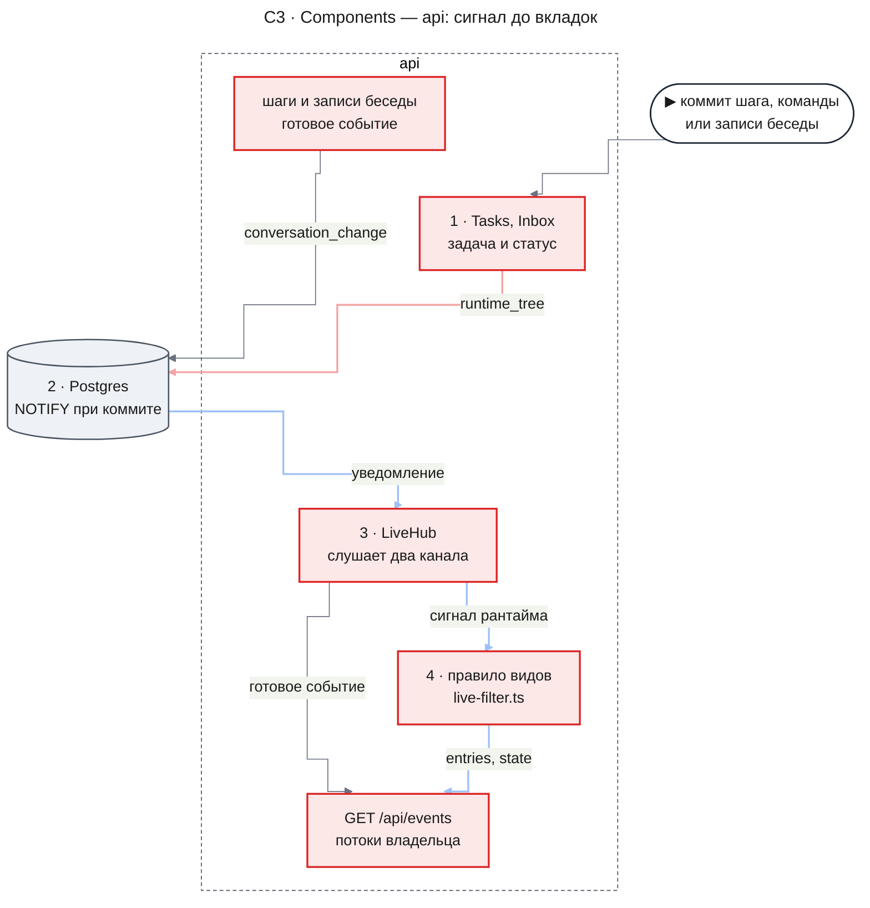
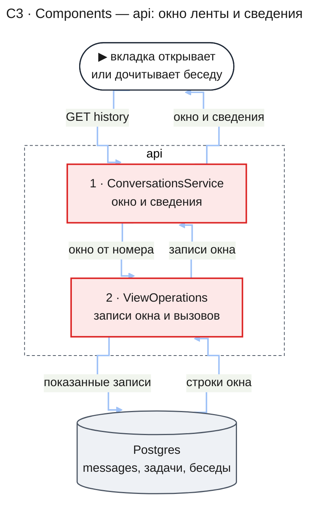
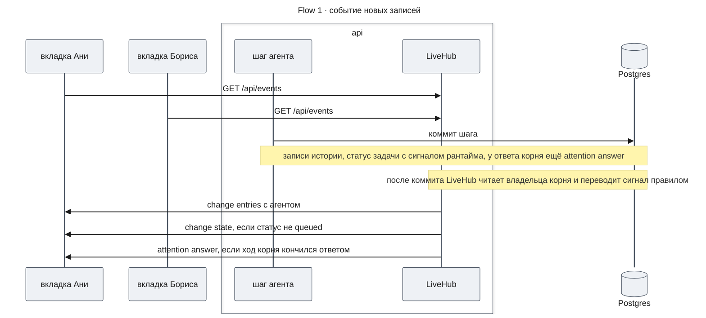
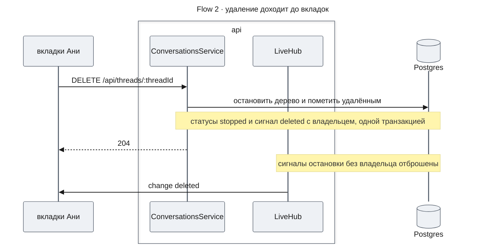
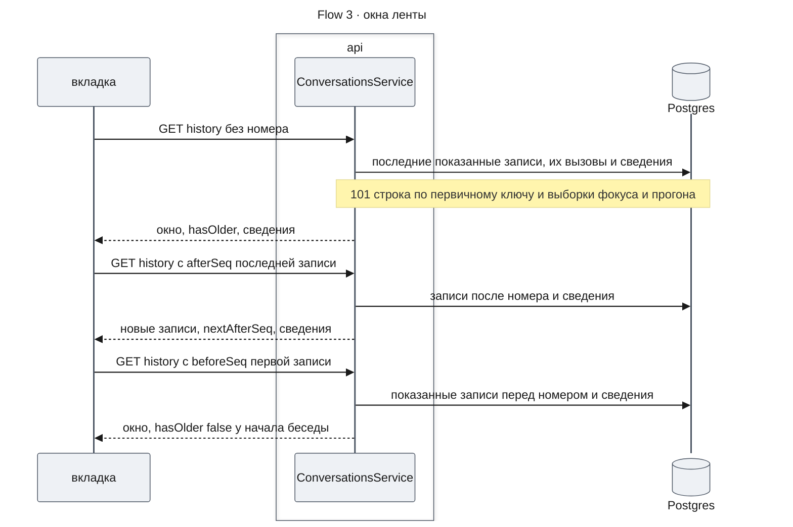

# Живой экран без лишних запросов, быстрые длинные беседы и уведомления — Design Document — server

**Status:** На утверждении · **Date:** 2026-11-28 · **PRD:** [prd.md](./prd.md) · **UXRD:** [uxrd.md](./uxrd.md) · **Depends on:** нет

## Snapshot

**Overview.** Часть меняет четыре места, которые уже работают. Сигнал рантайма `runtime_tree` получает id задачи и записанный статус, и `LiveHub` выводит из него, что изменилось: записи одного агента или состояние беседы. Записи, о которых рантайм не знает, — название, уровень уведомлений, удаление и три события для уведомлений — шлют свои места записи тем же методом отправки на канал `conversation_change`. Маршрут истории без номера отдаёт последнее окно в 100 записей и признак «есть старше», с `beforeSeq` — окно перед записью, а с `afterSeq` дочитывает новые записи, как сегодня. Фокус и карточка прогона тренера читаются выборками, без сбора всей истории. Совпадение поиска в результате инструмента получает номер записи, чтобы к нему можно было перейти. Сервер хранит уровень уведомлений сотрудника и беседы.

- **Не меняется**: что показывают лента, список бесед и состояния в нём; правило состояния беседы и отметка «прочитано» (`improvements` FR-06); поток частей текста `delta`; форма ответа истории — окно и сведения беседы по-прежнему приходят одним ответом.
- **Главный риск**: показанная запись, которую пишут без записи строки её задачи, не дойдёт до ленты до следующего события ([Risks](#risks-and-mitigation)).
- **Открытые вопросы**: нет.

### Key Decisions

#### KD-1: Записи агента и состояние беседы выводятся из сигнала рантайма, в который добавлены задача и статус

Сегодня рантайм шлёт `{rootId}` на каждую запись задачи: создание, смену статуса, сообщение и его доставку. Этот сигнал приходит и на каждом шаге, когда агент переходит между `queued` и `running`. По одному `rootId` нельзя отличить новую запись от смены состояния, и каждая часть экрана перечитывала бы всё на каждом шаге, как сегодня. Поэтому сигнал получает id задачи и статус, если запись его меняла. `LiveHub` переводит сигнал правилом из трёх строк ([How the change kinds are derived](#how-the-change-kinds-are-derived)). Правило лежит в `live-filter.ts` рядом с правилами потоков `LiveHub`, чтобы проверять его табличным тестом без базы ([pure-decision.md](../../code-system/patterns/pure-decision.md)).

Записи агента выводятся из статуса, а не из `History.append`. Шаг агента коммитит записи истории вместе с записью статуса своей задачи. Стоп пишет статус, прерывание пишет сообщение, создание задачи вставляет строку. Значит, каждая показанная запись уже уходит с сигналом своей задачи в той же транзакции. Служебные записи вызова, которые `StepContext.guard` пишет посреди шага, лента увидит при коммите шага, как и сегодня. Отвергнуто: сигнал из `History.append` — история не знает корня и владельца, и пришлось бы передавать их в каждое место вызова ради того, что сигнал статуса уже несёт.

Владельца сигнала рантайма `LiveHub` читает по корню, как сегодня (`rootOwner`), но только когда правило дало событие. Поэтому переход в `running` не стоит чтения базы.

#### KD-2: Записи беседы, о которых рантайм не знает, шлют готовое событие с владельцем на свой канал

Название, уровень беседы, удаление и события внимания пишет слой агентов или api, а не рантайм. Место записи шлёт `{ownerId, event}` с готовым событием тем же методом `notify` из `packages/db`, что и рантайм, на канал `conversation_change`. `LiveHub` раздаёт такое событие потокам владельца без правила и без чтения базы. Сигнал несёт владельца, потому что у помеченного удалённым корня `rootOwner` владельца не находит, и удаление не дошло бы до вкладок. Канал отдельный, потому что Dispatcher будит свой цикл на каждый сигнал `runtime_tree`, а движок о беседах не знает. Подъём беседы в списке после отправки своего сигнала не шлёт. Отправка пишет сообщение корню в той же транзакции ([runtime-fixes design-send.md](../runtime-fixes/design-send.md)), и сигнал этого сообщения даёт `state`, по которому список перечитывается.

#### KD-3: Четыре вида изменения — по числу разных перечитываний на вебе

Вид отдельный, только когда веб перечитывает по нему другое:

- **`entries`** с агентом — перечитать ленту этого агента;
- **`state`** — перечитать то, что зависит от состояния беседы: сведения беседы, дерево агентов, список, счётчик ожиданий;
- **`summary`** — перечитать строку беседы в списке: название и уровень;
- **`deleted`** — убрать беседу.

Создание беседы, смена статуса, очередь, решения и дерево агентов дают одно `state`: их читают одни и те же части экрана. Уровень беседы меняет только строку списка и даёт `summary`. Отметка «прочитано» события не даёт, как сегодня. Открытая вкладка пишет отметку на каждую новую запись, и `summary` за ней превратил бы каждую запись в чтение списка и второе чтение ленты (AC-06.1). Другие вкладки снимут «новый ответ» при следующем чтении списка. `deleted` нельзя заменить на `state`: открытая беседа прочитала бы 404 и показала «не найдено» вместо «удалена».

#### KD-4: Событие `attention` шлют три места записи в коммите шага, без хранения

Ответ готов — шаг модели корня закоммитил ответ без вызовов инструментов, и ход корня кончился. Решение открылось — шаг инструментов в любом агенте дерева задал вопрос (`effects.ask`). Ход упал — шаг корня закоммитил сбой (`failResult`). У каждого места в контексте шага есть корень и владелец. Событие уходит в транзакции коммита, поэтому повтор шага после сбоя даёт одно событие — от коммита, который удался. Сервер ничего о событиях не хранит. Новое уведомление о беседе заменяет старое по `tag` уведомления браузера, а это решает часть `web`. Из сигнала рантайма это событие не выводится: «ответ готов» — факт истории, и частичный ответ, который крючок обрыва шага пишет на «Прервать» и стоп ([runtime-fixes design-steps.md](../runtime-fixes/design-steps.md), KD-1), не должен звать сотрудника. По статусу эти два ответа не различить.

#### KD-5: Окно — 100 записей с конца; старше — по `beforeSeq`, новее — по `afterSeq`, как сегодня

Без номера маршрут истории отдаёт последнее окно — до `HISTORY_PAGE_SIZE` показанных записей с конца — и признак `hasOlder`. С `beforeSeq` он отдаёт окно перед этой записью. Чтение с `afterSeq` и `nextAfterSeq` не меняется: веб уже дочитывает им новые записи. `HISTORY_PAGE_SIZE` становится 100 вместо 500, потому что бюджет API сообщений беседы задан на 100 записей (`chat-shell` NFR-05).

Метки окна нет. Дочитывание по `afterSeq` ничего не теряет. Новые записи приходят с большими номерами. Состояние вызова в старом ответе веб обновляет по записи `tool_result`, которая приходит новой записью. До неё ответ держит состояние первого чтения, как сегодня, а решение по вызову показывает карточка решения из сведений. Выведенные записи остановки получают номера после последней настоящей, и продолжение пишет те же записи под теми же номерами (`resume.ts`). После переподключения веб дочитывает по `afterSeq`, как всегда.

Переход из поиска к давней записи `s` — два существующих чтения: `beforeSeq = s + 1` и `afterSeq = s`. Окно «вокруг записи» и признак `hasNewer` не нужны: «есть новее» уже говорит `nextAfterSeq`. Что из этого строить на экране, решает часть `web`.

Совпадение поиска в результате инструмента сегодня приходит без номера: `seq` в `ConversationMatch` есть только у сообщения. Пока лента читалась целиком, вызов уже был в загруженной ленте, а с окнами вебу нужен номер, чтобы дочитать окно. Поэтому `ConversationSearchRepository` отдаёт в `seq` номер записи `tool_result` и для совпадения в результате, в том числе в полном результате из `tool_results`. Новых полей нет: меняется только то, что `seq` у `tool_result` больше не `null`. Веб сегодня читает `seq` только у сообщения, поэтому прежнее чтение не ломается.

#### KD-6: Фокус и карточка прогона читают выборки вместо всей истории; сведения остаются в ответе окна

`wholeHistory` уходит. Фокусу и сводке прогона приходят только нужные им записи корня. Фокус получает удачные результаты инструментов записей и запуска по брифу, сводка — удачные результаты четырёх инструментов тренера и первое сообщение сотрудника после каждого плана и предложения. Чистые функции `focusOf` и `testRunSummary` не меняются. Каждая выборка — один запрос по беседе и видам записи, и её размер зависит от числа таких вызовов, а не от длины беседы. Сведения беседы остаются в том же ответе, что окно. Отдельный маршрут сведений не сэкономил бы ничего: новая запись корня меняет фокус и карточку прогона, и веб читал бы оба маршрута на каждое `entries`. Отвергнуто: фокус из записей окна — он пропал бы, когда последнее действие с записью старше окна.

#### KD-7: Уровень сотрудника — поле его строки, уровень беседы — поле корня беседы

Уровень по умолчанию — новое поле `notification_level` строки `identity_users`, не пустое, «все события» по умолчанию. Так хранится язык сотрудника. Уровень беседы — новое поле `notification_level` корневой строки `conversations`; пустое значение значит «как по умолчанию». Так хранится отметка «прочитано». Ответвление начинает без своего уровня. Применяет уровни веб, сервер их только хранит и отдаёт. Отвергнуто: таблица `settings` — там значения администратора; хранение в браузере — PRD требует один уровень на всех устройствах (AC-05.2).

## Terms

- **Показанная запись** — запись истории, которую лента показывает: все виды, кроме служебных записей вызова (`tool_confirmation`, `tool_decision`, `tool_sent`, `run_attempt`). Номера показанных записей идут с пропусками.
- **Выведенная запись остановки** — запись, которой нет в таблице: у остановленного агента лента показывает его открытые вызовы закрытыми и событие остановки с номерами после последней настоящей записи.
- **Сигнал рантайма** — NOTIFY на канале `runtime_tree` о записи строки задачи.
- **Событие изменения** — SSE-событие `change` вкладке: беседа, вид изменения, у `entries` — агент.
- **Событие внимания** — SSE-событие `attention`: решение открылось, ответ готов или ход упал.

## Part

- **Prerequisite ADRs**: [ADR-0001](../../adr/ADR-0001-durable-runtime-owner.md) (runtime — владелец задач, в памяти API только потоки), [ADR-0022](../../adr/ADR-0022-one-database-and-nestjs-modules.md) (одна база, репозитории в `packages/db`), [ADR-0023](../../adr/ADR-0023-live-task-objects-one-stepping-process.md) (порядок записей в транзакции).

**Out of scope**

- Поток частей текста `delta` и `DeltaPublisher` остаются как есть.
- Правило состояния беседы (`conversationState`, `stateFacts`), список бесед, отметка «прочитано» и её маршрут не меняются; маршрут отметки сигнала не шлёт, как сегодня.
- Унаследованная часть ленты агента (`GET /api/agents/:agentId/inherited`) не меняется: она не растёт после ответвления и читается один раз.
- Поиск по беседам не меняется, кроме номера записи у совпадения в результате инструмента (KD-5).
- Маршруты документов, задач агента, прогона глубокого агента, дерева агентов и счётчика `GET /api/agents/awaiting` не меняются.
- Dispatcher, который будит свой цикл по `runtime_tree` и не читает данные сигнала, не меняется.
- Что веб перечитывает на каждый вид, как ставит разделитель, как переходит к записи из поиска, когда показывает уведомление и как применяет уровни, решает часть `web`.

**Constraints**

- PoC без обратной совместимости. Событие `tree`, `wholeHistory`, чтение истории с первой записи по умолчанию и их тесты удаляются; контракты меняются одной версией. Часть `web` строится сразу после этой на той же ветке, и обе сливаются вместе.
- Новых таблиц и переменных окружения нет: два поля на существующих строках. Миграция `0000_schema.sql` и снимки перегенерируются на месте, dev-база пересоздаётся.
- Сигналы обоих каналов шлёт один метод `notify` из `packages/db` в открытой транзакции; `DeltaPublisher` не меняется.
- Чтение истории держит бюджет `chat-shell` NFR-05 при любой длине беседы (NFR-02): окно идёт по первичному ключу истории, выборки фокуса и прогона не читают всю историю.
- Логи идут через логгер `common`: `LiveHub` пишет канал, вид, id беседы, агента и владельца на каждое событие; чтение истории пишет направление, номер и число записей.

## Building-block Inventory

Follows the [code system](../../code-system/README.md).

| Building block | Pattern | Status | Note |
|---|---|---|---|
| `notify` в `packages/db` | [repository-over-transaction.md](../../code-system/patterns/repository-over-transaction.md) | extended | данные сигнала — объект, а не только `rootId` |
| `Tasks`, `Inbox` | — | extended | сигнал называет задачу и записанный статус |
| правило видов в `live-filter.ts` | [pure-decision.md](../../code-system/patterns/pure-decision.md) | extended | рядом с `noteTargets` и `deltaTargets`: сигнал рантайма → `entries` и `state` |
| `LiveHub` | — | extended | слушает `conversation_change`, шлёт `change` и `attention` вместо `tree` |
| шаг модели, шаг инструментов, `failResult` | [step-handler.md](../../code-system/patterns/step-handler.md) | extended | `attention` в коммите шага |
| `ConversationsService` (название, уровень), `ControlOperations` (сгенерированное название, удаление) | — | extended | `summary` или `deleted` в своей записи |
| окно истории в `ViewOperations` и `MessagesRepository` | [repository-over-transaction.md](../../code-system/patterns/repository-over-transaction.md) | extended | последнее окно, окно перед номером, `hasOlder` |
| выборки фокуса и прогона в `MessagesRepository` | [repository-over-transaction.md](../../code-system/patterns/repository-over-transaction.md) | extended | удачные результаты названных инструментов; первое сообщение после записи |
| `ConversationSearchRepository` | — | extended | `seq` записи результата у совпадения `tool_result` (KD-5) |
| уровень сотрудника | — | extended | колонка `notification_level` строки `identity_users` и маршрут `PUT /api/auth/me/notification-level`, как `language` (KD-7) |

Описание сигнала в [packages/runtime.md](../../code-system/packages/runtime.md) и живых событий в [packages/api.md](../../code-system/packages/api.md) правится в том же изменении.

## Acceptance Criteria

### FR-01: Сигнал называет вид изменения

- From the PRD: AC-01.1, AC-01.3, AC-01.4.
- AC-01.2 сервер выполняет четырьмя видами (KD-3): создание, состояние, очередь, решения и дерево агентов дают `state`; название и уровень — `summary`; удаление — `deleted`. Отметка «прочитано» события не даёт (KD-3). Подъём беседы в списке после отправки приходит как `state` от сообщения в той же транзакции.
- Удаление беседы доходит до всех вкладок владельца событием `deleted`, а события остановки удаляемого дерева не приходят.
- Переход агента в `running` событий не даёт, переход в `queued` даёт только `entries` этого агента.
- Ответ корня без вызовов инструментов даёт `attention` `answer`, сбой корня — `attention` `failure`, вопрос в любом агенте дерева — `attention` `decision`. Ответ сабагента `attention` не даёт. Частичный ответ, который обрыв шага пишет на «Прервать» или стоп, даёт `change` `entries` без `attention`.

### FR-02: Лента читается окнами с конца

- From the PRD: AC-02.1, AC-02.2, AC-02.3, AC-02.4.
- AC-02.3 — серверная половина: при открытии сервер отдаёт последнее окно; разделитель по `seenThroughSeq` ставит веб.
- AC-02.4 — два чтения `beforeSeq = s + 1` и `afterSeq = s`; «дальше есть ещё» назад говорит `hasOlder`, вперёд — `nextAfterSeq`.
- Окно агента читается так же, как окно беседы.
- Совпадение поиска в результате инструмента несёт `seq` записи `tool_result`, и окно `beforeSeq = seq + 1` её содержит.

### FR-03: Метка окна

- Не строится (KD-5): веб дочитывает новые записи по `afterSeq`. AC-03.1 и AC-03.2 убираются из PRD.

### FR-04: Сведения о беседе читаются без сбора всей истории

- From the PRD: AC-04.1, AC-04.2.
- Сведения приходят в том же ответе, что окно (KD-6). Фокус беседы тот же, что при чтении всей истории, и когда последнее действие с записью старше окна.

### FR-05: Уровень уведомлений хранится на сервере

- From the PRD: AC-05.1, AC-05.2, AC-05.3.
- Ответвление беседы со своим уровнем начинает без уровня.
- Уровень вне набора `NotificationLevel` отвечает 400 `VALIDATION_FAILED`, и уровень не меняется.

## Design

### Architecture (C1–C4)

Контейнеры не меняются: веб, api с пакетами в одном процессе, Postgres. Меняются компоненты внутри api.

#### C3 · Components: api

**api — сигнал доходит до вкладок**

Рантайм шлёт сигнал из тех же мест, что сегодня: `Tasks` — при создании задачи и записи её статуса, `Inbox` — когда задаче пришло или доставлено сообщение. Готовое событие на `conversation_change` шлют шаг модели, шаг инструментов и `failResult` (события внимания), `ConversationsService` (переименование, уровень беседы) и `ControlOperations` (сгенерированное название, удаление). `deltaTargets` и `noteTargets` из `live-filter.ts` остаются: события `change` и `attention` идут во все потоки владельца, как раньше `tree`.

#### How the change kinds are derived

| Сигнал рантайма о задаче X | События |
|---|---|
| записан статус `running` | нет |
| записан статус `queued` | `change` `entries` агента X |
| записан другой статус; задача создана; X пришло или доставлено сообщение | `change` `entries` агента X и `change` `state` |

`running` — это захват задачи на шаг, и он ничего не пишет в историю. `queued` пишет коммит шага, после которого агент продолжает, и состояние беседы от этого не меняется. Всё остальное меняет то, что видно в сведениях, дереве или списке. Так, сообщение корню оживляет законченный корень, создание задачи-вопроса открывает решение, а конец сабагента меняет дерево. `entries` задачи-вопроса никто не слушает: у вопроса нет ленты. Сигнал корня без владельца — удалённой беседы или дерева другого типа — отбрасывается.

| Место записи (`conversation_change`) | Событие |
|---|---|
| шаг модели корня: ответ без вызовов инструментов кончает ход | `attention` `answer` |
| шаг инструментов любого агента задаёт вопрос | `attention` `decision` |
| `failResult` корня | `attention` `failure` |
| переименование, сгенерированное название, уровень беседы | `change` `summary` |
| удаление беседы | `change` `deleted` |

**api — вкладка читает окно и сведения**

`ViewOperations` читает показанные записи по первичному ключу истории: последние 100, 100 перед номером или 100 после него. Чтобы узнать `hasOlder`, он берёт на одну запись больше. К ответам модели окна он читает их записи вызовов по `(conversation_id, call_id)`, как сегодня. Выведенные записи остановки стоят в конце истории, поэтому попадают только в окно, которое доходит до конца. Сведения `ConversationsService` собирает как сегодня, а вместо `wholeHistory` фокус и сводка прогона получают выборки из `MessagesRepository` (KD-6). У агента то же делает `AgentControlService`.

### Runtime Flows

#### Flow 1: новая запись агента доходит до вкладок владельца

**Starts when:** коммит шага агента записывает историю, for AC-01.1, AC-01.3, AC-01.4

Сигналы уходят в транзакции коммита, поэтому откат шага не шлёт ничего, а повтор шага после сбоя шлёт события того коммита, который удался. Вкладка Бориса не получает событий о беседе Ани: `LiveHub` выбирает потоки по владельцу. Пока у сервера нет ни одного потока, сигналы отбрасываются без разбора.

#### Flow 2: удаление беседы

**Starts when:** сотрудник удаляет беседу, for AC-01.2

Сигналы остановки удаляемого дерева `LiveHub` отбрасывает: корень уже помечен удалённым, и `rootOwner` владельца не находит. Поэтому вкладки получают одно `deleted`. Чтение истории удалённой беседы отвечает 404 `THREAD_NOT_FOUND`, как для отсутствующей.

#### Flow 3: окна ленты

**Starts when:** вкладка открывает беседу, дочитывает её по событию или прокручивает вверх, for AC-02.1, AC-02.2, AC-04.1, AC-04.2

Окна назад от последнего до первого не пересекаются и не оставляют пропусков, потому что граница — номер первой записи предыдущего окна, а номера в истории растут и не меняются. Чтение по `afterSeq` после переподключения дочитывает пропущенное: если записей больше окна, веб читает дальше по `nextAfterSeq`, как сегодня.

#### Flow 4: уровень уведомлений беседы

**Starts when:** сотрудник выбирает уровень беседы, for AC-05.2, AC-05.3

```mermaid
---
title: "Flow 4 · уровень беседы"
config:
  theme: base
  look: classic
  themeVariables:
    primaryColor: "#eef1f5"
    primaryBorderColor: "#4b5563"
    primaryTextColor: "#1a1a1a"
    lineColor: "#6b7280"
  themeCSS: |
    @keyframes lit_f4{0%,22.5%{stroke:#991b1b;stroke-width:6px}25%,100%{stroke:#37474f;stroke-width:2px}}
    .messageLine0[data-id='i0'],.messageLine1[data-id='i0']{animation:lit_f4 4.8s linear 0s infinite}
    .messageLine0[data-id='i2'],.messageLine1[data-id='i2']{animation:lit_f4 4.8s linear 1.2s infinite}
    .messageLine0[data-id='i4'],.messageLine1[data-id='i4']{animation:lit_f4 4.8s linear 2.4s infinite}
    .messageLine0[data-id='i6'],.messageLine1[data-id='i6']{animation:lit_f4 4.8s linear 3.6s infinite}
---
sequenceDiagram
    participant Web as вкладка
    box api
        participant Conv as ConversationsService
    end
    participant DB@{ "type": "database" } as Postgres
    Web->>Conv: PUT notification-level беседы
    alt беседа чужая, удалена или её нет
        Conv-->>Web: 404 THREAD_NOT_FOUND
    else своя беседа
        Conv->>DB: уровень корня беседы
        Note over Conv,DB: notification_level и сигнал summary в одной транзакции
        Conv-->>Web: 204
    end
```

Другие вкладки и устройства узнают новый уровень по `summary` и перечитывают строку беседы. Уровень сотрудника меняет `PUT /api/auth/me/notification-level` без сигнала: вкладка на другом устройстве получает его при следующей загрузке.

### Contract Definitions

Все маршруты — под `/api`, за `SessionGuard`; чужая беседа или агент отвечают так же, как отсутствующие.

- **`GET /api/events`** — поток событий владельца, как раньше, с событиями `ready`, `change`, `attention`, `delta` и `ping`. События `tree` нет. `ready` приходит при открытии потока и после восстановления связи с базой: события перерыва потеряны, и веб перечитывает экран. Вид изменения, которого веб не знает, он читает как «перечитать всё».
- **Событие `change`** — данные `{threadId, kind, agentId?}`. `kind` — из набора `LiveChangeKind`; `agentId` есть только у `entries`.
- **Событие `attention`** — данные `{threadId, event}`; `event` — `decision`, `answer` или `failure`. Одно событие на факт, без текста ответа.
- **`GET /api/threads/:threadId/history`** — окно ленты корня и сведения беседы, ответ `ConversationView`. Без номера — последнее окно; `beforeSeq` — окно перед записью; `afterSeq` — записи после неё, как сегодня. Номер — целое не меньше 0; оба номера сразу нельзя. Ошибки: 400 `VALIDATION_FAILED` — оба номера сразу или номер не целое; 404 `THREAD_NOT_FOUND`.
- **`GET /api/agents/:agentId/history`** — окно ленты агента и его сведения, ответ `AgentPageView`; параметры и ошибки — как у беседы, с 404 `AGENT_NOT_FOUND`.
- **`PUT /api/threads/:threadId/notification-level`** — тело `{level}`: значение `NotificationLevel` или `null` — «как по умолчанию». Возвращает 204 и шлёт `change` `summary`. Ошибки: 400 `VALIDATION_FAILED`, 404 `THREAD_NOT_FOUND`.
- **`PUT /api/auth/me/notification-level`** — тело `{level}`, значение `NotificationLevel`. Возвращает 204. Ошибки: 400 `VALIDATION_FAILED`.
- **`GET /api/auth/me`** — получает поле `notificationLevel`, по умолчанию `all`.
- **`GET /api/search`** — как сегодня; у совпадения с `place: 'tool_result'` поле `seq` — номер записи `tool_result` в истории агента, где нашлось совпадение, а не `null`.
- **`ThreadSummary`** — получает поле `notificationLevel`: уровень беседы или `null`. Его отдают список, `GET /api/threads/:threadId`, `GET /api/threads/:threadId/forks`, ответвление и сведения беседы.

**LiveChangeKind** — что изменилось и какие чтения это может изменить:

| Вид | Что изменилось | Какие чтения меняются |
|---|---|---|
| `entries` | записи истории агента `agentId` или его очередь | история этого агента и его задачи; для корня — ещё `focus` и `training` в сведениях |
| `state` | беседа создана, сменились статус агента, очередь, решения или дерево | сведения беседы и её агентов, дерево агентов, состояние в списке, счётчик ожиданий |
| `summary` | строка беседы: название, уровень | список, `thread` в сведениях |
| `deleted` | беседа удалена | список, счётчик ожиданий; любое чтение беседы отвечает 404 |

Трекер задач перечитывает задачу по `entries` и `state` её бесед и своего вида не добавляет ([task-tracker design-server.md](../task-tracker/design-server.md)).

**ConversationView** и **AgentPageView** — поля как сегодня, плюс `hasOlder`. `entries` — до `HISTORY_PAGE_SIZE` (100) показанных записей по возрастанию `seq`. `hasOlder` — есть показанные записи раньше первой записи ответа; веб читает его в ответах без номера и с `beforeSeq`. `nextAfterSeq` — как сегодня в ответе с `afterSeq`, в остальных `null`. У пустой истории окно без записей и `hasOlder` false.

**NotificationLevel** — `all` — все события; `decisions_and_failures` — решения и сбои; `off` — без уведомлений.

### Data Model

| Строка | Поле | Что хранит | По умолчанию |
|---|---|---|---|
| `identity_users` | `notification_level` | уровень уведомлений сотрудника, CHECK по `NotificationLevel` | `all` |
| `conversations`, корень | `notification_level` | уровень беседы, CHECK по `NotificationLevel`; пусто — как у сотрудника | пусто |

Поле беседы заполняется только у корня. Ответвление его не копирует. Существующие строки не переносятся: dev-база пересоздаётся.

Сигналы не хранятся. Сигнал рантайма — `{rootId, taskId, status?}`; `status` есть, когда запись сменила статус. Сигнал `conversation_change` — `{ownerId, event}`, где `event` — готовое событие `change` или `attention`. Оба меньше килобайта.

## Security Considerations

- **Authentication & Authorization**: владельца события рантайма `LiveHub` читает по корню, как сегодня; владельца в `conversation_change` кладёт место записи из строки беседы или контекста шага, а не клиент. Событие идёт только потокам этого владельца (AC-01.3). История и уровни проверяют владельца, как прежние маршруты; чужая беседа и чужой агент отвечают как отсутствующие (NFR-03). Новый маршрут уровня беседы покрыт e2e с двумя сотрудниками по образцу маршрута отметки «прочитано»; маршруты истории остаются в существующей матрице чужих id.
- **Input Validation**: номера окна и тела уровней проверяют схемы `@agent-os/contracts`. Данные сигналов `LiveHub` разбирает теми же схемами и отбрасывает с предупреждением сигнал, который не разобрался.
- **Sensitive Data Handling**: сигналы и события несут только id, виды и статусы — без текста записей и названий. Логи пишут id и виды, секретов и текста ответов в них нет.

## Risks and Mitigation

- **Показанная запись без записи строки задачи не дойдёт до ленты** — среднее влияние, низкая вероятность. Сегодня все такие записи пишут коммит шага, стоп, прерывание и создание задачи, и все они пишут строку задачи (KD-1). Табличный тест правила проверяет перевод сигнала, а один e2e — `change` `entries` с агентом после шага и `deleted` после удаления.
- **Переход из поиска в начало длинной беседы** — низкое влияние. Если веб догружает окна назад до найденной записи, это до одного чтения на каждые 100 записей, и каждое заодно собирает сведения. Два чтения из KD-5 этого избегают; что выбрать, решает часть `web`.
- **Состояние вызова в старом ответе ждёт его результата** — низкое влияние, как сегодня: до записи `tool_result` блок вызова показывает состояние первого чтения, а решение по вызову видно на карточке решения.
- **Другая вкладка показывает «новый ответ» после того, как беседу прочитали в этой** — низкое влияние, как сегодня. Отметка «прочитано» события не шлёт, и метка уходит при следующем чтении списка.
- **Событие `attention` в перерыве связи потеряно** — низкое влияние. После `ready` веб перечитывает экран, и состояние беседы в списке показывает пропущенное.
- **Уровень сотрудника, изменённый на другом устройстве, не доходит до открытой вкладки** — низкое влияние. Вкладка получает его при следующей загрузке; уровень беседы доходит сразу по `summary`.
- **Между частями `server` и `web` веб не собирается** — низкое влияние. Контракты меняются одной версией, и обе части сливаются вместе.

## Update History

| Version | Date | Change |
|---------|------|--------|
| 1.0 | 2026-11-28 | Первая версия |
| 1.1 | 2026-11-28 | `attention` `answer` шлёт шаг модели корня, частичный ответ обрыва шага его не даёт; подъём в списке приходит в коммите отправки; трекер среди читателей `entries` и `state` |
| 1.2 | 2026-11-28 | Упрощение по ревью владельца: метки окна, `hasNewer`, отдельного маршрута сведений и окон унаследованной части нет; четыре вида изменения вместо девяти; `entries` и `state` выводятся из сигнала рантайма с задачей и статусом, `History.append` сигнала не шлёт; `conversation_change` несёт только записи беседы и события внимания; `LiveHub` читает владельца по корню, как сегодня; `HISTORY_PAGE_SIZE` — 100 |
| 1.3 | 2026-11-28 | По дизайну `web`: отметка «прочитано» события не шлёт; совпадение поиска в результате инструмента несёт `seq` записи |
