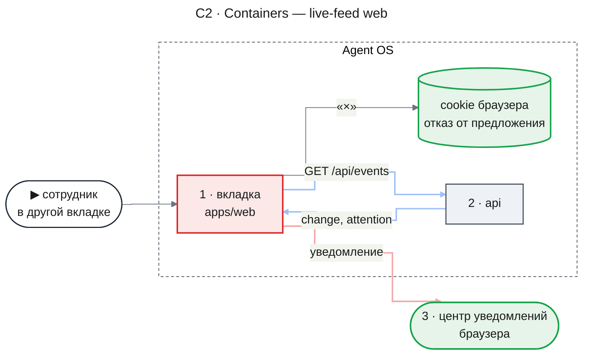
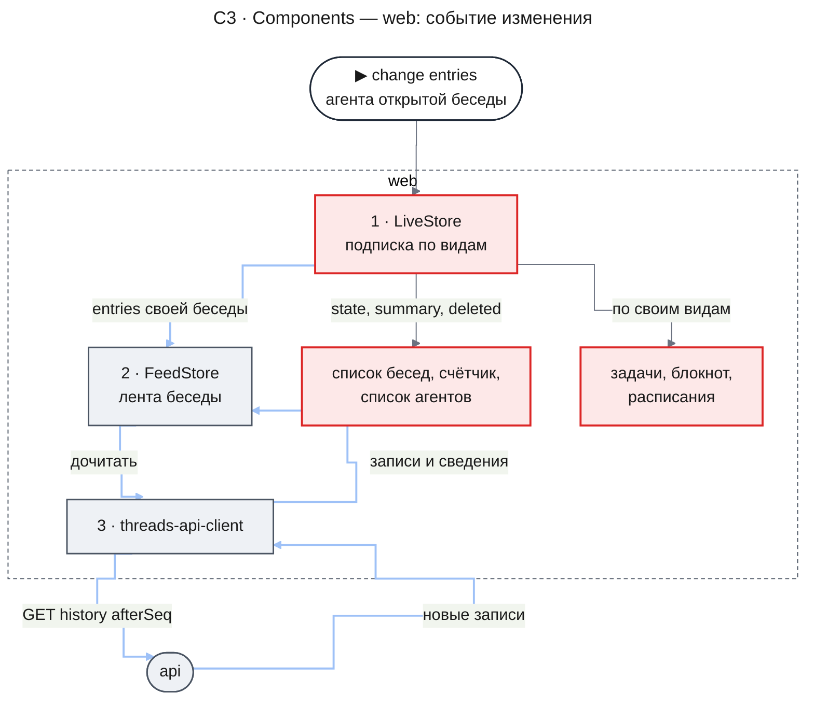
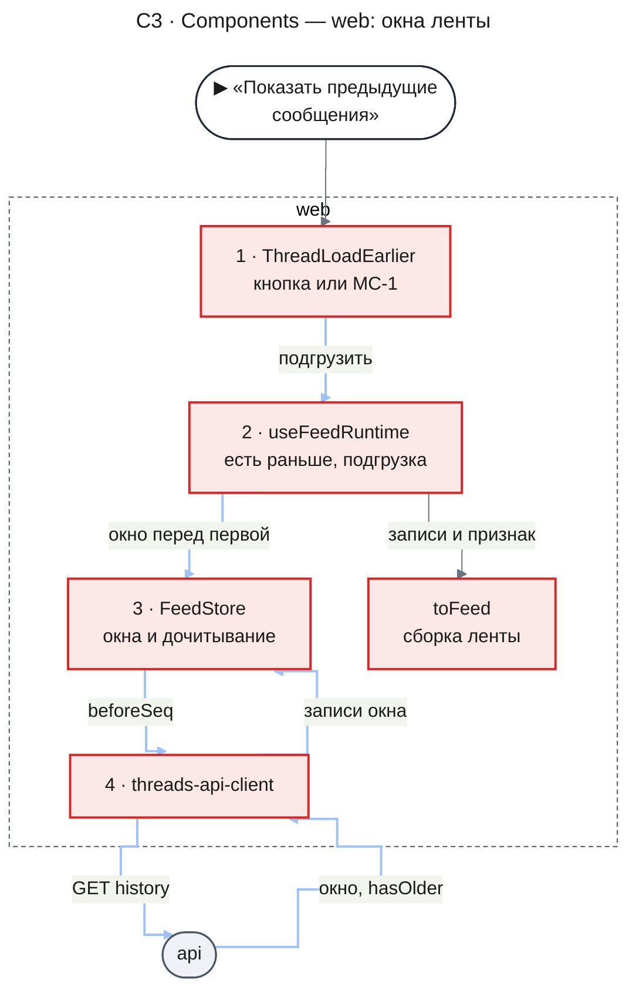
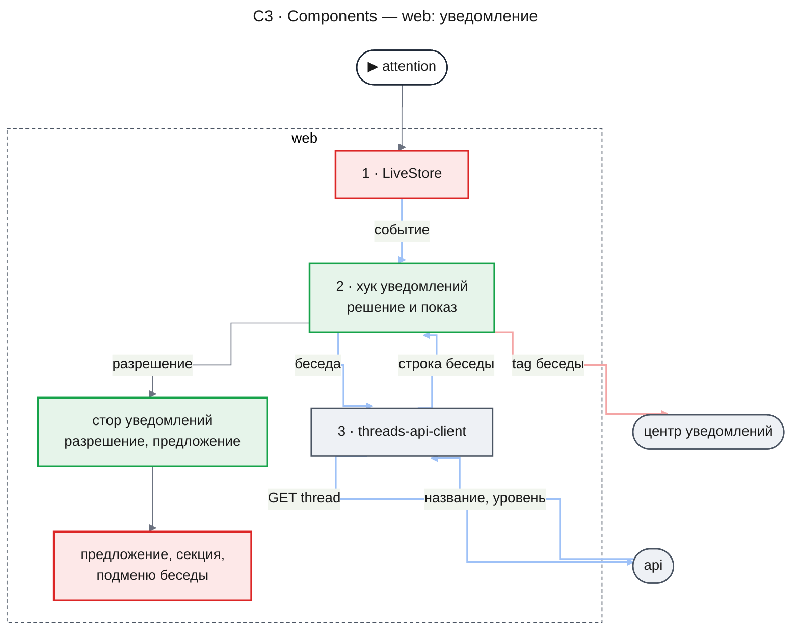
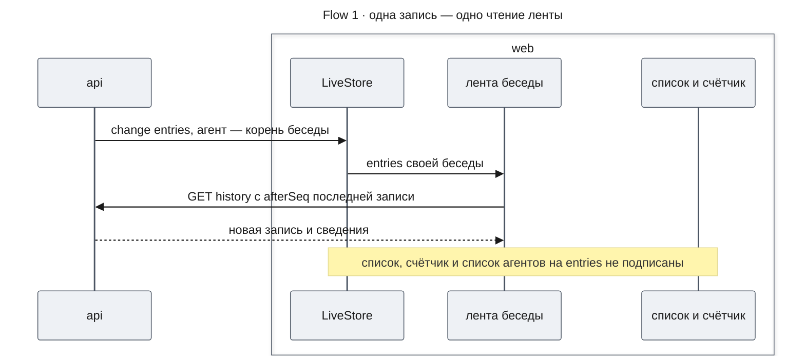
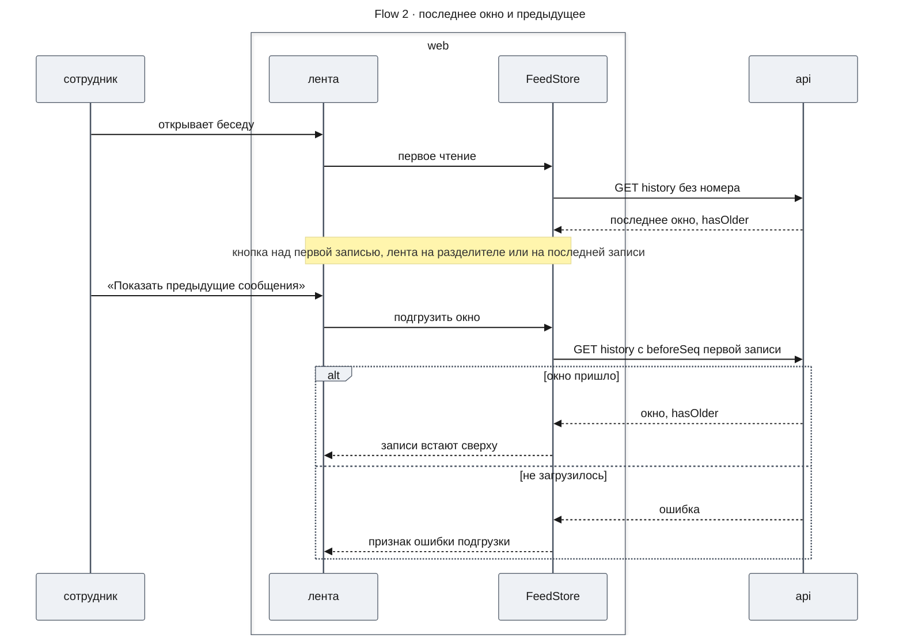
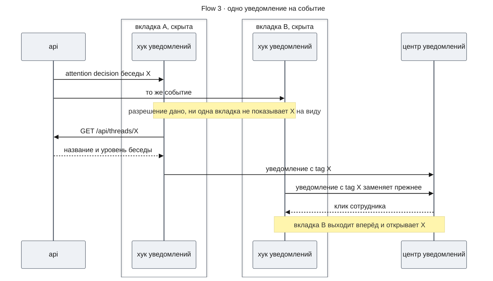
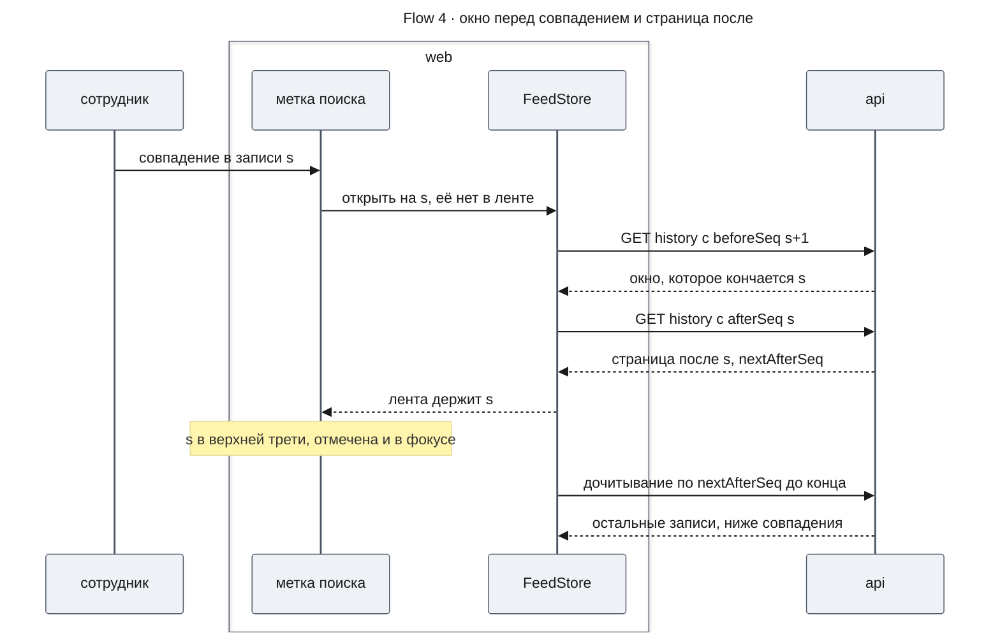
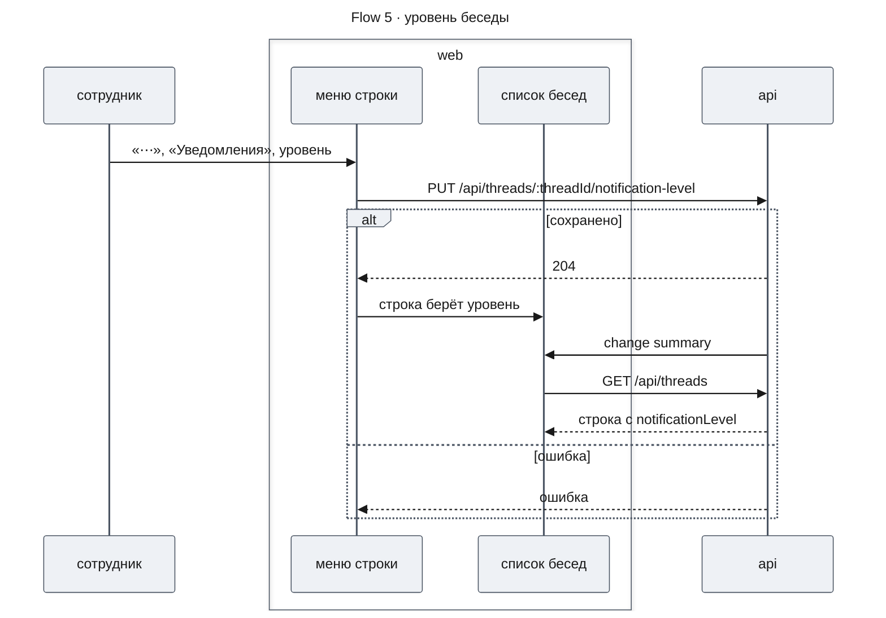

# Живой экран без лишних запросов, быстрые длинные беседы и уведомления — Design Document — web

**Status:** На утверждении · **Date:** 2026-11-28 · **PRD:** [prd.md](./prd.md) · **UXRD:** [uxrd.md](./uxrd.md) · **Depends on:** [design-server.md#contract-definitions](./design-server.md#contract-definitions)

## Snapshot

**Overview.** Часть переводит экран на то, что уже отдаёт сервер, и почти ничего не строит заново. Каждая часть экрана подписывается на живой поток только по тем видам изменения, которые её касаются: новая запись агента дочитывает одну ленту, а список бесед, счётчик и список агентов её не замечают. Лента открывается последним окном, а готовая кнопка «Показать предыдущие сообщения» включается и подгружает окна перед первой записью. Уведомления показывает хук оболочки по событию `attention`: он молчит, если сама вкладка показывает беседу на виду, сверяет уровень беседы и показывает уведомление браузера с меткой беседы, поэтому одно событие даёт одно уведомление, сколько бы вкладок его ни показали. Уровень по умолчанию выбирается в секции «Уведомления» на «Мой доступ», уровень беседы — в меню «⋯» её строки.

- **Не меняется**: что показывает лента, дочитывание новых записей по `afterSeq`, отметка «прочитано» и правило её отправки, повторное чтение всего экрана после `ready`, поток частей текста `delta`.
- **Главный риск**: подгрузка предыдущих сообщений может сдвинуть запись, на которую смотрит сотрудник; это проверяет спайк S-1 ([Risks](#risks-and-mitigation)).
- **Открытые вопросы**: нет.

### Key Decisions

#### KD-1: Виды изменения фильтрует подписка живого стора; неизвестный вид идёт путём `ready`

Сегодня восемь частей экрана слушают заметку `tree` и каждая перечитывает свои данные. Поток событий получает событие `change` с видом, и подписчик называет при подписке виды, которые его касаются; стор зовёт его только на них. Фильтр стоит в одном месте подписки, а не в каждом из восьми слушателей. Каждый слушатель перечитывает свои данные, как сегодня. Событие `change`, которое не разобралось схемой, в том числе с видом, которого веб не знает, стор не отбрасывает, а передаёт слушателям `ready`: они уже умеют перечитывать экран после переподключения (AC-06.3). Отвергнуто: новая шина событий или стор изменений — их некому использовать второй раз; разбор неизвестного вида в каждом слушателе — восемь копий одного правила. Ручной сигнал после удаления в этой вкладке уходит: сервер сам шлёт `deleted` всем вкладкам владельца ([design-server.md](./design-server.md), KD-2).

#### KD-2: Лента открывается последним окном; кнопка подгрузки включается признаками библиотеки ленты

Первое чтение ленты идёт без номера и получает последнее окно и признак `hasOlder`. Дочитывание новых записей по `afterSeq` остаётся прежним. Кнопка «Показать предыдущие сообщения» с подписью загрузки, объявлением и переносом фокуса уже есть в ленте и молчит только потому, что рантайм ленты не получает признак «есть раньше» и обработчик подгрузки (MC-41 chat-shell UXRD). Обработчик читает окно перед первой записью по `beforeSeq` и ставит его записи перед уже прочитанными. Установленная библиотека ленты (`@assistant-ui/react` 0.15.37) обещает, что при постоянных id сообщений строки и прокрутка остаются на месте, а id сообщений ленты постоянные (`seq-N`); проверку в браузере даёт спайк S-1. Сведения беседы из ответа старого окна лента не берёт: они не новее сведений последнего дочитывания. Ошибку подгрузки стор ленты держит своим признаком, и кнопка показывает на своём месте MC-1 с «Повторить»: библиотека только пишет отказ в лог и ошибки не отдаёт.

#### KD-3: Четыре точечные правки сборки ленты вместо слоя «частичной истории»

Окно, которое не начинается с первой записи беседы, ломает четыре места, и каждое правится одним условием:

- **Первое сообщение беседы.** Беседа считается без задачи, только если в окне нет записи задачи и раньше окна записей нет. Иначе отказ отправки в длинной беседе показал бы текст отказа первого сообщения.
- **Карточки старше окна.** Карточки решений и сабагентов, созданные раньше первой записи окна, сборка не показывает, пока есть более старые записи; открытое решение и работающий или ждущий сабагент остаются наверху окна. Без условия все давние карточки длинной беседы стояли бы стопкой над первой записью.
- **Разделитель «Новое».** Разделитель ставится, только если окно держит запись отметки «прочитано» или раньше окна записей нет. Иначе он встал бы на первый ответ окна, хотя первый непрочитанный выше (AC-07.2).
- **Выравнивание на разделитель** делается только при открытии беседы. Разделитель, который появился после подгрузки предыдущих сообщений, ленту не двигает (AC-07.3).

Остальное принимается как есть, потому что видно только в начале окна и исправляется подгрузкой. У одобренной карточки записи, чей вызов старше окна, нет строки исхода. Описание прогона тренера не отмечено, если его запись лежит выше окна. Название беседы запрашивается после первого ответа в окне, а не в беседе: длинная беседа без названия бывает только после сбоя названия. Отвергнуто: слой, который помнит границы прочитанного и чинит каждое правило по ним, — он нужен только этим четырём местам.

#### KD-4: Переход из поиска к давней записи — окно перед ней и одна страница после неё, затем обычное дочитывание

Совпадение с номером записи, которого нет в ленте, лента открывает так: окно перед записью по `beforeSeq`, страница после неё по `afterSeq`, затем ставит обе в ленту вместо прежних записей и сразу отмечает совпадение (UXRD LF-02). После этого обычное дочитывание по `nextAfterSeq` доводит ленту до конца беседы в фоне, добавляя записи ниже. Лента снова непрерывна до последней записи, и дыры в ней веб не держит. Отвергнуто: подгружать окна назад, пока совпадение не окажется в ленте, — сотрудник ждал бы по чтению на каждые сто записей до того, как увидит совпадение. Отвергнуто и держать дыру между совпадением и концом беседы: тогда ленте нужна кнопка «к последним сообщениям», которой нет в UXRD. Совпадение в результате инструмента приходит с номером записи результата, поэтому лента открывает его тем же путём, что и совпадение в сообщении.

#### KD-5: Уведомления — хук оболочки на событии `attention`; одно уведомление на событие даёт метка беседы

Хук смонтирован в оболочке один раз и подписан на `attention`. На событие он проверяет разрешение браузера и то, что эта вкладка не показывает беседу на виду. Затем он читает беседу `GET /api/threads/:threadId`, сверяет событие с уровнем беседы или, если его нет, с уровнем сотрудника и показывает уведомление с меткой (`tag`) — id беседы. Беседу он читает на каждое событие, потому что список держит только первую страницу, а название и уровень нужны для любой беседы. Хук, а не стор, потому что текст уведомления переводится в React (interface-text, [ADR-0020](../../adr/ADR-0020-next-intl-client-layer.md)). Разрешение, предложение и признак «браузер не умеет» держит маленький стор: их читают три места — предложение в сайдбаре, секция на «Мой доступ» и подменю беседы.

Одинаковая метка заменяет уведомление той же беседы во всём источнике сайта, из какой бы вкладки оно ни пришло ([Notifications Standard, show steps](https://notifications.spec.whatwg.org/)). Поэтому три скрытые вкладки дают одно уведомление без выбора главной вкладки (AC-09.2). Как Chrome показывает замену — тихо или заново — проверяет спайк S-2. Каждая вкладка решает сама и о других вкладках ничего не знает; открыв беседу, она закрывает уведомление о ней, если показала его сама. Отвергнуто: канал между вкладками, чтобы скрытая вкладка знала, что беседа видна в другой, — ради случая двух открытых вкладок он добавил бы обмен сообщениями при каждом переходе и закрытии вкладки; блокировка `navigator.locks` с одной вкладкой-показчиком — дубли уже снимает метка; сервис-воркер — он нужен только Web Push, который в Won't Have.

#### KD-6: Отказ от предложения хранится в cookie браузера

«×» скрывает предложение в этом браузере (UXRD LF-03), поэтому отказ переживает перезагрузку вкладки, а стор живёт только в её памяти ([shell-store.md](../../code-system/patterns/shell-store.md)). Веб пишет отказ в cookie `aos_notify_offer` сам, как уже пишет `sidebar_state`. Отвергнуто: `localStorage` — его держит только next-themes для режима темы, а настройку одного устройства, которую пишет сам веб, проект хранит в cookie через `document.cookie` ([pre-paint-preference.md](../../code-system/patterns/pre-paint-preference.md)); сервер — отказ относится к браузеру, а не к сотруднику.

#### KD-7: Строка берёт уровень беседы после ответа 204; другие вкладки узнают его по `summary`

Подменю «Уведомления» в меню «⋯» строки зовёт `PUT /api/threads/:threadId/notification-level` и закрывается. После 204 строка этой вкладки показывает сохранённый уровень — так же секция кладёт язык в `CurrentUser` после ответа. Другие вкладки и устройства узнают уровень по `summary`, на который их список перечитывает первую страницу. Отметка подменю и метка «без уведомлений» (UXRD LF-06) берут уровень из строки, поэтому после ошибки прежняя отметка остаётся сама (MC-9). Отвергнуто: ждать `summary` и в этой вкладке — список перечитывается по событию, только пока загружена одна страница, и строка со второй страницы осталась бы со старым уровнем; отметка до ответа с откатом — откат ради доли секунды ожидания.

## Terms

- **Окно** — до ста показанных записей, которые сервер отдаёт за одно чтение: последние или перед заданной записью ([design-server.md](./design-server.md), KD-5).
- **Дочитывание** — чтение записей после последней показанной по `afterSeq` до конца беседы; есть сегодня.
- **Вид изменения** — `entries`, `state`, `summary` или `deleted` в событии `change` ([design-server.md](./design-server.md#contract-definitions)).
- **Беседа на экране** — беседа, которую вкладка показывает в основной области, пока вкладка видима.
- **Метка уведомления** (`tag`) — строка, по которой браузер заменяет прежнее уведомление новым.

## Part

- **Prerequisite ADRs**: [ADR-0020](../../adr/ADR-0020-next-intl-client-layer.md) — текст интерфейса переводит клиентский слой next-intl.

**Out of scope**

- Поток частей текста `delta`, переподключение живого потока и повторное чтение всего экрана после `ready` остаются как есть. Поток по-прежнему переоткрывается при каждой смене экрана, поэтому переход между беседами перечитывает экран, как сегодня.
- Унаследованная часть ленты агента, опрос названия беседы после первого ответа и правило отправки отметки «прочитано» не меняются.
- Беседа на экране — только основная область. Открытая страница агента или правая панель не гасят уведомление о беседе.
- Вкладки не знают друг о друге. При двух открытых вкладках скрытая может уведомить о беседе, которую сотрудник смотрит в другой вкладке. Открытие беседы в одной вкладке не закрывает уведомление, которое показала другая.
- Уровень сотрудника, изменённый на другом устройстве, открытая вкладка узнаёт при следующей загрузке страницы ([design-server.md](./design-server.md), Risks).

**Constraints**

- PoC без обратной совместимости: заметка `tree`, ручной сигнал после удаления, чтение ленты с первой записи и тесты, которые их закрепляют, удаляются в том же изменении. Часть строится на ветке части `server`, и обе сливаются вместе.
- Новых зависимостей нет: `Notification` и `document.cookie` — API браузера.
- Уведомления требуют защищённой страницы (PRD, Constraints). Страница по HTTP на внутреннем адресе показывает в секции MC-6 «нет https», а в подменю — MC-8; остальной экран работает (AC-08.5).
- Каждое решение хука уведомлений пишется в лог через логгер веба: id беседы, событие, показано ли и почему нет. Текста ответа и названия беседы в логе нет.

## Building-block Inventory

Follows the [code system](../../code-system/README.md).

| Building block | Pattern | Status | Note |
|---|---|---|---|
| `LiveStore` (`lib/live`) | [shell-store.md](../../code-system/patterns/shell-store.md) | extended | события `change` и `attention`, подписка по видам; `tree` и ручной сигнал удалены |
| `FeedStore` (`lib/feed`) | [shell-store.md](../../code-system/patterns/shell-store.md) | extended | первое чтение без номера, подгрузка окна перед первой записью, переход к записи, признак ошибки подгрузки |
| `threads-api-client`, `auth-api` | [web-api-client.md](../../code-system/patterns/web-api-client.md) | extended | `beforeSeq`, чтение без номера, два `PUT` уровня |
| стор уведомлений (`lib/notifications`) | [shell-store.md](../../code-system/patterns/shell-store.md) | reused | в коде пока нет `Notification`; разрешение и предложение нужны трём экранам, ближайший сосед — `CurrentUser` — держит только сотрудника |
| cookie `aos_notify_offer` | [pre-paint-preference.md](../../code-system/patterns/pre-paint-preference.md) | reused | только хранение: настройку устройства пишет сам веб, как `sidebar_state`; до первой отрисовки она не нужна |
| хук уведомлений оболочки | — | new | искали показ системных сообщений вне ленты: есть только объявления скринридера `announcer`, которые не выходят из вкладки |
| секция «Уведомления» | — | new | соседняя `LanguageSection` — образец секции «Мой доступ» с сохранением на месте |

Описание живых событий в [packages/web.md](../../code-system/packages/web.md) правится в том же изменении: `lib/live` отдаёт подписку по видам и событие внимания, `lib/notifications` появляется в таблице каталогов.

## Acceptance Criteria

### FR-06: Экран перечитывает только то, что изменилось

- From the PRD: AC-06.1, AC-06.2, AC-06.3.
- Отметка «прочитано» событий не шлёт. Метку «новый ответ» другие вкладки снимают при своём следующем чтении списка.
- Беседа, удалённая в другой вкладке или на другом устройстве, показывает «удалена», а не «не найдено», без чтения ленты.

### FR-07: Беседа открывается на последних записях

- From the PRD: AC-07.1, AC-07.2, AC-07.3.
- AC-07.2: «непрочитанное влезает в одно окно» значит, что окно держит запись отметки «прочитано». Если непрочитанное заняло ровно всё окно, беседа открывается на последних записях.
- Подгрузка, которая не удалась, показывает MC-1 и «Повторить» на месте кнопки, и прочитанные записи остаются на месте; «Повторить» подгружает то же окно.
- Совпадение поиска в сообщении или в результате инструмента, которого нет в ленте, открывается на нём в верхней трети ленты, а записи после него приходят следом (UXRD LF-02).

### FR-08: Уведомления браузера

- From the PRD: AC-08.1, AC-08.2, AC-08.3, AC-08.4, AC-08.5.
- Уведомление беседы без названия называет её «Новая беседа»; клик ведёт вкладку через обычный вопрос об уходе со страницы, если на ней есть несохранённые изменения (UXRD, «Клик по уведомлению»).

### FR-09: Без лишних уведомлений

- From the PRD: AC-09.2.
- AC-09.1 держится для вкладки, которая показывает беседу на виду: она не уведомляет. Другая, скрытая вкладка может уведомить (Out of scope).
- Открытие беседы закрывает её уведомление, если его показала та же вкладка (UXRD KD-5).

### FR-10: Выбор уровня уведомлений

- From the PRD: AC-10.1, AC-10.2.
- Ошибка сохранения уровня беседы показывает MC-9 и оставляет прежнюю отметку; ошибка уровня по умолчанию — MC-5 в секции.

## Design

### Architecture (C1–C4)

Сервер и его границы не меняются; меняется вкладка, у неё появляются центр уведомлений браузера и cookie отказа от предложения.

#### C2 · Containers

Каждая открытая вкладка — отдельный поток владельца; о других вкладках она не знает. Одно уведомление на событие у нескольких вкладок даёт метка уведомления в центре уведомлений браузера.

#### C3 · Components: web

**web — событие изменения доходит до тех, кого касается**

`LiveStore` зовёт подписчика только на виды, которые тот назвал при подписке, и только `ready` получают все. Какие виды касаются каждой части экрана, решает таблица ниже; что именно перечитывает часть, остаётся прежним.

#### Какие виды касаются каждой части экрана

| Часть экрана | Сегодня — на | После |
|---|---|---|
| лента беседы | `tree` своей беседы | `entries` корневого агента беседы; `state` и `summary` своей беседы; `deleted` своей беседы — статус «удалена» без чтения |
| лента агента на его странице и в панели | `tree` его беседы | `entries` этого агента; `state`, `summary` и `deleted` его беседы |
| список бесед, первая страница | любой `tree`, ручной сигнал удаления | `state`, `summary`, `deleted` любой беседы |
| счётчик ожиданий | любой `tree` | `state`, `deleted` любой беседы |
| список агентов | любой `tree` | `state`, `summary`, `deleted` любой беседы |
| задачи агента, документы блокнота, вкладка прогона в библиотеке | `tree` своей беседы | `entries` и `state` своей беседы |
| расписания | любой `tree` | `state`, `summary`, `deleted` любой беседы |

Id корневого агента беседы совпадает с id беседы, поэтому лента беседы узнаёт свои записи по `agentId` события. Список агентов слушает `summary`, потому что его строки несут название беседы. Задачи и документы меняют инструменты агентов беседы, а событие не говорит, какой агент чей, поэтому они слушают `entries` любого агента своей беседы, как сегодня слушают любой `tree` своей беседы.

**web — лента открывается окном и подгружает предыдущие**

`FeedStore` держит записи, признак «есть раньше» из первого чтения и из каждого старого окна и признак ошибки подгрузки. Подгрузка, дочитывание и переход к записи идут одной очередью чтений стора, поэтому ответы не перемешиваются. `toFeed` получает признак «есть раньше», чтобы применить правки KD-3. Лента агента на его странице и в правой панели идёт тем же путём.

**web — событие внимания становится уведомлением**

Хук уведомлений решает по событию в таком порядке: разрешение браузера дано; эта вкладка не показывает беседу на виду; уровень беседы, а без него уровень сотрудника из `CurrentUser`, пропускает событие. Беседу он читает только после первых двух проверок, поэтому вкладка без разрешения запросов не шлёт. Уровень пропускает событие так:

| Уровень | `decision` | `answer` | `failure` |
|---|---|---|---|
| `all` | да | да | да |
| `decisions_and_failures` | да | нет | да |
| `off` | нет | нет | нет |

Стор уведомлений читает состояние разрешения при создании, после ответа браузера и каждый раз, когда вкладка становится видимой. Так секция и подменю показывают новое разрешение во всех вкладках, когда сотрудник на них возвращается, и после разрешения в настройках сайта (UXRD LF-04). Предложение LF-03 стор показывает, когда разрешение ещё не спрашивали, уведомления доступны, уровень сотрудника — не `off`, в cookie нет отказа и в этой вкладке сервер принял сообщение сотрудника: с отправки агент начинает работу. После перезагрузки вкладки предложение ждёт следующей отправки.

### Runtime Flows

#### Flow 1: новая запись агента в открытой беседе

**Starts when:** агент дописал запись в беседу, которая открыта во вкладке, for AC-06.1, AC-06.2

Лента получает запись после одного чтения. Событие `state` о другой беседе получают список и счётчик, а лента открытой беседы — нет, потому что её подписка проверяет id беседы (AC-06.2).

#### Flow 2: открытие длинной беседы и подгрузка предыдущих сообщений

**Starts when:** сотрудник открывает беседу, for AC-07.1, AC-07.2, AC-07.3

При ошибке на месте кнопки стоят MC-1 и «Повторить», фокус переходит на «Повторить», а прочитанные записи остаются. Когда приходит окно без `hasOlder`, кнопка исчезает. Разделитель, который появился в подгруженном окне, ленту не двигает (KD-3).

#### Flow 3: уведомление в скрытой вкладке

**Starts when:** сервер шлёт `attention`, for AC-08.2, AC-08.3, AC-08.4, AC-09.1, AC-09.2, AC-10.1, AC-10.2

Вкладка B читает беседу так же, как вкладка A, и показывает уведомление с той же меткой: браузер заменяет одно другим, и сотрудник видит одно (AC-09.2, спайк S-2). Вкладка, которая показывает X на виду, молчит (AC-09.1); скрытая вкладка рядом с ней может уведомить (Out of scope). Открыв X, вкладка закрывает уведомление о X, если показала его сама. Уровень `decisions_and_failures` пропускает `decision` и `failure` и молчит на `answer`. Ответ сабагента `attention` не даёт ([design-server.md](./design-server.md#contract-definitions)), поэтому AC-08.3 веб выполняет без своей проверки. Ошибка чтения беседы пишется в лог, и уведомления нет.

#### Flow 4: переход из поиска к давней записи

**Starts when:** сотрудник открывает совпадение в сообщении или в результате инструмента, запись которого не в ленте, for UXRD LF-02

Две страницы заменяют прежние записи ленты одним изменением, и метка ставится сразу после него. Дочитывание до конца идёт обычной очередью чтений и добавляет записи ниже видимой части, поэтому совпадение остаётся на месте. Совпадение, которое лента уже держит, открывается как сегодня, без чтений.

#### Flow 5: уровень уведомлений беседы

**Starts when:** сотрудник выбирает уровень в подменю «Уведомления» строки беседы, for AC-10.1, AC-10.2

Меню закрывается при выборе. Событие `summary` приходит во все вкладки владельца, и их список перечитывает первую страницу, пока загружена только она. После ошибки всплывает MC-9, а отметка остаётся прежней, потому что строка не изменилась. Уровень по умолчанию секция сохраняет `PUT /api/auth/me/notification-level`, а после 204 кладёт его в `CurrentUser`, как язык; ошибка — MC-5 на месте подсказки.

### Contract Definitions

Часть потребляет контракты части `server` без изменений: события `change` и `attention`, окна истории, маршруты уровней и поле `notificationLevel` ([design-server.md](./design-server.md#contract-definitions)). Наружу она отдаёт одно хранилище браузера.

- **Cookie `aos_notify_offer`** — значение `dismissed`, путь `/`, срок год. Пишет его «×» предложения; без cookie предложение может появиться.

**Как часть показывает ошибки**

- Подгрузка окна не удалась — MC-1 и «Повторить» на месте кнопки; запись в лог.
- Уровень беседы не сохранился — всплывающее MC-9; уровень по умолчанию — MC-5 в секции.
- Браузер отказал — всплывающее MC-3; секция и подменю показывают MC-6 и MC-8.
- Чтение беседы для уведомления не удалось — уведомления нет; запись в лог.

## Security Considerations

- **Authentication & Authorization**: новых маршрутов веб не вводит; события и чтения идут прежним потоком и клиентом API под сессией сотрудника.
- **Input Validation**: события потока и ответы разбирают схемы `@agent-os/contracts`.
- **Sensitive Data Handling**: уведомление несёт только название беседы и одно из трёх событий (AC-08.2). Cookie несёт только признак отказа. Лог хука уведомлений пишет id и события без названий.

## Risks and Mitigation

- **Прокрутка при подгрузке сдвигает запись, на которую смотрит сотрудник** — среднее влияние, средняя вероятность: у ленты `scroll-smooth`, а у голосовых строк отложенная отрисовка. Спайк S-1 до работы над лентой: в `next build && next start` подгрузить окно в беседе из 500 записей с голосовыми строками и сверить экранное положение просматриваемой записи до и после — допуск 2 px. Если не держит, исправление выбирается в спайке.
- **Chrome показывает замену уведомления заново или не заменяет между вкладками** — среднее влияние, низкая вероятность по стандарту. Спайк S-2: три вкладки, все скрыты, одно `attention` → один всплывший тост на Windows; клик по нему выводит вперёд вкладку и беседу. Если тостов три, AC-09.2 не держится, и вопрос возвращается владельцу.
- **Браузер заморозил давно скрытую вкладку** — уведомления нет (PRD, Assumptions and Risks). Спайк S-2 заодно оставляет вкладку скрытой на 30 минут и проверяет, что уведомление пришло.
- **Переход из поиска глубоко в длинную беседу дочитывает много страниц** — низкое влияние: совпадение видно после двух чтений, остальные идут в фоне, по одному на сто записей.

## Update History

| Version | Date | Change |
|---------|------|--------|
| 1.0 | 2026-11-28 | Первая версия |
| 1.1 | 2026-11-28 | Канал между вкладками убран: каждая вкладка решает об уведомлении сама; отметка «прочитано» событий не шлёт; совпадение в результате инструмента открывается по номеру записи; открытых вопросов нет |
