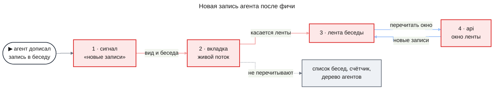
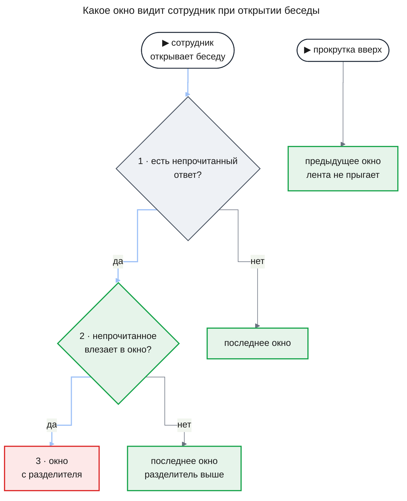
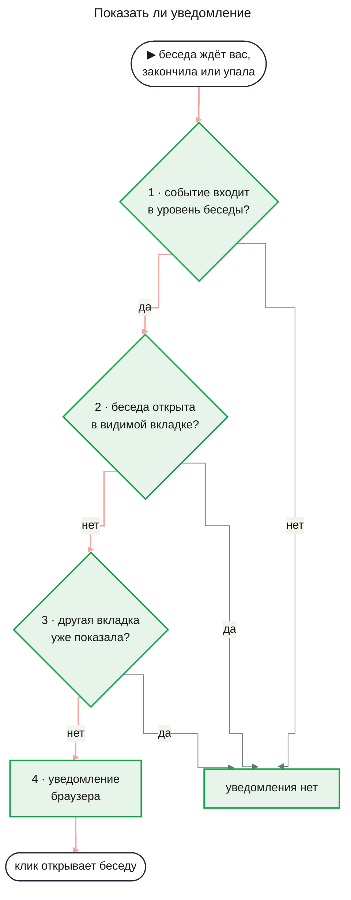

# PRD: Живой экран без лишних запросов, быстрые длинные беседы и уведомления (live-feed)

| Date | Depth |
|---|---|
| 2026-11-28 | full |

## Snapshot

**Overview.** Сегодня любое изменение в беседе заставляет экран чата перечитать почти всё: ленту, список бесед, счётчик ожиданий, дерево агентов — до восьми запросов на одну новую запись агента. Беседа открывается чтением с самой первой записи, поэтому чем она длиннее, тем дольше открывается. Чтобы узнать, что агент ждёт ответа или закончил, сотрудник держит беседу перед глазами. После фичи живой сигнал говорит, что именно изменилось, и перечитывается только та часть экрана, которой это касается. Беседа открывается на последних записях, старые подгружаются при прокрутке вверх, а браузер сам показывает уведомление, когда беседа ждёт сотрудника, закончила или упала, пока открыта хотя бы одна вкладка Agent OS.

- **Не меняется**: что лента показывает, состояния бесед в списке и отметка «прочитано» (`improvements` FR-06, FR-11). Меняется одно: если непрочитанное не влезает в одно окно, беседа открывается на последних записях, а не на разделителе (AC-07.2).
- **Не входит**: уведомления без открытой вкладки (Web Push) — значит, о беседе расписания, которая закончила ночью при закрытом браузере, сотрудник узнаёт только из списка бесед; передача изменений готовыми кусками данных вместо перечитывания.
- **Главный риск**: браузер может заморозить или выгрузить давно скрытую вкладку, и тогда уведомление не придёт ([Assumptions and Risks](#assumptions-and-risks)).
- **Открытые вопросы**: пять решений приняты по рекомендации аналитика и ждут подтверждения владельца ([Undetermined Items](#undetermined-items)).

## Terms

- **Лента** — записи беседы по порядку: сообщения сотрудника, ответы агента, вызовы инструментов, карточки.
- **Живой поток** — постоянное соединение вкладки с сервером, по которому вкладка узнаёт, что в беседах сотрудника что-то изменилось. Он есть сегодня.
- **Сигнал** — короткое сообщение в живом потоке: в какой беседе и что изменилось. Данных сигнал не несёт — за ними вкладка идёт отдельным чтением.
- **Вид изменения** — то, что сигнал называет: состояние беседы, название, новые записи ленты (и чей агент их дописал), открытое или отвеченное решение, очередь сообщений, дерево агентов, беседа создана, беседа удалена, отметка «прочитано».
- **Решение** — любая карточка, на которую должен ответить сотрудник: подтверждение изменяющего вызова, бриф глубокого агента, вопрос агента (`agent-guidance`, Terms).
- **Окно** — последний отрезок ленты, который вкладка читает за один запрос. Более старые записи читаются следующими окнами.
- **Метка окна** — короткий отпечаток содержимого окна. Пока в окне ничего не менялось, метка та же; повторное чтение с той же меткой сервер отвечает словами «не изменилось», без записей.
- **Разделитель** — черта в ленте перед первым непрочитанным ответом (`improvements` FR-11).
- **Уровень уведомлений** — о чём сотрудник хочет слышать: «все события», «решения и сбои» или «без уведомлений».

## Background

Идеи взяты из [bb](https://github.com/get-bb/bb): там сигнал о беседе называет вид изменения, а лента читается окнами с конца. Фича меняет три вещи, которые сотрудник замечает по-разному: экран работает тише, длинная беседа открывается сразу, а следить за беседой больше не нужно.

### Живой экран

Сегодня сигнал говорит только «в этой беседе что-то изменилось». Каждая из восьми частей экрана, которые его слушают, на всякий случай перечитывает свои данные. После фичи сигнал называет вид изменения, и откликается только та часть, которой он касается:

Если вкладка не узнала вид изменения или потеряла живой поток и подключилась заново, она перечитывает весь экран, как сегодня. Так ошибка в списке видов приводит к лишнему запросу, а не к устаревшему экрану.

### Открытие длинной беседы

Сегодня вкладка читает ленту с первой записи страницами, а сервер при каждом чтении, даже за одной новой записью, собирает всю историю беседы — ради сводки, которую показывает карточка прогона тренера (`create-and-test` AC-10.4). После фичи беседа открывается так:

Карточка прогона и остальные сведения о беседе — дерево агентов, решения, очередь — читаются отдельно от окна. Поэтому чтение окна стоит одинаково в беседе из пятидесяти записей и из пяти тысяч.

### Уведомления

Сегодня о том, что агент ждёт ответа, закончил или упал, говорят только отметки в списке бесед (`improvements` FR-11). Сотрудник, который ушёл в другую вкладку, их не видит. После фичи вкладка Agent OS, даже скрытая, решает про каждое такое событие так:

Уведомление говорит о беседе целиком: о конце или сбое главного агента и о решении в любом агенте её дерева, но не о каждом закончившем сабагенте. Уведомления живут на уже открытом живом потоке, поэтому без открытой вкладки их нет. Эта фича частично снимает исключение `schedules-search-memory` из Won't Have о push-уведомлениях: о срабатывании расписания сотрудник теперь узнаёт, если вкладка открыта.

## Users and Use Cases

### Users

- **Сотрудник** — аналитик, SRE или менеджер, который ведёт несколько бесед с агентами и запускает долгие ресерчи. Ему важно открыть любую беседу сразу и не сторожить её, пока агент работает.
- **Разработчик Agent OS** — владелец и агенты Claude Code. Им важно, чтобы одно изменение давало один запрос и чтобы экран не тормозил с ростом бесед.

### Use Cases

- **UC-1**: Аня держит открытой беседу, где агент разбирает логи, → лента дописывается по мере работы, а список бесед и счётчик не перечитываются на каждую запись, так что экран не подтормаживает. Покрывает FR-01, FR-06.
- **UC-2**: Аня открывает беседу недельного разбора инцидента из нескольких тысяч записей → сразу видит последние записи, а нужное место недельной давности находит прокруткой вверх, и лента не прыгает. Покрывает FR-02, FR-03, FR-04, FR-07.
- **UC-3**: Аня запустила глубокий ресерч и ушла читать почту в другой вкладке → когда сабагент ресерча просит подтверждения, браузер показывает уведомление, и клик ведёт её в беседу. Покрывает FR-08, FR-09.
- **UC-4**: Утренняя сводка расписания закончила, пока у Ани открыта вкладка Agent OS в фоне → она получает уведомление «закончил»; если браузер был закрыт, она видит отметку в списке бесед, когда откроет его. Покрывает FR-08.
- **UC-5**: В беседе с долгой проверкой Аню интересуют только просьбы о решении и сбои → она выбирает для этой беседы уровень «решения и сбои», а для остальных бесед остаётся уровень по умолчанию. Покрывает FR-05, FR-10.

## Functional Requirements

### Must Have (MVP)

#### Сигнал и чтение ленты — часть `server`

- **FR-01. Сигнал называет вид изменения.** Каждый сигнал о беседе сотрудника называет беседу и вид изменения из списка в Terms.
  - AC-01.1: Given агент в беседе дописал запись, when сигнал приходит во вкладку владельца, then сигнал называет беседу, вид «новые записи» и агента, который их дописал.
  - AC-01.2: Given в беседе сменилось состояние, название, очередь или дерево агентов, открыто или отвечено решение, беседа создана, удалена или прочитана, then каждый такой случай даёт сигнал со своим видом изменения.
  - AC-01.3: Given изменение в беседе сотрудника A, then сигнал приходит только во вкладки A, как сегодня.

- **FR-02. Лента читается окнами с конца.** Сервер отдаёт последнее окно ленты беседы или агента и по запросу — окно перед уже прочитанным, до самой первой записи.
  - AC-02.1: Given беседа из 3000 записей, when вкладка читает последнее окно, then получает последние записи по порядку и признак, что до них есть более старые.
  - AC-02.2: Given вкладка прочитала окна подряд от последнего до первого, then она получила каждую запись беседы ровно один раз, без пропусков, а у первого окна нет признака более старых записей.
  - AC-02.3: Given в беседе есть непрочитанный ответ, и непрочитанное влезает в одно окно, when вкладка открывает беседу, then сервер отдаёт окно, которое начинается с первого непрочитанного ответа и кончается последней записью; given непрочитанного больше, чем влезает в окно, then сервер отдаёт последнее окно.

- **FR-03. Метка окна.** Каждое окно приходит со своей меткой, и повторное чтение того же окна с той же меткой сервер отвечает «не изменилось».
  - AC-03.1: Given вкладка держит последнее окно с меткой, и в беседе ничего не менялось, when она читает его снова с этой меткой, then ответ «не изменилось» без записей.
  - AC-03.2: Given после чтения агент дописал запись, when вкладка читает окно со старой меткой, then получает окно с новой записью и новую метку.

- **FR-04. Сведения о беседе читаются отдельно от окна.** Состояние беседы, очередь, решения, дерево агентов и карточка прогона тренера читаются отдельно от окна ленты и показывают то же, что сегодня.
  - AC-04.1: Given беседа прогона тренера, when сотрудник её открывает и агент дописывает запись, then карточка прогона показывает то же, что сегодня (`create-and-test` AC-10.4), а чтение окна не собирает всю историю беседы.
  - AC-04.2: Given беседа с агентами и открытым решением, when сотрудник её открывает, then дерево агентов, решения и очередь показаны так же, как сегодня.

- **FR-05. Уровень уведомлений хранится на сервере.** У сотрудника есть уровень уведомлений по умолчанию, у беседы — свой уровень, который заменяет его, и оба хранятся за сотрудником на сервере.
  - AC-05.1: Given сотрудник ничего не выбирал, then его уровень по умолчанию — «все события», а у бесед своего уровня нет.
  - AC-05.2: Given сотрудник выбрал уровень беседы на одном устройстве, when он открывает Agent OS на другом, then у беседы тот же уровень.
  - AC-05.3: Given сотрудник B, when он читает или меняет уровень уведомлений беседы сотрудника A, then ответ такой же, как для несуществующей беседы, и уровень не изменился.

#### Экран — часть `web`

- **FR-06. Экран перечитывает только то, что изменилось.** Каждая часть экрана перечитывает свои данные только на виды изменения, которые её касаются, а на неизвестный вид и после повторного подключения живого потока экран перечитывает всё.
  - AC-06.1: Given сотрудник держит беседу открытой, when агент дописывает запись, then лента показывает её после одного чтения окна, а список бесед, счётчик ожиданий и дерево агентов не перечитываются.
  - AC-06.2: Given в другой беседе сменилось состояние, when приходит сигнал, then обновляется отметка этой беседы в списке, а лента открытой беседы не перечитывается.
  - AC-06.3: Given живой поток оборвался и подключился снова или пришёл неизвестный вид изменения, then все части экрана показывают текущее состояние без перезагрузки страницы.

- **FR-07. Беседа открывается на последних записях.** Лента беседы и лента агента в панели открываются на окне, которое отдал сервер (FR-02), а более старые записи подгружаются, когда сотрудник прокручивает вверх.
  - AC-07.1: Given беседа из нескольких тысяч записей без непрочитанного, when сотрудник её открывает, then видны последние записи.
  - AC-07.2: Given непрочитанное влезает в одно окно, when сотрудник открывает беседу, then лента стоит на разделителе (`improvements` AC-11.2); given непрочитанного больше, then лента стоит на последних записях, а разделитель найдётся прокруткой вверх.
  - AC-07.3: Given сотрудник смотрит на запись и прокручивает вверх до начала окна, when подгружается предыдущее окно, then эта запись остаётся на том же месте экрана.

- **FR-08. Уведомления браузера.** Пока открыта хотя бы одна вкладка Agent OS, видимая или скрытая, браузер показывает уведомление, когда беседа ждёт сотрудника, закончила или упала, в пределах уровня этой беседы.
  - AC-08.1: Given сотрудник ещё не разрешал уведомления, then браузер спрашивает разрешение только после его собственного действия в Agent OS, а не при открытии страницы.
  - AC-08.2: Given уведомления разрешены и вкладка скрыта, when в любом агенте дерева беседы открылось решение, главный агент закончил ответ или ход упал, then браузер показывает уведомление с названием беседы и событием на языке интерфейса (`i18n` FR-01), без текста ответа.
  - AC-08.3: Given сабагент беседы закончил, а главный агент ещё работает, then уведомления нет.
  - AC-08.4: Given сотрудник кликает на уведомление, then вкладка Agent OS выходит на передний план с этой беседой.
  - AC-08.5: Given браузер запретил уведомления или страница открыта не по HTTPS и не на `localhost`, then сотрудник видит, что уведомления недоступны и почему, а остальной экран работает.

- **FR-09. Без лишних уведомлений.** Уведомления нет, если беседа открыта в видимой вкладке, а на одно событие браузер показывает одно уведомление, сколько бы вкладок Agent OS ни было открыто.
  - AC-09.1: Given беседа открыта в видимой вкладке, when агент в ней закончил, then уведомления нет ни в одной вкладке этого браузера.
  - AC-09.2: Given открыты три вкладки Agent OS, все скрыты, when беседа ждёт решения, then браузер показывает одно уведомление.

- **FR-10. Выбор уровня уведомлений.** Сотрудник выбирает уровень по умолчанию для всех своих бесед и может задать отдельный уровень у беседы.
  - AC-10.1: Given уровень по умолчанию «все события», а у беседы выбран «решения и сбои», when в этой беседе агент закончил, then уведомления нет; when в ней ход упал или открылось решение, then уведомление есть.
  - AC-10.2: Given у беседы выбран «без уведомлений», then о ней уведомлений нет, а другие беседы уведомляют по уровню по умолчанию.

### Won't Have

- Уведомления без открытой вкладки (Web Push) — отдельная фича позже: нужен сервис-воркер, подписка браузера и отправка с сервера. До неё беседа расписания, закончившая при закрытом браузере, не объявляется.
- Изменения готовыми кусками данных в сигнале, как патчи в bb, — не в этой фиче: перечитывания по виду изменения должно хватить. Вернуться, если замеры не дотянут до целей из Non-Functional Requirements.
- Уведомление о каждом закончившем сабагенте — нет: сотруднику важна беседа целиком, а отдельный сабагент закончил — это ещё не результат.
- Уведомления по почте и в мессенджер, звук и значок на иконке вкладки — нет: владелец выбрал уведомления браузера.
- Внешний API и вебхуки, Agent OS как MCP-сервер, проверка здоровья провайдеров моделей — нет: идеи bb рассмотрены и отклонены владельцем.
- Архив бесед с отменой, закрепление и папки, экспорт и импорт бесед — не в этой фиче: не решено, нужны ли они.

## Non-Functional Requirements

### Performance

- **NFR-01**: Беседа из 5000 записей открывается до появления последней записи в пределах бюджета отрисовки восстановленной беседы (`chat-shell` NFR-01).
- **NFR-02**: Чтение окна в беседе из 5000 записей укладывается в бюджет API сообщений беседы (`chat-shell` NFR-05) так же, как в беседе из 100 записей.

### Security

- **NFR-03**: Окна ленты, их метки и уровни уведомлений другой сотрудник не читает и не меняет: чужая беседа отвечает как несуществующая (`chat-shell` AC-14.2). Каждый новый маршрут покрыт одним e2e-тестом с двумя сотрудниками (бизнес-ограничение 2 в `.claude/skills/project-context/SKILL.md`).

## Delivery Parts

| Part | Covers | Cut along | Depends on | Rationale |
|------|--------|-----------|------------|-----------|
| `server` | FR-01, FR-02, FR-03, FR-04, FR-05 | backend | — | Сигнал рантайма, чтение окон с меткой и хранение уровней — один слой рантайма, базы, API и контрактов, который web читает как контракт |
| `web` | FR-06, FR-07, FR-08, FR-09, FR-10 | frontend | `server` | Отклик частей экрана, лента окнами и уведомления браузера — один слой интерфейса поверх контракта `server` |

## Success Criteria

- Длинные беседы открываются сразу — самая длинная настоящая беседа владельца открывается в пределах `chat-shell` NFR-01; замер в браузере на dev-машине после выпуска части `web`.
- Живой экран дешёвый — за полчаса работы с открытой беседой каждая новая запись даёт одно чтение ленты и ни одного чтения списка бесед; читается из сетевого журнала браузера после выпуска части `web`.
- Сотруднику не нужно сторожить беседу — за первую неделю после выпуска владелец не пропустил ни одного решения, пока вкладка Agent OS была открыта в фоне; по его отзыву.

## Constraints and Risks

### Constraints

- **PoC.** Старый сигнал «в беседе что-то изменилось» и чтение ленты с первой записи заменяются сразу; старые читатели и их тесты удаляются в том же изменении (корневой `CLAUDE.md`).
- **Решение владельца по уведомлениям.** Уведомления показывает браузер, пока открыта вкладка Agent OS (Notification API на живом потоке); Web Push — отдельная фича.
- **Защищённая страница.** Браузер даёт уведомления только странице по HTTPS или на `localhost`; развёртывание по простому HTTP на внутреннем адресе останется без уведомлений.
- **Настройки — в базе.** Новых переменных окружения нет; уровни уведомлений — данные сотрудника.

### Assumptions and Risks

Браузер может заморозить или выгрузить давно скрытую вкладку ради экономии памяти, и тогда живой поток молчит, а уведомление не приходит. Насколько часто так бывает в Chrome у владельца, проверит проверка части `web` в браузере; если часто, это довод в пользу Web Push.

Название беседы в уведомлении видно на экране компьютера всем, кто рядом, и в центре уведомлений системы. Поэтому уведомление не несёт текста ответа (AC-08.2).

Вид изменения, который сервер забыл назвать в сигнале, оставит часть экрана устаревшей до следующего изменения. Перечитывание всего экрана на неизвестный вид и после переподключения этого не закрывает: оно ловит только виды, которые вкладка не знает.

Решение о том, что одна вкладка показывает уведомление за все, работает внутри одного браузера. На втором устройстве с открытой вкладкой то же событие даст своё уведомление ([Undetermined Items](#undetermined-items)).

## Undetermined Items

Все пункты ниже приняты по рекомендации аналитика, и документ уже написан по ним. Ни один не блокирует проектирование; если владелец выберет иначе, меняется названный критерий.

- Беседа с новым ответом открывается на разделителе, только если непрочитанное влезает в одно окно, а иначе на последних записях, — или всегда на разделителе; затрагивает AC-02.3 и AC-07.2; решает владелец.
- Изменения готовыми кусками данных отложены в Won't Have до замеров — или делаются сразу; затрагивает Won't Have и часть `server`; решает владелец.
- Уровни уведомлений хранятся на сервере и одинаковы на всех устройствах — или у каждого браузера свои; затрагивает FR-05; решает владелец.
- Уведомление говорит о беседе целиком (конец или сбой главного агента, решение в любом агенте), а уровень по умолчанию — «все события»; затрагивает AC-05.1, AC-08.2, AC-08.3; решает владелец.
- Одно уведомление на событие считается внутри браузера, а не на все устройства сотрудника; затрагивает FR-09; решает владелец.

## Update History

| Version | Date | Change |
|---------|------|--------|
| 1.0 | 2026-11-28 | Первая версия |
