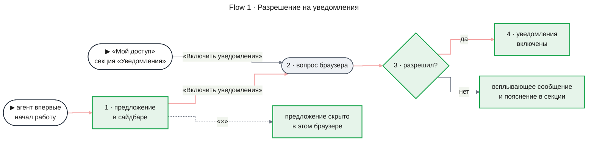
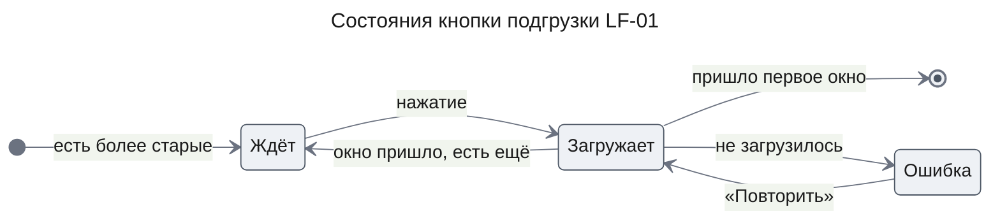

# UXRD: Живой экран, длинные беседы и уведомления (live-feed)

| Дата | PRD | Опирается на |
|---|---|---|
| 2026-11-28 | [prd.md](./prd.md) | [chat-shell UXRD](../chat-shell/uxrd.md) — лента, список бесед и меню «⋯»; [improvements UXRD](../improvements/uxrd.md) — разделитель «Новое» и метки состояния; [enterprise-access UXRD](../enterprise-access/uxrd.md) — страница «Мой доступ» |

## Snapshot

**Overview.** Длинная беседа открывается на последних записях, а более старые подгружает кнопка «Показать предыдущие сообщения» над лентой; лента при этом не прыгает. Браузер сообщает, что беседа ждёт сотрудника, закончила или упала, и разрешение на это просит только после нажатия «Включить уведомления». Предложение включить уведомления появляется в сайдбаре, когда агент впервые начинает работу, а насовсем уведомлениями управляет секция «Уведомления» на странице «Мой доступ». Отдельный уровень для одной беседы сотрудник выбирает в её меню «⋯» в списке бесед.

- **Не меняется**: что лента показывает, метки состояния в списке и отметка «прочитано» (improvements UXRD, IM-09, IM-10). Тихая работа экрана по видам изменений (PRD FR-06) не имеет своего интерфейса: сотрудник видит те же данные, только без лишних перечитываний.
- **Главный UX-риск**: сотрудник откажет браузеру по привычке и больше не увидит вопроса — браузер не даёт спросить повторно. Поэтому вопрос задаётся только после явного «Включить уведомления» (KD-3), а секция объясняет, как разрешить уведомления в настройках сайта (LF-04).
- **Открытые вопросы**: нет.

### Key Decisions

| ID | Решение | Почему |
|---|---|---|
| KD-1 | Более старые записи подгружает кнопка «Показать предыдущие сообщения» над первой загруженной записью (chat-shell UXRD, MC-41): одно нажатие — одно окно | Кнопка уже есть в интерфейсе вместе с подписью загрузки, объявлением для скринридера и переносом фокуса; фича её только включает. Лента не сдвигается без действия сотрудника |
| KD-2 | Беседа открывается так: совпадение поиска, если сотрудник пришёл из поиска; иначе разделитель «Новое», если непрочитанное влезает в одно окно; иначе последние записи. Правило live-feed AC-07.2 заменяет improvements AC-11.2 для длинного непрочитанного | Если непрочитанного больше окна, открытие на разделителе заставило бы ждать подгрузки многих окон. Последние записи видны сразу, а разделитель найдётся прокруткой вверх |
| KD-3 | Вопрос браузера о разрешении задаётся только после нажатия «Включить уведомления» в предложении LF-03 или в секции LF-04. Предложение появляется, когда агент впервые начинает работу в этом браузере | Браузеры прячут или блокируют вопросы, заданные при открытии страницы, а после отказа сайт не может спросить снова ([web.dev, Permission UX](https://web.dev/articles/push-notifications-permissions-ux)). Когда агент работает, сотруднику понятно, зачем уведомление |
| KD-4 | Уровень по умолчанию выбирается в секции «Уведомления» на «Мой доступ». Уровень одной беседы — в подменю «Уведомления» её меню «⋯» в списке бесед, с пунктом «Как по умолчанию». Беседа «без уведомлений» помечена в строке перечёркнутым колокольчиком | Так устроено в Slack, Discord и Telegram: общее правило в настройках, исключение — там, где лежит сама беседа. Меню «⋯» строки — единственное меню беседы: у шапки беседы меню нет. Метка объясняет, почему беседа молчит |
| KD-5 | Уведомление — название беседы и одно из трёх событий, без текста ответа. Новое уведомление о беседе заменяет прежнее о ней же, а открытие беседы убирает её уведомление | Название видно всем рядом с экраном (PRD, Assumptions and Risks). Одно уведомление на беседу не копит стопку в центре уведомлений |
| KD-6 | Недоступность уведомлений объясняется в секции LF-04 и в подменю LF-05. Других плашек и предупреждений по экрану нет, и остальной интерфейс работает как прежде | Сотрудник ищет причину там, где управляет уведомлениями. Постоянная плашка на каждом экране отвлекала бы часами (README дизайн-системы, «Комфорт долгой сессии») |

## Design System

Фича следует [дизайн-системе](../../design-system/README.md): новых цветов, движений и компонентов нет, лента и сайдбар — комфортная плотность.

### Component Inventory

| Компонент | Спецификация | Статус | Примечание |
|---|---|---|---|
| Разделитель ленты | [feed-divider.md](../../design-system/components/feed-divider.md), вариант «Новое» | reused | Точка открытия беседы (LF-02) |
| Форма настроек | [settings-form.md](../../design-system/components/settings-form.md), вариант «Сохранение на месте» | reused | Радиогруппа уровня в секции LF-04 |
| Лента | chat-shell UXRD, TH-01, TH-05 | extended | Включена кнопка MC-41 сверху (LF-01) и строка ошибки на её месте; точка открытия (LF-02) |
| Строка и меню «⋯» списка бесед | chat-shell UXRD, SB-06, SB-07 | extended | Подменю «Уведомления» (LF-05), метка «без уведомлений» (LF-06) |
| Страница «Мой доступ» | enterprise-access UXRD, Screen 3 | extended | Секция «Уведомления» (LF-04) |
| Меню | [shadcn `dropdown-menu`](https://ui.shadcn.com/docs/components/dropdown-menu) | reused | Подменю с радиопунктами, как выбор темы в меню пользователя (chat-shell UXRD, SB-11) |
| Всплывающие сообщения | chat-shell UXRD, TST-01 | reused | Отказ браузера и ошибка сохранения уровня беседы |

Предложение LF-03 собрано из текста, кнопки и «×» и стоит в одном месте, поэтому описано здесь как элемент экрана, а не компонент.

## User Flows

### Primary User Flow

**Включить уведомления.** Implements: UC-3, UC-4; AC-08.1, AC-08.5



Предложение и кнопка в секции видны, только пока браузер ещё не спрашивал, уведомления доступны и уровень по умолчанию — не «без уведомлений». Ответ браузера сразу меняет секцию LF-04 и подменю LF-05 во всех открытых вкладках.

### Alternative Flows

- **Длинная беседа** (UC-2; AC-07.1, AC-07.2, AC-07.3). Беседа открывается по правилу KD-2. Сотрудник прокручивает вверх и нажимает «Показать предыдущие сообщения» (LF-01); каждое нажатие подгружает следующее окно, пока не загрузится первая запись.
- **Уровень беседы** (UC-5; AC-10.1, AC-10.2). Сотрудник открывает «⋯» строки беседы, затем «Уведомления», и выбирает уровень (LF-05). Выбор сохраняется сразу и действует на всех его устройствах (PRD AC-05.2).
- **Клик по уведомлению** (UC-3; AC-08.4). Вкладка, показавшая уведомление, выходит на передний план и открывает беседу, а фокус встаёт в поле сообщения. Если на этой вкладке есть несохранённые изменения, сначала звучит обычный вопрос об уходе со страницы.

### Error Flows

- **Предыдущее окно не загрузилось.** На месте кнопки LF-01 — MC-1 и «Повторить»; уже прочитанные записи остаются на месте.
- **Браузер отказал или уведомления недоступны** (AC-08.5). После отказа — всплывающее сообщение MC-3, секция и подменю показывают причину (MC-6, MC-8). Остальной экран работает.
- **Уровень не сохранился.** В секции — ошибка MC-5 на месте подсказки и прежняя отметка. В подменю — всплывающее сообщение MC-9 и прежняя отметка.

## Screens

### Screen 1: Лента беседы — подгрузка и точка открытия

```
┌──────────────────────────────────────────────┐
│      ( Показать предыдущие сообщения ) LF-01 │  ← кнопка подгрузки
│                                              │
│  Сотрудник: Покажи ошибки за вторник         │  ← первая загруженная запись
│  Агент: …                                    │
│ ──────────── Новые сообщения ──────────────  │  ← LF-02, верхняя треть
│  Агент: Нашёл три всплеска…                  │
│                                              │
│ [ Сообщение агенту…                     ↑ ]  │
└──────────────────────────────────────────────┘

Не загрузилось:
│   Не удалось загрузить предыдущие сообщения.  [ Повторить ]   │
```

**LF-01. Кнопка «Показать предыдущие сообщения»** стоит по центру над первой загруженной записью, пока в беседе есть более старые записи (KD-1). Это готовая кнопка ленты с текстами MC-41 (chat-shell UXRD). Нажатие подгружает предыдущее окно; пока окно идёт, подпись кнопки меняется на «Загружаем предыдущие сообщения…» и мерцает.



**Раскладка и поведение**:

- Пришедшее окно встаёт над записями, и запись, на которую смотрит сотрудник, остаётся на том же месте экрана (AC-07.3). Кнопка остаётся над новой первой записью.
- После первой записи беседы кнопка исчезает, и начало ленты выглядит как сегодня: разделитель ветки (feed-divider, вариант «Ветка») или первое сообщение.
- Новые записи внизу, пока сотрудник читает старые, ведут себя как сегодня: лента не уезжает вниз, а появляется кнопка «Вниз» (chat-shell UXRD, TH-09).
- Те же правила действуют в ленте агента на его странице и в правой панели. Разделителя «Новое» там нет.

**LF-02. Точка открытия** — правило KD-2, по порядку:

| Беседа | Где стоит лента | AC |
|---|---|---|
| Сотрудник пришёл из поиска | На найденном сообщении (search-result, как сегодня), даже в начале длинной беседы: лента сразу получает окно до него и записи после него, без подгрузки окон по одному | — |
| Непрочитанное влезает в одно окно | Разделитель «Новое» в верхней трети ленты (improvements UXRD, IM-10) | AC-07.2 |
| Непрочитанного больше окна | Последняя запись внизу ленты; разделитель появится на своём месте, когда сотрудник догрузит его окно | AC-07.2 |
| Непрочитанного нет | Последняя запись внизу ленты | AC-07.1 |

**Screen states**:

| State | What shows | AC |
|---|---|---|
| Открытие | Скелетон истории на всю ленту (chat-shell UXRD, TH-05), затем лента сразу в точке LF-02 без видимой прокрутки | AC-07.1, AC-07.2 |
| Есть более старые | Кнопка LF-01 над первой записью | AC-07.3 |
| Подгрузка | Подпись кнопки LF-01 «Загружаем предыдущие сообщения…» | AC-07.3 |
| Начало беседы | Кнопки нет | — |
| Ошибка подгрузки | На месте кнопки MC-1 и «Повторить» | — |

### Screen 2: Сайдбар — предложение и меню беседы

```
┌──────────────────────────────┐
│ ✎ Новый чат                  │
│ Сегодня                      │
│  Разбор инцидента       ◔  ⋯ │
│  Ночная проверка   🔕       ⋯ │ ← LF-06
│  …                           │
│┌────────────────────────────┐│
││ Сообщать, когда агент    × ││ ← LF-03
││ закончит или будет ждать   ││
││ вас?                       ││
││ [ Включить уведомления ]   ││
│└────────────────────────────┘│
│ (А) Аня · Расход за ноябрь   │
└──────────────────────────────┘

Меню «⋯» → Уведомления ▸     (•) Как по умолчанию · Все события   ← LF-05
                             ( ) Все события
                             ( ) Решения и сбои
                             ( ) Без уведомлений
                             ─────────────────────
                             Включить в браузере
```

**LF-03. Предложение включить уведомления** стоит внизу сайдбара над блоком пользователя (chat-shell UXRD, SB-11) и не сдвигает список бесед. Оно появляется, когда агент любой беседы впервые в этом браузере начинает работу, при условиях под Flow 1. Это блок с рамкой `--border` и фоном `--sidebar`: текст MC-2 Caption, кнопка `outline` `sm` и иконочная кнопка «×» в правом верхнем углу. «Включить уведомления» задаёт вопрос браузера, «×» скрывает предложение в этом браузере. После ответа браузера предложение исчезает.

**LF-05. Подменю «Уведомления»** — пункт меню «⋯» строки беседы (chat-shell UXRD, SB-07) между «Ответвить чат» и «Удалить». Подменю — радиогруппа из четырёх уровней (MC-7). Выбор сохраняется сразу и закрывает меню. Под чертой — пункт, зависящий от браузера:

| Браузер | Пункт под чертой |
|---|---|
| Ещё не спрашивал | «Включить в браузере» — задаёт вопрос браузера |
| Разрешил | Пункта и черты нет |
| Запретил или уведомления недоступны | MC-8 — ведёт на секцию «Уведомления» на «Мой доступ» |

**LF-06. Метка «без уведомлений»** — перечёркнутый колокольчик 14 px `--muted-foreground` сразу после названия беседы, перед меткой состояния (improvements UXRD, IM-09). Название усекается раньше на ширину метки. Метка есть у каждой беседы, которая сейчас молчит: со своим уровнем «Без уведомлений» или «Как по умолчанию» при уровне по умолчанию «Без уведомлений». Другие уровни слышны и метки не требуют.

### Screen 3: Мой доступ — секция «Уведомления» (LF-04)

Секция стоит на странице «Мой доступ» (enterprise-access UXRD, Screen 3) последней, под секцией «Язык» (i18n UXRD, LN-01).

```
│  Уведомления                                         LF-04 │
│  Браузер ещё не показывает уведомления Agent OS.           │
│  [ Включить уведомления ]                                  │
│                                                            │
│  По умолчанию для всех бесед                               │
│  (•) Все события      ждёт вас, ответ готов, сбой          │
│  ( ) Решения и сбои   ждёт вас, сбой                       │
│  ( ) Без уведомлений                                       │
│  Действует на всех ваших устройствах.                      │
```

**Раскладка**:

- Заголовок — Heading, как у соседних секций. Строка о браузере — Body; кнопка `outline` `sm` под ней есть только в состоянии «Ещё не спрашивал», при условиях под Flow 1.
- Радиогруппа — [форма настроек](../../design-system/components/settings-form.md), «Сохранение на месте»: сохраняет при выборе. Пояснение уровня — Caption `--muted-foreground` справа от названия, а ниже 640 px — под ним.
- Радиогруппа доступна в любом состоянии браузера: уровень хранится за сотрудником и действует на других устройствах.

**Screen states**:

| State | What shows | AC |
|---|---|---|
| Ещё не спрашивал | MC-6 «не спрашивал»; «Включить уведомления» — если уровень по умолчанию не «Без уведомлений» | AC-08.1 |
| Разрешено | MC-6 «разрешено», кнопки нет | AC-08.2 |
| Запрещено | MC-6 «запрещено»: как разрешить в настройках сайта | AC-08.5 |
| Нет защищённого адреса | MC-6 «нет https» | AC-08.5 |
| Браузер не умеет | MC-6 «не умеет» | AC-08.5 |
| Сохраняем / Не сохранилось | Как «Сохранение на месте» settings-form; ошибка MC-5 | AC-05.2 |

Если сотрудник разрешит уведомления в настройках сайта, секция покажет «Разрешено», когда он вернётся на вкладку, без перезагрузки.

### Screen 4: Уведомление браузера (LF-07)

```
┌────────────────────────────────────────┐
│ [значок Agent OS]  Разбор инцидента    │ ← название беседы
│                    Ждёт вашего решения │ ← событие, MC-10
└────────────────────────────────────────┘
```

- Заголовок — название беседы, у беседы без названия — «Новая беседа» (chat-shell UXRD). Текст — одно событие из MC-10 на языке интерфейса, без текста ответа (AC-08.2).
- Когда уведомление есть, а когда нет, решает PRD (FR-08, FR-09; диаграмма «Показать ли уведомление»).
- Новое уведомление о беседе заменяет прежнее о ней же. Открытие беседы в любой вкладке убирает её уведомление (KD-5).
- Клик — по Alternative Flows, «Клик по уведомлению».

## Accessibility

- **Фокус**: во время подгрузки фокус остаётся на кнопке LF-01. Когда кнопка исчезает после первой записи беседы, фокус переходит к следующему элементу в порядке Tab; при ошибке — на «Повторить». После ответа браузера на вопрос из LF-03 фокус переходит на блок пользователя (SB-11), потому что предложение исчезло; из секции LF-04 — на радиогруппу уровня. После клика по уведомлению фокус в поле сообщения.
- **Объявления**: начало подгрузки — текст загрузки из MC-41 (chat-shell UXRD); ошибка подгрузки MC-1 — `role="status"`, не `alert`, потому что чтение не прервано. Появление предложения LF-03 не объявляется: оно не срочное и стоит в порядке Tab сайдбара.
- **Подменю LF-05**: → открывает подменю, ← закрывает, выбранный уровень отмечен радиопунктом. Метка LF-06 для скринридера — MC-11 в названии строки.
- **Reduced motion**: подпись загрузки кнопки LF-01 не мерцает.

## Responsive Behavior

- **Лента** — одинаково на всех ширинах.
- **Предложение LF-03** — внизу сайдбара от 768 px и внизу шторки ниже 768 px. В свёрнутой полосе сайдбара 48 px его нет, секция LF-04 остаётся.
- **Подменю LF-05** — от 640 px открывается сбоку от меню; ниже — поверх меню, по его краю; ← и Esc возвращают в меню.
- **Секция LF-04** — ниже 640 px пояснения уровней стоят под названиями.

## Content and Microcopy

| ID | Where (screen / component / state) | Русский | English |
|---|---|---|---|
| MC-1 | LF-01 — ошибка подгрузки, на месте кнопки | «Не удалось загрузить предыдущие сообщения.» + «Повторить» | "Couldn't load earlier messages." + "Retry" |
| MC-2 | LF-03 — предложение | «Сообщать, когда агент закончит или будет ждать вас?»; «Включить уведомления»; «×» для скринридера — «Скрыть предложение» | "Get notified when an agent finishes or needs you?"; "Turn on notifications"; "×" — "Dismiss" |
| MC-3 | Всплывающее сообщение — браузер отказал | «Браузер не разрешил уведомления. Включить их можно в настройках сайта в браузере.» | "The browser didn't allow notifications. You can turn them on in the site settings." |
| MC-4 | LF-04 — заголовок и уровни | «Уведомления»; «По умолчанию для всех бесед»; «Все события» — «ждёт вас, ответ готов, сбой»; «Решения и сбои» — «ждёт вас, сбой»; «Без уведомлений»; «Действует на всех ваших устройствах.» | "Notifications"; "Default for all chats"; "All events" — "needs you, reply ready, failure"; "Decisions and failures" — "needs you, failure"; "Off"; "Applies on all your devices." |
| MC-5 | LF-04 — ошибка сохранения | «Не удалось сохранить: попробуйте ещё раз.» | "Couldn't save: try again." |
| MC-6 | LF-04 — строка о браузере | «не спрашивал»: «Браузер ещё не показывает уведомления Agent OS.»; «разрешено»: «Браузер показывает уведомления, пока открыта хотя бы одна вкладка Agent OS.»; «запрещено»: «Браузер запретил уведомления для Agent OS. Разрешите их в настройках сайта — значок слева от адреса.»; «нет https»: «Уведомления недоступны: браузер показывает их только на защищённом адресе (https). Попросите администратора открыть Agent OS по https.»; «не умеет»: «Этот браузер не показывает уведомления.» | "The browser doesn't show Agent OS notifications yet."; "The browser shows notifications while at least one Agent OS tab is open."; "The browser blocked notifications for Agent OS. Allow them in the site settings — the icon left of the address."; "Notifications are unavailable: the browser shows them only on a secure (https) address. Ask your administrator to open Agent OS over https."; "This browser doesn't show notifications." |
| MC-7 | LF-05 — подменю | «Уведомления»; «Как по умолчанию · {уровень}»; уровни — как в MC-4 | "Notifications"; "Default · {level}"; levels as in MC-4 |
| MC-8 | LF-05 — пункт под чертой | «Включить в браузере»; «Браузер не показывает уведомления — подробнее» | "Turn on in browser"; "Browser doesn't show notifications — details" |
| MC-9 | Всплывающее сообщение — уровень беседы не сохранился | «Не удалось изменить уведомления беседы. Попробуйте ещё раз.» | "Couldn't change notifications for this chat. Try again." |
| MC-10 | LF-07 — событие | «Ждёт вашего решения»; «Ответ готов»; «Сбой: агент остановился с ошибкой» | "Waiting for your decision"; "Reply ready"; "Failed: the agent stopped with an error" |
| MC-11 | LF-06 — для скринридера | «без уведомлений» | "notifications off" |

## Update History

| Version | Date | Change |
|---------|------|--------|
| 1.0 | 2026-11-28 | Первая версия |
| 1.1 | 2026-11-28 | Старые записи — по готовой кнопке MC-41 вместо самоподгрузки и скелетона; переход из поиска в начало беседы решён, открытый вопрос снят |
