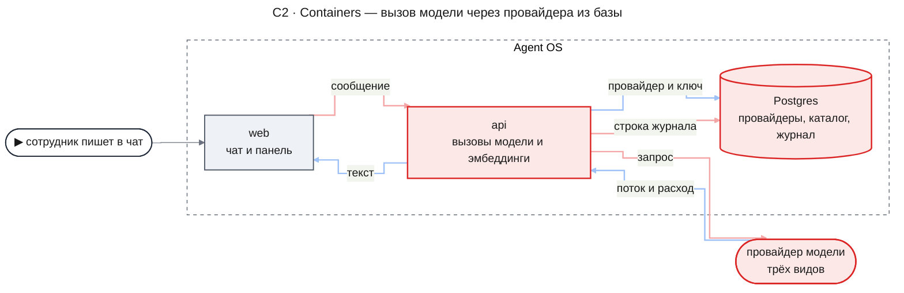
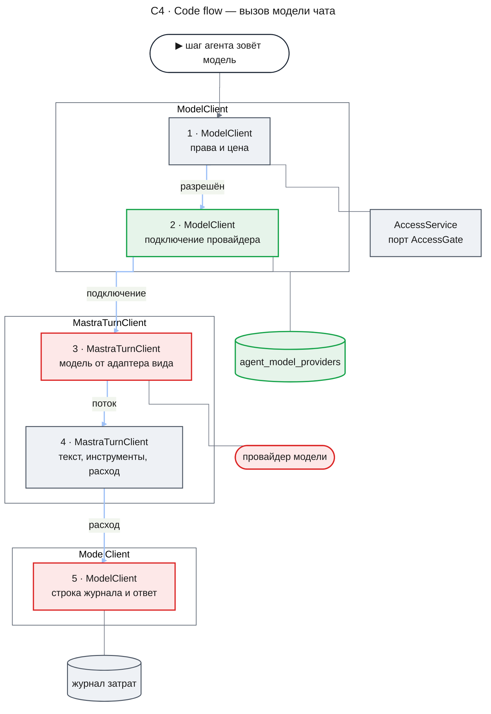
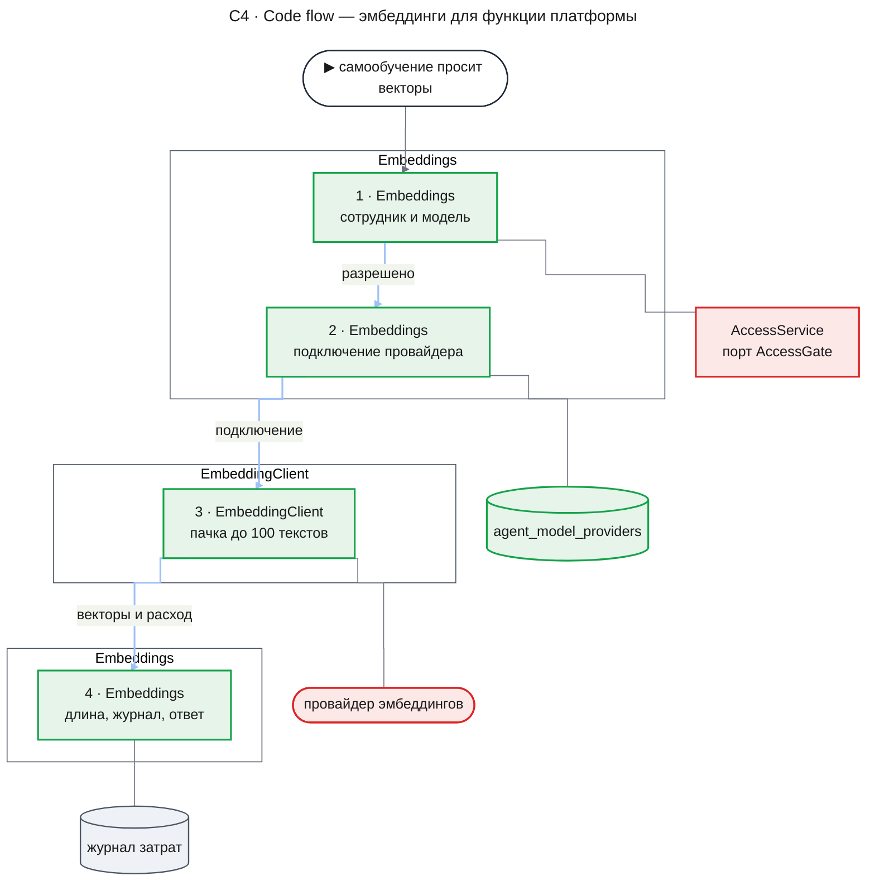
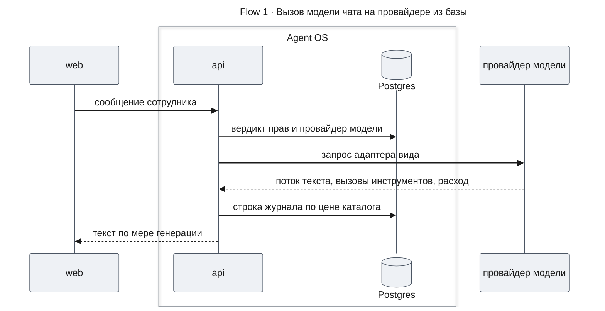
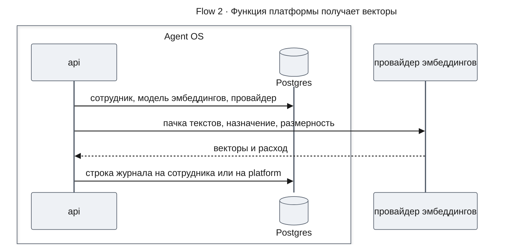
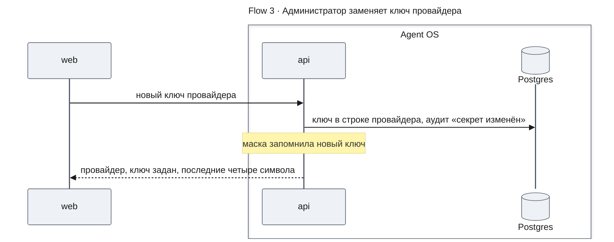

# Провайдеры моделей — Design Document — core

**Status:** Approved · **Date:** 2026-11-20 · **PRD:** [prd.md](./prd.md) · **UXRD:** [uxrd.md](./uxrd.md) · **Depends on:** ничего — первая часть

## Snapshot

**Overview.** Сегодня каждый вызов модели идёт в Anthropic, а ключ, адрес и модель по умолчанию сервер читает из окружения при старте. Эта часть заводит провайдеров моделей записями в базе — имя, вид, адрес, ключ и признак «включён» — и читает провайдера модели из базы на каждом вызове, поэтому новый ключ действует со следующего вызова. Служба вызовов модели остаётся одной: она по-прежнему проверяет права, повторяет запрос и пишет журнал затрат, а запрос к провайдеру строит адаптер его вида — Anthropic, Gemini или OpenAI-совместимый. Новая служба эмбеддингов отдаёт функциям платформы векторы текстов на модели эмбеддингов по умолчанию, записывает их стоимость на сотрудника или на платформу и любой отказ возвращает значением с причиной. Модели по умолчанию хранятся строкой настроек, а ключ нигде не показывается: API отдаёт только его последние четыре символа, а логгер маскирует каждый ключ, который процесс прочитал или принял.

- **Не меняется**: права, квоты и журнал затрат; повторы, учёт прерванной попытки, поток текста и остановка; тестовый шов модели.
- **Главный риск**: ключ, заданный во время работы, попадает в лог мимо маски; закрыт общей памятью секретов процесса (KD-7) и тестом.
- **Открытые вопросы**: нет.

### Key Decisions

#### KD-1: Реестр провайдеров — таблица `agent_model_providers` пакета `agents`; каталог ссылается на провайдера первой частью id модели, текстом без внешнего ключа; адрес и ключ читаются из базы на каждом вызове, без кэша

Решение записано в [ADR-0019](../../adr/ADR-0019-model-provider-registry-in-agents.md). Модель вызывает пакет `agents`, поэтому ключ хранится там, где его отправляют, и не пересекает границу пакета. Так же устроен реестр MCP-серверов ([ADR-0014](../../adr/ADR-0014-mcp-registry-owned-by-agents.md)). Каталог моделей остаётся в модуле `access` ([ADR-0015](../../adr/ADR-0015-access-gate-and-model-catalogue.md)), и связь «модель → провайдер» — текст, как у права на MCP-сервер. Факт другой стороны границы — вид провайдера при добавлении модели, число моделей провайдера при его удалении — контроллер читает сам и передаёт входом операции ([port-module-split.md](../../code-system/patterns/port-module-split.md)). Чтение строки по первичному ключу стоит доли миллисекунды против секунд вызова модели и укладывается в бюджет NFR-02, а смена ключа видна со следующего вызова на любом экземпляре API. Переменные `ANTHROPIC_API_KEY`, `AGENTS_ANTHROPIC_BASE_URL`, `AGENT_DEFAULT_MODEL`, поля `AgentsConfig` и `createResolveModel` удаляются без замены (FR-02).

Не взяты: провайдеры в `access` с ключом в ответе `AccessGate` — ключ ходил бы через порт на каждый вызов, а состояние провайдера смешалось бы с правами. Новый пакет — у реестра нет второго потребителя. Кэш клиентов со сбросом при записи — не видит ключ, сменённый на другом экземпляре; ADR-0015 отверг такой кэш для прав по той же причине.

#### KD-2: `ModelClient` остаётся единственной службой вызовов: после вердикта `AccessGate` он берёт подключение провайдера из реестра и передаёт его шву; состояние провайдера и его ошибка становятся названной причиной сбоя — значением, а не исключением

AC-09.1 требует, чтобы агент не стартовал, а AC-09.2 — чтобы он упал в ходе работы. Поэтому готовность провайдера проверяют два места — `resolveStart` при старте и `ModelClient` на каждом вызове — одной чистой функцией `providerReadiness` ([pure-decision.md](../../code-system/patterns/pure-decision.md)). Ответ `model_error` получает поле причины, и шаг агента пишет её в сбой как есть. Отказ провайдера не отказ прав, поэтому он не пишет запись `access_denied`. Шов тестов `AgentTurnModelClient` остаётся на месте, и проверки над ним в тестах выполняются по-настоящему.

Не взяты: проверка только внутри клиента хода — она ниже шва, в тестах не работает, а отказ стал бы исключением. Состояние провайдера в вердикте `AccessGate` — отвергнуто в KD-1.

#### KD-3: Адаптер на вид провайдера — объект в `agents` над пакетом AI SDK этого вида: `@ai-sdk/anthropic`, `@ai-sdk/google`, `@ai-sdk/openai-compatible`; всё, что зависит от вида, живёт только в адаптере

AI SDK уже приводит три вида к одной форме: поток текста, вызовы инструментов, расход. Адаптер добавляет то, чего AI SDK не знает о платформе: адрес по умолчанию, нужен ли ключ, есть ли эмбеддинги, метку «кешировать до сюда», параметры эмбеддинга, запрос проверки подключения и признак «провайдер не принял инструменты» в теле ошибки. Метку кеша ставит только адаптер Anthropic, потому что Gemini и OpenAI кешируют начало запроса сами. Схемы инструментов для Gemini чистит слой совместимости Google: Mastra 1.83 включает его для модели, чей провайдер содержит `google` (`GoogleSchemaCompatLayer.shouldApply` в `@mastra/schema-compat`, прочитано в коде). Пакеты берутся на спецификации `@ai-sdk/provider` 4, как установленный `@ai-sdk/anthropic` 4.0.82: `@ai-sdk/google` 4.x и `@ai-sdk/openai-compatible` 3.x (npm, 2026-11-20); для эмбеддингов добавляется `ai` 7.x — та же версия, что у Mastra.

Не взяты: `ModelRouterLanguageModel` и `ModelRouterEmbeddingModel` из Mastra — без ключа в конфиге они читают его из окружения, а адрес Gemini не задаётся. Свои HTTP-клиенты — повторили бы AI SDK. Свой чистильщик схем — в установленной Mastra он уже есть.

#### KD-4: id модели — `<провайдер>/<имя у провайдера>`, разрез по первой косой черте; у модели каталога появляются назначение и размерность; провайдер — первая часть id, отдельного столбца нет

Форму задаёт PRD, решение записано в [ADR-0018](../../adr/ADR-0018-model-id-provider-prefix.md), а id `anthropic/…` в правах, квотах, записях и журнале ей уже соответствуют, поэтому данные не мигрируют (AC-05.4). Имя у провайдера может содержать косую черту, как `Qwen/Qwen3-32B` у vLLM. Провайдера из id достаёт одна функция `modelProvider` в `contracts`, а все проверки `anthropic/` удаляются. Назначение модели — `chat` или `embedding`; модель эмбеддингов хранит цену ввода, нули в остальных ставках и неизменную размерность.

Не взяты: столбец провайдера — второе место для того же значения. Отдельная таблица моделей эмбеддингов — права, удаление и список каталога пришлось бы удвоить.

#### KD-5: Модели по умолчанию — строка настроек `access_model_defaults` модуля `access`; встроенные записи хранят модель `null`, то есть «модель чата по умолчанию», и получают её при старте запуска

Оба значения проверяются по каталогу — модель чата должна быть моделью чата, — а каталог живёт в `access`. Агенты читают значения через `AccessGate`, библиотека — через `AccessService`, и каждый читатель берёт их на запросе ([settings-row.md](../../code-system/patterns/settings-row.md)). Модель `null` в записи даёт и «встроенные записи переходят на новую модель» (FR-06), и посев чистой базы, где модели ещё нет. `resolveStart` заменяет `null` моделью чата по умолчанию, когда строит снимок записи, — у агента и у каждого исполнителя workflow, — поэтому исполнители, форки и перезапуски берут модель из снимка, а идущий запуск смену не замечает ([run-snapshot.md](../../code-system/patterns/run-snapshot.md)). Готовность провайдера `resolveStart` проверяет, как сегодня вердикт, только у модели самой записи. Удаление модели, выбранной по умолчанию, снимает выбор: значение становится «не выбрана», а панель предупреждает об этом до удаления (`uxrd.md` MP-03).

Не взяты: строка в `agents` — проверка вида модели шла бы через порт обратно в `access`. Переписывать встроенные записи при смене модели — на чистой базе посеять нечего. Значение в окружении — запрещено FR-02.

#### KD-6: Служба эмбеддингов — `Agents.embeddings` рядом с `ModelClient`, со своим швом `EmbeddingClient`; проверку делает новый вопрос порта `AccessGate.embedding` без права и квоты; вызов без сотрудника пишется на владельца `platform`

Первый потребитель — самообучение — живёт в `agents`, и адаптеры тоже там. Журнал затрат уже принимает строку «только ввод» с нулевыми ставками. Квота модели чата считается по строкам с её id, поэтому эмбеддинги в квоту не входят (AC-08.2), но входят в месячный расход, который суммирует все строки сотрудника. Владелец `platform` не совпадает ни с одним id сотрудника — это uuid ([ADR-0012](../../adr/ADR-0012-closed-api-and-server-issued-employee-id.md)) — и не виден ни в чьём расходе без изменения схемы журнала (AC-07.5).

Не взяты: эмбеддинги через `ModelClient` — у них другая форма ответа и учёта. Пустой владелец в журнале — меняет схему `runtime` и всех читателей журнала. Право на модель эмбеддингов — PRD его исключает (Constraints).

#### KD-7: Ключ хранится как есть и только записывается; API отдаёт признак и последние четыре символа; маска логов узнаёт ключ из общей памяти секретов процесса в `common`, которую реестр пополняет при каждом чтении и записи ключа

Ключ попадает в память процесса тремя путями: чтение строки провайдера, запрос администратора и стандартный ввод посева. Каждый путь кладёт ключ в память секретов (`rememberSecret`) раньше, чем он может попасть в лог. `createSecretMasker` читает свой список и эту память при каждом вызове, поэтому все держатели маски — логгер приложения, логгер агентов, `run_code`, CLI и будущее извлечение — видят новый ключ без правки. Память только растёт, поэтому заменённый ключ остаётся скрытым (AC-11.2). `beforeSend` Sentry прогоняет текст исключений через ту же маску. Ключ короче 8 символов не принимается, потому что маска по значению работает с 8.

Не взяты: изменяемый набор, переданный каждому держателю, — пять правок проводки и риск забыть одну. Пересоздание логгеров при смене ключа — не видит ключ, сменённый на другом экземпляре. Шифрование ключей — Won't Have PRD.

## Terms

- **Провайдер, вид провайдера, ключ, каталог, модель чата, модель эмбеддингов, размерность** — как в [PRD, Terms](./prd.md#terms).
- **Подключение провайдера** — то, что нужно для одного запроса: вид, адрес, ключ и имя модели у провайдера. Реестр собирает его из строки провайдера на каждом вызове.
- **Готовность провайдера** — `ready`, `missing` (не заведён), `disabled` (выключен) или `key_missing` (вид требует ключ, а его нет).
- **Адаптер вида** — объект пакета `agents`, который знает всё, чем вид отличается от других; остальной код видит только его методы.
- **Шов** — интерфейс, который тесты подменяют двойником, а всё над ним работает по-настоящему: `AgentTurnModelClient` для чата и `EmbeddingClient` для эмбеддингов.
- **Метка кеша** — указание провайдеру «запомни запрос до этого места»; меняет только стоимость.
- **Память секретов** — общий для процесса список значений, которые маска логгера заменяет на `[redacted]`.

## Part

- **Part**: `core`
- **Covers**: FR-01, FR-02, FR-03, FR-04, FR-05, FR-06, FR-07, FR-08, FR-09, FR-10, FR-11, FR-15, FR-17
- **Depends on**: ничего — первая часть
- **Prerequisite ADRs**: [ADR-0003](../../adr/ADR-0003-drizzle-data-layer.md), [ADR-0004](../../adr/ADR-0004-agent-framework-packages.md), [ADR-0012](../../adr/ADR-0012-closed-api-and-server-issued-employee-id.md), [ADR-0014](../../adr/ADR-0014-mcp-registry-owned-by-agents.md), [ADR-0015](../../adr/ADR-0015-access-gate-and-model-catalogue.md), [ADR-0017](../../adr/ADR-0017-run-snapshots-from-library.md)
- **Sibling parts**: `web` (FR-12 – FR-14, FR-16) строит экраны над разделом [Для части `web`](#для-части-web).

**Out of scope**

- Экраны панели и выбора модели — часть `web`; строка расхода на эмбеддинги в «Мой доступ» (FR-18) отложена.
- Хранение векторов и поиск по ним — `self-learning`.
- Особые настройки вызова одного вида: рассуждения, фильтры безопасности, свой предел вывода или окна контекста у модели. Все виды берут общий `AGENT_MAX_OUTPUT_TOKENS` и общий порог сжатия `AGENT_COMPACT_AT_TOKENS`.
- Встроенные записи, уже посеянные на существующей базе разработчика, сохраняют свою модель `anthropic/…` и не следуют модели по умолчанию, пока базу не создали заново: записи не мигрируют.
- Подпись рассуждений Gemini в истории вызовов инструментов не хранится (Risks).
- `RecordSummary` не получает модель записи и её готовность: пометка «модель не работает» есть на странице записи и в редакторе, но не в строке списка библиотеки.

**Constraints**

- Новых переменных окружения нет, три старые и все проверки `anthropic/` удаляются без слоя совместимости (CLAUDE.md, PoC) — KD-1, KD-4.
- Ключи лежат в базе как есть, как токены MCP-серверов (PRD, Constraints) — KD-7.
- Каждый шаг пишет лог через логгер `common` с идентификаторами — раздел [Логирование](#логирование).
- Время до первого токена — не хуже нынешнего плюс 50 мс (NFR-02): к вызову добавляется одно чтение строки провайдера по первичному ключу.
- Тестов мало и только на критичное — [Test Strategy](#test-strategy).

## Building-block Inventory

Follows the [code system](../../code-system/README.md).

| Building block | Pattern | Status | Note |
|---|---|---|---|
| `ModelClient` | — | extended | подключение провайдера на вызове, причина в `model_error`, модель заголовков из порта (KD-2) |
| `createMastraTurnClient` | — | extended | модель и метка кеша от адаптера по подключению вызова; `ResolveModel` и `createResolveModel` удалены |
| Адаптеры видов | — | new | искали в коде и Mastra: вызов умеет только Anthropic, роутер Mastra отвергнут (KD-3) |
| Реестр `Agents.providers`, таблица `agent_model_providers` | [repository-over-transaction.md](../../code-system/patterns/repository-over-transaction.md), [write-only-secret.md](../../code-system/patterns/write-only-secret.md) | new | по образцу реестра MCP (KD-1) |
| `providerReadiness` | [pure-decision.md](../../code-system/patterns/pure-decision.md) | new | одна функция для старта, вызова и эмбеддингов |
| `classifyRejection` | — | extended | ключ отклонён, инструменты не приняты, недоступен |
| `Agents.embeddings`, шов `EmbeddingClient` | [composition-root.md](../../code-system/patterns/composition-root.md) | new | своего пути эмбеддингов в коде нет (KD-6) |
| `AccessGate`, `AccessService`, `modelVerdict` | [pure-decision.md](../../code-system/patterns/pure-decision.md) | extended | `defaultChatModel`, `embedding`; списки выбора — только модели чата |
| Каталог `access_models` | — | extended | назначение и размерность (KD-4) |
| `access_model_defaults` | [settings-row.md](../../code-system/patterns/settings-row.md) | new | модели по умолчанию (KD-5) |
| `TokenLedger` | — | reused | строка эмбеддинга с нулевыми ставками; владелец `platform` |
| `createSecretMasker`, `rememberSecret` | [logging.md](../../code-system/patterns/logging.md) | extended | память секретов процесса (KD-7) |
| `AdminModelProvidersController` | [auth-boundary.md](../../code-system/patterns/auth-boundary.md) | new | по образцу `AdminMcpServersController`, в `AgentsModule` |
| `resolveStart`, `BuiltinRecordsSeeder`, `seed:access` | [run-snapshot.md](../../code-system/patterns/run-snapshot.md) | extended | модель `null`, готовность провайдера, посев провайдеров |
| Двойники `@agent-os/agents/testing` | — | extended | двойник эмбеддингов и реестра |

## Acceptance Criteria

### FR-01: Провайдеры и ключи в базе

- From the PRD: AC-01.1, AC-01.2, AC-01.3, AC-01.4, AC-01.5
- Провайдер создаётся включённым. Имя — строчные латинские буквы, цифры и дефис, до 32 символов, с буквы или цифры; ключ — от 8 до 512 символов. Иначе ответ 400 `VALIDATION_FAILED`, и ничего не меняется (DC-1).
- `apiKey: null` в изменении убирает ключ; ни один маршрут провайдеров не отдаёт значение ключа (DC-2).

### FR-02: Настроек провайдера в окружении нет

- From the PRD: AC-02.1, AC-02.2
- Пока модель чата по умолчанию не выбрана, первое сообщение беседы получает 409 `START_REFUSED` с причиной `model_not_configured`, а заголовок беседы не создаётся, и причина есть в логе (DC-3).

### FR-03: Одна служба вызовов для трёх видов

- From the PRD: AC-03.1, AC-03.2, AC-03.3

### FR-04: Инструменты MCP на всех видах

- From the PRD: AC-04.1, AC-04.2
- Запрос к Gemini несёт схемы инструментов без ключевых слов, которые Gemini не принимает: `$schema`, `additionalProperties`, `$ref` и `$defs`; `const` уходит как `enum` (DC-4).

### FR-05: Провайдер и вид модели в каталоге

- From the PRD: AC-05.1, AC-05.2, AC-05.3, AC-05.4
- Право на модель эмбеддингов отклоняется ответом 422 `GRANT_INVALID` с причиной `embedding_model`; моделей эмбеддингов нет в «Мой доступ» (DC-5).
- Удаление модели, выбранной по умолчанию, снимает этот выбор: модели по умолчанию этого назначения больше нет, пока администратор не выберет другую (DC-6).

### FR-06: Модели по умолчанию

- From the PRD: AC-06.1, AC-06.2, AC-06.3
- Встроенная запись с моделью `null` стартует на модели чата по умолчанию на момент старта; запуск, который уже идёт, смену не замечает (DC-7).

### FR-07: Служба эмбеддингов

- From the PRD: AC-07.1, AC-07.2, AC-07.3, AC-07.4, AC-07.5
- Каждый вектор ответа имеет единичную длину (DC-8).
- Больше 100 текстов служба отправляет несколькими запросами, по строке журнала на запрос; пустой список даёт ответ без запроса к провайдеру (DC-9).

### FR-08: Проверка и учёт эмбеддингов

- From the PRD: AC-08.1, AC-08.2, AC-08.3

### FR-09: Понятные отказы провайдера

- From the PRD: AC-09.1, AC-09.2, AC-09.3, AC-09.4, AC-09.5
- Отказ провайдера не пишет запись `access_denied` в аудит (DC-10).

### FR-10: Стоимость по расходу провайдера

- From the PRD: AC-10.1
- Ответ провайдера без числа входных токенов записывается оценкой, как прерванная попытка, с пометкой `estimated` в логе (DC-11).

### FR-11: Ключи не попадают в логи

- From the PRD: AC-11.1, AC-11.2

### FR-15: Проверка подключения

- From the PRD: AC-15.1
- Проверка не пишет ни журнала затрат, ни аудита; ответа нет за 10 секунд — результат «адрес недоступен» (DC-12).

### FR-17: Посев разработчика

- From the PRD: AC-17.1, AC-17.2
- Стандартный ввод `seed:access` — три строки: пароль администратора, ключ Anthropic, ключ Google; пустая строка — провайдер без ключа (DC-13).

## Design

### Architecture (C1–C4)

#### C2 · Containers

Провайдеры, каталог и модели по умолчанию живут в Postgres, а вызов модели и эмбеддингов делает процесс `api`. Веб в этой части не меняется: экраны строит часть `web`.

- `api` читает провайдера модели на каждом вызове, строит запрос адаптером вида, считает векторы для функций платформы и открывает маршруты провайдеров, каталога и моделей по умолчанию.
- Postgres получает таблицу провайдеров, назначение и размерность у моделей каталога и строку моделей по умолчанию.
- Провайдер модели — теперь любой из трёх видов: Anthropic, Gemini или OpenAI-совместимый сервер по адресу из базы.

#### C4 · Code flow: вызов модели чата

Шаг агента, сжатие, заголовок беседы и извлечение самообучения зовут модель одним путём.

Шаг 2 читает строку провайдера по первой части id модели и решает `providerReadiness`; не готовый провайдер даёт `model_error` с причиной до запроса. Шаг 3 берёт у адаптера вида модель AI SDK и метку кеша и ставит метку на системный блок и последнее сообщение, только если адаптер её дал. Шаг 5 пишет строку журнала по цене из вердикта, как сегодня; ошибку провайдера разбирает `classifyRejection` по таблице [ниже](#как-разбирается-ошибка-провайдера).

#### C4 · Code flow: эмбеддинги

Шаг 1 спрашивает `AccessGate.embedding`: включён ли названный сотрудник и какая модель эмбеддингов выбрана, с ценой ввода и размерностью. Шаг 3 повторяется на каждую пачку до 100 текстов, по порядку. Шаг 4 сверяет длину каждого вектора с размерностью каталога, приводит вектор к единичной длине и пишет строку журнала на каждую пачку.

#### Как разбирается ошибка провайдера

Чат и эмбеддинги разбирают отказ провайдера одной функцией `classifyRejection`. Таблица говорит, что делает служба с ответом провайдера.

| Ответ провайдера | Повтор | Причина после повторов |
|---|---|---|
| 401 или 403 | нет | `provider_key_rejected` |
| 400 или 422, тело ошибки — об инструментах (признак адаптера вида) | нет | `provider_tools_rejected` |
| 408, 429, 5xx, обрыв сети, таймаут запроса | до двух, паузы 1 и 3 секунды, как сегодня | `provider_unavailable` |
| любой другой статус | нет | `model_error` у чата, `provider_error` у эмбеддингов |

Признак «об инструментах» знает адаптер: у Anthropic сообщение ошибки начинается с `tools.`, у Gemini оно называет `function_declarations`, у OpenAI-совместимого — `tools`. Ответ, отклонённый провайдером до первого байта, строки журнала не даёт, как сегодня, поэтому неверный ключ не стоит денег (AC-09.3). Тело ответа провайдера уходит в лог полем `responseBody` вместе со статусом, моделью и провайдером (AC-04.2, AC-07.3).

### Runtime Flows

#### Flow 1: Вызов модели чата на провайдере из базы

**Starts when:** шаг агента, сжатие, заголовок беседы или извлечение зовут `ModelClient`, for AC-01.2, AC-02.2, AC-03.1, AC-03.2, AC-03.3, AC-04.1, AC-04.2, AC-05.4, AC-09.2, AC-09.3, AC-09.4, AC-09.5, AC-10.1

**Outcome:** ответ модели в истории агента; одна строка журнала на каждую оплаченную попытку с id модели `<провайдер>/<имя>`; запрос ушёл на адрес и с ключом, которые лежали в строке провайдера в момент вызова.

**Failure handling:**

- Провайдер не заведён, выключен или без нужного ключа → запроса нет, строки журнала нет, агент падает с причиной `provider_missing`, `provider_disabled` или `provider_key_missing` (AC-09.2, AC-09.4).
- Провайдер отклонил ключ, не принял инструменты или недоступен после повторов → причина по таблице [выше](#как-разбирается-ошибка-провайдера); тело ответа в логе (AC-09.3, AC-09.5, AC-04.2).
- Отказ `AccessGate` → как сегодня: `not_started`, запись `access_denied`, сбой с причиной вердикта.
- Остановка → сигнал обрывает поток любого вида; прерванная попытка пишется оценкой, как сегодня (AC-03.2).
- Нет модели чата по умолчанию у заголовка беседы → `completeText` отклоняется с причиной `model_not_configured`, заголовка нет, причина в логе (DC-3).

#### Flow 2: Функция платформы получает векторы

**Starts when:** функция платформы зовёт `Agents.embeddings.embed`, for AC-06.3, AC-07.1, AC-07.2, AC-07.3, AC-07.4, AC-07.5, AC-08.1, AC-08.2, AC-08.3

**Outcome:** функция получает векторы в порядке текстов, каждый длины, равной размерности модели, и единичной длины, с id модели и размерностью. На каждую пачку в журнале строка с входными токенами по цене каталога; без сотрудника владелец строки — `platform`.

**Failure handling:**

- Модель эмбеддингов не выбрана или сотрудник отключён → `unavailable` с причиной `model_not_configured` или `owner_disabled`, запроса нет (AC-07.2, AC-08.3).
- Провайдер не заведён, выключен или без ключа → `unavailable` с причиной готовности, запроса нет.
- Ошибка провайдера → причина по таблице [выше](#как-разбирается-ошибка-провайдера); у пачек, уже полученных до неё, строки журнала остаются, векторы не отдаются (AC-07.3).
- Вектор не той длины → `unavailable` с причиной `dimension_mismatch`; строка журнала этой пачки записана, потому что провайдер её посчитал (AC-07.4).
- Провайдер не сообщил число токенов → строка пишется оценкой по байтам текстов (DC-11).
- Остановка сигналом вызывающего → обещание отклоняется причиной сигнала, как у `ModelClient`; это единственный отказ не значением.

#### Flow 3: Администратор заменяет ключ провайдера

**Starts when:** администратор отправляет новый ключ, for AC-01.1, AC-01.2, AC-01.4, AC-01.5, AC-11.1, AC-11.2

**Outcome:** строка провайдера держит новый ключ; следующий вызов любой модели провайдера на любом экземпляре читает его; в аудите `admin_change` с провайдером и пометкой `secret_changed` вместо значения; маска процесса скрывает и новый, и прежний ключ.

**Failure handling:**

- Не администратор → 403 `ADMIN_REQUIRED`, ничего не меняется (AC-01.4).
- Ключ короче 8 или длиннее 512 символов → 400 `VALIDATION_FAILED`, ничего не меняется (DC-1).
- Провайдера нет → 404 `MODEL_PROVIDER_NOT_FOUND`.
- Аудит не записался после изменения → ключ уже сменён, ответ 500, ошибка в логе; так же ведёт себя реестр MCP.

### Contract Definitions

#### Для части `web`

Все маршруты ниже — под `@AdminOnly()`: не администратор получает 403 `ADMIN_REQUIRED`. Тело проверяет схема из `contracts`; нарушение — 400 `VALIDATION_FAILED`. Ни один ответ не содержит значения ключа. Формы провайдеров моделей названы с префиксом `ModelProvider`: имена `ProviderView`, `CreateProviderBody` и `UpdateProviderBody` в `identity.ts` и маршрут `/api/admin/providers` принадлежат провайдерам входа. Где каждая форма лежит в `contracts`, показывает таблица в конце раздела.

- **`GET /api/admin/model-providers`** — провайдеры по имени. Returns список `ModelProviderView`.
- **`POST /api/admin/model-providers`** — тело `CreateModelProviderBody`: `name`, `kind`, необязательные `baseUrl` и `apiKey`; провайдер включён. Returns 201 `ModelProviderView`. Имя занято — 409 `MODEL_PROVIDER_NAME_TAKEN`.
- **`GET /api/admin/model-providers/:name`** — один провайдер. Returns `ModelProviderView`; нет такого — 404 `MODEL_PROVIDER_NOT_FOUND`.
- **`PATCH /api/admin/model-providers/:name`** — тело `UpdateModelProviderBody`: любое из `baseUrl` (`null` — адрес вида по умолчанию), `apiKey` (`null` — убрать ключ) и `enabled`; имя и вид не меняются. Returns `ModelProviderView`; 404 как выше.
- **`DELETE /api/admin/model-providers/:name`** — удаляет провайдера без моделей в каталоге. Returns 204. У провайдера есть модели — 409 `MODEL_PROVIDER_HAS_MODELS` с числом моделей в `count` (AC-01.3); 404 как выше.
- **`POST /api/admin/model-providers/:name/check`** — один запрос к провайдеру с сохранёнными адресом и ключом, без вызова модели (FR-15). Returns `ModelProviderCheck`; 404 как выше.
- **`GET /api/admin/models`** — каталог по имени. Returns список `CatalogModel`.
- **`POST /api/admin/models`** — тело `CreateCatalogModelBody`, объединение по `purpose`: у обоих `id` целиком (`<провайдер>/<имя у провайдера>`) и `name`; у `chat` — `prices` и `longContext`, как сегодня; у `embedding` — `inputUsdPerMTok` и `dimensions`. Returns `CatalogModel`.
- **`PATCH /api/admin/models/:id`** — тело `UpdateCatalogModelBody`: один строгий объект, хотя бы одно из `name`, `prices`, `longContext` и `inputUsdPerMTok`. Модель чата меняет первые три, модель эмбеддингов — `name` и `inputUsdPerMTok`; на поле другого назначения `AccessService`, прочитав назначение строки, отвечает 400 `VALIDATION_FAILED`. **`DELETE /api/admin/models/:id`** — как сегодня.
- Правила каталога: добавление модели к несуществующему провайдеру — 422 `MODEL_PROVIDER_INVALID` с причиной `provider_unknown` (AC-05.3); модель эмбеддингов к провайдеру вида Anthropic — та же ошибка с причиной `embeddings_not_supported` (AC-05.2). Удаление модели по умолчанию снимает выбор (DC-6).
- **`GET /api/admin/model-defaults`** — модели по умолчанию. Returns `ModelDefaults`.
- **`PUT /api/admin/model-defaults`** — тело `UpdateModelDefaultsBody`: `chatModel` и `embeddingModel`, каждое — id модели каталога или `null`. Returns `ModelDefaults`. Модели нет в каталоге или она не своего назначения — 422 `MODEL_DEFAULT_INVALID` с причиной `model_unknown`, `not_chat` или `not_embedding` и отклонённым id в `model` (AC-06.2).
- **`POST /api/admin/grants`** — как сегодня; право на модель эмбеддингов — 422 `GRANT_INVALID` с причиной `embedding_model` (DC-5).
- **`GET /api/access/models`** («Мой доступ») — только модели чата; каждая получает `unavailableReason`: `null`, если провайдер готов, иначе `provider_missing`, `provider_disabled` или `provider_key_missing`. По этому полю веб прячет модель из выбора и помечает запись, которая на ней не запустится (`uxrd.md` MP-08). Контроллер переезжает в `AccessAdminModule`, потому что читает готовность провайдеров у `Agents` ([port-module-split.md](../../code-system/patterns/port-module-split.md)).
- **`GET /api/library/choices`** — `defaultModel` становится `null`, пока модель чата по умолчанию не выбрана.
- **`POST /api/library/...`, содержимое записи** — модель записи может быть `null`: запись работает на модели чата по умолчанию. Посев ставит `null` во встроенные записи, кроме координатора `deep-research` (KD-5).
- **Отказ старта** — 409 `START_REFUSED` получает причины `model_not_configured`, `provider_missing`, `provider_disabled`, `provider_key_missing` с полем `model`; у `model_not_configured` оно `null` (AC-02.1, AC-09.1). Те же четыре причины получает исход `refused` вызова `start_agent` и `start_workflow` (`ToolRefusalReasonSchema`), с моделью в `refusalDetail`: так отказ видит блок вызова в беседе (AC-09.1, `uxrd.md` MP-09).
- **Сбой агента** — `failureReason` получает `provider_missing`, `provider_disabled`, `provider_key_missing`, `provider_key_rejected`, `provider_unavailable`, `provider_tools_rejected`; `model_error` остаётся для прочих ошибок провайдера.

**`ModelProviderView`**

- `name` — имя провайдера и первая часть id его моделей.
- `kind` — `anthropic`, `gemini` или `openai_compatible`.
- `baseUrl` — заданный адрес или `null`; `effectiveBaseUrl` — адрес, на который уходят запросы: заданный или адрес вида по умолчанию (`https://api.anthropic.com/v1`, `https://generativelanguage.googleapis.com/v1beta`, `https://api.openai.com/v1`).
- `enabled` — включён ли.
- `apiKeySet` — задан ли ключ; `apiKeyLast4` — последние четыре символа ключа или `null`.
- `state` — `ready`, `disabled` или `key_missing`.
- `catalogModels` — число моделей провайдера в каталоге; контроллер берёт его у `AccessService`.

**`ModelProviderCheck`**

- `result` — `works`, `key_rejected` или `unreachable`.
- `message` — статус и текст ответа провайдера до 500 символов, через маску секретов; `null` при `works`.

**`CatalogModel`** — строка ответа со своей схемой; сегодня она псевдоним тела добавления, и веб разбирает список этой схемой. Объединение по `purpose`, у обоих `id`, `name` и `provider` (первая часть id):

- `purpose: 'chat'` — `prices` и `longContext`, как сегодня.
- `purpose: 'embedding'` — `inputUsdPerMTok` и `dimensions` (целое от 1 до 4096).

**`ModelDefaults`** — `chatModel` и `embeddingModel`, каждое id или `null`; `updatedAt` и `updatedBy` — `null`, пока значения ни разу не задавали.

**Где изменения ложатся в `packages/contracts/src`**

| Модуль | Имя | Изменение |
|---|---|---|
| `model-providers.ts`, новый, по образцу `mcp.ts` | `ModelProviderNameSchema`, `MODEL_PROVIDER_NAME_MAX_LENGTH`, `MODEL_PROVIDER_API_KEY_MIN_LENGTH`, `MODEL_PROVIDER_API_KEY_MAX_LENGTH` | имя провайдера и границы ключа 32, 8 и 512 (FR-01) |
| `model-providers.ts` | `ModelProviderKindSchema`, `ModelProviderViewSchema`, `ModelProviderCheckSchema`, `CreateModelProviderBodySchema`, `UpdateModelProviderBodySchema`, `ModelProviderErrorCode` | формы выше; коды `MODEL_PROVIDER_NOT_FOUND`, `MODEL_PROVIDER_NAME_TAKEN`, `MODEL_PROVIDER_HAS_MODELS` |
| `access.ts` | `ModelIdSchema`, `modelProvider` | первая часть id — по `ModelProviderNameSchema`, после первой косой черты — непустое имя без пробелов, косая черта в нём допустима (KD-4) |
| `access.ts` | `CatalogModelSchema`, `CreateCatalogModelBodySchema`, `UpdateCatalogModelBodySchema`, `ModelDefaultsSchema`, `UpdateModelDefaultsBodySchema` | формы и тела выше; назначение при изменении проверяет сервис, не схема |
| `access.ts` | `AccessErrorCode`, `ModelProviderInvalidReasonSchema`, `ModelDefaultInvalidReasonSchema`, `ModelDefaultInvalidErrorSchema` | коды `MODEL_PROVIDER_INVALID` и `MODEL_DEFAULT_INVALID` с их причинами; ошибка моделей по умолчанию несёт `model` |
| `access.ts` | `GrantInvalidReasonSchema` | причина `embedding_model` |
| `access.ts` | `MyModelSchema`, `ModelUnavailableReasonSchema` | `unavailableReason`: `null`, `provider_missing`, `provider_disabled` или `provider_key_missing` |
| `agents.ts`, `threads.ts` | `ToolRefusalReasonSchema`, `StartRefusedErrorSchema` | четыре причины отказа старта; `model` у `model_not_configured` — `null` |
| `agents.ts` | `AgentFailureReasonSchema` | шесть причин `provider_*` из «Сбой агента» |
| `library.ts` | `LibraryChoicesSchema`, `AgentContentSchema`, `WorkflowContentSchema` | `defaultModel` и модель агента, координатора и исполнителя могут быть `null` |

#### Внутри платформы

- **`Agents.embeddings.embed`** — считает векторы текстов на модели эмбеддингов по умолчанию. Вход:
  - `texts` — тексты, порядок сохраняется; пустой список даёт `vectors` без запроса к провайдеру.
  - `inputType` — `document` для текстов, которые хранят, или `query` для вопроса. Адаптер Gemini передаёт его провайдеру как вид задачи, OpenAI-совместимый не передаёт.
  - `ownerId` — сотрудник, на которого пишется расход, или `null` — расход платформы.
  - `taskId` — задача для строки журнала или `null`.
  - `signal` — остановка вызывающего; `logger` — логгер вызывающего с его идентификаторами.

  Returns значение одного из двух видов. `vectors` несёт `vectors` — по вектору на текст в порядке текстов, каждый длины `dimensions` и единичной длины, — а также `model` (id каталога) и `dimensions`. `unavailable` несёт `reason`, `model` (id или `null`, если модель не выбрана) и `message` для лога и состояния потребителя. Причины `reason`: `model_not_configured`, `owner_disabled`, `provider_missing`, `provider_disabled`, `provider_key_missing`, `provider_key_rejected`, `provider_unavailable`, `provider_error`, `dimension_mismatch`. Служба не бросает исключений, кроме отказа по `signal` вызывающего.

  Пределы: до 100 текстов в одном запросе к провайдеру — длинный список служба делит сама и шлёт пачки по очереди; таймаут запроса 30 секунд; повторы — как у чата. Длину текста служба не проверяет: отказ провайдера — `provider_error`. Состояния у службы нет: повтор вызова снова зовёт провайдера и снова пишет журнал, поэтому потребитель хранит векторы вместе с id модели и не считает их побайтно одинаковыми между вызовами.
- **`Agents.embeddings.model`** — какая модель эмбеддингов выбрана сейчас, без запроса к провайдеру и без журнала. Returns `model` и `dimensions` или `unavailable` с причиной `model_not_configured`. Нужна потребителю, чтобы заметить смену модели и пересчитать векторы.
- **`ModelClient.call`** — как сегодня, но ответ `model_error` несёт `reason` из причин сбоя агента выше; `not_started` по-прежнему значит отказ `AccessGate`. **`completeText`** берёт модель из `AccessGate.defaultChatModel` и при её отсутствии отклоняется с причиной `model_not_configured`.
- **`AccessGate.defaultChatModel`** — id модели чата по умолчанию или `null`.
- **`AccessGate.embedding`** — по `ownerId` или `null` отвечает `allowed` с `model`, ценой ввода и `dimensions` либо `refused` с `owner_disabled` или `model_not_configured`. Права и квоты не читает. **`AccessGate.model`** на модель эмбеддингов отвечает `model_not_connected`.
- **`Agents.providers`** — операции реестра для контроллеров `apps/api`: список, чтение, добавление, изменение, удаление со входом `catalogModels` (число моделей в каталоге), проверка подключения, вид провайдера по имени и готовность провайдеров по именам. Пишущая операция возвращает `view`, `before` и `after` без значения ключа, а при смене ключа поле `apiKey` в `before` и `after` равно `changed` ([write-only-secret.md](../../code-system/patterns/write-only-secret.md)).
- **`rememberSecret`** в `@agent-os/common` — добавляет значение в память секретов процесса; каждая маска `createSecretMasker` скрывает его с этого момента.
- **`PLATFORM_OWNER_ID`** в `@agent-os/runtime` — владелец `platform` строк журнала без сотрудника.

**Error handling**

- `MODEL_PROVIDER_NOT_FOUND` — 404, провайдера с таким именем нет.
- `MODEL_PROVIDER_NAME_TAKEN` — 409 при добавлении.
- `MODEL_PROVIDER_HAS_MODELS` — 409 при удалении, с `count`.
- `MODEL_PROVIDER_INVALID` — 422 при добавлении модели, с `reason`.
- `MODEL_DEFAULT_INVALID` — 422 при выборе модели по умолчанию, с `reason` и `model`.

### Data Model

- **`agent_model_providers`** (пакет `agents`) — строка на провайдера: имя (первичный ключ, неизменно), вид (неизменен), адрес или пусто, ключ как есть или пусто, признак «включён». Только пакет `agents` читает и пишет её.
- **`access_models`** (модуль `access`) — получает назначение (`chat` по умолчанию для существующих строк) и размерность. Строка эмбеддинга держит размерность, цену ввода и нули в остальных ставках, без цен длинного контекста; у модели чата размерности нет. Провайдер — первая часть id, внешнего ключа на реестр нет.
- **`access_model_defaults`** (модуль `access`) — одна строка, её создаёт миграция: модель чата и модель эмбеддингов по умолчанию, обе — ссылки на каталог или пусто; удаление модели из каталога очищает ссылку.
- **`runtime_model_calls`** — схема та же; строки эмбеддингов несут только входные токены, а владелец `platform` — расход без сотрудника.
- **Содержимое записи библиотеки** — модель записи может быть пустой.

**Invariants**

1. Ключ хранится только в строке провайдера; ответ API, аудит, лог, причина сбоя и история агента его не содержат.
2. Ключ, если задан, не короче 8 символов; любой ключ, который процесс прочитал или принял, есть в памяти секретов до первого лога после этого.
3. Модель чата по умолчанию — модель назначения `chat`, модель эмбеддингов — назначения `embedding`; назначение модели не меняется, поэтому правило держится.
4. Модель по умолчанию, если выбрана, есть в каталоге: удаление модели снимает выбор.
5. Провайдер с моделями в каталоге не удаляется. Удаление и добавление модели в одну секунду могут разойтись, и тогда модель останется без провайдера; её вызов падает с `provider_missing`, а не с сырой ошибкой.
6. Строка журнала от `ModelClient` или `Agents.embeddings` пишется за запрос, который провайдер мог оплатить: ответ начался, или остановка оборвала отправленный запрос. Отказ провайдера до первого байта строки не даёт — как сегодня.

### Логирование

Каждый шаг пишет запись через логгер `common` с идентификаторами вызывающего (сотрудник, задача, агент), моделью, провайдером и длительностью:

- вызов модели — как сегодня, плюс `provider` и, у отказа провайдера, `reason`, `statusCode` и `responseBody`;
- эмбеддинги — начало (число текстов и пачек, `inputType`, `ownerId` или `platform`, `taskId`), каждая пачка (id строки журнала, токены, `estimated`), итог `vectors` или `unavailable` с причиной;
- реестр — добавление, изменение (какие поля, без значений), удаление, проверка подключения с результатом;
- модели по умолчанию — изменение «было» и «стало».

## Test Strategy

### Main Use Cases

- **UC-1: Запуск на каждом виде через одну службу** — covers AC-03.1, AC-03.2, AC-03.3, AC-04.1, AC-10.1, DC-4
  - Given: три провайдера — `anthropic`, `google` вида Gemini и `local` OpenAI-совместимый с адресом локального сервера; провайдер подменён на уровне сети ответами каждого вида, с вызовом инструмента и расходом «10 000 входных, из них 8 000 из кеша»
  - When: один и тот же агент делает вызов модели на каждой из трёх моделей; в одном прогоне сотрудник его останавливает
  - Then: у каждого вида текст идёт частями, вызов инструмента вернулся агенту, строка журнала несёт 10 000 входных и 8 000 чтения кеша, а стоимость считает 2 000 по цене ввода; запросы `local` ушли на его адрес; запрос Gemini не содержит `$schema`, `additionalProperties`, `$ref`; остановка обрывает поток любого вида
- **UC-2: Новый ключ действует со следующего вызова** — covers AC-01.2, AC-02.2, AC-05.4
  - Given: права и запись на модели `anthropic/…`, провайдер `anthropic` заведён с ключом, модель выбрана по умолчанию
  - When: сотрудник пишет в чат, администратор меняет ключ, сотрудник пишет снова
  - Then: оба ответа получены без рестарта, второй запрос ушёл с новым ключом
- **UC-3: Модели по умолчанию** — covers AC-06.1, AC-06.2, DC-7
  - Given: в каталоге модели чата Haiku и Sonnet и модель эмбеддингов
  - When: администратор выбирает моделью чата модель эмбеддингов, затем Sonnet; автор создаёт запись; сотрудник открывает новую беседу
  - Then: первый выбор отклонён с `not_chat`; новая запись и встроенный чат на Sonnet; исполнитель workflow, стартовавший после смены в запуске, начатом до неё, работает на прежней модели
- **UC-4: Эмбеддинги на счёт запускающего без права** — covers AC-06.3, AC-07.1, AC-08.1, AC-08.2, DC-8, DC-9
  - Given: модель эмбеддингов по умолчанию с размерностью 768; у Ани нет права на неё, квота на Sonnet исчерпана; провайдер подменён двойником шва
  - When: функция просит векторы 101 текста от имени Ани
  - Then: 101 вектор длины 768 единичной длины в порядке текстов и id модели; две строки журнала на Аню; месячный расход Ани вырос, расход против квоты Sonnet — нет

### Error and Edge Use Cases

- **UC-E1: Ключ не уходит ни в API, ни в лог** — covers AC-01.1, AC-01.5, AC-11.1, AC-11.2, DC-1, DC-2, NFR-01
  - Given: сервер работает; администратор добавляет провайдера Gemini с ключом, затем заменяет ключ
  - When: администратор читает провайдера; в запись лога попадает текст со старым и с новым ключом
  - Then: ответ содержит `apiKeySet: true` и последние четыре символа, без ключа; в аудите `secret_changed`; в записях консоли и Sentry оба ключа заменены маской
- **UC-E2: Только администратор** — covers AC-01.4
  - Given: сотрудник без права администратора
  - When: он вызывает любой маршрут провайдеров, моделей по умолчанию или каталога
  - Then: 403 `ADMIN_REQUIRED`, ничего не изменилось
- **UC-E3: Провайдер не готов** — covers AC-02.1, AC-09.1, AC-09.2, AC-09.4, DC-3, DC-10
  - Given: модель чата по умолчанию не выбрана; потом выбрана, а провайдер выключен; потом включён, но вида Gemini и без ключа
  - When: сотрудник пишет в чат; агент работает, и администратор выключает провайдера
  - Then: старт отклонён с `model_not_configured`, затем с `provider_disabled`; идущий агент падает с `provider_disabled` на следующем вызове; без ключа — `provider_key_missing`; провайдер не получил запросов, `access_denied` нет
- **UC-E4: Провайдер отвечает ошибкой** — covers AC-04.2, AC-07.3, AC-09.3, AC-09.5
  - Given: ответы провайдера по строкам таблицы разбора ошибок
  - When: агент или функция эмбеддингов зовёт модель
  - Then: причина и число попыток как в таблице; при 401 строки журнала нет; тело ответа провайдера в логе
- **UC-E5: Эмбеддинги отказаны** — covers AC-07.2, AC-07.4, AC-08.3
  - Given: модель эмбеддингов не выбрана; потом выбрана, но Аня отключена; потом провайдер вернул вектор длины 3072 при размерности 768
  - When: функция просит векторы
  - Then: `unavailable` с `model_not_configured`, `owner_disabled` — без запроса к провайдеру, — и `dimension_mismatch`
- **UC-E6: Расход платформы** — covers AC-07.5
  - Given: модель эмбеддингов выбрана
  - When: функция просит векторы без сотрудника
  - Then: векторы получены; строка журнала на `platform`; месячный расход любого сотрудника не изменился
- **UC-E7: Правила каталога** — covers AC-05.1, AC-05.2, AC-05.3, AC-01.3, DC-5, DC-6
  - Given: провайдеры `anthropic` и `google`, модель Haiku выбрана по умолчанию
  - When: администратор добавляет `google/gemini-embedding-001` эмбеддингом 768, эмбеддинг к `anthropic`, модель `foo/bar`, право на модель эмбеддингов; удаляет Haiku и провайдера `google`
  - Then: первое принято с провайдером, назначением, ценой и размерностью; эмбеддинг к `anthropic`, `foo/bar`, право и удаление `google` отклонены с `embeddings_not_supported`, `provider_unknown`, `embedding_model`, `MODEL_PROVIDER_HAS_MODELS`; Haiku удалена, и модель чата по умолчанию стала «не выбрана»
- **UC-E8: Проверка подключения** — covers AC-15.1, DC-12
  - Given: провайдер, подменённый на уровне сети ответами 200, 401 и молчанием
  - When: администратор проверяет подключение
  - Then: `works`, `key_rejected`, `unreachable`; ни строки журнала, ни аудита

Вне автотестов: AC-04.1 на настоящем Gemini с тестовыми MCP-серверами и Sentry проверяет владелец вручную (PRD, Assumptions); AC-17.1 и AC-17.2 — ручной прогон посева на чистой базе с поиском ключей в выводе и логе; DC-11 и DC-13 — в том же ручном прогоне и в UC-E4.

### Non-Functional Use Cases

- **UC-N1: Время до первого токена** — covers NFR-02
  - Given: один и тот же запрос на модели Anthropic до фичи и после
  - When: владелец замеряет время до первого токена
  - Then: разница не больше 50 мс

## Security Considerations

- **Authentication & Authorization**: маршруты провайдеров, каталога и моделей по умолчанию — под `@AdminOnly()` ([auth-boundary.md](../../code-system/patterns/auth-boundary.md)). Службу эмбеддингов не открывает ни маршрут, ни инструмент: её зовёт только код платформы.
- **Input Validation**: имя, вид, адрес, ключ, id модели, назначение и размерность проверяют схемы `contracts`; правила «провайдер есть», «вид умеет эмбеддинги» и «модель своего назначения» — сервис по фактам, которые передаёт контроллер. Адрес принимается и `http`: внутренние серверы моделей часто без TLS, а задаёт адрес только администратор.
- **Sensitive Data Handling**: ключ хранится в базе как есть (PRD, Constraints); наружу — только признак и последние четыре символа. Поле ключа называется `apiKey`, оно уже в именах секретов логгера и аудита. Маска по значению покрывает оба логгера, `run_code`, CLI и `beforeSend` Sentry (KD-7). Тело ответа провайдера идёт в лог через ту же маску; заголовки запроса не логируются.

## Risks and Mitigation

- **Ключ в логе мимо маски** — высокий ущерб, низкая вероятность после KD-7. Единственная память секретов в `common`, пополнение на каждом чтении и записи, тест UC-E1.
- **Gemini отклоняет схему инструмента MCP** — запуски на части серверов падают. Слой Google в Mastra чистит схему; срабатывает ли он для сырой JSON Schema MCP, проверяет UC-1 на теле запроса первой задачей плана. Если не срабатывает, адаптер Gemini зовёт тот же слой `@mastra/schema-compat` сам. Остаток — понятный сбой `provider_tools_rejected`; инструмент закрывают запретом права.
- **Признак «не принял инструменты» по тексту ошибки** — провайдер сменит текст, и причина станет `model_error`. Признаки берутся из записанных ответов каждого вида в UC-E4; тело ответа всегда в логе.
- **Gemini 3 требует вернуть подпись рассуждений у вызова инструмента** — платформа её не хранит, и модели Gemini 3 с инструментами отклонят второй ход. Первая версия работает на Gemini 2.5, где подпись необязательна; хранение подписи — следующая фича.
- **OpenAI-совместимый сервер не сообщает расход или не умеет инструменты** — адаптер просит расход в потоке; без него строка пишется оценкой (DC-11); без инструментов — понятный сбой.
- **Общий предел вывода и порог сжатия не подходят малой локальной модели** — провайдер отвечает ошибкой `model_error`. Особые настройки модели — вне части.
- **Ответ Gemini на запрос эмбеддингов может не содержать числа токенов** — строка пишется оценкой по байтам, сверка с биллингом в первую неделю (PRD, Success Criteria).

## Appendix: Fact Disposition

| Fact | Disposition | Handled in |
|------|-------------|------------|
| Путь вызова от `call` до журнала, `completeText` на env-модели, 5 причин отказа (`model-client.ts`, packages/agents/src/model/model-client.ts:ModelClient) | transform | KD-2, Flow 1, Contract «Внутри платформы» |
| Метка кеша `anthropic`, префикс `anthropic/`, ключ в замыкании (`mastra-turn.ts`, packages/agents/src/model/mastra-turn.ts:CACHE_MARK) | transform | KD-3, C4 вызова модели |
| Только `@ai-sdk/anthropic`; `ai` и пакеты Google и OpenAI не установлены (`package.json`, packages/agents/package.json:@ai-sdk/anthropic) | transform | KD-3 |
| `anthropic/` в схеме id, конфиге, вебе, сидах и тестах (`access.ts`, packages/contracts/src/access.ts:ModelIdSchema) | transform | KD-4 |
| Каталог без провайдера, назначения и размерности (`schema.ts`, packages/db/src/schema.ts:accessModels) | transform | KD-4, Data Model |
| Вердикт модели требует право; списки выбора без отбора по виду (`model-verdict.ts`, apps/api/src/access/model-verdict.ts:modelVerdict) | transform | KD-6, Contract `AccessGate` |
| Реестр с секретом: флаг «задан», метка `changed`, аудит после операции (`mcp-registry.ts`, packages/agents/src/mcp/mcp-registry.ts:McpRegistry) | transform: тот же образец для провайдеров, плюс последние четыре символа | KD-1, KD-7 |
| Модель по умолчанию из env у четырёх читателей; ненулевая модель записи (`schema.ts`, packages/db/src/schema.ts:librarySettings) | transform | KD-5 |
| Маска фиксирует список при создании, пять держателей, Sentry не маскирует (`logger.ts`, packages/common/src/logger.ts:createSecretMasker) | transform | KD-7 |
| Ключ и адрес в замыкании при старте; удаляемые переменные в конфиге и тестах (`agents.module.ts`, apps/api/src/agents/agents.module.ts:AGENTS) | remove | KD-1, Test Strategy |
| Посев каталога через API, пароль — весь stdin (`seed-access-cli.ts`, apps/api/src/access/seed-access-cli.ts:main) | transform | DC-13 |
| Классификатор знает только статус (`retry-policy.ts`, packages/agents/src/model/retry-policy.ts:classifyRejection) | transform | Как разбирается ошибка провайдера |
| Шов теста — `AgentTurnModelClient`; для эмбеддингов шва нет (`testing.ts`, packages/agents/src/testing.ts:createScriptedModel) | transform: второй шов `EmbeddingClient` | KD-2, KD-6 |
| Границы модулей: где жить реестру и службам (`README.md`, docs/code-system/README.md:ModuleBoundaries) | transform: новая граница «Провайдеры моделей в `agents`» | KD-1 |
| Столкновения с дизайном самообучения: причины отказа, опция `secrets`, векторы (`design-core.md`, docs/features/self-learning/design-core.md:KD-4) | out-of-scope: правит дизайн `self-learning` по контрактам этой части | Contract «Внутри платформы» |

Дизайн сохраняет форму строки журнала затрат и его суммы за месяц и по модели: они уже принимают строку «только ввод» (packages/runtime/src/token-ledger.ts:TokenLedger).

## Update History

| Version | Date | Change |
|---------|------|--------|
| 1.0 | 2026-11-20 | Initial version |
| 1.1 | 2026-11-20 | Approved; формы провайдеров моделей названы `ModelProvider…`, тела каталога и модуль `contracts` для каждого изменения названы, `MODEL_DEFAULT_INVALID` несёт `model`, ссылки на ADR-0018 и ADR-0019 |
