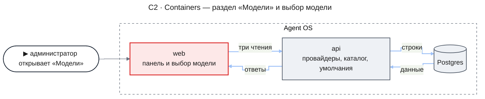
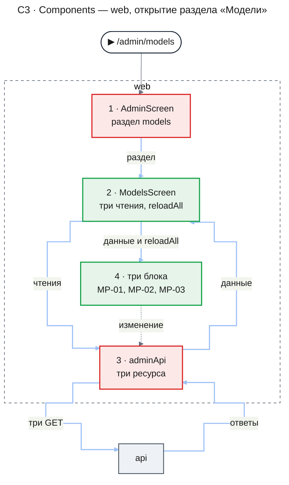
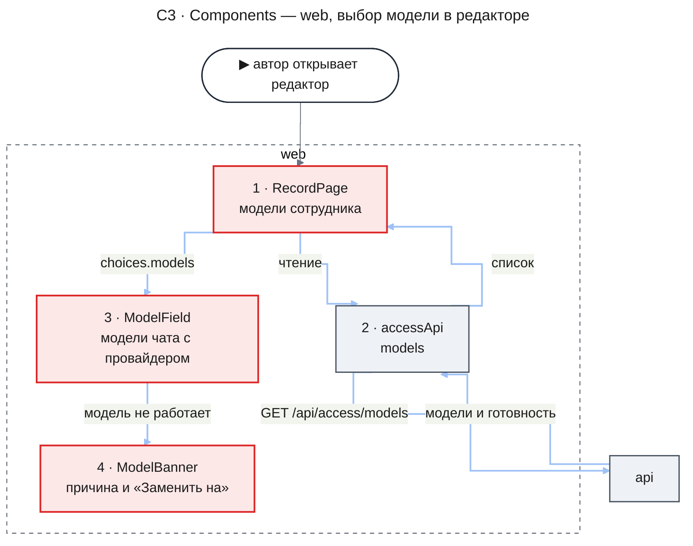
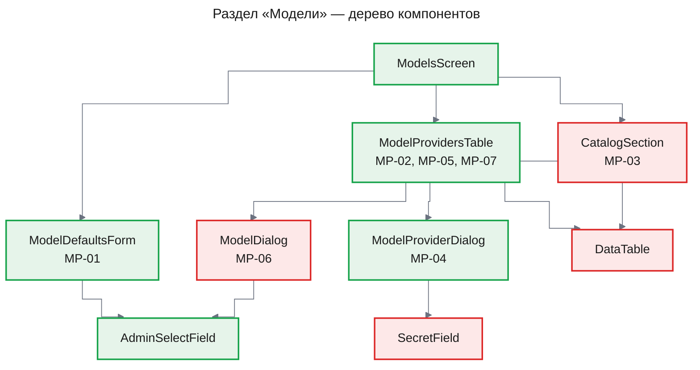
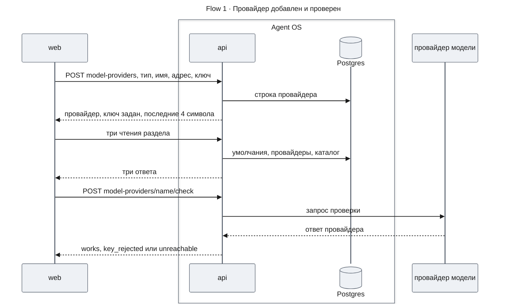
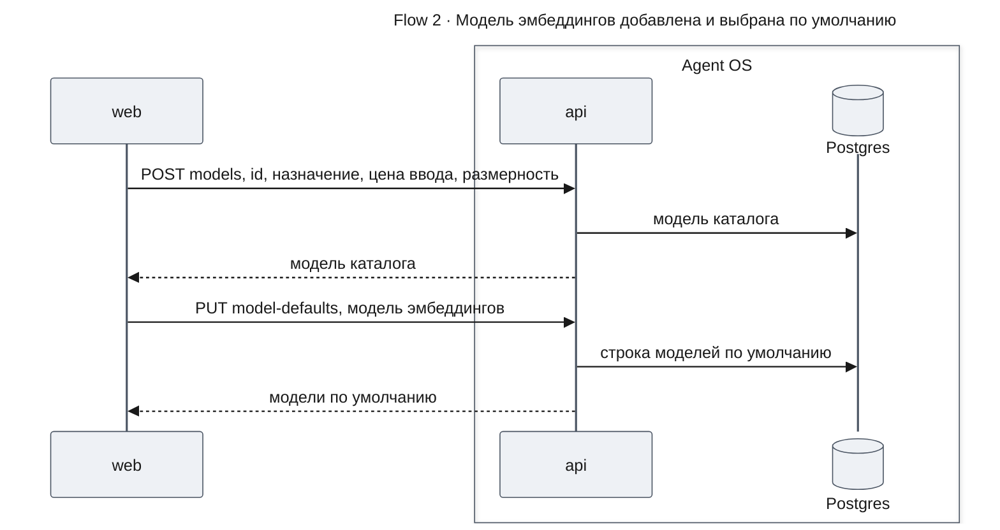
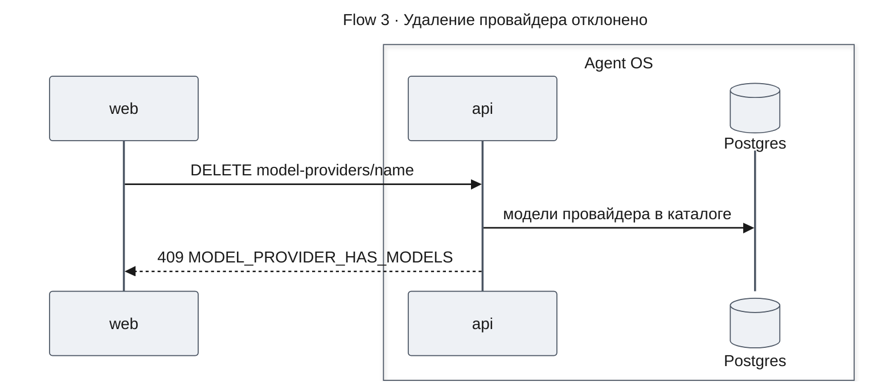
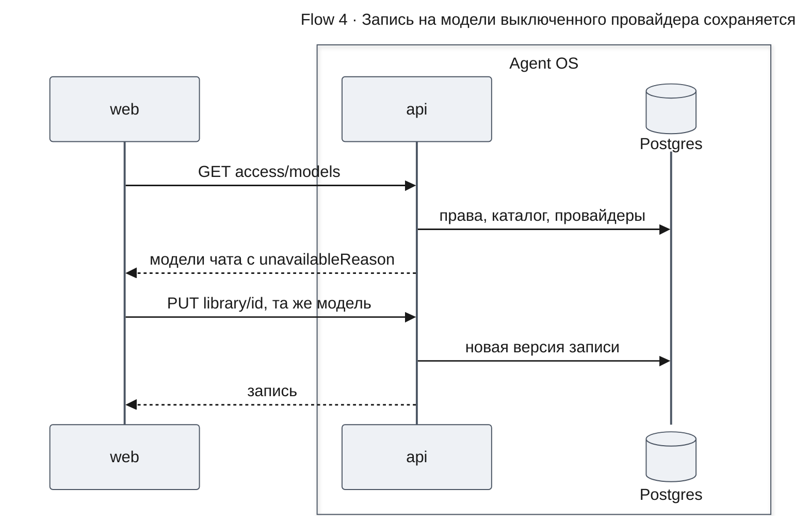

# Провайдеры моделей — Design Document — web

**Status:** Approved · **Date:** 2026-11-20 · **PRD:** [prd.md](./prd.md) · **UXRD:** [uxrd.md](./uxrd.md) · **Depends on:** [design-core.md, Для части web](./design-core.md#для-части-web)

## Snapshot

**Overview.** Часть `core` заводит провайдеров моделей в базе и открывает для них маршруты; эта часть даёт администратору экран, а сотруднику — понятные причины. Раздел панели «Модели» — страница из трёх блоков: модели по умолчанию, провайдеры с ключом и проверкой подключения, каталог моделей с провайдером и назначением. Страница читает три ресурса в одном родителе и после любого изменения перечитывает все три, поэтому блоки не расходятся. Везде, где человек выбирает модель, предлагаются только модели чата с именем провайдера, а модель неработающего провайдера помечается причиной и не мешает сохранению. Сбои из-за провайдера показываются своими словами в строке события, отчёте, блоке ошибки ответа и отказе старта.
- **Главный риск**: ключ провайдера уходит в запрос, когда администратор его не менял; закрыт правилом «пустая замена — ключа в теле нет» (KD-4) и тестом UC-1.
- **Открытые вопросы**: нет.

### Key Decisions

#### KD-1: «Модели» — страница `ModelsScreen` из трёх блоков; родитель держит три чтения и после любого изменения перечитывает все три

`ModelsScreen` читает модели по умолчанию, провайдеров и каталог тремя `useResource` ([read-on-open.md](../../code-system/patterns/read-on-open.md)) и отдаёт блокам их данные и одну функцию `reloadAll`. Блоки зависят друг от друга: число моделей у провайдера, метка «Нет провайдера» в каталоге, предупреждения моделей по умолчанию и снятый выбор после удаления модели (design-core DC-6). Перечитать после изменения все три ресурса — три коротких `GET` и ни одного правила «что от чего зависит». Форма моделей по умолчанию перемонтируется только тогда, когда сохранённые значения изменились, поэтому изменение в другом блоке не стирает её несохранённый выбор.

#### KD-2: Имена — `modelProviders` в клиенте API, `ModelProvider…` в компонентах и файлах; имена провайдеров входа не трогаются

`adminApi.providers`, `providerRules`, `PROVIDER_TEXT` и `components/admin/sign-in/provider-*` — это провайдеры входа. У провайдеров моделей свои имена: `adminApi.modelProviders`, `adminApi.modelDefaults`, `ModelProvidersTable`, `ModelProviderDialog`, `modelProviderRules`.

#### KD-3: Общие компоненты несут по одному необязательному свойству; где UXRD требовал бы переписать общий компонент, строится поведение компонента, и отличие записано

`DataTableRow` получает `result` — строку итога под строкой (data-table «Итог действия»). `ActionsMenu` применяет `disabled` действия к пункту меню. `SecretField` получает `lastFour` и `hint`, `SavingSwitch` — `confirmOff` рядом с `confirmOn`. `admin-form` получает общий выпадающий список `AdminSelectField` для MP-01 и MP-06; у диалога права свой `SelectField`, у редактора — `ModelField`. Окно «Нельзя удалить» с одной кнопкой «Понятно» собирается прямо из `AlertDialog` из `ui`. Что строится иначе, чем в UXRD, — в [Отличия от UXRD](#отличия-от-uxrd).

#### KD-4: Ключ живёт только в форме диалога; пустая замена значит «ключ не менялся», и тело запроса ключа не несёт

Поле ключа — `SecretField`: `undefined` — замены нет, пустая строка — замена начата. При сохранении `ModelProviderDialog` кладёт `apiKey` в тело, только если введено непустое значение; иначе поля в теле нет, и `PATCH` оставляет прежний ключ (UXRD KD-3). `AdminForm.secretFields` очищает поле после успеха, а ключ не попадает ни в адрес, ни в уведомление, ни в лог. На экране от ключа остаются только `apiKeySet` и `apiKeyLast4` из ответа `core`. `apiKey: null` («убрать ключ») веб не отправляет: в UXRD такого действия нет.

#### KD-5: Готовность модели веб узнаёт из ответа сервера, не повторяя правил `core`

У сотрудника готовность приходит полем `unavailableReason` в `GET /api/access/models`. В панели одна чистая функция `modelUnavailableReason` берёт имя провайдера из id модели через `modelProvider` из `contracts` и смотрит на список провайдеров: провайдера нет — `provider_missing`, `state` `disabled` — `provider_disabled`, `state` `key_missing` — `provider_key_missing`, иначе `null`. Какой вид требует ключ, решает `core` полем `state`, поэтому правило не дублируется. Функцию берут MP-01, метка «Нет провайдера» в каталоге (MP-03), диалог права и редактор системной записи в панели.

#### KD-6: Подпись модели — `formatModel` для id и `formatRecordModel` для модели записи, которая может быть `null`

`formatModel(modelId, names?)` даёт название модели из каталога, если `names` её знает, иначе короткое имя семейства Claude или id. `formatRecordModel(t, model | null, names?)` подписывает модель записи: id — через `formatModel`, а `null` — модель чата по умолчанию (design-core KD-5). Её подпись — «Модель по умолчанию · {название}», «Модель по умолчанию — не выбрана» или просто «Модель по умолчанию», когда модель по умолчанию неизвестна (UXRD MC-8, `i18n/translations/ru/formats.json`). Названия передают редактор, `DefinitionView` и строка события. Блок ответа, блок вызова и отказ у поля сообщения строят текст чистыми функциями без списка и называют модель по id (отличие записано).

#### KD-7: Причины провайдера — слова MC-9 и подсказка MC-10 в двух функциях, которые берут все места, читающие причины; «Модель для чата не настроена» — отказ старта у поля сообщения

`providerFailureText` и `providerFailureHint` в `lib/agents/format.ts` дают слова MC-9 и подсказку MC-10 из каталога i18n. Их берут `failureReasonText` (строка события и отчёт), `replyFailureText` в `lib/access/access-texts.ts` (блок ошибки ответа), `startRefused` в `lib/library/library-errors.ts` и `refusalText` (блок вызова). `CHAT_FAILURE_REASONS` включает `PROVIDER_FAILURE_REASONS`, поэтому сбой провайдера показывается блоком ответа, а не строкой события. `core` отвечает на первое сообщение без модели по умолчанию 409 `START_REFUSED` `model_not_configured` (design-core DC-3); веб показывает такой отказ у поля сообщения текстом MC-11 (`library-errors.ts`), а не в блоке ответа, как рисует UXRD (отличие записано).

## Terms

- **Провайдер, ключ, каталог, модель чата, модель эмбеддингов, размерность** — как в [PRD, Terms](./prd.md#terms); тип провайдера и назначение модели — как в UXRD KD-1.
- **Готовность модели** — работает ли провайдер модели сейчас: `null` или причина `provider_missing`, `provider_disabled`, `provider_key_missing` (KD-5).
- **Строка итога** — строка под строкой таблицы с итогом проверки подключения (data-table, «Итог действия»).
- **Чтение при открытии** — экран читает данные, когда его открыли, и перечитывает после своего изменения ([read-on-open.md](../../code-system/patterns/read-on-open.md)).
- **Выбор модели** — каждое поле, где человек выбирает модель: редактор агента, диалог права, MP-01 (UXRD MP-08).

## Part

- **Part**: `web`
- **Covers**: FR-12, FR-13, FR-14, FR-16; видимая сторона FR-01, FR-02, FR-04, FR-05, FR-06, FR-09, FR-15
- **Depends on**: [design-core.md, Для части web](./design-core.md#для-части-web)
- **Prerequisite ADRs**: [ADR-0012](../../adr/ADR-0012-closed-api-and-server-issued-employee-id.md) (сотрудника веб не передаёт), [ADR-0015](../../adr/ADR-0015-access-gate-and-model-catalogue.md) (каталог и права — у `access`), [ADR-0018](../../adr/ADR-0018-model-id-provider-prefix.md) (id модели — `{провайдер}/{имя}`; провайдер — первая часть id)
- **Sibling parts**: `core` (FR-01 – FR-11, FR-15, FR-17) — здесь только его контракт

**Out of scope**

- Строка расхода на эмбеддинги в «Мой доступ» (FR-18) — отложена в PRD.
- Пометка модели в строке списка библиотеки (MC-12): у `RecordSummary` нет модели записи ([Отличия от UXRD](#отличия-от-uxrd)).
- Экран знаний самообучения и его строка «Отбор по смыслу выключен» — `self-learning` (UXRD MP-09).
- Действие «убрать ключ» и смена имени или типа провайдера — их нет в UXRD.
- Два одноимённых `describeRefusal` (в `admin-form.tsx` и в `library-errors.ts`).

**Constraints**

- PoC: самый короткий путь; каждый блок сначала искали среди существующих ([Building-block Inventory](#building-block-inventory)).
- Контракт `core` потребляется как написан.
- Логи — через `src/lib/logger.ts`; ключ в лог не попадает ([Логирование](#логирование)).
- Тестов мало, только на критичное ([Test Strategy](#test-strategy)).
- WCAG 2.1 AA и работа от 360 px без горизонтальной прокрутки страницы, как во всей панели (UXRD Accessibility).

## Building-block Inventory

Follows the [code system](../../code-system/README.md). Поиск перед «new»: `apps/web/src/components` (`admin`, `library`, `account`, `agents`, `assistant-ui`), `apps/web/src/lib`, `docs/design-system/components/`, `docs/code-system/patterns/`.

| Building block | Pattern | Status | Note |
|---|---|---|---|
| `adminApi.modelProviders`, `adminApi.modelDefaults`, `adminApi.models` | [web-api-client.md](../../code-system/patterns/web-api-client.md) | new / extended | маршруты `core`; каталог разбирается схемой ответа, а не тела создания |
| `ModelsScreen` | [read-on-open.md](../../code-system/patterns/read-on-open.md) | new | три чтения и `reloadAll` (KD-1) |
| `ModelDefaultsForm` | [settings-row.md](../../code-system/patterns/settings-row.md) | new | MP-01 по образцу `LibrarySettingsForm` |
| `ModelProvidersTable`, `ModelProviderDialog`, `modelProviderRules` | — | new | MP-02, MP-04, MP-05, MP-07; образец — `providers-table.tsx` входа (KD-2) |
| `CatalogSection`, `ModelDialog`, правила модели в `form-rules.ts` | — | extended | MP-03, MP-06: провайдер, назначение, имя у провайдера |
| `modelUnavailableReason`, тексты типов и причин | [pure-decision.md](../../code-system/patterns/pure-decision.md) | new | KD-5 |
| `DataTable`, `ActionsMenu` | [data-table.md](../../design-system/components/data-table.md) | extended | `result`; `disabled` пункта меню (KD-3) |
| `SecretField` | [secret-field.md](../../design-system/components/secret-field.md), [write-only-secret.md](../../code-system/patterns/write-only-secret.md) | extended | `lastFour`, `hint` (KD-3, KD-4) |
| `SavingSwitch` | [settings-form.md](../../design-system/components/settings-form.md) | extended | `confirmOff` (KD-3) |
| `AdminSelectField` | [settings-form.md](../../design-system/components/settings-form.md) | new | общий список панели; третьего частного не заводим (KD-3) |
| `describeAdminError`, `AdminErrorTarget`, `AdminErrorContext` | [web-api-client.md](../../code-system/patterns/web-api-client.md) | extended | коды `MODEL_PROVIDER_*`, `MODEL_DEFAULT_INVALID`; цель `modelName`; имя провайдера в контексте |
| `ModelField`, `ModelBanner`, `EditorChoices`, `blankAgent` | [record-editor.md](../../design-system/components/record-editor.md) | extended | модели чата с провайдером, пометка неработающей, модель `null` (KD-5, KD-6) |
| `GrantForm` диалога права | — | extended | только модели чата работающих провайдеров с провайдером |
| `ModelsSection` «Мой доступ», `ModelHint` страницы записи | — | extended | провайдер, «не работает», строка MC-12 |
| `DefinitionView` (карточка глубокого агента) | — | extended | модели только для чтения через `formatRecordModel` (KD-6) |
| `formatModel`, `formatRecordModel`, `failureReasonText` | — | extended | KD-6, KD-7 |
| `providerFailureText`, `providerFailureHint`, `replyFailureText`, `refusalText`, `startRefused` | — | new / extended | KD-7 |
| строка события сбоя провайдера | [agent-status.md](../../design-system/components/agent-status.md) | new | по образцу `QuotaFailureLine`: название из `accessApi.modelsForFeed`, вторая строка подсказки |
| `useResource`, `resourceTableState`, `AdminForm`, `ConfirmDialog`, `StateBadge`, `PageHeader`, `AlertDialog`, `toast` | — | reused | без изменений |

Новых паттернов нет; `docs/code-system/` и `docs/design-system/` эта часть не меняет: «Итог действия», концовка ключа и подтверждение выключения уже описаны в спецификациях и UXRD.

## Acceptance Criteria

### FR-12: Провайдеры в панели

- From the PRD: AC-12.1, AC-12.2, AC-12.3
- Изменение провайдера без введённого ключа шлёт `PATCH` без поля `apiKey`, и ключ провайдера остаётся прежним (DC-1).

### FR-13: Провайдер и вид в каталоге, модели по умолчанию

- From the PRD: AC-13.1, AC-13.2, AC-13.3
- Добавление модели шлёт id `{провайдер}/{имя у провайдера}`; тело модели эмбеддингов несёт только цену ввода и размерность, тело модели чата — цены (DC-2).

### FR-14: Выбор модели — только модели чата с провайдером

- From the PRD: AC-14.1, AC-14.2, AC-14.3
- Запись, чья модель не работает из-за провайдера, сохраняется без замены модели; запись с моделью без права отклоняется (DC-3).

### FR-16: Проверка подключения в панели

- From the PRD: AC-16.1

### Видимая сторона требований `core`

- From the PRD: AC-01.1, AC-01.3, AC-02.1, AC-04.2, AC-05.1, AC-05.2, AC-05.3, AC-05.4, AC-06.1, AC-06.2, AC-09.1, AC-09.2, AC-09.3, AC-09.4, AC-09.5, AC-15.1 — каждый в той части, которую человек видит на экране.
- Сбой агента с причиной провайдера показывает слова MC-9, а в беседе — блок ошибки ответа с текстом MC-11, а не строку события (DC-4).
- Первое сообщение беседы без модели чата по умолчанию оставляет текст в поле и показывает под ним MC-11 «Модель для чата не настроена…» (DC-5).

## Design

### Architecture (C1–C4)

#### C2 · Containers

Веб зовёт маршруты `core`; новых контейнеров и хранилищ нет.

- `web` показывает раздел «Модели», выбор модели с провайдером и причины сбоев провайдера.
- `api` и Postgres в этой части не меняются: их меняет `core`.

#### C3 · Components: web

**web — открытие раздела «Модели»**

- `AdminScreen` рисует `ModelsScreen` по адресу `/admin/models` ([shell-route.md](../../code-system/patterns/shell-route.md)).
- `ModelsScreen` держит шапку `h1` «Модели» без кнопки и три `useResource`. Каждый блок получает свой ресурс и данные соседей, которые ему нужны, и `reloadAll` для своих изменений (KD-1).
- Каждый блок показывает загрузку и ошибку своего ресурса состояниями таблицы; MP-01 ждёт все три чтения, потому что варианты его полей строятся из каталога и провайдеров.

**web — выбор модели в редакторе**

- `RecordPage` передаёт в `EditorChoices.models` модели сотрудника с названием, провайдером и готовностью. В панели `SystemRecordPage` строит тот же список из каталога (только модели чата) и списка провайдеров через `modelUnavailableReason` (KD-5) — это одно лишнее чтение провайдеров.
- `ModelField` предлагает модели чата с готовностью `null`, по имени провайдера и названию. Модель записи, чей провайдер не работает, стоит первой, недоступна для выбора и несёт метку «Выключено» с короткой причиной MC-8; модель без права остаётся с меткой «у вас недоступна».
- `ModelBanner` знает два вида потерянной модели: без права — текст и отказ при сохранении; не работает провайдер — текст MC-12 с «Заменить на {модель}», и сохранение проходит (DC-3).
- Карточка глубокого агента показывает модели глубокого агента и субагентов только для чтения (`DefinitionView`); поля выбора модели там нет ([deep-agents](../deep-agents/design-agent-types.md)).

#### Дерево компонентов

Где стоит каждая часть раздела «Модели».

В строке провайдера ещё стоят `SavingSwitch` «Включён», меню «⋯» и строка итога; удаление открывает `ConfirmDialog` или окно «Нельзя удалить» на `AlertDialog`. Остальные места фичи стоят в существующих экранах.

| Место | Спецификация | Что меняется |
|---|---|---|
| `ModelField`, `ModelBanner` в редакторе агента | [record-editor.md](../../design-system/components/record-editor.md), часть 4 | модели чата с провайдером, пометка и баннер MC-12, модель `null` |
| `GrantForm` диалога права | enterprise-access UXRD GR-01 | только модели чата работающих провайдеров, подпись с провайдером |
| `ModelsSection` «Мой доступ» | enterprise-access UXRD MA-02 | провайдер Caption под названием, метка «не работает» |
| `ModelHint` страницы записи | custom-agents UXRD RV-01 | строка MC-12 при неработающем провайдере |
| строка события, отчёт | [agent-status.md](../../design-system/components/agent-status.md), [agent-report.md](../../design-system/components/agent-report.md) | слова MC-9, подсказка MC-10 второй строкой |
| блок ошибки ответа | chat-shell UXRD TH-08 | тексты MC-11 |
| блок вызова, поле сообщения | [tool-call.md](../../design-system/components/tool-call.md) | отказ старта MC-12, у первого сообщения MC-11 |

#### Данные экранов

Каждый экран читает при открытии и после своего изменения перечитывает затронутое. Правок до ответа сервера нет.

| Экран | Читает | Пишет, затем перечитывает |
|---|---|---|
| «Модели» в панели | `GET /api/admin/model-defaults`, `GET /api/admin/model-providers`, `GET /api/admin/models` | любой `POST`, `PATCH`, `PUT`, `DELETE` раздела, затем все три чтения (KD-1) |
| Проверка подключения | — | `POST /api/admin/model-providers/:name/check`; итог — состояние таблицы, без перечитывания |
| Редактор, страница записи, «Мой доступ» | `GET /api/access/models` | сохранение записи в редакторе — `PUT /api/library/:id` |
| Редактор системной записи, диалог права | `GET /api/admin/models`, `GET /api/admin/model-providers` | сохранение записи или права своим маршрутом панели |

#### Как раздел «Модели» выбирает, что показать

Тексты — по ID сообщений UXRD; состояния каждого блока — в таблицах MP-01 – MP-07.

| Условие | Что показано |
|---|---|
| У модели чата по умолчанию `null` | «Не выбрана» и предупреждение MC-2 «Пока модель чата не выбрана…» у поля |
| Выбранная модель не работает (KD-5) | Модель в поле с меткой «Выключено» и причиной MC-8; предупреждение MC-2 с причиной по `provider_*` |
| Работающих моделей назначения нет | Поле недоступно, подсказка MC-2 «добавьте модель ниже» |
| `apiKeySet` ложно, тип не `openai_compatible` | В колонке «Ключ» метка «Нужен ключ», включён провайдер или нет |
| `apiKeySet` ложно, тип `openai_compatible` | «без ключа» `--muted-foreground` |
| `apiKeySet` истинно | «…{apiKeyLast4}» Mono |
| `baseUrl` `null` | вторая строка «адрес по умолчанию» |
| Модель каталога без провайдера в списке | метка «Нет провайдера» в колонке «Провайдер» (AC-05.4) |
| Провайдеров нет | «Добавить модель» `aria-disabled` с описанием MC-1; пустой каталог — MC-7 |
| `catalogModels` провайдера больше нуля | «Удалить» открывает окно «Нельзя удалить» MC-5 без запроса |
| Модель выбрана по умолчанию | Подтверждение удаления модели добавляет фразу MC-7; выключение её провайдера спрашивает MC-3 |

Каталог веб сортирует по id, провайдеров показывает в порядке ответа (по имени), варианты выбора модели — по имени провайдера, затем по названию.

#### Отличия от UXRD

Где буквальное выполнение UXRD потребовало бы переписать общий компонент или данных нет в контракте `core`, строится так. Ни одно отличие не задевает критерий приёмки PRD.

| UXRD | Что строится | Почему |
|---|---|---|
| «Модель для чата не настроена» — блок ошибки ответа (MP-09, Error Flows) | Текст MC-11 под полем сообщения, текст остаётся в поле | `core` отвечает на первое сообщение 409 `START_REFUSED` (design-core DC-3); у беседы нет ответа, куда поставить блок (KD-7) |
| Отказ старта из-за провайдера в чате — блок ошибки ответа | У первого сообщения новой беседы — то же место у поля сообщения, текст MC-11 | та же причина; в идущей беседе сбой приходит в ленту и встаёт блоком ответа |
| `{модель}` — название из каталога | Блок ответа, блок вызова и отказ у поля сообщения называют модель по id (короткое имя Claude); строка события — по названию | эти тексты строят чистые функции без списка моделей (KD-6) |
| Отчёт родителю «Причина: {причина}» с моделью | Слова MC-9 без названия модели | в данных отчёта `ReportPartData` нет модели |
| Удалён последний провайдер — фокус на `h2` «Провайдеры» (Accessibility) | Фокус на `h1` страницы | правило ухода фокуса живёт внутри `DataTable` |
| Отказ переключателя «Включён» — строка под строкой провайдера | Причина под самим переключателем в ячейке | так `SavingSwitch` устроен во всей панели |
| Ошибка одного блока не прячет два других | Ошибка чтения каталога или провайдеров показывает ошибку и в MP-01 с «Повторить» | варианты полей MP-01 строятся из этих чтений |
| Пометка модели в строке списка библиотеки (MC-12) | Пометки в строке нет; есть на странице записи и в редакторе | у `RecordSummary` нет модели записи и её готовности |
| Отказ проверки не из-за сети (MC-6) | «Не удалось проверить: {сообщение сервера}»; при 404 список перечитывается и строка уходит | MC-6 такого текста не задаёт |
| Ошибки поля ключа (MC-4) | Ключ короче 8 или длиннее 512 знаков — «Ключ — от 8 до 512 символов» | граница `core` (design-core FR-01), текста в MC-4 нет |

### Runtime Flows

Все потоки идут одним путём: `web` зовёт `api`, `api` читает или пишет Postgres, ответ возвращается в `web`. Устройство `api` — в design-core.

#### Flow 1: Администратор добавляет провайдера и проверяет подключение

**Starts when:** администратор нажимает «Добавить» в диалоге провайдера, затем «Проверить подключение» в уведомлении, for AC-12.1, AC-12.2, AC-16.1, AC-01.1, AC-15.1

**Outcome:** диалог закрыт, поле ключа пусто; строка провайдера в таблице включена, в колонке «Ключ» — «…{последние 4}» или «без ключа»; под строкой — строка итога MC-6 со временем, пока администратор на странице. Ответ провайдера на проверку виден только как текст `message` от `core`.

**Failure handling:**

- Имя занято → 409 `MODEL_PROVIDER_NAME_TAKEN`, ошибка поля «Имя» MC-4; введённое, ключ тоже, остаётся в форме.
- Имя или ключ не прошли правило → ошибка поля до запроса; сервер отвечает 400 `VALIDATION_FAILED`, если правило всё же разошлось, — ошибка формы.
- Нет связи с сервером при сохранении → ошибка формы, введённое остаётся.
- Проверка не дошла до сервера → строка итога «Не удалось проверить: нет связи с сервером»; 404 → перечитывание, строка уходит.
- Не администратор → общий обработчик 403 `ADMIN_REQUIRED` уводит с экрана, как во всей панели.

#### Flow 2: Администратор добавляет модель эмбеддингов и выбирает её по умолчанию

**Starts when:** администратор нажимает «Добавить модель» в диалоге с назначением «Эмбеддинги», затем «Выбрать по умолчанию» и «Сохранить», for AC-13.1, AC-13.2, AC-13.3, AC-05.1, AC-05.2, AC-05.3, AC-06.2

**Outcome:** модель в каталоге со строкой «google · Эмбеддинги · 768», «—» в колонках вывода и кэша; в MP-01 она выбрана и сохранена, уведомление MC-2. После каждого шага раздел перечитывает три ресурса, и форма MP-01 перемонтируется, потому что сохранённое значение изменилось (KD-1).

**Failure handling:**

- 409 `MODEL_ID_TAKEN` → ошибка поля «Имя модели у провайдера» (цель `modelName`).
- 422 `MODEL_PROVIDER_INVALID` `embeddings_not_supported` или `provider_unknown` → ошибка формы MC-7; во втором случае с именем провайдера из контекста.
- 422 `MODEL_DEFAULT_INVALID` → ошибка формы MP-01 MC-2, выбор остаётся (AC-06.2); название модели — из поля `model` ответа.
- У провайдера типа Anthropic радиогруппа не предлагает «Эмбеддинги», поэтому запроса с таким телом из диалога нет (AC-13.2).

#### Flow 3: Удаление провайдера, у которого есть модели

**Starts when:** администратор выбирает «Удалить» в меню провайдера, for AC-12.3, AC-01.3

**Outcome:** провайдер на месте. Обычный путь запроса не делает: `catalogModels` строки больше нуля, и «Удалить» сразу открывает окно «Нельзя удалить» MC-5 с числом моделей и кнопкой «Понятно». Запрос и ответ на схеме — случай, когда модель добавили в другой вкладке после чтения списка: `ConfirmDialog` остаётся открытым с текстом MC-5 «Не удалось удалить…», а раздел перечитывает три ресурса.

**Failure handling:**

- 404 `MODEL_PROVIDER_NOT_FOUND` → провайдера уже нет: раздел перечитывает список, строка уходит, фокус — по правилу таблицы.
- Нет связи → текст ошибки в окне, провайдер остаётся; повтор — та же кнопка.

#### Flow 4: Автор сохраняет запись на модели выключенного провайдера

**Starts when:** автор открывает редактор своего агента, чья модель принадлежит выключенному провайдеру, правит инструкцию и сохраняет, for AC-14.1, AC-14.3, DC-3

**Outcome:** в поле «Модель» запись держит свою модель первой, недоступной для выбора, с меткой «Выключено» и «провайдер выключен»; в списке её для выбора нет. Над полями баннер MC-12 с «Заменить на {модель}». Сохранение с этой моделью прошло, запись сохранила модель.

**Failure handling:**

- Модель записи вообще не в списке сотрудника (нет права) → метка «у вас недоступна», а сохранение отклоняется 422 `model_not_allowed` у поля «Модель».
- Чтение моделей не удалось → список пуст, баннера нет, `useResource` пишет ошибку в лог; сохранение работает.

### Contract Definitions

Контракт `core` — маршруты провайдеров, каталога и моделей по умолчанию, формы ответов, `unavailableReason`, причины отказа старта и сбоя — потребляется как написан в [design-core.md, Для части web](./design-core.md#для-части-web). Ниже — что эта часть даёт остальному вебу.

#### Клиент API

- **`adminApi.modelProviders`** — `list`, `create`, `update(name, …)`, `remove(name)`, `check(name)` над маршрутами `/api/admin/model-providers`; имя в пути кодируется `encodeURIComponent`. `create` и `update` кладут `apiKey` в тело, только если вызывающий его передал (KD-4).
- **`adminApi.modelDefaults`** — `get` и `save({ chatModel, embeddingModel })` над `/api/admin/model-defaults`.
- **`adminApi.models`** — `list` разбирает ответ схемой модели каталога из `contracts` (объединение по `purpose`), а не схемой тела создания; `create` шлёт id целиком.
- **`ApiRequestError.model`** — `api-request.ts` копирует строку `model` из тела любой ошибки, а не только `START_REFUSED`: так её читают и отказ старта, и `MODEL_DEFAULT_INVALID`.

#### Компоненты и функции

- **`ModelsScreen`** — без свойств; сам читает три ресурса и рисует три блока.
- **`DataTableRow.result`** — необязательно: строка итога под строкой. Несёт состояние — идёт, успех или отказ, — видимый текст, у успеха текст метки «Хорошо», и текст объявления. Строка — `status` вежливо, переносится и не усекается.- **`DataTableAction.disabled` в меню** — пункт меню недоступен; меню целиком недоступно только при `pending`.
- **`SecretField`** — необязательные `lastFour` (концовка «…{символы}» после «Задан» и в имени для скринридера) и `hint` (подсказка под полем, описание поля).
- **`SavingSwitch.confirmOff`** — необязательно: выключение зовёт его вместо сохранения, переключатель остаётся включённым; вызывающий спрашивает подтверждение и сохраняет сам.
- **`AdminSelectField`** — подпись, значение или `null` с текстом пустого значения, варианты (значение, текст закрытого поля, содержимое пункта, недоступен ли), подсказка, предупреждение, недоступность и ошибка поля. Подсказка и предупреждение — описание поля.
- **`modelUnavailableReason(modelId, providers)`** — `null` или `provider_missing`, `provider_disabled`, `provider_key_missing` (KD-5).
- **`formatModel(modelId, names?)`** и **`formatRecordModel(t, model | null, names?)`** — подпись модели и модели записи (KD-6).
- **`providerFailureText(t, reason, model?)`** — слова MC-9, без модели — без названия; **`providerFailureHint(t, reason)`** — подсказка MC-10 (KD-7). Их берут `failureReasonText`, `replyFailureText`, `startRefused` и `refusalText`.
- **`EditorChoices.models`** — у каждой модели имя провайдера и готовность; **`EditorChoices.defaultModel`** может быть `null`, и `blankAgent` кладёт `defaultModel` в запись как есть.
- **`AdminErrorTarget`** знает `modelName`; **`AdminErrorContext`** — имя провайдера для текстов MC-4 и MC-7 «провайдера {имя} уже нет».

### Логирование

Через `logger` из `src/lib/logger.ts` с `describeApiError` ([logging.md](../../code-system/patterns/logging.md)): метод, путь, статус, код, причина, без тел запросов и ответов, поэтому ключа в логе нет.

- Чтения раздела: `useResource` с меткой `admin` пишет отказ каждого из трёх чтений.
- Формы и переключатель: `AdminForm` и `SavingSwitch` с событиями `admin: model provider create`, `admin: model provider save`, `admin: model provider enable`, `admin: model defaults save`, `admin: model create`, `admin: model save` пишут отказ сервера.
- Удаление: `ConfirmDialog` с `admin: model provider remove`.
- Проверка: `admin: model provider check` — имя провайдера, `result` и `durationMs`; текст `message` в лог не идёт: он уже прошёл маску `core`, но это ответ чужой системы.

### Доступность и ширина

Роли, имена и клавиатура компонентов — в их спецификациях; раздел добавляет только своё (UXRD Accessibility).

- `h1` «Модели» получает фокус при открытии; у каждого блока `h2`, таблицы подписаны названием блока: «Провайдеры», «Каталог моделей».
- После закрытия диалога фокус возвращается на кнопку, которая его открыла: «Добавить …» или «⋯» строки. После проверки из уведомления — на «⋯» строки провайдера; после «Выбрать по умолчанию» — на поле MP-01 этого назначения. После удаления провайдера — по правилу таблицы; последний ушёл — на `h1` страницы (отличие записано).
- Переключатель в строке называется «Включён: {имя}», меню — «Действия: {имя}», концовка ключа читается «ключ заканчивается на {символы}».
- Предупреждения MP-01 — описание своего поля, не `alert`; отказ переключателя, ошибки формы и загрузки — `alert`.
- Ниже 768 px кнопка «Добавить …» уходит строкой под `h2`, таблицы прокручиваются внутри своего блока, а строка итога переносится и не прокручивается с таблицей.

## Test Strategy

Автотестами становятся UC-1 – UC-4, UC-E1 и UC-E2 — по одному на каждый критичный путь. UC-5 и UC-6 проверяют сценарии L1: их тексты и ветви не защищают ни секрет, ни данные.

### Main Use Cases

- **UC-1: Ключ провайдера уходит только при вводе и не возвращается** — covers AC-12.1, AC-12.2, AC-01.1, DC-1
  - Given: администратор в «Моделях», провайдеров нет.
  - When: он добавляет провайдера Google Gemini с ключом `AIza…x9Qz`, затем OpenAI-совместимого `local` с адресом и без ключа; потом открывает «Изменить» у `google`, меняет адрес и сохраняет, не трогая ключ.
  - Then: тело первого `POST` несёт `apiKey`, второго — без `apiKey`; в строке `google` «…x9Qz», в строке `local` «без ключа», оба включены; в диалоге изменения «Задан · …x9Qz» и ни одного поля с ключом; тело `PATCH` несёт `baseUrl` и не несёт `apiKey`.
- **UC-2: Диалог модели создаёт модель чата и модель эмбеддингов** — covers AC-13.1, AC-13.2, AC-05.1, AC-05.2, AC-05.3, DC-2
  - Given: провайдеры `anthropic` и `google`.
  - When: администратор выбирает `anthropic` и смотрит назначения; затем добавляет `google`, «Чат», `gemini-2.5-flash` с ценами; затем `google`, «Эмбеддинги», `gemini-embedding-001`, цену ввода и размерность 768; затем ещё одну модель `google`, а сервер отвечает 422 `MODEL_PROVIDER_INVALID` сначала с `provider_unknown`, потом с `embeddings_not_supported`.
  - Then: у `anthropic` варианта «Эмбеддинги» нет; первое тело — id `google/gemini-2.5-flash`, назначение `chat`, цены; второе — id `google/gemini-embedding-001`, назначение `embedding`, только цена ввода и размерность, а форма не показывала цен вывода и кэша; в каталоге строка «Эмбеддинги · 768» с провайдером `google`; на отказы диалог остаётся открытым с ошибкой формы MC-7 — «провайдера google больше нет» и «провайдер этого типа не считает эмбеддинги».
- **UC-3: Модели по умолчанию предлагают только своё назначение** — covers AC-13.3, AC-06.1
  - Given: каталог с Haiku, Sonnet и моделью эмбеддингов; провайдеры готовы.
  - When: администратор открывает оба списка MP-01, выбирает Sonnet и сохраняет.
  - Then: в «Модели чата» только Haiku и Sonnet, в «Модели эмбеддингов» только модель эмбеддингов с размерностью; `PUT` несёт Sonnet; новая запись в редакторе стоит на модели, которую вернули `choices`.
- **UC-4: Выбор модели — модели чата с провайдером; запись на выключенном провайдере сохраняется** — covers AC-14.1, AC-14.2, AC-14.3, DC-3
  - Given: сотрудник с правами на Haiku (`anthropic`) и Gemini 2.5 Flash (`google`), у Gemini `unavailableReason` `provider_disabled`; его агент на Gemini 2.5 Flash; в каталоге ещё модель эмбеддингов.
  - When: автор открывает редактор, раскрывает «Модель», правит инструкцию и сохраняет; администратор открывает диалог права роли.
  - Then: в списке автора только Haiku с подписью `anthropic`; Gemini 2.5 Flash стоит первой, недоступна, с меткой «провайдер выключен»; баннер MC-12 с «Заменить на Haiku»; `PUT` ушёл с моделью `google/gemini-2.5-flash` и сохранение прошло; в диалоге права нет модели эмбеддингов.

### Error and Edge Use Cases

- **UC-E1: Провайдера с моделями удалить нельзя** — covers AC-12.3, AC-01.3
  - Given: у `google` две модели в каталоге; у `local` моделей нет, но сервер на удаление отвечает 409 `MODEL_PROVIDER_HAS_MODELS`.
  - When: администратор выбирает «Удалить» у `google`, затем у `local` и подтверждает.
  - Then: у `google` окно «Нельзя удалить «google»» с числом 2 и одной кнопкой «Понятно», запроса `DELETE` нет; у `local` окно подтверждения остаётся открытым с текстом MC-5 «Не удалось удалить…», провайдер в таблице.
- **UC-E2: Сбой из-за провайдера в беседе** — covers AC-09.2, AC-09.3, AC-09.4, AC-09.5, AC-04.2, AC-02.1, AC-09.1, DC-4, DC-5
  - Given: идущая беседа, корневой агент на `anthropic/claude-haiku-5-5`; новая беседа на развёртывании без модели по умолчанию.
  - When: корень беседы заканчивается сбоем с причиной `provider_disabled`, затем `provider_unavailable`; в новой беседе сотрудник отправляет первое сообщение, сервер отвечает 409 `START_REFUSED` `model_not_configured`.
  - Then: в беседе блок ошибки ответа «Провайдер модели Haiku выключен. Обратитесь к администратору Agent OS.», затем «Провайдер модели Haiku не отвечает. Попробуйте перегенерировать позже.», строки события нет; в новой беседе текст остался в поле, под ним MC-11 «Модель для чата не настроена. Обратитесь к администратору Agent OS.».

Слова причин в строке события, отчёте и блоке вызова (MC-9, MC-10, MC-12) — строки в существующих табличных тестах текстов причин, по строке на причину.

### Manual and L1 Use Cases

- **UC-5: Проверка подключения** — covers AC-16.1, AC-15.1
  - Given: провайдер `google` с верным ключом, затем с неверным; провайдер `local` с неверным адресом.
  - When: администратор выбирает «Проверить подключение» в меню, затем из уведомления после замены ключа.
  - Then: под строкой «Проверяем подключение…», затем «Работает · {время}», «Ключ отклонён: {текст}» или «Адрес недоступен: {текст}»; объявления MC-6; пункт меню недоступен, пока проверка идёт.
- **UC-6: Предупреждения и подтверждения раздела** — covers AC-05.4, AC-06.2
  - Given: модель `anthropic/…` в каталоге без провайдера `anthropic`; модель чата по умолчанию у провайдера `google`.
  - When: администратор смотрит каталог, выключает `google`, удаляет модель по умолчанию.
  - Then: метка «Нет провайдера»; подтверждение MC-3 «Выключить провайдера «google»?», «Отмена» оставляет переключатель включённым; после выключения в MP-01 метка «Выключено» и предупреждение MC-2; подтверждение удаления модели несёт фразу MC-7.

### L1-сценарии в браузере

Готовый интерфейс принимается в настоящем браузере против настоящего API после `next build && next start`.

| Сценарий | Шаги | Проверяемый сигнал |
|---|---|---|
| Провайдер и ключ | Добавить Gemini с ключом, проверить из уведомления; изменить адрес, не трогая ключ | В Network тело `POST` с `apiKey`, тело `PATCH` без него; в DOM и ответах нет полного ключа; строка итога «Работает» |
| Модель и умолчание | Добавить модель эмбеддингов, «Выбрать по умолчанию», сохранить | Фокус в поле «Модель эмбеддингов»; `PUT` с её id; форма показывает сохранённое |
| Выключение | Выключить провайдера модели чата по умолчанию; «Отмена»; снова и «Выключить» | Подтверждение MC-3; после «Отмена» фокус на переключателе; после выключения предупреждение MP-01; чат отвечает блоком MC-11 |
| Сбой в беседе | Неверный ключ у провайдера модели чата, отправить сообщение | Блок ошибки ответа «…отклонил ключ…», без ответа провайдера на экране и в консоли |
| 360 px и тема | «Модели», оба диалога, выбор модели на 360 px, в светлой и тёмной теме | Нет прокрутки страницы вбок; строка итога переносится; цели касания 44 px; цвета меток из токенов |

## Security Considerations

- **Authentication & Authorization**: веб ничего не решает о праве: раздел «Модели» стоит за охраной панели, а каждый маршрут `core` под `@AdminOnly()`; 403 `ADMIN_REQUIRED` обрабатывает общий обработчик клиента API. Сотрудника веб не передаёт (ADR-0012).
- **Input Validation**: имя провайдера, длина ключа, адрес, имя модели, цены и размерность проверяются до отправки правилами `form-rules.ts` по схемам и константам `contracts`; сервер проверяет снова. Ответы разбираются схемами `contracts`. Текст ответа провайдера при проверке выводится как текст, без разметки.
- **Sensitive Data Handling**: ключ существует только в состоянии открытой формы и в теле одного запроса (KD-4); `AdminForm.secretFields` стирает его после успеха; поле не отдаёт значение менеджерам паролей; в лог идут только метод, путь, статус и код. На экране — только `apiKeyLast4`.

## Risks and Mitigation

- **Ключ уходит в запрос, когда его не меняли** — сильно, вероятно без правила. KD-4 и UC-1.
- **Блоки раздела расходятся после изменения** — средне, вероятно без общего перечитывания. `reloadAll` после каждого изменения (KD-1).
- **Готовность модели в панели расходится с `core`** — средне, редко. Веб не повторяет правила, а читает `state` провайдера (KD-5).

## Update History

| Version | Date | Change |
|---------|------|--------|
| 1.0 | 2026-11-20 | Initial version |
| 1.1 | 2026-11-22 | По коду; workflow убран, тексты причин через i18n, открытых вопросов нет |
