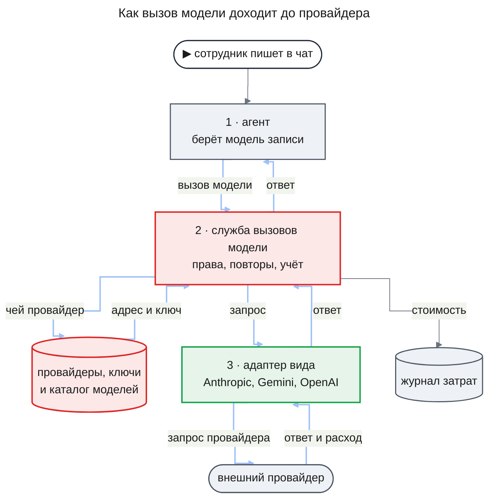
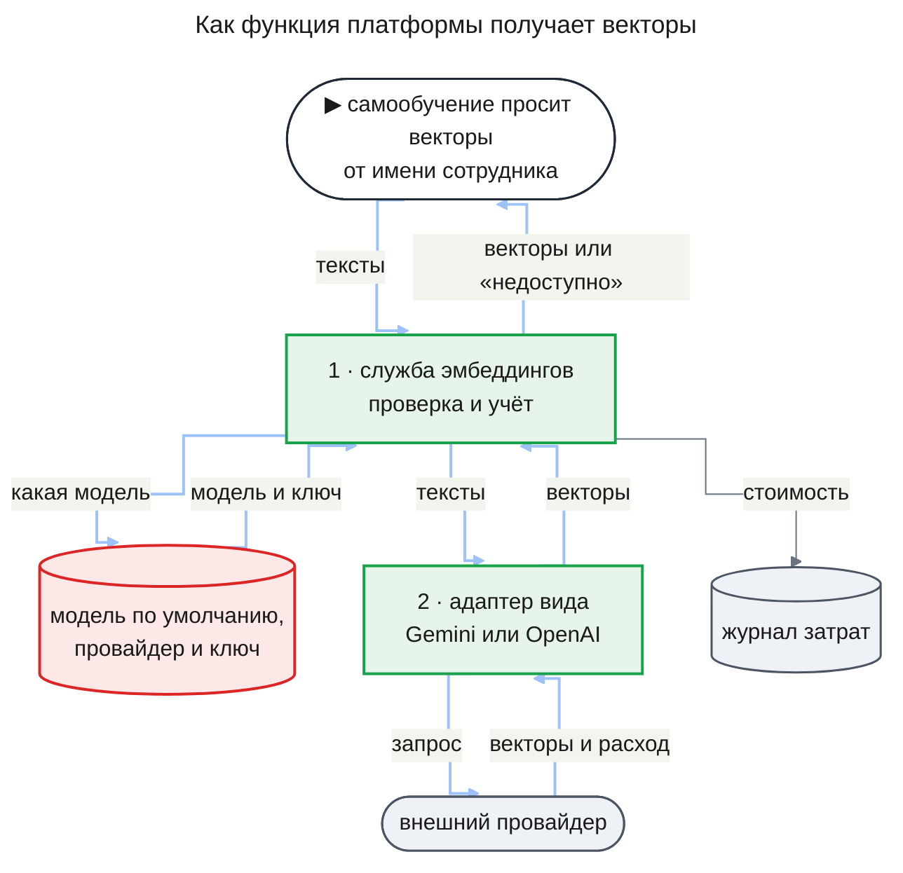
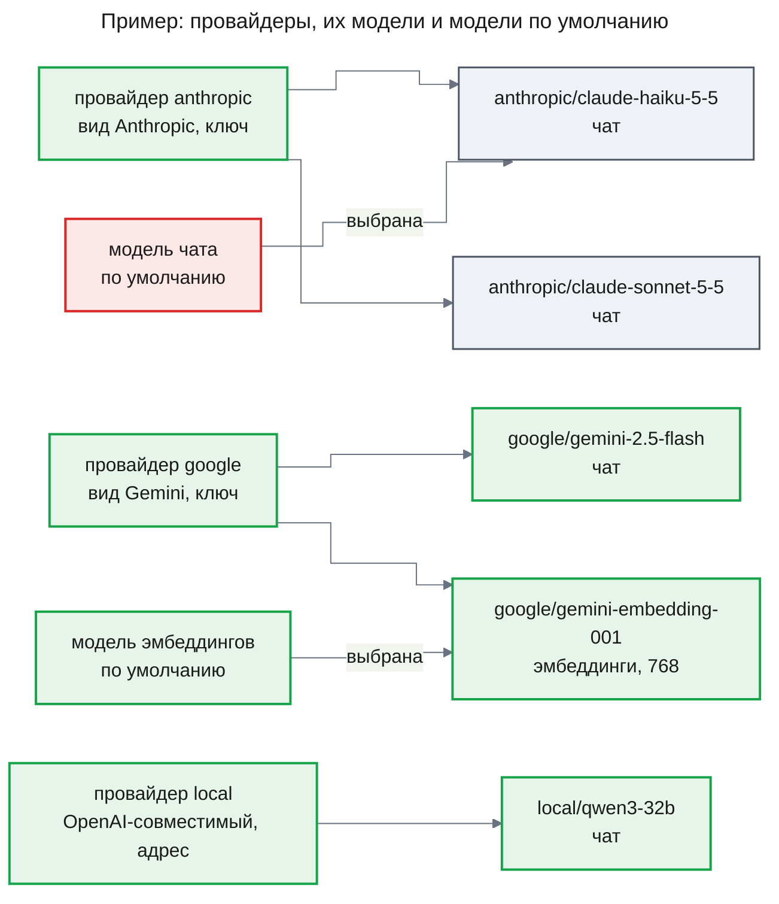

# PRD: Провайдеры моделей (model-providers)

| Status | Date | Depth | UXRD | Designs |
|---|---|---|---|---|
| Draft | 2026-11-20 | full | — | — |

## Snapshot

**Overview.** Сегодня платформа умеет вызывать модели только одного провайдера — Anthropic, а его ключ, адрес и модель по умолчанию задаются переменными окружения сервера. Фича делает вызов модели независимым от провайдера. В первой версии работают три вида провайдеров: Anthropic, Google Gemini и OpenAI-совместимые серверы — сам OpenAI, локальный vLLM, корпоративный шлюз. Администратор заводит провайдеров и их ключи в панели, добавляет их модели в каталог и выбирает модели по умолчанию. Вторая новая возможность — служба эмбеддингов: функции платформы, первой из них самообучение, получают векторы текстов от имени сотрудника, а их стоимость входит в его месячный расход.

- **Для**: администраторы, авторы агентов и workflow, сотрудники, функции платформы.
- **Не входит**: хранение векторов и поиск по ним (это `self-learning`), Voyage, шифрование ключей, переход на другого провайдера при ошибке.
- **Не меняется**: права на модели, квоты и журнал затрат работают как в `enterprise-access`; существующие модели `anthropic/…` и записи на них работают, как только администратор заведёт провайдера `anthropic`.
- **Части**: `core` → `web`.
- **Главный риск**: ключ провайдера, заданный в панели во время работы, попадает в лог ([Risks](#risks)).
- **Открытые вопросы**: нет.

## Terms

- **Провайдер** — компания или сервер, который отвечает на запросы к моделям: Anthropic, Google, локальный vLLM. В платформе это запись с именем, видом, адресом и ключом.
- **Вид провайдера** — протокол, на котором платформа с ним говорит. Видов три: Anthropic, Gemini и OpenAI-совместимый.
- **OpenAI-совместимый провайдер** — любой сервер, который принимает запросы в формате OpenAI: сам OpenAI, vLLM на своём GPU, корпоративный шлюз к моделям. Поэтому у провайдера настраивается адрес.
- **Ключ** — секрет, с которым провайдер принимает запросы и выставляет счёт.
- **Каталог моделей** — список моделей, которыми может пользоваться платформа, с ценами (`enterprise-access` FR-19).
- **Модель чата** — модель, которая ведёт диалог и вызывает инструменты: на ней работают агенты, workflow и главный чат.
- **Эмбеддинг (вектор)** — числовой отпечаток смысла текста: у близких по смыслу текстов векторы близки. По векторам платформа находит записи, похожие на вопрос.
- **Модель эмбеддингов** — модель, которая превращает текст в вектор. Диалог она не ведёт.
- **Размерность** — сколько чисел в одном векторе, например 768. Векторы разной размерности или от разных моделей сравнивать нельзя.
- **Кеширование промпта** — провайдер запоминает начало повторяющегося запроса и берёт за него меньше. На ответ модели оно не влияет.
- **Журнал затрат** — запись о каждом вызове модели: чей, какая модель, сколько токенов и сколько стоило (`agent-platform` FR-29 показывает из него месячный расход).

## Background

Сегодня каждый вызов модели — главный чат, агенты, workflow, заголовки бесед — идёт в Anthropic. Ключ, адрес и модель по умолчанию сервер читает из своего окружения при старте. Каталог моделей принимает только id вида `anthropic/…`, а запрос к другому провайдеру платформа построить не умеет. Эмбеддингов в платформе нет совсем, а у Anthropic их и не купить.

Владелец хочет работать не только с Anthropic: брать модели Google, модели на своих серверах и модели через корпоративный шлюз. Самообучению (`self-learning` FR-18) нужны векторы, чтобы отбирать в промпт записи графа, близкие к вопросу. Ключи и выбор моделей должны жить в базе и в панели, как всё остальное в платформе.

Так вызов модели проходит через платформу после фичи. Красным отмечено то, что меняется, зелёным — новое.

Агент и журнал затрат остаются прежними. Служба вызовов модели по-прежнему проверяет права и квоты, повторяет запрос после временной ошибки и пишет стоимость в журнал. Новое в ней одно: провайдера, адрес и ключ она берёт из базы по id модели, а запрос строит адаптер нужного вида. Сегодня адаптер один — Anthropic.

Векторы функция платформы получает отдельной дорогой, через службу эмбеддингов.

Сотрудник эту службу не вызывает: у него нет ни инструмента, ни экрана для эмбеддингов. Если векторы получить нельзя, функция получает ответ «недоступно» с причиной и продолжает работу без них. Самообучение в этом случае отбирает записи по общему порядку (`self-learning` AC-18.3).

Так может выглядеть настройка после фичи. Имя провайдера — первая часть id его моделей, поэтому модели `anthropic/…` после фичи сохраняют свои id.

Модели Google и локального сервера здесь — примеры. Модель эмбеддингов первой версии — из Constraints.

## Users and Use Cases

### Users

- **Администратор** — заводит провайдеров, их ключи и модели, выбирает модели по умолчанию. Ему важно, чтобы ключ нигде не светился, а неверный ключ было видно сразу, а не по упавшим запускам.
- **Автор агента или workflow** — выбирает модель записи (`custom-agents` FR-21). Ему важно, что агент на модели другого провайдера получает те же инструменты, права и учёт, что на Anthropic.
- **Сотрудник** — запускает агентов и workflow. Ему важно, что запуск либо работает, либо заканчивается понятной причиной, и что весь расход виден в одной цифре за месяц.
- **Функция платформы** — первой будет самообучение. Ей нужны векторы текстов и ясный ответ, когда их получить нельзя.
- **Разработчик** — поднимает платформу локально. Ему нужен короткий путь к рабочему чату без переменных окружения с ключами.

### Use Cases

- **UC-1**: Администратор подключает Google с ключом и добавляет его модели в каталог → эти модели можно разрешать сотрудникам, как модели Anthropic, так что компания не зависит от одного провайдера.
- **UC-2**: Администратор подключает корпоративный шлюз или локальный vLLM по его адресу → агенты работают на моделях внутри сети компании.
- **UC-3**: Автор выбирает для своего агента модель другого провайдера → агент работает с теми же инструментами, правами и учётом расхода, так что модель меняется одной правкой записи.
- **UC-4**: Администратор выбирает модель чата и модель эмбеддингов по умолчанию → новые записи, заголовки бесед и функции платформы берут их без правки сервера.
- **UC-5**: Сотрудник запускает workflow с самообучением → платформа считает векторы от его имени, и их стоимость видна в его месячном расходе.
- **UC-6**: Администратор заменяет утёкший или просроченный ключ → следующий вызов идёт с новым ключом без рестарта, а ни старого, ни нового ключа нет в логах.
- **UC-7**: Запуск сотрудника упал из-за провайдера → сотрудник видит причину и знает, что исправить её может администратор.
- **UC-8**: Разработчик поднимает чистую базу → одна команда посева с ключом на стандартном вводе даёт рабочий чат.

### Что видит сотрудник

- В беседе ничего не меняется: ответ идёт по мере генерации, инструменты вызываются так же, остановка работает так же.
- Где он выбирает модель, рядом с её названием стоит имя провайдера. Моделей эмбеддингов среди них нет.
- Если провайдер выключен, без ключа, отклонил ключ или недоступен, агент заканчивается сбоем с причиной (FR-09). После исправления следующее сообщение продолжает работу, как после любого сбоя (`agent-platform` FR-09).
- Месячный расход (`agent-platform` FR-29) включает стоимость эмбеддингов, посчитанных от его имени.

## Functional Requirements

### Must Have (MVP)

#### Провайдеры и вызовы моделей — часть `core`

- **FR-01. Провайдеры и ключи в базе.** Провайдер — запись в базе: имя, вид, адрес, ключ и признак «включён». Администратор добавляет провайдера, меняет его адрес и ключ, включает и выключает его, удаляет провайдера без моделей в каталоге. Имя и вид после добавления не меняются, потому что имя — первая часть id моделей. Адрес необязателен: без него платформа идёт на официальный адрес вида, а у OpenAI-совместимого вида — на адрес OpenAI.

  Провайдер любого вида можно сохранить без ключа. Провайдер Anthropic или Gemini без ключа вызовов не принимает (FR-09), а OpenAI-совместимый без ключа работает, потому что локальному серверу ключ может быть не нужен. Ключ только записывается: ни один ответ сервера его не содержит. Изменение провайдера действует со следующего вызова модели без рестарта. Операции доступны только с правом администратора (`enterprise-access` FR-08), а каждое изменение попадает в аудит, где ключ записан как «секрет изменён» (`enterprise-access` FR-11).
  - AC-01.1: Given администратор добавил провайдера вида Gemini с ключом, when администратор читает провайдера, then в ответе нет ключа, а есть только признак, что ключ задан, и его последние четыре символа.
  - AC-01.2: Given агент работает на модели провайдера, when администратор заменил ключ, then следующий вызов модели идёт с новым ключом, а рестарта сервера не было.
  - AC-01.3: Given в каталоге есть модель провайдера, when администратор удаляет провайдера, then удаление отклоняется с причиной «у провайдера есть модели в каталоге», и провайдер остаётся.
  - AC-01.4: Given у сотрудника нет права администратора, when он добавляет или меняет провайдера в обход панели, then сервер отказывает.
  - AC-01.5: Given администратор заменил ключ, when смотрят аудит, then в нём запись с провайдером и пометкой «секрет изменён», без значения ключа.

- **FR-02. Настроек провайдера в окружении нет.** Сервер больше не читает из окружения ни ключ, ни адрес Anthropic, ни модель по умолчанию: переменные `ANTHROPIC_API_KEY`, `AGENTS_ANTHROPIC_BASE_URL` и `AGENT_DEFAULT_MODEL` удалены. Новое развёртывание стартует без провайдеров. Первый администратор появляется, как сегодня (`enterprise-access` FR-32), и заводит провайдера в панели.
  - AC-02.1: Given на развёртывании не выбрана модель чата по умолчанию, when сотрудник пишет в чат, then ответа модели нет, а сотрудник видит, что модель не настроена и нужно обратиться к администратору.
  - AC-02.2: Given администратор добавил провайдера `anthropic` с ключом и модель Haiku, выбрал её моделью чата по умолчанию и разрешил сотруднику, when сотрудник пишет в чат, then он получает ответ без рестарта сервера.

- **FR-03. Одна служба вызовов для трёх видов провайдеров.** Каждый вызов модели чата идёт через одну службу: главный чат, агенты, workflow, заголовки бесед, извлечение самообучения. Для всех трёх видов одинаковы проверка прав и квот (`enterprise-access` FR-18 – FR-22), повтор после временной ошибки, строка в журнале затрат, текст по мере генерации, вызовы инструментов и остановка.
  - AC-03.1: Given Ане разрешены модели трёх видов, when она поочерёдно запускает одного и того же агента на каждой, then каждый запуск показывает ответ в беседе по мере генерации, а в журнале затрат по строке на каждый вызов модели с id этой модели.
  - AC-03.2: Given агент работает на модели Gemini, when Аня останавливает его, then вызов модели прерывается, и агент останавливается так же, как на модели Anthropic.
  - AC-03.3: Given у OpenAI-совместимого провайдера задан адрес локального сервера, when агент работает на его модели, then запросы уходят на этот адрес.

- **FR-04. Инструменты MCP на всех видах.** Агент на модели любого вида получает те же MCP-инструменты, что на модели Anthropic, и может их вызывать. Если провайдер всё же не принял описание инструментов, агент заканчивается сбоем с понятной причиной, а не сырой ошибкой провайдера.
  - AC-04.1: Given у Ани есть права на тестовые MCP-серверы и на Sentry, when её агент на модели Gemini получает задачу, для которой нужен инструмент, then модель вызывает инструмент, а агент получает его результат.
  - AC-04.2: Given провайдер отклонил запрос из-за описания инструментов, when агент делает вызов модели, then запрос не повторяется, агент получает статус «сбой» с причиной «провайдер не принял описание инструментов», а полный ответ провайдера есть в логе.

- **FR-05. Провайдер и вид модели в каталоге.** Каждая модель каталога принадлежит провайдеру и имеет вид: модель чата или модель эмбеддингов. Её id — имя провайдера, косая черта и имя модели у провайдера. У модели чата цены те же, что сегодня (`enterprise-access` FR-19). У модели эмбеддингов есть только цена за миллион входных токенов и размерность, а размерность задаётся при добавлении и не меняется. Модели эмбеддингов есть у видов Gemini и OpenAI-совместимый, у вида Anthropic их нет. Модель добавляется только к существующему провайдеру. На уже работающем развёртывании модели `anthropic/…` остаются в каталоге и до появления провайдера `anthropic`: вызовы их заканчиваются причиной «провайдер модели не заведён» (FR-09).
  - AC-05.1: Given есть провайдер `google` вида Gemini, when администратор добавляет `google/gemini-embedding-001` как модель эмбеддингов с размерностью 768 и ценой ввода, then модель в каталоге с провайдером, видом, ценой и размерностью.
  - AC-05.2: Given провайдер вида Anthropic, when администратор добавляет к нему модель эмбеддингов, then добавление отклоняется с причиной «провайдер этого вида не считает эмбеддинги».
  - AC-05.3: Given провайдера `foo` нет, when администратор добавляет модель `foo/bar`, then добавление отклоняется с причиной «провайдер не найден».
  - AC-05.4: Given права, квоты и записи библиотеки ссылаются на модели `anthropic/…`, when администратор завёл провайдера `anthropic` с ключом, then эти права, квоты и записи работают без правок.

- **FR-06. Модели по умолчанию.** Администратор выбирает модель чата по умолчанию и модель эмбеддингов по умолчанию; каждую — только из моделей своего вида. Модель чата по умолчанию — последний шаг выбора модели агента (`agent-platform` FR-04), модель новой записи и модели в копии (`custom-agents` FR-05) и модель заголовков бесед. Встроенные записи библиотеки — главный чат, `general-purpose` и исполнители глубокого ресерча — работают на модели чата по умолчанию и переходят на новую, когда администратор её меняет. Координатор глубокого ресерча остаётся на своей модели `anthropic/claude-sonnet-5-5`. Модель эмбеддингов по умолчанию — та, на которой служба эмбеддингов считает векторы. Пока модель не выбрана, чат отвечает как в AC-02.1, а служба эмбеддингов — «недоступно» (AC-07.2).
  - AC-06.1: Given администратор сменил модель чата по умолчанию на Sonnet, when автор создаёт новую запись агента, then в ней стоит Sonnet.
  - AC-06.2: Given администратор выбирает модель чата по умолчанию, when он указывает модель эмбеддингов, then выбор отклоняется; и наоборот.
  - AC-06.3: Given администратор сменил модель эмбеддингов по умолчанию, when функция платформы просит векторы, then их считает новая модель, а ответ называет её id и размерность.

- **FR-07. Служба эмбеддингов.** Функция платформы передаёт службе список текстов и сотрудника, от имени которого считает. Работу, которую не начинал ни один сотрудник, например пересчёт векторов после смены модели, функция передаёт без сотрудника, и тогда это расход платформы (FR-08). В ответ она получает векторы в том же порядке, каждый длины, равной размерности модели, а также id модели и размерность. Сотрудники и агенты службу не вызывают: для них нет ни инструмента, ни запроса API. Любой сбой приходит ответом «недоступно» с причиной, а не ошибкой, которая обрывает работу функции. Причины: модель эмбеддингов не выбрана, провайдер выключен, у провайдера нет обязательного ключа, провайдер отклонил ключ, провайдер недоступен после повторов, сотрудник отключён, провайдер вернул вектор другой длины.
  - AC-07.1: Given модель эмбеддингов по умолчанию — `google/gemini-embedding-001` с размерностью 768, when функция просит векторы трёх текстов от имени Ани, then она получает три вектора длины 768 в порядке текстов и id модели.
  - AC-07.2: Given модель эмбеддингов не выбрана, when функция просит векторы, then она получает «недоступно» с причиной «модель эмбеддингов не выбрана», провайдер не получает запроса, а функция продолжает работу.
  - AC-07.3: Given провайдер отвечает временной ошибкой и после повторов, when функция просит векторы, then она получает «недоступно» с причиной «провайдер недоступен», а полный ответ провайдера есть в логе.
  - AC-07.4: Given провайдер вернул вектор длины 3072 при размерности 768, when функция просит векторы, then она получает «недоступно» с причиной «вектор не той размерности».
  - AC-07.5: Given функция пересчитывает векторы после смены модели, when она просит векторы без сотрудника, then векторы получены, а их стоимость записана как расход платформы и не видна ни в чьём месячном расходе.

- **FR-08. Проверка и учёт эмбеддингов.** Перед вызовом служба эмбеддингов проверяет только три условия: сотрудник, если он назван, включён; модель есть в каталоге с ценой; провайдер включён и, если его вид требует ключ, с ключом. Разрешение на модель эмбеддингов и квота на неё не нужны. Каждый вызов пишет в журнал затрат строку на этого сотрудника, а без сотрудника — на платформу: входные токены по цене каталога. Стоимость входит в месячный расход сотрудника (`agent-platform` FR-29), но не в расход на модели чата против их квот.
  - AC-08.1: Given у Ани нет разрешения на модель эмбеддингов, when самообучение её запуска просит векторы, then векторы получены, а их стоимость видна в месячном расходе Ани.
  - AC-08.2: Given квота Ани на Sonnet исчерпана, when самообучение её запуска просит векторы, then векторы получены, а расход Ани на Sonnet против квоты не вырос.
  - AC-08.3: Given Аня отключена, when функция просит векторы от её имени, then она получает «недоступно» с причиной «сотрудник отключён», и провайдер не получает запроса.

- **FR-09. Понятные отказы провайдера.** Если провайдер модели не заведён или выключен, у него нет обязательного ключа, он отклонил ключ или недоступен после повторов, агент не стартует или заканчивается статусом «сбой». Причина называет модель и то, что случилось с провайдером. Сотрудник видит, что исправить это может администратор, а сырой ответ провайдера есть только в логе. После исправления следующее сообщение сотрудника продолжает работу (`agent-platform` FR-09).
  - AC-09.1: Given провайдер модели записи выключен, when Аня запускает запись из чата, then агент не стартует, а Аня видит, что модель недоступна, потому что её провайдер выключен.
  - AC-09.2: Given агент работает, when администратор выключил провайдера его модели, then следующий вызов модели не идёт, а агент получает статус «сбой» с причиной «провайдер модели выключен».
  - AC-09.3: Given ключ провайдера неверный, when агент вызывает модель, then запрос не повторяется, агент получает статус «сбой» с причиной «провайдер отклонил ключ», а строки в журнале затрат нет.
  - AC-09.4: Given у провайдера вида Gemini нет ключа, when агент вызывает его модель, then провайдер не получает запроса, а агент получает статус «сбой» с причиной «у провайдера модели нет ключа».
  - AC-09.5: Given провайдер не отвечает и после повторов, when агент вызывает модель, then агент получает статус «сбой» с причиной «провайдер недоступен».

- **FR-10. Стоимость по расходу, который сообщил провайдер.** Стоимость вызова считается по ценам каталога от токенов, которые сообщил провайдер: ввод, вывод, чтение из кеша и запись в кеш. Кеширование промпта меняет только стоимость, ответ от него не зависит. Токен, прочитанный из кеша, оплачивается один раз — по цене чтения кеша. Провайдер, который не сообщает о записи в кеш, за неё и не платит.
  - AC-10.1: Given провайдер сообщил, что из 10 000 входных токенов 8 000 прочитаны из кеша, when платформа считает стоимость вызова, then 8 000 токенов посчитаны по цене чтения кеша, 2 000 — по цене ввода, и ни один токен не посчитан дважды.

- **FR-11. Ключи не попадают в логи.** Ключ любого провайдера скрыт маской в каждой записи лога, в консоли и в Sentry. Это касается и ключа, заданного или заменённого во время работы сервера: маска действует с момента сохранения. Заменённый ключ тоже остаётся скрытым.
  - AC-11.1: Given администратор задал ключ во время работы сервера, when в запись лога попадает текст с этим ключом, then в консоли и в Sentry вместо ключа маска.
  - AC-11.2: Given администратор заменил ключ, when в запись лога попадает текст со старым ключом, then вместо него маска.

#### Панель администратора и выбор модели — часть `web`

- **FR-12. Провайдеры в панели.** Администратор видит в панели список провайдеров: имя, вид, адрес, включён ли и задан ли ключ. Он добавляет провайдера, выбирая один из трёх видов, меняет адрес и ключ, включает, выключает и удаляет провайдера (FR-01). Поле ключа только для записи: после сохранения видны лишь его последние четыре символа, а новый ввод заменяет ключ.
  - AC-12.1: Given у провайдера задан ключ, when администратор открывает провайдера, then видит только последние четыре символа ключа и может ввести новый.
  - AC-12.2: Given администратор добавляет OpenAI-совместимого провайдера с адресом локального сервера и без ключа, when он сохраняет, then провайдер в списке, включён и помечен как провайдер без ключа.
  - AC-12.3: Given у провайдера есть модели в каталоге, when администратор удаляет его, then он видит причину отказа из AC-01.3.

- **FR-13. Провайдер и вид в каталоге, модели по умолчанию.** В каталоге моделей у каждой модели видны провайдер и вид. При добавлении модели администратор выбирает провайдера и вид. Для модели эмбеддингов он вводит только цену ввода и размерность, для модели чата — цены, как сегодня. Здесь же администратор выбирает модель чата и модель эмбеддингов по умолчанию (FR-06).
  - AC-13.1: Given администратор добавляет модель провайдера `google` вида «эмбеддинги», when он заполняет форму, then форма просит только цену ввода и размерность, а после сохранения модель видна в каталоге с провайдером и видом.
  - AC-13.2: Given администратор выбрал провайдера вида Anthropic, when он выбирает вид модели, then вида «эмбеддинги» среди вариантов нет.
  - AC-13.3: Given администратор выбирает модель чата по умолчанию, when он открывает список, then в нём только модели чата; в списке для эмбеддингов — только модели эмбеддингов.

- **FR-14. Выбор модели — только модели чата с провайдером.** Везде, где человек выбирает модель, — редактор записи, выдача права на модель, «Мой доступ» — показываются только модели чата, и у каждой видно имя провайдера. Модели выключенных провайдеров не предлагаются. Запись, в которой такая модель уже стоит, помечает её недоступной с причиной.
  - AC-14.1: Given в каталоге модели чата и модель эмбеддингов, when автор выбирает модель агента, then он видит только модели чата, каждую с именем провайдера.
  - AC-14.2: Given администратор выдаёт роли право на модель, when он открывает список моделей, then моделей эмбеддингов в нём нет.
  - AC-14.3: Given провайдер выключен, when автор открывает запись на его модели, then модель помечена недоступной с причиной «провайдер выключен», а в выборе модели для других записей её нет.

### Should Have

- **FR-15. Проверка подключения.** Администратор просит проверить провайдера, и платформа отправляет провайдеру один запрос с сохранёнными адресом и ключом. Ответ — одно из трёх: «работает», «ключ отклонён», «адрес недоступен» с текстом провайдера. Проверка не вызывает модель и не тратит токенов. Часть `core`.
  - AC-15.1: Given у провайдера неверный ключ, when администратор проверяет подключение, then ответ «ключ отклонён»; given адрес неверный, then ответ «адрес недоступен»; given адрес и ключ верны, then ответ «работает».

- **FR-16. Проверка подключения в панели.** У каждого провайдера в панели есть действие «проверить подключение», а результат виден рядом с провайдером. Часть `web`.
  - AC-16.1: Given администратор сохранил новый ключ, when он проверяет подключение, then видит результат FR-15 у этого провайдера.

- **FR-17. Посев разработчика.** Команда посева разработчика, которая сегодня заполняет каталог и права (`seed:access`), также заводит провайдеров `anthropic` и `google`, модель `google/gemini-embedding-001` с размерностью 768 и выбирает модели по умолчанию: Haiku для чата и эту модель для эмбеддингов. Ключи команда читает со стандартного ввода, как пароль, и никогда не берёт из аргументов. Провайдер, для которого ключ не дали, заводится без ключа. Часть `core`.
  - AC-17.1: Given чистая база с первым администратором, when разработчик запускает посев и даёт ключ Anthropic, then чат отвечает, а панель открывать не пришлось.
  - AC-17.2: Given разработчик дал ключи, when смотрят вывод команды и лог, then ключей в них нет.

### Could Have

- **FR-18. Расход на эмбеддинги в «Мой доступ».** Рядом с расходом по разрешённым моделям (`enterprise-access` FR-23) сотрудник видит строку расхода на эмбеддинги. Тогда сумма строк совпадает с месячным расходом.
  - AC-18.1: Given самообучение считало векторы от имени Ани, when Аня открывает «Мой доступ», then видит строку расхода на эмбеддинги за месяц.

### Won't Have

- Хранение векторов и поиск по ним — не эта фича: это `self-learning` FR-19.
- Voyage — не в первой версии: это третий ключ ради одних эмбеддингов, без моделей чата. Позже добавляется ещё одним видом провайдера.
- Модели картинок, звука и видео — не эта фича: платформа работает с текстом.
- Лимит частоты запросов на провайдера — не в первой версии: лимиты провайдера дают временную ошибку, которую служба уже повторяет.
- Шифрование ключей в базе — не в первой версии: ключи хранятся так же, как токены MCP-серверов (Constraints).
- Автоматическое обновление цен и списка моделей от провайдера — нет: администратор вводит модель и цену сам, как сегодня.
- Переход на другого провайдера при ошибке — нет: агент заканчивается сбоем с причиной (FR-09), а модель меняют в записи.
- Изменения в потоковой передаче ответа — нет: текст идёт по мере генерации, как сегодня.
- Особые настройки вызова отдельного провайдера, например режим рассуждений или фильтры безопасности Gemini, — не в первой версии: служба остаётся одинаковой для всех видов.
- Провайдеры со своей схемой входа, например Vertex AI или Bedrock, — не в первой версии: Gemini подключается по ключу Gemini API.
- Свои ключи сотрудников — нет: ключи заводит только администратор.
- Эмбеддинги для сотрудников и агентов, как инструмент или запрос API, — нет: их получают только функции платформы (FR-07).

## Non-Functional Requirements

### Security

- **NFR-01**: Ключ провайдера не появляется ни в ответе API, ни в логе, ни в аудите, ни в причине сбоя, которую видит сотрудник. Проверяется одним тестом на маску ключа, заданного во время работы (AC-11.1), и одним тестом на ответ API (AC-01.1).

### Performance

- **NFR-02**: Время до первого токена на модели Anthropic остаётся в пределах требования project-context, раздел «Performance Requirements», хотя провайдер и ключ теперь читаются из базы. Проверяется замером одного и того же запроса до фичи и после.

## Delivery Parts

| Part | Covers | Cut along | Depends on | Rationale |
|------|--------|-----------|------------|-----------|
| `core` | FR-01 – FR-11, FR-15, FR-17 | backend | — | Провайдеры, обе службы, каталог, проверка, учёт и маска ключей — один серверный слой с контрактом для панели |
| `web` | FR-12 – FR-14, FR-16 | frontend | `core` | Экраны панели и выбор модели читают контракт `core` |

- Deferred: FR-18 — общая цифра расхода уже включает эмбеддинги (FR-08), а отдельная строка только удобство.
- Фича `self-learning` зависит от части `core` этой фичи: векторы ей считает служба эмбеддингов (FR-07). Часть `web` ей не нужна.

## Success Criteria

- Агенты работают у всех трёх видов: владелец прогоняет один и тот же workflow с вызовами инструментов на модели Gemini и на модели OpenAI-совместимого провайдера, и оба запуска заканчиваются ответом. Читается в истории запусков и в журнале затрат в первую неделю после выпуска.
- Журнал затрат сходится со счетами провайдеров: за первую неделю сумма по каждому провайдеру отличается от его консоли биллинга не больше чем на 5 %. Читается в журнале затрат и в консолях провайдеров.
- Ключи не утекают: поиск полного значения каждого ключа в Sentry и в логах консоли за первые две недели находит ноль записей.

## Constraints and Risks

### Constraints

- Виды провайдеров первой версии: Anthropic, Google Gemini по ключу Gemini API и OpenAI-совместимый с настраиваемым адресом.
- Модель эмбеддингов первой версии — `gemini-embedding-001` от Google с размерностью 768: Anthropic эмбеддингов не продаёт, а ключ Google заодно открывает модели чата Gemini. Администратор может выбрать другую модель эмбеддингов из каталога.
- Провайдеры, ключи и выбор моделей живут только в базе и в панели. Новых переменных окружения нет, а три старые удаляются без слоя совместимости (CLAUDE.md, «Project status: PoC»).
- Ключи хранятся в базе как есть, так же как секреты других систем (`enterprise-access`, Constraints).
- **Принятое исключение: личные данные у внешнего провайдера эмбеддингов.** Тексты для эмбеддингов — записи графа и вопросы сотрудников — могут содержать личные данные из результатов инструментов. Они уходят внешнему провайдеру, первым будет Google, то есть вторая внешняя компания после Anthropic. Бизнес-ограничения project-context (раздел «Business Constraints») этого прямо не запрещают, но и не предусматривают: изоляция данных (ограничение 2) защищает от других сотрудников, а не от провайдера. Для PoC это принято.
- **Исключение из `enterprise-access` FR-20.** Модель эмбеддингов выбирает платформа, а не сотрудник, поэтому её вызов не требует разрешения и не ограничен квотой (FR-08). Расход всё равно записан на сотрудника и виден в его месячном расходе (`agent-platform` FR-29).

### Assumptions

- Два решения приняты по рекомендации и ещё не подтверждены владельцем явно: вызов эмбеддингов без разрешения и квоты (FR-08) и ключ только для записи со скрытием в логах, включая ключи, заданные во время работы (FR-01, FR-11). Подтверждаются на утверждении PRD.
- Платформа может очистить описания инструментов MCP так, что Gemini их принимает, не меняя смысла аргументов. Проверяется в дизайне `core` на тестовых MCP-серверах и на Sentry (AC-04.1).
- Каждый вид провайдера сообщает, сколько токенов прочитано из кеша, и этого хватает для FR-10. Проверяется сверкой с биллингом (Success Criteria).

### Risks

| Risk | Impact | Probability | Mitigation |
|------|--------|-------------|------------|
| Ключи нескольких провайдеров лежат в базе как есть: утечка базы или бэкапа раскрывает их все | High | Low | Доступ к базе только у оператора; у провайдера ключ с лимитом расходов; шифрование — Won't Have |
| Ключ, заданный в панели, попадает в лог, если маска не обновилась | High | Medium | FR-11 и тест из NFR-01 |
| Личные данные уходят второму внешнему провайдеру | Medium | High | Принятое исключение (Constraints). Ключ Gemini — только платного уровня: на бесплатном Google использует присланные данные для улучшения своих продуктов ([условия Gemini API](https://ai.google.dev/gemini-api/terms)) |
| Gemini отклоняет часть JSON Schema инструментов MCP, и запуски падают на некоторых серверах | High | Medium | Адаптер Gemini чистит описания (Assumptions); иначе понятный сбой (AC-04.2); ручная проверка на тестовых серверах и Sentry |
| Малые модели разных провайдеров по-разному вызывают инструменты, и качество запусков расходится. Стенда оценки нет (project-context, ограничение 6) | Medium | High | Владелец проверяет вручную (Success Criteria); модель меняется одной правкой записи (UC-3) |
| Кеш у провайдеров учитывается по-разному, и расход оказывается выше ожидаемого | Medium | Medium | FR-10; сверка журнала с биллингом в первую неделю (Success Criteria) |
| OpenAI-совместимые серверы различаются: один не умеет вызывать инструменты, другой не сообщает расход | Medium | Medium | Понятный сбой (FR-04, FR-09); проверка подключения (FR-15) |
| Удаление переменных окружения ломает существующие локальные окружения | Low | High | Для PoC принято; ключ задаётся посевом (FR-17) или в панели (FR-12) |
| Смена модели эмбеддингов делает сохранённые векторы потребителя несравнимыми | Low | Low | Ответ службы называет модель и размерность (FR-07); пересчёт — забота потребителя (`self-learning` AC-18.4) |

## Update History

| Version | Date | Change |
|---------|------|--------|
| 1.0 | 2026-11-20 | Initial version |
