# UXRD: Провайдеры моделей (model-providers)

| Статус | Дата | PRD | Дизайны |
|---|---|---|---|
| Черновик | 2026-11-20 | [prd.md](./prd.md) | — |

## Snapshot

**Overview.** Администратор настраивает модели в одном разделе панели — «Модели». Сверху он выбирает модель чата и модель эмбеддингов по умолчанию, ниже заводит провайдеров (Anthropic, Google Gemini или сервер, совместимый с OpenAI) и проверяет подключение, ещё ниже добавляет их модели в каталог. Ключ провайдера после сохранения не показывается: видно только, что он задан, и его последние четыре символа. Автор и сотрудник выбирают модель там же, где сегодня, но видят только модели чата и у каждой — имя провайдера. Если работа упала из-за провайдера, сотрудник видит причину в той же строке сбоя, что сегодня, и знает, что исправит её администратор.

- **Не меняется**: беседа, лента, статусы агентов, права, квоты и расход за месяц (enterprise-access и agent-platform UXRD). Стоимость эмбеддингов входит в ту же цифру расхода.
- **Главный UX-риск**: администратор выключает провайдера или убирает модель и не замечает, что чат перестал отвечать. Защищают подтверждение выключения такого провайдера (MP-02) и предупреждение у моделей по умолчанию (MP-01).
- **Открытые вопросы**: нет.

### Key Decisions

| ID | Решение | Почему |
|---|---|---|
| KD-1 | У провайдера — «Тип»: Anthropic, Google Gemini, OpenAI-совместимый. У модели — «Назначение»: «Чат» или «Эмбеддинги». Слова «вид» в интерфейсе фичи нет | В PRD оба понятия названы «вид», а в диалоге модели они стоят рядом. «Тип» уже значит протокол у провайдеров входа (enterprise-access AD-07) |
| KD-2 | Всё в разделе «Модели» (`/admin/models`): на одной странице сверху вниз блоки «Модели по умолчанию», «Провайдеры», «Каталог моделей». Провайдера добавляют и меняют в диалоге; своей страницы и пункта в сайдбаре у него нет. Кнопка «Добавить …» стоит у заголовка своего блока, шапка страницы кнопки не несёт | Провайдеров единицы, полей у них четыре — диалог короче страницы. От моделей по умолчанию зависит, отвечает ли чат, поэтому они первые. Самообучение уже отсылает администратора в «Модели» (self-learning UXRD, MC-3) |
| KD-3 | Ключ — [поле секрета](../../design-system/components/secret-field.md): после сохранения «Задан · …a1B2» и «Заменить»; пустая замена оставляет прежний ключ. Тип и имя после добавления — текст, а не поля | Ключ только записывается (AC-01.1, AC-12.1), а имя — первая часть ID моделей (FR-01) |
| KD-4 | Проверка подключения — пункт меню строки провайдера и действие в уведомлении после сохранения. Итог стоит строкой под провайдером, пока администратор на странице | Итог виден рядом с провайдером (FR-16), а после нового ключа проверка — следующий шаг |
| KD-5 | В выборе модели — только модели чата с подписью «{название} · {провайдер}». Модель, чей провайдер выключен, не заведён или без нужного ключа, не предлагается. Если она уже стоит, она остаётся выбранной с пометкой причины, и сохранению это не мешает | Модель, которая не ответит, выбирать незачем. Провайдера могли выключить на время, и правка инструкции не должна заставлять менять модель |
| KD-6 | Сбой из-за провайдера показывают те же места, что сегодня: строка события и причина в отчёте, блок ошибки ответа в чате, строка ошибки у поля сообщения, когда отклонено первое сообщение беседы, отказ старта в блоке вызова, пометки модели в библиотеке и редакторе. Причина называет модель и то, что случилось с провайдером; подсказка говорит, кто исправит. Сбой эмбеддингов виден только на экране знаний самообучения (self-learning UXRD, KN-01) | Сбой с причиной и продолжение сообщением сотрудник уже знает (agent-platform FR-09, enterprise-access KD-4) |
| KD-7 | Провайдера с моделями в каталоге удалить нельзя: «Удалить» открывает окно с причиной и без кнопки удаления | Отказ виден до подтверждения, а не после (AC-12.3) |

## Design System

Фича следует [дизайн-системе](../../design-system/README.md). Раздел «Модели» — компактная плотность панели ([foundations → Spacing & Density](../../design-system/foundations.md#spacing--density)).

### Component Inventory

Перед решением «extended» поиск шёл по `docs/design-system/components/` и `apps/web/src/components/admin/`.

| Компонент | Спецификация | Статус | Примечание |
|---|---|---|---|
| Таблица данных | [data-table.md](../../design-system/components/data-table.md) | extended | Состояние «Итог действия» — строка под строкой с итогом проверки (MP-07) |
| Секрет | [secret-field.md](../../design-system/components/secret-field.md) | extended | Последние символы в состоянии «Задан»; пустая замена в форме с другими полями |
| Форма настроек | [settings-form.md](../../design-system/components/settings-form.md) | reused | Модели по умолчанию (MP-01), диалоги провайдера (MP-04) и модели (MP-06) |
| Метка состояния | [state-badge.md](../../design-system/components/state-badge.md) | reused | «Нужен ключ», «Нет провайдера», «Работает», пометки моделей |
| Редактор записи | [record-editor.md](../../design-system/components/record-editor.md) | reused | Поле «Модель» и баннер модели (MP-08) |
| Строка библиотеки | [library-row.md](../../design-system/components/library-row.md) | reused | Пометка модели (MC-12) |
| Статус агента, строка события | [agent-status.md](../../design-system/components/agent-status.md) | reused | Новые причины сбоя (MC-10) |
| Вызов инструмента | [tool-call.md](../../design-system/components/tool-call.md) | reused | Новые причины отказа старта (MC-12) |
| Ошибка ответа | chat-shell UXRD, TH-08 | reused | Новые тексты (MC-11) |
| Строка ошибки у поля сообщения | agent-platform UXRD, Screen 1, «Сообщение не отправилось» | reused | Отказ первого сообщения беседы (MP-09, MC-11) |
| Выпадающий список, радиогруппа, переключатель, диалог, окно подтверждения, меню, уведомление | shadcn `select`, `radio-group`, `switch`, `dialog`, `alert-dialog`, `dropdown-menu`, `sonner` | reused | — |

## User Flows

### Primary User Flow

**Implements:** UC-1, UC-4; AC-12.1, AC-13.1, AC-13.3, AC-16.1, AC-05.1, AC-06.1

Администратор открывает в панели «Модели» и нажимает «Добавить провайдера». В диалоге он выбирает тип Google Gemini — имя `google` подставляется само, — вставляет ключ и нажимает «Добавить». Уведомление предлагает «Проверить подключение», и под строкой провайдера встаёт «Работает». Затем он нажимает «Добавить модель», выбирает провайдера `google` и назначение «Эмбеддинги», вводит имя модели, цену ввода и размерность. Уведомление о новой модели предлагает «Выбрать по умолчанию»: фокус переходит в «Модель эмбеддингов», администратор выбирает её и нажимает «Сохранить».

```mermaid
---
title: "Flow 1 · Провайдер, модель и модель по умолчанию"
config:
  theme: base
  look: classic
  themeVariables:
    primaryColor: "#eef1f5"
    primaryBorderColor: "#4b5563"
    primaryTextColor: "#1a1a1a"
    lineColor: "#6b7280"
  flowchart:
    curve: step
  themeCSS: |
    @keyframes lit_mpu1{0%,22.5%{stroke:#991b1b;stroke-width:6px}25%,100%{stroke:#f4a5a5;stroke-width:2px}}
---
flowchart LR
    entry(["▶ администратор открывает «Модели»"])
    provider["1 · диалог провайдера<br/>тип, имя, ключ"]
    check["2 · проверка<br/>«Работает»"]
    model["3 · диалог модели<br/>провайдер, назначение"]
    defaults["4 · модели по умолчанию<br/>«Сохранить»"]
    staff(["сотрудники<br/>чат и самообучение"])
    replace["«Изменить»<br/>замена ключа"]
    entry --> provider
    provider e1@-->|"«Добавить»"| check
    check e2@-->|"работает"| model
    model e3@-->|"«Добавить модель»"| defaults
    defaults e4@-->|"«Сохранить»"| staff
    check -.->|"ключ отклонён"| replace
    classDef entry fill:#ffffff,stroke:#1f2937,stroke-width:1.5px,color:#1a1a1a
    classDef changed fill:#fde8e8,stroke:#dc2626,stroke-width:2px,color:#1a1a1a
    classDef new fill:#e6f4ea,stroke:#16a34a,stroke-width:2px,color:#1a1a1a
    classDef unchanged fill:#eef1f5,stroke:#4b5563,stroke-width:1.5px,color:#1a1a1a
    classDef w1 stroke:#f4a5a5,stroke-width:2px,animation:lit_mpu1 4.8s linear 0s infinite
    classDef w2 stroke:#f4a5a5,stroke-width:2px,animation:lit_mpu1 4.8s linear 1.2s infinite
    classDef w3 stroke:#f4a5a5,stroke-width:2px,animation:lit_mpu1 4.8s linear 2.4s infinite
    classDef w4 stroke:#f4a5a5,stroke-width:2px,animation:lit_mpu1 4.8s linear 3.6s infinite
    class entry entry
    class provider,check,defaults,replace new
    class model changed
    class staff unchanged
    class e1 w1
    class e2 w2
    class e3 w3
    class e4 w4
```



### Alternative Flows

- **Замена ключа** (UC-6; AC-12.1, AC-16.1). В меню «⋯» провайдера — «Изменить». В диалоге «Ключ: Задан · …a1B2», администратор нажимает «Заменить», вставляет новый ключ и «Сохранить». Диалог закрывается, поле больше не держит ключ, а уведомление предлагает «Проверить подключение».
- **Локальный сервер или шлюз** (UC-2; AC-12.2). Тип «OpenAI-совместимый», своё имя, например `local`, адрес сервера и пустой ключ. Провайдер встаёт в список включённым, в колонке «Ключ» — «без ключа».
- **Модель другого провайдера у агента** (UC-3; AC-14.1). Автор раскрывает «Дополнительно» в редакторе и в «Модели» видит модели чата с именами провайдеров, например «Gemini 2.5 Flash · google». Модель новой записи — модель чата по умолчанию (AC-06.1).
- **Выдача права на модель** (AC-14.2). В диалоге права (enterprise-access GR-01) список «Модель» показывает только модели чата с провайдером.
- **Выключение провайдера** (AC-14.3, AC-09.2). Переключатель «Включён» в строке провайдера сохраняется сразу. Если модель этого провайдера выбрана моделью по умолчанию, выключение сначала спрашивает подтверждение с последствием (MC-3): чат перестанет отвечать или отбор по смыслу выключится. После выключения в блоке «Модели по умолчанию» стоит предупреждение (MP-01).

### Error Flows

Работа сотрудника упала из-за провайдера (UC-7). Сотрудник видит строку сбоя с причиной и подсказкой, что исправит администратор. Администратор включает провайдера или меняет ключ в «Моделях». Сотрудник пишет агенту или в чат, и работа продолжается с того места (agent-platform FR-09).

```mermaid
---
title: "Flow 2 · Сбой из-за провайдера и продолжение"
config:
  theme: base
  look: classic
  themeVariables:
    primaryColor: "#eef1f5"
    primaryBorderColor: "#4b5563"
    primaryTextColor: "#1a1a1a"
    lineColor: "#6b7280"
  flowchart:
    curve: step
  themeCSS: |
    @keyframes litr_mpu2{0%,30%{stroke:#1d4ed8;stroke-width:6px}33.33%,100%{stroke:#9ec1f7;stroke-width:2px}}
---
flowchart LR
    entry(["▶ агент вызывает модель"])
    line["1 · строка «Сбой»<br/>причина и подсказка"]
    admin["2 · администратор<br/>раздел «Модели»"]
    retry["3 · сотрудник пишет<br/>агенту или в чат"]
    goon["работа<br/>продолжается"]
    entry --> line
    line e1@-->|"сотрудник сообщает"| admin
    admin e2@-->|"включил, сменил ключ"| retry
    retry e3@-->|"новое сообщение"| goon
    classDef entry fill:#ffffff,stroke:#1f2937,stroke-width:1.5px,color:#1a1a1a
    classDef changed fill:#fde8e8,stroke:#dc2626,stroke-width:2px,color:#1a1a1a
    classDef unchanged fill:#eef1f5,stroke:#4b5563,stroke-width:1.5px,color:#1a1a1a
    classDef r1 stroke:#9ec1f7,stroke-width:2px,animation:litr_mpu2 3.6s linear 0s infinite
    classDef r2 stroke:#9ec1f7,stroke-width:2px,animation:litr_mpu2 3.6s linear 1.2s infinite
    classDef r3 stroke:#9ec1f7,stroke-width:2px,animation:litr_mpu2 3.6s linear 2.4s infinite
    class entry entry
    class line,admin changed
    class retry,goon unchanged
    class e1 r1
    class e2 r2
    class e3 r3
```



Пути без своей схемы:

- **Чат без модели** (AC-02.1). Пока модель чата по умолчанию не выбрана, первое сообщение новой беседы не отправляется: под полем сообщения стоит строка MC-11 «Модель для чата не настроена…», а набранный текст остаётся в поле (MP-09). Идущая беседа смену модели по умолчанию не замечает. У администратора в блоке «Модели по умолчанию» стоит предупреждение (MP-01).
- **Неверный ключ или провайдер не отвечает** (AC-09.3, AC-09.5). Агент заканчивается сбоем с причиной MC-9. Администратор видит то же через «Проверить подключение» (MP-07).
- **Провайдер не принял описание инструментов** (AC-04.2). Сбой с причиной MC-9 «не принял описание инструментов». Сотрудник видит причину, а не ответ провайдера.
- **Эмбеддинги недоступны** (AC-07.2, AC-07.3, AC-07.4). Сотрудник об этом не узнаёт в беседе: функция продолжает работу без векторов. Автор глубокого агента видит причину на экране знаний (self-learning UXRD, KN-01, MC-3).
- **Удаление провайдера с моделями** (AC-12.3, AC-01.3) — MP-05.
- **Модель эмбеддингов у Anthropic** (AC-13.2, AC-05.2). В диалоге модели у провайдера типа Anthropic назначения «Эмбеддинги» нет (MP-06).
- **Нет права администратора** — экран «Нет доступа» (enterprise-access UXRD, AD-02).

Критерии без своей поверхности: AC-01.2, AC-01.4, AC-01.5, AC-02.2, AC-03.1–AC-03.3, AC-04.1, AC-06.3, AC-07.1, AC-07.5, AC-08.1–AC-08.3, AC-10.1, AC-11.1, AC-11.2, AC-17.1, AC-17.2. Чат, лента и расход за месяц по ним выглядят как сегодня.

## Screens

### Screen 1: Модели (`/admin/models`)

```
┌─────────────────────┬──────────────────────────────────────────────────────────────┐
│ ◆ Agent OS          │ ◧  Модели                                                     │ h1
│ ← К чату            │──────────────────────────────────────────────────────────────│
│ ПАНЕЛЬ              │  Модели по умолчанию                                          │ MP-01
│  …                  │  Модель чата         [ Haiku · anthropic                 ▾ ]  │
│ ▌▣ Модели           │  На ней работают чат и системные агенты…                      │
│                     │  Модель эмбеддингов  [ Не выбрана                        ▾ ]  │
│                     │  ⚠ Пока модель эмбеддингов не выбрана, отбор по смыслу…       │
│                     │  [ Сохранить ]                                                │
│                     │                                                               │
│                     │  Провайдеры                           [ + Добавить провайдера ]│ MP-02
│                     │  Провайдер           Тип               Ключ    Моделей Включён │
│                     │  anthropic           Anthropic         …a1B2       2  [●━]  ⋯ │
│                     │  адрес по умолчанию                                            │
│                     │  google              Google Gemini     …x9Qz       2  [●━]  ⋯ │
│                     │  ⓧ Ключ отклонён: API key not valid. Please pass a valid…      │ MP-07
│                     │  local               OpenAI-совместимый без ключа  1  [━○]  ⋯ │
│                     │  http://vllm.corp:8000/v1                                      │
│                     │                                                               │
│                     │  Каталог моделей                          [ + Добавить модель ]│ MP-03
│                     │  $ за 1 млн токенов                                           │
│                     │  Модель             Провайдер Назначение       Вход Выход …   │
│                     │  Haiku              anthropic Чат              1    5     … ⋯ │
│                     │  anthropic/claude-haiku-5-5                                   │
│                     │  Gemini Embedding   google    Эмбеддинги · 768 0,15 —     … ⋯ │
│                     │  google/gemini-embedding-001                                  │
└─────────────────────┴──────────────────────────────────────────────────────────────┘
```

**Раскладка** (KD-2): шапка панели с `h1` «Модели» без кнопки (enterprise-access AD-01). Три блока идут один под другим и разделены 32 px. У каждого блока заголовок `h2` Heading; у «Провайдеров» и «Каталога моделей» справа от него кнопка `outline` `sm` с `Plus`. Форма «Моделей по умолчанию» не шире 640 px, таблицы занимают ширину основной области. Каждый блок грузится и падает сам по себе: ошибка одного не прячет два других.

#### MP-01. Модели по умолчанию

[Форма настроек](../../design-system/components/settings-form.md), вариант «Форма страницы», без «Отмены»: два выпадающих списка и одна кнопка «Сохранить».

- **«Модель чата»** — только модели чата, чей провайдер работает (AC-13.3); подпись варианта — MP-08.
- **«Модель эмбеддингов»** — только модели эмбеддингов, чей провайдер работает; к подписи добавлена размерность: «Gemini Embedding · google · 768».
- Под каждым полем — подсказка MC-2. Предупреждение (settings-form, «Предупреждение») стоит под полем, к которому относится, и сохранению не мешает.

| Состояние | Что показано | AC |
|---|---|---|
| Загрузка | Состояние Loading таблицы данных на месте формы | — |
| Ошибка загрузки | «Не удалось загрузить модели по умолчанию» и «Повторить» (MC-2) | — |
| Модель не выбрана | В поле «Не выбрана», под ним предупреждение MC-2: чат не отвечает или отбор по смыслу выключен | AC-02.1, AC-07.2 |
| Выбрать не из чего | Поле недоступно, под ним подсказка MC-2 «добавьте модель ниже» вместо обычной | — |
| Выбранная модель не работает | Модель остаётся в поле с [меткой](../../design-system/components/state-badge.md) «Выключено» и короткой причиной (MC-8); под полем предупреждение MC-2 с причиной | AC-09.1 |
| Сохранено | Уведомление MC-2; форма показывает сохранённое | AC-06.1, AC-06.3 |
| Сервер отказал | Ошибка формы MC-2; выбор остаётся | AC-06.2 |

#### MP-02. Провайдеры

[Таблица данных](../../design-system/components/data-table.md), вариант «Строка с действиями», по имени провайдера. Строки не ссылки: своей страницы у провайдера нет (KD-2).

| Колонка | Что в ней |
|---|---|
| «Провайдер» | Имя Mono; второй строкой Caption — адрес Mono или «адрес по умолчанию» `--muted-foreground` |
| «Тип» | «Anthropic», «Google Gemini» или «OpenAI-совместимый» |
| «Ключ» | Задан — «…» и последние четыре символа Mono. Не задан у Anthropic или Gemini — метка «Нужен ключ», состояние «Нужно действие». Не задан у OpenAI-совместимого — «без ключа» `--muted-foreground` |
| «Моделей» | Число моделей провайдера в каталоге, табличные цифры |
| «Включён» | Переключатель, сохраняется сразу (settings-form, «Сохранение на месте»). Подтверждение спрашивает только выключение провайдера, чья модель выбрана моделью по умолчанию |

Справа — меню «⋯» «Действия: {имя}»: «Изменить» (MP-04), «Проверить подключение» (MP-07), «Удалить» (MP-05).

| Состояние | Что показано | AC |
|---|---|---|
| Загрузка, ошибка | Loading и Error таблицы, тексты MC-3 | — |
| Пусто | «Провайдеров пока нет» и подсказка MC-3 | — |
| Провайдер без ключа | «без ключа» у OpenAI-совместимого, «Нужен ключ» у остальных | AC-12.2 |
| Выключен | Переключатель в положении «выключен»; строка не тускнеет | AC-14.3 |
| Выключение провайдера модели по умолчанию | `alert-dialog` MC-3 с последствием и кнопкой «Выключить»; «Отмена» оставляет переключатель включённым | — |
| Переключатель не сохранился | Переключатель возвращается, под строкой Caption `--destructive` с причиной (MC-3) | — |
| Проверка | Строка итога под провайдером (MP-07) | AC-16.1 |

#### MP-03. Каталог моделей

Меняет экран каталога enterprise-access AD-11; остальное в нём прежнее: цены, вложенная строка длинных запросов, меню «⋯» с «Изменить» и «Убрать из каталога».

- **Колонки**: «Модель» (название, ID Mono второй строкой), «Провайдер», «Назначение», затем четыре цены.
- **«Провайдер»** — имя провайдера. Если провайдера с этим именем нет, например у моделей `anthropic/…` до появления провайдера `anthropic` (FR-05), рядом метка «Нет провайдера», состояние «Нужно действие».
- **«Назначение»** — «Чат» или «Эмбеддинги · {размерность}» (AC-05.1).
- **Модель эмбеддингов** — «Выход» и обе цены кэша показывают «—», вложенной строки нет.
- **Порядок** — по ID, поэтому модели одного провайдера стоят рядом.
- **«Добавить модель»** — у заголовка блока. Пока провайдеров нет, кнопка `aria-disabled` с описанием «Сначала добавьте провайдера».
- **«Убрать из каталога»** — подтверждение enterprise-access MC-30. Если модель выбрана моделью по умолчанию, к тексту добавлена фраза MC-7 о последствиях.

| Состояние | Что показано | AC |
|---|---|---|
| Пусто, провайдеры есть | «Каталог пуст» / «Добавьте модель, чтобы агенты могли работать.» (enterprise-access MC-30) | — |
| Пусто, провайдеров нет | «Каталог пуст» / «Сначала добавьте провайдера, потом его модели.» (MC-7) | — |
| Модель без провайдера | Метка «Нет провайдера» в колонке «Провайдер» | AC-05.4 |

### Screen 2: Диалог провайдера, удаление и проверка

#### MP-04. Диалог провайдера

[Форма диалога](../../design-system/components/settings-form.md). Ключ уходит только в теле запроса сохранения: в адресе страницы его нет, а после сохранения форма его не держит.

```
┌ Новый провайдер ─────────────────────────────────┐   ┌ Провайдер google ────────────────────────────────┐
│ Тип                                               │   │ google · Google Gemini                            │
│ ○ Anthropic                                       │   │ Имя и тип не меняются. Нужны другие — добавьте…   │
│ ● Google Gemini                                   │   │ Адрес (необязательно)                             │
│   По ключу Gemini API.                            │   │ [                                           ]     │
│ ○ OpenAI-совместимый                              │   │ Пусто — официальный адрес Gemini API.             │
│   OpenAI, vLLM, корпоративный шлюз — любой…       │   │ Ключ                                              │
│ Имя                                               │   │ ● Задан  …x9Qz                     [ Заменить ]   │
│ [ google                                    ]     │   │                                                   │
│ Первая часть ID его моделей: google/<модель>…     │   │                        [ Сохранить ] [ Отмена ]   │
│ Адрес (необязательно)                             │   └───────────────────────────────────────────────────┘
│ [                                           ]     │
│ Пусто — официальный адрес Gemini API.             │
│ Ключ (необязательно)                              │
│ [ ••••••••••••••••••••••••              👁 ]       │
│ Без ключа модели этого провайдера не работают.    │
│                         [ Добавить ] [ Отмена ]   │
└───────────────────────────────────────────────────┘
```

**Новый провайдер** — «Добавить провайдера»:

1. **«Тип»** — радиогруппа из трёх типов с подсказками MC-4; выбран Anthropic.
2. **«Имя»** — Mono. Тип Anthropic подставляет `anthropic`, Gemini — `google`, OpenAI-совместимый оставляет поле пустым. Подстановка идёт, пока администратор не правил поле сам.
3. **«Адрес»** — необязательно, Mono; подсказка зависит от типа (MC-4).
4. **«Ключ»** — [поле секрета](../../design-system/components/secret-field.md) в состоянии «Не задан», необязательно; подсказка зависит от типа (MC-4).

«Добавить» сохраняет включённого провайдера. Диалог закрывается, строка встаёт в таблицу, уведомление MC-4 несёт действие «Проверить подключение».

**Изменение** — «Изменить» в меню строки:

- Сверху строкой текста «{имя} · {тип}» и подсказка, что они не меняются (KD-3).
- «Адрес» — поле.
- «Ключ» — поле секрета: задан — «Задан · …x9Qz» и «Заменить»; не задан — пустое поле. После «Заменить» пустое поле при сохранении оставляет прежний ключ.

«Сохранить» закрывает диалог с уведомлением MC-4. Действие «Проверить подключение» в нём есть, только если менялись адрес или ключ.

| Состояние | Что показано | AC |
|---|---|---|
| Ключ задан | «Ключ: Задан · …x9Qz» и «Заменить»; полного ключа нет ни на экране, ни в коде страницы | AC-12.1, AC-01.1 |
| Ошибка поля | Пустое или недопустимое имя, занятое имя, неполный адрес, ключ короче 8 или длиннее 512 символов — ошибки полей MC-4 | — |
| Сервер отказал | Ошибка формы MC-4; введённое остаётся, ключ тоже, пока диалог открыт | — |
| Провайдера уже нет | Ошибка формы MC-4; после закрытия таблица перечитывается | — |

#### MP-05. Удаление провайдера

«Удалить» открывает `alert-dialog` (KD-7):

- **У провайдера есть модели в каталоге** — окно «Нельзя удалить «{имя}»» с числом его моделей и одной кнопкой «Понятно» (MC-5). Удаления нет (AC-12.3).
- **Моделей нет** — подтверждение панели (enterprise-access MC-20) с текстом MC-5 и кнопкой «Удалить». После удаления строка уходит, уведомление «Провайдер удалён».
- **Сервер всё же отказал**, например модель добавили в другой вкладке, — ошибка в окне MC-5 с причиной из AC-01.3; провайдер остаётся.

#### MP-07. Проверка подключения

Состояние «Итог действия» [таблицы данных](../../design-system/components/data-table.md): строка Caption под строкой провайдера.

| Состояние | Что показано | AC |
|---|---|---|
| Идёт | `LoaderCircle` и «Проверяем подключение…»; «Проверить подключение» в меню недоступна | — |
| Работает | [Метка](../../design-system/components/state-badge.md) «Работает», состояние «Хорошо», и время проверки | AC-15.1, AC-16.1 |
| Ключ отклонён | `CircleX` и «Ключ отклонён: {текст провайдера}» `--destructive` | AC-15.1 |
| Адрес недоступен | `CircleX` и «Адрес недоступен: {текст провайдера}» `--destructive` | AC-15.1 |
| Нет связи с сервером | «Не удалось проверить: нет связи с сервером» `--destructive` | — |
| Другой отказ | Сервер отказал не из-за ключа и не из-за адреса: `CircleX` и «Не удалось проверить: {сообщение сервера}» `--destructive`. Если провайдер ответил, его текст входит в сообщение | — |
| Провайдера уже нет | Его удалили, например в другой вкладке: таблица провайдеров перечитывается, строка уходит вместе с итогом, фокус — как после удаления провайдера (Accessibility) | — |

Текст провайдера показан так, как его вернул сервер: ключ в нём уже скрыт маской (FR-11). Текст переносится и не усекается. Итог держится, пока администратор на странице; повторная проверка заменяет его. Провайдер проверяется и выключенным.

### Screen 3: Диалог модели (MP-06)

Меняет диалог «Добавить модель» и «Изменить» из enterprise-access AD-11.

```
┌ Добавить модель ─────────────────────────────────┐
│ Провайдер                                         │
│ [ google · Google Gemini                    ▾ ]   │
│ Назначение                                        │
│ ○ Чат   ● Эмбеддинги                              │
│ Имя модели у провайдера                           │
│ [ gemini-embedding-001                      ]     │
│ ID: google/gemini-embedding-001                   │
│ Название                                          │
│ [ Gemini Embedding                          ]     │
│ $ за 1 млн токенов                                │
│ Вход [ 0,15   ]                                   │
│ Размерность                                       │
│ [ 768   ]                                         │
│ Сколько чисел в векторе… После добавления не…     │
│                    [ Добавить модель ] [ Отмена ] │
└───────────────────────────────────────────────────┘
```

**Добавление** — поля сверху вниз:

1. **«Провайдер»** — выпадающий список всех провайдеров по имени, подпись «{имя} · {тип}». Единственный провайдер выбран сразу.
2. **«Назначение»** — радиогруппа «Чат» и «Эмбеддинги», выбран «Чат». У провайдера типа Anthropic варианта «Эмбеддинги» нет, а под радиогруппой подсказка MC-7 (AC-13.2). Выбор такого провайдера возвращает назначение на «Чат».
3. **«Имя модели у провайдера»** — Mono. Под полем Caption `--muted-foreground` с ID, который получится: «ID: {провайдер}/{имя}». Поле заменяет прежнее «ID модели».
4. **«Название»** — как сегодня.
5. **Цены по назначению**. Чат — четыре цены и «Другие цены для длинных запросов», как сегодня. Эмбеддинги — только «Вход» под подписью «$ за 1 млн токенов» и «Размерность» с подсказкой MC-7 (AC-13.1). Смена назначения убирает поля другого назначения вместе с введённым в них.

После «Добавить модель» уведомление «Модель добавлена» (enterprise-access MC-30). Если модель по умолчанию её назначения не выбрана, в уведомлении есть «Выбрать по умолчанию»: фокус переходит в нужное поле MP-01.

**Изменение** — сверху строкой текста «{ID} · {назначение}», у эмбеддингов ещё «· {размерность}». Меняются только «Название» и цены её назначения.

| Состояние | Что показано | AC |
|---|---|---|
| Эмбеддинги | Поля «Вход» и «Размерность»; флажка длинных запросов нет | AC-13.1 |
| Провайдер типа Anthropic | Назначение только «Чат», подсказка MC-7 | AC-13.2 |
| Ошибка поля | Ошибки MC-7 и enterprise-access MC-30 под полями | — |
| Сервер отказал | Ошибка формы MC-7: тип не считает эмбеддинги, провайдера больше нет | AC-05.2, AC-05.3 |

### Screen 4: Выбор модели (MP-08)

Правило одно для всех мест, где человек выбирает модель (KD-5): поле «Модель» редактора агента (custom-agents UXRD, ED-01), редактор агента компании (custom-agents AL-02), «Модель» в диалоге права (enterprise-access GR-01) и поля MP-01.

```
Модель                                      Модель стоит, а провайдер выключен
[ Haiku · anthropic                 ▾ ]     [ Gemini 2.5 Flash · google ⊖ провайдер выключен ▾ ]
 ┌───────────────────────────────────┐      ⚠ Провайдер модели Gemini 2.5 Flash выключен —
 │ Haiku               anthropic     │        агент не запустится.        [ Заменить на Haiku ]
 │ Sonnet              anthropic     │
 │ Gemini 2.5 Flash    google        │
 │ Qwen3 32B           local         │
 └───────────────────────────────────┘
```

- **Что предлагается** — только модели чата (AC-14.1, AC-14.2). Сотруднику — из его прав, администратору — из каталога, как сегодня.
- **Подпись варианта** — название UI и имя провайдера Caption `--muted-foreground` справа. В закрытом поле — «{название} · {провайдер}». Порядок — по имени провайдера, внутри — по названию.
- **Модель не работает** — провайдер выключен, не заведён или у типа Anthropic и Gemini нет ключа. Такая модель не предлагается (AC-14.3).
- **Такая модель уже стоит** — она первая в списке, недоступна для выбора и несёт метку «Выключено» с короткой причиной MC-8. В редакторе над полями баннер MC-12 с «Заменить на {модель}», как у модели без права (record-editor, часть 4). Сохранение с ней проходит. Модель без права работает как сегодня: сохранение отклоняется.
- **Запись без своей модели** — агент или глубокий агент, сохранённый без модели, работает на модели чата по умолчанию. Поле «Модель» и страница записи показывают «Модель по умолчанию · {название}» с названием текущей модели чата по умолчанию, а пока она не выбрана — «Модель по умолчанию — не выбрана» (MC-8). В списке поля этот вариант первый и есть только у такой записи; выбор другой модели даёт записи свою.
- **«Мой доступ»** (enterprise-access MA-02) — под названием модели Caption с именем провайдера. У модели, которая не работает, метка «не работает», состояние «Выключено»; строка остаётся, потому что расход по ней уже есть.

### Screen 5: Сбои из-за провайдера (MP-09)

Нового экрана нет (KD-6): причины встают в элементы, которые уже показывают сбои. Слова причин — MC-9, тексты мест — MC-10–MC-12.

| Что случилось | Что видит сотрудник | AC |
|---|---|---|
| Старт агента или глубокого агента, а провайдер модели выключен, не заведён, без ключа; модель по умолчанию не выбрана | Блок вызова «Запустить агента», исход «отказано», причина MC-12; «Открыть», как в custom-agents RN-06 | AC-09.1 |
| То же посреди работы, а ещё провайдер отклонил ключ, не отвечает или не принял описание инструментов | Статус «Сбой», строка события MC-10 с подсказкой второй строкой; отчёт родителю с причиной MC-10 | AC-09.2–AC-09.5, AC-04.2 |
| Первое сообщение новой беседы, а модель чата по умолчанию не выбрана или её провайдер выключен, не заведён, без ключа | Ответа нет: сервер отклоняет сообщение до ответа. Под полем сообщения — строка ошибки MC-11, как «Сообщение не отправилось» (agent-platform UXRD, Screen 1); набранный текст остаётся в поле, повтор — та же «Отправить» | AC-02.1, AC-09.1 |
| Позже в беседе: провайдер модели беседы выключен, не заведён, без ключа, отклонил ключ, не отвечает или не принял описание инструментов | Блок ошибки ответа (chat-shell UXRD, TH-08) с текстом MC-11 и «Перегенерировать» | AC-09.1–AC-09.5 |
| Модель агента не работает, а агент ещё не запущен | Пометка в строке библиотеки, на странице агента и баннер в редакторе (MC-12) | AC-14.3 |
| Нет векторов для самообучения | Только строка «Отбор по смыслу выключен» на экране знаний (self-learning UXRD, MC-3) | AC-07.2–AC-07.4 |

После исправления сотрудник пишет агенту или в чат, и работа продолжается (agent-platform FR-09). Ответ провайдера сотрудник не видит нигде.

## Accessibility

- **Целевой уровень**: WCAG 2.1 AA, как у всей панели (enterprise-access PRD, NFR-05). PRD этой фичи своего уровня не задаёт.
- **Заголовки**: `h1` «Модели», `h2` у каждого блока; таблицы подписаны названием блока.
- **Новых сочетаний клавиш нет.** Порядок Tab на странице — сверху вниз по блокам: поля и «Сохранить» MP-01, «Добавить провайдера», строки провайдеров (переключатель, затем «⋯»), «Добавить модель», строки каталога.

| Событие | Куда фокус |
|---|---|
| Открытие раздела | `h1` (enterprise-access, Accessibility) |
| Закрытие диалога провайдера или модели | Кнопка, которая его открыла: «Добавить …» или «⋯» строки |
| «Проверить подключение» из меню | Остаётся на «⋯» этой строки |
| «Проверить подключение» или «Выбрать по умолчанию» из уведомления | «⋯» строки этого провайдера; поле MP-01 нужного назначения |
| Провайдер удалён | Следующая строка, без неё — предыдущая, без строк — `h2` «Провайдеры» |
| Окно «Нельзя удалить» закрыто | «⋯» этой строки |
| Подтверждение выключения закрыто | Переключатель этой строки |

**Объявления**:

- Начало и итог проверки — `status` вежливо: «Проверяем подключение {имя}…», затем «{имя}: работает», «{имя}: ключ отклонён», «{имя}: адрес недоступен» или «{имя}: не удалось проверить» (MC-6).
- Отказ первого сообщения у поля сообщения — `alert`: текст MC-11.
- Предупреждения MP-01 — описание своего поля (`aria-describedby`), а не `alert`: они стоят на странице постоянно.
- Отказ переключателя, ошибки формы и ошибки загрузки — `alert`, как в панели.
- Строка события сбоя объявляется так же, как сбой по квоте (enterprise-access MC-17): текст MC-10.

**Имена**:

- Вариант списка модели читается «{название}, провайдер {провайдер}»; недоступный — с короткой причиной: «Gemini 2.5 Flash, провайдер google, провайдер выключен».
- Переключатель в строке — «Включён: {имя}».
- Концовка ключа в таблице читается «ключ заканчивается на {символы}», метка «Нужен ключ» — «ключ не задан, модели не работают».
- Поле «Ключ» отказывается от менеджеров паролей, как поля секрета панели (enterprise-access, Accessibility).

## Responsive Behavior

Раздел следует правилам панели (enterprise-access UXRD, Responsive Behavior).

| Брейкпоинт | Ширина | Экран | Что меняется |
|---|---|---|---|
| Mobile | < 768 px | Модели | Кнопка «Добавить …» уходит строкой под заголовок блока; таблицы прокручиваются внутри своего блока; поля MP-01 во всю ширину |
| Mobile | < 768 px | Диалоги провайдера и модели | Во всю ширину с полями 16 px; цены эмбеддингов — одной колонкой |
| Mobile | < 768 px | Выбор модели | Имя провайдера в варианте переносится под название |
| Desktop | ≥ 1024 px | Модели | Как на макете |

Строка итога проверки (MP-07) на любой ширине стоит под своим провайдером и переносится, не прокручиваясь вместе с таблицей.

## Content and Microcopy

Тон, знаки и запись денег — как в enterprise-access UXRD, Content and Microcopy. Имена провайдеров, моделей и ID не переводятся. `{модель}` в текстах сотрудника — название модели из каталога, как его показывает enterprise-access MC-10. `{тип}` — «Anthropic», «Google Gemini» или «OpenAI-совместимый».

| ID | Где | Текст | Примечание |
|---|---|---|---|
| MC-1 | Модели — блоки (KD-2) | «Модели по умолчанию», «Провайдеры», «Каталог моделей»; «Добавить провайдера», «Добавить модель»; описание недоступной «Добавить модель» — «Сначала добавьте провайдера» | Вкладка — enterprise-access MC-18 |
| MC-2 | Модели по умолчанию (MP-01) | «Модель чата» / «На ней работают чат и системные агенты, её же получает каждый новый агент. Агенты, у которых своя модель, на ней и остаются.»; «Модель эмбеддингов» / «На ней самообучение отбирает знания, близкие по смыслу к вопросу. После смены знания какое-то время заново готовятся к отбору.»; «Не выбрана»; предупреждения «Пока модель чата не выбрана, чат не отвечает сотрудникам.», «Пока модель эмбеддингов не выбрана, отбор по смыслу в самообучении выключен.», «Модель {модель} сейчас не работает: {причина}. Пока это так, чат не отвечает.», «Модель {модель} сейчас не работает: {причина}. Пока это так, отбор по смыслу в самообучении выключен.»; причины — «провайдер {провайдер} выключен», «провайдера {провайдер} нет», «у провайдера {провайдер} нет ключа»; «В каталоге нет работающих моделей чата — добавьте модель ниже.», «В каталоге нет работающих моделей эмбеддингов — добавьте модель с назначением «Эмбеддинги» ниже.»; «Сохранить»; «Модели по умолчанию сохранены»; «Не удалось загрузить модели по умолчанию» + «Повторить»; «Не удалось сохранить: модель {модель} другого назначения», «Не удалось сохранить: модели {модель} больше нет в каталоге» | — |
| MC-3 | Провайдеры (MP-02) | «Провайдер», «Тип», «Ключ», «Моделей», «Включён»; «Anthropic», «Google Gemini», «OpenAI-совместимый»; «адрес по умолчанию»; «…{последние 4 символа}», «Нужен ключ», «без ключа»; переключатель — «Включён: {имя}»; меню «Действия: {имя}»: «Изменить», «Проверить подключение», «Удалить»; «Провайдеров пока нет» / «Добавьте провайдера, чтобы подключить его модели: Anthropic, Google Gemini или сервер, совместимый с OpenAI.»; «Не удалось загрузить провайдеров» + «Повторить»; отказ переключателя — «Не удалось сохранить: {причина}»; подтверждение выключения — «Выключить провайдера «{имя}»?» / «{модель} — модель чата по умолчанию: пока провайдер выключен, чат не отвечает сотрудникам.», «{модель} — модель эмбеддингов по умолчанию: пока провайдер выключен, отбор по смыслу в самообучении выключен.» / «Выключить», «Отмена» | В тексте подтверждения — одна или обе фразы о моделях по умолчанию |
| MC-4 | Диалог провайдера (MP-04) | «Новый провайдер», «Провайдер {имя}»; «Тип»: «Anthropic», «Google Gemini» / «По ключу Gemini API.», «OpenAI-совместимый» / «OpenAI, vLLM, корпоративный шлюз — любой сервер с API в формате OpenAI.»; «Имя» / «Первая часть ID его моделей: {имя}/<модель>. После добавления имя не меняется.»; «Адрес», «(необязательно)»: Anthropic — «Пусто — официальный адрес Anthropic.», Gemini — «Пусто — официальный адрес Gemini API.», OpenAI-совместимый — «Адрес API сервера, например http://vllm.corp:8000/v1. Пусто — адрес OpenAI.»; «Ключ», «(необязательно)»: Anthropic и Gemini — «Без ключа модели этого провайдера не работают.», OpenAI-совместимый — «Оставьте пустым, если серверу ключ не нужен.»; «{имя} · {тип}» / «Имя и тип не меняются. Нужны другие — добавьте нового провайдера.»; «Добавить», «Сохранить», «Отмена»; «Провайдер {имя} добавлен», «Провайдер {имя} сохранён» + «Проверить подключение»; ошибки «Введите имя», «Имя — {правило имени}», «Провайдер с таким именем уже есть», «Введите полный адрес, например https://api.example.com/v1», «Ключ — от 8 до 512 символов»; «Не удалось сохранить: {причина}»; «Не удалось сохранить: провайдера {имя} уже нет. Закройте окно — список обновится.» | Правило имени задаёт дизайн `core`; текст ошибки называет его словами. Поле ключа — тексты секрета enterprise-access MC-28 |
| MC-5 | Удаление провайдера (MP-05) | «Нельзя удалить «{имя}»» / «Моделей этого провайдера в каталоге: {N}. Сначала уберите их из каталога.» / «Понятно»; «Удалить провайдера «{имя}»?» / «Ключ провайдера удалится вместе с ним. Вернуть нельзя.» / «Удалить»; «Провайдер удалён»; «Не удалось удалить: у провайдера есть модели в каталоге. Сначала уберите их.» | «Отмена» — enterprise-access MC-20 |
| MC-6 | Проверка подключения (MP-07) | «Проверить подключение»; «Проверяем подключение…»; «Работает · {время}»; «Ключ отклонён: {текст провайдера}», «Адрес недоступен: {текст провайдера}», без текста провайдера — «Ключ отклонён», «Адрес недоступен»; «Не удалось проверить: нет связи с сервером»; «Не удалось проверить: {сообщение сервера}»; объявления «Проверяем подключение {имя}…», «{имя}: работает», «{имя}: ключ отклонён», «{имя}: адрес недоступен», «{имя}: не удалось проверить» | Время — по правилу таблицы данных. `{сообщение сервера}` — отказ не из-за ключа и не из-за адреса, с текстом провайдера, если он ответил |
| MC-7 | Каталог и диалог модели (MP-03, MP-06) | «Провайдер», «Назначение»; «Чат», «Эмбеддинги», «Эмбеддинги · {размерность}»; «Нет провайдера»; «Имя модели у провайдера» / «Как модель называется в API провайдера, например gemini-2.5-flash.»; «ID: {провайдер}/{имя}»; «У Anthropic нет моделей эмбеддингов.»; «Размерность» / «Сколько чисел в векторе, например 768. После добавления не меняется.»; «{ID} · {назначение}»; «Каталог пуст» / «Сначала добавьте провайдера, потом его модели.»; «Выбрать по умолчанию»; к удалению модели по умолчанию — «Это модель чата по умолчанию: пока вы не выберете другую, чат не отвечает.», «Это модель эмбеддингов по умолчанию: пока вы не выберете другую, отбор по смыслу в самообучении выключен.»; ошибки «Выберите провайдера», «Введите имя модели», «Размерность — целое число больше нуля», «Не удалось сохранить: провайдер этого типа не считает эмбеддинги», «Не удалось сохранить: провайдера {имя} больше нет. Закройте окно и откройте его снова.» | Добавляется к enterprise-access MC-30. «ID модели» и «ID — в виде `anthropic/<имя>`» уходят; «Модель с таким ID уже есть в каталоге» — ошибка поля «Имя модели у провайдера» |
| MC-8 | Выбор модели (MP-08) | Вариант «{название}» + «{провайдер}»; закрытое поле «{название} · {провайдер}»; у эмбеддингов в MP-01 «{название} · {провайдер} · {размерность}»; короткие причины на метке — «провайдер выключен», «нет провайдера», «нет ключа»; запись без своей модели — «Модель по умолчанию · {название}», без модели чата по умолчанию — «Модель по умолчанию — не выбрана»; «Мой доступ» — «{провайдер}» под названием, метка «не работает» | `{название}` у записи без своей модели — название текущей модели чата по умолчанию |
| MC-9 | Причины сбоя для сотрудника | «провайдер модели {модель} не настроен»; «провайдер модели {модель} выключен»; «у провайдера модели {модель} нет ключа»; «провайдер модели {модель} отклонил ключ»; «провайдер модели {модель} не отвечает»; «провайдер модели {модель} не принял описание инструментов»; «модель не настроена» | Со строчной — после «Сбой:» и «Причина:»; с заглавной — в начале фразы. «Не настроен» — провайдер не заведён; «модель не настроена» — не выбрана модель чата по умолчанию |
| MC-10 | Строка события, отчёт, объявление | «Сбой: {причина} · {время}»; второй строкой — «Исправить это может администратор Agent OS. Потом напишите, чтобы продолжить.», у «не отвечает» — «Напишите, чтобы попробовать снова. Если сбой повторится, сообщите администратору Agent OS.»; в отчёте «Причина: {причина}»; объявление «Работа завершена сбоем: {причина}» | Добавляется к agent-platform MC-14, MC-18 и enterprise-access MC-14, MC-17 |
| MC-11 | Ошибка ответа чата (TH-08); строка ошибки у поля сообщения | «{Причина}. Обратитесь к администратору Agent OS.»; у «не отвечает» — «Провайдер модели {модель} не отвечает. Попробуйте перегенерировать позже.»; без модели по умолчанию — «Модель для чата не настроена. Обратитесь к администратору Agent OS.» | Добавляется к enterprise-access MC-11; кнопка — chat-shell MC-34. У поля сообщения — отказ первого сообщения беседы (MP-09), без кнопки |
| MC-12 | Отказ старта, библиотека, редактор | Отказ в блоке вызова — «{Причина} — {вид} не запустился» + «Открыть»; строка библиотеки и страница агента — «{Причина} — {вид} не запустится»; баннер редактора — «{Причина} — {вид} не запустится» + «Заменить на {модель}» | Рядом с enterprise-access MC-10 и custom-agents MC-2, MC-6, MC-9, MC-16. Здесь только причины, известные до вызова: не настроен, выключен, нет ключа, модель не настроена |

## Update History

| Версия | Дата | Изменение |
|---------|------|--------|
| 1.0 | 2026-11-20 | Первая версия |
| 1.1 | 2026-11-20 | Тексты записи без модели, длины ключа и прочего отказа проверки; отказ первого сообщения — у поля сообщения |
