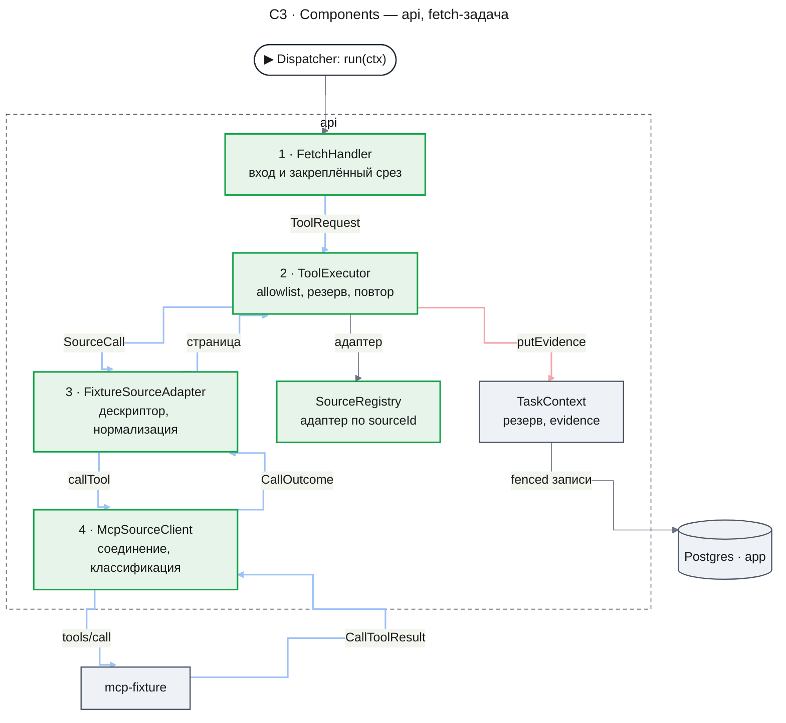
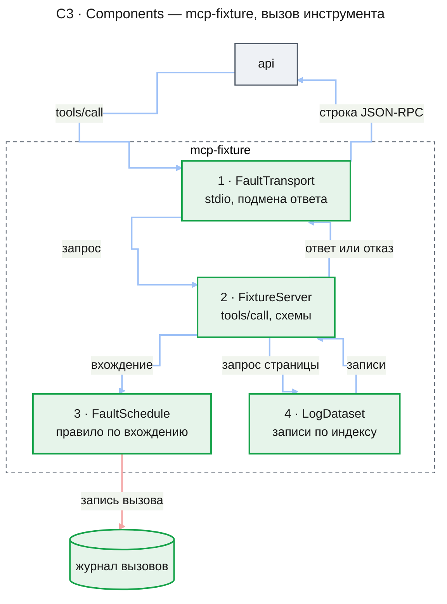
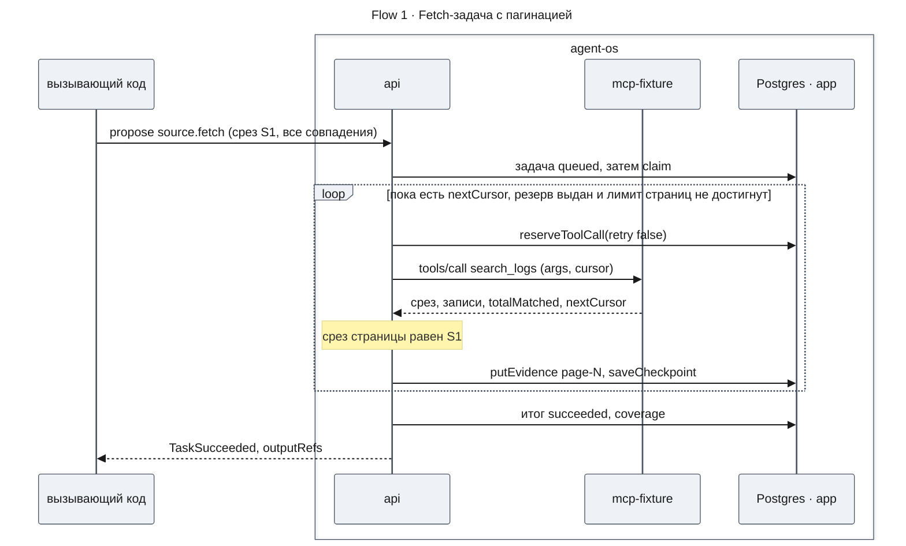
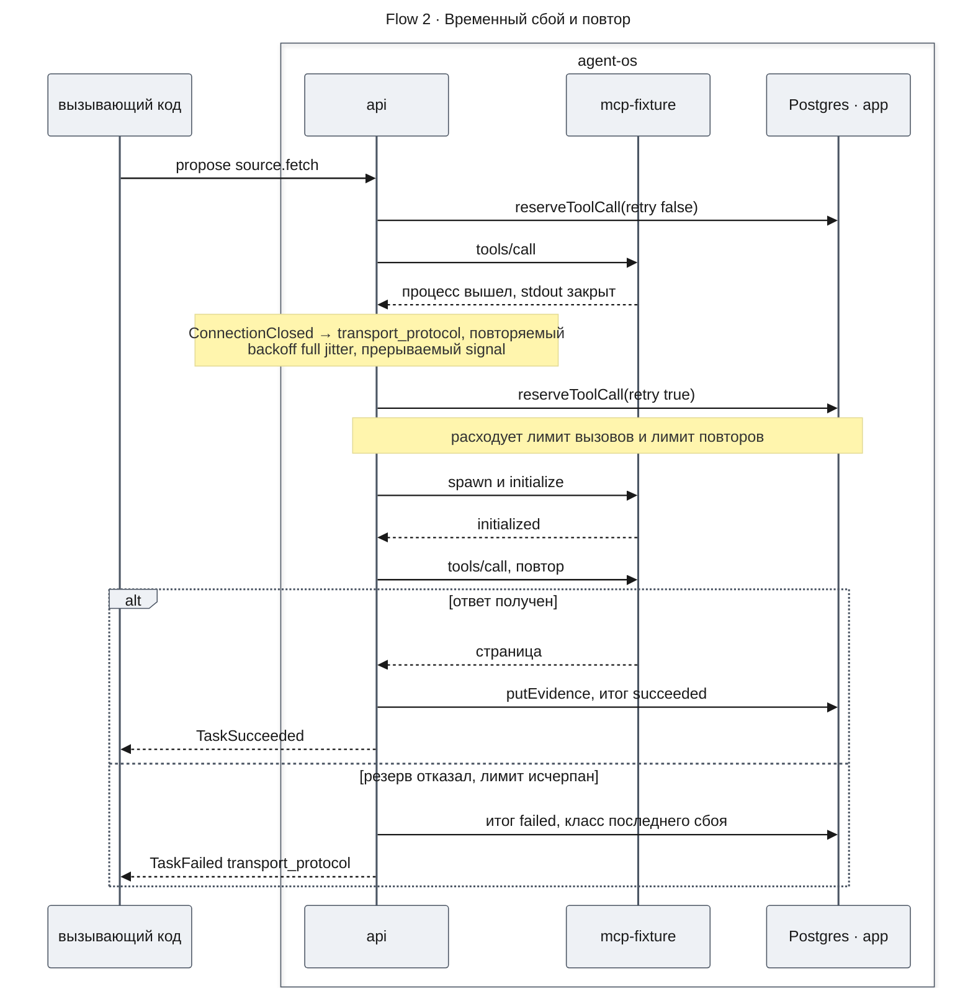
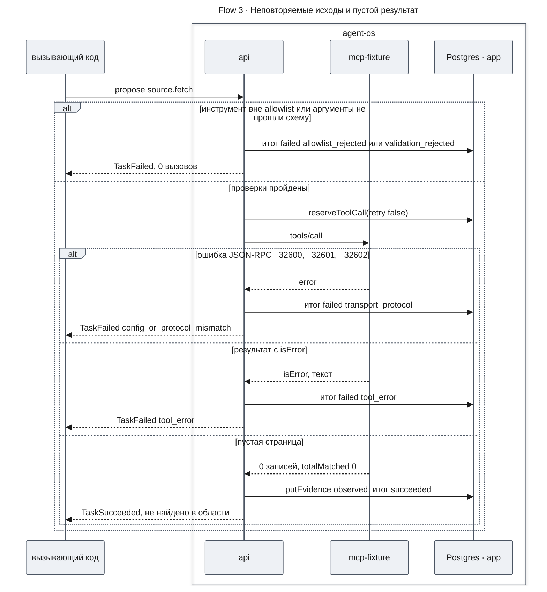
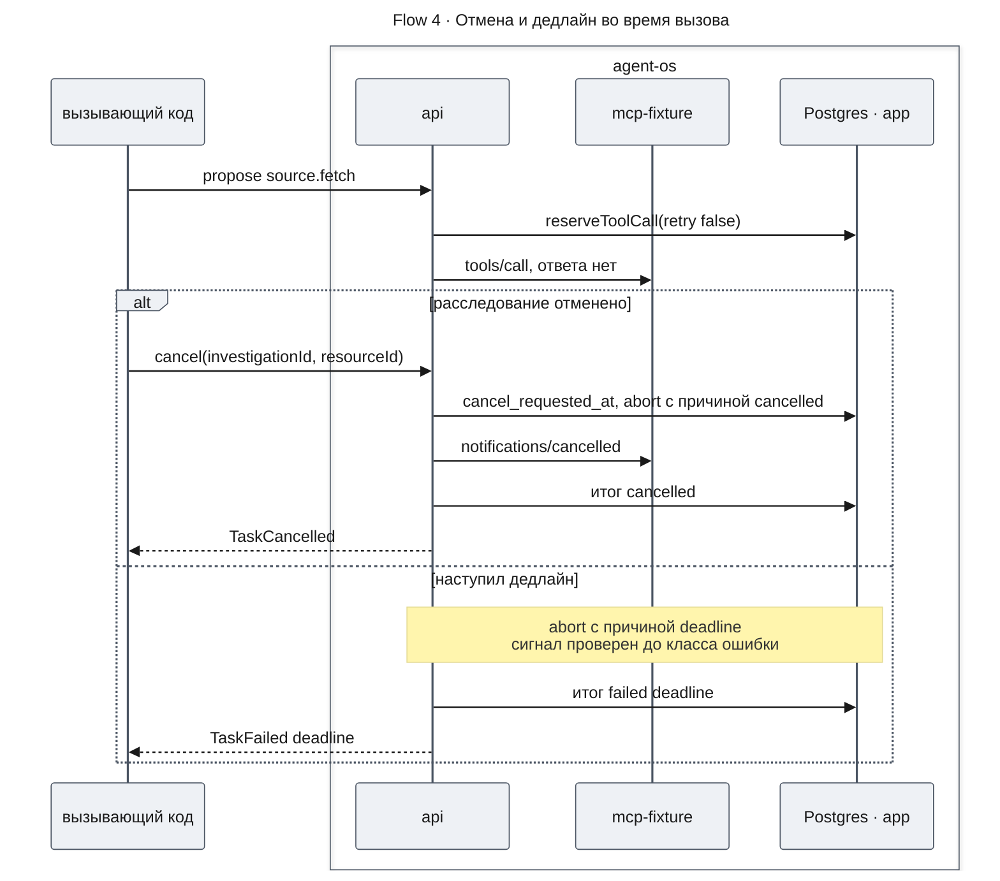
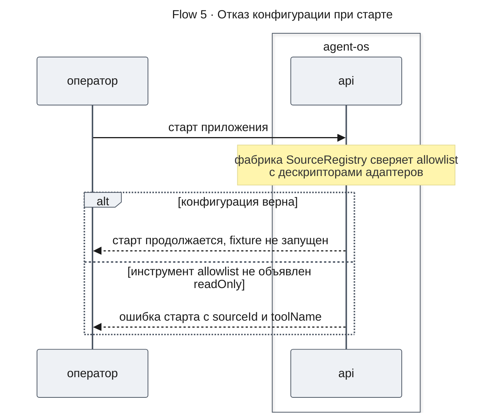

# Runtime исследований — Design Doc — mcp-source

| Status | Date | PRD | UXRD | Depends on |
|---|---|---|---|---|
| Approved | 2026-10-31 | [prd.md](./prd.md) | — | [design-runtime.md](./design-runtime.md#contract-definitions) |

## Snapshot

- **Что меняется**: в `apps/api` появляется модуль `sources`: обработчик `source.fetch`, `ToolExecutor` (allowlist, проверка аргументов, резерв, повторы, классификация, пагинация, evidence) и порт `SourceAdapter`; первый адаптер ходит в fixture через `@modelcontextprotocol/client` по stdio. Новый пакет `packages/mcp-fixture` — read-only MCP-сервер с детерминированными логами сценария §15, эталоном и режимами отказа.
- **Что не меняется**: runtime, его таблицы и порты потребляются как написаны в `design-runtime.md` ([Контракт runtime](#контракт-runtime)); чат и `apps/web`.
- **Главный риск**: неверный класс исхода MCP — локальная ошибка клиента выглядит как серверная; ответ — порядок классификации (KD-2) и fixture, воспроизводящая каждый код.
- **Открытые вопросы**: нет.

### Key Decisions

| ID | Decision | Why | Rejected alternatives |
|---|---|---|---|
| KD-1 | `@modelcontextprotocol/client` 2.4.0 по stdio; один долгоживущий процесс fixture на адаптер, запуск при первом вызове, перезапуск после обрыва перед повтором | `ProtocolError`/`SdkError` ложатся на классы FR-13–FR-14; `core` 2.4.0 уже в lockfile; без портов | `@modelcontextprotocol/sdk` 1.32.2; `@mastra/mcp` 2.7.0; Streamable HTTP; процесс на задачу |
| KD-2 | Классификация: сначала `ctx.signal`, затем `ProtocolError`, `SdkError`, `isError`, контракт результата в адаптере, пустой результат, строки по умолчанию; проверку `outputSchema` клиентом не используем | Отмена приходит как `RequestTimeout`; локальная проверка `outputSchema` даёт те же −32600/−32602, что сервер | Различать по происхождению; доверить контракт клиенту |
| KD-3 | `SourceAdapter` возвращает классифицированный `CallOutcome`; сигнал, резерв, повтор, пагинация, сверка среза и evidence — в `ToolExecutor`; классификатор MCP — в общем `McpSourceClient` | Новый источник — новый адаптер без правок исполнителя (AC-16.1) | Исполнитель знает ошибки MCP; повторы в адаптере |
| KD-4 | Allowlist — TS-модуль `sources.config.ts`; декларации инструментов (`readOnly`, схемы zod) — в дескрипторе адаптера; проверка в фабрике `SourceRegistry`; env — только параметры процесса | Ошибка конфигурации останавливает старт до воркеров (AC-11.3); одна форма схем | JSON и путь в env; проверка в `onApplicationBootstrap`; аннотации `tools/list` |
| KD-5 | Страница — отдельное evidence `page-NNNN` и checkpoint после неё с лимитом страниц; срез закреплён во входной ссылке, его читает `SourceAdapter.currentSnapshot` вне резерва задачи; содержимое — канонический JSON без времени | Восстановление продолжает с checkpoint, повтор страницы даёт тот же `sha256`; срез — метаданные, а не данные | Одно evidence на все страницы; слияние срезов; время в содержимом; чтение среза инструментом в бюджете |
| KD-6 | Fixture — пакет `packages/mcp-fixture`: низкоуровневый `Server` за обёрткой stdio-транспорта, записи по индексу seeded PRNG, правила отказа по (инструмент, хеш аргументов, вхождение) из журнала вызовов | `McpServer` не выдаёт −32600 и битый JSON; счётчик переживает `crash_process`; spawn без построения набора | `apps/mcp-fixture`; `McpServer`; счётчик в процессе; материализация записей при старте |
| KD-7 | Каждый повтор — `reserveToolCall(retry: true)`; backoff full jitter, прерываемый; таймаут вызова ограничен остатком дедлайна; задержка ≥ остатка — `deadline` | Лимиты FR-14 считает runtime; повтор не переживает дедлайн (AC-19.3) | Повторы SDK (`maxTotalTimeout`); фиксированная задержка |

Значения backoff, таймаутов и лимита страниц — [Settings](#settings).

## Part

- **Part**: `mcp-source`
- **Covers**: FR-11–FR-16; Should: FR-17, FR-21
- **Depends on**: [`design-runtime.md`, Contract Definitions](./design-runtime.md#contract-definitions) — `TaskHandler`, `HandlerRegistry`, `TaskContext`, `HandlerResult`, `Coverage`, `FailureReason`, `EvidenceInput`, `EvidenceRef` и правило резерва
- **Sibling parts**: `runtime`; его критерии здесь — только сквозной сценарий (метрика № 1) и сторона исполнителя в AC-19.3, AC-20.2

### Agreement Checklist

#### Scope
- [x] Модуль `sources` в `apps/api/src/sources/` (C3, KD-3)
- [x] Allowlist и декларации инструментов с отказом при старте (KD-4, Flow 5)
- [x] Пакет `packages/mcp-fixture`: сервер, генератор, эталон, отказы, журнал вызовов (KD-6)
- [x] `@modelcontextprotocol/client` в `apps/api`, `@modelcontextprotocol/server` в fixture (KD-1)
- [x] Сквозной сценарий метрики № 1 и счётчики метрик № 3–5 (Test Strategy)

#### Non-Scope (Explicitly not changing)
- [x] Код, таблицы и контракт runtime ([Контракт runtime](#контракт-runtime))
- [x] Реальные источники, изменяющие инструменты, HTTP-транспорт (PRD Won't Have, KD-1)
- [x] W1–W7, LLM, выбор инструментов моделью — `deep-research`
- [x] FR-22 (`stale`) — отложено PRD

#### Constraints
- [x] Parallel operation: да — задачи процесса делят соединение адаптера; у каждого экземпляра `apps/api` свой процесс fixture
- [x] Backward compatibility: контракт runtime потребляется без изменений
- [x] Performance measurement: да — скриптом по требованию (UC-N1, UC-N2)
- [x] Дедлайн и отмена не классифицируются как сбой источника и не повторяются (KD-2)

## Acceptance Criteria (AC) - EARS Format

Критерии PRD этой части действуют как написаны; use case каждого — строка **covers** в [Test Strategy](#test-strategy), механизм — поток, чья строка **AC** его называет. Критерии без потока: AC-12.4 — [Settings](#settings), AC-15.1–AC-15.5 — [Fixture MCP](#fixture-mcp), AC-21.1 — [Эталон сценария](#эталон-сценария).

### Критерии уровня дизайна

- [ ] **AC-MS-1** — **If** вызов завершился любой ошибкой, а `ctx.signal` уже прерван, **then** исход берётся из `signal.reason.kind` и не повторяется. Механизм — KD-2, K-1.
- [ ] **AC-MS-2** — **If** `structuredContent` отсутствует или нарушает контракт результата, **then** вызов записан `transport_protocol` с кодом `result_contract_violation`, повторяется по FR-14 и не даёт evidence «не найдено». Механизм — K-11.
- [ ] **AC-MS-3** — **If** очередная задержка backoff не меньше остатка дедлайна, **then** задача `failed` с классом `deadline` без следующего вызова. Механизм — KD-7.
- [ ] **AC-MS-4** — **If** срез страницы отличается от закреплённого, **then** задача `failed` `snapshot_changed`, страница не сохранена, прежние страницы в `outputRefs` не входят. Механизм — KD-5.
- [ ] **AC-MS-5** — **When** соединение оборвалось, следующий вызов идёт по новому соединению; рукопожатие не входит ни в `toolCallsUsed`, ни в журнал вызовов fixture. Механизм — KD-1, Flow 2.
- [ ] **AC-MS-6** — **If** `putEvidence` или резерв вернули `fenced`/`not_current_attempt`, **then** исполнитель больше не вызывает источник в этой попытке. Механизм — [Data Contract](#data-contract).
- [ ] **AC-MS-7** — **While** fixture перезапускается после `crash_process`, номер вхождения правила отказа продолжает считаться по журналу вызовов. Механизм — KD-6.
- [ ] **AC-MS-8** — **When** задача восстанавливается после гибели процесса, она продолжает со страницы из checkpoint, а повторно полученная страница даёт тот же `evidenceKey` и `sha256`. Механизм — KD-5.
- [ ] **AC-MS-9** — **When** задача сохранила `SOURCE_MAX_PAGES` страниц, а курсор не исчерпан, **then** она `succeeded` с охватом `partial` и курсором следующей страницы в `continuation`, без следующего вызова. Механизм — KD-5.

## Design

### Change Impact Map

```yaml
Change Target: новый модуль apps/api/src/sources и пакет packages/mcp-fixture
Direct Impact:
  - apps/api/src/app.module.ts (импорт SourcesModule)
  - apps/api/package.json (@modelcontextprotocol/client, @agent-os/mcp-fixture workspace:*)
  - apps/api/.env.example (SOURCE_*, FIXTURE_*)
  - pnpm-lock.yaml; knip.json (точка входа процесса fixture)
Indirect Impact:
  - packages/contracts/src/research.ts (Coverage.totalRelation и классы FailureReason потребляются; владелец — design-runtime.md)
  - Сборка: turbo собирает fixture до тестов apps/api по ребру workspace:*
  - Процессы: apps/api порождает дочерний процесс node при первом fetch-вызове
  - CI: check — исполнитель против fixture (UC-E7); e2e-runtime — сквозной сценарий (UC-8)
No Ripple Effect:
  - Модуль research и его таблицы (только порты HandlerRegistry и TaskContext)
  - ThreadsService, ChatController, mastraProvider, AuditService
  - apps/web (контракты чата не меняются)
```

### Architecture (C1–C4)

C1 опущен: внешних систем и людей, меняющих поведение, нет.

#### C2 · Containers


> **Why** — здесь и в обеих C3 шаги идут в порядке исполнения, а не «сначала запись»: журнал вызовов пишется внутри вызова, evidence — после ответа.

| Container | Role | Change |
|---|---|---|
| `api` | runtime и новый модуль `sources` | [MODIFY] |
| `mcp-fixture` | дочерний процесс `node`: чтение синтетических логов, отказы | [NEW] |
| журнал вызовов | JSONL-файл fixture, независимый счётчик (метрики № 3, 4) | [NEW] |
| Postgres · `app` | задачи и evidence runtime; новых таблиц нет | [READ] |

#### C3 · Components: api



| Component | Responsibility | Подключение | Проверка | Change |
|---|---|---|---|---|
| `FetchHandler` | `TaskHandler` `source.fetch` v1: вход, срез, `ToolOutcome` → `HandlerResult` | `HandlerRegistry.register` в `onModuleInit` | UC-1 | [NEW] |
| `ToolExecutor` | allowlist и схема до резерва; резерв, повтор, пагинация, срез, evidence, checkpoint | DI модуля | UC-2, UC-E4 | [NEW] |
| `SourceRegistry` | адаптеры по `sourceId`, allowlist по типу workflow, сверка конфигурации | фабрика провайдера | UC-E2 | [NEW] |
| `FixtureSourceAdapter` | дескриптор инструментов fixture, параметры процесса, нормализация | токен `SOURCE_ADAPTERS` | UC-5 | [NEW] |
| `McpSourceClient` | `Client` и `StdioClientTransport`, перезапуск, таймаут, K-3–K-13 | процесс `node` `dist/server.js` fixture при первом вызове | UC-E4, UC-E7 | [NEW] |
| `TaskContext` | порт runtime: резерв, `putEvidence`, `saveCheckpoint`, `signal` | DI runtime | UC-E11, UC-E12 | [READ] |

C4 опущен: компоненты C3 — классы один к одному. `SourcesModule` импортирует `ResearchModule`, регистрирует `FetchHandler` в `onModuleInit` и закрывает адаптеры в `onApplicationShutdown` после остановки воркеров; адаптеры и allowlist приходят токенами-символами `SOURCE_ADAPTERS` и `SOURCES_CONFIG`.

**Code locations:** `apps/api/src/sources/` (модуль, обработчик, исполнитель, реестр, конфигурация), `apps/api/src/sources/mcp/` (клиент и классификатор), `apps/api/src/sources/fixture/` (адаптер), `packages/mcp-fixture/src/`, `packages/mcp-fixture/ground-truth/`.

#### C3 · Components: mcp-fixture



| Component | Responsibility in this flow | Change |
|---|---|---|
| `FaultTransport` | обёртка `StdioServerTransport`: подмена ответа по `id` запроса | [NEW] |
| `FixtureServer` | низкоуровневый `Server`: инструменты, ресурс `fixture://source-info`; отказ схемы → `isError`, как `McpServer` | [NEW] |
| `FaultSchedule` | правила из файла; номер вхождения — из журнала вызовов, запись до обработки | [NEW] |
| `LogDataset` | записи по индексу, срез, курсоры, агрегаты, индекс `traceId` | [NEW] |

### Runtime Flows

#### Flow 1: fetch-задача с пагинацией

**Starts when:** вызывающий код предлагает задачу `source.fetch` с полнотой «все совпадения», Dispatcher её исполняет · **AC:** AC-12.1, AC-12.2, AC-16.1, AC-17.1, AC-17.2, AC-MS-8, AC-MS-9



**Outcome:** по одному evidence `observed` на страницу с provenance FR-12; `outputRefs` — все страницы по порядку; охват по [правилу полноты](#пагинация-и-охват). При «выборке» цикл делает одну страницу.

**Failure handling:**

- Отказ резерва → по [Error Handling](#error-handling); на странице N > 1 `continuation` — курсор следующей страницы (AC-17.2).
- Достигнут `SOURCE_MAX_PAGES` → как отказ резерва на странице N > 1, без резерва и вызова (AC-MS-9).
- Гибель процесса между страницами → новая попытка продолжает с checkpoint; страница, сохранённая без checkpoint, получается снова с тем же ключом (AC-MS-8).
- `fenced` или `not_current_attempt` → `stopped` ([Data Contract](#data-contract), AC-MS-6).

#### Flow 2: временный сбой и повтор

**Starts when:** вызов инструмента завершился повторяемым классом (K-4–K-8, K-11) · **AC:** AC-13.3, AC-13.4, AC-14.1, AC-14.2, AC-14.3, AC-MS-2, AC-MS-5, AC-MS-7



**Outcome:** вызовов в журнале fixture столько, сколько выдано резервов, без рукопожатия (AC-MS-5); число вызовов AC-14.1–AC-14.3 даёт правило резерва runtime.

**Failure handling:**

- Задержка не меньше остатка дедлайна → `deadline` без вызова (KD-7, AC-MS-3).
- `signal` прерван во время задержки → K-1.
- Перезапуск сам падает → K-5 или K-9 для того же вызова, в его резерве.
- Несколько задач делят соединение → каждая получает K-5 и повторяет в своём бюджете; перезапуск один на адаптер.

#### Flow 3: неповторяемые исходы и пустой результат

**Starts when:** вызов вернул ошибку протокола, ошибку инструмента или корректную пустую страницу; либо проверка до вызова не прошла · **AC:** AC-11.1, AC-11.2, AC-12.3, AC-13.1, AC-13.2, AC-14.4



**Outcome:** неповторяемый исход — ровно один вызов в журнале fixture (AC-14.4); пустая страница — evidence с нулём совпадений и областью поиска в `normalizedArgs` (AC-13.1). Неизвестный итог: `totalMatched` null, а не 0 (AC-12.3).

**Failure handling:**

- Текст `isError` длиннее лимита `FailureReason.message` → обрезается, полный текст в лог не пишется.
- Ответ нарушает контракт результата → K-11 и Flow 2, а не пустой результат (AC-MS-2).

#### Flow 4: отмена и дедлайн во время вызова

**Starts when:** вызов ждёт ответа fixture, когда расследование отменено или наступил дедлайн · **AC:** AC-19.3, AC-20.2, AC-MS-1



**Outcome:** после отмены вызовов нет — ни повтора, ни страницы: следующий резерв отклоняется `cancel_requested`, задержка backoff прерывается сигналом (AC-20.2). После дедлайна — тоже, и класс `deadline`, а не `transport_protocol` (AC-19.3).

**Failure handling:**

- Ответ fixture после прерывания → отбрасывается, запись в лог на уровне `debug`.
- Таймаут вызова сработал раньше сигнала runtime → K-2.
- Причина `shutdown` или `lease_lost` → K-1, `stopped` ([ToolOutcome](#fetchinput-и-toolrequest)).

#### Flow 5: отказ конфигурации при старте

**Starts when:** оператор или тест запускает `apps/api` · **AC:** AC-11.3



**Outcome:** сервер не опрашивается: `readOnlyHint` не читается, отказ не зависит от самоописания сервера.

**Failure handling:**

- Правила сверки — [SourceDescriptor и allowlist](#sourcedescriptor-и-allowlist); первая ошибка прерывает построение провайдера до воркеров runtime.

### Integration Points List

Подключение и проверка компонентов — таблица [C3 · api](#c3--components-api); `AppModule` и завершение — `SourcesModule` (UC-8); сборка и CI — [Change Impact Map](#change-impact-map).

### Contract Definitions

Порты — внутрипроцессные API модуля `sources`, без HTTP. Схемы — zod внутри `apps/api` и fixture; `packages/contracts` не меняется.

| Operation | Input | Output | Errors |
|---|---|---|---|
| `FetchHandler.run` | `TaskContext` с `FetchInput` | `HandlerResult` | `AttemptStoppedError` при `stopped`, запись итога — по [гарантиям Dispatcher](./design-runtime.md#dispatcher-итог-попытки); иное исключение — `internal` |
| `ToolExecutor.execute` | `TaskContext`, `ToolRequest` | `ToolOutcome` | отказы — значения; исключение только на дефект |
| `SourceRegistry.currentSnapshot` | `sourceId`, `AbortSignal` | срез источника | нет адаптера или ошибка адаптера — исключение |
| `SourceAdapter.call` | `SourceCall` | `CallOutcome` | сбой источника — значение; дефект — исключение |
| `SourceAdapter.currentSnapshot` | `AbortSignal` | срез, string 1..200 | таймаут, прерывание, сбой — исключение |
| `SourceAdapter.close` | — | `void` | — |

`currentSnapshot` вызывает `deep-research` до `propose`, чтобы закрепить срез во входной ссылке (KD-5): без allowlist, резерва и evidence, в пределах `SOURCE_CALL_TIMEOUT_MS` и сигнала вызывающего. `FixtureSourceAdapter` читает ресурс `fixture://source-info`, адаптер-заглушка UC-7 возвращает свой срез.

#### Контракт runtime

Охват с `totalRelation` и классы, которые выставляет эта часть, — [design-runtime.md, Coverage](./design-runtime.md#coverage) и [FailureReason](./design-runtime.md#failurereason); правило полноты принадлежит этой части ([Пагинация и охват](#пагинация-и-охват)).

#### FetchInput и ToolRequest

| Field | Type | Constraint | Meaning |
|---|---|---|---|
| `sourceId`, `toolName` | string | 1..100 | источник и инструмент (`FetchInput`, проверка при приёме) |
| `args` | JSON object | канонический JSON в лимите `provenance.normalizedArgs` за вычетом лимита `Coverage.continuation` | аргументы без курсора; курсор входит в `normalizedArgs` |
| `workflowType` | string | тип вызывающего обработчика | ключ allowlist |
| `pin` | string | срез входной ссылки `{kind: "source", ref: sourceId}` | ожидаемый срез; ссылки нет — `snapshot_pin_missing` |
| `completeness` | enum (`all`, `sample`) | из `expectedOutput` | до исчерпания или одна страница |
| `resume` | `FetchCheckpoint` или null | из `ctx.checkpoint` | продолжение |

`ToolOutcome`: `kind` (`completed`, `failed`, `stopped`), `evidenceRefs`, `coverage`, `failure`, `warnings` — поля `HandlerResult`. `stopped` — `fenced`, `not_current_attempt`, `shutdown` или `lease_lost`: `FetchHandler` бросает `AttemptStoppedError` с кодом причины; судьбу исключения определяют гарантии [Dispatcher: итог попытки](./design-runtime.md#dispatcher-итог-попытки).

`FetchCheckpoint`: `nextPage`, `cursor`, `unpinnedAt` (время первой страницы источника без среза или null), `evidenceIds` сохранённых страниц, `returned`, `totalMatched`, `totalRelation`. `TaskContext` не ищет evidence по `evidenceKey`, поэтому id хранятся, а `SOURCE_MAX_PAGES` держит их список в лимите checkpoint runtime.

#### SourceDescriptor и allowlist

| Field | Type | Constraint | Meaning |
|---|---|---|---|
| `sourceId` | string | 1..100, уникален | источник |
| `tools[].name`, `tools[].paginated` | string, bool | имя уникально в источнике | инструмент и наличие курсора |
| `tools[].readOnly` | bool | объявляет проект | только читающий |
| `tools[].argsSchema`, `tools[].resultSchema` | zod | обязательны | проверка до вызова и контракт результата |
| `allowlist` (`sources.config.ts`) | `workflowType` → `{sourceId, toolName}[]` | — | что вправе вызывать тип |

Фабрика `SourceRegistry` проверяет: каждая пара allowlist есть в дескрипторе, у каждой `readOnly: true`, `sourceId` не повторяются, `FIXTURE_FAULTS` задан вместе с `FIXTURE_CALL_LOG`. Нарушение — исключение с `sourceId` и `toolName`.

#### SourceCall и CallOutcome

`SourceCall`: `toolName`, `args` (прошли `argsSchema`), `cursor` (string или null), `signal` (`ctx.signal`), `timeoutMs` (KD-7). `CallOutcome.kind`: `page` с `NormalizedPage`; `tool_error` с текстом; `transport` с `code`, `retryable`, `reconnect`, `cause` — строка K-n.

`NormalizedPage`: `snapshot` (1..200), `items` (JSON), `returned`, `totalMatched` (int или null), `totalRelation` (`eq`, `gte` или null), `nextCursor` (в лимите `Coverage.continuation` или null), `exhausted` (источник утверждает, что отдал весь ответ на запрос).

Адаптер нормализует ответ каждого инструмента в единицы `Coverage`; инструмент с `paginated: false` всегда `exhausted`.

| Tool | `returned` | `totalMatched`, `totalRelation` | `exhausted` |
|---|---|---|---|
| `search_logs` | число записей | из ответа; нет в ответе — null, null | false |
| `aggregate_logs` | число корзин | null, null — счёт записей в другой единице, остаётся в содержимом | true |
| `get_trace` | число записей | число записей, `eq` | true |

#### Evidence страницы

| Поле `EvidenceInput` | Значение |
|---|---|
| `evidenceKey` | `page-0001`, `page-0002`, … |
| `provenance.normalizedArgs` | канонический JSON аргументов после `argsSchema` и курсор страницы |
| `provenance.snapshot` | срез страницы; у источника без среза — `unpinned:<unpinnedAt ISO>` |
| `coverage` | охват страницы: её `returned`, `truncated` = есть `nextCursor`, `continuation` = `nextCursor` |
| `content` | `application/json`: канонический JSON `NormalizedPage` и номер страницы, без времени |

#### Пагинация и охват

Охват задачи `complete`, когда `nextCursor` равен null и при этом либо `totalRelation = eq` и сумма `returned` равна `totalMatched`, либо `exhausted = true`. Иначе — `partial`; если курсор есть, `truncated = true` и `continuation` — этот курсор. Без подтверждённого счёта (`totalMatched` null или `gte`) конец курсора `search_logs` охват не завершает. Конец страниц при сумме меньше `totalMatched` с `eq` — `partial` с предупреждением `source_ended_early`.

Курсор fixture непрозрачен: base64url JSON версии, среза, хеша запроса и смещения. Чужой хеш запроса — `isError` «invalid cursor».

#### Fixture MCP

Инструменты объявлены `readOnlyHint: true` и без `outputSchema` (KD-2); ответ — `structuredContent`, сериализация с фиксированным порядком ключей (AC-15.1). Тот же JSON идёт и в `text`, пока `structuredContent` не длиннее 1 MiB; больше — `content` пуст, чтобы страница не шла в ответе дважды ([Settings](#settings)).

| Tool | Args | Result |
|---|---|---|
| `search_logs` | `from`, `to` (ISO, `from < to`), `service`, `level`, `event`, `status` (необязательны), `pageSize` (1..500, умолчание 500), `cursor` | `snapshot`, `records`, `totalMatched`, `totalRelation`, `nextCursor` |
| `aggregate_logs` | `from`, `to`, `groupBy` (`service`, `level`, `event`, `status`), `bucket` (`15m`, `1h`), фильтры как у поиска | `snapshot`, `buckets` (`start`, `key`, `count`), `totalMatched`, `totalRelation` |
| `get_trace` | `traceId` (32 hex) | `snapshot`, `records` по времени, `totalMatched` |

Ресурс `fixture://source-info`: `snapshot`, `datasetVersion`, `recordCount` — метаданные источника для `currentSnapshot`.

Запись лога: `ts` (ISO UTC, мс), `service` (`checkout-web`, `payment-api`, `provider-adapter`, `fraud-check`, `ledger`), `level`, `event`, `traceId`, `spanSeq`, `status` (`ok`, `error`, `timeout`, `late`), `durationMs`, `message` (синтетика до 200 символов).

| Версия | Записей | Окно | Релиз |
|---|---|---|---|
| `v1` | 120 000 | 2026-09-14T00:00Z — 2026-09-16T00:00Z | 2026-09-15T00:00:00Z |
| `v2` | `v1` + 2 000 | + час после окна | тот же |

Срез — `fx-<версия>-<8 hex sha256 параметров генератора>`. Запись `i` — функция (seed версии, `i`) seeded PRNG; время монотонно по индексу, интервал — диапазон индексов. Трасса `checkout-web` → `payment-api` → `provider-adapter` → провайдер; задержка провайдера из одного распределения до и после релиза. Локальный timeout `provider-adapter` — 3 000 мс до релиза и 1 500 мс после; задержка больше timeout даёт `provider.timeout`, затем `provider.response` со статусом `late` (AC-15.2).

#### Эталон сценария

`ground-truth/<версия>.json`: причина (снижение timeout `provider-adapter` при релизе), время релиза, отвергнутая альтернатива (рост задержки провайдера — распределение то же) и `affectedTraceIds` — трассы после релиза с задержкой между двумя timeout. Файл пишет генератор; тест сверяет его с повторной генерацией (AC-21.1).

#### Отказы fixture

Правило (`FIXTURE_FAULTS`): `tool`, `argsHash` (sha256 канонических аргументов без курсора или `*`), `occurrences` (номера или `all`), `mode`, параметры. Вхождение — номер вызова с этими (`tool`, `argsHash`) по журналу; запись в журнал — синхронно до обработки. В журнал пишется только `tools/call`; `resources/read` не пишется. Строка журнала: `seq`, `tool`, `argsHash`, `occurrence`, `mode`, `pid`.

| Mode | Что делает fixture | Исход у исполнителя |
|---|---|---|
| `drop_connection` | закрывает транспорт и выходит с кодом 0 | K-5 |
| `crash_process` | `process.exit(1)` без ответа | K-5 |
| `delay_ms` | отвечает через N мс | успех или K-1/K-2/K-6 |
| `hang` | не отвечает, отмену игнорирует | K-1, K-2 или K-6 |
| `late_response` | отвечает после таймаута вызова | K-6; поздний ответ — `debug` |
| `jsonrpc_error` | ошибка с кодом из параметра | K-3 или K-4 |
| `malformed_json` | вместо ответа — строка не-JSON; клиент её пропускает | K-6 по таймауту |
| `invalid_result` | `result` не проходит схему `CallToolResult` | K-7 |
| `contract_violation` | валидный результат, `structuredContent` нарушает `resultSchema` | K-11 |
| `tool_error`, `tool_error_args` | `isError` с текстом; второй — как отказ схемы `McpServer` | K-10 |
| `empty` | 0 записей, `totalMatched` 0 | K-12, `complete` |
| `unknown_total` | без `totalMatched` | успех, `partial`, `totalMatched` null |
| `page_cap` | последняя страница — не больше N записей, без `nextCursor` | успех, `partial`, `source_ended_early` |
| `total_cap` | `totalMatched` = N с `gte` | успех, `partial` |
| `snapshot_flip` | после этого вхождения текущей становится другая версия | `snapshot_changed` |
| `oversize` | дополняет `message` до заданного объёма | успех (AC-12.4) |

При `NODE_ENV=production` файл правил не читается.

### Data Contract

#### ToolExecutor.execute

```yaml
Input:
  Type: TaskContext, ToolRequest
  Preconditions: попытка получена claim; адаптеры и allowlist прошли сверку при старте
  Validation: allowlist по workflowType, затем argsSchema — до резерва; resultSchema — на каждый ответ
Output:
  Type: ToolOutcome
  Guarantees: вызовов источника столько же, сколько выданных резервов; повтор только по K-n с retryable после резерва retry true; страницы другого среза не сохраняются
  On Error: сбой источника — значение ToolOutcome; fenced или not_current_attempt из резерва или putEvidence — stopped без следующего вызова; дефект кода и K-14 — исключение, runtime пишет internal
Invariants:
  - signal проверяется до классификации ошибки и перед каждым резервом и вызовом
  - содержимое и ключ evidence страницы зависят только от среза, аргументов и номера страницы
```

### Error Handling

Классификатор `McpSourceClient` проверяет строки по порядку; первая совпавшая решает. K-1 и K-2 проверяет `ToolExecutor` до чтения `CallOutcome`.

| ID | Условие | Класс | Код | Повтор |
|---|---|---|---|---|
| K-1 | `ctx.signal` прерван | по `reason.kind`: `cancelled`, `deadline`; `shutdown`, `lease_lost` → `stopped` | — | нет |
| K-2 | сработал таймаут вызова, ограниченный остатком дедлайна | `deadline` | `deadline_in_call` | нет |
| K-3 | `ProtocolError` −32600, −32601, −32602, −32002, −32021, −32022, −32042 | `transport_protocol` | `config_or_protocol_mismatch` | нет |
| K-4 | `ProtocolError` −32603, −32700 и прочие коды | `transport_protocol` | `server_internal_error`, `protocol_error` | да |
| K-5 | `SdkError` `ConnectionClosed`, `NotConnected`, `SendFailed` | `transport_protocol` | `connection_lost` | да, с перезапуском |
| K-6 | `SdkError` `RequestTimeout` | `transport_protocol` | `timeout` | да |
| K-7 | `SdkError` `InvalidResult` | `transport_protocol` | `invalid_result` | да |
| K-8 | `SdkHttpError` 5xx, 408, 429 | `transport_protocol` | `http_status` | да |
| K-9 | `SdkError` `CapabilityNotSupported`, `MethodNotSupportedByProtocolVersion`, `EraNegotiationFailed`, `ClientHttpAuthentication`, `ClientHttpForbidden`; прочие 4xx; ошибка spawn | `transport_protocol` | `config_or_protocol_mismatch` | нет |
| K-10 | результат с `isError` | `tool_error` | `tool_error` | нет |
| K-11 | `structuredContent` отсутствует или не проходит `resultSchema` | `transport_protocol` | `result_contract_violation` | да |
| K-12 | корректная страница | успех; 0 записей — пустой результат | — | — |
| K-13 | любой другой `SdkError`, включая коды новее 2.4.0 | `transport_protocol` | `unclassified_client_error` | нет |
| K-14 | исключение не из SDK (не `ProtocolError`, `SdkError`, `SdkHttpError`) | не классифицируется: дефект, исключение; runtime пишет `internal` | — | нет |

До вызова: инструмент вне allowlist — `allowlist_rejected` (`tool_not_allowlisted`), аргументы не прошли `argsSchema` — `validation_rejected` (`tool_args_invalid`); резерв не берётся. Срез страницы не равен закреплённому — `snapshot_changed`, без повтора.

Отказ резерва: `tool_calls_exhausted` до первой страницы — `failed` `budget_exhausted`; на странице N > 1 — `succeeded` с `partial`; `retries_exhausted` или `tool_calls_exhausted` на повторе — `failed` с классом последнего сбоя; `cancel_requested` — `cancelled`; `not_current_attempt` — `stopped`.

### Logging and Monitoring

- `Logger` Nest: `taskId`, `attempt`, `sourceId`, `toolName`, `callIndex`, класс и код, длительность; `warn` — повтор, перезапуск процесса, `snapshot_changed`, `stopped`; `error` — K-3, K-9, K-13; `debug` — поздний ответ и stderr fixture.
- Аргументы, записи и текст `isError` в лог не попадают — только идентификаторы, хеш аргументов, размеры и классы (правило runtime).

### Settings

Значения принадлежат этому документу; переменные — в `apps/api/.env.example`, разбор — схемой zod в фабрике `SourceRegistry`.

| Env | Default | Meaning |
|---|---|---|
| `SOURCE_CALL_TIMEOUT_MS` | 30 000 | таймаут вызова и чтения среза до ограничения дедлайном |
| `SOURCE_RETRY_BASE_MS` / `SOURCE_RETRY_CAP_MS` | 200 / 5 000 | full jitter: случайная задержка от 0 до min(потолок, база × 2^n) |
| `SOURCE_MAX_PAGES` | 1 000 | страниц на задачу; держит `FetchCheckpoint` в лимите checkpoint runtime |
| `FIXTURE_DATASET` | `v1` | версия данных при запуске процесса |
| `FIXTURE_FAULTS` / `FIXTURE_CALL_LOG` | не заданы | путь правил отказа и журнала вызовов; правила без журнала — ошибка старта |

Буфер чтения stdio (`maxBufferSize`) — 32 MiB, предел одной строки ответа; с правилом `text` ([Fixture MCP](#fixture-mcp)) ответ со страницей в лимите содержимого evidence runtime занимает не больше половины буфера. Ответ длиннее буфера закрывает транспорт (K-5).

Окружение процесса fixture — набор переменных, который `StdioClientTransport` наследует по умолчанию (`getDefaultEnvironment`), плюс `FIXTURE_*`; `DATABASE_URL` и ключи моделей не передаются (Code Inspection Evidence).

### Implementation Approach

**Selected Approach**: hybrid — сначала fixture и классификатор против реального процесса (Early Verification Point), затем вертикальные срезы исполнителя: одна страница, повтор, пагинация, сквозной сценарий с Postgres.

## Test Strategy

### Main Use Cases

- **UC-1: evidence с provenance** — covers AC-12.1
  - Given: fetch-задача `search_logs` за час после релиза, срез `v1`
  - When: задача исполнена
  - Then: `succeeded`; у каждого evidence все поля FR-12; `outputRefs` — эти evidence
- **UC-2: пагинация** — covers AC-12.2, AC-17.1, AC-17.2, AC-MS-9
  - Given: 2 500 совпадений, страница 500
  - When: «выборка»; «все» с лимитом вызовов 10; «все» с лимитом 3; «все» с лимитом страниц 2
  - Then: 1 страница с курсором и `truncated`; 5 страниц, `complete`; 3 страницы, `succeeded`, `partial`, курсор 4-й; 2 страницы, `partial`, курсор 3-й, 2 вызова
- **UC-3: пусто и итог неизвестен** — covers AC-12.3, AC-13.1
  - Given: фильтр без совпадений; режим `unknown_total`
  - Then: evidence `observed` с 0 совпадений и аргументами поиска, `complete`; `totalMatched` null, `partial`
- **UC-4: большой результат** — covers AC-12.4
  - Given: `oversize` объёмом из AC-12.4
  - When: evidence прочитано через `EvidenceReader.get`
  - Then: байты и `sha256` равны каноническому JSON `NormalizedPage` этой страницы; записи совпадают с `structuredContent` ответа fixture
- **UC-5: данные и эталон** — covers AC-15.1, AC-15.2, AC-15.3, AC-21.1, метрика № 5
  - Given: два процесса `v1`
  - When: 100 одинаковых запросов к каждому; агрегат `timeout` по часам; `get_trace` каждого `traceId` эталона
  - Then: `result` равны байт в байт; после релиза выше; ответ провайдера позже timeout; `recordCount` ≥ 100 000; эталон равен повторной генерации, все трассы найдены; агрегат и трассы `complete`
- **UC-6: новая версия данных** — covers AC-15.5
  - Given: процесс `v1`, затем `v2`
  - When: `currentSnapshot` и один запрос за окно `v2` в каждом
  - Then: срезы различны, `totalMatched` во второй раз больше
- **UC-7: второй адаптер** — covers AC-16.1
  - Given: адаптер-заглушка не-MCP со своим дескриптором, `currentSnapshot` и строкой allowlist
  - When: fetch-задача через него со срезом из `currentSnapshot`
  - Then: `succeeded`, тот же формат provenance; код `ToolExecutor` и runtime не менялся
- **UC-8: сквозной сценарий** — covers PRD метрики № 1, № 3
  - Given: Postgres, fixture, семь исходов метрики № 1
  - When: 20 прогонов подряд
  - Then: все исходы в каждом; 10 одинаковых запросов — 1 вызов в журнале

### Error and Edge Use Cases

- **UC-E1: проверка до вызова** — covers AC-11.1, AC-11.2
  - Given: `get_trace` вне allowlist `source.fetch`; `search_logs` с `pageSize` 0
  - Then: `allowlist_rejected`, `validation_rejected`; `toolCallsUsed` 0, журнал пуст
- **UC-E2: нечитающий инструмент в allowlist** — covers AC-11.3
  - Given: инструмент `readOnly: false`, сервер помечает его `readOnlyHint`
  - When: строится приложение
  - Then: старт прерван с `sourceId` и `toolName`, fixture не запущен
- **UC-E3: ошибка инструмента** — covers AC-13.2, AC-14.4
  - Given: `tool_error` и `tool_error_args`, повторов 3, вызовов 5
  - Then: `failed` `tool_error` с текстом; по 1 вызову
- **UC-E4: повтор в бюджете** — covers AC-13.3, AC-14.1–AC-14.3, AC-MS-5, AC-MS-7
  - Given: `crash_process` на вхождениях 1–2; затем на всех с лимитами (повторы 2, вызовы 5) и (5, 2)
  - Then: `succeeded` после 3 вызовов; `failed` `transport_protocol` после 3 и после 2; журнал равен `toolCallsUsed`
- **UC-E5: несоответствие протокола** — covers AC-14.4
  - Given: `jsonrpc_error` −32601, −32602, −32600, повторов 3, вызовов 5
  - Then: по 1 вызову, `config_or_protocol_mismatch`
- **UC-E6: некорректный ответ** — covers AC-13.4, AC-MS-2
  - Given: `malformed_json`, `invalid_result`, `contract_violation` на 1-м вхождении
  - Then: первый вызов — `transport_protocol`, evidence «не найдено» нет; второй успешен
- **UC-E7: матрица отказов** — covers AC-15.4, метрика № 4
  - Given: каждый режим [Отказы fixture](#отказы-fixture), 30 вызовов на класс
  - Then: 100 % в ожидаемом классе; 0 повторов вне резерва; 0 повторов K-3, K-9, K-13
- **UC-E8: дедлайн** — covers AC-19.3, AC-MS-1, AC-MS-3
  - Given: `hang`; повторяемый сбой при задержке больше остатка
  - When: наступает дедлайн
  - Then: `failed` `deadline`, вызовов больше нет
- **UC-E9: отмена во время вызова** — covers AC-20.2, AC-MS-1
  - Given: задача ждёт ответа `hang`
  - When: расследование отменено
  - Then: `cancelled`; после возврата `cancel` журнал не растёт
- **UC-E10: срез сменился** — covers AC-MS-4
  - Given: `snapshot_flip` после 2-го вхождения, «все»
  - Then: `snapshot_changed`; 2 evidence, `outputRefs` пусты
- **UC-E11: восстановление** — covers AC-MS-8
  - Given: `apps/api` убит после 2-й страницы из 5
  - When: процесс поднят
  - Then: 5 страниц, ключи и `sha256` первых двух прежние
- **UC-E12: попытка перестала быть текущей** — covers AC-MS-6
  - Given: «все», 5 страниц; `TaskContext` в памяти даёт `fenced` из `putEvidence` 1-й страницы, во втором прогоне — `not_current_attempt` из резерва 2-й
  - Then: `stopped`; в журнале по 1 вызову

### Non-Functional Use Cases

- **UC-N1: накладные расходы исполнителя** — covers PRD Performance
  - Given: fixture с задержкой 0, прогрев, локальный Postgres
  - When: 100 одностраничных вызовов
  - Then: p95 разницы `execute` и `callTool` в пределах цели PRD; p95 — отсортированные[ceil(0.95n) − 1]
- **UC-N2: страница fixture** — covers PRD Performance
  - Given: прогретый процесс `v1`
  - When: 100 запросов `search_logs` по 500 записей
  - Then: p95 ответа в пределах цели PRD

## Security Considerations

- **Authentication & Authorization**: новых точек входа нет; задачу видит владелец расследования (runtime). Вызываются только инструменты allowlist, объявленные читающими в коде; аннотации сервера не доверены (FR-11).
- **Input Validation**: `FetchInput` — при приёме; аргументы — `argsSchema` до вызова; ответ — схема `CallToolResult` в клиенте и `resultSchema` в адаптере; курсор непрозрачен и проверяется fixture.
- **Sensitive Data Handling**: fixture — синтетика; окружение процесса без `DATABASE_URL` и ключей моделей ([Settings](#settings)); аргументы и содержимое не логируются.

## Verification Strategy

### Correctness Proof Method

- **Correctness definition**: каждый внедрённый отказ записан своим классом; вызовов в журнале fixture столько же, сколько выданных резервов; нет повтора после неповторяемого класса, отмены или дедлайна; нет страниц чужого среза.
- **Verification method**: журнал fixture — независимый счётчик; среды — [Test Boundaries](#test-boundaries).
- **Verification timing**: классификатор — первым срезом; UC-E7 и UC-8 — при приёмке; UC-N1, UC-N2 — по требованию.

### Early Verification Point

- **First verification target**: `McpSourceClient` против процесса fixture с режимами `jsonrpc_error` −32602, `malformed_json`, `invalid_result`, `crash_process`, `hang` с прерыванием сигнала.
- **Success criteria**: K-3, K-6, K-7, K-5 и K-1 соответственно; после `crash_process` следующий вызов идёт по новому процессу; журнал считает вхождения через перезапуск.
- **Failure response**: расхождение → фактическое поведение клиента 2.4.0 в Code Inspection Evidence и правка таблицы K-n до среза пагинации.

## Risks and Mitigation

| Risk | Impact | Probability | Mitigation |
|---|---|---|---|
| Локальная ошибка клиента принята за серверную, класс и повтор неверны | High | Medium | KD-2, K-13, K-14, Early Verification Point, UC-E7 |
| Обрыв общего соединения роняет вызовы соседних задач | Medium | Medium | каждая повторяет в своём бюджете; один перезапуск на адаптер |
| Недетерминированное содержимое страницы ломает повтор ключа при восстановлении | High | Low | канонический JSON без времени (KD-5), UC-E11 |
| Тесты отказов влияют друг на друга через журнал | Medium | Medium | правила по хешу аргументов; разные окна и фильтры на тест |
| Ответ длиннее буфера stdio обрывает соединение | Medium | Low | страница больше 1 MiB идёт без `text`; ответ не больше половины буфера ([Settings](#settings)), UC-4 |

## Future Extensibility

- **Deferred possibilities**: Streamable HTTP-адаптер для реальных источников (KD-1); `currentSnapshot` через инструмент с бюджетом, если реальный источник не даёт ресурс; общий кеш ответов между расследованиями (PRD Won't Have).
- **Intentional limitations**: одно соединение на адаптер в процессе; `malformed_json` неотличим от таймаута, поэтому ждёт таймаут вызова; инструменты только читают, `operationId` нет; страниц на задачу не больше `SOURCE_MAX_PAGES`.

## Appendix: Evidence

### Design Summary (Meta)

```yaml
design_type: "new_feature"
risk_level: "medium"
complexity_level: "high"
complexity_rationale: "(1) FR-13, FR-14, AC-14.1–AC-14.4, AC-19.3, AC-20.2 — порядок классификации и счёт вызовов в бюджете runtime; FR-15, AC-15.4 — сервер, воспроизводящий каждый код. (2) Риск — локальные ошибки клиента совпадают с серверными кодами; ответ — KD-2, KD-6"
main_constraints:
  - "Порты runtime потребляются как написаны в design-runtime.md"
  - "Только читающие инструменты, объявленные в коде проекта"
  - "CI без Postgres в задаче check"
biggest_risks:
  - "Классификация исхода MCP"
  - "Детерминизм содержимого при восстановлении"
unknowns:
  - "Точка входа процесса fixture для knip (поле bin или exports) — проверяется в плане"
  - "Перекодирование кодов ошибок codec.encodeErrorCode по эре протокола — проверяется Early Verification Point"
```

### Prerequisite ADRs

- [ADR-0001](../../adr/ADR-0001-durable-runtime-owner.md) — долговечностью владеет runtime; `@mastra/mcp` отвергнут как библиотека (KD-1), а не как владелец.
- [ADR-0003](../../adr/ADR-0003-drizzle-data-layer.md) — эта часть не добавляет таблиц и миграций.
- **Тест ADR**: не выполнен критерий 1 (дорого обратить) — ADR нет; решение записано в KD-1.

### Applicable Standards

| Standard | Type | Source | Impact on Design |
|---|---|---|---|
| TS strict, NodeNext, ESM с `.js` | explicit | `apps/api/tsconfig.json` | модуль `sources` и пакет fixture в ESM |
| oxlint type-aware, `--deny-warnings` | explicit | `apps/api/package.json` (lint) | таймеры и промисы backoff явно обработаны |
| knip: неиспользуемые экспорты и зависимости — ошибка | explicit | `knip.json` | точка входа fixture объявлена |
| turbo `^build` только по ребру `workspace:*` | explicit | `turbo.json` | `apps/api` зависит от `@agent-os/mcp-fixture` (KD-6) |
| CI: `--frozen-lockfile`, `turbo lint typecheck build test`, Node 24 | explicit | `.github/workflows/ci.yml` | lockfile с клиентом; тесты без Postgres в `check` |
| vitest: unit `*.spec.ts`, e2e `*.e2e-spec.ts` | explicit | `apps/api/vitest.config*.ts` | против fixture — unit, с Postgres — e2e |
| Контракты zod 4 в стиле `threads.ts` | implicit | `packages/contracts/src/threads.ts` | схемы `sources` |
| Модуль Nest на домен, токены-символы | implicit | `apps/api/src/*/*.module.ts` | `SourcesModule`, `SOURCE_ADAPTERS`, `SOURCES_CONFIG` |
| Ошибка конфигурации — исключение при построении провайдера | implicit | `apps/api/src/mastra/models.ts` (`parseModelId`) | фабрика `SourceRegistry` (KD-4) |
| Детерминизм данных по индексу с seeded PRNG; p95 = `ceil(0.95n) − 1` после прогрева | implicit | `apps/api/test/support/seed.ts`, `apps/api/test/threads.perf.e2e-spec.ts` | генератор fixture, UC-N1, UC-N2 |
| Изоляция e2e уникальным `resourceId`, без очистки таблиц | implicit | `apps/api/test/support/seed.ts` | сквозные сценарии |

### Existing Codebase Analysis

#### Code Inspection Evidence

- **Examined**: `Client.callTool` 2.4.0 (`dist/public-*.mjs`) — `outputSchema` проверяется только по закешированному `tools/list`; нарушение — `ProtocolError` `InvalidRequest`/`InvalidParams`. → KD-2
- **Examined**: `core-internal` в бандлах клиента 2.4.0 (`src-*.mjs`) — прерывание сигналом даёт `SdkError(RequestTimeout)`, если `signal.reason` не `SdkError`; закрытие транспорта — `ConnectionClosed`; таймаут по умолчанию 60 000 мс. `SdkErrorCode`, кроме кодов K-5–K-9: `AlreadyConnected`, `NotInitialized`, `UnsupportedResultType`, `InputRequiredRoundsExceeded`, `ListPaginationExceeded`, `ClientHttpNotImplemented`, `ClientHttpUnexpectedContent`. → K-1, K-5, K-6, K-13
- **Examined**: `ReadBuffer` клиента stdio 2.4.0 — строка с `SyntaxError` пропускается молча; лимит буфера 10 MiB, превышение закрывает транспорт. → `malformed_json` (K-6), [Settings](#settings)
- **Examined**: `StdioClientTransport` 2.4.0 (`dist/stdio.mjs`) — `cross-spawn`, `onclose` по `close` процесса; `maxBufferSize` — параметр; env процесса — `{...getDefaultEnvironment(), ...env}` (`DEFAULT_INHERITED_ENV_VARS`: на POSIX `HOME`, `PATH`, `USER` и др.); повторный `start()` бросает обычный `Error`. → KD-1, Settings, K-14
- **Examined**: `CallToolResultSchema` 2.4.0 — `content: z.array(ContentBlockSchema)`, пустой массив допустим. → [Fixture MCP](#fixture-mcp)
- **Examined**: `@modelcontextprotocol/server` 2.4.0 (`node_modules/.pnpm`) — `McpServer`: неизвестный инструмент → −32602 «Tool X not found»; ошибки обработчика и схем → `isError`. `Protocol`: брошенный `code` уходит в ответ JSON-RPC. → KD-6, `tool_error_args`
- **Finding**: MCP-кода и зависимостей в `apps/api` и `packages/*` нет (текстовый поиск по `apps/api/src`, `apps/api/test`, `packages/contracts/src`); похожей функциональности нет; модуль `research` не реализован — порты из `design-runtime.md`.
- **Finding**: изменяемых существующих символов нет; единственная правка старого кода — импорт в `AppModule` (прочитан). → Change Impact Map

#### Field Propagation Map

Только поле с риском потери; `args`, `snapshot`, `nextCursor` проходят без потерь.

```yaml
fields:
  - name: "totalMatched, totalRelation"
    origin: "ответ fixture"
    transformations:
      - layer: "FixtureSourceAdapter"
        type: "NormalizedPage"
        transformation: "нормализация по инструменту; отсутствие — null, а не 0"
    destination: "Coverage страницы и задачи"
    loss_risk: "low"
    loss_risk_reason: "счёт записей aggregate_logs намеренно не входит в Coverage (другая единица) и остаётся в содержимом evidence"
```

#### Fact Disposition Table

| Fact ID | Disposition | Handled in |
|---|---|---|
| `apps/api/package.json:mcp-client-dependency` | transform — клиент 2.4.0 | KD-1 |
| `mcp-client-error-taxonomy` | preserve — коды как есть; (a)–(c) закрыты | KD-2, Error Handling |
| `mcp-fixture-server-behaviour` | transform — низкоуровневый `Server`, обёртка транспорта | KD-6, Отказы fixture |
| `packages/contracts/src/research.ts:TaskContext-port` | preserve; (a), (c) — контракт runtime; (b) — `unpinned:`; (h) — `TaskContext` в памяти | Контракт runtime, Test Boundaries |
| `prd.md:FR-13-FR-14-classification` | preserve — счёт вызовов из правила резерва | Flow 2, Flow 3, K-n |
| `prd.md:FR-11-allowlist-config` | transform — TS-модуль и проверка в фабрике | KD-4, Flow 5 |
| `prd.md:FR-12-FR-17-evidence-and-pagination` | transform — evidence на страницу, правило полноты | KD-5, Пагинация и охват |
| `prd.md:FR-16-source-adapter-boundary` | transform — порт `SourceAdapter`, токен `SOURCE_ADAPTERS` | KD-3, UC-7 |
| `pnpm-workspace.yaml:fixture-package-placement` | transform — `packages/mcp-fixture` с ребром `workspace:*` | KD-6 |
| `apps/api/package.json:fixture-spawn-strategy` | transform — stdio, данные по индексу | KD-1, Test Boundaries |
| `prd.md:FR-15-fixture-scenario` | transform — схема записи, версии, срез, отказы | Fixture MCP, Эталон сценария |
| `apps/api/test/support/seed.ts:synthetic-data-patterns` | preserve — детерминизм по индексу, метод p95 | Applicable Standards, UC-N1 |
| `design-runtime.md:deadline-cancel-contract` | preserve — сигнал первым, таймаут по остатку | KD-2, KD-7, Flow 4 |
| `prd.md:mcp-source-test-surface` | transform — разделение `check` и `e2e-runtime` | Test Boundaries |

### Test Boundaries

| Component/Dependency | Mock? | Rationale |
|---|---|---|
| Процесс fixture | No | коды и обрывы проверяются только на реальном транспорте |
| `TaskContext` в задаче `check` | в памяти, с правилом резерва и внедряемыми `fenced` | Postgres в `check` нет |
| Postgres | No, в `e2e-runtime` | fencing, `putEvidence`, восстановление |
| Время и случайность backoff | внедряются | детерминированные задержки |
| Второй источник | адаптер-заглушка не-MCP | граница FR-16 |

- **Schema and data**: таблицы runtime только через порты; данные — генератор fixture и Postgres из `infra/docker-compose.yml`.
- **Mock limitations acknowledged**: охраняемый UPDATE резерва и fencing в памяти не проверяются — UC-E9, UC-E11 и UC-8 идут против Postgres.
- **Integration verification points**: в `check` — UC-2, UC-3, UC-5, UC-6, UC-E1–UC-E8, UC-E10, UC-E12 против процесса fixture; в `e2e-runtime` — UC-1, UC-4, UC-7, UC-8, UC-E9, UC-E11; UC-N1, UC-N2 — скрипт.

### References

- [MCP specification, Tools — Error Handling](https://modelcontextprotocol.io/specification/2025-11-25/server/tools#error-handling) — ошибка протокола против `isError`
- [MCP specification, Tools — Structured Content](https://modelcontextprotocol.io/specification/2025-11-25/server/tools#structured-content) — дублирование в `text` как рекомендация совместимости
- [MCP specification, Pagination](https://modelcontextprotocol.io/specification/2025-11-25/server/utilities/pagination) — непрозрачный курсор
- [MCP TypeScript SDK](https://github.com/modelcontextprotocol/typescript-sdk) — пакеты `client`, `server`, `core` v2
- [AWS Architecture Blog — Exponential Backoff and Jitter](https://aws.amazon.com/blogs/architecture/exponential-backoff-and-jitter/) — full jitter
- Спецификация: `docs/side_reserch/agent_os_workflow_spec.md`, §6, §13.8, §15, §17; дайджест: `docs/side_reserch/papers_digest.md`, §1 (п. 6, 7)

## Update History

| Version | Date | Change |
|---|---|---|
| 1.0 | 2026-10-31 | Первая версия |
| 1.1 | 2026-10-31 | Контракт runtime цитируется вместо предложенных изменений; `SourceAdapter.currentSnapshot` и срез как метаданные; нормализация охвата по инструментам; K-13, K-14; отказ резерва до первой страницы; `stopped` через `failed`; checkpoint с id evidence и `SOURCE_MAX_PAGES` (AC-MS-9); размер ответа и `text` выше 1 MiB; окружение процесса по SDK; UC-E12; ADR-0003; без ADR для KD-1; таблица C3 вместо списка точек интеграции |
| 1.2 | 2026-10-31 | `stopped` — исключение `AttemptStoppedError`, без класса от обработчика; чтение среза вне бюджета — в KD-5; UC-4 сверяет канонический JSON страницы; пустой `content` проверен по схеме клиента; журнал fixture только для `tools/call`; `cancel` с `resourceId` во Flow 4; селекторы анимации сокращены |
| 1.3 | 2026-10-31 | Утверждён; судьба `AttemptStoppedError` при `shutdown` и `lease_lost` — ссылкой на гарантии Dispatcher в `design-runtime.md`; закрыт блок YAML в Design Summary |
