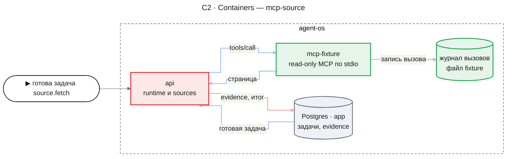
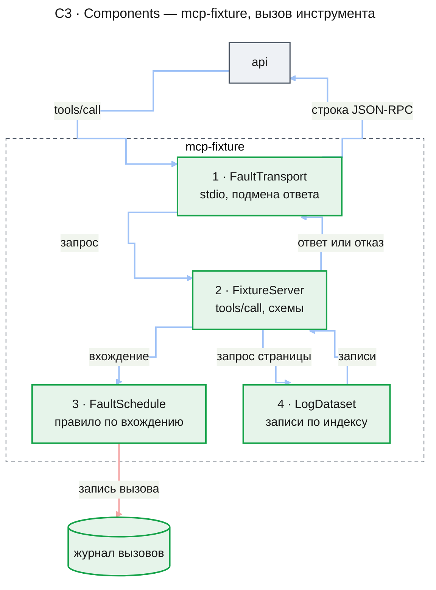
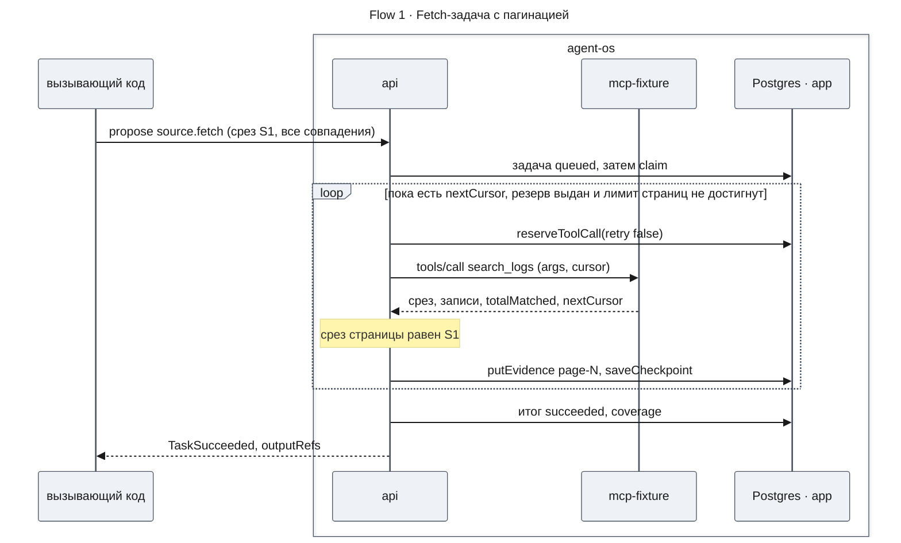
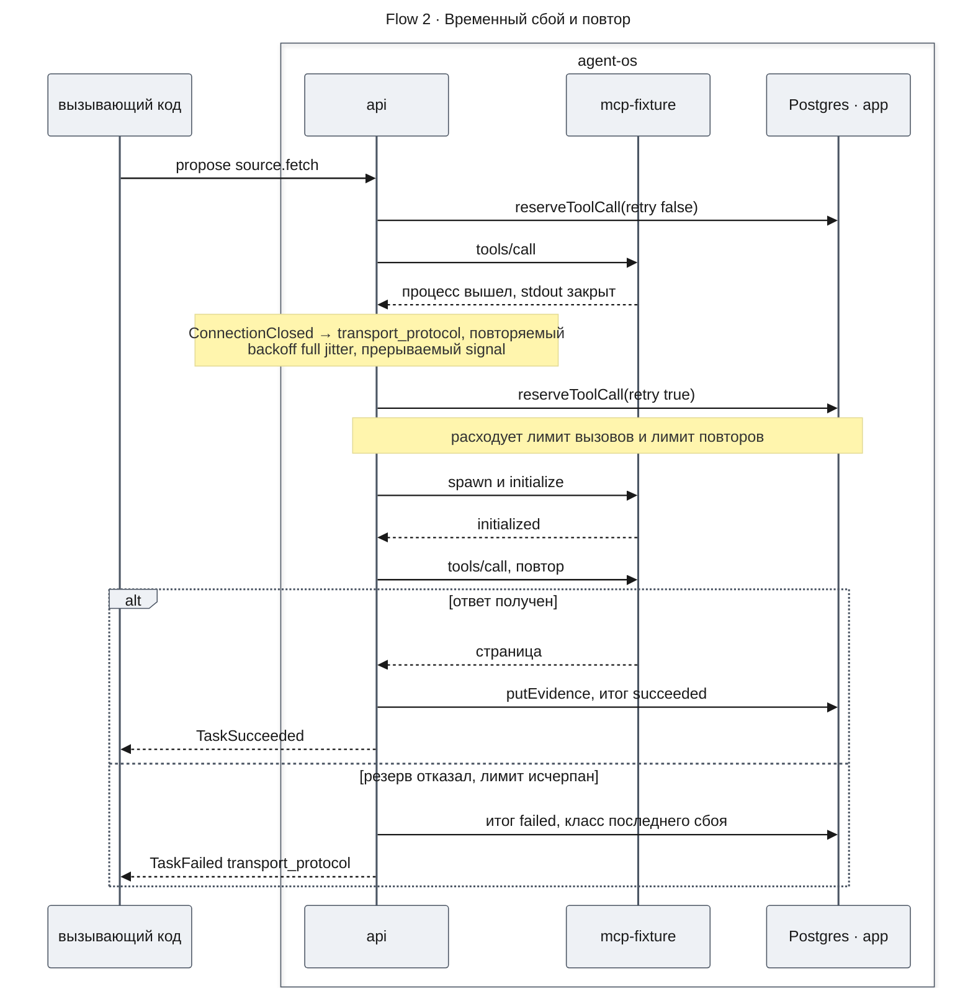
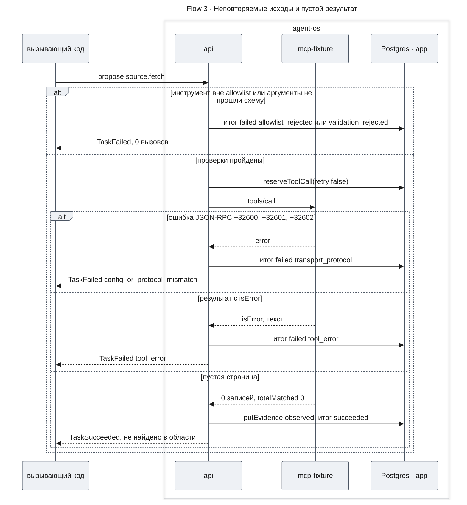
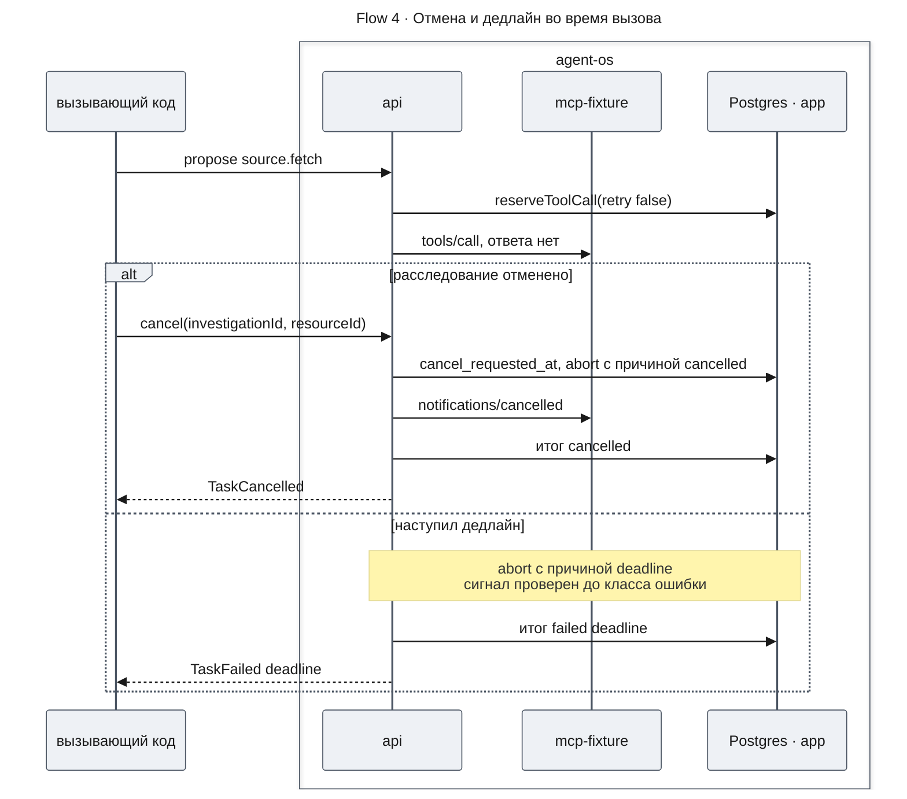
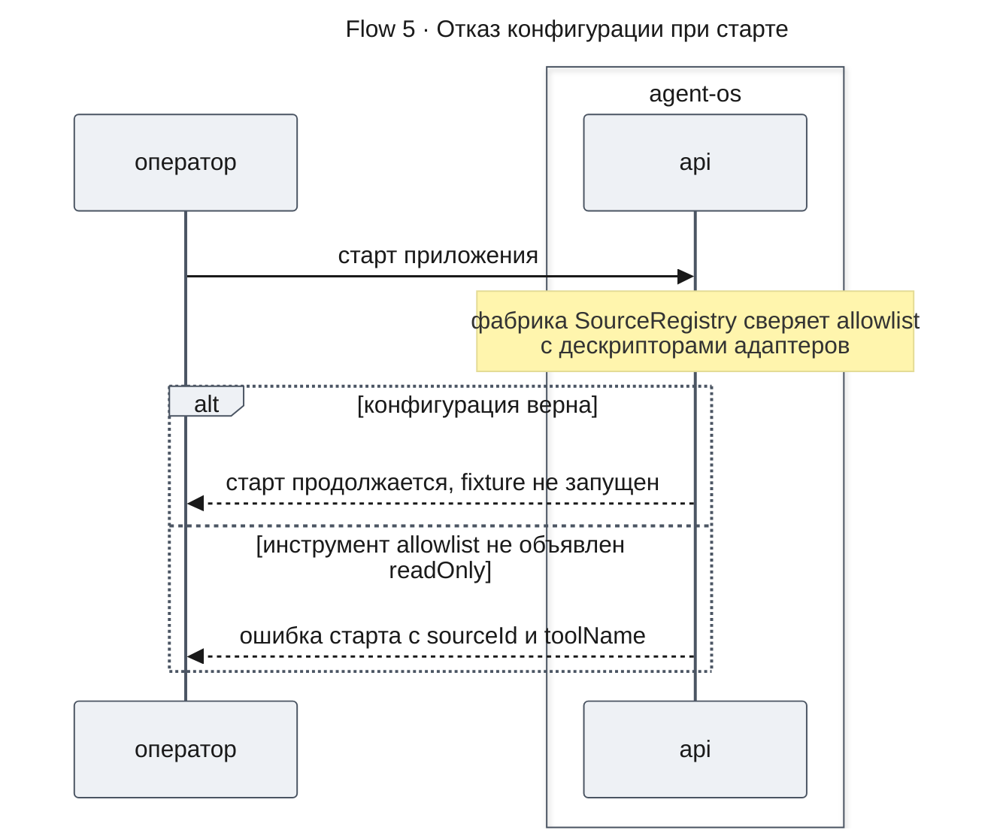

# Runtime исследований — Design Doc — mcp-source

**Status:** Approved · **Date:** 2026-10-31 · **PRD:** [prd.md](./prd.md) · **UXRD:** нет · **Depends on:** [design-runtime.md](./design-runtime.md#contract-definitions)

## Snapshot

**Обзор.** Runtime умеет исполнять задачи, но первым фичам исследования нужен источник данных и исполнитель вызовов, исходам которого можно доверять. Эта часть добавляет пакет источников с обработчиком fetch-задачи: он проверяет инструмент по allowlist и аргументы по схеме, берёт у runtime резерв на каждый вызов, повторяет временные сбои в бюджете задачи, проходит страницы и сохраняет каждую страницу как evidence. Каждый исход вызова MCP получает свой класс (сбой транспорта или протокола, ошибка инструмента, пустой результат), и повторяются только временные сбои. Источником служит тестовый MCP-сервер в отдельном пакете: он отдаёт детерминированные синтетические логи сценария вместе с эталонным ответом и по правилам воспроизводит каждый вид отказа.

- **Не меняется**: runtime, его таблицы и порты потребляются как написаны в `design-runtime.md` ([Контракт runtime](#контракт-runtime)); чат и `apps/web` не меняются.
- **Главный риск**: локальная ошибка клиента MCP выглядит как серверная, и исход получает неверный класс. Его снижают порядок классификации (KD-2) и fixture, воспроизводящая каждый код.
- **Открытые вопросы**: нет; два допущения проверяет план (Appendix: Evidence, Code Inspection Evidence).

### Key Decisions

#### KD-1: Клиент MCP — `@modelcontextprotocol/client` 2.4.0 по stdio с одним долгоживущим процессом fixture на адаптер

Процесс запускается при первом вызове и перезапускается после обрыва перед повтором. Ошибки клиента `ProtocolError` и `SdkError` ложатся на классы FR-13 и FR-14, пакет `core` 2.4.0 уже есть в lockfile, а stdio не требует сетевых портов.

Отвергнуты `@modelcontextprotocol/sdk` 1.32.2, `@mastra/mcp` 2.7.0, транспорт Streamable HTTP и отдельный процесс fixture на каждую задачу.

#### KD-2: Исход вызова классифицируется в строгом порядке, и проверку `outputSchema` клиентом проект не использует

Порядок такой: сначала `ctx.signal`, затем `ProtocolError`, `SdkError`, `isError`, контракт результата в адаптере, пустой результат и строки по умолчанию ([Error Handling](#error-handling)). Сигнал проверяется первым, потому что отмену клиент сообщает как `RequestTimeout`. Контракт результата проверяет адаптер, потому что локальная проверка `outputSchema` даёт те же коды −32600 и −32602, что и сервер.

Отвергнуты различение ошибок по происхождению и проверка контракта силами клиента.

#### KD-3: `SourceAdapter` возвращает уже классифицированный `CallOutcome`, а сигнал, резерв, повтор, пагинация, сверка среза и evidence живут в `ToolExecutor`

Классификатор MCP живёт в общем `McpSourceClient`. Так новый источник подключается новым адаптером без правок исполнителя (AC-16.1).

Отвергнуты исполнитель, который знает ошибки MCP, и повторы внутри адаптера.

#### KD-4: Allowlist — TS-модуль `sources.config.ts` в точке сборки `apps/api`, а сверку с дескрипторами выполняет фабрика `SourceRegistry`

Модуль передаётся в `createSources`, а декларации инструментов (`readOnly`, схемы zod) лежат в дескрипторе адаптера. Переменные окружения задают только параметры процесса, и читает их точка сборки. Так ошибка конфигурации останавливает старт до воркеров (AC-11.3), у схем одна форма, а пакет не читает окружение (ADR-0004).

Отвергнуты JSON с путём в env, проверка в `onApplicationBootstrap` и аннотации `tools/list`.

#### KD-5: Каждая страница — отдельное evidence `page-NNNN` с checkpoint после неё, а срез закреплён во входной ссылке

Число страниц ограничено лимитом. Срез читает `SourceAdapter.currentSnapshot` вне резерва задачи, а содержимое страницы — канонический JSON без времени. Так восстановление продолжает с checkpoint, повтор страницы даёт тот же `sha256`, а срез хранится как метаданные.

Отвергнуты одно evidence на все страницы, слияние срезов, время в содержимом и чтение среза инструментом в бюджете задачи.

#### KD-6: Fixture — пакет `packages/mcp-fixture` на низкоуровневом `Server`, подключённый к `@agent-os/sources` только как devDependency

Сервер стоит за обёрткой stdio-транспорта (ADR-0004), записи вычисляются по индексу seeded PRNG, а правило отказа срабатывает по инструменту, хешу аргументов и номеру вхождения из журнала вызовов. `McpServer` не выдаёт −32600 и битый JSON, счётчик в журнале переживает `crash_process`, а запуск процесса не строит набор данных.

Отвергнуты `apps/mcp-fixture`, `McpServer`, счётчик в памяти процесса и материализация записей при старте.

#### KD-7: Каждый повтор берёт резерв `reserveToolCall(retry: true)`, а задержка и таймаут ограничены дедлайном

Backoff — full jitter, и сигнал прерывает задержку; значения backoff, таймаутов и лимита страниц заданы в [Settings](#settings). Таймаут вызова ограничен остатком дедлайна, а задержка не меньше остатка сразу даёт `deadline`. Так лимиты FR-14 считает runtime, и повтор не переживает дедлайн (AC-19.3).

Отвергнуты повторы SDK (`maxTotalTimeout`) и фиксированная задержка.

## Terms

- **MCP** (Model Context Protocol) — протокол, по которому клиент вызывает инструменты внешнего источника.
- **Fixture** — тестовый MCP-сервер репозитория с синтетическими логами, эталоном сценария и режимами отказа.
- **stdio** — обмен с дочерним процессом через стандартные потоки ввода и вывода.
- **Allowlist** — перечень инструментов, которые вправе вызывать задачи данного типа workflow.
- **Срез** (snapshot) — версия данных источника, к которой относится ответ; задача закрепляет срез во входной ссылке.
- **Evidence** и **provenance** — сохранённый выход вызова и запись о том, откуда он получен: источник, инструмент, аргументы, срез.
- **Резерв вызова** — разрешение runtime на один вызов инструмента в бюджете задачи (`reserveToolCall`).
- **Full jitter** — случайная задержка повтора от нуля до потолка, который растёт с номером повтора.
- **Классы K-n** — строки таблицы классификации исходов вызова ([Error Handling](#error-handling)).
- **Checkpoint** — JSON, по которому новая попытка продолжает со следующей страницы.

## Part

- **Часть**: `mcp-source`
- **Покрывает**: проверку до вызова и read-only allowlist (FR-11), ответ с provenance и метаданными усечения (FR-12), три класса исхода вызова (FR-13), повтор временных сбоев в бюджете (FR-14), fixture MCP-сервер (FR-15), границу source adapter (FR-16); из Should Have — пагинацию до исчерпания (FR-17) и эталон сценария (FR-21).
- **Зависит от**: [`design-runtime.md`, Contract Definitions](./design-runtime.md#contract-definitions) — `TaskHandler`, `HandlerRegistry`, `TaskContext`, `HandlerResult` (из `@agent-os/runtime`), `Coverage`, `FailureReason`, `EvidenceInput`, `EvidenceRef` (схемы `@agent-os/contracts`) и правило резерва.
- **Соседние части**: `runtime`; из его критериев здесь только сквозной сценарий (метрика № 1) и сторона исполнителя в AC-19.3 и AC-20.2.

**Вне рамок части**

- Код, таблицы и контракт runtime не меняются ([Контракт runtime](#контракт-runtime)).
- Реальные источники, изменяющие инструменты и HTTP-транспорт в фиче не появляются (PRD, Won't Have; KD-1).
- Сценарии W1–W7, LLM и выбор инструментов моделью относятся к `deep-research`.
- Пометку `stale` (FR-22) PRD отложил.
- `ThreadsService`, `ChatController`, `mastraProvider`, `AuditService` и `apps/web` не меняются, и `packages/contracts` эта часть тоже не меняет.
- Отложены Streamable HTTP-адаптер для реальных источников (KD-1), `currentSnapshot` через инструмент с бюджетом, если реальный источник не даёт ресурс, и общий кеш ответов между расследованиями (PRD, Won't Have).

**Ограничения**

- Задачи процесса делят соединение адаптера, а у каждого экземпляра `apps/api` свой процесс fixture.
- Контракт runtime потребляется без изменений.
- Производительность измеряет скрипт по требованию (UC-N1, UC-N2).
- Дедлайн и отмена не классифицируются как сбой источника и не повторяются (KD-2).
- Задача CI `check` идёт без Postgres: тесты пакета sources против процесса fixture проходят в ней, а тесты с Postgres — в задаче `e2e-runtime`.
- Пакеты sources и fixture следуют стандартам репозитория: TS strict и ESM с суффиксом `.js`, приватный пакет с одним входом и сборкой `tsc` в `dist` без `@nestjs/*` и `@mastra/*`, oxlint без предупреждений, knip, сборка turbo по рёбрам `workspace:*` и CI с `--frozen-lockfile` на Node 24 (ADR-0004).

## Acceptance Criteria

Критерии PRD применяются как написаны, и ниже каждый назван в нескольких словах. Критерии уровня дизайна (AC-MS-n) уточняют поведение исполнителя, которое PRD не описывает.

### FR-11: Проверка до вызова и read-only allowlist

- Применяются как написаны: инструмент вне allowlist отклоняется без обращения к источнику (AC-11.1); аргументы вне схемы отклоняются как ошибка валидации (AC-11.2); инструмент, не объявленный читающим, не попадает в allowlist, и конфигурация отклоняется при старте (AC-11.3).

### FR-12: Унифицированный ответ с provenance и метаданными усечения

- Применяются как написаны: evidence поиска несёт все поля provenance (AC-12.1); при нескольких страницах выставлены признак усечения и состояние пагинации (AC-12.2); неизвестный `totalMatched` не записывается нулём (AC-12.3); результат 10 MB читается без изменений (AC-12.4).
- Если срез страницы отличается от закреплённого, задача `failed` с классом `snapshot_changed`, страница не сохранена, а прежние страницы в `outputRefs` не входят (AC-MS-4).

### FR-13: Три класса исхода вызова

- Применяются как написаны: пустой результат даёт `succeeded` с evidence «не найдено в области» (AC-13.1); ошибка инструмента даёт `failed` без повтора (AC-13.2); обрыв соединения — сбой транспорта по FR-14 (AC-13.3); неразборчивый ответ — сбой транспорта, а не пустой результат (AC-13.4).
- Если `structuredContent` отсутствует или нарушает контракт результата, вызов записан классом `transport_protocol` с кодом `result_contract_violation`, повторяется по FR-14 и не даёт evidence «не найдено» (AC-MS-2).

### FR-14: Повтор временных сбоев в пределах бюджета

- Применяются как написаны: два сбоя и ответ при лимитах повторов 3 и вызовов 5 дают `succeeded` после трёх вызовов (AC-14.1); лимит повторов 2 даёт три вызова и `failed` (AC-14.2); лимит вызовов 2 даёт два вызова и `failed` (AC-14.3); ошибка протокола или отказ аргументов вызывает источник один раз (AC-14.4).
- Когда соединение оборвалось, следующий вызов идёт по новому соединению, а рукопожатие не входит ни в `toolCallsUsed`, ни в журнал вызовов fixture (AC-MS-5).
- Если `putEvidence` или резерв вернули `fenced` или `not_current_attempt`, исполнитель больше не вызывает источник в этой попытке (AC-MS-6).

### FR-15: Fixture MCP-сервер с синтетическими логами

- Применяются как написаны: ответы на один запрос совпадают байт в байт (AC-15.1); данные показывают рост timeout после релиза и ответ провайдера позже локального timeout (AC-15.2); записей не меньше 100 000, и инструменты не меняют данные (AC-15.3); режимы отказа воспроизводятся на заданных вызовах (AC-15.4); новая версия данных меняет срез (AC-15.5).
- Пока fixture перезапускается после `crash_process`, номер вхождения правила отказа продолжает считаться по журналу вызовов (AC-MS-7).

### FR-16: Граница source adapter

- Применяется как написан: второй адаптер работает без изменений runtime и ToolExecutor и даёт тот же формат provenance (AC-16.1).

### FR-17: Пагинация до исчерпания проверяется кодом

- Применяются как написаны: 2 500 совпадений по 500 на странице дают пять страниц без усечения (AC-17.1); бюджет на три страницы даёт `succeeded` с неполным охватом и продолжением (AC-17.2).
- Когда задача восстанавливается после гибели процесса, она продолжает со страницы из checkpoint, а повторно полученная страница даёт тот же `evidenceKey` и `sha256` (AC-MS-8).
- Когда задача сохранила `SOURCE_MAX_PAGES` страниц, а курсор не исчерпан, она `succeeded` с охватом `partial` и курсором следующей страницы в `continuation`, без следующего вызова (AC-MS-9).

### FR-19 и FR-20: Дедлайн и отмена на стороне исполнителя

- Применяются как написаны: после дедлайна источник больше не вызывается, а исход записан причиной «дедлайн» (AC-19.3); после отмены источник не вызывается ни повтором, ни следующей страницей (AC-20.2).
- Если вызов завершился любой ошибкой, а `ctx.signal` уже прерван, исход берётся из `signal.reason.kind` и не повторяется (AC-MS-1).
- Если очередная задержка backoff не меньше остатка дедлайна, задача `failed` с классом `deadline` без следующего вызова (AC-MS-3).

### FR-21: Эталон сценария в fixture

- Применяется как написан: рядом с данными лежит эталон с причиной и списком `traceId`, и каждый `traceId` находится инструментом получения трассы (AC-21.1).

## Design

### Architecture (C1–C4)

#### C2 · Containers

> **Why** — здесь и в обеих C3 шаги идут в порядке исполнения, а не «сначала запись»: журнал вызовов пишется внутри вызова, evidence — после ответа.

- `api` исполняет runtime и новый пакет `sources`, связанные в одном процессе.
- `mcp-fixture` — новый дочерний процесс `node`, который читает синтетические логи и воспроизводит отказы.
- Журнал вызовов — новый JSONL-файл fixture, независимый счётчик вызовов для метрик № 3 и № 4.
- Postgres · `app` хранит задачи и evidence runtime; эта часть только пользуется ими, и новых таблиц нет.

#### C3 · Components: api

- `FetchHandler` — обработчик `TaskHandler` типа `source.fetch` версии 1: читает вход и закреплённый срез и превращает `ToolOutcome` в `HandlerResult`. Его регистрирует в `HandlerRegistry` функция `createSources`.
- `ToolExecutor` проверяет allowlist и схему до резерва, а затем берёт резерв, повторяет, проходит страницы, сверяет срез и сохраняет evidence и checkpoint.
- `SourceRegistry` держит адаптеры по `sourceId` и allowlist по типу workflow и сверяет конфигурацию при сборке.
- `FixtureSourceAdapter` несёт дескриптор инструментов fixture и параметры процесса и нормализует ответы; список адаптеров передаёт точка сборки.
- `McpSourceClient` держит `Client` и `StdioClientTransport`, перезапускает процесс, ограничивает вызов таймаутом и классифицирует исход по строкам K-3–K-13. Процесс `node` он запускает при первом вызове по пути входа fixture, который передаёт точка сборки.
- `TaskContext` — порт runtime, через который исполнитель берёт резерв, пишет `putEvidence` и `saveCheckpoint` и читает `signal`.

Функция сборки `createSources` принимает `HandlerRegistry` runtime, адаптеры, allowlist, настройки, порт `Clock` runtime и порт `SourcesLogger`, регистрирует `FetchHandler` и отдаёт `SourceRegistry` и `close()`. Тонкий `SourcesModule` в `apps/api` вызывает её после сборки runtime, передаёт `sources.config.ts` и путь входа fixture и закрывает адаптеры в `onApplicationShutdown`, после остановки воркеров (UC-9).

#### C3 · Components: mcp-fixture

- `FaultTransport` оборачивает `StdioServerTransport` и подменяет ответ по `id` запроса.
- `FixtureServer` — низкоуровневый `Server` с инструментами и ресурсом `fixture://source-info`; отказ схемы он отдаёт как `isError`, так же как `McpServer`.
- `FaultSchedule` читает правила из файла, берёт номер вхождения из журнала вызовов и пишет вызов в журнал до обработки.
- `LogDataset` отдаёт записи по индексу, срез, курсоры, агрегаты и индекс `traceId`.

### Runtime Flows

#### Flow 1: fetch-задача с пагинацией

**Когда начинается:** вызывающий код предлагает задачу `source.fetch` с полнотой «все совпадения», и Dispatcher её исполняет. Поток даёт provenance и признак усечения (AC-12.1, AC-12.2), границу адаптера (AC-16.1), пагинацию до исчерпания (AC-17.1, AC-17.2), продолжение с checkpoint и лимит страниц (AC-MS-8, AC-MS-9).

**Результат:** по одному evidence `observed` на страницу с provenance FR-12; `outputRefs` — все страницы по порядку; охват по [правилу полноты](#пагинация-и-охват). При «выборке» цикл делает одну страницу.

**Обработка сбоев:**

- Отказ резерва → по [Error Handling](#error-handling); на странице N > 1 `continuation` — курсор следующей страницы (AC-17.2).
- Достигнут `SOURCE_MAX_PAGES` → как отказ резерва на странице N > 1, без резерва и вызова (AC-MS-9).
- Гибель процесса между страницами → новая попытка продолжает с checkpoint; страница, сохранённая без checkpoint, получается снова с тем же ключом (AC-MS-8).
- `fenced` или `not_current_attempt` → `stopped` ([ToolExecutor.execute](#toolexecutorexecute), AC-MS-6).

#### Flow 2: временный сбой и повтор

**Когда начинается:** вызов инструмента завершился повторяемым классом (K-4–K-8, K-11). Поток даёт класс сбоя транспорта (AC-13.3, AC-13.4, AC-MS-2), повтор в бюджете (AC-14.1–AC-14.3), новое соединение после обрыва (AC-MS-5) и счёт вхождений fixture через перезапуск (AC-MS-7).

**Результат:** вызовов в журнале fixture столько, сколько выдано резервов, без рукопожатия (AC-MS-5); число вызовов AC-14.1–AC-14.3 даёт правило резерва runtime.

**Обработка сбоев:**

- Задержка не меньше остатка дедлайна → `deadline` без вызова (KD-7, AC-MS-3).
- `signal` прерван во время задержки → K-1.
- Перезапуск сам падает → K-5 или K-9 для того же вызова, в его резерве.
- Несколько задач делят соединение → каждая получает K-5 и повторяет в своём бюджете; перезапуск один на адаптер.

#### Flow 3: неповторяемые исходы и пустой результат

**Когда начинается:** вызов вернул ошибку протокола, ошибку инструмента или корректную пустую страницу, либо проверка до вызова не прошла. Поток даёт отказ до вызова (AC-11.1, AC-11.2), неизвестный итог (AC-12.3), пустой результат и ошибку инструмента (AC-13.1, AC-13.2) и вызов без повтора при несоответствии протокола (AC-14.4).

**Результат:** неповторяемый исход — ровно один вызов в журнале fixture (AC-14.4); пустая страница — evidence с нулём совпадений и областью поиска в `normalizedArgs` (AC-13.1). Неизвестный итог: `totalMatched` null, а не 0 (AC-12.3).

**Обработка сбоев:**

- Текст `isError` длиннее лимита `FailureReason.message` → обрезается, полный текст в лог не пишется.
- Ответ нарушает контракт результата → K-11 и Flow 2, а не пустой результат (AC-MS-2).

#### Flow 4: отмена и дедлайн во время вызова

**Когда начинается:** вызов ждёт ответа fixture, когда расследование отменено или наступил дедлайн. Поток даёт исход по сигналу без повтора (AC-19.3, AC-20.2, AC-MS-1).

**Результат:** после отмены вызовов нет — ни повтора, ни страницы: следующий резерв отклоняется `cancel_requested`, задержка backoff прерывается сигналом (AC-20.2). После дедлайна — тоже, и класс `deadline`, а не `transport_protocol` (AC-19.3).

**Обработка сбоев:**

- Ответ fixture после прерывания → отбрасывается, запись в лог на уровне `debug`.
- Таймаут вызова сработал раньше сигнала runtime → K-2.
- Причина `shutdown` или `lease_lost` → K-1, `stopped` ([ToolOutcome](#fetchinput-и-toolrequest)).

#### Flow 5: отказ конфигурации при старте

**Когда начинается:** оператор или тест запускает `apps/api`. Поток даёт отказ конфигурации с нечитающим инструментом (AC-11.3).

**Результат:** сервер не опрашивается: `readOnlyHint` не читается, отказ не зависит от самоописания сервера.

**Обработка сбоев:**

- Правила сверки — [SourceDescriptor и allowlist](#sourcedescriptor-и-allowlist); первая ошибка прерывает `createSources` до старта воркеров runtime.
- Без установленной fixture сверка не выполняется, а старт продолжается ([Contract Definitions](#contract-definitions)).

### Contract Definitions

Порты — внутрипроцессные API пакета `@agent-os/sources`, без HTTP. Схемы — zod внутри пакетов sources и fixture; `packages/contracts` не меняется.

| Операция | Вход | Выход | Ошибки |
|---|---|---|---|
| `createSources` | `HandlerRegistry`, адаптеры, allowlist, [настройки](#settings), `Clock`, `SourcesLogger` | `SourceRegistry`, `close()` | нарушение сверки — исключение с `sourceId` и `toolName` (AC-11.3) |
| `FetchHandler.run` | `TaskContext` с `FetchInput` | `HandlerResult` | `AttemptStoppedError` при `stopped`, запись итога — по [гарантиям Dispatcher](./design-runtime.md#dispatcher-итог-попытки); иное исключение — `internal` |
| `ToolExecutor.execute` | `TaskContext`, `ToolRequest` | `ToolOutcome` | отказы — значения; исключение только на дефект |
| `SourceRegistry.currentSnapshot` | `sourceId`, `AbortSignal` | срез источника | нет адаптера или ошибка адаптера — исключение |
| `SourceAdapter.call` | `SourceCall` | `CallOutcome` | сбой источника — значение; дефект — исключение |
| `SourceAdapter.currentSnapshot` | `AbortSignal` | срез, string 1..200 | таймаут, прерывание, сбой — исключение |
| `SourceAdapter.close` | — | `void` | — |

`Clock` — порт `@agent-os/runtime` ([`design-runtime.md`, Функции сборки и порты](./design-runtime.md#функции-сборки-и-порты)): время, случайность и таймеры backoff. `SourcesLogger` — порт пакета sources с уровнями и полями из [Logging and Monitoring](#logging-and-monitoring).

`currentSnapshot` вызывает `deep-research` до `propose`, чтобы закрепить срез во входной ссылке (KD-5): без allowlist, резерва и evidence, в пределах `SOURCE_CALL_TIMEOUT_MS` и сигнала вызывающего. `FixtureSourceAdapter` читает ресурс `fixture://source-info`, адаптер-заглушка UC-7 возвращает свой срез.

Без установленной `@agent-os/mcp-fixture`, которая подключена только как devDependency (ADR-0004), `SourcesModule` не вызывает `createSources`. Тогда обработчик `source.fetch` не зарегистрирован, и `propose` такой задачи отклоняется `unknown_workflow`, а `SourcesModule` предоставляет пустой `SourceRegistry`, чей `currentSnapshot` отвечает исключением «нет адаптера». Инструменты только читают, поэтому у вызова нет `operationId`.

#### Контракт runtime

Охват с `totalRelation` и классы, которые выставляет эта часть, — [design-runtime.md, Coverage](./design-runtime.md#coverage) и [FailureReason](./design-runtime.md#failurereason); правило полноты принадлежит этой части ([Пагинация и охват](#пагинация-и-охват)).

#### FetchInput и ToolRequest

| Поле | Тип | Ограничение | Смысл |
|---|---|---|---|
| `sourceId`, `toolName` | string | 1..100 | источник и инструмент (`FetchInput`, проверка при приёме) |
| `args` | JSON object | канонический JSON в лимите `provenance.normalizedArgs` за вычетом лимита `Coverage.continuation` | аргументы без курсора; курсор входит в `normalizedArgs` |
| `workflowType` | string | тип вызывающего обработчика | ключ allowlist |
| `pin` | string | срез входной ссылки `{kind: "source", ref: sourceId}` | ожидаемый срез; ссылки нет — `snapshot_pin_missing` |
| `completeness` | enum (`all`, `sample`) | из `expectedOutput` | до исчерпания или одна страница |
| `resume` | `FetchCheckpoint` или null | из `ctx.checkpoint` | продолжение |

`ToolOutcome`: `kind` (`completed`, `failed`, `stopped`), `evidenceRefs`, `coverage`, `failure`, `warnings` — поля `HandlerResult`. `stopped` — `fenced`, `not_current_attempt`, `shutdown` или `lease_lost`: `FetchHandler` бросает `AttemptStoppedError` с кодом причины; судьбу исключения определяют гарантии [Dispatcher: итог попытки](./design-runtime.md#dispatcher-итог-попытки).

`FetchCheckpoint`: `nextPage`, `cursor`, `unpinnedAt` (время первой страницы источника без среза или null), `evidenceIds` сохранённых страниц, `returned`, `totalMatched`, `totalRelation`. `TaskContext` не ищет evidence по `evidenceKey`, поэтому id хранятся, а `SOURCE_MAX_PAGES` держит их список в лимите checkpoint runtime.

#### SourceDescriptor и allowlist

| Поле | Тип | Ограничение | Смысл |
|---|---|---|---|
| `sourceId` | string | 1..100, уникален | источник |
| `tools[].name`, `tools[].paginated` | string, bool | имя уникально в источнике | инструмент и наличие курсора |
| `tools[].readOnly` | bool | объявляет проект | только читающий |
| `tools[].argsSchema`, `tools[].resultSchema` | zod | обязательны | проверка до вызова и контракт результата |
| `allowlist` (`sources.config.ts`) | `workflowType` → `{sourceId, toolName}[]` | — | что вправе вызывать тип |

Фабрика `SourceRegistry` проверяет: каждая пара allowlist есть в дескрипторе, у каждой `readOnly: true`, `sourceId` не повторяются, `FIXTURE_FAULTS` задан вместе с `FIXTURE_CALL_LOG`. Нарушение — исключение с `sourceId` и `toolName`.

#### SourceCall и CallOutcome

`SourceCall`: `toolName`, `args` (прошли `argsSchema`), `cursor` (string или null), `signal` (`ctx.signal`), `timeoutMs` (KD-7). `CallOutcome.kind`: `page` с `NormalizedPage`; `tool_error` с текстом; `transport` с `code`, `retryable`, `reconnect`, `cause` — строка K-n.

`NormalizedPage`: `snapshot` (1..200), `items` (JSON), `returned`, `totalMatched` (int или null), `totalRelation` (`eq`, `gte` или null), `nextCursor` (в лимите `Coverage.continuation` или null), `exhausted` (источник утверждает, что отдал весь ответ на запрос).

Адаптер нормализует ответ каждого инструмента в единицы `Coverage`; инструмент с `paginated: false` всегда `exhausted`.

| Инструмент | `returned` | `totalMatched`, `totalRelation` | `exhausted` |
|---|---|---|---|
| `search_logs` | число записей | из ответа; нет в ответе — null, null | false |
| `aggregate_logs` | число корзин | null, null — счёт записей в другой единице, остаётся в содержимом | true |
| `get_trace` | число записей | число записей, `eq` | true |

#### Evidence страницы

| Поле `EvidenceInput` | Значение |
|---|---|
| `evidenceKey` | `page-0001`, `page-0002`, … |
| `provenance.normalizedArgs` | канонический JSON аргументов после `argsSchema` и курсор страницы |
| `provenance.snapshot` | срез страницы; у источника без среза — `unpinned:<unpinnedAt ISO>` |
| `coverage` | охват страницы: её `returned`, `truncated` = есть `nextCursor`, `continuation` = `nextCursor` |
| `content` | `application/json`: канонический JSON `NormalizedPage` и номер страницы, без времени |

#### Пагинация и охват

Охват задачи `complete`, когда `nextCursor` равен null и при этом либо `totalRelation = eq` и сумма `returned` равна `totalMatched`, либо `exhausted = true`. Иначе — `partial`; если курсор есть, `truncated = true` и `continuation` — этот курсор. Без подтверждённого счёта (`totalMatched` null или `gte`) конец курсора `search_logs` охват не завершает. Конец страниц при сумме меньше `totalMatched` с `eq` — `partial` с предупреждением `source_ended_early`.

Курсор fixture непрозрачен: base64url JSON версии, среза, хеша запроса и смещения. Чужой хеш запроса — `isError` «invalid cursor».

#### Fixture MCP

Инструменты объявлены `readOnlyHint: true` и без `outputSchema` (KD-2); ответ — `structuredContent`, сериализация с фиксированным порядком ключей (AC-15.1). Тот же JSON идёт и в `text`, пока `structuredContent` не длиннее 1 MiB; больше — `content` пуст, чтобы страница не шла в ответе дважды ([Settings](#settings)).

| Инструмент | Аргументы | Результат |
|---|---|---|
| `search_logs` | `from`, `to` (ISO, `from < to`), `service`, `level`, `event`, `status` (необязательны), `pageSize` (1..500, умолчание 500), `cursor` | `snapshot`, `records`, `totalMatched`, `totalRelation`, `nextCursor` |
| `aggregate_logs` | `from`, `to`, `groupBy` (`service`, `level`, `event`, `status`), `bucket` (`15m`, `1h`), фильтры как у поиска | `snapshot`, `buckets` (`start`, `key`, `count`), `totalMatched`, `totalRelation` |
| `get_trace` | `traceId` (32 hex) | `snapshot`, `records` по времени, `totalMatched` |

Ресурс `fixture://source-info`: `snapshot`, `datasetVersion`, `recordCount` — метаданные источника для `currentSnapshot`.

Запись лога: `ts` (ISO UTC, мс), `service` (`checkout-web`, `payment-api`, `provider-adapter`, `fraud-check`, `ledger`), `level`, `event`, `traceId`, `spanSeq`, `status` (`ok`, `error`, `timeout`, `late`), `durationMs`, `message` (синтетика до 200 символов).

| Версия | Записей | Окно | Релиз |
|---|---|---|---|
| `v1` | 120 000 | 2026-09-14T00:00Z — 2026-09-16T00:00Z | 2026-09-15T00:00:00Z |
| `v2` | `v1` + 2 000 | + час после окна | тот же |

Срез — `fx-<версия>-<8 hex sha256 параметров генератора>`. Запись `i` — функция (seed версии, `i`) seeded PRNG; время монотонно по индексу, интервал — диапазон индексов. Трасса `checkout-web` → `payment-api` → `provider-adapter` → провайдер; задержка провайдера из одного распределения до и после релиза. Локальный timeout `provider-adapter` — 3 000 мс до релиза и 1 500 мс после; задержка больше timeout даёт `provider.timeout`, затем `provider.response` со статусом `late` (AC-15.2).

#### Эталон сценария

`ground-truth/<версия>.json`: причина (снижение timeout `provider-adapter` при релизе), время релиза, отвергнутая альтернатива (рост задержки провайдера — распределение то же) и `affectedTraceIds` — трассы после релиза с задержкой между двумя timeout. Файл пишет генератор; тест сверяет его с повторной генерацией (AC-21.1).

#### Отказы fixture

Правило (`FIXTURE_FAULTS`): `tool`, `argsHash` (sha256 канонических аргументов без курсора или `*`), `occurrences` (номера или `all`), `mode`, параметры. Вхождение — номер вызова с этими (`tool`, `argsHash`) по журналу; запись в журнал — синхронно до обработки. В журнал пишется только `tools/call`; `resources/read` не пишется. Строка журнала: `seq`, `tool`, `argsHash`, `occurrence`, `mode`, `pid`.

| Режим | Что делает fixture | Исход у исполнителя |
|---|---|---|
| `drop_connection` | закрывает транспорт и выходит с кодом 0 | K-5 |
| `crash_process` | `process.exit(1)` без ответа | K-5 |
| `delay_ms` | отвечает через N мс | успех или K-1/K-2/K-6 |
| `hang` | не отвечает, отмену игнорирует | K-1, K-2 или K-6 |
| `late_response` | отвечает после таймаута вызова | K-6; поздний ответ — `debug` |
| `jsonrpc_error` | ошибка с кодом из параметра | K-3 или K-4 |
| `malformed_json` | вместо ответа — строка не-JSON; клиент её пропускает | K-6 по таймауту |
| `invalid_result` | `result` не проходит схему `CallToolResult` | K-7 |
| `contract_violation` | валидный результат, `structuredContent` нарушает `resultSchema` | K-11 |
| `tool_error`, `tool_error_args` | `isError` с текстом; второй — как отказ схемы `McpServer` | K-10 |
| `empty` | 0 записей, `totalMatched` 0 | K-12, `complete` |
| `unknown_total` | без `totalMatched` | успех, `partial`, `totalMatched` null |
| `page_cap` | последняя страница — не больше N записей, без `nextCursor` | успех, `partial`, `source_ended_early` |
| `total_cap` | `totalMatched` = N с `gte` | успех, `partial` |
| `snapshot_flip` | после этого вхождения текущей становится другая версия | `snapshot_changed` |
| `oversize` | дополняет `message` до заданного объёма | успех (AC-12.4) |

При `NODE_ENV=production` файл правил не читается.

#### ToolExecutor.execute

Вызывающий передаёт `TaskContext` и `ToolRequest` и получает `ToolOutcome`. Попытка получена claim, а адаптеры и allowlist прошли сверку при старте. До резерва исполнитель проверяет allowlist по `workflowType` и аргументы по `argsSchema`, а каждый ответ сверяет с `resultSchema`.

- Вызовов источника столько же, сколько выдано резервов, и повтор идёт только по строке K-n с `retryable` после резерва с `retry: true`.
- Страницы другого среза не сохраняются, а содержимое и ключ evidence страницы зависят только от среза, аргументов и номера страницы.
- `signal` проверяется до классификации ошибки и перед каждым резервом и вызовом.
- Сбой источника возвращается значением `ToolOutcome`. `fenced` или `not_current_attempt` из резерва или `putEvidence` дают `stopped` без следующего вызова.
- Дефект кода и K-14 бросают исключение, и runtime пишет `internal`.

#### Error Handling

Классификатор `McpSourceClient` проверяет строки по порядку; первая совпавшая решает. K-1 и K-2 проверяет `ToolExecutor` до чтения `CallOutcome`.

| ID | Условие | Класс | Код | Повтор |
|---|---|---|---|---|
| K-1 | `ctx.signal` прерван | по `reason.kind`: `cancelled`, `deadline`; `shutdown`, `lease_lost` → `stopped` | — | нет |
| K-2 | сработал таймаут вызова, ограниченный остатком дедлайна | `deadline` | `deadline_in_call` | нет |
| K-3 | `ProtocolError` −32600, −32601, −32602, −32002, −32021, −32022, −32042 | `transport_protocol` | `config_or_protocol_mismatch` | нет |
| K-4 | `ProtocolError` −32603, −32700 и прочие коды | `transport_protocol` | `server_internal_error`, `protocol_error` | да |
| K-5 | `SdkError` `ConnectionClosed`, `NotConnected`, `SendFailed` | `transport_protocol` | `connection_lost` | да, с перезапуском |
| K-6 | `SdkError` `RequestTimeout` | `transport_protocol` | `timeout` | да |
| K-7 | `SdkError` `InvalidResult` | `transport_protocol` | `invalid_result` | да |
| K-8 | `SdkHttpError` 5xx, 408, 429 | `transport_protocol` | `http_status` | да |
| K-9 | `SdkError` `CapabilityNotSupported`, `MethodNotSupportedByProtocolVersion`, `EraNegotiationFailed`, `ClientHttpAuthentication`, `ClientHttpForbidden`; прочие 4xx; ошибка spawn | `transport_protocol` | `config_or_protocol_mismatch` | нет |
| K-10 | результат с `isError` | `tool_error` | `tool_error` | нет |
| K-11 | `structuredContent` отсутствует или не проходит `resultSchema` | `transport_protocol` | `result_contract_violation` | да |
| K-12 | корректная страница | успех; 0 записей — пустой результат | — | — |
| K-13 | любой другой `SdkError`, включая коды новее 2.4.0 | `transport_protocol` | `unclassified_client_error` | нет |
| K-14 | исключение не из SDK (не `ProtocolError`, `SdkError`, `SdkHttpError`) | не классифицируется: дефект, исключение; runtime пишет `internal` | — | нет |

До вызова: инструмент вне allowlist — `allowlist_rejected` (`tool_not_allowlisted`), аргументы не прошли `argsSchema` — `validation_rejected` (`tool_args_invalid`); резерв не берётся. Срез страницы не равен закреплённому — `snapshot_changed`, без повтора.

Отказ резерва: `tool_calls_exhausted` до первой страницы — `failed` `budget_exhausted`; на странице N > 1 — `succeeded` с `partial`; `retries_exhausted` или `tool_calls_exhausted` на повторе — `failed` с классом последнего сбоя; `cancel_requested` — `cancelled`; `not_current_attempt` — `stopped`.

#### Logging and Monitoring

- Порт `SourcesLogger` от точки сборки (в `apps/api` — адаптер над `Logger` Nest): `taskId`, `attempt`, `sourceId`, `toolName`, `callIndex`, класс и код, длительность; `warn` — повтор, перезапуск процесса, `snapshot_changed`, `stopped`, а при старте — `@agent-os/mcp-fixture` не установлена, источники не подключены (пишет `SourcesModule` через адаптер над `Logger` Nest); `error` — K-3, K-9, K-13; `debug` — поздний ответ и stderr fixture.
- Аргументы, записи и текст `isError` в лог не попадают — только идентификаторы, хеш аргументов, размеры и классы (правило runtime).

#### Settings

Значения принадлежат этому документу; переменные — в `apps/api/.env.example`. Читает их точка сборки, разбор — схемой zod пакета sources в `createSources`.

| Переменная | По умолчанию | Смысл |
|---|---|---|
| `SOURCE_CALL_TIMEOUT_MS` | 30 000 | таймаут вызова и чтения среза до ограничения дедлайном |
| `SOURCE_RETRY_BASE_MS` / `SOURCE_RETRY_CAP_MS` | 200 / 5 000 | full jitter: случайная задержка от 0 до min(потолок, база × 2^n) |
| `SOURCE_MAX_PAGES` | 1 000 | страниц на задачу; держит `FetchCheckpoint` в лимите checkpoint runtime |
| `FIXTURE_DATASET` | `v1` | версия данных при запуске процесса |
| `FIXTURE_FAULTS` / `FIXTURE_CALL_LOG` | не заданы | путь правил отказа и журнала вызовов; правила без журнала — ошибка старта |

Буфер чтения stdio (`maxBufferSize`) — 32 MiB, предел одной строки ответа; с правилом `text` ([Fixture MCP](#fixture-mcp)) ответ со страницей в лимите содержимого evidence runtime занимает не больше половины буфера. Ответ длиннее буфера закрывает транспорт (K-5).

Окружение процесса fixture — набор переменных, который `StdioClientTransport` наследует по умолчанию (`getDefaultEnvironment`), плюс `FIXTURE_*`; `DATABASE_URL` и ключи моделей не передаются (Code Inspection Evidence).

## Test Strategy

### Main Use Cases

- **UC-1: evidence с provenance** — covers AC-12.1
  - Given: fetch-задача `search_logs` за час после релиза, срез `v1`
  - When: задача исполнена
  - Then: `succeeded`; у каждого evidence все поля FR-12; `outputRefs` — эти evidence
- **UC-2: пагинация** — covers AC-12.2, AC-17.1, AC-17.2, AC-MS-9
  - Given: 2 500 совпадений, страница 500
  - When: «выборка»; «все» с лимитом вызовов 10; «все» с лимитом 3; «все» с лимитом страниц 2
  - Then: 1 страница с курсором и `truncated`; 5 страниц, `complete`; 3 страницы, `succeeded`, `partial`, курсор 4-й; 2 страницы, `partial`, курсор 3-й, 2 вызова
- **UC-3: пусто и итог неизвестен** — covers AC-12.3, AC-13.1
  - Given: фильтр без совпадений; режим `unknown_total`
  - Then: evidence `observed` с 0 совпадений и аргументами поиска, `complete`; `totalMatched` null, `partial`
- **UC-4: большой результат** — covers AC-12.4
  - Given: `oversize` объёмом из AC-12.4
  - When: evidence прочитано через `EvidenceReader.get`
  - Then: байты и `sha256` равны каноническому JSON `NormalizedPage` этой страницы; записи совпадают с `structuredContent` ответа fixture
- **UC-5: данные и эталон** — covers AC-15.1, AC-15.2, AC-15.3, AC-21.1, метрика № 5
  - Given: два процесса `v1`
  - When: 100 одинаковых запросов к каждому; агрегат `timeout` по часам; `get_trace` каждого `traceId` эталона
  - Then: `result` равны байт в байт; после релиза выше; ответ провайдера позже timeout; `recordCount` ≥ 100 000; эталон равен повторной генерации, все трассы найдены; агрегат и трассы `complete`
- **UC-6: новая версия данных** — covers AC-15.5
  - Given: процесс `v1`, затем `v2`
  - When: `currentSnapshot` и один запрос за окно `v2` в каждом
  - Then: срезы различны, `totalMatched` во второй раз больше
- **UC-7: второй адаптер** — covers AC-16.1
  - Given: адаптер-заглушка не-MCP со своим дескриптором, `currentSnapshot` и строкой allowlist
  - When: fetch-задача через него со срезом из `currentSnapshot`
  - Then: `succeeded`, тот же формат provenance; код `ToolExecutor` и runtime не менялся
- **UC-8: сквозной сценарий** — covers PRD метрики № 1, № 3
  - Given: Postgres, fixture, семь исходов метрики № 1
  - When: 20 прогонов подряд
  - Then: все исходы в каждом; 10 одинаковых запросов — 1 вызов в журнале
- **UC-9: связывание в `apps/api`** — covers AC-11.3
  - Given: `apps/api` со штатным `sources.config.ts`
  - When: приложение стартует и останавливается
  - Then: обработчик `source.fetch` зарегистрирован до старта воркеров, процесс fixture закрыт после их остановки
  - Вариант: в allowlist инструмент без `readOnly` — старт `apps/api` прерван до старта воркеров

### Error and Edge Use Cases

- **UC-E1: проверка до вызова** — covers AC-11.1, AC-11.2
  - Given: `get_trace` вне allowlist `source.fetch`; `search_logs` с `pageSize` 0
  - Then: `allowlist_rejected`, `validation_rejected`; `toolCallsUsed` 0, журнал пуст
- **UC-E2: нечитающий инструмент в allowlist** — covers AC-11.3
  - Given: инструмент `readOnly: false`, сервер помечает его `readOnlyHint`
  - When: вызывается `createSources`
  - Then: сборка прервана с `sourceId` и `toolName`, fixture не запущен
- **UC-E3: ошибка инструмента** — covers AC-13.2, AC-14.4
  - Given: `tool_error` и `tool_error_args`, повторов 3, вызовов 5
  - Then: `failed` `tool_error` с текстом; по 1 вызову
- **UC-E4: повтор в бюджете** — covers AC-13.3, AC-14.1–AC-14.3, AC-MS-5, AC-MS-7
  - Given: `crash_process` на вхождениях 1–2; затем на всех с лимитами (повторы 2, вызовы 5) и (5, 2)
  - Then: `succeeded` после 3 вызовов; `failed` `transport_protocol` после 3 и после 2; журнал равен `toolCallsUsed`
- **UC-E5: несоответствие протокола** — covers AC-14.4
  - Given: `jsonrpc_error` −32601, −32602, −32600, повторов 3, вызовов 5
  - Then: по 1 вызову, `config_or_protocol_mismatch`
- **UC-E6: некорректный ответ** — covers AC-13.4, AC-MS-2
  - Given: `malformed_json`, `invalid_result`, `contract_violation` на 1-м вхождении
  - Then: первый вызов — `transport_protocol`, evidence «не найдено» нет; второй успешен
- **UC-E7: матрица отказов** — covers AC-15.4, метрика № 4
  - Given: каждый режим [Отказы fixture](#отказы-fixture), 30 вызовов на класс
  - Then: 100 % в ожидаемом классе; 0 повторов вне резерва; 0 повторов K-3, K-9, K-13
- **UC-E8: дедлайн** — covers AC-19.3, AC-MS-1, AC-MS-3
  - Given: `hang`; повторяемый сбой при задержке больше остатка
  - When: наступает дедлайн
  - Then: `failed` `deadline`, вызовов больше нет
- **UC-E9: отмена во время вызова** — covers AC-20.2, AC-MS-1
  - Given: задача ждёт ответа `hang`
  - When: расследование отменено
  - Then: `cancelled`; после возврата `cancel` журнал не растёт
- **UC-E10: срез сменился** — covers AC-MS-4
  - Given: `snapshot_flip` после 2-го вхождения, «все»
  - Then: `snapshot_changed`; 2 evidence, `outputRefs` пусты
- **UC-E11: восстановление** — covers AC-MS-8
  - Given: процесс восстановления ([Test Boundaries](#test-boundaries)) убит после 2-й страницы из 5
  - When: процесс поднят
  - Then: 5 страниц, ключи и `sha256` первых двух прежние
- **UC-E12: попытка перестала быть текущей** — covers AC-MS-6
  - Given: «все», 5 страниц; `TaskContext` в памяти даёт `fenced` из `putEvidence` 1-й страницы, во втором прогоне — `not_current_attempt` из резерва 2-й
  - Then: `stopped`; в журнале по 1 вызову

### Non-Functional Use Cases

- **UC-N1: накладные расходы исполнителя** — covers PRD Performance
  - Given: fixture с задержкой 0, прогрев, локальный Postgres
  - When: 100 одностраничных вызовов
  - Then: p95 разницы `execute` и `callTool` в пределах цели PRD; p95 — отсортированные[ceil(0.95n) − 1]
- **UC-N2: страница fixture** — covers PRD Performance
  - Given: прогретый процесс `v1`
  - When: 100 запросов `search_logs` по 500 записей
  - Then: p95 ответа в пределах цели PRD

## Security Considerations

- **Authentication & Authorization**: новых точек входа нет; задачу видит владелец расследования (runtime). Вызываются только инструменты allowlist, объявленные читающими в коде; аннотации сервера не доверены (FR-11).
- **Input Validation**: `FetchInput` — при приёме; аргументы — `argsSchema` до вызова; ответ — схема `CallToolResult` в клиенте и `resultSchema` в адаптере; курсор непрозрачен и проверяется fixture.
- **Sensitive Data Handling**: fixture — синтетика; окружение процесса без `DATABASE_URL` и ключей моделей ([Settings](#settings)); аргументы и содержимое не логируются.

## Risks and Mitigation

- **Локальная ошибка клиента принята за серверную, и класс и повтор неверны.** Влияние высокое, вероятность средняя. Риск снижают порядок классификации (KD-2), строки K-13 и K-14, первая проверка классификатора против процесса fixture и матрица отказов UC-E7.
- **Обрыв общего соединения роняет вызовы соседних задач.** Влияние и вероятность средние. Каждая задача повторяет в своём бюджете, а перезапуск один на адаптер.
- **Недетерминированное содержимое страницы ломает повтор ключа при восстановлении.** Влияние высокое, вероятность низкая. Содержимое — канонический JSON без времени (KD-5), и это проверяет UC-E11.
- **Тесты отказов влияют друг на друга через журнал.** Влияние и вероятность средние. Правила привязаны к хешу аргументов, а тесты берут разные окна и фильтры.
- **Ответ длиннее буфера stdio обрывает соединение.** Влияние среднее, вероятность низкая. Страница больше 1 MiB идёт без `text`, и ответ занимает не больше половины буфера ([Settings](#settings)); это проверяет UC-4.

## Appendix: Evidence

### Prerequisite ADRs

- [ADR-0001](../../adr/ADR-0001-durable-runtime-owner.md) — долговечностью владеет runtime; `@mastra/mcp` отвергнут как библиотека (KD-1), а не как владелец.
- [ADR-0003](../../adr/ADR-0003-drizzle-data-layer.md) — эта часть не добавляет таблиц и миграций.
- [ADR-0004](../../adr/ADR-0004-agent-framework-packages.md) — пакет `@agent-os/sources` над runtime без NestJS; клиент MCP — его зависимость; allowlist и окружение — из точки сборки; fixture — только в devDependencies.
Тест ADR для KD-1 не пройден по первому условию (решение недорого обратить), поэтому ADR нет, и решение записано в KD-1.

### Existing Codebase Analysis

#### Code Inspection Evidence

- **Изучено**: `Client.callTool` 2.4.0 (`dist/public-*.mjs`) — `outputSchema` проверяется только по закешированному `tools/list`; нарушение — `ProtocolError` `InvalidRequest`/`InvalidParams`. → KD-2
- **Изучено**: `core-internal` в бандлах клиента 2.4.0 (`src-*.mjs`) — прерывание сигналом даёт `SdkError(RequestTimeout)`, если `signal.reason` не `SdkError`; закрытие транспорта — `ConnectionClosed`; таймаут по умолчанию 60 000 мс. `SdkErrorCode`, кроме кодов K-5–K-9: `AlreadyConnected`, `NotInitialized`, `UnsupportedResultType`, `InputRequiredRoundsExceeded`, `ListPaginationExceeded`, `ClientHttpNotImplemented`, `ClientHttpUnexpectedContent`. → K-1, K-5, K-6, K-13
- **Изучено**: `ReadBuffer` клиента stdio 2.4.0 — строка с `SyntaxError` пропускается молча; лимит буфера 10 MiB, превышение закрывает транспорт. → `malformed_json` (K-6), [Settings](#settings)
- **Изучено**: `StdioClientTransport` 2.4.0 (`dist/stdio.mjs`) — `cross-spawn`, `onclose` по `close` процесса; `maxBufferSize` — параметр; env процесса — `{...getDefaultEnvironment(), ...env}` (`DEFAULT_INHERITED_ENV_VARS`: на POSIX `HOME`, `PATH`, `USER` и др.); повторный `start()` бросает обычный `Error`. → KD-1, Settings, K-14
- **Изучено**: `CallToolResultSchema` 2.4.0 — `content: z.array(ContentBlockSchema)`, пустой массив допустим. → [Fixture MCP](#fixture-mcp)
- **Изучено**: `@modelcontextprotocol/server` 2.4.0 (`node_modules/.pnpm`) — `McpServer`: неизвестный инструмент → −32602 «Tool X not found»; ошибки обработчика и схем → `isError`. `Protocol`: брошенный `code` уходит в ответ JSON-RPC. → KD-6, `tool_error_args`
- **Вывод**: MCP-кода и зависимостей в `apps/api` и `packages/*` нет (текстовый поиск по `apps/api/src`, `apps/api/test`, `packages/contracts/src`); похожей функциональности нет; порты берутся из `design-runtime.md`.
- **Вывод**: изменяемых существующих символов нет; из старого кода меняется только импорт `SourcesModule` в `AppModule` (прочитан). Дизайн следует неявным стандартам кода: ошибка конфигурации — исключение при построении провайдера (`parseModelId` в `apps/api/src/mastra/models.ts`), отсюда фабрика `SourceRegistry` (KD-4); детерминизм данных по индексу с seeded PRNG и p95 = `ceil(0.95n) − 1` после прогрева (`apps/api/test/support/seed.ts`, `apps/api/test/threads.perf.e2e-spec.ts`), отсюда генератор fixture и UC-N1, UC-N2; изоляция e2e уникальным `resourceId` без очистки таблиц; контракты zod 4 в стиле `packages/contracts/src/threads.ts`; модуль Nest на домен.
- **Вывод**: поля `totalMatched` и `totalRelation` идут от ответа fixture через нормализацию `FixtureSourceAdapter` в `NormalizedPage`, где отсутствие — null, а не 0, и дальше в `Coverage` страницы и задачи. Риск потери низкий: счёт записей `aggregate_logs` намеренно не входит в `Coverage`, потому что это другая единица, и остаётся в содержимом evidence. `args`, `snapshot` и `nextCursor` проходят без потерь.
- **Вывод**: часть затрагивает такие места кода:
  - Новый пакет `packages/sources` с `@modelcontextprotocol/client`, `@agent-os/runtime` и `@agent-os/contracts` в dependencies и `@agent-os/mcp-fixture` и `@agent-os/db` (`createDatabase` и `applyMigrations` в глобальной подготовке тестов) в devDependencies; его `.oxlintrc.json` запрещает `@mastra/*` (ADR-0004). Код: `packages/sources/src/` (функция сборки, обработчик, исполнитель, реестр), `src/mcp/` (клиент и классификатор), `src/fixture/` (адаптер), `packages/sources/test/` (тесты против fixture и с Postgres).
  - Новый пакет `packages/mcp-fixture`: `src/` и `ground-truth/`.
  - В `apps/api`: `src/sources/` (тонкий `SourcesModule`, `sources.config.ts`), импорт `SourcesModule` в `app.module.ts`, `package.json` (`@agent-os/sources` как `workspace:*`, `@agent-os/mcp-fixture` в devDependencies, путь входа процесса fixture) и `.env.example` (`SOURCE_*`, `FIXTURE_*`).
  - В корне: `pnpm-lock.yaml`, `knip.json` (точка входа процесса fixture) и `.github/workflows/ci.yml`, где `e2e-runtime` запускает и тесты пакета sources с Postgres.
  - Косвенно: схемы `packages/contracts/src/research.ts` (`Coverage.totalRelation`, классы `FailureReason`) потребляются, а владеет ими `design-runtime.md`. Turbo собирает runtime до sources и fixture до тестов sources по рёбрам `workspace:*`. Процесс с runtime и sources порождает дочерний процесс `node` при первом fetch-вызове, а `check` запускает тесты пакета sources против fixture (UC-E7) без правки задачи.
- **Допущение**: точку входа процесса fixture для knip (поле `bin` или `exports`) выбирает и проверяет план.
- **Допущение**: клиент 2.4.0 против настоящего процесса fixture даёт K-3, K-6, K-7, K-5 и K-1 на режимах `jsonrpc_error` −32602, `malformed_json`, `invalid_result`, `crash_process` и `hang` с прерыванием сигналом, после `crash_process` следующий вызов идёт по новому процессу, а журнал считает вхождения через перезапуск. Перекодирование кодов ошибок `codec.encodeErrorCode` по эре протокола тоже не проверено. Обе вещи проверяет первая точка проверки плана; расхождение записывается сюда и правит таблицу K-n до пагинации.

#### Fact Disposition Table

| Факт | Решение | Где учтено |
|---|---|---|
| `apps/api/package.json:mcp-client-dependency` | transform — клиент 2.4.0 в зависимостях `@agent-os/sources` | KD-1 |
| `mcp-client-error-taxonomy` | preserve — коды как есть; (a)–(c) закрыты | KD-2, Error Handling |
| `mcp-fixture-server-behaviour` | transform — низкоуровневый `Server`, обёртка транспорта | KD-6, Отказы fixture |
| `packages/contracts/src/research.ts:TaskContext-port` | preserve; (a), (c) — контракт runtime; (b) — `unpinned:`; (h) — `TaskContext` в памяти | Контракт runtime, Test Boundaries |
| `prd.md:FR-13-FR-14-classification` | preserve — счёт вызовов из правила резерва | Flow 2, Flow 3, K-n |
| `prd.md:FR-11-allowlist-config` | transform — TS-модуль и проверка в фабрике | KD-4, Flow 5 |
| `prd.md:FR-12-FR-17-evidence-and-pagination` | transform — evidence на страницу, правило полноты | KD-5, Пагинация и охват |
| `prd.md:FR-16-source-adapter-boundary` | transform — порт `SourceAdapter`, список адаптеров `createSources` | KD-3, UC-7 |
| `pnpm-workspace.yaml:fixture-package-placement` | transform — `packages/mcp-fixture` в devDependencies sources по ребру `workspace:*` | KD-6 |
| `apps/api/package.json:fixture-spawn-strategy` | transform — stdio, данные по индексу | KD-1, Test Boundaries |
| `prd.md:FR-15-fixture-scenario` | transform — схема записи, версии, срез, отказы | Fixture MCP, Эталон сценария |
| `apps/api/test/support/seed.ts:synthetic-data-patterns` | preserve — детерминизм по индексу, метод p95 | Fixture MCP, UC-N1 |
| `design-runtime.md:deadline-cancel-contract` | preserve — сигнал первым, таймаут по остатку | KD-2, KD-7, Flow 4 |
| `prd.md:mcp-source-test-surface` | transform — разделение `check` и `e2e-runtime` | Test Boundaries |

### Test Boundaries

| Компонент или зависимость | Подмена | Почему |
|---|---|---|
| Процесс fixture | нет | коды и обрывы проверяются только на реальном транспорте |
| `TaskContext` в задаче `check` | в памяти, с правилом резерва и внедряемыми `fenced` | Postgres в `check` нет |
| Postgres | нет, в `e2e-runtime` | fencing, `putEvidence`, восстановление |
| Время и случайность backoff | порт `Clock` в `createSources` | детерминированные задержки |
| Процесс UC-E11 | вход тестовой обвязки пакета sources, собранный `tsc` пакета, как KD-8 runtime | вход вызывает `createDatabase`, `createRuntime` и `createSources` с адаптером fixture; ребёнок runtime не импортирует sources по порядку слоёв |
| Второй источник | адаптер-заглушка не-MCP | граница FR-16 |

- **Как проверяется корректность**: журнал вызовов fixture служит независимым счётчиком. Каждый внедрённый отказ записан своим классом, вызовов в журнале столько же, сколько выдано резервов, после неповторяемого класса, отмены или дедлайна повтора нет, а страниц чужого среза нет.
- **Схема и данные**: таблицы runtime только через порты; данные — генератор fixture и Postgres из `infra/docker-compose.yml`.
- **Чего не проверяют подмены**: охраняемый UPDATE резерва и fencing в памяти не проверяются — UC-E9, UC-E11 и UC-8 идут против Postgres.
- **Где живут тесты**: все тесты, включая `research-runtime-mcp-source` int и e2e, живут в пакете `@agent-os/sources`; в `apps/api` — только UC-9, в задаче `e2e-runtime`. В `check` — UC-2, UC-3, UC-5, UC-6, UC-E1–UC-E8, UC-E10, UC-E12 против процесса fixture; в `e2e-runtime` — UC-1, UC-4, UC-7, UC-8, UC-E9, UC-E11; UC-N1, UC-N2 — скрипт.

### References

- [MCP specification, Tools — Error Handling](https://modelcontextprotocol.io/specification/2025-11-25/server/tools#error-handling) — ошибка протокола против `isError`
- [MCP specification, Tools — Structured Content](https://modelcontextprotocol.io/specification/2025-11-25/server/tools#structured-content) — дублирование в `text` как рекомендация совместимости
- [MCP specification, Pagination](https://modelcontextprotocol.io/specification/2025-11-25/server/utilities/pagination) — непрозрачный курсор
- [MCP TypeScript SDK](https://github.com/modelcontextprotocol/typescript-sdk) — пакеты `client`, `server`, `core` v2
- [AWS Architecture Blog — Exponential Backoff and Jitter](https://aws.amazon.com/blogs/architecture/exponential-backoff-and-jitter/) — full jitter
- Спецификация: `docs/side_reserch/agent_os_workflow_spec.md`, разделы 6, 13.8, 15, 17; дайджест: `docs/side_reserch/papers_digest.md`, раздел 1 (п. 6, 7)

## Update History

| Версия | Дата | Изменение |
|---|---|---|
| 1.0 | 2026-10-31 | Первая версия |
| 1.1 | 2026-10-31 | Контракт runtime цитируется вместо предложенных изменений; `SourceAdapter.currentSnapshot` и срез как метаданные; нормализация охвата по инструментам; K-13, K-14; отказ резерва до первой страницы; `stopped` через `failed`; checkpoint с id evidence и `SOURCE_MAX_PAGES` (AC-MS-9); размер ответа и `text` выше 1 MiB; окружение процесса по SDK; UC-E12; ADR-0003; без ADR для KD-1; таблица C3 вместо списка точек интеграции |
| 1.2 | 2026-10-31 | `stopped` — исключение `AttemptStoppedError`, без класса от обработчика; чтение среза вне бюджета — в KD-5; UC-4 сверяет канонический JSON страницы; пустой `content` проверен по схеме клиента; журнал fixture только для `tools/call`; `cancel` с `resourceId` во Flow 4; селекторы анимации сокращены |
| 1.3 | 2026-10-31 | Утверждён; судьба `AttemptStoppedError` при `shutdown` и `lease_lost` — ссылкой на гарантии Dispatcher в `design-runtime.md`; закрыт блок YAML в Design Summary |
| 1.4 | 2026-10-31 | Перенос в пакеты по ADR-0004: модуль `sources` — пакет `@agent-os/sources` с клиентом MCP в зависимостях; функция сборки `createSources` и тонкий `SourcesModule`; allowlist и окружение из точки сборки; fixture в devDependencies sources; тесты — в пакете sources |
| 1.5 | 2026-10-31 | Порты `Clock` и `SourcesLogger` во входе `createSources`; `@agent-os/db` в devDependencies sources и процесс восстановления UC-E11 в Test Boundaries; задача CI `e2e-runtime` и lint пакета sources в карте влияния; UC-9 о связывании в `apps/api`; поведение без установленной fixture |
| 1.6 | 2026-10-31 | `warn` при старте без установленной fixture; без fixture `SourcesModule` предоставляет пустой `SourceRegistry`, `currentSnapshot` отвечает исключением «нет адаптера» |
| 1.7 | 2026-10-31 | Приведено к текущему шаблону: порядок и состав разделов, Snapshot с обзором, Key Decisions с отвергнутыми вариантами, Terms, критерии по требованиям; решения, контракты, критерии и use cases не менялись |
