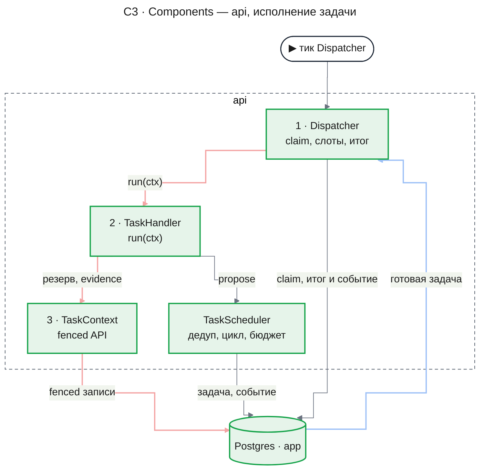
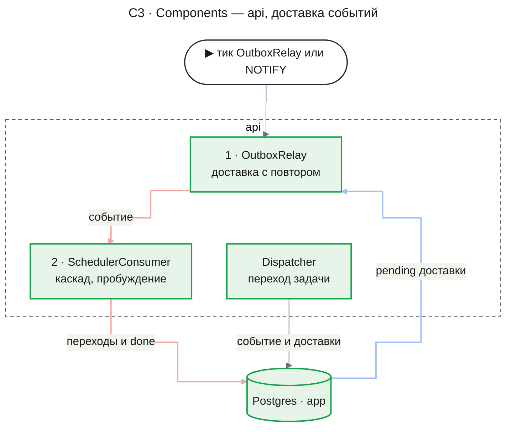
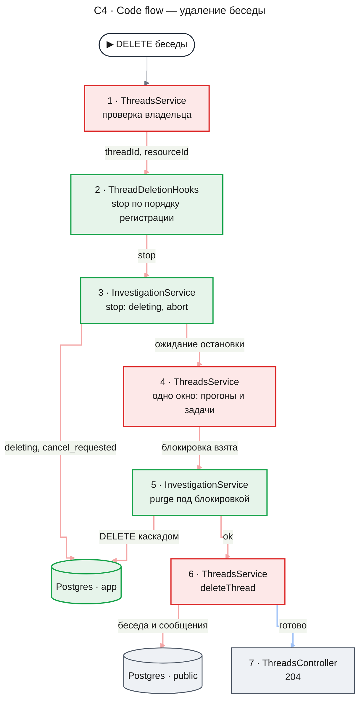
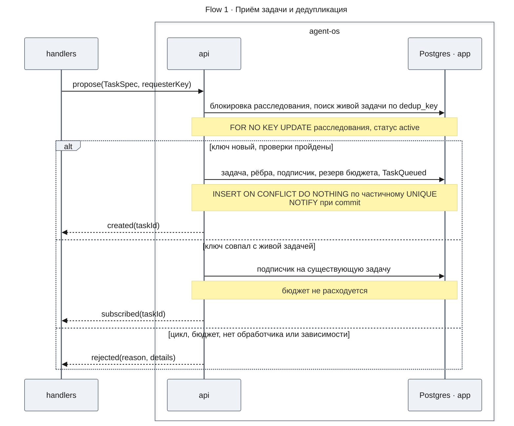
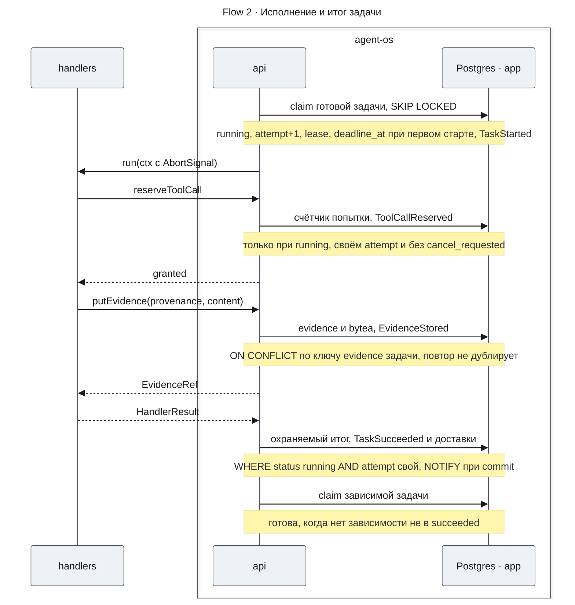
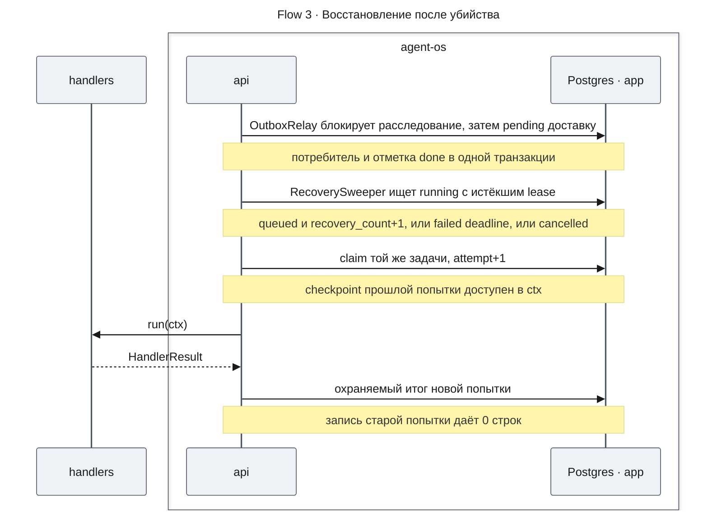
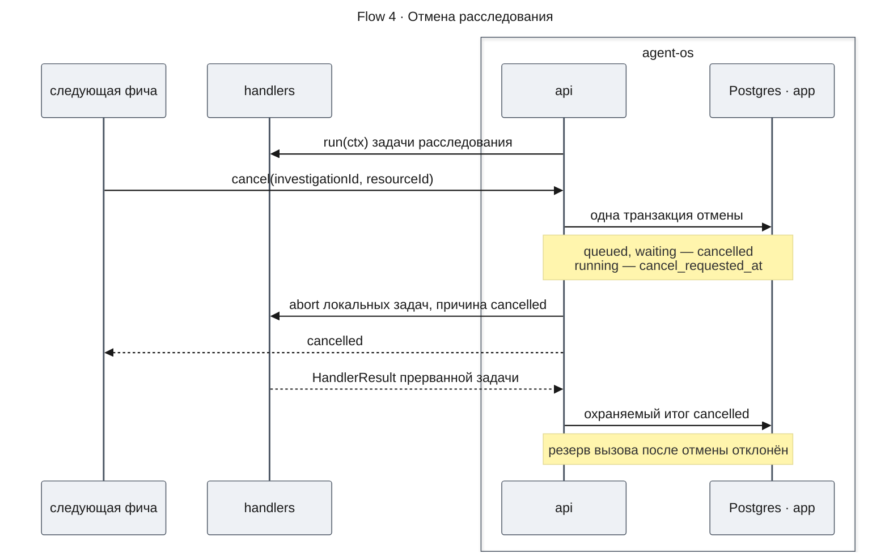
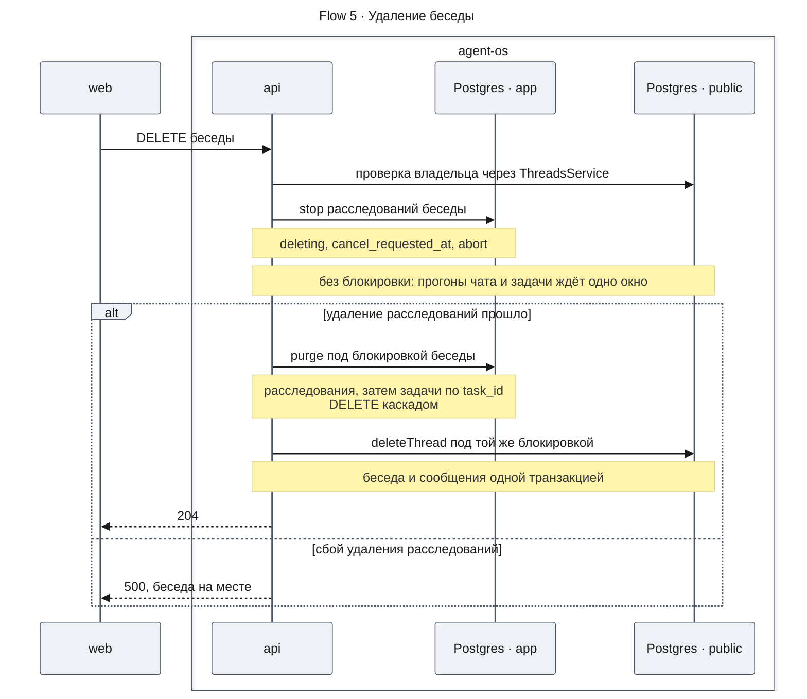
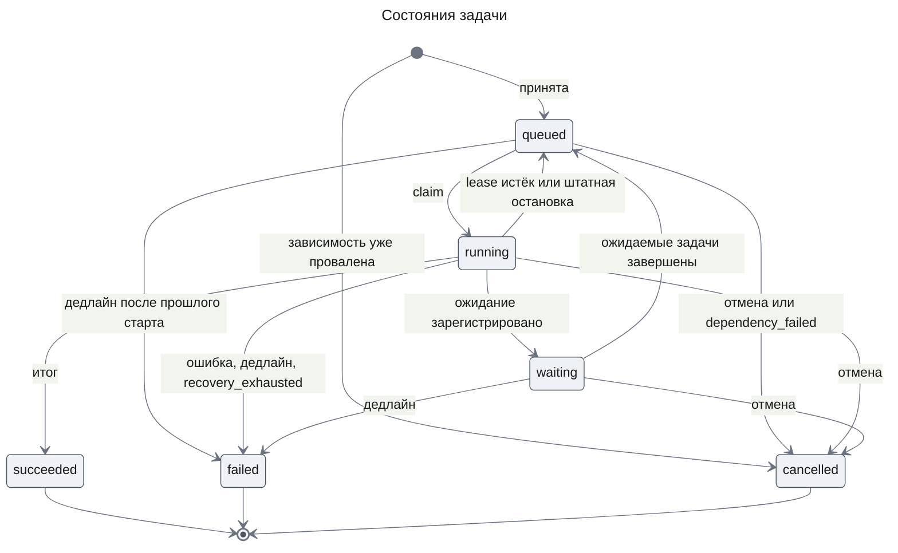

# Runtime исследований — Design Doc — runtime

**Status:** Approved · **Date:** 2026-10-31 · **PRD:** [prd.md](./prd.md) · **UXRD:** нет · **Depends on:** ничего

## Snapshot

**Обзор.** Фичам исследования нужен исполнитель задач, который переживает гибель процесса и не выполняет одну работу дважды. Эта часть добавляет собственный durable runtime на Postgres: он принимает задачу с проверкой контракта, дедупликацией, отказом от циклов и бюджетом, отдаёт её одному воркеру за раз и пишет итог вместе с событием одной транзакцией. После рестарта runtime подбирает брошенные задачи и доставляет недоставленные события, а запоздавшие записи старой попытки отклоняет. Код runtime и модель базы живут в двух пакетах без NestJS, которые `apps/api` собирает при старте; удаление беседы сначала останавливает и удаляет её расследования.

- **Не меняется**: таблицы `mastra_*` и `audit_events`, контракты чата и `main.ts`; Mastra не владеет ни задачами, ни событиями, ни восстановлением.
- **Главный риск**: собственная механика может ошибиться под конкуренцией или при убийстве процесса. Дедупликацию, отказ цикла и fencing подтвердил spike (Appendix: Evidence), а матрица убийств проверяется первой.
- **Открытые вопросы**: нет; одно допущение проверяет план (Appendix: Evidence, Code Inspection Evidence).
- **Изменено фичей `agent-quality`**: у расследования появились окончательные статусы `completed` и `failed`, у задачи — сроки ожидания в очереди и одной попытки рядом с общим сроком, а у `withAttemptGuard` — режим, который отказывает в остановленной или закрытой работе. Как это устроено — в [`design-lifecycle.md`](../agent-quality/design-lifecycle.md#key-decisions), KD-1–KD-3; подробнее — в отметках у KD-9, FR-19, `Investigation`, `withAttemptGuard`, Runtime Settings и State Transitions.

### Key Decisions

#### KD-1: Задачами, событиями и восстановлением владеет только собственный runtime на Postgres

Mastra работает лишь агентами внутри обработчиков, без workflows и без восстановления run (ADR-0001). Так состояние задачи и событие о нём пишутся одной транзакцией, а зависимостей, бюджета и дедупликации Mastra не даёт.

Отвергнуты evented workflows Mastra, потому что их шина событий живёт в памяти, и Temporal, потому что он вне scope фичи. pg-boss и graphile-worker отвергнуты: у них нет графа задач и бюджета.

#### KD-2: Таблицы runtime живут в схеме `app` с префиксом `research_`, а модель и миграции описаны на Drizzle в пакете `@agent-os/db`

Модель, миграции и запросы пишутся на Drizzle (ADR-0003), модель и миграции лежат в `@agent-os/db` (ADR-0004), журнал миграций — `app.__drizzle_migrations`. Старт приложения только проверяет миграции и не применяет их. Схема `app` отделена от таблиц `mastra_*` и примет таблицы `chat-storage`, а одна модель даёт и DDL, и типы.

Отвергнуты схема `public`, где лежат таблицы Mastra, и схема `research`, которая не примет чат. node-pg-migrate с сырым `pg`, Kysely и Prisma отвергнуты в ADR-0003.

#### KD-3: Приём, рёбра и бюджет сериализует блокировка строки расследования `FOR NO KEY UPDATE`, а записи попытки охраняет номер `attempt`

Частичный UNIQUE по `dedup_key` служит страховкой. Задачу захватывает `FOR UPDATE OF t SKIP LOCKED` с lease, строки доставок блокируются только после блокировки расследования, с повторной проверкой `status = pending`, а каждая запись попытки сверяет `attempt` как fencing token. Без блокировки расследования встречные рёбра проходят обе (spike A2), а `NO KEY UPDATE` не конфликтует с блокировкой `KEY SHARE`, которую берут вставки через FK.

Отвергнут `FOR UPDATE` расследования: под ним ждали бы резерв вызова и итог, и возникала бы взаимоблокировка с `purge`. Отвергнуты также advisory locks и уровень SERIALIZABLE с повторами.

#### KD-4: События доставляет transactional outbox, а гарантией доставки служит опрос

Событие и строки его доставок пишутся в транзакции перехода, и строка доставки служит отметкой inbox. Гарантия доставки — опрос не реже раза в секунду, а `LISTEN/NOTIFY` только подсказывает, что пора опросить. Так событие не теряется при убийстве процесса, а повторная доставка не даёт эффекта.

Отвергнуты шина Mastra, которая живёт в памяти, один `NOTIFY`, который теряется без слушателя, и отдельная таблица inbox.

#### KD-5: Удаление беседы идёт в две фазы: остановка расследований до ожидания прогонов и удаление под блокировкой беседы

Хуки `stop` вызываются до `cancelRunsThen` и ждут остановки задач в том же окне, что и прогоны чата, а `purge` выполняется под блокировкой беседы. Окно — `THREAD_RUN_SETTLE_TIMEOUT_MS` (`design-threads-api.md`, ThreadRunRegistry). Так ожидание DELETE не растёт, а блокировка не держится на ожидании.

`ThreadDeletionHooks` живёт в `apps/api`, и хук из `stopThread` и `purgeThread` регистрирует связывание `apps/api`, поэтому runtime о беседах не знает (ADR-0004).

Отвергнут FK на `mastra_threads`, потому что он ссылался бы на чужую таблицу, и очистка сирот, потому что она читала бы `mastra_*`. Ожидание под `ThreadWriteLock` отвергнуто: оно задерживало бы переименование беседы.

#### KD-6: Содержимое evidence хранится в `bytea` отдельно от метаданных

Таблица `research_evidence_contents` держит байты вместе с `sha256` и размером, а метаданные лежат отдельно. Spike подтвердил побайтный round-trip 10 MiB, а `jsonb` не хранит `\u0000`.

Отвергнуты `jsonb`, файлы на диске, запись которых идёт вне транзакции, и объектное хранилище, которое PRD относит к Won't Have.

#### KD-7: Пакеты собираются функциями без Nest, а тонкий `ResearchModule` привязывает их к фазам Nest

`createDatabase` отдаёт один `pg.Pool` с клиентом Drizzle, а `createRuntime` — сервисы runtime со `start` и `stop`. `ResearchModule` в `apps/api` запускает воркеры в `onApplicationBootstrap` по флагу `RUNTIME_WORKERS`, останавливает их в `beforeApplicationShutdown` и закрывает пул в `onApplicationShutdown`. Тесты пакета и дочерний процесс убийств собирают runtime теми же функциями без `AppModule`, а пул закрывается после воркеров по фазам Nest.

Отвергнуты пакеты в виде динамических модулей Nest (ADR-0004, вариант 3), старт из `main.ts` и отдельный пул в каждом сервисе.

Runtime уже реализован в `apps/api`, и перенос в пакеты меняет форму на границах. Вызывающие, найденные текстовым поиском по `apps` и `packages`, — это код runtime, его тесты, связывание в `apps/api` и скелеты тестов `mcp-source`, поэтому всё переносится одним коммитом без адаптеров:

- Порт обработчика (`TaskHandler` и `TaskContext` из `apps/api/src/research/handler.registry.ts`, тип `HandlerResult` из `@agent-os/contracts`) переходит в `@agent-os/runtime`; импорты переводятся на него, а `HandlerResultSchema` остаётся в contracts.
- `DatabaseModule` с провайдерами `PG_POOL`, `DRIZZLE` и `RUNTIME_CONFIG` заменяет `createDatabase`, и сервисы runtime получают клиент параметром `createRuntime`.
- `RuntimeLifecycle` заменяют `Runtime.start` и `Runtime.stop`, которые вызывает `ResearchModule`, с прежним порядком фаз.
- `RuntimeConfig` разбирается из объекта, который передаёт точка сборки, а не через `ConfigService` в `loadRuntimeConfig`; имена и значения по умолчанию переменных прежние ([Runtime Settings](#runtime-settings)).
- `InvestigationService.create` вызывает `ThreadsService.withOwnedThread` через порт `ThreadOwnership` вместо DI. Сигнатура `create` прежняя, и `apps/api` передаёт `ThreadsService` реализацией порта.

#### KD-8: Дочерний процесс матрицы убийств — это вход тестовой обвязки пакета runtime, собранный `tsc` пакета

Вход собирается отдельным тестовым проектом, вызывает `createDatabase` и `createRuntime` с тестовыми обработчиками и передаёт им настройки из своего окружения. Он служит точкой сборки теста: только он читает окружение, а код пакета получает настройки параметрами. Ребёнок исполняет тот же собранный `dist`, что и `apps/api`, а харнесс отказывается запускать сборку старше исходников.

Отвергнут `nest build` с `AppModule`, потому что Nest остаётся вне пакета. Запуск исходников через `tsx` или через снятие типов Node отвергнут: это новый загрузчик ради одного входа, а снятие типов не отображает спецификаторы `.js` на `.ts`.

#### KD-9: Клиентский пакет охраняет записи в свои таблицы через `TaskContext.withAttemptGuard`, не читая таблиц runtime

Обработчик может вести собственные таблицы, и писать в них должна только текущая попытка: иначе попытка-зомби после перехвата lease оставит там свои строки. `withAttemptGuard` проверяет попытку под той же блокировкой строки задачи, что и записи runtime, и выполняет запись клиента в той же транзакции. Таблицы расследований, задач, событий, доставок и evidence остаются за runtime (ADR-0001). Операция обратно совместима: прежние функции `TaskContext` и обработчики она не меняет. Её реализует план части `engine` фичи `deep-research` ([design-engine.md](../deep-research/design-engine.md)).

> **Изменено фичей `agent-quality`.** У `withAttemptGuard` появился необязательный режим `requireActive`: в нём охрана отвечает `stopping` и ничего не пишет, если у задачи стоит запрос отмены или расследование не `active`. Через этот режим резервирует вызов модели движок ([`design-lifecycle.md`](../agent-quality/design-lifecycle.md#key-decisions), KD-2).

Отвергнуто чтение `research_tasks` клиентом: оно открыло бы ему таблицы runtime и повторило бы охрану вне runtime. Хранение записей клиента как evidence через `putEvidence` отвергнуто, потому что evidence нельзя искать и обновлять как строки. Отдельная проверка попытки перед записью отвергнута: между проверкой и commit reaper успевает вернуть задачу.

## Terms

- **Durable runtime** — исполнитель задач, чьё состояние хранится в Postgres и переживает гибель процесса.
- **Claim** — захват готовой задачи воркером: задача переходит в `running`, получает следующий номер попытки и lease.
- **Lease** — срок, на который попытка владеет задачей; heartbeat продлевает его, а истёкший lease возвращает задачу в очередь.
- **Fencing token** — номер попытки `attempt`, который проверяет каждая запись; брошенная попытка с устаревшим номером ничего не меняет.
- **Reaper** — периодический обход (`RecoverySweeper`), который находит задачи с истёкшим lease или дедлайном.
- **Transactional outbox** — событие пишется той же транзакцией, что и изменение состояния, а доставляет его потом отдельный воркер.
- **Доставка** — строка о том, что событие должен обработать конкретный потребитель; её отметка `done` защищает от повторного эффекта, как inbox.
- **Ключ дедупликации** (`dedup_key`) — хеш содержания задачи; одинаковые предложения в одном расследовании получают одну задачу.
- **Evidence** — сохранённый выход задачи: provenance (источник, инструмент, аргументы, срез данных) и содержимое.
- **Checkpoint** — JSON, который попытка сохраняет, чтобы следующая попытка продолжила с того же места.
- **Точка сборки** — код, который читает окружение и вызывает функции сборки пакетов: `apps/api` или вход дочернего процесса тестов.
- **Spike** — одноразовый эксперимент против настоящего Postgres, который проверил механику до дизайна.

## Part

- **Часть**: `runtime`
- **Покрывает**: расследование, привязанное к беседе (FR-01), контракт задачи (FR-02), состояния исполнения и статусы знания (FR-03), запуск по готовым зависимостям (FR-04), бюджет (FR-05), общую задачу для одинакового запроса (FR-06), отказ от циклов (FR-07), доставку событий с восстановлением (FR-08), единый конверт событий (FR-09), хранилище и миграции (FR-10); из Should Have — параллельное исполнение (FR-18), дедлайн (FR-19), отмену (FR-20) и удаление беседы с расследованиями (FR-23).
- **Зависит от**: ничего, это первая часть.
- **Соседние части**: `mcp-source` (FR-11–FR-17, FR-21) потребляет порты из [Contract Definitions](#contract-definitions).

**Вне рамок части**

- Таблицы `mastra_*` не меняются (KD-5).
- `audit_events`, `AuditService` и его пул остаются как есть.
- HTTP API runtime, LLM и сценарии W1–W7 в эту фичу не входят (PRD, Won't Have).
- ToolExecutor, fixture MCP, allowlist и повторы транспорта относятся к части `mcp-source`.
- `main.ts` и `MastraLifecycle` не меняются (KD-7).
- `ThreadsController`, `ChatController`, `ThreadTitleService`, `ThreadRunRegistry`, `ThreadWriteLock` и `apps/web` не меняют поведения; `ThreadsController` остаётся единственным вызывающим `delete`, и сигнатура не меняется.
- Отложены объектное хранилище содержимого, FK `research_investigations.thread_id` на таблицу бесед `chat-storage` с каскадом вместо хука, отдельные процессы-воркеры, повторная отправка `needs_attention` оператором и пометка `stale` (FR-22, `evidence-graph`).

**Ограничения**

- Несколько экземпляров `apps/api` работают над одной базой одновременно (KD-3), а задачи исполняются внутри процесса `apps/api`.
- Чат обратно совместим: сквозные тесты `chat-shell` проходят без правок (AC-01.2, AC-23.4), а `DELETE /api/threads/:threadId` отвечает прежними кодами (сбой хука — существующий 500) и ждёт не дольше окна KD-5.
- Старт `apps/api` и e2e требуют применённых миграций.
- Старт зависимой задачи и время восстановления измеряет отдельный скрипт (PRD, Non-Functional Requirements).
- Дедлайн абсолютный и фиксируется при первом старте; дедлайн и отмена не считаются сбоем источника и не повторяются (FR-19, State Transitions and Invariants).
- Тесты с Postgres идут в отдельной задаче CI `e2e-runtime` с сервисом `postgres:16`: пакеты собираются по графу turbo, затем идут тесты пакетов db, runtime и sources ([`design-mcp-source.md`, Test Boundaries](./design-mcp-source.md#test-boundaries)), включая матрицу убийств и миграции, и тесты `apps/api` с удалением беседы и связыванием. Набор `chat-shell` и замер латентности в CI не входят, и первый проверяется при приёмке (PRD, метрика № 6).
- Новые пакеты следуют стандартам репозитория: TS strict и ESM с суффиксом `.js`, приватный пакет с одним входом и сборкой `tsc` в `dist` без `@nestjs/*`, oxlint без предупреждений, knip и сборка turbo по графу. Lint пакетов db и runtime запрещает `@mastra/*` (ADR-0004).

## Acceptance Criteria

Критерии PRD применяются как написаны, и ниже каждый назван в нескольких словах. Критерии уровня дизайна (AC-RT-n) уточняют поведение системы, которое PRD не описывает.

### FR-01: Расследование, привязанное к беседе

- Применяются как написаны: расследование возвращается только владельцу по паре «пользователь, беседа» (AC-01.1); сообщения и заголовок беседы не меняются, а тесты `chat-shell` проходят без правок (AC-01.2).

### FR-02: Контракт задачи

- Применяются как написаны: задача без ожидаемого результата, бюджета или среза входной ссылки отклоняется с указанием поля (AC-02.1); задача без зарегистрированного обработчика отклоняется (AC-02.2).

### FR-03: Состояния исполнения отдельно от статусов знания

- Применяются как написаны: задача в конечном состоянии не переходит в `running` (AC-03.1); переход в `waiting` без условия отклоняется (AC-03.2); evidence успешной fetch-задачи имеет статус `observed` (AC-03.3); evidence `supported` без области, основания или версии отклоняется (AC-03.4).

### FR-04: Запуск по готовым зависимостям

- Применяются как написаны: задача стартует только после `succeeded` своей зависимости и получает её выходы (AC-04.1); провал зависимости отменяет задачу с причиной, называющей зависимость (AC-04.2); зависимость из чужого расследования отклоняется (AC-04.3).
- Если при приёме задачи её зависимость уже `failed` или `cancelled`, задача создаётся сразу `cancelled` с классом `dependency_failed`; если при переходе в `waiting` все ожидаемые задачи уже завершены, задача сразу возвращается в `queued` (AC-RT-6).

### FR-05: Предложенная задача проходит проверку бюджета

- Применяются как написаны: задача сверх остатка вызовов отклоняется с причиной «бюджет» (AC-05.1); задача сверх лимита числа задач отклоняется, а прежние задачи исполняются (AC-05.2).

### FR-06: Общая задача для одинакового запроса

- Применяются как написаны: запрос с ключом исполняющейся задачи делает запросившего подписчиком, и источник вызывается один раз (AC-06.1); 10 одновременных одинаковых запросов дают одну задачу (AC-06.2); порядок ключей аргументов не меняет ключ (AC-06.3); другой срез (AC-06.4), другая версия обработчика (AC-06.5) или другая полнота результата (AC-06.6) дают новую задачу.

### FR-07: Отказ от циклов ожидания

- Применяются как написаны: встречное ожидание отклоняется с перечнем задач цикла (AC-07.1); зависимость, замыкающая цепочку, отклоняется (AC-07.2); зависимость от самой себя отклоняется (AC-07.3).

### FR-08: Доставка событий с восстановлением после рестарта

- Применяются как написаны: после убийства процесса каждое ожидавшее событие доставлено, а задачи дошли до тех же конечных состояний (AC-08.1); ни один эффект не применён дважды (AC-08.2); повторная доставка не меняет записей (AC-08.3); задача из `running` исполняется снова в пределах времени восстановления (AC-08.4).
- Если попытка, чей lease перехвачен (меньший `attempt` или задача уже не `running`), пишет итог, evidence, checkpoint, резерв вызова или запись клиента через `withAttemptGuard`, система отклоняет запись и не меняет ни одной строки (AC-RT-1).
- Если каждая попытка задачи прерывается истечением lease, обработчик вызывается не больше `RUNTIME_MAX_RECOVERIES + 1` раз, и следующее истечение lease записывает `failed` с классом `recovery_exhausted` (AC-RT-2).
- Пока два процесса с runtime работают над одной базой с одним обработчиком, каждая готовая задача исполняется одной попыткой за раз, и каждую доставку доводит до `done` один процесс; в production это экземпляры `apps/api` (AC-RT-4).
- Когда процесс завершается штатно, исполняющиеся задачи возвращаются в `queued` без роста `recovery_count`, а пул закрывается после остановки воркеров (AC-RT-5).
- Пакеты `@agent-os/db` и `@agent-os/runtime` не импортируют `@mastra/*`, а production-экземпляр Mastra соблюдает правило ADR-0001 (Decision): `listWorkflows()` пуст (скрытые служебные workflows Mastra не учитываются), в `recoveryConfig` `workflows` и `durableAgents` выключены (`off`), а `restartAllActiveWorkflowRuns` нигде в `apps/api/src` не вызывается (AC-RT-7).

### FR-09: Единый конверт событий

- Применяются как написаны: событие о большом результате несёт ссылку, а не содержимое (AC-09.1); событие неизвестной версии схемы помечается требующим внимания, а остальные доставляются (AC-09.2); порядок причин восстанавливается по `causationId` и `correlationId` (AC-09.3).

### FR-10: Хранилище и миграции

- Применяются как написаны: миграции создают схему, а повторное применение ничего не меняет (AC-10.1); беседы и сообщения Mastra читаются без изменений (AC-10.2).
- Когда `apps/api` стартует при неприменённых миграциях или без схемы `app`, система завершает старт ошибкой с именами миграций до приёма запросов (AC-RT-3).
- Домены CHECK статусов, классов и типов в схеме `app` совпадают со значениями enum в `packages/contracts` (AC-RT-8).

### FR-18: Параллельное исполнение независимых задач

- Применяется как написан: вторая независимая задача стартует, не дожидаясь первой (AC-18.1).

### FR-19: Дедлайн задачи

- Применяются как написаны: задача дольше дедлайна завершается `failed` с причиной «дедлайн», а независимые задачи — как обычно (AC-19.1); после подъёма процесса позже дедлайна задача `failed`, и источник больше не вызывается (AC-19.2); прерванная по дедлайну задача не повторяется (AC-19.3).
  > **Изменено фичей `agent-quality`.** Общий срок от первого захвата (`deadline_at`) остаётся, а рядом появились срок ожидания в очереди и срок одной попытки: готовая задача, которая ждёт дольше `RUNTIME_QUEUE_WAIT_MS`, завершается `failed` с кодом `queue_wait_exceeded`, а попытка дольше `RUNTIME_ATTEMPT_MS` прерывается и повторяется как потерянная. Как это устроено — в [`design-lifecycle.md`](../agent-quality/design-lifecycle.md#key-decisions), KD-3.

### FR-20: Отмена расследования

- Применяются как написаны: ожидающие задачи отменяются, а evidence завершённых остаётся (AC-20.1); после отмены источник не вызывается (AC-20.2); задача, успевшая завершиться до отмены, остаётся `succeeded` (AC-20.3).

### FR-23: Удаление беседы удаляет её расследования

- Применяются как написаны: после удаления беседы в хранилище не остаётся данных её расследований (AC-23.1); источник после удаления не вызывается, записи не появляются снова (AC-23.2); расследования других бесед и пользователей не меняются (AC-23.3); беседа без расследований удаляется как раньше (AC-23.4); при сбое удаления расследований беседа остаётся, а повтор удаляет всё (AC-23.5).

## Design

### Architecture (C1–C4)

#### C2 · Containers

- `web` вызывает удаление беседы и не меняется.
- `api` исполняет чат и беседы, а теперь и связанные в процессе пакеты db и runtime с воркерами.
- Postgres · `app` — новая схема с таблицами runtime и таблицей учёта миграций.
- Postgres · `public` хранит `mastra_*` и `audit_events`, и runtime их не трогает.

#### C3 · Components: api

Компоненты исполнения, доставки и восстановления живут в пакете `@agent-os/runtime` и исполняются в процессе `api`; `ThreadsService` и `ThreadDeletionHooks` — код `apps/api`.

**api — исполнение задачи (запись)**

**api — доставка событий**

- `Dispatcher` опрашивает базу и просыпается по `NOTIFY`, захватывает задачи в свободные слоты, держит `AbortSignal` и heartbeat попытки и пишет охраняемый итог.
- `TaskHandler` — порт обработчика; его реализации дают `mcp-source` и следующие фичи.
- `TaskContext` даёт обработчику fenced API: резерв вызова, `putEvidence`, checkpoint, ожидание и охрану записей клиента (`withAttemptGuard`).
- `TaskScheduler` проверяет `TaskSpec`, дедуплицирует, регистрирует рёбра с проверкой цикла, резервирует бюджет и подписывает запросившего.
- `TaskRepository`, `EvidenceStore` и `EventLog` выполняют запросы Drizzle к задачам, evidence и событиям в переданной транзакции.
- `OutboxRelay` доставляет события с повтором, backoff и парковкой, а `LISTEN` использует как подсказку.
- `SchedulerConsumer` каскадом отменяет задачи с `dependency_failed`, будит задачи в `waiting` и отмечает подписчиков.

**api — остановка: отмена, удаление беседы, восстановление**

- `ThreadsService` удаляет беседу в две фазы (KD-5).
- `ThreadDeletionHooks` — реестр хуков «до удаления беседы»; ошибка хука прерывает удаление.
- `InvestigationService` создаёт расследования, читает их по беседе, отменяет, а для хука удаления останавливает и очищает расследования беседы.
- `RunningTaskRegistry` держит `AbortController` задач, исполняющихся в процессе, и ждёт их завершения.
- `RecoverySweeper` обрабатывает истёкший lease, дедлайн задач в `queued` и `waiting` и исчерпание восстановлений.

#### C4 · Code flow: удаление беседы

Цепочка не показывает, что добавляет каждый модуль:

- `ThreadsService` удаляет беседу в две фазы (KD-5, [ThreadDeletionHook](#threaddeletionhook)) и получает `withOwnedThread(threadId, userId, fn)`: метод проверяет владельца и исполняет `fn` под блокировкой беседы, реализуя порт `ThreadOwnership`.
- `ThreadDeletionHooks` принимает `register(hook)` на старте модулей, вызывает `stopAll(ref, window)` и `purgeAll(ref)` по порядку регистрации и пробрасывает ошибку хука.
- `InvestigationService` создаёт расследование через порт `ThreadOwnership`, а `stopThread` и `purgeThread` служат хуком удаления.
- `createDatabase` из `@agent-os/db` создаёт один `pg.Pool` с клиентом Drizzle и закрывает пул (KD-7).
- `createRuntime` из `@agent-os/runtime` собирает сервисы runtime из клиента базы, настроек и портов и отдаёт `start` и `stop` воркеров (KD-7).
- `ResearchModule` в `apps/api` читает окружение, вызывает функции сборки, отдаёт провайдерами `InvestigationService`, `TaskScheduler`, `HandlerRegistry`, `EventConsumerRegistry` и `EvidenceReader`, привязывает фазы Nest и регистрирует хук удаления.
- `mastraProvider` выключает восстановление run (KD-1, AC-RT-7).

### Runtime Flows

#### Flow 1: приём задачи и дедупликация

**Когда начинается:** код обработчика или следующей фичи вызывает `TaskScheduler.propose`. Поток проверяет контракт задачи и её зависимости (AC-02.1, AC-02.2, AC-04.3, AC-RT-6), каскад от проваленной зависимости (AC-04.2), бюджет (AC-05.1, AC-05.2), дедупликацию (AC-06.1–AC-06.6) и отказ от циклов (AC-07.1–AC-07.3).

**Результат:** создана одна задача `queued` (или `cancelled` с `dependency_failed`, если зависимость уже провалена) с событием `TaskQueued`, либо добавлен подписчик, либо отказ без записей. Бюджет расследования уменьшается на одну задачу и на лимит вызовов задачи целиком.

**Обработка сбоев:**

- Ключ занят параллельной транзакцией → `ON CONFLICT DO NOTHING`, затем чтение существующей задачи и подписка (spike A1).
- Ребро замкнуло бы цикл → `rejected: wait_cycle` с перечнем задач цикла; транзакция откатывается, другие задачи не меняются.
- Расследование `cancelled` или `deleting` → `rejected: investigation_inactive`; ошибка базы — по [TaskScheduler.propose](#taskschedulerpropose).

#### Flow 2: исполнение, итог и старт зависимой задачи

**Когда начинается:** тик `Dispatcher` (не реже `RUNTIME_POLL_MS`) или `NOTIFY` при свободном слоте. Поток даёт охраняемые переходы (AC-03.1, AC-03.2), статус `observed` у evidence (AC-03.3), старт по готовым зависимостям и параллельное исполнение (AC-04.1, AC-18.1), однократный эффект (AC-08.2), конверт и цепочку причин (AC-09.1, AC-09.3), дедлайн (AC-19.1, AC-19.3) и fencing (AC-RT-1).

> **Why** — потоки 2 и 3 начинает таймер воркера в `api`, а не клиент.

**Результат:** задача `succeeded` с `output_refs` и `outcome`, вызовы и повторы попытки перенесены в счётчики задачи; событие и строки доставки записаны той же транзакцией. Зависимая задача стартует следующим claim и видит ссылки на выходы зависимости в `ctx.upstream`.

**Обработка сбоев:**

- Исключение обработчика, невалидный `HandlerResult` (в том числе `wait` без `waitFor`), итог отклонён охраной → по таблице [Error Handling](#error-handling).
- Сработал `AbortSignal` по дедлайну → `Dispatcher` сразу пишет `failed` с классом `deadline` и освобождает слот, не дожидаясь обработчика; его поздние записи, включая резерв вызова, отклоняет fencing.
- Сбой commit итога → три повтора с backoff; дальше lease истекает, и задача восстанавливается по Flow 3.

#### Flow 3: восстановление после убийства процесса

**Когда начинается:** `apps/api` поднят после гибели процесса посреди расследования. Поток даёт доставку и восстановление (AC-08.1–AC-08.4), событие, требующее внимания (AC-09.2), дедлайн после рестарта (AC-19.2), fencing и предел восстановлений (AC-RT-1, AC-RT-2).

**Результат:** каждое ожидавшее событие доставлено, брошенная задача исполнена новой попыткой и дошла до того же итога; evidence с тем же ключом не дублируется. Время до повторного старта — lease плюс период reaper плюс опрос, в пределах цели PRD (Reliability).

**Обработка сбоев:**

- Дедлайн истёк, восстановления исчерпаны (AC-RT-2) или стоит `cancel_requested_at` → reaper пишет итог без вызова обработчика (AC-19.2, [Error Handling](#error-handling)).
- Расследование удалено после чтения доставки → доставка пропускается, её строку удалил каскад `purge`.
- Доставка уже `done` → повтор ничего не меняет; неизвестная `schemaVersion` → сразу `needs_attention`; сбой потребителя → backoff, затем `needs_attention`; остальные доставки продолжаются.

#### Flow 4: отмена расследования

**Когда начинается:** код следующей фичи вызывает `InvestigationService.cancel`, пока задача расследования исполняется. Поток даёт отмену расследования (AC-20.1–AC-20.3).

**Результат:** ожидающие задачи `cancelled`, исполняющиеся — `cancelled` после остановки; задачи, успевшие записать `succeeded` до транзакции отмены, остаются `succeeded` с evidence. Резерв вызова отклоняется сразу после commit отмены.

**Обработка сбоев:**

- Обработчик не реагирует на abort → итог `cancelled` пишется без ожидания, поздние записи отклоняет fencing.
- Задача исполняется на другом экземпляре → heartbeat возвращает `cancel_requested_at`, тот экземпляр прерывает задачу; при его гибели reaper пишет `cancelled`.
- Повторная отмена → пустая операция.

#### Flow 5: удаление беседы с расследованиями

**Когда начинается:** пользователь удаляет беседу в `web` (`DELETE /api/threads/:threadId`). Поток удаляет расследования беседы (AC-23.1–AC-23.5).

**Результат:** в схеме `app` нет строк расследований беседы, `mastra_*` не содержит беседы; расследования других бесед и пользователей не изменены. Беседа без расследований проходит хук как пустую операцию; ожидание — в окне KD-5.

**Обработка сбоев:**

- Сбой `stop` или `purge` → по столбцу «При ошибке» таблицы [ThreadDeletionHook](#threaddeletionhook); расследования в `deleting` не исполняются, повтор удаляет и их, и беседу (AC-23.5).
- Локальная задача не завершилась до конца окна → удаление продолжается, в лог — предупреждение; новый вызов источника невозможен: резерв требует `cancel_requested_at IS NULL`, а после `purge` строки задачи нет.
- Расследование создано между `stop` и блокировкой → `purge` удаляет и его, локальные задачи прерываются без ожидания, их поздние записи отклоняет fencing.
- `purge` прерван взаимоблокировкой (40P01) — страховка сверх порядка блокировок → DELETE 500, повтор по AC-23.5.
- Прогон чата не завершился за окно → `cancelRunsThen` повторяет действие после его завершения; хуки идемпотентны.
- `deleteThread` упал после удаления расследований → 500, беседа на месте без расследований; повтор удаляет беседу.

### Contract Definitions

Порты — внутрипроцессные API пакета `@agent-os/runtime`; HTTP-поверхности нет. Порт обработчика (`TaskHandler`, `TaskContext`, `HandlerResult` как тип) объявлен в `@agent-os/runtime`. Данные, пересекающие хранилище и части, описаны схемами zod в `packages/contracts/src/research.ts`, включая `HandlerResultSchema`, `Coverage` и `FailureReason`. Хеш `dedup_key` (`node:crypto`) живёт в `@agent-os/runtime`, потому что `web` тоже собирает контракты.

| Операция | Вход | Выход | Ошибки |
|---|---|---|---|
| `InvestigationService.create` | `InvestigationSpec` | `Investigation` | ошибка порта `ThreadOwnership` пробрасывается (в `apps/api` — 404 беседы); ошибка на пустом `resourceId` |
| `InvestigationService.listForThread` | `resourceId`, `threadId` | `Investigation[]` владельца, у каждого `tasks`: `Task[]` (Task, модель чтения) (AC-01.1) | ошибка на пустом `resourceId` |
| `InvestigationService.cancel` | `investigationId`, `resourceId` | `void` | не найдено для владельца → `investigation_not_found` |
| `TaskScheduler.propose` | `TaskSpec`, `requesterKey` | `ProposeResult` | отказ — значение `ProposeResult`, не исключение |
| `HandlerRegistry.register` | `TaskHandler` | `void` | дубль типа и версии → ошибка старта |
| `TaskHandler.run` | `TaskContext` | `HandlerResult` | исключение → `failed`, класс `internal` |
| `TaskContext.reserveToolCall` | `toolName`, `retry` | `ToolCallGrant` | — |
| `TaskContext.putEvidence` | `EvidenceInput` | `EvidenceRef` | попытка не текущая или строки задачи нет (расследование удалено, ошибка FK) → `fenced`; содержимое больше лимита → `validation_rejected` |
| `TaskContext.saveCheckpoint` | JSON до 64 KiB | `void` | попытка не текущая → `fenced` |
| `TaskContext.registerWait` | `taskIds` | `ok` или `rejected: wait_cycle` с циклом | задачи нет в расследовании → `unknown_dependency` |
| `TaskContext.withAttemptGuard` | функция `work`, получающая транзакцию | `committed` с результатом `work` или `fenced` | попытка не текущая или строки задачи нет → значение `fenced`, ничего не записано; исключение `work` или сбой commit → откат, исключение пробрасывается; `work` дольше `RUNTIME_LEASE_MS` или вызов другой функции `TaskContext` внутри `work` → откат, исключение |
| `EvidenceReader.get` | `evidenceId`, `resourceId` | `EvidenceRecord` и байты | не найдено для владельца → `evidence_not_found` |
| `EventConsumerRegistry.register` | `EventConsumer` | `void` | дубль имени → ошибка старта |
| `ThreadDeletionHooks.register` | хук `ThreadDeletionHook` | `void` | — |

#### Функции сборки и порты

Пакеты не импортируют `@nestjs/*`: функции сборки получают настройки и порты параметрами, окружение читает только точка сборки (ADR-0004).

| Операция | Вход | Выход | Ошибки |
|---|---|---|---|
| `createDatabase` (`@agent-os/db`) | строка подключения, размер пула | клиент Drizzle над одним `pg.Pool`, `close()` | — |
| `assertNoPendingMigrations` (`@agent-os/db`) | клиент базы | `void` | нет схемы `app` или есть ожидающие файлы → исключение с их именами (AC-RT-3) |
| `applyMigrations` (`@agent-os/db`) | строка подключения | `void` | сбой → откат всего запуска, исключение |
| `createRuntime` (`@agent-os/runtime`) | клиент базы, `RuntimeConfig`, порты `ThreadOwnership`, `RuntimeLogger`, `Clock` | сервисы таблицы выше, `start()`, `stop()` | — |
| `Runtime.start` / `Runtime.stop` | — | `void` | `stop` возвращает исполняющиеся задачи в `queued` (AC-RT-5) |
| `ThreadOwnership.withOwnedThread` | `threadId`, `resourceId`, функция | результат функции под блокировкой беседы | беседа не принадлежит владельцу → ошибка реализации |

`RuntimeLogger` принимает уровни и поля из [Logging and Monitoring](#logging-and-monitoring); `apps/api` передаёт адаптер над `Logger` Nest. `Clock` — время, случайность и таймеры ([Test Boundaries](#test-boundaries)). `ResearchModule` вызывает `assertNoPendingMigrations` и регистрирует хук удаления в `onModuleInit`, `start` — в `onApplicationBootstrap` при `RUNTIME_WORKERS=on`, `stop` — в `beforeApplicationShutdown`, `close()` пула — в `onApplicationShutdown` (KD-7).

#### InvestigationSpec и Investigation

| Поле | Тип | Ограничение | Смысл |
|---|---|---|---|
| `resourceId` | string | 1..255, владелец беседы | пользователь, как `resource` в Mastra Memory |
| `threadId` | string | `ThreadIdSchema` | беседа без FK |
| `query` | string | 1..10 000 | исходный запрос |
| `budget.maxTasks` | int | 1..1 000 | лимит числа задач |
| `budget.maxToolCalls` | int | 1..10 000 | лимит вызовов инструментов |
| `investigationId`, `status`, `createdAt` | uuid, enum (`active`, `cancelled`, `deleting`), datetime | только в `Investigation` | идентичность и состояние |
| `tasks` | `Task[]` | только в ответе `listForThread` | задачи расследования |

> **Изменено фичей `agent-quality`.** У `status` появились окончательные значения `completed` и `failed`: их ставит новая операция `InvestigationService.closeInTx`, когда кончилась задача контроллера, и тем же действием отменяет незаконченные задачи ([`design-lifecycle.md`](../agent-quality/design-lifecycle.md#key-decisions), KD-1).

#### Task (модель чтения)

| Поле | Тип | Ограничение | Смысл |
|---|---|---|---|
| `taskId` | uuid | — | идентичность задачи |
| `workflowType`, `workflowVersion` | string, int | из `TaskSpec` | тип и версия обработчика |
| `status` | `TaskStatus` (`queued`, `running`, `waiting`, `succeeded`, `failed`, `cancelled`) | — | текущий статус |
| `dedupKey` | string | префикс `v1:` | ключ дедупликации |
| `outputRefs` | uuid[] (`evidenceId`) | пусто до `succeeded` | выходы задачи; запись и байты — через `EvidenceReader.get` |
| `outcome` | `answerOrDelta`, `missingEvidence`, `warnings` из `HandlerResult` или null | при `succeeded` | результат задачи |
| `coverage` | `Coverage` или null | при `succeeded` | охват результата |
| `failureReason` | `FailureReason` или null | при `failed` и `cancelled` | причина исхода |
| `attempt` | int | ≥ 0 | номер последней попытки |
| `toolCallsUsed`, `retriesUsed` | int, int | ≤ `maxToolCalls` и `maxRetries` из `TaskBudget` задачи | вызовы и повторы, списанные с задачи |
| `subscribers` | string[] | `requesterKey` подписчиков | кто ждёт результат задачи |

#### TaskSpec

| Поле | Тип | Ограничение | Смысл |
|---|---|---|---|
| `investigationId` | uuid | расследование `active` | владелец задачи |
| `workflowType` | string | 1..100, есть обработчик | тип workflow |
| `workflowVersion` | int | ≥ 1, есть обработчик | версия обработчика; входит в ключ |
| `input` | JSON object | до 16 KiB, схема обработчика | нормализуемые параметры |
| `inputRefs` | `InputRef[]` | у каждой есть `snapshot` | входные ссылки со срезом |
| `expectedOutput` | `ExpectedOutput` | обязателен | ожидаемый результат до старта |
| `dependsOn` | uuid[] | задачи того же расследования | запуск после их `succeeded` |
| `budget` | `TaskBudget` | обязателен | лимиты задачи |

`InputRef`: `kind` (string), `ref` (string, 1..500), `snapshot` (string, 1..200). `ExpectedOutput`: `description` (1..2 000), `completeness` (`all`, `sample`). `TaskBudget`: `maxToolCalls` (≥ 1), `maxRetries` (≥ 0), `deadlineMs` (1 000..3 600 000), `maxTokens` (≥ 0; расходует `deep-research`).

Второй аргумент `propose`:

| Поле | Тип | Ограничение | Смысл |
|---|---|---|---|
| `requesterKey` | string | 1..200; выбирает вызывающий; уникален для запрашивающей стороны в расследовании | кто запросил задачу; хранится как `subscriber_key` |

`dedup_key` = `v1:` и hex sha256 канонического JSON из `workflowType`, `workflowVersion`, `input`, `expectedOutput` и `inputRefs`, упорядоченных по `kind` и `ref`. Канонизация сортирует ключи объектов рекурсивно и сохраняет порядок массивов (AC-06.3); смена правила меняет префикс версии. Дедупликация действует только внутри расследования.

#### ProposeResult

| Поле | Тип | Ограничение | Смысл |
|---|---|---|---|
| `outcome` | enum (`created`, `subscribed`, `rejected`) | — | что произошло |
| `taskId`, `status` | uuid, `TaskStatus` | при `created` и `subscribed` | задача, на которую подписан запросивший |
| `reason` | enum (`invalid_spec`, `unknown_workflow`, `unknown_dependency`, `self_dependency`, `wait_cycle`, `budget_exhausted`, `investigation_inactive`) | при `rejected` | причина отказа |
| `details` | object | при `rejected` | путь поля, задачи цикла или исчерпанный лимит (`tasks`, `tool_calls`) |

Подписчик читает общий результат по `taskId` через `listForThread`. `notified_event_id` — учёт runtime, а не обратный вызов. Бюджет отменённых задач в расследование не возвращается.

#### TaskHandler и TaskContext

`TaskHandler`: `workflowType`, `workflowVersion`, `inputSchema` (zod-схема `input`, проверяется при приёме), `run(ctx)`.

| Поле `TaskContext` | Тип | Смысл |
|---|---|---|
| `taskId`, `investigationId`, `attempt` | uuid, uuid, int | идентичность попытки; `attempt` — fencing token |
| `input`, `inputRefs`, `expectedOutput`, `budget` | из `TaskSpec` | контракт задачи |
| `upstream` | список `{taskId, kind, status, outputRefs}` | зависимости и ожидаемые задачи с их выходами |
| `checkpoint` | JSON или null | последний сохранённый checkpoint |
| `signal` | AbortSignal | причина в `signal.reason`: `{kind}` из `cancelled`, `deadline`, `shutdown`, `lease_lost` |
| `deadlineAt` | datetime | абсолютный дедлайн |
| `reserveToolCall`, `putEvidence`, `saveCheckpoint`, `registerWait`, `withAttemptGuard` | функции | fenced API, см. таблицу операций |

`ToolCallGrant`: `granted` (bool), `callIndex` (int, при выдаче), `reason` (`tool_calls_exhausted`, `retries_exhausted`, `not_current_attempt`, `cancel_requested`) при отказе.

Правило резерва — одно условие в охраняемом UPDATE: задача `running` со своим `attempt` и без `cancel_requested_at`, `tool_calls_used + attempt_tool_calls < max_tool_calls`, а при `retry: true` ещё и `retries_used + attempt_retries < max_retries`. Выдача увеличивает `attempt_tool_calls` на 1, при `retry: true` — и `attempt_retries`.

- Собственная охраняемая запись попытки, которая её завершает (итог, переход в `waiting`, штатный возврат в `queued`), переносит `attempt_tool_calls` в `tool_calls_used` и `attempt_retries` в `retries_used`.
- Claim обнуляет `attempt_tool_calls` и `attempt_retries`. Лимит вызовов и лимит повторов действуют на задачу по всем попыткам: возобновление `waiting → queued` не даёт новых вызовов и повторов.
- Попытка, потерянная по lease, ничего не переносит: reaper возвращает задачу в `queued`, и следующий claim обнуляет её счётчики: вызовы и повторы такой попытки не списываются, и следующая попытка расходует лимиты заново (AC-RT-2).

`withAttemptGuard(work)` охраняет записи пакета-клиента в его собственные таблицы (KD-9). Это транзакция одной задачи, как `saveCheckpoint` (инвариант 13): расследование она не блокирует. Первым шагом runtime проверяет под блокировкой строки задачи, что задача `running` и попытка текущая. До commit ни claim, ни reaper, ни итог не меняют задачу, а reaper ждёт commit. Проверка прошла — runtime вызывает `work` с транзакцией Drizzle над `Database` из `@agent-os/db`, затем делает commit и возвращает `committed` с результатом `work`. Проверка не прошла — откат, предупреждение `fenced` в `RuntimeLogger` и значение `fenced`.

- Внутри `work` клиент пишет только свои таблицы через переданную транзакцию. Он не обращается к модели или внешней системе (инвариант 14) и не блокирует расследование (инвариант 9).
- Вызов другой функции `TaskContext` внутри `work` runtime отклоняет исключением сразу: её транзакция ждала бы ту же строку задачи.
- Транзакция ограничена `RUNTIME_LEASE_MS`. Если `work` не завершился в срок, база прерывает транзакцию, runtime откатывает её и бросает исключение, поэтому reaper и `purge` ждут не дольше lease.
- Таблицы клиента ссылаются по FK только на своё расследование или свою задачу, и `purge` удаляет их строки каскадом.
- `cancel_requested_at` охрану не меняет, как и у `putEvidence`.
  > **Изменено фичей `agent-quality`.** Это правило теперь действует только в обычном режиме: в режиме `requireActive` выставленный `cancel_requested_at` или неактивное расследование дают отказ `stopping`. Подробнее — в отметке у KD-9.
- Отказ `withAttemptGuard` — значение, как отказ `propose` и резерва. `putEvidence`, `saveCheckpoint` и `registerWait` сообщают `fenced` исключением `AttemptFencedError` с полем `reason: 'fenced'`, которое распознаёт `mcp-source`. Оба сигнала значат одно: попытка не текущая, и ничего не записано.
- Первый потребитель — движок `deep-research`: так он пишет `research_decisions`, `research_claims` и `research_llm_calls` ([design-engine.md](../deep-research/design-engine.md)).

#### HandlerResult

| Поле | Тип | Ограничение | Смысл |
|---|---|---|---|
| `kind` | enum (`completed`, `failed`, `wait`) | — | итог попытки |
| `answerOrDelta` | JSON или null | до 64 KiB | ответ или изменение (спецификация, раздел 4) |
| `evidenceRefs` | uuid[] | evidence этой задачи | становятся `output_refs` |
| `coverage` | `Coverage` или null | — | охват результата |
| `missingEvidence`, `warnings` | string[] | по 500 символов | пробелы и предупреждения |
| `proposedTasks` | `TaskSpec[]` | проходят приём в транзакции итога | предложенные задачи |
| `failure` | `FailureReason` | при `failed` | причина |
| `waitFor` | uuid[] | при `wait`, рёбра уже зарегистрированы | условие пробуждения |

#### Coverage

| Поле | Тип | Ограничение | Смысл |
|---|---|---|---|
| `completeness` | enum (`complete`, `partial`) | правило `complete` — у `mcp-source`; runtime проверяет схему | исчерпан ли запрошенный охват |
| `totalMatched` | int или null | null — неизвестно | всего совпадений или нижняя граница |
| `totalRelation` | enum (`eq`, `gte`) или null | обязателен при `totalMatched`, иначе null | точное число или нижняя граница |
| `returned` | int | ≥ 0; ≤ `totalMatched` при `eq` | получено |
| `truncated` | bool | `true` ⇒ `completeness = partial` | результат усечён |
| `continuation` | string или null | до 4 KiB, непрозрачна | продолжение пагинации; формат задаёт `mcp-source` |

#### FailureReason

| Поле | Тип | Ограничение | Смысл |
|---|---|---|---|
| `class` | enum (`transport_protocol`, `tool_error`, `deadline`, `cancelled`, `dependency_failed`, `budget_exhausted`, `recovery_exhausted`, `snapshot_changed`, `allowlist_rejected`, `validation_rejected`, `internal`) | дискриминатор | класс исхода |
| `code` | string | 1..100, машинный | уточнение, например `config_or_protocol_mismatch` |
| `message` | string | до 2 000 символов | текст для человека |
| `cause` | string или null | до 500 | исходная ошибка |
| `attempt`, `toolCalls`, `retries` | int | ≥ 0 | счётчики попытки |
| `dependencyTaskId`, `rootCauseTaskId` | uuid | при `dependency_failed` | прямая и корневая причина каскада |

Только runtime выставляет `dependency_failed` и `recovery_exhausted`. Runtime пишет `deadline` по таймеру дедлайна и при рестарте после дедлайна, `cancelled` — для итога при выставленном `cancel_requested_at`. `budget_exhausted` и `validation_rejected` приходят только от обработчика через `HandlerResult.failure`; обработчик может вернуть и `cancelled` (отражая `signal.reason`) или `deadline`.

Сбои источника выставляет `mcp-source`: классы `transport_protocol`, `tool_error`, `snapshot_changed` и `allowlist_rejected` с их кодами. Класс `transport_protocol` возвращает и обработчик, который сам вызывает внешний сервис, например API модели. При сбое сервиса такой обработчик ставит свой код: движок `deep-research` пишет `model_unavailable` ([design-engine.md](../deep-research/design-engine.md)).

Обработчик не возвращает `internal`: его пишет runtime при исключении обработчика или невалидном результате. Остановленную попытку обработчик может завершить исключением: при `fenced` и `not_current_attempt` запись отклоняет охрана, при `signal.reason` `shutdown` Dispatcher возвращает задачу в queued (или пишет cancelled, если выставлен cancel_requested_at), при `lease_lost` итог не пишет.

#### EventEnvelope

| Поле | Тип | Ограничение | Смысл |
|---|---|---|---|
| `eventId` | uuid | генерируется приложением | идентичность и ключ inbox |
| `type` | enum типов ниже | — | тип события |
| `schemaVersion` | int | ≥ 1 | версия схемы payload |
| `investigationId`, `taskId` | uuid, uuid или null | — | область |
| `causationId` | uuid или null | событие-причина | цепочка причин |
| `correlationId` | uuid | `eventId` события `InvestigationCreated` | группа расследования |
| `stateRevision` | int | `state_version` задачи или `revision` расследования | сравнение свежести |
| `payloadRef` | string или null | `evidence:<id>` или `task-outcome:<id>` | большое содержимое по ссылке |
| `payload` | JSON | до 8 KiB | малое содержимое |
| `createdAt` | datetime | — | время записи |

Типы runtime, `schemaVersion` 1: `InvestigationCreated`, `InvestigationCancelled`, `TaskQueued` (причина: `admitted`, `woken`, `recovered`, `released`), `TaskStarted`, `TaskWaiting`, `ToolCallReserved`, `EvidenceStored`, `TaskSucceeded`, `TaskFailed`, `TaskCancelled`. Причинная цепочка: `TaskStarted` ← последнее `TaskSucceeded` зависимостей или `TaskQueued`; `ToolCallReserved` ← `TaskStarted`; `EvidenceStored` ← последний `ToolCallReserved`; итог ← последнее `EvidenceStored` или `TaskStarted`. Глобального порядка событий нет: потребители сравнивают `stateRevision`.

`EventConsumer`: `name`, `eventTypes`, `schemaVersions`, `handle(tx, event)` — только переходы в базе внутри переданной транзакции. Runtime регистрирует потребителя `runtime.scheduler` на `TaskSucceeded`, `TaskFailed` и `TaskCancelled`.

#### EvidenceInput и EvidenceRecord

| Поле | Тип | Ограничение | Смысл |
|---|---|---|---|
| `evidenceKey` | string | 1..200, уникален в задаче | естественный ключ, например номер страницы |
| `provenance.sourceId`, `provenance.toolName` | string | 1..200 | источник и инструмент |
| `provenance.normalizedArgs` | JSON | до 16 KiB | нормализованные аргументы |
| `provenance.snapshot` | string | 1..200 | срез данных или верхняя граница времени |
| `coverage` | `Coverage` | — | охват этой порции |
| `content.mediaType`, `content.bytes` | string, bytes | до 16 MiB | содержимое выхода |
| `evidenceId`, `taskId`, `writtenByAttempt`, `sha256`, `byteSize`, `createdAt` | — | только в `EvidenceRecord` | идентичность и целостность |
| `knowledgeStatus` | enum (`observed`, `candidate`, `supported`, `refuted`, `unknown`, `stale`) | `putEvidence` пишет `observed` | статус знания |
| `scope`, `basis`, `evidenceVersion` | string, string, int | обязательны при `supported` | область, основание и версия (AC-03.4) |

`EvidenceRef`: `evidenceId`, `sha256`, `byteSize`. Повторный `putEvidence` с тем же `evidenceKey` возвращает существующий ref; другой `sha256` — ошибка `internal` (provenance неизменяем).

#### ThreadDeletionHook

`ref` — `threadId` и `resourceId` беседы после проверки владельца. Оба метода идемпотентны (Flow 5).

| Метод | Когда вызывается | Что делает | Возвращает | При ошибке |
|---|---|---|---|---|
| `stop(ref, window)` | до `cancelRunsThen`, без блокировки беседы | одна транзакция, как отмена: расследования беседы FOR NO KEY UPDATE → `deleting`, у задач `cancel_requested_at`; затем abort локальных задач | сразу после commit и abort — `settled` | исключение → DELETE 500 до отмены прогонов чата, ничего не изменено |
| `purge(ref)` | в действии `cancelRunsThen` под `ThreadWriteLock`, до `deleteThread` | одна транзакция: расследования беседы FOR NO KEY UPDATE, их задачи FOR UPDATE, DELETE расследований каскадом; abort локальных задач без ожидания | `void` | исключение, включая 40P01 → беседа не удаляется, DELETE 500 (AC-23.5) |

`settled` — промис, который разрешается, когда локальные задачи остановлены или истёк `window`, и никогда не отклоняется. `window` — сигнал таймаута на окно KD-5, который `ThreadsService.delete` взводит перед `cancelRunsThen`. `stopAll` собирает `settled` всех хуков, и действие `cancelRunsThen` ждёт их все до `lock.run`.

#### TaskScheduler.propose

Вызывающий передаёт `TaskSpec` и `requesterKey` и получает `ProposeResult`. Расследование должно существовать, а `resourceId` вызывающего уже проверен при создании расследования. Приём проверяет вход по `TaskSpecSchema`, затем по `inputSchema` обработчика, затем рёбра и бюджет под блокировкой расследования.

- При `created` задача, рёбра, подписчик, резерв бюджета и `TaskQueued` записаны вместе; при `subscribed` записан только подписчик.
- Отказ возвращается значением `rejected`, а ошибка базы — исключением без частичных записей.
- Дедупликацию и ацикличность держат инварианты из State Transitions and Invariants, а резервы — CHECK из Data Model.

#### Dispatcher: итог попытки

На вход приходит `HandlerResult` или причина срабатывания `AbortSignal`. Попытка получена claim, и транзакция не держалась во время `run`. Результат проверяется по `HandlerResultSchema`, и невалидный результат даёт `failed` с классом `internal`. На выходе — строка задачи в конечном статусе или в `waiting`, событие и доставки.

- Запись проходит только при `status = running` и своём `attempt`, и итог пишется не больше одного раза на задачу.
- Выставленный `cancel_requested_at` превращает итог в `cancelled`, а `failed` с классом `cancelled` пишется статусом `cancelled`.
- Запись, завершающая попытку, переносит её счётчики по правилу резерва ([TaskHandler и TaskContext](#taskhandler-и-taskcontext)).
- `signal.reason` `shutdown` даёт штатный возврат в `queued`, а при выставленном `cancel_requested_at` — итог `cancelled`; `lease_lost` не пишет ничего. Оба правила действуют независимо от `HandlerResult` или исключения.
- `signal.reason` `deadline` даёт итог `failed` с классом `deadline` независимо от `HandlerResult` или исключения.
- Если охрана вернула 0 строк, результат отбрасывается; сбой commit повторяется, а затем задачу восстанавливает lease.
- Порядок блокировок задают инварианты из State Transitions and Invariants.

#### Error Handling

| Ситуация | Обработка | Что видит вызывающий |
|---|---|---|
| Невалидный `TaskSpec`, нет обработчика, цикл, бюджет | отказ при приёме, транзакция откатывается | `ProposeResult.rejected` с причиной |
| Исключение обработчика или невалидный `HandlerResult` | `failed`, класс `internal`, сообщение обрезано | `TaskFailed` |
| Дедлайн | `failed`, класс `deadline`; повтора нет | `TaskFailed` |
| Отмена | `cancelled`, класс `cancelled`; повтора нет | `TaskCancelled` |
| Зависимость провалена | каскадом `cancelled`, класс `dependency_failed` с прямой и корневой причиной | `TaskCancelled` на каждую задачу каскада |
| Lease истёк | requeue; при исчерпании восстановлений — `recovery_exhausted` (AC-RT-2) | `TaskQueued (recovered)` или `TaskFailed` |
| Heartbeat вернул 0 строк или не удаётся вплоть до `lease_expires_at` | abort с причиной `lease_lost`, слот освобождён | ничего; задачу вернёт reaper |
| База недоступна в цикле воркера (dispatcher, relay, reaper, heartbeat) | ошибка в лог, backoff с удвоением от `RUNTIME_POLL_MS` до 16 × `RUNTIME_POLL_MS`; состояние не меняется | ничего |
| Запись брошенной попытки | отклонена охраной, предупреждение `fenced` | исключение `AttemptFencedError`; у `withAttemptGuard` — значение `fenced` |
| `work` в `withAttemptGuard` не завершился за `RUNTIME_LEASE_MS` или вызвал другую функцию `TaskContext` | откат, предупреждение | исключение |
| Сбой потребителя события | откат к savepoint, `attempts`, `next_attempt_at`, `last_error` — той же транзакцией; после лимита `needs_attention` | строка доставки с `last_error` |
| Неизвестная `schemaVersion` | сразу `needs_attention`, без вызова потребителя | строка доставки |
| Пустой `resourceId` | исключение (дефект сервера), как `assertUserId` | 500 |

Runtime не повторяет задачу сам: повторная попытка возникает только при восстановлении. Повтор временного сбоя источника — внутри попытки, через `reserveToolCall(retry)` по правилам `mcp-source`.

#### Logging and Monitoring

- Порт `RuntimeLogger` (в `apps/api` — адаптер над `Logger` Nest) с полями `investigationId`, `taskId`, `attempt`, `eventId`, `consumer`; уровни: `warn` — `fenced`, восстановление, таймаут остановки; `error` — `needs_attention`, исключение обработчика, сбой commit итога.
- В лог не попадают `input`, содержимое evidence и аргументы; только идентификаторы, размеры и классы.
- Наблюдаемость прототипа — SQL по таблицам: задачи по статусам, доставки `needs_attention`, задачи с `recovery_count > 0`.

#### Runtime Settings

Переменные — в `apps/api/.env.example`. Разбор в `RuntimeConfig` — схема zod пакета runtime над объектом переменных, который передаёт точка сборки: `apps/api` или вход дочернего процесса (KD-8).

| Переменная | По умолчанию | Смысл |
|---|---|---|
| `RUNTIME_WORKERS` | `on` | `off` — без воркеров (e2e чата) |
| `RUNTIME_CONCURRENCY` | 4 | слоты исполнения в процессе |
| `RUNTIME_POLL_MS` | 500 | опрос claim и доставок (гарантия ≤ 1 с) |
| `RUNTIME_NOTIFY` | `on` | `off` — только опрос |
| `RUNTIME_LEASE_MS` / `RUNTIME_HEARTBEAT_MS` / `RUNTIME_REAPER_MS` | 30 000 / 10 000 / 5 000 | lease, heartbeat, период reaper |
| `RUNTIME_MAX_RECOVERIES` | 3 | восстановлений до `recovery_exhausted` |
| `RUNTIME_DELIVERY_MAX_ATTEMPTS` | 5 | до `needs_attention`; backoff 1 с, удвоение до 60 с, jitter |
| `RUNTIME_SHUTDOWN_GRACE_MS` | 5 000 | ожидание задач при штатной остановке |
| `DB_POOL_MAX` | 10 | размер пула `createDatabase`; та же настройка задаёт размер пула замков беседы ([`design-lifecycle.md`](../agent-quality/design-lifecycle.md), KD-5) |
| `RUNTIME_CRASH_AT` | не задан | `<точка>[:n]` — `process.exit(137)` на n-м проходе; не при `NODE_ENV=production` |

Точки `RUNTIME_CRASH_AT`: `admission.after-commit`, `dispatch.after-claim`, `handler.after-evidence`, `dispatch.before-terminal`, `dispatch.after-terminal` (события записаны, но не доставлены), `relay.before-done` (внутри транзакции доставки), `relay.after-done`, `reaper.after-requeue`, `cancel.after-commit`.

> **Изменено фичей `agent-quality`.** К настройкам добавились `RUNTIME_QUEUE_WAIT_MS` (по умолчанию 600 000) — предел ожидания готовой задачи в очереди — и `RUNTIME_ATTEMPT_MS` (по умолчанию 900 000) — предел одной попытки ([`design-lifecycle.md`](../agent-quality/design-lifecycle.md#contract-definitions), Contract Definitions). Подробнее — в отметке у FR-19.

### Data Model

Схема `app` описана в модуле `packages/db/src/schema.ts` через `pgSchema('app')`; домены CHECK строятся там из enum контрактов (AC-RT-8). Каскад удаления идёт от `research_investigations`; каждый FK — `ON DELETE CASCADE`, его цель указана в столбце ограничений. Статусы и классы — `text` с CHECK, не ENUM.

| Таблица | Столбцы (группы) | Ограничения и индексы |
|---|---|---|
| `research_investigations` | `investigation_id`, `resource_id`, `thread_id` (text, без FK), `query`, `status`, `max_tasks`, `tasks_reserved`, `max_tool_calls`, `tool_calls_reserved`, `revision`, `created_at`, `updated_at` | CHECK резерв ≤ лимита и `resource_id <> ''`; индекс (`resource_id`, `thread_id`) |
| `research_tasks` | контракт: `workflow_type`, `workflow_version`, `input`, `input_refs`, `expected_output`, `dedup_key`; исполнение: `status`, `wait_condition`, `state_version`, `attempt`, `lease_owner`, `lease_expires_at`, `recovery_count`, `deadline_at`, `started_at`, `finished_at`, `cancel_requested_at`; бюджет: `max_tool_calls`, `max_retries`, `deadline_ms`, `max_tokens`, `tool_calls_used`, `retries_used`, `attempt_tool_calls`, `attempt_retries`; итог: `outcome`, `failure_reason`, `output_refs`, `checkpoint` | FK `investigation_id` → `research_investigations`; UNIQUE (`investigation_id`, `task_id`); частичный UNIQUE (`investigation_id`, `dedup_key`) для живых статусов; CHECK `waiting` ⇔ `wait_condition` (AC-03.2); CHECK счётчиков ≤ лимитов; CHECK `dedup_key LIKE 'v1:%'`; частичные индексы `queued`, (`lease_expires_at`) для `running`, (`deadline_at`) для незавершённых |
| `research_task_dependencies` | `investigation_id`, `task_id`, `depends_on_task_id`, `kind` (`depends_on`, `waits_for`) | PK (`task_id`, `depends_on_task_id`, `kind`); составные FK (`investigation_id`, `task_id`) и (`investigation_id`, `depends_on_task_id`) → `research_tasks`; CHECK без петли; индекс по цели |
| `research_task_subscribers` | `task_id`, `subscriber_key`, `subscribed_at`, `notified_event_id` | FK `task_id` → `research_tasks`; PK (`task_id`, `subscriber_key`) |
| `research_events` | `event_id`, `seq` (identity, только порядок), поля `EventEnvelope` | FK `investigation_id` → `research_investigations`, `task_id` без FK; PK `event_id`; CHECK размера `payload`; индексы (`correlation_id`, `seq`), (`causation_id`), (`task_id`, `seq`) |
| `research_event_deliveries` | `event_id`, `consumer`, `status` (`pending`, `done`, `needs_attention`), `attempts`, `next_attempt_at`, `last_error` | FK `event_id` → `research_events`; PK (`event_id`, `consumer`); частичный индекс (`next_attempt_at`) для `pending` |
| `research_evidence` | `evidence_id`, `investigation_id`, `task_id`, `evidence_key`, `written_by_attempt`, `knowledge_status`, `scope`, `basis`, `evidence_version`, `provenance`, `coverage`, `created_at` | составной FK (`investigation_id`, `task_id`) → `research_tasks`; UNIQUE (`task_id`, `evidence_key`); CHECK `supported` ⇒ `scope`, `basis`, `evidence_version` (AC-03.4); триггер запрещает менять provenance |
| `research_evidence_contents` | `evidence_id`, `media_type`, `bytes` (bytea), `sha256`, `byte_size` | FK `evidence_id` → `research_evidence`; CHECK `byte_size = octet_length(bytes)` и ≤ 16 MiB |

Готовность задачи — запрос: `queued`, расследование `active`, тип и версия есть в локальном реестре, нет ребра `depends_on` к задаче не в `succeeded`.

Запросы — drizzle-orm в переданной транзакции; где построителя не хватает — фрагмент `sql` (ADR-0003).

#### Migration Strategy

- Данные не переносятся; `public` не трогается: `schemaFilter: ['app']`, исполняются только файлы `packages/db/migrations/` (AC-10.2).
- `db:generate` (`drizzle-kit generate` в пакете db) пишет SQL и снимки `meta/`; SQL ревьюится в PR. `drizzle.config.ts` (вне `src`, проверяет `typecheck`) задаёт модель, `out` и журнал.
- Триггер provenance — custom-миграция (`generate --custom`). В первой миграции `CREATE SCHEMA "app"` — с `IF NOT EXISTS`: схему журнала мигратор создаёт раньше (spike).
- Применяет одна функция `applyMigrations` пакета db: свой `pg.Client`, `pg_advisory_lock`, `migrate()` из `drizzle-orm/node-postgres/migrator` — все файлы одной транзакцией, без `CONCURRENTLY`. Её вызывают вход CLI `db:migrate` в `apps/api` (точка сборки читает `DATABASE_URL`) и глобальная подготовка тестов пакетов и `apps/api`; `drizzle-kit migrate` без блокировки не используется.
- Старт сверяет `readMigrationFiles` с хэшами журнала: файл без записи — ожидающий, включая изменённый и пропущенный мигратором по метке времени (AC-RT-3). Хэш считается по сырым байтам, поэтому `.gitattributes` снимает с `packages/db/migrations/**` преобразование концов строк (`-text`).
- После `migrate()` функция миграций проверяет ожидающие миграции и завершается ненулевым кодом с именем файла; лекарство — перегенерировать пропущенную миграцию, чтобы её метка шла после последней применённой.
- Только вперёд (AC-10.1). CI `check`: `db:generate` не создаёт файлов, `drizzle-kit check` проходит.
- `migrations/` вне `src`: `tsc` пакета его не копирует, путь — относительно модуля, глубина `src` и `dist` совпадает. `chat-storage` добавит таблицы `chat_` в ту же модель пакета db.
- Файлы миграций, уже применённые из `apps/api/migrations/`, лежат в `packages/db/migrations/` побайтно: их хэши совпадают с журналом `app.__drizzle_migrations`, и мигратор не применяет их повторно.

### State Transitions and Invariants

Расследование имеет статусы `active`, `cancelled` и `deleting`; claim и приём работают только для `active`.

> **Изменено фичей `agent-quality`.** У расследования появились окончательные статусы `completed` и `failed` (отметка у `Investigation`), а у задачи — переход `queued → failed` по сроку ожидания в очереди, и попытку, вышедшую за свой срок, сборщик обрабатывает как потерянную (отметка у FR-19). Схемы состояний и переходы задаёт [`design-lifecycle.md`](../agent-quality/design-lifecycle.md#state-transitions-and-invariants), KD-1 и KD-3.

**Инварианты**

1. Каждый переход задачи — один UPDATE с охраной по допустимому исходному статусу, а переход из `running` охраняется ещё и по `attempt`; `state_version` растёт на 1.
2. Переход и его событие с доставками пишутся одной транзакцией.
3. Конечные статусы (`succeeded`, `failed`, `cancelled`) не меняются.
4. `status = waiting` тогда и только тогда, когда `wait_condition` не NULL.
5. `deadline_at` записывается при первом claim и больше не меняется.
6. `attempt` растёт только при claim.
7. В расследовании не больше одной живой задачи (`queued`, `running`, `waiting`, `succeeded`) на `dedup_key`.
8. Граф рёбер `depends_on` и `waits_for` в расследовании ацикличен.
9. Блокировки берутся в порядке: расследование (`FOR NO KEY UPDATE`, по `investigation_id`), затем задачи (по `task_id`). Существующие строки доставок блокируются только под блокировкой расследования, а транзакция перехода лишь вставляет новые. Вставки событий и evidence берут через FK `FOR KEY SHARE` (события — на расследование, evidence — на задачу), и эта блокировка совместима с `NO KEY UPDATE`.
10. Второй держатель блокировки расследования при доставке (`OutboxRelay`, `purge`) ждёт на ней, поэтому цикла с задачами потребителя нет.
11. Сначала расследование, затем задачи блокируют приём, ожидание (рёбра и переход в `waiting`), итог с `proposedTasks`, отмена и `stop`; `purge` затем удаляет каскадом задачи, события и доставки.
12. `OutboxRelay` читает `investigation_id` события pending-доставки без блокировки, блокирует расследование `FOR NO KEY UPDATE`, затем доставку `FOR UPDATE SKIP LOCKED` со статусом `pending`, затем исполняет потребителя (каскад, пробуждение, подписчики) в savepoint и отмечает `done` (Flow 3); сбой потребителя описан в [Error Handling](#error-handling).
13. Транзакция одной задачи сначала касается строки своей задачи (охраняемый UPDATE, `FOR UPDATE` или вставка evidence с FK на задачу) и только затем вставляет события. Так работают claim, heartbeat, резерв, evidence, checkpoint, итог без `proposedTasks` и ожидания, reaper, штатный возврат в `queued` и охрана записей клиента (`withAttemptGuard`).
14. Ни одна транзакция не держится через `run` обработчика, вызов модели или внешней системы; `work` в `withAttemptGuard` только пишет в базу.

## Test Strategy

### Main Use Cases

- **UC-1: расследование видно только владельцу** — covers AC-01.1
  - Given: расследование U в беседе T и расследование V в беседе T2
  - When: запрашиваются расследования по (U, T) и по (V, T)
  - Then: первый ответ — расследование U с задачами, второй — пустой список
- **UC-2: чат не замечает runtime** — covers AC-01.2, AC-10.2, AC-23.4
  - Given: мигрированная база с беседами и сообщениями Mastra, воркеры runtime выключены
  - When: создаётся расследование беседы, затем выполняется набор e2e `chat-shell`, включая удаление беседы без расследований
  - Then: сообщения и заголовок беседы не изменились, тесты чата проходят без правок
- **UC-3: приём проверяет контракт** — covers AC-02.1, AC-02.2, AC-04.3
  - Given: зарегистрирован обработчик одного типа версии 1
  - When: предлагаются задачи без `expectedOutput`, без бюджета, со ссылкой без `snapshot`, с версией 2, с зависимостью из чужого расследования
  - Then: каждая отклонена со своей причиной, задач не прибавилось
- **UC-4: охраняемые переходы** — covers AC-03.1, AC-03.2
  - Given: задачи в `succeeded`, `failed`, `cancelled`
  - When: выполняется claim или переход в `waiting` без условия
  - Then: 0 изменённых строк, `state_version` прежний
- **UC-5: статусы знания** — covers AC-03.3, AC-03.4
  - Given: задача сохранила evidence и завершилась `succeeded`
  - When: читается evidence; пишется `supported` без области
  - Then: статус `observed`; `supported` отклонён схемой и CHECK
- **UC-6: зависимая и параллельные задачи** — covers AC-04.1, AC-18.1
  - Given: B зависит от A, C независима, конкурентность 2
  - When: A исполняется
  - Then: C стартует до конца A, B — только после `succeeded` A и видит выходы A в `upstream`
- **UC-7: каскад провала** — covers AC-04.2, AC-RT-6
  - Given: цепочка A ← B ← C в `queued`
  - When: A завершается `failed`; затем предлагается D, зависящая от A
  - Then: B и C `cancelled` с `dependency_failed` и `rootCauseTaskId` = A, у каждой своё событие; D создана сразу `cancelled`
- **UC-8: бюджет расследования** — covers AC-05.1, AC-05.2
  - Given: остаток 2 вызова; в другом расследовании достигнут лимит задач
  - When: предлагается задача с лимитом 3 вызова; предлагается ещё одна задача
  - Then: оба отказа `budget_exhausted`, обработчик не вызван, прежние задачи исполняются
- **UC-9: одна задача на ключ** — covers AC-06.1–AC-06.6
  - Given: задача F `running`
  - When: 10 одинаковых предложений одновременно; затем варианты с другим порядком ключей, срезом, версией, `completeness`
  - Then: одна задача, 10 подписчиков, один резерв; порядок ключей не меняет ключ; другой срез, версия или `completeness` и провалившийся ключ — новая задача
- **UC-10: циклы** — covers AC-07.1–AC-07.3
  - Given: A ждёт B; цепочка A → B → C
  - When: встречные рёбра A и B двумя транзакциями одновременно; затем ожидание C от A и зависимость от себя
  - Then: принято ровно одно встречное ребро, второе отклонено с перечнем цикла; C от A и петля отклонены; статусы A и B прежние
- **UC-11: матрица убийств** — covers AC-08.1, AC-08.2, AC-08.4, AC-RT-1
  - Given: эталонный прогон расследования с зависимостями и подпиской без сбоя
  - When: дочерний процесс убивается в каждой точке `RUNTIME_CRASH_AT` и запускается снова без неё
  - Then: конечные статусы как в эталоне; по одному evidence на ключ и переходу каждого вида на задачу; доставки `done`; подписчик отмечен одним `eventId`; задача из `running` перезапущена в пределах цели PRD
- **UC-12: повторная доставка** — covers AC-08.3
  - Given: доставка события `done`
  - When: та же доставка обрабатывается ещё раз
  - Then: ни одна строка не изменилась
- **UC-13: конверт и причины** — covers AC-09.1, AC-09.3
  - Given: задача сохраняет evidence 10 MiB, зависимая задача стартует
  - When: читаются события расследования
  - Then: `EvidenceStored` несёт `payloadRef`, а не содержимое; `causationId` ведёт от `TaskStarted` к `TaskStarted` зависимой
- **UC-14: миграции** — covers AC-10.1
  - Given: пустая база
  - When: миграции применяются дважды
  - Then: схема `app` создана, второй запуск ничего не применил
- **UC-15: дедлайн** — covers AC-19.1–AC-19.3
  - Given: обработчик дольше дедлайна и независимая задача; отдельно процесс убит и поднят после дедлайна
  - When: дедлайн истекает
  - Then: задача `failed` с классом `deadline`, независимая `succeeded`; после подъёма обработчик не вызван; резервов после дедлайна нет
- **UC-16: отмена** — covers AC-20.1–AC-20.3
  - Given: расследование с `succeeded`, `queued` и `running` задачей, ждущей источник
  - When: расследование отменено
  - Then: `queued` и `running` — `cancelled`, `succeeded` с evidence на месте, после commit отмены резервов нет
- **UC-17: удаление беседы** — covers AC-23.1–AC-23.3, AC-23.5
  - Given: беседа T пользователя U с задачей `running`; расследования другой беседы U и другого пользователя
  - When: T удалена; отдельно — удаление расследований падает, запрос повторяется
  - Then: строк расследования T нет, резервов после удаления нет, чужие расследования прежние; при сбое — 500 и беседа на месте, повтор удаляет оба

### Error and Edge Use Cases

- **UC-E1: попытка-зомби** — covers AC-RT-1
  - Given: lease попытки 1 истёк, reaper вернул задачу, попытка 2 взяла её
  - When: попытка 1 пишет итог, evidence, checkpoint и резерв
  - Then: все записи отклонены; итог попытки 2 принят
- **UC-E2: задача-отрава** — covers AC-RT-2
  - Given: обработчик убивает процесс на каждой попытке
  - When: процесс поднимается снова после каждой гибели
  - Then: вызовы обработчика и итог — как в AC-RT-2; остальные задачи завершены
- **UC-E3: событие требует внимания** — covers AC-09.2
  - Given: событие неизвестной `schemaVersion` и потребитель, падающий на одном событии
  - When: работает `OutboxRelay`
  - Then: обе доставки `needs_attention` (вторая после лимита попыток), остальные `done`
- **UC-E4: два экземпляра** — covers AC-RT-4
  - Given: два процесса с runtime и одним обработчиком, 20 готовых задач
  - When: оба работают до завершения
  - Then: у каждой задачи одна попытка, каждая доставка `done` один раз
- **UC-E5: штатная остановка** — covers AC-RT-5
  - Given: задача исполняется
  - When: runtime останавливается, затем закрывается пул
  - Then: задача `queued`, `recovery_count` прежний, ошибок закрытого пула нет
  - Вариант: отмена закоммичена во время остановки → задача `cancelled`
- **UC-E6: старт без миграций** — covers AC-RT-3
  - Given: база без схемы `app` или с непримененным файлом
  - When: стартует `apps/api`
  - Then: старт прерван, как требует AC-RT-3
- **UC-E7: ограждения кода** — covers AC-RT-7, AC-RT-8
  - Given: исходники и мигрированная база
  - When: работают lint, проверка доменов CHECK и проверка провайдера Mastra
  - Then: импорт `@mastra/*` в пакетах db и runtime — ошибка lint; домены CHECK равны enum контрактов; провайдер Mastra проходит проверку AC-RT-7, включая выключенное восстановление run
- **UC-E8: связывание в `apps/api`** — covers AC-RT-5
  - Given: `apps/api` с `RUNTIME_WORKERS=on` и исполняющейся задачей
  - When: приложение закрывается
  - Then: задача `queued`, пул закрыт после остановки воркеров
  - Вариант: при `RUNTIME_WORKERS=off` готовая задача остаётся `queued`
- **UC-E9: охрана записей клиента** — covers AC-RT-1 (`withAttemptGuard`, KD-9)
  - Given: тестовая таблица клиента; lease попытки 1 перехвачен, задача `running` с попыткой 2
  - When: попытки 1 и 2 вызывают `withAttemptGuard`, и каждая пишет строку в эту таблицу
  - Then: попытка 1 получает `fenced`, её строки нет; попытка 2 получает `committed`, её строка есть
  - Вариант: lease попытки 2 истекает, пока `work` не завершён → reaper возвращает задачу только после commit, строка попытки 2 сохранена
  - Вариант: `work` не завершается за `RUNTIME_LEASE_MS` → откат, исключение, строки нет

### Non-Functional Use Cases

- **UC-N1: старт зависимой задачи** — covers PRD Performance (старт зависимой задачи)
  - Given: 50 пар задач, `RUNTIME_NOTIFY=off`, локальный Postgres
  - When: зависимость каждой пары завершается
  - Then: p95 задержки до `TaskStarted` зависимой — в пределах цели PRD; скрипт по требованию, не в наборе тестов
- **UC-N2: время восстановления** — covers PRD Reliability
  - Given: процесс убит с задачей в `running` и событиями `pending`
  - When: процесс поднят
  - Then: доставки `done` и задача снова исполняется в пределах цели PRD

## Security Considerations

- **Authentication & Authorization**: создание — только через порт `ThreadOwnership`, который в `apps/api` реализует `ThreadsService.withOwnedThread`; чтение, отмена и evidence фильтруются по `resourceId` (Contract Definitions).
- **Input Validation**: `TaskSpec`, `HandlerResult`, `EvidenceInput` и checkpoint проверяются схемами zod и лимитами размера до записи; SQL только параметризованный, `sql.raw` — только константы кода.
- **Sensitive Data Handling**: события несут идентификаторы и малые payload, содержимое — по ссылке; правила лога — Logging and Monitoring; удаление беседы удаляет данные её расследований (Flow 5).

## Risks and Mitigation

- **Пропущенная охрана перехода даёт двойной эффект после восстановления.** Влияние высокое, вероятность средняя. Все переходы идут через одну функцию охраняемого UPDATE, а UC-11 и UC-E1 проверяют охрану.
- **Вызов источника, начатый на другом экземпляре до отмены или удаления, завершается после них.** Влияние среднее, вероятность низкая. Резерв отклоняется сразу, heartbeat прерывает задачу за свой период, а прототип работает одним процессом.
- **Расследование, созданное параллельно удалению беседы в другом экземпляре, останется сиротой.** Влияние среднее, вероятность низкая. Внутри процесса защищает `ThreadWriteLock`, а после `chat-storage` защитит FK на таблицу бесед.
- **Блокировка расследования станет узким местом.** Влияние и вероятность низкие: расследований единицы (PRD, Scalability).
- **Миграции не применены при старте или в e2e.** Влияние и вероятность средние. Старт проверяет миграции (AC-RT-3), e2e-харнесс применяет их, а задача CI проверяет генерацию.
- **Содержимое evidence раздувает Postgres.** Влияние и вероятность средние. Evidence ограничено 16 MiB, а объектное хранилище — следующий шаг.
- **Тестовые точки сбоя попадают в production-код.** Влияние и вероятность низкие. Точки выключены в production ([Runtime Settings](#runtime-settings)) и собраны в одной функции `CrashPoints`.

## Appendix: Evidence

### Prerequisite ADRs

- [ADR-0001](../../adr/ADR-0001-durable-runtime-owner.md) — свой durable runtime на Postgres (KD-1)
- [ADR-0003](../../adr/ADR-0003-drizzle-data-layer.md) — схема `app`; Drizzle для модели, миграций и запросов (KD-2)
- [ADR-0004](../../adr/ADR-0004-agent-framework-packages.md) — пакеты `@agent-os/db` и `@agent-os/runtime` без NestJS, `apps/api` — точка сборки; порт обработчика в runtime (KD-2, KD-7)

Для KD-3–KD-8 тест ADR не пройден: они связывают только код этой части.

### Existing Codebase Analysis

#### Code Inspection Evidence

- **Изучено**: `apps/api/src/threads/threads.service.ts:delete` — `getOwnedThread`, затем `cancelRunsThen` с `lock.run` и `deleteThread`; ожидание прогонов идёт вне блокировки. → KD-5
- **Изучено**: `apps/api/src/threads/thread-run-registry.ts` — действие повторяется после таймаута ожидания. → хук идемпотентен.
- **Изучено**: `@mastra/core` 1.80.0 — `listWorkflows()` фильтрует скрытые ключи; `recovery.workflows` по умолчанию `auto`; `mastraProvider` не передаёт workflows, у `assistant` нет processors. → AC-RT-7.
- **Изучено**: `@nestjs/core` 12.3.2 `nest-application-context.js:close` — `beforeApplicationShutdown` вызывается до `onApplicationShutdown`. → KD-7: воркеры до пула.
- **Изучено**: drizzle-orm 0.45.4 `pg-core/dialect.js:migrate` — одна транзакция, без блокировки и сверки хэшей. → Migration Strategy.
- **Изучено**: `apps/api/node_modules/oxlint/configuration_schema.json` 1.90.0 — есть `no-restricted-imports` и `overrides`. → AC-RT-7.
- **Вывод**: потребители `ThreadsService` найдены текстовым поиском по `apps/api` без LSP и прочитаны: `ThreadsController`, `ChatController`, две unit-спеки. → Part, Вне рамок части.
- **Вывод**: похожей функциональности нет (места перечислены в Fact Disposition Table). Дизайн следует неявным стандартам кода: контракты zod 4 в стиле `packages/contracts/src/threads.ts` (`XSchema` и `z.infer`, JSDoc на экспорте), модуль Nest на домен, проверка владельца через `ThreadsService` с ошибкой класса 500 на пустом владельце (`assertUserId`), реестр `AbortController` по образцу `ThreadRunRegistry` и изоляция тестов уникальными `resourceId` и `workflowType` без очистки таблиц (`apps/api/test/support/seed.ts`).
- **Вывод**: runtime уже реализован в `apps/api`, и перенос в пакеты затрагивает такие места кода:
  - `apps/api/src/research/` переходит в `packages/runtime/src` вместе с unit-спеками; `research.module.ts` остаётся тонким модулем, а `runtime.lifecycle.ts` удаляется.
  - Из `apps/api/src/database/` файлы `schema.ts`, `migrate.ts` и `pending-migrations.ts` со спекой переходят в `packages/db/src`, а `database.module.ts` удаляется. `runtime-config.ts` становится схемой `RuntimeConfig` пакета runtime, а `migrate-cli.ts` переходит в `apps/api/src/research/`.
  - `apps/api/migrations/**` с `meta/` переходит в `packages/db/migrations/**` побайтно, а правило `-text` из `apps/api/.gitattributes` переходит в корневой `.gitattributes` тем же коммитом.
  - `apps/api/drizzle.config.ts` и скрипт `db:generate` переходят в пакет db, а `apps/api/tsconfig.child.json`, скрипты `build:child`, `test:e2e:runtime`, `test:verify` и `vitest.config.verify.ts` — в пакет runtime (KD-8).
  - Тесты runtime и их обвязка (`apps/api/test/research-runtime-runtime*`, `test/support/runtime*`, `testHandlers.ts`, `test/verify/`) переходят в `packages/runtime/test`; в `apps/api` остаются UC-2, UC-17, UC-E6, UC-E8 и проверка провайдера Mastra.
  - В `knip.json` входы `src/database/migrate-cli.ts` и `test/support/runtimeChildMain.ts` в `apps/api` заменяются входом CLI в `src/research` и входом ребёнка пакета runtime. Override запрета `@mastra/*` для `src/research` в `apps/api/.oxlintrc.json` удаляется, а запрет переходит в `.oxlintrc.json` пакетов db и runtime.
  - Из `apps/api/src/app.module.ts` удаляется импорт `DatabaseModule`, а в `packages/contracts/src/research.ts` тип `HandlerResult` уходит в `@agent-os/runtime`, тогда как `HandlerResultSchema` и остальные схемы остаются.
  - Новые пакеты: `packages/db` (пул, клиент Drizzle, модель схемы `app`, мигратор и проверка миграций, `migrations/`, `drizzle.config.ts`; `drizzle-orm` и `pg` в dependencies, `drizzle-kit` в devDependencies) и `packages/runtime` (runtime, порты, тесты с Postgres, матрица убийств, замеры по требованию). В `apps/api` меняются `research.module.ts`, `app.module.ts`, e2e-харнесс (импорт функции миграций из `@agent-os/db`) и `package.json` (`@agent-os/db` и `@agent-os/runtime` как `workspace:*`, вход CLI `db:migrate`); в корне — `package.json` (скрипты `db:generate`, `db:migrate`), `.gitattributes`, `.github/workflows/ci.yml` и `knip.json`.
  - Уже реализовано, и перенос этого не меняет: [threads.service.ts](../../../apps/api/src/threads/threads.service.ts) (`delete` с хуками, конструктор, `withOwnedThread`), [threads.module.ts](../../../apps/api/src/threads/threads.module.ts) (провайдер и экспорт `ThreadDeletionHooks`), `apps/api/src/threads/thread-deletion-hooks.ts`, unit-тесты, создающие `ThreadsService` напрямую, `apps/api/src/mastra/mastra.provider.ts` (recovery off), `packages/contracts/src/index.ts` (реэкспорт `research.ts`) и `apps/api/.env.example` (переменные `RUNTIME_*`). Runtime добавляет к базе один пул и одно соединение `LISTEN`.
- **Допущение**: drizzle-kit загружает модуль схемы с импортом `@agent-os/contracts` (ESM); это проверяет план, а импорты `.js` уже проверил spike.

#### Spike: механика runtime

Node 24.11, `pg` 8.23.1, Postgres 16.15 из `infra/docker-compose.yml`, одноразовые базы; строки Drizzle — drizzle-orm 0.45.4, drizzle-kit 0.31.11, TypeScript 6.

| Проверка | Результат |
|---|---|
| A1: 10 одинаковых приёмов, 20 повторов; сырой `pg` и Drizzle (`onConflictDoNothing` с `target` и `where`) | 20 из 20: 1 задача, 10 подписчиков; ключ в `failed` или `cancelled` даёт новую |
| A2: встречные рёбра, 100 повторов | под `FOR NO KEY UPDATE` расследования одно ребро отклонено в 100 из 100; без блокировки оба приняты |
| Purge против резерва, держащего строку задачи | порядок `purge`: 100 из 100 без 40P01; DELETE без предварительных блокировок — 40P01 в 20 из 20; резерв после блокировок `purge` — 0 строк |
| Purge против OutboxRelay с каскадом, 100 повторов на порядок | доставка, затем расследование: 40P01 в 31 из 100; расследование, затем доставка: 0 из 100 |
| A5: fencing | итог и evidence attempt 1 после reaper — 0 строк; повтор ключа evidence — 0 строк; итог attempt 2 — 1 строка; гонка итога и reaper — одна запись в 100 из 100 |
| Содержимое | `bytea` 10 MiB: sha256 совпал; `\u0000` в `jsonb` отклонён (`22P05`) |
| Drizzle: `generate`, `migrate` дважды | `CREATE SCHEMA "app"` падает при журнале в `app`; с `IF NOT EXISTS` применено, повторы — ничего |
| Drizzle: сбой custom-миграции; три мигратора сразу | откат запуска; без блокировки один падает (`23505`), под advisory lock — нет |
| Drizzle: блокировки | `no key update` не держит вставку с FK, второй `no key update` ждёт, `update` держит (`55P03`); `skipLocked` пропускает строку; `of: table` — `42601` (`OF` принимает только неполные имена), `of` по `alias` проходит |
| Drizzle: прочее | CHECK, каскадный FK, savepoint, pending по хэшам, импорты `.js` |

#### Fact Disposition Table

| Факт | Решение | Где учтено |
|---|---|---|
| `apps/api/src/main.ts:bootstrap` | transform — старт в фазах Nest | KD-7 |
| `apps/api/src/mastra/mastra.provider.ts:mastraProvider` | transform | KD-1, AC-RT-7 |
| `apps/api/src/audit/audit.service.ts:AuditService` | preserve — свой пул и DDL | KD-7, ADR-0003 |
| `apps/api/.env.example:DATABASE_URL` | preserve | Runtime Settings |
| `packages/contracts/src/index.ts:contracts` | transform | Contract Definitions |
| e2e-харнесс `apps/api/test/support` | transform | Migration Strategy |
| `knip.json:workspaces` | preserve | Part, Ограничения |
| `apps/api/src/chat/chat.controller.ts:ChatController.chat` | preserve | KD-5, Data Model |
| `apps/api/node_modules/@mastra/core/dist/mastra-CvhIjzFJ.js:Mastra.startWorkers` | out-of-scope | KD-1 |
| `apps/api/node_modules/@mastra/core/dist/event-emitter-DstvopcS.js:EventEmitterPubSub` | out-of-scope | KD-4 |
| `apps/api/node_modules/@mastra/core/dist/agent-b2Y5GsZg.js:EventedWorkflow` | out-of-scope | KD-1 |
| `apps/api/node_modules/@mastra/core/dist/mastra-CvhIjzFJ.js:Mastra.restartAllActiveWorkflowRuns` | preserve | KD-1, AC-RT-7 |
| `apps/api/node_modules/@mastra/pg/dist/index.js:PostgresStore` | preserve | KD-2 |
| `apps/api/package.json:dependencies` | transform — drizzle-orm в dependencies, drizzle-kit в devDependencies пакета db; `apps/api` зависит от db и runtime | KD-2, KD-7 |
| `apps/api/src/threads/thread-write-lock.ts:ThreadWriteLock` | preserve | KD-5, Risks |

### Test Boundaries

| Компонент или зависимость | Подмена | Почему |
|---|---|---|
| Postgres | нет | вся корректность — в транзакциях, блокировках и CHECK |
| `TaskHandler` | тестовые обработчики | runtime проверяется без MCP (PRD, Delivery Parts) |
| Время и случайность | внедряются | backoff, jitter и таймеры детерминированы |
| Процесс | дочерний процесс (KD-8) | убийство требует реального выхода |
| Порт `ThreadOwnership` в тестах пакета runtime | тестовый двойник владельца | runtime проверяется без чата и Mastra |
| `ThreadsService` в тестах `apps/api` | нет | удаление проверяется через HTTP чата (UC-17) |

- **Где живут тесты**: в пакете runtime — UC-1, UC-3–UC-16, UC-E1–UC-E5, матрица убийств и UC-N1, UC-N2; в пакете db — UC-14, домены CHECK из UC-E7 и проверка миграций; в `apps/api` — UC-2, UC-17, UC-E6, проверка провайдера Mastra и UC-E8.
- **Как проверяется корректность**: сценарии идут против Postgres из `infra/docker-compose.yml`. Матрица убийств запускает дочерний процесс (KD-8) с тестовыми обработчиками и `RUNTIME_CRASH_AT` и сверяет конечное состояние с эталонным прогоном без сбоя.
- **Зависимости схемы**: `packages/db/src/schema.ts` и `packages/db/migrations/`; `mastra_threads` и `mastra_messages` читаются только через `Memory`.
- **Чего не проверяют подмены**: гонки и fencing моками не проверяются, а несколько экземпляров проверяет только UC-E4.

### References

- [PostgreSQL 16 — INSERT, ON CONFLICT](https://www.postgresql.org/docs/16/sql-insert.html#SQL-ON-CONFLICT) — арбитр по частичному индексу
- [PostgreSQL 16 — SELECT, Locking Clause](https://www.postgresql.org/docs/16/sql-select.html#SQL-FOR-UPDATE-SHARE) — `FOR UPDATE OF … SKIP LOCKED`
- [PostgreSQL 16 — NOTIFY](https://www.postgresql.org/docs/16/sql-notify.html) — доставка при commit
- [Drizzle — Migrations](https://orm.drizzle.team/docs/migrations) — `generate`, `migrate()`
- [NestJS — Lifecycle events](https://docs.nestjs.com/fundamentals/lifecycle-events) — фазы старта и завершения
- [Transactional outbox](https://microservices.io/patterns/data/transactional-outbox.html) — событие в транзакции изменения
- [M. Kleppmann — How to do distributed locking](https://martin.kleppmann.com/2016/02/08/how-to-do-distributed-locking.html) — fencing token
- Спецификация: `docs/side_reserch/agent_os_workflow_spec.md`, разделы 4, 13, 14, 16

## Update History

| Версия | Дата | Изменение |
|---|---|---|
| 1.0 | 2026-10-31 | Первая версия |
| 1.1 | 2026-10-31 | Удаление беседы: `stop` до `cancelRunsThen`, ожидание задач в окне ожидания прогонов вне блокировки, под блокировкой только `purge`; `RUNTIME_STOP_SETTLE_MS` удалён; модель чтения `Task` и `requesterKey`; правило резерва вызова и граница вызовов после восстановления; тестовая механика убрана из карты влияния, точек интеграции и CI |
| 1.2 | 2026-10-31 | Лимит повторов на задачу по всем попыткам (`retries_used`); граница вызовов после потерь по lease через AC-RT-2; AC-RT-2 как число вызовов обработчика; AC-RT-7 и UC-E7 с наблюдаемой проверкой Mastra; порядок блокировок в транзакции итога; ошибки heartbeat, недоступной базы и FK в `putEvidence`; `stop` возвращает `settled`; C3 разделён на запись и доставку, анимация остановки только по удалению; Flow 4 с вызывающей фичей и `run(ctx)`; неявные стандарты и задача CI `e2e-runtime` подтверждены; сокращены повторы окна удаления, карта распространения полей, таблица AC и имена тестовой обвязки |
| 1.3 | 2026-10-31 | Блокировка расследования `FOR NO KEY UPDATE` в приёме, рёбрах, бюджете, отмене и stop; общий порядок блокировок с FOR KEY SHARE вставок через FK; `purge` блокирует расследования, затем задачи по `task_id`, сбой 40P01 — DELETE 500 и повтор; цели FK в Data Model; spike блокировок; ссылки на механизм каждого AC; AC-RT-7 без скрытых workflows Mastra; таблицы C3 исполнения и доставки объединены; правки раскладки C3 остановки, заметки Flow 4 и цвета `ThreadsService` в C4; сокращены spike, свидетельства кода и карта распространения полей |
| 1.4 | 2026-10-31 | `OutboxRelay` блокирует расследование до доставки; порядок блокировок расследование → задачи → доставки с перечнем всех транзакций; транзакция одной задачи касается своей строки до вставки событий; переход в `waiting` под блокировкой расследования; spike purge против `OutboxRelay` с каскадом; механизм в строках AC-RT; сокращены spike, свидетельства кода, Runtime Settings и повторы порядка блокировок |
| 1.5 | 2026-10-31 | Утверждён; строки доставок вне порядка блокировок, только под блокировкой расследования; сбой потребителя — откат к savepoint и запись счётчиков доставки той же транзакцией; механизм AC-RT-5; ссылки на ADR-0001 и ADR-0002; сокращены повторы порядка `purge` и вывода spike |
| 1.6 | 2026-10-31 | AC-RT-7 и UC-E7 ссылаются на правило ADR-0001 и проверяют выключенное восстановление run Mastra; `mastraProvider` выключает recovery; KD-1 и KD-2 согласованы с ADR-0001 и ADR-0002; сокращены повторы в Migration Strategy |
| 1.7 | 2026-10-31 | ADR-0001 и ADR-0002 приняты; строки доставок блокируются только под блокировкой расследования, переход лишь вставляет новые; повторная проверка pending доставки; `mastraProvider` в C4; пункт Scope о Mastra без workflows приложения; сокращены Fact Disposition и Agreement Checklist |
| 1.8 | 2026-10-31 | KD-2: Drizzle для модели, миграций и запросов схемы `app` (ADR-0003 вместо ADR-0002); Migration Strategy — мигратор под advisory lock, проверка хэшей, custom-миграции, проверка генерации в CI; доступ к данным в Data Model; spike Drizzle; сокращены карта распространения полей и описание spike |
| 1.9 | 2026-10-31 | `Coverage.totalRelation` (`eq`, `gte`), `returned ≤ totalMatched` только при `eq`, правило `complete` у `mcp-source`; `mcp-source` тоже выставляет `validation_rejected`, `budget_exhausted`, `deadline`, `cancelled`; сокращены повторы в Data Contract |
| 1.10 | 2026-10-31 | Явное разделение классов исхода между runtime и обработчиком, `failed` с классом `cancelled` пишется статусом `cancelled`; проверка пропущенных миграций в функции миграций; `.gitattributes` для каталога миграций; drizzle-kit в devDependencies; повторы потерянной попытки в ограничениях; сокращены Data Model, Fact Disposition; карта распространения полей удалена |
| 1.11 | 2026-10-31 | Утверждён, ADR-0003 принят; правило Dispatcher для `shutdown` и `lease_lost` независимо от исхода обработчика; проверка после `migrate()` — отдельный пункт Migration Strategy; сбой хука DELETE — существующий 500; сокращены spike и повторы |
| 1.12 | 2026-10-31 | Утверждён; при `shutdown` с выставленным `cancel_requested_at` итог `cancelled`, при `deadline` — `failed` с классом `deadline` независимо от исхода обработчика; вариант UC-E5 с отменой во время остановки; сокращены повторы System Invariants и spike |
| 1.13 | 2026-10-31 | Перенос в пакеты по ADR-0004: runtime — `@agent-os/runtime`, модель и миграции — `@agent-os/db`; порт обработчика в runtime, zod-схемы в contracts; DI Nest заменён функциями сборки и тонким `ResearchModule` (KD-7); порты `ThreadOwnership`, `RuntimeLogger`, `Clock`; дочерний процесс матрицы убийств собирается `tsc` пакета (KD-8); тесты и задача CI `e2e-runtime` — в пакетах; AC-RT-7 о пакетах db и runtime |
| 1.14 | 2026-10-31 | Перенос реализованного в `apps/api` кода в пакеты: группа переноса в карте влияния, побайтный перенос миграций, Interface Change Matrix, прежняя реализация точек интеграции — по текущему коду; UC-E8 о связывании в `apps/api`; AC-RT-4 о двух процессах с runtime; задача CI `e2e-runtime` запускает и тесты пакета sources с Postgres |
| 1.15 | 2026-10-31 | В карте влияния прямое и косвенное влияние сведены к тому, что меняет перенос, уже реализованное вынесено в отдельную группу; UC-E8 без повтора регистрации хука удаления из UC-17 |
| 1.16 | 2026-10-31 | Приведено к текущему шаблону: порядок и состав разделов, Snapshot с обзором, Key Decisions с отвергнутыми вариантами, Terms, критерии по требованиям; решения, контракты, критерии и use cases не менялись |
| 1.17 | 2026-11-01 | FailureReason: обработчик, вызывающий внешний сервис, возвращает `transport_protocol` со своим кодом (`model_unavailable` у движка `deep-research`); классы и коды сбоев источника — у `mcp-source`; поведение и схемы не менялись |
| 1.18 | 2026-11-01 | `TaskContext.withAttemptGuard` (KD-9): запись клиента в свои таблицы в транзакции под блокировкой строки задачи с проверкой попытки, отказ — значение `fenced`; транзакция ограничена `RUNTIME_LEASE_MS`, вложенный вызов `TaskContext` отклоняется, FK таблиц клиента только на своё расследование или задачу; AC-RT-1, инварианты 13 и 14 и Error Handling охватывают её; первый потребитель — движок `deep-research`; добавление к контракту с обратной совместимостью, реализуется в плане части `engine`; UC-E9; прочее поведение не менялось |
| 1.19 | 2026-11-06 | Отметки о правилах, которые заменила утверждённая фича `agent-quality` (`design-lifecycle.md` KD-1–KD-3): окончательные статусы расследования `completed` и `failed` и операция `InvestigationService.closeInTx`; сроки ожидания в очереди и одной попытки рядом с `deadline_at` и настройки `RUNTIME_QUEUE_WAIT_MS`, `RUNTIME_ATTEMPT_MS`; режим `requireActive` у `withAttemptGuard` с отказом `stopping`. Отмечены Snapshot, KD-9, FR-19, `Investigation`, правило `cancel_requested_at` у `withAttemptGuard`, Runtime Settings, статусы расследования в State Transitions. Утверждённый текст не менялся; статус Approved сохранён |
| 1.20 | 2026-11-07 | Строка `DB_POOL_MAX` в Runtime Settings: та же настройка задаёт размер пула замков беседы (`design-lifecycle.md` KD-5); прочий текст не менялся |
