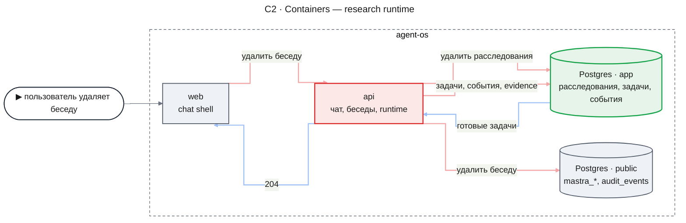
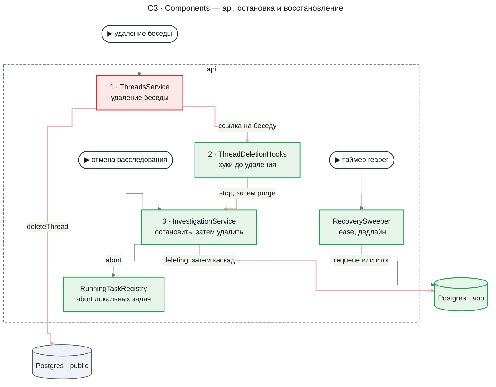
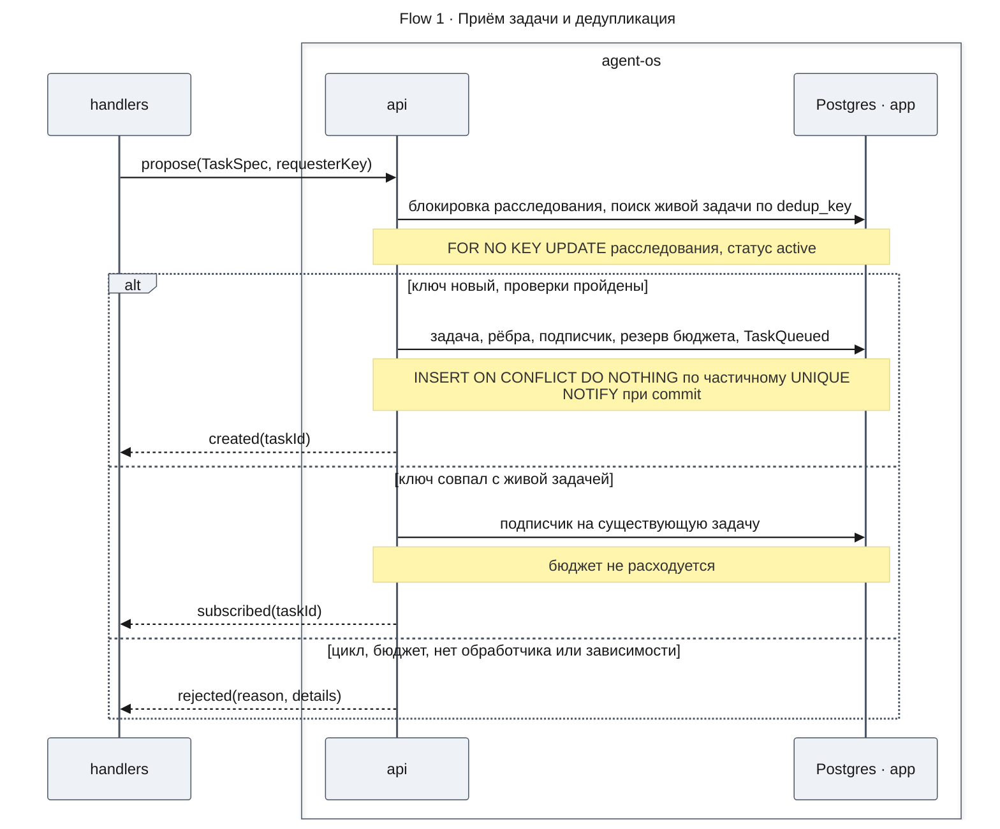
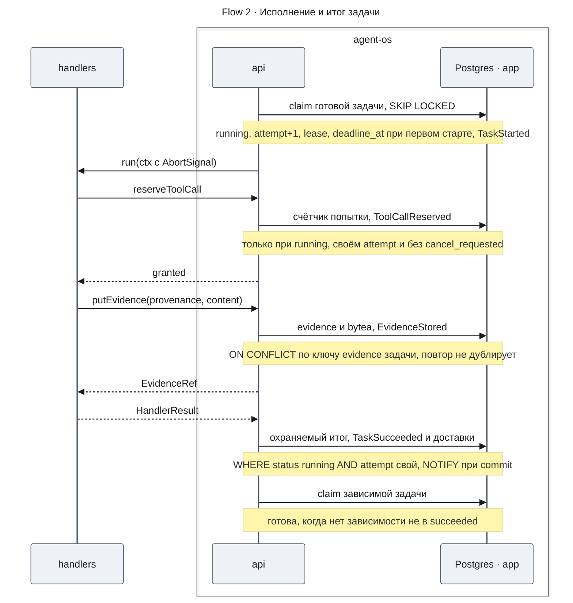
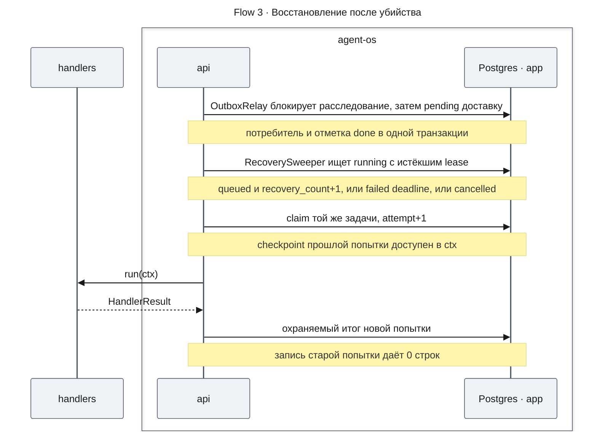
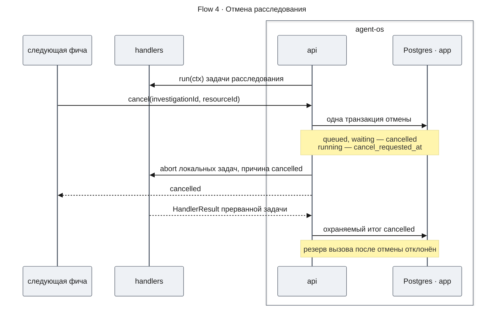
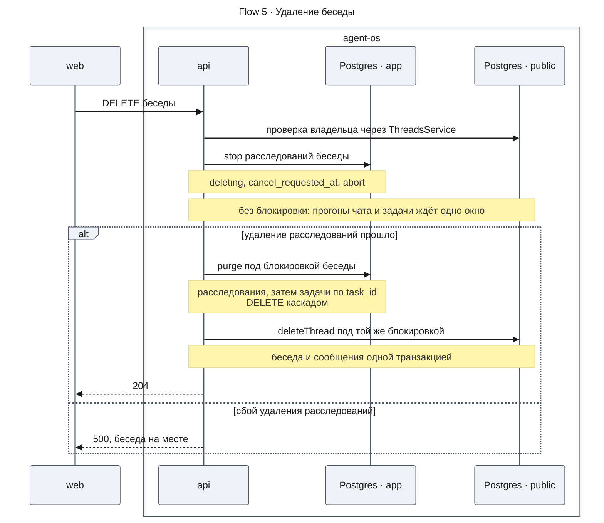
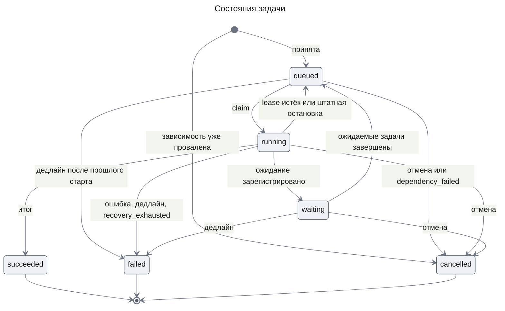

# Runtime исследований — Design Doc — runtime

| Status | Date | PRD | UXRD | Depends on |
|---|---|---|---|---|
| Approved | 2026-10-31 | [prd.md](./prd.md) | — | — |

## Snapshot

- **Что меняется**: в `apps/api` появляется модуль `research` — собственный durable runtime на Postgres: задачи с контрактом спецификации (§4), приём с дедупликацией, отказом циклов и бюджетом, claim с lease и fencing, transactional outbox, хранилище evidence. Таблицы — в новой схеме `app` на Drizzle (ADR-0003). Удаление беседы сначала останавливает и удаляет её расследования.
- **Что не меняется**: таблицы `mastra_*` и `audit_events`, контракты чата, `main.ts`; Mastra не владеет ни задачами, ни событиями, ни восстановлением.
- **Порты для `mcp-source`**: `TaskHandler`, `TaskContext`, `HandlerResult`, классы исходов `FailureReason` и контракт охвата `Coverage` в `packages/contracts`.
- **Главный риск**: корректность собственной механики под конкуренцией и при убийстве процесса; дедупликация, отказ цикла и fencing подтверждены spike (Appendix: Evidence), матрица убийств — первая точка проверки.
- **Открытые вопросы**: нет; допущения, которые проверяет план, — Appendix: Evidence, unknowns.

### Key Decisions

| ID | Decision | Why | Rejected alternatives |
|---|---|---|---|
| KD-1 | Свой runtime на Postgres — единственный владелец задач, событий и восстановления; Mastra — агенты внутри обработчиков, без workflows и восстановления run (ADR-0001) | Состояние и событие пишутся одной транзакцией; Mastra не даёт зависимостей, бюджета, дедупа | Mastra evented workflows (шина в памяти); Temporal (вне scope); pg-boss, graphile-worker (нет графа и бюджета) |
| KD-2 | Схема `app`, префикс `research_`; модель, миграции и запросы — Drizzle (ADR-0003), журнал `app.__drizzle_migrations`; старт только проверяет миграции | Схема примет `chat-storage`, отделена от `mastra_*`; одна модель даёт DDL и типы | Схема `public`; схема `research` (не примет чат); node-pg-migrate и сырой `pg`, Kysely, Prisma (ADR-0003) |
| KD-3 | Блокировка строки расследования `FOR NO KEY UPDATE` сериализует приём, рёбра и бюджет; частичный UNIQUE по `dedup_key` — страховка; claim задачи через `FOR UPDATE OF t SKIP LOCKED` с lease, доставки — после блокировки расследования, с повторной проверкой status = pending; `attempt` — fencing token каждой записи | Без блокировки взаимные рёбра проходят обе (spike A2); NO KEY UPDATE не конфликтует с KEY SHARE вставок через FK | `FOR UPDATE` расследования (ждут резерв и итог, взаимоблокировка с purge); advisory locks; SERIALIZABLE с повторами |
| KD-4 | Transactional outbox: событие и строки доставки пишутся в транзакции перехода; строка доставки — отметка inbox; гарантия — опрос ≤ 1 с, `LISTEN/NOTIFY` — только подсказка | Событие не теряется при убийстве; повтор доставки без эффекта | Шина Mastra (в памяти); только `NOTIFY` (теряется без слушателя); отдельная таблица inbox |
| KD-5 | Удаление беседы в две фазы: stop хуков до `cancelRunsThen` с ожиданием в окне прогонов, purge под блокировкой беседы | Ожидание DELETE не растёт, блокировка не держится на ожидании | FK на `mastra_threads`, очистка сирот, ожидание под `ThreadWriteLock` |
| KD-6 | Содержимое evidence — `bytea` в `research_evidence_contents` с `sha256` и размером; метаданные отдельно | Побайтовый round-trip 10 MiB (spike); `jsonb` не хранит `\u0000` | `jsonb`; файлы на диске (вне транзакции); объектное хранилище (Won't Have) |
| KD-7 | Один `pg.Pool` в глобальном `DatabaseModule`; воркеры стартуют в `onApplicationBootstrap` по флагу `RUNTIME_WORKERS`, останавливаются в `beforeApplicationShutdown`, пул закрывается в `onApplicationShutdown` | Старт одинаков в проде, в тестах и в дочернем процессе убийств; пул закрывается после воркеров по фазам Nest | Старт из `main.ts` (не видят тесты); `onModuleInit`; пул в каждом сервисе |

KD-5: окно — `THREAD_RUN_SETTLE_TIMEOUT_MS` (`design-threads-api.md`, ThreadRunRegistry), общее с ожиданием прогонов чата; хуки `ThreadDeletionHooks` оставляют зависимость только `research → threads`. FK ссылался бы на чужую таблицу, очистка сирот читала бы `mastra_*`, ожидание под блокировкой задерживало бы переименование.

## Part

- **Part**: `runtime`
- **Covers**: FR-01–FR-10; Should: FR-18, FR-19, FR-20, FR-23
- **Depends on**: нет — первая часть
- **Sibling parts**: `mcp-source` (FR-11–FR-17, FR-21) потребляет порты из [Contract Definitions](#contract-definitions)

### Agreement Checklist

#### Scope
- [x] Модуль `research` без импортов `@mastra/*` (KD-1, C3)
- [x] `DatabaseModule` (KD-2, KD-7)
- [x] Схема `app` и её миграции (KD-2, Migration Strategy)
- [x] Контракты расследования, задачи, события, evidence, исходов и охвата в `packages/contracts` (Contract Definitions)
- [x] Хук удаления беседы в `ThreadsService.delete` (KD-5, Flow 5)
- [x] Экземпляр Mastra без workflows приложения и с выключенным восстановлением run (KD-1, ADR-0001)
- [x] Отдельная задача CI с Postgres для e2e runtime (Verification Strategy)

#### Non-Scope (Explicitly not changing)
- [x] Таблицы `mastra_*` (KD-5)
- [x] `audit_events`, `AuditService` и его пул (Fact Disposition)
- [x] HTTP API runtime, LLM, W1–W7 (PRD Won't Have)
- [x] ToolExecutor, fixture MCP, allowlist, повторы транспорта — часть `mcp-source`
- [x] `main.ts` и `MastraLifecycle` (KD-7)

#### Constraints
- [x] Parallel operation: да — несколько экземпляров `apps/api` (KD-3); исполнение внутри процесса `apps/api`
- [x] Backward compatibility: обязательна для чата — сквозные тесты `chat-shell` без правок (AC-01.2, AC-23.4)
- [x] Performance measurement: да — старт зависимой задачи и время восстановления (PRD, Non-Functional Requirements), отдельным скриптом
- [x] Дедлайн абсолютный и фиксируется при первом старте; дедлайн и отмена не считаются сбоем источника и не повторяются (FR-19, State Transitions)

## Acceptance Criteria (AC) - EARS Format

Критерии PRD действуют как написаны; таблица связывает их с use cases. Механизм — в потоке, чья строка **AC** называет критерий, остальных — в разделах: AC-01.1 — [Contract Definitions](#contract-definitions), AC-03.2 и AC-03.4 — [Data Model](#data-model), AC-10.1 и AC-10.2 — [Migration Strategy](#migration-strategy), AC-01.2 — [Integration Points List](#integration-points-list). У AC-RT-n без потока механизм указан в строке.

| PRD AC | Use case |
|---|---|
| AC-01.1 | UC-1 |
| AC-01.2, AC-10.2, AC-23.4 | UC-2 |
| AC-02.1, AC-02.2, AC-04.3 | UC-3 |
| AC-03.1, AC-03.2 | UC-4 |
| AC-03.3, AC-03.4 | UC-5 |
| AC-04.1, AC-18.1 | UC-6 |
| AC-04.2 | UC-7 |
| AC-05.1, AC-05.2 | UC-8 |
| AC-06.1–AC-06.6 | UC-9 |
| AC-07.1–AC-07.3 | UC-10 |
| AC-08.1, AC-08.2, AC-08.4 | UC-11 |
| AC-08.3 | UC-12 |
| AC-09.1, AC-09.3 | UC-13 |
| AC-09.2 | UC-E3 |
| AC-10.1 | UC-14 |
| AC-19.1–AC-19.3 | UC-15 |
| AC-20.1–AC-20.3 | UC-16 |
| AC-23.1–AC-23.3, AC-23.5 | UC-17 |

### Критерии уровня дизайна

- [ ] **AC-RT-1** — **If** попытка, чей lease перехвачен (меньший `attempt` или задача уже не `running`), пишет итог, evidence, checkpoint или резерв вызова, **then** система отклоняет запись и не меняет ни одной строки.
- [ ] **AC-RT-2** — **If** каждая попытка задачи прерывается истечением lease, **then** обработчик вызывается не больше `RUNTIME_MAX_RECOVERIES + 1` раз, и следующее истечение lease записывает `failed` с классом `recovery_exhausted`.
- [ ] **AC-RT-3** — **When** `apps/api` стартует при неприменённых миграциях или без схемы `app`, система завершает старт ошибкой с именами миграций до приёма запросов. Механизм — проверка миграций ([Integration Points List](#integration-points-list)).
- [ ] **AC-RT-4** — **While** работают два экземпляра `apps/api` с одним обработчиком, каждая готовая задача исполняется одной попыткой за раз, и каждая доставка выполняется до `done` одним экземпляром. Механизм — KD-3.
- [ ] **AC-RT-5** — **When** процесс завершается штатно, исполняющиеся задачи возвращаются в `queued` без роста `recovery_count`, а пул закрывается после остановки воркеров. Механизм — KD-7 и штатный возврат в queued ([Contract Definitions](#contract-definitions)).
- [ ] **AC-RT-6** — **If** при приёме задачи её зависимость уже `failed` или `cancelled`, **then** задача создаётся сразу `cancelled` с классом `dependency_failed`; **if** при переходе в `waiting` все ожидаемые задачи уже завершены, **then** задача сразу возвращается в `queued`.
- [ ] **AC-RT-7** — Код `apps/api/src/research/**` не импортирует `@mastra/*`, а production-экземпляр Mastra соблюдает правило ADR-0001 (Decision): `listWorkflows()` пуст (скрытые служебные workflows Mastra не учитываются), в `recoveryConfig` `workflows` и `durableAgents` — `off`, `restartAllActiveWorkflowRuns` нигде в `apps/api/src` не вызывается. Механизм — KD-1.
- [ ] **AC-RT-8** — Домены CHECK статусов, классов и типов в схеме `app` совпадают со значениями enum в `packages/contracts`. Механизм — [Data Model](#data-model).

## Design

### Change Impact Map

```yaml
Change Target: ThreadsService.delete() и новый модуль research
Direct Impact:
  - apps/api/src/threads/threads.service.ts (delete с хуками, конструктор, withOwnedThread)
  - apps/api/src/threads/threads.module.ts (провайдер и экспорт ThreadDeletionHooks)
  - unit-тесты, создающие ThreadsService напрямую (аргументы конструктора); e2e-харнесс (миграции, RUNTIME_WORKERS=off)
  - apps/api/src/app.module.ts (импорт DatabaseModule, ResearchModule)
  - apps/api/src/mastra/mastra.provider.ts (recovery off)
  - apps/api/package.json, package.json (drizzle-orm — dependencies; drizzle-kit — devDependencies; скрипты db:generate, db:migrate), apps/api/drizzle.config.ts
  - .gitattributes (apps/api/migrations/** -text)
  - apps/api/.env.example, .github/workflows/ci.yml, apps/api/.oxlintrc.json
  - packages/contracts/src/index.ts (реэкспорт research.ts)
Indirect Impact:
  - DELETE /api/threads/:threadId — ожидание в пределах окна KD-5; коды ответа DELETE прежние (сбой хука — существующий 500)
  - Старт apps/api и e2e требует применённых миграций
  - Пул соединений: +1 пул и +1 соединение LISTEN к той же базе
No Ripple Effect:
  - ThreadsController (единственный вызывающий delete; сигнатура не меняется)
  - ChatController, ThreadTitleService, ThreadRunRegistry, ThreadWriteLock (поведение не меняется)
  - MastraLifecycle, main.ts
  - AuditService, audit_events
  - apps/web (контракты чата не меняются; новые схемы не импортируются)
```

### Architecture (C1–C4)

C1 опущен: внешние системы и люди не меняют поведения; fixture MCP — граница `mcp-source`.

#### C2 · Containers



| Container | Role | Change |
|---|---|---|
| `web` | вызывает удаление беседы | без изменений |
| `api` | чат, беседы и модуль `research` с воркерами runtime | [MODIFY] |
| Postgres · `app` | схема runtime и таблица учёта миграций | [NEW] |
| Postgres · `public` | `mastra_*` и `audit_events`; runtime их не трогает | без изменений |

#### C3 · Components: api

**api — исполнение задачи (запись)**


**api — доставка событий**


| Component | Responsibility (исполнение и доставка) | Change |
|---|---|---|
| `Dispatcher` | опрос и пробуждение, claim, слоты, `AbortSignal`, охраняемый итог, heartbeat | [NEW] |
| `TaskHandler` | порт обработчика; реализации — в `mcp-source` и следующих фичах | [NEW] |
| `TaskContext` | fenced API: резерв вызова, `putEvidence`, checkpoint, ожидание | [NEW] |
| `TaskScheduler` | валидация `TaskSpec`, дедуп, рёбра с проверкой цикла, бюджет, подписка | [NEW] |
| `TaskRepository`, `EvidenceStore`, `EventLog` | запросы Drizzle к задачам, evidence и событиям в переданной транзакции | [NEW] |
| `OutboxRelay` | доставка с повтором, backoff и парковкой; `LISTEN` как подсказка | [NEW] |
| `SchedulerConsumer` | каскад `dependency_failed`, пробуждение `waiting`, отметка подписчиков | [NEW] |

**api — остановка: отмена, удаление беседы, восстановление**



| Component | Responsibility in this flow | Change |
|---|---|---|
| `ThreadsService` | удаление беседы в две фазы (KD-5) | [MODIFY] |
| `ThreadDeletionHooks` | реестр хуков «до удаления беседы»; ошибка хука прерывает удаление | [NEW] |
| `InvestigationService` | создание, чтение по беседе, отмена, остановка и очистка беседы | [NEW] |
| `RunningTaskRegistry` | `AbortController` исполняющихся в процессе задач, ожидание завершения | [NEW] |
| `RecoverySweeper` | истёкший lease, дедлайн `queued` и `waiting`, исчерпание восстановлений | [NEW] |

#### C4 · Code flow: удаление беседы


**Code locations:**

- [threads.service.ts](../../../apps/api/src/threads/threads.service.ts)
- [threads.module.ts](../../../apps/api/src/threads/threads.module.ts)
- `apps/api/src/threads/thread-deletion-hooks.ts` — новый
- `apps/api/src/research/` — новый модуль runtime
- `apps/api/src/database/` — пул, клиент Drizzle, модель схемы `app`, мигратор и проверка миграций
- `apps/api/migrations/` — сгенерированные SQL-миграции и снимки `meta/`
- `apps/api/drizzle.config.ts` — конфигурация drizzle-kit
- `packages/contracts/src/research.ts` — новые контракты

| Type | Name | Change | Notes |
|---|---|---|---|
| Service | `ThreadsService` | [MODIFY] | `delete` в две фазы (KD-5, [ThreadDeletionHook](#threaddeletionhook)); новый `withOwnedThread(threadId, userId, fn)` — проверка владельца и `fn` под блокировкой беседы |
| Provider | `ThreadDeletionHooks` | [NEW] | `register(hook)` на старте модулей; `stopAll(ref, window)` и `purgeAll(ref)` по порядку регистрации; ошибка пробрасывается |
| Service | `InvestigationService` | [NEW] | `create` через `withOwnedThread`; `stopThread` и `purgeThread` — хук удаления |
| Module | `DatabaseModule` | [NEW] | глобальные `PG_POOL` и клиент Drizzle над ним (KD-7); проверка миграций в `onModuleInit` |
| Module | `ResearchModule` | [NEW] | импортирует `ThreadsModule`; экспортирует `InvestigationService`, `TaskScheduler`, `HandlerRegistry`, `EventConsumerRegistry`, `EvidenceReader` |
| Provider | `RuntimeLifecycle` | [NEW] | старт и остановка воркеров в фазах Nest (KD-7) |
| Provider | `mastraProvider` | [MODIFY] | восстановление run off (KD-1, AC-RT-7) |

### Runtime Flows

#### Flow 1: приём задачи и дедупликация

**Starts when:** код обработчика или следующей фичи вызывает `TaskScheduler.propose` · **AC:** AC-02.1, AC-02.2, AC-04.2, AC-04.3, AC-05.1, AC-05.2, AC-06.1–AC-06.6, AC-07.1–AC-07.3, AC-RT-6



**Outcome:** создана одна задача `queued` (или `cancelled` с `dependency_failed`, если зависимость уже провалена) с событием `TaskQueued`, либо добавлен подписчик, либо отказ без записей. Бюджет расследования уменьшается на одну задачу и на лимит вызовов задачи целиком.

**Failure handling:**

- Ключ занят параллельной транзакцией → `ON CONFLICT DO NOTHING`, затем чтение существующей задачи и подписка (spike A1).
- Ребро замкнуло бы цикл → `rejected: wait_cycle` с перечнем задач цикла; транзакция откатывается, другие задачи не меняются.
- Расследование `cancelled` или `deleting` → `rejected: investigation_inactive`; ошибка базы — по [Data Contract](#data-contract).

#### Flow 2: исполнение, итог и старт зависимой задачи

**Starts when:** тик `Dispatcher` (не реже `RUNTIME_POLL_MS`) или `NOTIFY` при свободном слоте · **AC:** AC-03.1, AC-03.2, AC-03.3, AC-04.1, AC-08.2, AC-09.1, AC-09.3, AC-18.1, AC-19.1, AC-19.3, AC-RT-1



> **Why** — потоки 2 и 3 начинает таймер воркера в `api`, а не клиент.

**Outcome:** задача `succeeded` с `output_refs` и `outcome`, вызовы и повторы попытки перенесены в счётчики задачи; событие и строки доставки записаны той же транзакцией. Зависимая задача стартует следующим claim и видит ссылки на выходы зависимости в `ctx.upstream`.

**Failure handling:**

- Исключение обработчика, невалидный `HandlerResult` (в том числе `wait` без `waitFor`), итог отклонён охраной → по таблице [Error Handling](#error-handling).
- Сработал `AbortSignal` по дедлайну → `Dispatcher` сразу пишет `failed` с классом `deadline` и освобождает слот, не дожидаясь обработчика; его поздние записи, включая резерв вызова, отклоняет fencing.
- Сбой commit итога → три повтора с backoff; дальше lease истекает, и задача восстанавливается по Flow 3.

#### Flow 3: восстановление после убийства процесса

**Starts when:** `apps/api` поднят после гибели процесса посреди расследования · **AC:** AC-08.1, AC-08.2, AC-08.3, AC-08.4, AC-09.2, AC-19.2, AC-RT-1, AC-RT-2



**Outcome:** каждое ожидавшее событие доставлено, брошенная задача исполнена новой попыткой и дошла до того же итога; evidence с тем же ключом не дублируется. Время до повторного старта — lease плюс период reaper плюс опрос, в пределах цели PRD (Reliability).

**Failure handling:**

- Дедлайн истёк, восстановления исчерпаны (AC-RT-2) или стоит `cancel_requested_at` → reaper пишет итог без вызова обработчика (AC-19.2, [Error Handling](#error-handling)).
- Расследование удалено после чтения доставки → доставка пропускается, её строку удалил каскад `purge`.
- Доставка уже `done` → повтор ничего не меняет; неизвестная `schemaVersion` → сразу `needs_attention`; сбой потребителя → backoff, затем `needs_attention`; остальные доставки продолжаются.

#### Flow 4: отмена расследования

**Starts when:** код следующей фичи вызывает `InvestigationService.cancel`, пока задача расследования исполняется · **AC:** AC-20.1–AC-20.3



**Outcome:** ожидающие задачи `cancelled`, исполняющиеся — `cancelled` после остановки; задачи, успевшие записать `succeeded` до транзакции отмены, остаются `succeeded` с evidence. Резерв вызова отклоняется сразу после commit отмены.

**Failure handling:**

- Обработчик не реагирует на abort → итог `cancelled` пишется без ожидания, поздние записи отклоняет fencing.
- Задача исполняется на другом экземпляре → heartbeat возвращает `cancel_requested_at`, тот экземпляр прерывает задачу; при его гибели reaper пишет `cancelled`.
- Повторная отмена → пустая операция.

#### Flow 5: удаление беседы с расследованиями

**Starts when:** пользователь удаляет беседу в `web` (`DELETE /api/threads/:threadId`) · **AC:** AC-23.1–AC-23.5



**Outcome:** в схеме `app` нет строк расследований беседы, `mastra_*` не содержит беседы; расследования других бесед и пользователей не изменены. Беседа без расследований проходит хук как пустую операцию; ожидание — в окне KD-5.

**Failure handling:**

- Сбой `stop` или `purge` → по столбцу On error таблицы [ThreadDeletionHook](#threaddeletionhook); расследования в `deleting` не исполняются, повтор удаляет и их, и беседу (AC-23.5).
- Локальная задача не завершилась до конца окна → удаление продолжается, в лог — предупреждение; новый вызов источника невозможен: резерв требует `cancel_requested_at IS NULL`, а после `purge` строки задачи нет.
- Расследование создано между `stop` и блокировкой → `purge` удаляет и его, локальные задачи прерываются без ожидания, их поздние записи отклоняет fencing.
- `purge` прерван взаимоблокировкой (40P01) — страховка сверх порядка блокировок → DELETE 500, повтор по AC-23.5.
- Прогон чата не завершился за окно → `cancelRunsThen` повторяет действие после его завершения; хуки идемпотентны.
- `deleteThread` упал после удаления расследований → 500, беседа на месте без расследований; повтор удаляет беседу.

### State Transitions and Invariants



Расследование имеет статусы `active`, `cancelled` и `deleting`; claim и приём работают только для `active`.

```yaml
System Invariants:
  - Каждый переход задачи — один UPDATE с охраной по допустимому исходному статусу; переход из running ещё и по attempt; state_version растёт на 1
  - Переход и его событие с доставками пишутся одной транзакцией
  - Конечные статусы (succeeded, failed, cancelled) не меняются
  - status = waiting тогда и только тогда, когда wait_condition не NULL
  - deadline_at записывается при первом claim и больше не меняется
  - attempt растёт только при claim
  - В расследовании не больше одной живой задачи (queued, running, waiting, succeeded) на dedup_key
  - Граф рёбер depends_on и waits_for в расследовании ацикличен
  - Порядок блокировок: расследование (FOR NO KEY UPDATE, по investigation_id), затем задачи (по task_id); существующие строки доставок блокируются только под блокировкой расследования; транзакция перехода лишь вставляет новые; вставки событий и evidence берут через FK FOR KEY SHARE (события — на расследование, evidence — на задачу), совместимый с NO KEY UPDATE
  - Доставки: второй держатель блокировки расследования (OutboxRelay, purge) ждёт на ней, поэтому цикла с задачами потребителя нет
  - Расследование, затем задачи — приём, ожидание (рёбра и переход в waiting), итог с proposedTasks, отмена, stop; purge затем удаляет каскадом задачи, события и доставки
  - OutboxRelay читает investigation_id события pending доставки без блокировки, блокирует расследование FOR NO KEY UPDATE, затем доставку FOR UPDATE SKIP LOCKED со статусом pending, затем исполняет потребителя (каскад, пробуждение, подписчики) в savepoint и отметку done (Flow 3); сбой потребителя — [Error Handling](#error-handling)
  - Транзакция одной задачи сначала касается строки своей задачи (охраняемый UPDATE, FOR UPDATE или вставка evidence с FK на задачу) и только затем вставляет события: claim, heartbeat, резерв, evidence, checkpoint, итог без proposedTasks и ожидания, reaper, штатный возврат в queued
  - Ни одна транзакция не держится через вызов обработчика или внешней системы
```

### Integration Points List

| Integration Point | Location | Old Implementation | New Implementation | Switching Method | Verified by |
|---|---|---|---|---|---|
| Удаление беседы | `ThreadsService.delete` | `cancelRunsThen` → `lock.run` → `deleteThread` | две фазы хуков (KD-5) | DI, регистрация хука в `ResearchModule.onModuleInit` | UC-17, UC-2 |
| Создание расследования | `ThreadsService.withOwnedThread` | — | проверка владельца и вставка под блокировкой беседы | новый метод | UC-1 |
| Старт и остановка воркеров | `RuntimeLifecycle` | `MastraLifecycle.start` из `main.ts` | фазы Nest (KD-7) | флаг `RUNTIME_WORKERS` | UC-11, UC-E5 |
| Пул Postgres | `DatabaseModule` | пул внутри `AuditService` | `PG_POOL` для нового кода | DI-токен | UC-14 |
| Проверка миграций | `DatabaseModule.onModuleInit` | DDL в `AuditService.onModuleInit` | сверка хэшей файлов с `app.__drizzle_migrations` | старт приложения | UC-E6 |
| e2e-харнесс | окружение e2e `apps/api` | без миграций схемы `app` | миграции до набора, воркеры runtime выключены; набор `chat-shell` без правок (AC-01.2) | настройка харнесса | UC-2 |
| Обработчики `mcp-source` | `HandlerRegistry.register` | — | регистрация `TaskHandler` при старте модуля | DI | UC-3, приёмка `mcp-source` |
| Контракты | `packages/contracts/src/index.ts` | только `threads.js` | + `research.js` | реэкспорт | UC-13, AC-RT-8 |

### Contract Definitions

Порты — внутрипроцессные API модуля `research`; HTTP-поверхности нет. Данные, пересекающие хранилище и части, описаны схемами zod в `packages/contracts/src/research.ts`. Хеш `dedup_key` (`node:crypto`) живёт в `apps/api`, потому что `web` тоже собирает контракты.

| Operation | Input | Output | Errors |
|---|---|---|---|
| `InvestigationService.create` | `InvestigationSpec` | `Investigation` | 404 беседы через `ThreadsService`; ошибка на пустом `resourceId` |
| `InvestigationService.listForThread` | `resourceId`, `threadId` | `Investigation[]` владельца, у каждого `tasks`: `Task[]` (Task, модель чтения) (AC-01.1) | ошибка на пустом `resourceId` |
| `InvestigationService.cancel` | `investigationId`, `resourceId` | `void` | не найдено для владельца → `investigation_not_found` |
| `TaskScheduler.propose` | `TaskSpec`, `requesterKey` | `ProposeResult` | отказ — значение `ProposeResult`, не исключение |
| `HandlerRegistry.register` | `TaskHandler` | `void` | дубль типа и версии → ошибка старта |
| `TaskHandler.run` | `TaskContext` | `HandlerResult` | исключение → `failed`, класс `internal` |
| `TaskContext.reserveToolCall` | `toolName`, `retry` | `ToolCallGrant` | — |
| `TaskContext.putEvidence` | `EvidenceInput` | `EvidenceRef` | попытка не текущая или строки задачи нет (расследование удалено, ошибка FK) → `fenced`; содержимое больше лимита → `validation_rejected` |
| `TaskContext.saveCheckpoint` | JSON до 64 KiB | `void` | попытка не текущая → `fenced` |
| `TaskContext.registerWait` | `taskIds` | `ok` или `rejected: wait_cycle` с циклом | задачи нет в расследовании → `unknown_dependency` |
| `EvidenceReader.get` | `evidenceId`, `resourceId` | `EvidenceRecord` и байты | не найдено для владельца → `evidence_not_found` |
| `EventConsumerRegistry.register` | `EventConsumer` | `void` | дубль имени → ошибка старта |
| `ThreadDeletionHooks.register` | хук `ThreadDeletionHook` | `void` | — |

#### InvestigationSpec и Investigation

| Field | Type | Constraint | Meaning |
|---|---|---|---|
| `resourceId` | string | 1..255, владелец беседы | пользователь, как `resource` в Mastra Memory |
| `threadId` | string | `ThreadIdSchema` | беседа без FK |
| `query` | string | 1..10 000 | исходный запрос |
| `budget.maxTasks` | int | 1..1 000 | лимит числа задач |
| `budget.maxToolCalls` | int | 1..10 000 | лимит вызовов инструментов |
| `investigationId`, `status`, `createdAt` | uuid, enum (`active`, `cancelled`, `deleting`), datetime | только в `Investigation` | идентичность и состояние |
| `tasks` | `Task[]` | только в ответе `listForThread` | задачи расследования |

#### Task (модель чтения)

| Field | Type | Constraint | Meaning |
|---|---|---|---|
| `taskId` | uuid | — | идентичность задачи |
| `workflowType`, `workflowVersion` | string, int | из `TaskSpec` | тип и версия обработчика |
| `status` | `TaskStatus` (`queued`, `running`, `waiting`, `succeeded`, `failed`, `cancelled`) | — | текущий статус |
| `dedupKey` | string | префикс `v1:` | ключ дедупликации |
| `outputRefs` | uuid[] (`evidenceId`) | пусто до `succeeded` | выходы задачи; запись и байты — через `EvidenceReader.get` |
| `outcome` | `answerOrDelta`, `missingEvidence`, `warnings` из `HandlerResult` или null | при `succeeded` | результат задачи |
| `coverage` | `Coverage` или null | при `succeeded` | охват результата |
| `failureReason` | `FailureReason` или null | при `failed` и `cancelled` | причина исхода |
| `attempt` | int | ≥ 0 | номер последней попытки |
| `toolCallsUsed`, `retriesUsed` | int, int | ≤ `maxToolCalls` и `maxRetries` из `TaskBudget` задачи | вызовы и повторы, списанные с задачи |
| `subscribers` | string[] | `requesterKey` подписчиков | кто ждёт результат задачи |

#### TaskSpec

| Field | Type | Constraint | Meaning |
|---|---|---|---|
| `investigationId` | uuid | расследование `active` | владелец задачи |
| `workflowType` | string | 1..100, есть обработчик | тип workflow |
| `workflowVersion` | int | ≥ 1, есть обработчик | версия обработчика; входит в ключ |
| `input` | JSON object | до 16 KiB, схема обработчика | нормализуемые параметры |
| `inputRefs` | `InputRef[]` | у каждой есть `snapshot` | входные ссылки со срезом |
| `expectedOutput` | `ExpectedOutput` | обязателен | ожидаемый результат до старта |
| `dependsOn` | uuid[] | задачи того же расследования | запуск после их `succeeded` |
| `budget` | `TaskBudget` | обязателен | лимиты задачи |

`InputRef`: `kind` (string), `ref` (string, 1..500), `snapshot` (string, 1..200). `ExpectedOutput`: `description` (1..2 000), `completeness` (`all`, `sample`). `TaskBudget`: `maxToolCalls` (≥ 1), `maxRetries` (≥ 0), `deadlineMs` (1 000..3 600 000), `maxTokens` (≥ 0; расходует `deep-research`).

Второй аргумент `propose`:

| Field | Type | Constraint | Meaning |
|---|---|---|---|
| `requesterKey` | string | 1..200; выбирает вызывающий; уникален для запрашивающей стороны в расследовании | кто запросил задачу; хранится как `subscriber_key` |

`dedup_key` = `v1:` и hex sha256 канонического JSON из `workflowType`, `workflowVersion`, `input`, `expectedOutput` и `inputRefs`, упорядоченных по `kind` и `ref`. Канонизация сортирует ключи объектов рекурсивно и сохраняет порядок массивов (AC-06.3); смена правила меняет префикс версии.

#### ProposeResult

| Field | Type | Constraint | Meaning |
|---|---|---|---|
| `outcome` | enum (`created`, `subscribed`, `rejected`) | — | что произошло |
| `taskId`, `status` | uuid, `TaskStatus` | при `created` и `subscribed` | задача, на которую подписан запросивший |
| `reason` | enum (`invalid_spec`, `unknown_workflow`, `unknown_dependency`, `self_dependency`, `wait_cycle`, `budget_exhausted`, `investigation_inactive`) | при `rejected` | причина отказа |
| `details` | object | при `rejected` | путь поля, задачи цикла или исчерпанный лимит (`tasks`, `tool_calls`) |

Подписчик читает общий результат по `taskId` через `listForThread`. `notified_event_id` — учёт runtime, а не обратный вызов.

#### TaskHandler и TaskContext

`TaskHandler`: `workflowType`, `workflowVersion`, `inputSchema` (zod-схема `input`, проверяется при приёме), `run(ctx)`.

| Field of `TaskContext` | Type | Meaning |
|---|---|---|
| `taskId`, `investigationId`, `attempt` | uuid, uuid, int | идентичность попытки; `attempt` — fencing token |
| `input`, `inputRefs`, `expectedOutput`, `budget` | из `TaskSpec` | контракт задачи |
| `upstream` | список `{taskId, kind, status, outputRefs}` | зависимости и ожидаемые задачи с их выходами |
| `checkpoint` | JSON или null | последний сохранённый checkpoint |
| `signal` | AbortSignal | причина в `signal.reason`: `{kind}` из `cancelled`, `deadline`, `shutdown`, `lease_lost` |
| `deadlineAt` | datetime | абсолютный дедлайн |
| `reserveToolCall`, `putEvidence`, `saveCheckpoint`, `registerWait` | функции | fenced API, см. таблицу операций |

`ToolCallGrant`: `granted` (bool), `callIndex` (int, при выдаче), `reason` (`tool_calls_exhausted`, `retries_exhausted`, `not_current_attempt`, `cancel_requested`) при отказе.

Правило резерва — одно условие в охраняемом UPDATE: задача `running` со своим `attempt` и без `cancel_requested_at`, `tool_calls_used + attempt_tool_calls < max_tool_calls`, а при `retry: true` ещё и `retries_used + attempt_retries < max_retries`. Выдача увеличивает `attempt_tool_calls` на 1, при `retry: true` — и `attempt_retries`.

- Собственная охраняемая запись попытки, которая её завершает (итог, переход в `waiting`, штатный возврат в `queued`), переносит `attempt_tool_calls` в `tool_calls_used` и `attempt_retries` в `retries_used`.
- Claim обнуляет `attempt_tool_calls` и `attempt_retries`. Лимит вызовов и лимит повторов действуют на задачу по всем попыткам: возобновление `waiting → queued` не даёт новых вызовов и повторов.
- Попытка, потерянная по lease, ничего не переносит: reaper возвращает задачу в `queued`, и следующий claim обнуляет её счётчики (Future Extensibility, Intentional limitations).

#### HandlerResult

| Field | Type | Constraint | Meaning |
|---|---|---|---|
| `kind` | enum (`completed`, `failed`, `wait`) | — | итог попытки |
| `answerOrDelta` | JSON или null | до 64 KiB | ответ или изменение (спецификация, §4) |
| `evidenceRefs` | uuid[] | evidence этой задачи | становятся `output_refs` |
| `coverage` | `Coverage` или null | — | охват результата |
| `missingEvidence`, `warnings` | string[] | по 500 символов | пробелы и предупреждения |
| `proposedTasks` | `TaskSpec[]` | проходят приём в транзакции итога | предложенные задачи |
| `failure` | `FailureReason` | при `failed` | причина |
| `waitFor` | uuid[] | при `wait`, рёбра уже зарегистрированы | условие пробуждения |

#### Coverage

| Field | Type | Constraint | Meaning |
|---|---|---|---|
| `completeness` | enum (`complete`, `partial`) | правило `complete` — у `mcp-source`; runtime проверяет схему | исчерпан ли запрошенный охват |
| `totalMatched` | int или null | null — неизвестно | всего совпадений или нижняя граница |
| `totalRelation` | enum (`eq`, `gte`) или null | обязателен при `totalMatched`, иначе null | точное число или нижняя граница |
| `returned` | int | ≥ 0; ≤ `totalMatched` при `eq` | получено |
| `truncated` | bool | `true` ⇒ `completeness = partial` | результат усечён |
| `continuation` | string или null | до 4 KiB, непрозрачна | продолжение пагинации; формат задаёт `mcp-source` |

#### FailureReason

| Field | Type | Constraint | Meaning |
|---|---|---|---|
| `class` | enum (`transport_protocol`, `tool_error`, `deadline`, `cancelled`, `dependency_failed`, `budget_exhausted`, `recovery_exhausted`, `snapshot_changed`, `allowlist_rejected`, `validation_rejected`, `internal`) | дискриминатор | класс исхода |
| `code` | string | 1..100, машинный | уточнение, например `config_or_protocol_mismatch` |
| `message` | string | до 2 000 символов | текст для человека |
| `cause` | string или null | до 500 | исходная ошибка |
| `attempt`, `toolCalls`, `retries` | int | ≥ 0 | счётчики попытки |
| `dependencyTaskId`, `rootCauseTaskId` | uuid | при `dependency_failed` | прямая и корневая причина каскада |

Только runtime выставляет `dependency_failed` и `recovery_exhausted`. Runtime пишет `deadline` по таймеру дедлайна и при рестарте после дедлайна, `cancelled` — для итога при выставленном `cancel_requested_at`. `budget_exhausted` и `validation_rejected` приходят только от обработчика через `HandlerResult.failure`; обработчик может вернуть и `cancelled` (отражая `signal.reason`) или `deadline`. Остальные классы и коды выставляет `mcp-source`.

Обработчик не возвращает `internal`: его пишет runtime при исключении обработчика или невалидном результате. Остановленную попытку обработчик может завершить исключением: при `fenced` и `not_current_attempt` запись отклоняет охрана, при `signal.reason` `shutdown` Dispatcher возвращает задачу в queued (или пишет cancelled, если выставлен cancel_requested_at), при `lease_lost` итог не пишет.

#### EventEnvelope

| Field | Type | Constraint | Meaning |
|---|---|---|---|
| `eventId` | uuid | генерируется приложением | идентичность и ключ inbox |
| `type` | enum типов ниже | — | тип события |
| `schemaVersion` | int | ≥ 1 | версия схемы payload |
| `investigationId`, `taskId` | uuid, uuid или null | — | область |
| `causationId` | uuid или null | событие-причина | цепочка причин |
| `correlationId` | uuid | `eventId` события `InvestigationCreated` | группа расследования |
| `stateRevision` | int | `state_version` задачи или `revision` расследования | сравнение свежести |
| `payloadRef` | string или null | `evidence:<id>` или `task-outcome:<id>` | большое содержимое по ссылке |
| `payload` | JSON | до 8 KiB | малое содержимое |
| `createdAt` | datetime | — | время записи |

Типы runtime, `schemaVersion` 1: `InvestigationCreated`, `InvestigationCancelled`, `TaskQueued` (причина: `admitted`, `woken`, `recovered`, `released`), `TaskStarted`, `TaskWaiting`, `ToolCallReserved`, `EvidenceStored`, `TaskSucceeded`, `TaskFailed`, `TaskCancelled`. Причинная цепочка: `TaskStarted` ← последнее `TaskSucceeded` зависимостей или `TaskQueued`; `ToolCallReserved` ← `TaskStarted`; `EvidenceStored` ← последний `ToolCallReserved`; итог ← последнее `EvidenceStored` или `TaskStarted`.

`EventConsumer`: `name`, `eventTypes`, `schemaVersions`, `handle(tx, event)` — только переходы в базе внутри переданной транзакции. Runtime регистрирует потребителя `runtime.scheduler` на `TaskSucceeded`, `TaskFailed` и `TaskCancelled`.

#### EvidenceInput и EvidenceRecord

| Field | Type | Constraint | Meaning |
|---|---|---|---|
| `evidenceKey` | string | 1..200, уникален в задаче | естественный ключ, например номер страницы |
| `provenance.sourceId`, `provenance.toolName` | string | 1..200 | источник и инструмент |
| `provenance.normalizedArgs` | JSON | до 16 KiB | нормализованные аргументы |
| `provenance.snapshot` | string | 1..200 | срез данных или верхняя граница времени |
| `coverage` | `Coverage` | — | охват этой порции |
| `content.mediaType`, `content.bytes` | string, bytes | до 16 MiB | содержимое выхода |
| `evidenceId`, `taskId`, `writtenByAttempt`, `sha256`, `byteSize`, `createdAt` | — | только в `EvidenceRecord` | идентичность и целостность |
| `knowledgeStatus` | enum (`observed`, `candidate`, `supported`, `refuted`, `unknown`, `stale`) | `putEvidence` пишет `observed` | статус знания |
| `scope`, `basis`, `evidenceVersion` | string, string, int | обязательны при `supported` | область, основание и версия (AC-03.4) |

`EvidenceRef`: `evidenceId`, `sha256`, `byteSize`. Повторный `putEvidence` с тем же `evidenceKey` возвращает существующий ref; другой `sha256` — ошибка `internal` (provenance неизменяем).

#### ThreadDeletionHook

`ref` — `threadId` и `resourceId` беседы после проверки владельца. Оба метода идемпотентны (Flow 5).

| Method | Called | Does | Returns | On error |
|---|---|---|---|---|
| `stop(ref, window)` | до `cancelRunsThen`, без блокировки беседы | одна транзакция, как отмена: расследования беседы FOR NO KEY UPDATE → `deleting`, у задач `cancel_requested_at`; затем abort локальных задач | сразу после commit и abort — `settled` | исключение → DELETE 500 до отмены прогонов чата, ничего не изменено |
| `purge(ref)` | в действии `cancelRunsThen` под `ThreadWriteLock`, до `deleteThread` | одна транзакция: расследования беседы FOR NO KEY UPDATE, их задачи FOR UPDATE, DELETE расследований каскадом; abort локальных задач без ожидания | `void` | исключение, включая 40P01 → беседа не удаляется, DELETE 500 (AC-23.5) |

`settled` — промис, который разрешается, когда локальные задачи остановлены или истёк `window`, и никогда не отклоняется. `window` — сигнал таймаута на окно KD-5, который `ThreadsService.delete` взводит перед `cancelRunsThen`. `stopAll` собирает `settled` всех хуков, и действие `cancelRunsThen` ждёт их все до `lock.run`.


### Data Model

Схема `app` описана в модуле `apps/api/src/database/schema.ts` через `pgSchema('app')`; домены CHECK строятся там из enum контрактов (AC-RT-8). Каскад удаления идёт от `research_investigations`; каждый FK — `ON DELETE CASCADE`, его цель указана в столбце ограничений. Статусы и классы — `text` с CHECK, не ENUM.

| Table | Columns (группы) | Constraints и индексы |
|---|---|---|
| `research_investigations` | `investigation_id`, `resource_id`, `thread_id` (text, без FK), `query`, `status`, `max_tasks`, `tasks_reserved`, `max_tool_calls`, `tool_calls_reserved`, `revision`, `created_at`, `updated_at` | CHECK резерв ≤ лимита и `resource_id <> ''`; индекс (`resource_id`, `thread_id`) |
| `research_tasks` | контракт: `workflow_type`, `workflow_version`, `input`, `input_refs`, `expected_output`, `dedup_key`; исполнение: `status`, `wait_condition`, `state_version`, `attempt`, `lease_owner`, `lease_expires_at`, `recovery_count`, `deadline_at`, `started_at`, `finished_at`, `cancel_requested_at`; бюджет: `max_tool_calls`, `max_retries`, `deadline_ms`, `max_tokens`, `tool_calls_used`, `retries_used`, `attempt_tool_calls`, `attempt_retries`; итог: `outcome`, `failure_reason`, `output_refs`, `checkpoint` | FK `investigation_id` → `research_investigations`; UNIQUE (`investigation_id`, `task_id`); частичный UNIQUE (`investigation_id`, `dedup_key`) для живых статусов; CHECK `waiting` ⇔ `wait_condition` (AC-03.2); CHECK счётчиков ≤ лимитов; CHECK `dedup_key LIKE 'v1:%'`; частичные индексы `queued`, (`lease_expires_at`) для `running`, (`deadline_at`) для незавершённых |
| `research_task_dependencies` | `investigation_id`, `task_id`, `depends_on_task_id`, `kind` (`depends_on`, `waits_for`) | PK (`task_id`, `depends_on_task_id`, `kind`); составные FK (`investigation_id`, `task_id`) и (`investigation_id`, `depends_on_task_id`) → `research_tasks`; CHECK без петли; индекс по цели |
| `research_task_subscribers` | `task_id`, `subscriber_key`, `subscribed_at`, `notified_event_id` | FK `task_id` → `research_tasks`; PK (`task_id`, `subscriber_key`) |
| `research_events` | `event_id`, `seq` (identity, только порядок), поля `EventEnvelope` | FK `investigation_id` → `research_investigations`, `task_id` без FK; PK `event_id`; CHECK размера `payload`; индексы (`correlation_id`, `seq`), (`causation_id`), (`task_id`, `seq`) |
| `research_event_deliveries` | `event_id`, `consumer`, `status` (`pending`, `done`, `needs_attention`), `attempts`, `next_attempt_at`, `last_error` | FK `event_id` → `research_events`; PK (`event_id`, `consumer`); частичный индекс (`next_attempt_at`) для `pending` |
| `research_evidence` | `evidence_id`, `investigation_id`, `task_id`, `evidence_key`, `written_by_attempt`, `knowledge_status`, `scope`, `basis`, `evidence_version`, `provenance`, `coverage`, `created_at` | составной FK (`investigation_id`, `task_id`) → `research_tasks`; UNIQUE (`task_id`, `evidence_key`); CHECK `supported` ⇒ `scope`, `basis`, `evidence_version` (AC-03.4); триггер запрещает менять provenance |
| `research_evidence_contents` | `evidence_id`, `media_type`, `bytes` (bytea), `sha256`, `byte_size` | FK `evidence_id` → `research_evidence`; CHECK `byte_size = octet_length(bytes)` и ≤ 16 MiB |

Готовность задачи — запрос: `queued`, расследование `active`, тип и версия есть в локальном реестре, нет ребра `depends_on` к задаче не в `succeeded`.

Запросы — drizzle-orm в переданной транзакции; где построителя не хватает — фрагмент `sql` (ADR-0003).

### Data Contract

#### TaskScheduler.propose

```yaml
Input:
  Type: TaskSpec, requesterKey
  Preconditions: расследование существует; resourceId вызывающего проверен при создании расследования
  Validation: TaskSpecSchema, затем inputSchema обработчика, затем рёбра и бюджет под блокировкой расследования
Output:
  Type: ProposeResult
  Guarantees: при created — задача, рёбра, подписчик, резерв и TaskQueued записаны вместе; при subscribed — только подписчик
  On Error: отказ возвращается значением; ошибка базы — исключение без частичных записей
Invariants:
  - Дедуп и ацикличность — System Invariants; резервы — CHECK в Data Model
```

#### Dispatcher: итог попытки

```yaml
Input:
  Type: HandlerResult или причина AbortSignal
  Preconditions: попытка получена claim; транзакция не держалась во время run
  Validation: HandlerResultSchema; невалидный результат — failed, класс internal
Output:
  Type: строка задачи в конечном статусе или waiting, событие, доставки
  Guarantees: запись только при status = running и своём attempt; cancel_requested_at превращает итог в cancelled; failed с классом cancelled пишется статусом cancelled; запись, завершающая попытку, переносит её счётчики по правилу резерва (TaskContext); signal.reason shutdown — штатный возврат в queued, а при выставленном cancel_requested_at — итог cancelled; lease_lost — без записи; оба правила — независимо от HandlerResult или исключения; signal.reason deadline — итог failed с классом deadline, независимо от HandlerResult или исключения
  On Error: 0 строк — результат отброшен; сбой commit — повтор, затем восстановление по lease
Invariants:
  - Итог пишется не больше одного раза на задачу
  - Порядок блокировок — System Invariants
```

### Error Handling

| Ситуация | Обработка | Что видит вызывающий |
|---|---|---|
| Невалидный `TaskSpec`, нет обработчика, цикл, бюджет | отказ при приёме, транзакция откатывается | `ProposeResult.rejected` с причиной |
| Исключение обработчика или невалидный `HandlerResult` | `failed`, класс `internal`, сообщение обрезано | `TaskFailed` |
| Дедлайн | `failed`, класс `deadline`; повтора нет | `TaskFailed` |
| Отмена | `cancelled`, класс `cancelled`; повтора нет | `TaskCancelled` |
| Зависимость провалена | каскадом `cancelled`, класс `dependency_failed` с прямой и корневой причиной | `TaskCancelled` на каждую задачу каскада |
| Lease истёк | requeue; при исчерпании восстановлений — `recovery_exhausted` (AC-RT-2) | `TaskQueued (recovered)` или `TaskFailed` |
| Heartbeat вернул 0 строк или не удаётся вплоть до `lease_expires_at` | abort с причиной `lease_lost`, слот освобождён | ничего; задачу вернёт reaper |
| База недоступна в цикле воркера (dispatcher, relay, reaper, heartbeat) | ошибка в лог, backoff с удвоением от `RUNTIME_POLL_MS` до 16 × `RUNTIME_POLL_MS`; состояние не меняется | ничего |
| Запись брошенной попытки | отклонена охраной, предупреждение `fenced` | ничего |
| Сбой потребителя события | откат к savepoint, `attempts`, `next_attempt_at`, `last_error` — той же транзакцией; после лимита `needs_attention` | строка доставки с `last_error` |
| Неизвестная `schemaVersion` | сразу `needs_attention`, без вызова потребителя | строка доставки |
| Пустой `resourceId` | исключение (дефект сервера), как `assertUserId` | 500 |

Runtime не повторяет задачу сам: повторная попытка возникает только при восстановлении. Повтор временного сбоя источника — внутри попытки, через `reserveToolCall(retry)` по правилам `mcp-source`.

### Logging and Monitoring

- `Logger` Nest с полями `investigationId`, `taskId`, `attempt`, `eventId`, `consumer`; уровни: `warn` — `fenced`, восстановление, таймаут остановки; `error` — `needs_attention`, исключение обработчика, сбой commit итога.
- В лог не попадают `input`, содержимое evidence и аргументы; только идентификаторы, размеры и классы.
- Наблюдаемость прототипа — SQL по таблицам: задачи по статусам, доставки `needs_attention`, задачи с `recovery_count > 0`.

### Runtime Settings

Переменные — в `apps/api/.env.example`, разбор — zod в `RuntimeConfig` при старте.

| Env | Default | Meaning |
|---|---|---|
| `RUNTIME_WORKERS` | `on` | `off` — без воркеров (e2e чата) |
| `RUNTIME_CONCURRENCY` | 4 | слоты исполнения в процессе |
| `RUNTIME_POLL_MS` | 500 | опрос claim и доставок (гарантия ≤ 1 с) |
| `RUNTIME_NOTIFY` | `on` | `off` — только опрос |
| `RUNTIME_LEASE_MS` / `RUNTIME_HEARTBEAT_MS` / `RUNTIME_REAPER_MS` | 30 000 / 10 000 / 5 000 | lease, heartbeat, период reaper |
| `RUNTIME_MAX_RECOVERIES` | 3 | восстановлений до `recovery_exhausted` |
| `RUNTIME_DELIVERY_MAX_ATTEMPTS` | 5 | до `needs_attention`; backoff 1 с, удвоение до 60 с, jitter |
| `RUNTIME_SHUTDOWN_GRACE_MS` | 5 000 | ожидание задач при штатной остановке |
| `DB_POOL_MAX` | 10 | размер `PG_POOL` |
| `RUNTIME_CRASH_AT` | не задан | `<точка>[:n]` — `process.exit(137)` на n-м проходе; не при `NODE_ENV=production` |

### Implementation Approach

**Selected Approach**: hybrid — сначала горизонтальный фундамент (контракты, схема, миграции, пул, репозитории), затем вертикальные срезы по потокам 1–5, каждый с проверкой против Postgres.

### Migration Strategy

- Данные не переносятся; `public` не трогается: `schemaFilter: ['app']`, исполняются только файлы `apps/api/migrations/` (AC-10.2).
- `db:generate` (`drizzle-kit generate`) пишет SQL и снимки `meta/`; SQL ревьюится в PR. `drizzle.config.ts` (вне `src`, проверяет `typecheck`) задаёт модель, `out` и журнал.
- Триггер provenance — custom-миграция (`generate --custom`). В первой миграции `CREATE SCHEMA "app"` — с `IF NOT EXISTS`: схему журнала мигратор создаёт раньше (spike).
- Применяет одна функция в `apps/api/src/database/`: свой `pg.Client`, `pg_advisory_lock`, `migrate()` из `drizzle-orm/node-postgres/migrator` — все файлы одной транзакцией, без `CONCURRENTLY`. Её вызывают `db:migrate` (из `dist`) и e2e-харнесс; `drizzle-kit migrate` без блокировки не используется.
- Старт сверяет `readMigrationFiles` с хэшами журнала: файл без записи — ожидающий, включая изменённый и пропущенный мигратором по метке времени (AC-RT-3). Хэш считается по сырым байтам, поэтому `.gitattributes` снимает с `apps/api/migrations/**` преобразование концов строк (`-text`).
- После `migrate()` функция миграций проверяет ожидающие миграции и завершается ненулевым кодом с именем файла; лекарство — перегенерировать пропущенную миграцию, чтобы её метка шла после последней применённой.
- Только вперёд (AC-10.1). CI `check`: `db:generate` не создаёт файлов, `drizzle-kit check` проходит.
- `migrations/` вне `src`: `nest build` его не копирует, путь — относительно модуля, глубина `src` и `dist` совпадает. `chat-storage` добавит таблицы `chat_` в ту же модель.

## Test Strategy

### Main Use Cases

- **UC-1: расследование видно только владельцу** — covers AC-01.1
  - Given: расследование U в беседе T и расследование V в беседе T2
  - When: запрашиваются расследования по (U, T) и по (V, T)
  - Then: первый ответ — расследование U с задачами, второй — пустой список
- **UC-2: чат не замечает runtime** — covers AC-01.2, AC-10.2, AC-23.4
  - Given: мигрированная база с беседами и сообщениями Mastra, воркеры runtime выключены
  - When: создаётся расследование беседы, затем выполняется набор e2e `chat-shell`, включая удаление беседы без расследований
  - Then: сообщения и заголовок беседы не изменились, тесты чата проходят без правок
- **UC-3: приём проверяет контракт** — covers AC-02.1, AC-02.2, AC-04.3
  - Given: зарегистрирован обработчик одного типа версии 1
  - When: предлагаются задачи без `expectedOutput`, без бюджета, со ссылкой без `snapshot`, с версией 2, с зависимостью из чужого расследования
  - Then: каждая отклонена со своей причиной, задач не прибавилось
- **UC-4: охраняемые переходы** — covers AC-03.1, AC-03.2
  - Given: задачи в `succeeded`, `failed`, `cancelled`
  - When: выполняется claim или переход в `waiting` без условия
  - Then: 0 изменённых строк, `state_version` прежний
- **UC-5: статусы знания** — covers AC-03.3, AC-03.4
  - Given: задача сохранила evidence и завершилась `succeeded`
  - When: читается evidence; пишется `supported` без области
  - Then: статус `observed`; `supported` отклонён схемой и CHECK
- **UC-6: зависимая и параллельные задачи** — covers AC-04.1, AC-18.1
  - Given: B зависит от A, C независима, конкурентность 2
  - When: A исполняется
  - Then: C стартует до конца A, B — только после `succeeded` A и видит выходы A в `upstream`
- **UC-7: каскад провала** — covers AC-04.2, AC-RT-6
  - Given: цепочка A ← B ← C в `queued`
  - When: A завершается `failed`; затем предлагается D, зависящая от A
  - Then: B и C `cancelled` с `dependency_failed` и `rootCauseTaskId` = A, у каждой своё событие; D создана сразу `cancelled`
- **UC-8: бюджет расследования** — covers AC-05.1, AC-05.2
  - Given: остаток 2 вызова; в другом расследовании достигнут лимит задач
  - When: предлагается задача с лимитом 3 вызова; предлагается ещё одна задача
  - Then: оба отказа `budget_exhausted`, обработчик не вызван, прежние задачи исполняются
- **UC-9: одна задача на ключ** — covers AC-06.1–AC-06.6
  - Given: задача F `running`
  - When: 10 одинаковых предложений одновременно; затем варианты с другим порядком ключей, срезом, версией, `completeness`
  - Then: одна задача, 10 подписчиков, один резерв; порядок ключей не меняет ключ; другой срез, версия или `completeness` и провалившийся ключ — новая задача
- **UC-10: циклы** — covers AC-07.1–AC-07.3
  - Given: A ждёт B; цепочка A → B → C
  - When: встречные рёбра A и B двумя транзакциями одновременно; затем ожидание C от A и зависимость от себя
  - Then: принято ровно одно встречное ребро, второе отклонено с перечнем цикла; C от A и петля отклонены; статусы A и B прежние
- **UC-11: матрица убийств** — covers AC-08.1, AC-08.2, AC-08.4, AC-RT-1
  - Given: эталонный прогон расследования с зависимостями и подпиской без сбоя
  - When: дочерний процесс убивается в каждой точке `RUNTIME_CRASH_AT` и запускается снова без неё
  - Then: конечные статусы как в эталоне; по одному evidence на ключ и переходу каждого вида на задачу; доставки `done`; подписчик отмечен одним `eventId`; задача из `running` перезапущена в пределах цели PRD
- **UC-12: повторная доставка** — covers AC-08.3
  - Given: доставка события `done`
  - When: та же доставка обрабатывается ещё раз
  - Then: ни одна строка не изменилась
- **UC-13: конверт и причины** — covers AC-09.1, AC-09.3
  - Given: задача сохраняет evidence 10 MiB, зависимая задача стартует
  - When: читаются события расследования
  - Then: `EvidenceStored` несёт `payloadRef`, а не содержимое; `causationId` ведёт от `TaskStarted` к `TaskStarted` зависимой
- **UC-14: миграции** — covers AC-10.1
  - Given: пустая база
  - When: миграции применяются дважды
  - Then: схема `app` создана, второй запуск ничего не применил
- **UC-15: дедлайн** — covers AC-19.1–AC-19.3
  - Given: обработчик дольше дедлайна и независимая задача; отдельно процесс убит и поднят после дедлайна
  - When: дедлайн истекает
  - Then: задача `failed` с классом `deadline`, независимая `succeeded`; после подъёма обработчик не вызван; резервов после дедлайна нет
- **UC-16: отмена** — covers AC-20.1–AC-20.3
  - Given: расследование с `succeeded`, `queued` и `running` задачей, ждущей источник
  - When: расследование отменено
  - Then: `queued` и `running` — `cancelled`, `succeeded` с evidence на месте, после commit отмены резервов нет
- **UC-17: удаление беседы** — covers AC-23.1–AC-23.3, AC-23.5
  - Given: беседа T пользователя U с задачей `running`; расследования другой беседы U и другого пользователя
  - When: T удалена; отдельно — удаление расследований падает, запрос повторяется
  - Then: строк расследования T нет, резервов после удаления нет, чужие расследования прежние; при сбое — 500 и беседа на месте, повтор удаляет оба

### Error and Edge Use Cases

- **UC-E1: попытка-зомби** — covers AC-RT-1
  - Given: lease попытки 1 истёк, reaper вернул задачу, попытка 2 взяла её
  - When: попытка 1 пишет итог, evidence, checkpoint и резерв
  - Then: все записи отклонены; итог попытки 2 принят
- **UC-E2: задача-отрава** — covers AC-RT-2
  - Given: обработчик убивает процесс на каждой попытке
  - When: процесс поднимается снова после каждой гибели
  - Then: вызовы обработчика и итог — как в AC-RT-2; остальные задачи завершены
- **UC-E3: событие требует внимания** — covers AC-09.2
  - Given: событие неизвестной `schemaVersion` и потребитель, падающий на одном событии
  - When: работает `OutboxRelay`
  - Then: обе доставки `needs_attention` (вторая после лимита попыток), остальные `done`
- **UC-E4: два экземпляра** — covers AC-RT-4
  - Given: два процесса `apps/api` с одним обработчиком и 20 готовыми задачами
  - When: оба работают до завершения
  - Then: у каждой задачи одна попытка, каждая доставка `done` один раз
- **UC-E5: штатная остановка** — covers AC-RT-5
  - Given: задача исполняется
  - When: приложение закрывается
  - Then: задача `queued`, `recovery_count` прежний, ошибок закрытого пула нет
  - Вариант: отмена закоммичена во время остановки → задача `cancelled`
- **UC-E6: старт без миграций** — covers AC-RT-3
  - Given: база без схемы `app` или с непримененным файлом
  - When: стартует `apps/api`
  - Then: старт прерван, как требует AC-RT-3
- **UC-E7: ограждения кода** — covers AC-RT-7, AC-RT-8
  - Given: исходники и мигрированная база
  - When: работают lint, проверка доменов CHECK и проверка провайдера Mastra
  - Then: импорт `@mastra/*` в `research` — ошибка lint; домены CHECK равны enum контрактов; провайдер Mastra проходит проверку AC-RT-7, включая выключенное восстановление run

### Non-Functional Use Cases

- **UC-N1: старт зависимой задачи** — covers PRD Performance (старт зависимой задачи)
  - Given: 50 пар задач, `RUNTIME_NOTIFY=off`, локальный Postgres
  - When: зависимость каждой пары завершается
  - Then: p95 задержки до `TaskStarted` зависимой — в пределах цели PRD; скрипт по требованию, не в наборе тестов
- **UC-N2: время восстановления** — covers PRD Reliability
  - Given: процесс убит с задачей в `running` и событиями `pending`
  - When: процесс поднят
  - Then: доставки `done` и задача снова исполняется в пределах цели PRD

## Security Considerations

- **Authentication & Authorization**: создание — только через `ThreadsService.withOwnedThread`, чтение, отмена и evidence фильтруются по `resourceId` (Contract Definitions).
- **Input Validation**: `TaskSpec`, `HandlerResult`, `EvidenceInput` и checkpoint проверяются схемами zod и лимитами размера до записи; SQL только параметризованный, `sql.raw` — только константы кода.
- **Sensitive Data Handling**: события несут идентификаторы и малые payload, содержимое — по ссылке; правила лога — Logging and Monitoring; удаление беседы удаляет данные её расследований (Flow 5).

## Verification Strategy

### Correctness Proof Method

- **Correctness definition**: при любой точке гибели процесса и при любой конкуренции приёма конечные статусы совпадают с прогоном без сбоя, ни один эффект (evidence, переход, отметка подписчика, доставка) не применён дважды, ни одно событие не потеряно.
- **Verification method**: сценарии против Postgres из `infra/docker-compose.yml`; матрица убийств — дочерний процесс с `AppModule`, тестовыми обработчиками и `RUNTIME_CRASH_AT`; сверка с эталонным прогоном.
- **Verification timing**: spike — Appendix: Evidence; матрица и латентность — после среза Flow 3; полная матрица (точка × проход, PRD, метрика № 2) — при приёмке `runtime`.

Точки `RUNTIME_CRASH_AT`: `admission.after-commit`, `dispatch.after-claim`, `handler.after-evidence`, `dispatch.before-terminal`, `dispatch.after-terminal` (события записаны, не доставлены), `relay.before-done` (внутри транзакции доставки), `relay.after-done`, `reaper.after-requeue`, `cancel.after-commit`.

CI получает задачу `e2e-runtime`: сервис `postgres:16`, сборка контрактов и `apps/api`, `db:migrate`, затем e2e runtime, включая матрицу убийств (UC-11) и миграции (UC-14). Набор `chat-shell` (UC-2) и замер латентности (UC-N1) в CI не входят: первый проверяется при приёмке (PRD, метрика № 6).

### Early Verification Point

- **First verification target**: матрица убийств минимум по шести точкам из списка выше на расследовании из трёх задач (зависимость и подписка) плюс UC-N1 с выключенным `NOTIFY`.
- **Success criteria**: ноль расхождений с эталоном и ноль повторных эффектов во всех точках; p95 старта зависимой задачи в пределах цели PRD.
- **Failure response**: расхождение → остановить срезы Flow 4–5, исправить охрану или транзакционную границу и повторить; латентность вне цели → уменьшить `RUNTIME_POLL_MS`, затем пересмотреть KD-4.

## Risks and Mitigation

| Risk | Impact | Probability | Mitigation |
|---|---|---|---|
| Пропущенная охрана перехода даёт двойной эффект после восстановления | High | Medium | одна функция охраняемого UPDATE; UC-11, UC-E1 |
| Вызов источника, начатый на другом экземпляре до отмены или удаления, завершается после | Medium | Low | резерв отклоняется сразу; heartbeat прерывает за период; прототип — один процесс |
| Создание расследования параллельно удалению беседы в другом экземпляре оставит сироту | Medium | Low | `ThreadWriteLock` процесса; FK на таблицу бесед после `chat-storage` |
| Блокировка расследования станет узким местом | Low | Low | единицы расследований (PRD Scalability) |
| Миграции не применены при старте или в e2e | Medium | Medium | проверка при старте (AC-RT-3), миграции в e2e-харнессе, задача CI |
| Содержимое раздувает Postgres | Medium | Medium | лимит 16 MiB на evidence; объектное хранилище — следующий шаг |
| Тестовые точки сбоя в production-коде | Low | Low | выключены в production (Runtime Settings); одна функция `CrashPoints` |

## Future Extensibility

- **Deferred possibilities**: объектное хранилище содержимого; FK `research_investigations.thread_id` на таблицу бесед `chat-storage` с каскадом вместо хука; отдельные процессы-воркеры; повторная отправка `needs_attention` оператором; пометка `stale` (FR-22, `evidence-graph`).
- **Intentional limitations**: нет глобального порядка событий — потребители сравнивают `stateRevision`; бюджет отменённых задач не возвращается; дедупликация только внутри расследования; вызовы и повторы попытки, потерянной по lease, не списываются, следующая расходует лимиты заново (AC-RT-2).

## Appendix: Evidence

### Design Summary (Meta)

```yaml
design_type: "new_feature"
risk_level: "high"
complexity_level: "high"
complexity_rationale: "(1) FR-06–FR-08, FR-19, FR-20, FR-23 — согласованность под конкуренцией и при гибели процесса. (2) Риск — ошибки собственного runtime; ответ — блокировка расследования, охраняемые переходы, spike, матрица убийств"
main_constraints:
  - "Собственный runtime — единственный владелец; Mastra без долговечности"
  - "Не читать и не писать mastra_*; беседа проверяется через ThreadsService"
  - "Схема и миграции примут chat-storage"
biggest_risks:
  - "Пропущенная охрана перехода"
  - "Вызов источника на другом экземпляре после отмены"
unknowns:
  - "drizzle-kit загружает модуль схемы с импортом `@agent-os/contracts` (ESM) — проверяется в плане; импорты `.js` проверены spike"
  - "Поддержка overrides для no-restricted-imports в oxlint 1.90 — проверяется в плане; запасной вариант — тест по графу импортов"
```

### Prerequisite ADRs

- [ADR-0001](../../adr/ADR-0001-durable-runtime-owner.md) — свой durable runtime на Postgres (KD-1)
- [ADR-0003](../../adr/ADR-0003-drizzle-data-layer.md) — схема `app`; Drizzle для модели, миграций и запросов (KD-2)

KD-3–KD-7 связывают только код этой части.

### Applicable Standards

| Standard | Type | Source | Impact on Design |
|---|---|---|---|
| TS strict, NodeNext, ESM с суффиксом `.js` | explicit | `apps/api/tsconfig.json` | новый код в ESM |
| oxlint type-aware, `--deny-warnings`, `no-floating-promises` | explicit | `apps/api/.oxlintrc.json` | таймеры и опросы явно `void`; правило запрета `@mastra/*` в `research` |
| knip: неиспользуемые экспорты и зависимости — ошибка | explicit | `knip.json` | у схем контрактов есть потребитель; модель — entry плагина Drizzle |
| turbo: контракты собираются до `apps/*` | explicit | `turbo.json` | `research.ts` в barrel; CI-задача собирает контракты |
| vitest: unit `*.spec.ts`, e2e `*.e2e-spec.ts` | explicit | `apps/api/vitest.config*.ts` | e2e runtime в отдельной задаче CI |
| Postgres 16 из docker-compose | explicit | `infra/docker-compose.yml` | цель миграций и сервис CI |
| Контракты zod 4 в стиле `threads.ts`: `XSchema` и `z.infer`, JSDoc на экспорте | implicit | `packages/contracts/src/threads.ts` | стиль `research.ts` |
| Модуль Nest на домен, токены-символы | implicit | `apps/api/src/*/*.module.ts` | `ResearchModule`; глобальный `DatabaseModule` с `PG_POOL` (KD-7) |
| Владелец беседы проверяется через `ThreadsService`, пустой владелец — ошибка класса 500 | implicit | `apps/api/src/threads/threads.service.ts` | `withOwnedThread`, проверка `resourceId` |
| Остановка через реестр `AbortController` по образцу `ThreadRunRegistry` | implicit | `apps/api/src/threads/thread-run-registry.ts` | `RunningTaskRegistry` |
| Изоляция e2e уникальным `resourceId`, без очистки таблиц | implicit | `apps/api/test/support/seed.ts` | e2e runtime изолируются `resourceId` и `workflowType` |

Неявные стандарты подтверждены и обязательны.

### Existing Codebase Analysis

#### Code Inspection Evidence

- **Examined**: `apps/api/src/threads/threads.service.ts:delete` — `getOwnedThread`, затем `cancelRunsThen` с `lock.run` и `deleteThread`; ожидание прогонов идёт вне блокировки. → KD-5
- **Examined**: `apps/api/src/threads/thread-run-registry.ts` — действие повторяется после таймаута ожидания. → хук идемпотентен.
- **Examined**: `@mastra/core` 1.80.0 — `listWorkflows()` фильтрует скрытые ключи; `recovery.workflows` по умолчанию `auto`; `mastraProvider` не передаёт workflows, у `assistant` нет processors. → AC-RT-7.
- **Examined**: `@nestjs/core` 12.3.2 `nest-application-context.js:close` — `beforeApplicationShutdown` вызывается до `onApplicationShutdown`. → KD-7: воркеры до пула.
- **Examined**: drizzle-orm 0.45.4 `pg-core/dialect.js:migrate` — одна транзакция, без блокировки и сверки хэшей. → Migration Strategy.
- **Examined**: `apps/api/node_modules/oxlint/configuration_schema.json` 1.90.0 — есть `no-restricted-imports` и `overrides`. → AC-RT-7.
- **Finding**: потребители `ThreadsService` найдены текстовым поиском по `apps/api` без LSP и прочитаны: `ThreadsController`, `ChatController`, две unit-спеки. → Change Impact Map.
- **Finding**: похожей функциональности нет (места — Fact Disposition); переиспользуются паттерны `ThreadRunRegistry` и `assertUserId`.

#### Spike: механика runtime

Node 24.11, `pg` 8.23.1, Postgres 16.15 из `infra/docker-compose.yml`, одноразовые базы; строки Drizzle — drizzle-orm 0.45.4, drizzle-kit 0.31.11, TypeScript 6.

| Проверка | Результат |
|---|---|
| A1: 10 одинаковых приёмов, 20 повторов; сырой `pg` и Drizzle (`onConflictDoNothing` с `target` и `where`) | 20 из 20: 1 задача, 10 подписчиков; ключ в `failed` или `cancelled` даёт новую |
| A2: встречные рёбра, 100 повторов | под `FOR NO KEY UPDATE` расследования одно ребро отклонено в 100 из 100; без блокировки оба приняты |
| Purge против резерва, держащего строку задачи | порядок `purge`: 100 из 100 без 40P01; DELETE без предварительных блокировок — 40P01 в 20 из 20; резерв после блокировок `purge` — 0 строк |
| Purge против OutboxRelay с каскадом, 100 повторов на порядок | доставка, затем расследование: 40P01 в 31 из 100; расследование, затем доставка: 0 из 100 |
| A5: fencing | итог и evidence attempt 1 после reaper — 0 строк; повтор ключа evidence — 0 строк; итог attempt 2 — 1 строка; гонка итога и reaper — одна запись в 100 из 100 |
| Содержимое | `bytea` 10 MiB: sha256 совпал; `\u0000` в `jsonb` отклонён (`22P05`) |
| Drizzle: `generate`, `migrate` дважды | `CREATE SCHEMA "app"` падает при журнале в `app`; с `IF NOT EXISTS` применено, повторы — ничего |
| Drizzle: сбой custom-миграции; три мигратора сразу | откат запуска; без блокировки один падает (`23505`), под advisory lock — нет |
| Drizzle: блокировки | `no key update` не держит вставку с FK, второй `no key update` ждёт, `update` держит (`55P03`); `skipLocked` пропускает строку; `of: table` — `42601` (`OF` принимает только неполные имена), `of` по `alias` проходит |
| Drizzle: прочее | CHECK, каскадный FK, savepoint, pending по хэшам, импорты `.js` |

#### Fact Disposition Table

| Fact ID | Disposition | Handled in |
|---|---|---|
| `apps/api/src/main.ts:bootstrap` | transform — старт в фазах Nest | KD-7 |
| `apps/api/src/mastra/mastra.provider.ts:mastraProvider` | transform | KD-1, AC-RT-7 |
| `apps/api/src/audit/audit.service.ts:AuditService` | preserve — свой пул и DDL | KD-7, ADR-0003 |
| `apps/api/.env.example:DATABASE_URL` | preserve | Runtime Settings |
| `packages/contracts/src/index.ts:contracts` | transform | Contract Definitions |
| e2e-харнесс `apps/api/test/support` | transform | Integration Points List |
| `knip.json:workspaces` | preserve | Applicable Standards |
| `apps/api/src/chat/chat.controller.ts:ChatController.chat` | preserve | KD-5, Data Model |
| `apps/api/node_modules/@mastra/core/dist/mastra-CvhIjzFJ.js:Mastra.startWorkers` | out-of-scope | KD-1 |
| `apps/api/node_modules/@mastra/core/dist/event-emitter-DstvopcS.js:EventEmitterPubSub` | out-of-scope | KD-4 |
| `apps/api/node_modules/@mastra/core/dist/agent-b2Y5GsZg.js:EventedWorkflow` | out-of-scope | KD-1 |
| `apps/api/node_modules/@mastra/core/dist/mastra-CvhIjzFJ.js:Mastra.restartAllActiveWorkflowRuns` | preserve | KD-1, AC-RT-7 |
| `apps/api/node_modules/@mastra/pg/dist/index.js:PostgresStore` | preserve | KD-2 |
| `apps/api/package.json:dependencies` | transform — drizzle-orm — dependencies; drizzle-kit — devDependencies | KD-2 |
| `apps/api/src/threads/thread-write-lock.ts:ThreadWriteLock` | preserve | KD-5, Risks |

### Test Boundaries

| Component/Dependency | Mock? | Rationale |
|---|---|---|
| Postgres | No | вся корректность — в транзакциях, блокировках и CHECK |
| `TaskHandler` | тестовые обработчики | runtime проверяется без MCP (PRD, Delivery Parts) |
| Время и случайность | внедряются | backoff, jitter и таймеры детерминированы |
| Процесс | дочерний процесс | убийство требует реального выхода |
| `ThreadsService` в e2e | No | удаление проверяется через HTTP чата |

- **Schema dependencies**: `apps/api/src/database/schema.ts` и `apps/api/migrations/`; `mastra_threads`, `mastra_messages` — только через `Memory`.
- **Mock limitations acknowledged**: гонки и fencing моками не проверяются; несколько экземпляров — только UC-E4.

### References

- [PostgreSQL 16 — INSERT, ON CONFLICT](https://www.postgresql.org/docs/16/sql-insert.html#SQL-ON-CONFLICT) — арбитр по частичному индексу
- [PostgreSQL 16 — SELECT, Locking Clause](https://www.postgresql.org/docs/16/sql-select.html#SQL-FOR-UPDATE-SHARE) — `FOR UPDATE OF … SKIP LOCKED`
- [PostgreSQL 16 — NOTIFY](https://www.postgresql.org/docs/16/sql-notify.html) — доставка при commit
- [Drizzle — Migrations](https://orm.drizzle.team/docs/migrations) — `generate`, `migrate()`
- [NestJS — Lifecycle events](https://docs.nestjs.com/fundamentals/lifecycle-events) — фазы старта и завершения
- [Transactional outbox](https://microservices.io/patterns/data/transactional-outbox.html) — событие в транзакции изменения
- [M. Kleppmann — How to do distributed locking](https://martin.kleppmann.com/2016/02/08/how-to-do-distributed-locking.html) — fencing token
- Спецификация: `docs/side_reserch/agent_os_workflow_spec.md`, §4, §13, §14, §16

## Update History

| Version | Date | Change |
|---|---|---|
| 1.0 | 2026-10-31 | Первая версия |
| 1.1 | 2026-10-31 | Удаление беседы: `stop` до `cancelRunsThen`, ожидание задач в окне ожидания прогонов вне блокировки, под блокировкой только `purge`; `RUNTIME_STOP_SETTLE_MS` удалён; модель чтения `Task` и `requesterKey`; правило резерва вызова и граница вызовов после восстановления; тестовая механика убрана из карты влияния, точек интеграции и CI |
| 1.2 | 2026-10-31 | Лимит повторов на задачу по всем попыткам (`retries_used`); граница вызовов после потерь по lease через AC-RT-2; AC-RT-2 как число вызовов обработчика; AC-RT-7 и UC-E7 с наблюдаемой проверкой Mastra; порядок блокировок в транзакции итога; ошибки heartbeat, недоступной базы и FK в `putEvidence`; `stop` возвращает `settled`; C3 разделён на запись и доставку, анимация остановки только по удалению; Flow 4 с вызывающей фичей и `run(ctx)`; неявные стандарты и задача CI `e2e-runtime` подтверждены; сокращены повторы окна удаления, карта распространения полей, таблица AC и имена тестовой обвязки |
| 1.3 | 2026-10-31 | Блокировка расследования `FOR NO KEY UPDATE` в приёме, рёбрах, бюджете, отмене и stop; общий порядок блокировок с FOR KEY SHARE вставок через FK; `purge` блокирует расследования, затем задачи по `task_id`, сбой 40P01 — DELETE 500 и повтор; цели FK в Data Model; spike блокировок; ссылки на механизм каждого AC; AC-RT-7 без скрытых workflows Mastra; таблицы C3 исполнения и доставки объединены; правки раскладки C3 остановки, заметки Flow 4 и цвета `ThreadsService` в C4; сокращены spike, свидетельства кода и карта распространения полей |
| 1.4 | 2026-10-31 | `OutboxRelay` блокирует расследование до доставки; порядок блокировок расследование → задачи → доставки с перечнем всех транзакций; транзакция одной задачи касается своей строки до вставки событий; переход в `waiting` под блокировкой расследования; spike purge против `OutboxRelay` с каскадом; механизм в строках AC-RT; сокращены spike, свидетельства кода, Runtime Settings и повторы порядка блокировок |
| 1.5 | 2026-10-31 | Утверждён; строки доставок вне порядка блокировок, только под блокировкой расследования; сбой потребителя — откат к savepoint и запись счётчиков доставки той же транзакцией; механизм AC-RT-5; ссылки на ADR-0001 и ADR-0002; сокращены повторы порядка `purge` и вывода spike |
| 1.6 | 2026-10-31 | AC-RT-7 и UC-E7 ссылаются на правило ADR-0001 и проверяют выключенное восстановление run Mastra; `mastraProvider` выключает recovery; KD-1 и KD-2 согласованы с ADR-0001 и ADR-0002; сокращены повторы в Migration Strategy |
| 1.7 | 2026-10-31 | ADR-0001 и ADR-0002 приняты; строки доставок блокируются только под блокировкой расследования, переход лишь вставляет новые; повторная проверка pending доставки; `mastraProvider` в C4; пункт Scope о Mastra без workflows приложения; сокращены Fact Disposition и Agreement Checklist |
| 1.8 | 2026-10-31 | KD-2: Drizzle для модели, миграций и запросов схемы `app` (ADR-0003 вместо ADR-0002); Migration Strategy — мигратор под advisory lock, проверка хэшей, custom-миграции, проверка генерации в CI; доступ к данным в Data Model; spike Drizzle; сокращены карта распространения полей и описание spike |
| 1.9 | 2026-10-31 | `Coverage.totalRelation` (`eq`, `gte`), `returned ≤ totalMatched` только при `eq`, правило `complete` у `mcp-source`; `mcp-source` тоже выставляет `validation_rejected`, `budget_exhausted`, `deadline`, `cancelled`; сокращены повторы в Data Contract |
| 1.10 | 2026-10-31 | Явное разделение классов исхода между runtime и обработчиком, `failed` с классом `cancelled` пишется статусом `cancelled`; проверка пропущенных миграций в функции миграций; `.gitattributes` для каталога миграций; drizzle-kit в devDependencies; повторы потерянной попытки в ограничениях; сокращены Data Model, Fact Disposition; карта распространения полей удалена |
| 1.11 | 2026-10-31 | Утверждён, ADR-0003 принят; правило Dispatcher для `shutdown` и `lease_lost` независимо от исхода обработчика; проверка после `migrate()` — отдельный пункт Migration Strategy; сбой хука DELETE — существующий 500; сокращены spike и повторы |
| 1.12 | 2026-10-31 | Утверждён; при `shutdown` с выставленным `cancel_requested_at` итог `cancelled`, при `deadline` — `failed` с классом `deadline` независимо от исхода обработчика; вариант UC-E5 с отменой во время остановки; сокращены повторы System Invariants и spike |
