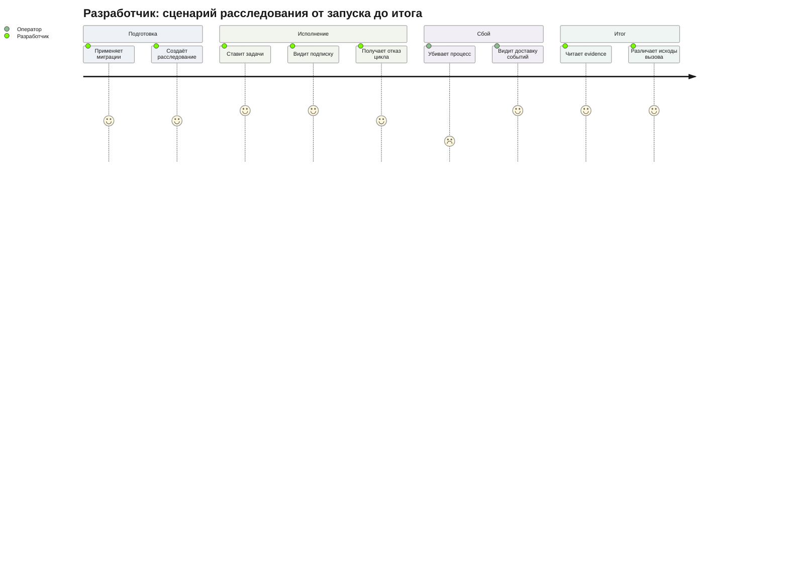
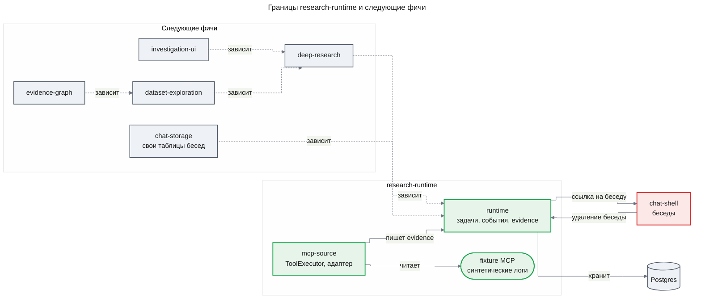
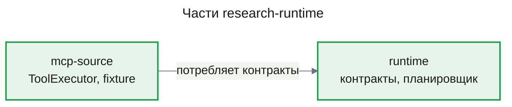

# PRD: Runtime исследований (research-runtime)

| Status | Date | Depth | UXRD | Designs |
|---|---|---|---|---|
| Approved | 2026-10-31 | full | — (интерфейса нет) | `design-runtime.md`, `design-mcp-source.md` |

## Snapshot

- **Что появляется**: долговечный runtime расследований без LLM — задачи с контрактом и зависимостями, дедупликация по ключу, отказ от циклов ожидания, события с гарантией доставки после рестарта, хранилище evidence с provenance и первый источник данных — read-only fixture MCP с синтетическими логами.
- **Для кого**: разработчик следующих фич исследовательской Agent OS; пользователь получит ценность через `deep-research` и `investigation-ui`.
- **Части**: `runtime`, затем `mcp-source`.
- **Главный риск**: собственный runtime на Postgres должен выдержать конкуренцию — одинаковые запросы, циклы ожидания, запоздавшие попытки после восстановления (Assumptions).
- **Открытые вопросы**: 1 (эталонный набор расследований — передан в `deep-research`).

---

## Overview

### Background

Спецификация `docs/side_reserch/agent_os_workflow_spec.md` описывает исследовательскую Agent OS: семь workflows (W1–W7) параллельно исследуют данные больше окна модели и запрашивают продолжения друг у друга. Это держится на программном слое без LLM: задачи с контрактом, планировщик зависимостей, события с повторной доставкой, хранилище evidence и исполнитель MCP (спецификация, §4, §13, §14, §16). Сегодня в `apps/api` этого слоя нет: есть только чат на Mastra с `PostgresStore` для памяти бесед.

Целевая модель имеет окно до ~250k токенов, но это не отменяет внешнего хранилища. Логи за период заведомо больше окна, а provenance требует хранить исходные записи отдельно от рабочего пакета контекста (дайджест `papers_digest.md`, §9). Ошибки исполнителя и сборки ответа встречаются чаще, чем ошибки плана (дайджест, §1, п. 3), поэтому надёжность исполнения закладывается первой.

Эта фича — первая в дорожной карте; остальные строятся на её контрактах. Здесь реализуются шаги 1–2 порядка сборки прототипа (спецификация, §17): источник MCP с унифицированными ответами и контракты задач, событий и evidence с хранилищем и простым планировщиком. Шаг 1 выполняется на синтетическом fixture MCP вместо реального источника.

---

## User Stories

### Primary Users

| Персона | Кто это | Что ей важно |
|---|---|---|
| **Разработчик исследовательских workflows** (основная) | Член команды, который строит `deep-research` и следующие фичи | Контракты и планировщик, которому можно доверить порядок, повторы и восстановление |
| **Оператор прототипа** | Тот, кто запускает `apps/api` и Postgres | Рестарт посреди расследования без потери и дублирования работы |
| **Аналитик / SRE** (косвенная) | Будущий автор исследовательских запросов через чат | Каждый факт прослеживается до исходного вызова и среза данных |

### User Stories

| Как | Я хочу | Чтобы |
|---|---|---|
| Разработчик workflows | Описать задачу контрактом с зависимостями, бюджетом и ожидаемым результатом | Планировщик сам запускал её по готовности и отклонял недопустимое |
| Разработчик workflows | Выполнять одинаковый запрос данных от двух задач один раз | Параллельные ветки не дублировали обращения к источнику |
| Оператор | Перезапустить процесс посреди расследования | Все события были доставлены, а ни одно действие не применилось дважды |
| Разработчик workflows | Отличать пустой результат, ошибку инструмента и сбой транспорта | «Ничего не найдено» не путалось с «источник недоступен» |
| Аналитик | Видеть у каждого фрагмента данных источник, инструмент, аргументы, срез и признак усечения | Любой вывод проверялся по исходной записи |
| Аналитик | Удалить беседу | Вместе с ней исчезли и все данные её расследований |

### Use Cases

- **UC-1**: Разработчик создаёт расследование, привязанное к беседе пользователя, и ставит fetch-задачу → она вызывает fixture MCP, результат сохранён как evidence с provenance.
- **UC-2**: Разработчик ставит задачу, зависящую от fetch-задачи → она стартует только после успеха зависимости; при провале зависимости не стартует.
- **UC-3**: Две задачи запрашивают одни и те же данные с одним срезом → вторая подписывается на первую, источник вызывается один раз, обе получают один результат.
- **UC-4**: Разработчик пытается связать задачи A и B взаимным ожиданием → планировщик отклоняет связь с причиной, остальные задачи не затронуты.
- **UC-5**: Оператор убивает процесс посреди расследования и запускает снова → незавершённые события доставлены, расследование доходит до того же итога, что и без сбоя.
- **UC-6**: Источник возвращает пустой результат, ошибку инструмента, обрывает соединение или отклоняет вызов как несовместимый → каждый исход записан своим классом, повтор выполняется только для временного сбоя транспорта и только в пределах бюджета.
- **UC-7**: Данные источника обновились (новый срез) → запрос с новым срезом выполняется заново, старый результат не выдаётся за актуальный.
- **UC-8**: Пользователь удаляет беседу, к которой привязаны расследования → исполнение их задач остановлено, расследования удалены со всеми данными, расследования других бесед и пользователей не затронуты.

### User Journey Diagram

---

## Functional Requirements

Требования нумеруются `FR-xx`, критерии приёмки — `AC-xx.y`. Критерии описывают наблюдаемый исход: состояние задачи, запись в хранилище, число вызовов источника. Пользовательского входа нет: приёмка идёт интеграционным тестом или скриптом против Postgres из `infra/docker-compose.yml`.

### Must Have (MVP)

#### Runtime: задачи, события, хранилище

- [ ] **FR-01. Расследование, привязанное к беседе.** Расследование хранит исходный запрос, бюджет, ссылку на беседу (`threadId`) и владельца (`resourceId` — идентификатор пользователя, как в Mastra Memory).
  - AC-01.1: Given расследование создано для беседы T пользователя U, When расследования запрашиваются по (U, T), Then оно возвращается со своими задачами; запрос с другим `resourceId` его не возвращает.
  - AC-01.2: Given расследование создано для беседы T, Then сообщения и заголовок беседы T не изменились, а сквозные тесты `chat-shell` проходят без правок.

- [ ] **FR-02. Контракт задачи.** Каждая задача несёт поля спецификации, §4: идентификатор, расследование, тип и версию workflow, входные ссылки со срезом данных, ожидаемый результат, зависимости, версию состояния, бюджет, статус, выходные ссылки и checkpoint. Бюджет задачи включает лимит вызовов инструментов, лимит повторов, дедлайн и лимит токенов; токены расходует `deep-research`.
  - AC-02.1: Given задача без ожидаемого результата, без бюджета или со входной ссылкой без среза данных, When она регистрируется, Then регистрация отклонена с указанием поля, задача не создана.
  - AC-02.2: Given задача с типом или версией workflow, для которых не зарегистрирован обработчик, Then регистрация отклонена.

- [ ] **FR-03. Состояния исполнения отдельно от статусов знания.** Состояния задачи: `queued`, `running`, `waiting`, `succeeded`, `failed`, `cancelled`; `waiting` хранит явное условие пробуждения. Статусы знания хранятся у evidence отдельно: `observed`, `candidate`, `supported`, `refuted`, `unknown`, `stale`. Код этой фичи выставляет только `observed`; остальные статусы определены контрактом для следующих фич.
  - AC-03.1: Given задача в конечном состоянии (`succeeded`, `failed`, `cancelled`), When происходит попытка перевести её в `running`, Then переход отклонён, состояние не изменилось.
  - AC-03.2: Given задача переводится в `waiting` без условия пробуждения, Then переход отклонён.
  - AC-03.3: Given fetch-задача завершилась `succeeded`, Then её evidence имеет статус `observed`; успех задачи не выставляет никакого другого статуса знания.
  - AC-03.4: Given запись evidence со статусом `supported` без области действия, основания или версии evidence, When она проверяется по контракту evidence, Then она отклонена.

- [ ] **FR-04. Запуск по готовым зависимостям.** Задача стартует только тогда, когда все её зависимости в состоянии `succeeded`; выходы зависимостей доступны ей по ссылкам.
  - AC-04.1: Given задача B зависит от A, When A ещё в `queued` или `running`, Then B не стартовала; When A перешла в `succeeded`, Then B стартует и получает ссылки на выходы A.
  - AC-04.2: Given A завершилась `failed` или `cancelled`, Then B не стартует и переходит в `cancelled` с причиной, называющей A.
  - AC-04.3: Given B зависит от задачи, которой нет в этом расследовании, Then регистрация B отклонена.

- [ ] **FR-05. Предложенная задача проходит проверку бюджета.** Предложение задачи само её не запускает: планировщик проверяет зависимости и остаток бюджета расследования. Бюджет расследования ограничивает общее число задач и вызовов инструментов, поэтому даже зациклившийся планировщик следующих фич не породит работу сверх лимита. Лимит вызовов принятой задачи списывается с бюджета расследования целиком; повторы и страницы расходуют лимит задачи (FR-14, FR-17) и не выводят расследование за его бюджет.
  - AC-05.1: Given у расследования остался бюджет на 2 вызова инструментов, When предлагается задача с бюджетом на 3 вызова, Then предложение отклонено с причиной «бюджет», источник не вызван.
  - AC-05.2: Given в расследовании достигнут лимит числа задач, When предлагается ещё одна, Then она отклонена, уже созданные задачи продолжают исполняться.

- [ ] **FR-06. Общая задача для одинакового запроса.** Ключ задачи вычисляет код из типа workflow, нормализованных параметров, ожидаемого результата, среза данных и версии обработчика. Запрос с ключом, совпадающим с задачей того же расследования в `queued`, `running`, `waiting` или `succeeded`, не создаёт новой задачи: запросивший становится подписчиком и получает тот же результат. Задача в `failed` или `cancelled` не переиспользуется.
  - AC-06.1: Given fetch-задача F выполняется, When поступает запрос с тем же ключом, Then новая задача не создана, запросивший записан подписчиком F, источник вызван ровно один раз, оба получают ссылку на одно evidence.
  - AC-06.2: Given 10 одинаковых запросов поступают одновременно, Then создана одна задача и источник вызван ровно один раз.
  - AC-06.3: Given два запроса отличаются только порядком ключей аргументов, Then у них один ключ.
  - AC-06.4: Given F со срезом S1 завершилась, When поступает тот же запрос со срезом S2, Then создана новая задача, источник вызван снова, результат S1 не выдан как результат S2.
  - AC-06.5: Given тот же запрос с другой версией обработчика, Then создана новая задача.
  - AC-06.6: Given задача F с ожидаемым результатом «все совпадения», When поступает тот же запрос того же типа workflow с ожидаемым результатом «выборка», Then создана новая задача с другим ключом, а запросивший не стал подписчиком F.

- [ ] **FR-07. Отказ от циклов ожидания.** Зависимость или ожидание, которое замкнуло бы цикл между задачами, отклоняется при регистрации (спецификация, §13.4).
  - AC-07.1: Given A ждёт B, When регистрируется ожидание B от A, Then оно отклонено с причиной «цикл ожидания» и перечнем задач цикла; A и B продолжают исполняться как до попытки.
  - AC-07.2: Given цепочка A → B → C, When регистрируется зависимость C от A, Then она отклонена.
  - AC-07.3: Given задача объявляет зависимость от самой себя, Then регистрация отклонена.

- [ ] **FR-08. Доставка событий с восстановлением после рестарта.** Изменение состояния и событие о нём фиксируются вместе: сохраняются оба или ни одно. Событие доставляется не реже одного раза. Повторная доставка события с тем же `eventId` не даёт эффекта. Задача, оставшаяся в `running` после гибели процесса, возвращается к исполнению.
  - AC-08.1: Given расследование из нескольких задач исполняется, When процесс `apps/api` принудительно убит после записи событий и до их доставки и затем запущен снова, Then каждое ожидавшее событие доставлено и все задачи достигли тех же конечных состояний, что и в прогоне без сбоя. Намеренное исключение — задача, чей дедлайн истёк до восстановления (AC-19.2).
  - AC-08.2: Given тот же сценарий, Then evidence каждой fetch-задачи сохранено ровно один раз, ни одно состояние не перешло дважды, ни один подписчик не уведомлён дважды.
  - AC-08.3: Given событие доставлено повторно с тем же `eventId`, Then повторная доставка не меняет ни одной записи.
  - AC-08.4: Given задача была в `running` в момент сбоя, Then после рестарта она не остаётся в `running` дольше времени восстановления (раздел Reliability) и исполняется снова; повторный вызов источника допустим, так как инструменты только читают.

- [ ] **FR-09. Единый конверт событий.** Каждое событие несёт `eventId`, `investigationId`, `taskId`, `causationId`, `correlationId`, `schemaVersion`, `stateRevision`, `payloadRef`, `createdAt` (спецификация, §14). Большое содержимое передаётся ссылкой. Фича определяет типы событий своего потока; типы событий W1–W7 добавляют фичи, которые их производят.
  - AC-09.1: Given результат инструмента объёмом из AC-12.4, Then событие о его сохранении содержит ссылку на результат, а размер события не зависит от размера результата.
  - AC-09.2: Given событие с неизвестной `schemaVersion`, Then оно не обрабатывается, не теряется и помечено как требующее внимания; доставка остальных событий продолжается.
  - AC-09.3: Given цепочка «задача → вызов → evidence → зависимая задача», Then по `causationId` и `correlationId` восстанавливается порядок причин от первого события до последнего.

- [ ] **FR-10. Хранилище и миграции.** Расследования, задачи, зависимости и подписки, события и отметки об их обработке, evidence вместе с содержимым больших выходов хранятся в Postgres. Схема вводится версионированными миграциями, которые не затрагивают таблицы Mastra.
  - AC-10.1: Given пустая база из `infra/docker-compose.yml`, When применяются миграции, Then схема создана; повторное применение ничего не меняет.
  - AC-10.2: Given база, где Mastra уже создал свои таблицы и лежат беседы, When применяются миграции, Then беседы и их сообщения читаются без изменений.

#### MCP-источник: исполнитель и fixture

- [ ] **FR-11. ToolExecutor: проверка до вызова и read-only allowlist.** Каждый вызов инструмента проходит проверку аргументов по схеме инструмента и проверку allowlist типа workflow. В allowlist могут входить только инструменты, объявленные как читающие. Это объявление делается в конфигурации source adapter проекта и не берётся из самоописания MCP-сервера: аннотации вроде `readOnlyHint` — непроверенные подсказки.
  - AC-11.1: Given инструмент не входит в allowlist типа workflow задачи, Then вызов отклонён без обращения к источнику, исход записан как отказ allowlist.
  - AC-11.2: Given аргументы не проходят схему инструмента, Then вызов отклонён без обращения к источнику, исход записан как ошибка валидации.
  - AC-11.3: Given инструмент не объявлен читающим в конфигурации адаптера, даже если сервер помечает его `readOnlyHint`, Then его нельзя включить в allowlist: конфигурация отклоняется при старте.

- [ ] **FR-12. Унифицированный ответ с provenance и метаданными усечения.** Каждый результат вызова содержит источник, инструмент, нормализованные аргументы, срез данных или верхнюю границу времени, `totalMatched`, `returned`, признак усечения и состояние пагинации. Результат сохраняется как evidence через хранилище `runtime` и попадает в выходные ссылки задачи.
  - AC-12.1: Given fetch-задача вызвала инструмент поиска fixture, Then её evidence содержит все поля provenance из FR-12, а выходные ссылки задачи указывают на это evidence.
  - AC-12.2: Given совпадений больше, чем помещается в одну страницу, Then признак усечения выставлен, `returned` меньше `totalMatched`, а состояние пагинации позволяет получить следующую страницу.
  - AC-12.3: Given источник не сообщает общее число совпадений, Then `totalMatched` помечен как неизвестный, а не записан нулём.
  - AC-12.4: Given результат объёмом 10 MB, Then он сохранён и читается обратно без изменений.

- [ ] **FR-13. Три класса исхода вызова.** Сбой транспорта или протокола, ошибка инструмента и корректный пустой результат различаются и записываются своим классом (спецификация, §13.8).
  - AC-13.1: Given источник вернул пустой результат, Then задача `succeeded`, evidence `observed` с нулём совпадений и областью поиска; это «не найдено в области», а не ошибка.
  - AC-13.2: Given источник вернул ошибку инструмента, Then задача `failed` с классом «ошибка инструмента» и текстом ошибки; автоматического повтора нет.
  - AC-13.3: Given соединение с источником оборвано, Then исход записан классом «сбой транспорта/протокола» и обрабатывается по FR-14.
  - AC-13.4: Given источник вернул ответ, который не разбирается или нарушает контракт инструмента, Then этот вызов записан классом «сбой транспорта/протокола» и никогда не записан как пустой результат: evidence «не найдено в области» по нему не создаётся.

- [ ] **FR-14. Повтор временных сбоев в пределах бюджета.** Временный сбой транспорта или протокола повторяется: обрыв соединения, таймаут, внутренняя ошибка сервера, некорректный ответ. Каждый повтор — это вызов инструмента: он расходует и лимит повторов задачи, и её лимит вызовов инструментов. Как только исчерпан любой из двух лимитов, задача завершается `failed` с классом последнего сбоя.

  Сбой, который одинаково повторится при каждом вызове, не повторяется: задача сразу завершается `failed` с классом «сбой транспорта/протокола» и причиной «несоответствие конфигурации или протокола». Это ошибка протокола JSON-RPC «неизвестный метод или инструмент» или «некорректный запрос», неподдерживаемая версия протокола, отсутствующая у сервера возможность, отказ аутентификации или авторизации. Внутренняя ошибка сервера JSON-RPC к этой причине не относится и остаётся временным сбоем из первого абзаца. Результат инструмента с признаком ошибки (`isError`), включая отказ самого сервера при проверке аргументов, к этой причине не относится и остаётся классом «ошибка инструмента» (AC-13.2).
  - AC-14.1: Given источник даёт 2 временных сбоя транспорта подряд, а затем ответ, лимит повторов задачи 3 и лимит вызовов 5, Then задача `succeeded` после 3 вызовов.
  - AC-14.2: Given источник даёт временный сбой транспорта на каждый вызов, лимит повторов 2 и лимит вызовов 5, Then задача `failed` с классом «сбой транспорта/протокола», источник вызван ровно 3 раза.
  - AC-14.3: Given источник даёт временный сбой транспорта на каждый вызов, лимит повторов 5 и лимит вызовов 2, Then задача `failed` с классом «сбой транспорта/протокола», источник вызван ровно 2 раза.
  - AC-14.4: Given источник отвечает ошибкой протокола JSON-RPC «неизвестный инструмент» или «некорректный запрос», лимит повторов 3 и лимит вызовов 5, Then источник вызван ровно 1 раз, задача `failed` с классом «сбой транспорта/протокола» и причиной «несоответствие конфигурации или протокола». Given источник отклоняет аргументы результатом инструмента с `isError` при тех же лимитах, Then источник вызван ровно 1 раз, задача `failed` с классом «ошибка инструмента» (AC-13.2).

- [ ] **FR-15. Fixture MCP-сервер с синтетическими логами.** В репозитории есть MCP-сервер только для чтения поверх детерминированно сгенерированных логов с `traceId`. Данные воспроизводят сценарий спецификации, §15: период до релиза и после, рост timeout платежей, адаптер провайдера, внешний ответ после локального timeout. Инструменты дают поиск по фильтру и интервалу времени с пагинацией, агрегаты (счётчики по полю и интервалу) и получение записей по `traceId`.
  - AC-15.1: Given одна версия данных и один запрос, Then ответы двух вызовов совпадают байт в байт.
  - AC-15.2: Given агрегат timeout платёжного сервиса до и после релиза, Then после релиза значение выше; Given записи затронутого `traceId`, Then время внешнего ответа позже локального timeout.
  - AC-15.3: Given объём данных fixture, Then в ней не меньше 100 000 записей логов, и ни один инструмент не меняет данные.
  - AC-15.4: Given тестовый режим отказа (сбой транспорта, ошибка инструмента, ошибка инструмента при проверке аргументов, некорректный ответ, ошибка протокола «неизвестный инструмент» или «некорректный запрос», задержка), Then fixture воспроизводит выбранный отказ на заданных вызовах.
  - AC-15.5: Given fixture переключена на новую версию данных с дополнительными записями, Then срез данных в provenance меняется (основа для AC-06.4).

- [ ] **FR-16. Граница source adapter.** Fixture подключена через адаптер источника; новый источник подключается новым адаптером без изменений в `runtime` и ToolExecutor.
  - AC-16.1: Given второй адаптер-заглушка с другим источником, When он регистрируется, Then fetch-задачи через него работают без изменений кода `runtime` и ToolExecutor, а его evidence имеет тот же формат provenance.

### Should Have

- [ ] **FR-17. Пагинация до исчерпания проверяется кодом.** Ожидаемый результат fetch-задачи указывает требуемую полноту: «все совпадения» или «выборка». Для «всех совпадений» исполнитель сам проходит страницы, пока источник не исчерпан или не кончился бюджет. Модели склонны останавливаться раньше нужного (дайджест, §1, п. 7), поэтому решение о полноте принимает код.
  - AC-17.1: Given 2 500 совпадений при странице 500 и достаточном бюджете, Then задача получила 5 страниц, усечения нет.
  - AC-17.2: Given бюджет позволяет 3 страницы, Then задача `succeeded` с признаком неполного охвата и состоянием пагинации для продолжения.

- [ ] **FR-18. Параллельное исполнение независимых задач.** Готовые задачи без взаимных зависимостей исполняются одновременно в пределах лимита конкурентности процесса.
  - AC-18.1: Given две готовые независимые задачи и лимит конкурентности ≥ 2, Then вторая стартует, не дожидаясь завершения первой.

- [ ] **FR-19. Дедлайн задачи.** Задача, превысившая дедлайн из бюджета, завершается `failed` с причиной «дедлайн»; медленная задача не блокирует независимые. Дедлайн абсолютный: он фиксируется при первом старте задачи и не сбрасывается восстановлением после сбоя. Дедлайн и отмена никогда не считаются сбоем источника или транспорта и не повторяются.
  - AC-19.1: Given обработчик задачи работает дольше её дедлайна, Then задача `failed` с причиной «дедлайн», а независимые задачи завершаются как обычно.
  - AC-19.2: Given задача исполнялась в момент гибели процесса, а процесс поднят уже после её дедлайна, Then после восстановления задача `failed` с причиной «дедлайн» и источник для неё больше не вызывается.
  - AC-19.3: Given fetch-задача прервана по дедлайну, а лимиты повторов и вызовов не исчерпаны, Then повтора нет: источник больше не вызван, исход записан причиной «дедлайн», а не классом «сбой транспорта/протокола».

- [ ] **FR-20. Отмена расследования.** Отмена переводит в `cancelled` задачи в `queued`, `waiting` и `running`: исполняющиеся задачи останавливаются, и после отмены новых вызовов источника нет. Задача, успевшая завершиться до того, как отмена вступила в силу, сохраняет свой результат. Уже сохранённые результаты остаются на месте.
  - AC-20.1: Given расследование с завершёнными и ожидающими задачами, When оно отменено, Then ожидающие задачи `cancelled`, evidence завершённых задач на месте.
  - AC-20.2: Given fetch-задача в `running` ждёт ответа источника, When расследование отменено, Then задача `cancelled`, а после отмены источник не вызван ни разу — ни повтором, ни следующей страницей.
  - AC-20.3: Given задача завершилась `succeeded` до того, как отмена вступила в силу, Then она остаётся `succeeded`, а её evidence на месте.

- [ ] **FR-21. Эталон сценария в fixture.** Генератор fixture сохраняет известный ответ сценария, §15: настоящую причину и затронутые `traceId`. Это первое эталонное расследование, по которому `deep-research` сможет мерить качество.
  - AC-21.1: Given сгенерированные данные, Then рядом лежит эталон с причиной и списком `traceId`, и каждый `traceId` из эталона находится инструментом получения по `traceId`.

- [ ] **FR-23. Удаление беседы удаляет её расследования.** Когда беседа удаляется, каждое расследование, привязанное к ней (`resourceId` и `threadId`), удаляется вместе со всеми данными: задачами, событиями, evidence и содержимым выходов. Исполняющиеся задачи этих расследований сначала останавливаются, и после удаления источник не вызывается. Удаление беседы без расследований ведёт себя так же, как сейчас. Требование действует и до, и после переноса бесед в собственные таблицы (`chat-storage`).
  - AC-23.1: Given у беседы T пользователя U есть расследование с задачами, событиями и evidence, When беседа T удалена, Then в хранилище не осталось ни расследования, ни его задач, событий, evidence и содержимого выходов.
  - AC-23.2: Given fetch-задача расследования беседы T в `running`, When беседа T удалена, Then после удаления источник не вызван ни разу и ни одна запись расследования не появилась снова.
  - AC-23.3: Given расследования другого пользователя и расследования другой беседы пользователя U, When пользователь U удаляет беседу T, Then эти расследования, их задачи и evidence не изменились.
  - AC-23.4: Given беседа без расследований, When она удалена, Then удаление ведёт себя как до этой фичи, а сквозные тесты удаления беседы `chat-shell` проходят без правок.
  - AC-23.5: Given удаление данных расследований не удалось, Then беседа не удалена, запрос удаления завершается ошибкой, и повторный запрос удаляет и расследования, и беседу.

### Could Have

- [ ] **FR-22. Пометка `stale` для evidence устаревшего среза.** Когда для того же ключа сохранён результат нового среза, evidence старого среза помечается `stale`.
  - AC-22.1: Given evidence для S1 и новое evidence того же ключа для S2, Then evidence S1 имеет статус `stale`, но остаётся читаемым.

### Won't Have (this release)

- **Объём следующих фич** — вызовы LLM, W1–W7, инструмент запуска для агента чата и остальное из таблицы «Дорожная карта фич»; эта фича только программная.
- **Изменяющие инструменты MCP и `operationId` для неопределённого исхода записи** — источники только читают (спецификация, §13.8).
- **Подключение реальных источников логов** — только fixture; новые источники — новые адаптеры (FR-16).
- **Переиспользование результатов между расследованиями** — дедупликация в пределах одного расследования; общий кеш требует модели доступа.
- **Объектное хранилище для больших выходов** — в прототипе выходы лежат в Postgres.
- **Отдельные процессы-воркеры** — исполнение идёт внутри процесса `apps/api`.
- **Перенос бесед и сообщений из Mastra Memory в собственные таблицы** — фича `chat-storage` из дорожной карты.

### Out of Scope

- RBAC и корпоративные роли — вынесены за границы спецификацией, §1.
- Temporal как владелец планирования — не рассматривается.
- Изменения чата, его контрактов и таблиц Mastra Memory, кроме удаления расследований вместе с беседой (FR-23).
- Отдельная benchmark-инфраструктура (спецификация, §17).

### Дорожная карта фич

Исследовательская Agent OS собирается фичами из таблицы; `chat-storage` переводит хранилище чата на собственные таблицы и идёт после `research-runtime`. Runtime — общий движок субагентов чата, а W1–W7 — первый набор субагентов на нём. Точка входа — чат: расследование или субагент запускается вызовом инструмента главного агента, а результат возвращается в беседу; отдельного HTTP API для запуска нет.

| Фича | Объём | Зависит от |
|---|---|---|
| `research-runtime` | Этот документ | — |
| `deep-research` | Динамический процесс без фиксированного конвейера, заданный декларативной конфигурацией; контроллер включает возможности по наблюдениям; бюджеты рабочего окна и токенов; синтез с provenance; запуск из чата по режиму или подтверждённому предложению, ответ дописывается в беседу; эталонный набор и сравнение с большой моделью. Объём — `docs/features/deep-research/prd.md` | `research-runtime` |
| `chat-steering` | Пользователь направляет идущее расследование из беседы; сигналы поступают на вход решения контроллера | `deep-research` |
| `dataset-exploration` | Полный W2, партиции W3, coverage manifest, частичные результаты. Объём уточняется по результатам эталонного набора `deep-research` | `deep-research` |
| `evidence-graph` | W4, граф evidence, продолжения NeedEvidence, демонстрация готовности по спецификации, §17. Объём уточняется по результатам эталонного набора `deep-research` | `dataset-exploration` |
| `investigation-ui` | Шаги и субагенты блоками вызовов инструментов в беседе, при необходимости ход расследования и evidence в рабочей области; UXRD | `deep-research` |
| `chat-storage` | Беседы и сообщения `chat-shell` переезжают из Mastra Memory в собственные таблицы и миграции | `research-runtime` (механизм миграций) |

Параллельно идёт платформенная ветка — то, что делает Agent OS корпоративной платформой, а не только исследовательским контуром:

| Фича | Объём | Зависит от |
|---|---|---|
| `access-control` | Вход через корпоративный SSO (OIDC) вместо dev-заголовка `x-user-id`, роли пользователей, RBAC на инструменты и источники | `chat-shell` |
| `mcp-registry` | Администратор подключает MCP-серверы и выдаёт права на инструменты по ролям; изменяющий вызов — только после подтверждения пользователя в беседе; журнал аудита каждого вызова инструмента | `access-control` |
| `workflow-templates` | Пользователи создают шаблоны процессов на формате конфигурации `deep-research`, делятся ими, права на запуск шаблона; первый пример — анализ инцидентов, анализ клиентов — после реальных MCP-источников | `deep-research`, `access-control` |

### Scope Boundary Diagram

---

## Non-Functional Requirements

### Performance

| Метрика | Цель | Как измеряется |
|---|---|---|
| Старт зависимой задачи после успеха зависимости | p95 ≤ 2 с | Интеграционный тест, 50 пар задач, локальный Postgres |
| Накладные расходы ToolExecutor на вызов (без времени источника) | p95 ≤ 100 мс | Тест против fixture с нулевой задержкой |
| Ответ fixture на страницу поиска | p95 ≤ 500 мс | Тест, 100 запросов |

### Reliability

- Время восстановления: после рестарта процесса ожидавшие события доставлены, а брошенные задачи вернулись к исполнению не позже чем через 60 с.

### Security

- Только читающие инструменты; allowlist и схема аргументов проверяются до вызова (FR-11).
- Расследования и их evidence изолированы по `resourceId` (AC-01.1) и удаляются вместе с беседой (FR-23).
- Fixture содержит только синтетические данные, без реальных персональных данных и секретов.

### Scalability

- Прототип рассчитан на единицы одновременных расследований в одном процессе `apps/api`.
- Хранение выходов в Postgres принимается до объёма из AC-12.4; больше — повод перейти на объектное хранилище.
- Контракты задач и событий версионируются, чтобы следующие фичи добавляли типы событий без миграции существующих.

---

## Delivery Parts

| Part | Covers | Cut along | Depends on | Rationale |
|---|---|---|---|---|
| `runtime` | FR-01–FR-10; Should: FR-18, FR-19, FR-20, FR-23 | `domain` | — | Ядро исполнения со своей предметной областью |
| `mcp-source` | FR-11–FR-16; Should: FR-17, FR-21 | `domain` | `runtime` | Шов с внешней системой MCP |

- Отложено: **FR-22** (пометка `stale`) — без графа evidence и решений по устаревшим данным ценность мала; кандидат в `evidence-graph`.

**Шов между частями** — контракты задачи, события и evidence в `packages/contracts` и хранилище evidence `runtime`. `mcp-source` регистрирует обработчик fetch-задач в планировщике и сохраняет результаты только через хранилище evidence. Критерии `runtime` проверяются тестовым обработчиком без MCP; сквозной сценарий с fixture (метрика № 1) запускается после `mcp-source`.

### Part Dependency Diagram

---

## Success Criteria

### Quantitative Metrics

| # | Метрика | Цель | Метод измерения | Срок |
|---|---|---|---|---|
| 1 | Сквозной сценарий | 7 из 7 исходов из списка ниже | Интеграционный тест против Postgres и fixture, 20 прогонов подряд без падений | При приёмке `mcp-source` |
| 2 | Восстановление после сбоя | 0 потерянных событий и 0 повторных эффектов на 20 точках убийства процесса | Тест, убивающий процесс в разных точках сценария, со сверкой записей | При приёмке `runtime` |
| 3 | Дедупликация под конкуренцией | 1 вызов источника в 20 из 20 прогонов сценария AC-06.2 | Счётчик вызовов fixture | При приёмке `mcp-source` |
| 4 | Классификация исходов | 100 % внедрённых отказов fixture записаны своим классом, 0 повторов вне бюджета, 0 повторов несоответствия конфигурации или протокола | Тест с режимами отказа FR-15, 30 вызовов на класс | При приёмке `mcp-source` |
| 5 | Детерминизм fixture | 100 % совпадение ответов при одной версии данных (AC-15.1) | Сравнение ответов на 100 запросах | При приёмке `mcp-source` |
| 6 | Без регрессии чата | Все тесты `apps/api` и `apps/web` проходят без правок после миграций | `pnpm --filter api test:e2e` против мигрированной базы из `infra/docker-compose.yml` и `pnpm check` | При приёмке `runtime` |

Исходы сквозного сценария (метрика № 1):

1. Fetch-задача сохраняет evidence с provenance (AC-12.1).
2. Зависимая задача стартует только после успеха зависимости (AC-04.1).
3. Повторный одинаковый запрос становится подписчиком с одним вызовом источника (AC-06.1).
4. Взаимное ожидание A и B отклонено (AC-07.1).
5. Рестарт посреди расследования проходит без потерь и дублей (AC-08.1, AC-08.2).
6. Пустой результат, ошибка инструмента и сбой транспорта различаются (FR-13).
7. Новый срез данных не переиспользует старый результат (AC-06.4).

### Qualitative Metrics

1. **Готовность контрактов.** Разработчик `deep-research` пишет обработчик нового типа workflow по схемам `packages/contracts` и Design Doc `runtime`, не читая внутренности планировщика (проверка — вопрос ревьюеру Design Doc `deep-research`).
2. **Подключаемость источника.** Подключение реального источника сводится к новому адаптеру; это подтверждает адаптер-заглушка AC-16.1.

---

## Technical Considerations

### Dependencies

- `apps/api`: NestJS 12, `@mastra/core` 1.80, `@mastra/pg` с `PostgresStore` для памяти бесед (проверено: `apps/api/package.json`, `apps/api/src/mastra/mastra.provider.ts`).
- MCP-клиента и MCP SDK в зависимостях нет; инструмента миграций нет (проверено: `apps/api/package.json`, корневой `package.json`). Оба вводятся этой фичей; выбор делает Design Doc.
- `packages/contracts`: zod 4, собирается до `apps/*`; схемы задачи, события, evidence и расследования добавляются рядом с `threads.ts`.
- Postgres 16 из `infra/docker-compose.yml` — общая база для Mastra и новой схемы.
- `chat-shell`: удаление беседы — `ThreadsService.delete` в `apps/api/src/threads/threads.service.ts` проверяет владельца, отменяет прогоны беседы и удаляет её через `PostgresStore.deleteThread` (проверено). Удаление расследований (FR-23) встраивается в этот путь.

### Constraints

- Исполнение внутри процесса `apps/api`, без вызовов LLM, только читающие инструменты MCP (Won't Have).
- Задачами, событиями и восстановлением владеет собственный runtime на Postgres; Mastra допускается только внутри обработчиков задач, без своей долговечности. Второй владелец сломал бы атомарность изменения состояния и события, а долговечная шина событий Mastra требует внешнего брокера, которого в проекте нет (проверено в `@mastra/core` 1.80.0: абстрактный `PubSub` в `dist/events/pubsub.d.ts`, умолчание `EventEmitterPubSub` опции `pubsub` в `dist/mastra/index.d.ts`; в `infra/docker-compose.yml` только Postgres).
- `research-runtime` не читает и не пишет таблицы `mastra_*`; принадлежность беседы пользователю проверяется через существующий сервис бесед.
- Слой хранения и механизм миграций `runtime` должны позже принять собственные таблицы бесед и сообщений (`chat-storage`).
- Удаление беседы без расследований — AC-23.4.

### Assumptions

- Механика собственного runtime — один исполнитель на одинаковый запрос под конкуренцией, отказ цикла при одновременной регистрации, отсечение запоздавшей попытки после восстановления — реализуема на Postgres без внешнего движка; проверяется коротким spike на техническом этапе.
- Новая схема уживается с таблицами Mastra в одной базе — проверяется AC-10.2.
- Синтетический сценарий достаточно похож на реальные логи, чтобы контракты provenance и пагинации подошли реальным источникам — проверяется подключением первого реального источника.

### Risks and Mitigation

| Риск | Влияние | Вероятность | Митигация |
|---|---|---|---|
| Собственный runtime дороже ожидаемого или ошибается под конкуренцией: дубли задач, пропущенный цикл, запоздавшая попытка перезаписывает итог | Высокое | Среднее | Spike механики на техническом этапе; AC-06.2, AC-07.1, метрика № 2 |
| Удаление беседы оставляет данные расследований или меняет удаление беседы без них | Высокое | Низкое | AC-23.1–AC-23.4; сквозные тесты `chat-shell` (метрика № 6) |
| Повтор чтения после сбоя даёт дубли evidence | Высокое | Среднее | AC-08.2 и метрика № 2 с несколькими точками убийства процесса |
| Гонка двух одинаковых запросов создаёт две задачи | Среднее | Высокое | AC-06.2 под конкуренцией |
| Большие выходы раздувают Postgres | Среднее | Среднее | Порог объёма выхода (Scalability) и переход на объектное хранилище |
| Контракты придётся ломать, когда появится `deep-research` | Среднее | Среднее | Версионирование схем событий (FR-09) и поле бюджета токенов уже в контракте |
| Синтетика даёт ложную уверенность | Среднее | Высокое | Эталон в fixture (FR-21) и эталонный набор в `deep-research` |

---

## Undetermined Items

- [ ] **Эталонный набор расследований.** Без набора из 20–30 расследований с известной причиной нельзя проверить качество цикла и бюджеты контекста (дайджест, §11, п. 7). Блокирует метрики качества `deep-research`. Владелец — фича `deep-research`: набор определён в `docs/features/deep-research/prd.md`, FR-13. Эта фича даёт только первый эталон (FR-21).

---

## Appendix

### References

- Спецификация: `docs/side_reserch/agent_os_workflow_spec.md` — §4, §13.1, §13.4, §13.7, §13.8, §14, §15, §16, §17.
- Дайджест статей: `docs/side_reserch/papers_digest.md` — §1 (ранняя остановка, лишние tools), §3.5 (неограниченный replanning), §9 (окно до 250k), §11 (пробелы спецификации).
- Соседняя фича: `docs/features/chat-shell/prd.md` — модель бесед (`threadId`, `resourceId`).
- Классы ошибок MCP — ошибка протокола (JSON-RPC error) и ошибка инструмента (`isError`): [MCP specification, Tools — Error Handling](https://modelcontextprotocol.io/specification/2025-11-25/server/tools#error-handling).
- Аннотации инструментов MCP недоверенные, если сервер не доверенный: [MCP specification, Tools — Data Types](https://modelcontextprotocol.io/specification/2025-11-25/server/tools#tool).
- Долговечное исполнение агентов на Postgres как альтернатива Temporal (заявления вендоров, не проверены): [DBOS](https://docs.dbos.dev/), [pydantic-ai-absurd](https://pypi.org/project/pydantic-ai-absurd/), [anchor-runtime](https://pypi.org/project/anchor-runtime/).

### Glossary

- **Расследование (investigation)** — один исследовательский запрос пользователя со своими задачами, бюджетом и evidence; привязано к беседе.
- **Задача (task)** — одно исполнение зарегистрированного workflow с контрактом из FR-02; fetch-задача получает данные из источника через ToolExecutor.
- **Evidence** — сохранённый результат вызова инструмента с provenance.
- **Provenance** — происхождение evidence: источник, инструмент, аргументы, срез данных, метаданные усечения.
- **Срез данных (snapshot)** — версия данных или верхняя граница времени, на которой получен результат.
- **ToolExecutor** — исполнитель вызовов MCP: проверка, вызов, нормализация, классификация ошибок, сохранение.
- **Source adapter** — граница, за которой подключается конкретный источник данных.
- **Fixture MCP** — MCP-сервер в репозитории с детерминированными синтетическими логами.

---

## Update History

| Version | Date | Change |
|---|---|---|
| 1.0 | 2026-10-31 | Первая версия по результатам подтверждения требований |
| 1.1 | 2026-10-31 | FR-08 — гарантии без механизма; ожидаемый результат в ключе FR-06, AC-06.6; AC-03.4 только для evidence; AC-19.1 без fixture; методы и сроки метрик № 1 и № 6 |
| 1.2 | 2026-10-31 | Утверждён вместе с Delivery Parts (`runtime` → `mcp-source`); FR-10 без привязки к движку; AC-02.3 слит в AC-06.6; расход бюджета повтором (FR-05, FR-14, AC-14.3); read-only из конфигурации адаптера (FR-11); вариант Mastra в вопросе 1 — внутри `apps/api`; рыночный контекст перенесён в References; Won't Have ссылается на дорожную карту; эталонный набор передан `deep-research`; сокращения |
| 1.3 | 2026-10-31 | Вопрос 1 решён — собственный runtime на Postgres; FR-14 без повтора несоответствия конфигурации или протокола, AC-13.4, AC-14.4; абсолютный дедлайн (FR-19, AC-19.2, AC-19.3, исключение в AC-08.1); отмена останавливает исполняющиеся задачи (FR-20); FR-23 — удаление беседы удаляет расследования; фича `chat-storage` в дорожной карте и ограничения хранения |
| 1.3.1 | 2026-10-31 | Причина «несоответствие конфигурации или протокола» — только ошибка протокола JSON-RPC, проверка аргументов с `isError` — ошибка инструмента (FR-14, AC-14.4, AC-15.4); причина решения по вопросу 1 сведена к проверенному факту о шине событий Mastra |
| 1.4 | 2026-10-31 | Утверждён; FR-23 — Should Have, AC-23.5 о частичном сбое удаления; FR-14 называет ошибки JSON-RPC, внутренняя ошибка сервера — временный сбой; решённый вопрос 1 перенесён в Constraints с проверкой по двум файлам; вступление дорожной карты без счёта фич; отдельный путь ребра `chat-storage` на схеме границ; сокращены повторы |
| 1.5 | 2026-10-31 | Дорожная карта: runtime — общий движок субагентов чата, запуск инструментом агента чата вместо HTTP API (`deep-research`), блоки вызовов инструментов в беседе (`investigation-ui`); Won't Have без HTTP API |
| 1.5.1 | 2026-10-31 | Следующая фича дорожной карты переименована: `research-loop` → `deep-research` |
| 1.6 | 2026-10-31 | Дорожная карта: `deep-research` — динамический процесс (контроллер включает и выключает workflows по наблюдениям) с эталонным набором и замером рабочего окна шага; объём `dataset-exploration` и `evidence-graph` уточняется по эталонному набору; добавлена платформенная ветка `access-control` → `mcp-registry` |
| 1.7 | 2026-10-31 | Эталонный набор определён в PRD `deep-research`; строка `deep-research` в дорожной карте ссылается на её PRD; добавлены фичи `chat-steering` и `workflow-templates`; запуск из чата возвращает результат в беседу |
