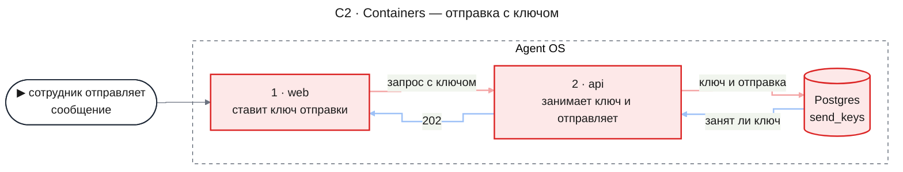
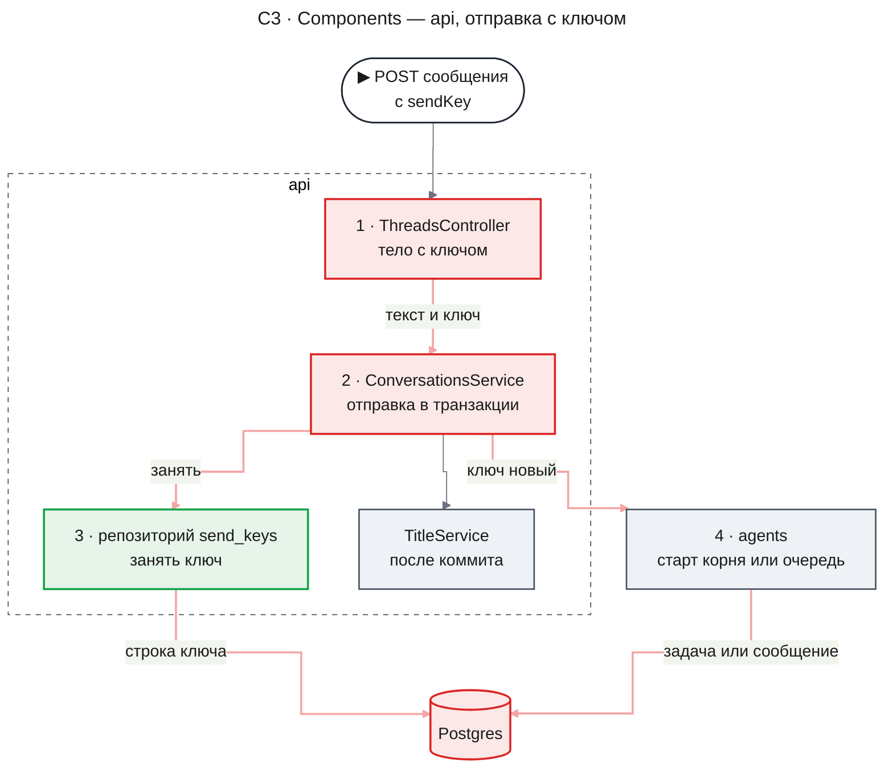
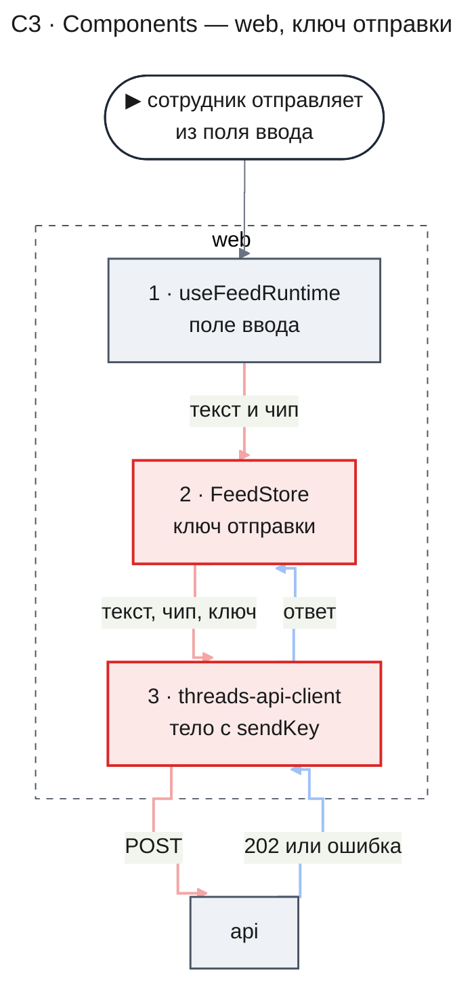
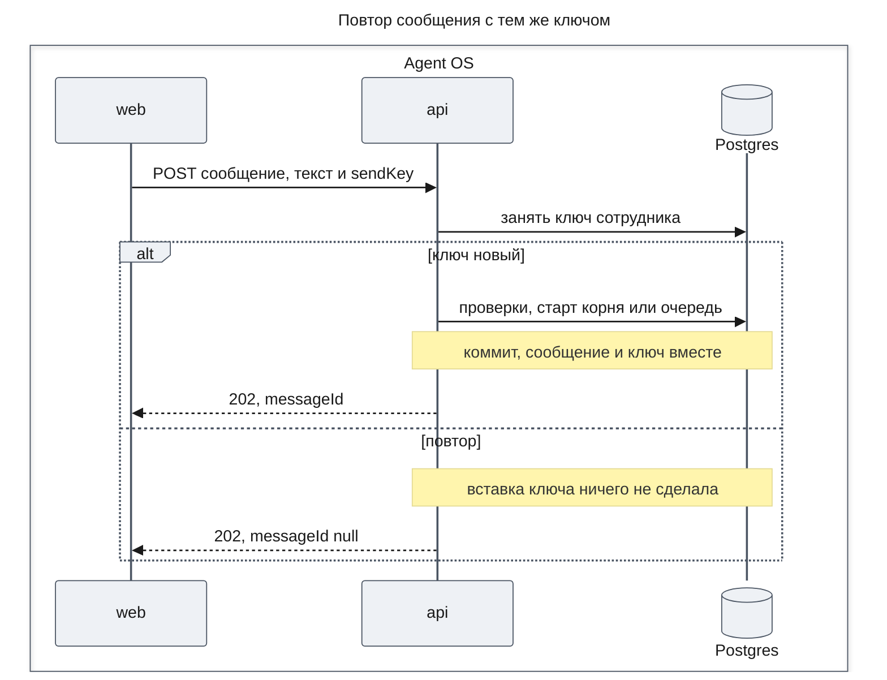
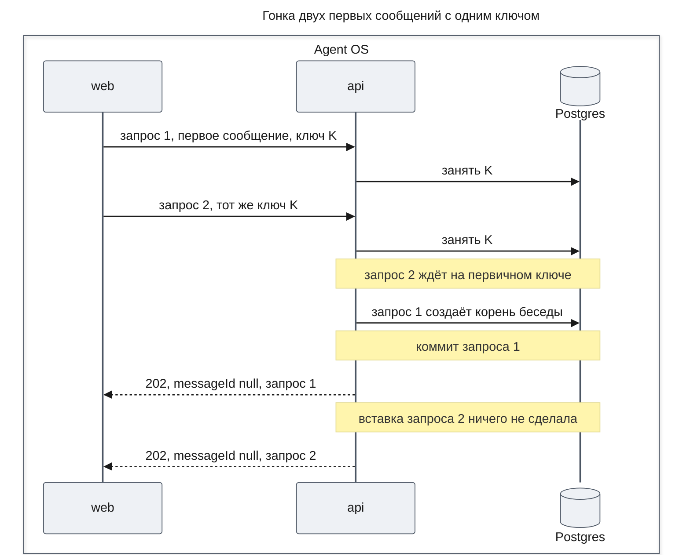

# Устойчивость хода агента — Design Document — send

**Status:** На утверждении · **Date:** 2026-11-28 · **PRD:** [prd.md](./prd.md) · **UXRD:** нет · **Depends on:** нет

## Snapshot

**Overview.** Если ответ сервера на отправку потерялся и сотрудник отправил вернувшийся в поле текст ещё раз, сегодня в беседе появляется второе такое же сообщение. Часть добавляет ключ отправки. Веб создаёт UUID на каждую отправку из поля ввода и шлёт его в поле `sendKey`, а следующая отправка после неудачи берёт ключ неудавшейся. Сервер первой записью транзакции отправки вставляет пару «сотрудник, ключ» в таблицу `send_keys` с `ON CONFLICT DO NOTHING`. Если пара уже есть, сервер отвечает 202 с `messageId: null` и ничего не создаёт, а веб, как после любой отправки, перечитывает беседу и видит принятое сообщение. Ключ покрывает сообщение в беседу, первое сообщение беседы и сообщение на странице агента.

- **Не меняется**: runtime и его очередь сообщений, «Запустить сейчас» и срабатывание расписания, развилка беседы.
- **Главный риск**: после потерянного ответа следующая отправка из того же поля считается повтором, даже если сотрудник изменил текст ([Risks](#risks-and-mitigation)).
- **Открытые вопросы**: нет.

### Key Decisions

#### KD-1: Ключ занимается строкой `send_keys` первой записью транзакции отправки

Строка `send_keys` — это сотрудник и ключ: первичный ключ по обоим полям и внешний ключ на сотрудника с каскадом ([ADR-0024](../../adr/ADR-0024-every-reference-is-a-foreign-key.md)). Служба отправки открывает транзакцию, вставляет строку с `ON CONFLICT DO NOTHING` раньше любой другой записи и выполняет отправку, как сегодня; все записи отправки коммитятся вместе с ключом. Второй запрос с тем же ключом Postgres держит на первичном ключе, пока первый не закончится: после коммита первого вставка второго ничего не делает, после отката проходит. Отказ (чужая запись в чипе, отказ обучения, отказ старта) откатывает и ключ, поэтому отправка после отказа выполняется заново.

- Ключ в своей транзакции до отправки не подходит: после отказа он остался бы занятым, и исправленная отправка молча не выполнилась бы.
- Колонка ключа на сообщении очереди `runtime_inbox` не подходит: первое сообщение беседы становится входом корня и в очередь не попадает. `runtime_tasks.exclusive_key` освобождается в конце задачи, и повтор после ответа агента он бы не узнал.
- Строка ключа идёт раньше строк задач, а дальше порядок [ADR-0023](../../adr/ADR-0023-live-task-objects-one-stepping-process.md), п. 6 прежний. Строку ключа берут только запросы с тем же ключом, поэтому новых циклов ожидания нет и своего повтора при взаимной блокировке транзакции не нужно.

#### KD-2: Повтор отвечает 202 `{ messageId: null }`

Веб уже принимает `messageId: null`: стор ленты ставит такую отправку временной записью первого сообщения и убирает её первым же чтением, в котором есть запись `task`. Она есть у каждой беседы и каждого агента, которые приняли первую отправку. После отправки стор всегда перечитывает ленту, и это чтение показывает сообщение первого запроса. Вернуть повтору `messageId` первой отправки значило бы хранить результат и ссылку на сообщение. Ответ 409 показал бы ошибку на отправку, которую сервер принял.

#### KD-3: Веб создаёт ключ на отправку из поля и хранит его с неудавшейся отправкой

`FeedStore` уже хранит неудавшуюся отправку (`sendFailure`) с текстом, который поле ввода возвращает сотруднику. Теперь там лежит и её ключ. Отправка из поля берёт ключ из `sendFailure`, если он там есть, иначе создаёт новый UUID. Текст и чип стор не сравнивает: следующая отправка после неудачи считается повтором. Ключ, созданный заново на каждый запрос, не поймал бы единственный повтор, который есть в вебе: сотрудник отправляет текст ещё раз после ошибки. Тихие отправки (кнопки карточек решений, пересылка в главный чат) неудачу не хранят и всегда берут новый ключ.

Первое сообщение новой беседы идёт тем же маршрутом с ключом, поэтому сервер держит и его (AC-03.2). После неудачи первого сообщения веб удаляет пустую беседу, а следующая отправка создаёт новую беседу со своим стором и новым ключом. Если неудачей был потерянный ответ, это удаление убирает принятую беседу, и у сотрудника остаётся одна беседа.

#### KD-4: «Запустить сейчас» идёт без ключа

Экран расписания выполняет одно действие за раз: пока запрос идёт, у кнопки нет обработчика клика. Поэтому двойной клик даёт один запрос и один запуск. Остаётся случай, когда ответ потерялся и сотрудник кликнул ещё раз: в истории два ручных запуска. Чтобы закрыть этот случай, нужны `sendKey` в теле `POST /api/schedules/:id/run`, ключ на каждое расписание, который экран держит после ошибки, то же занятие ключа в транзакции запуска и ответ повтору. У повтора нет запуска, из которого собрать `ScheduleRunView`, поэтому понадобились бы новый вид ответа и ветка в уведомлении экрана. Случай редкий, а его след виден сотруднику в истории расписания, поэтому часть его не закрывает (PRD, Won't Have: ключ отправки у «Запустить сейчас»).

#### KD-5: `sendKey` обязателен в обоих маршрутах сообщений

`POST /api/threads/:threadId/messages` и `POST /api/agents/:agentId/messages` принимают обязательный `sendKey`. Необязательное поле позволило бы клиенту молча пропустить ключ. Правка в развилке беседы (поле `edit` тела развилки) ключа не берёт: развилка не отправка из FR-03. Веб и помощники e2e-тестов шлют ключ в том же изменении, второй версии схемы нет.

## Terms

- **Ключ отправки** — по PRD ([Terms](./prd.md#terms)); здесь это UUID в поле `sendKey`.
- **Строка ключа** — строка `send_keys`: сотрудник и ключ.
- **Повтор** — запрос, чья вставка строки ключа ничего не сделала, потому что такая строка уже закоммичена.

## Part

- **Prerequisite ADRs**: [ADR-0012](../../adr/ADR-0012-closed-api-and-server-issued-employee-id.md) — сотрудника называет сессия, [ADR-0022](../../adr/ADR-0022-one-database-and-nestjs-modules.md) — одна база, репозитории в `packages/db`, [ADR-0023](../../adr/ADR-0023-live-task-objects-one-stepping-process.md) — порядок строк в транзакции, [ADR-0024](../../adr/ADR-0024-every-reference-is-a-foreign-key.md) — каждая ссылка внешний ключ.

**Out of scope**

- «Запустить сейчас» и срабатывание расписания идут без ключа (KD-4). Отправка, которую делает расписание, зовёт ту же отправку беседы без ключа.
- Сообщение агента агенту (инструмент `message-agent`), правка в развилке беседы и отправки трекера задач идут без ключа.
- Runtime не меняется.
- Строки ключей не истекают и не чистятся; каскад уносит их вместе с сотрудником.

**Constraints**

- **Без обратной совместимости** (PRD, Constraints): старое тело без ключа сервер не принимает (KD-5).
- **Настройки в базе**: новых настроек и переменных окружения нет.
- **Ключ в пределах сотрудника** (NFR-01): первичный ключ включает сотрудника из сессии, поэтому такой же ключ другого сотрудника занимает его собственную строку.

## Building-block Inventory

Follows the [code system](../../code-system/README.md).

| Building block | Pattern | Status | Note |
|---|---|---|---|
| репозиторий `send_keys` | [repository-over-transaction.md](../../code-system/patterns/repository-over-transaction.md) | new | одна вставка без ошибки при конфликте, ответ — занят ли ключ; искали в `runtime_tasks`, `runtime_inbox` — KD-1 |
| `ConversationsService`, `AgentControlService` | [repository-over-transaction.md](../../code-system/patterns/repository-over-transaction.md) | extended | отправка сотрудника — в транзакции, которая сначала занимает ключ |
| `ThreadsController`, `AgentsController` | [auth-boundary.md](../../code-system/patterns/auth-boundary.md) | reused | берут сотрудника из сессии и проверяют тело схемой с `sendKey` |
| `FeedStore`, `threads-api-client` | [web-api-client.md](../../code-system/patterns/web-api-client.md) | extended | ключ на отправку, ключ неудавшейся отправки в `sendFailure` |

## Acceptance Criteria

### FR-03: Повтор отправки ничего не создаёт

- From the PRD: AC-03.1, AC-03.2, AC-03.4, NFR-01.
- AC-03.1 уточняется: повтор получает 202 с `messageId: null`, а перечитанная беседа показывает сообщение первой отправки (KD-2).
- Когда сервер отказал первой отправке, ключ не занят, и отправка с тем же ключом проверяется и выполняется заново (KD-1).
- Когда тело сообщения приходит без `sendKey` или с ключом не в виде UUID, сервер отвечает 400 `VALIDATION_FAILED` (KD-5).
- Когда сотрудник после ошибки снова отправляет из того же поля, запрос несёт ключ неудавшейся отправки (KD-3).

## Design

### Architecture (C1–C4)

#### C2 · Containers

Веб ставит ключ на отправку, api занимает его в базе в той же транзакции, что и отправку.

#### C3 · Components: api

**api — отправка сообщения в беседу**

Отправку сотрудника `ConversationsService` выполняет в одной транзакции: сначала занимает ключ, затем делает прежнюю отправку — проверку чипа, старт корня или очередь и подъём беседы в списке. Если ключ уже занят, служба сразу отвечает `messageId: null`: строка ключа принадлежит этому сотруднику, и ответ ничего не раскрывает. Генерацию заголовка служба запускает после коммита и только для новой отправки. Внутри транзакции её запросы шли бы через соединение транзакции, потому что `Db` держит транзакцию в контексте вызова. Отправка, которую делает срабатывание расписания, зовёт прежнюю отправку без ключа внутри своей транзакции, как сейчас.

`AgentControlService` делает то же для страницы агента, и схема для неё та же: в одной транзакции он занимает ключ, проверяет агента и ставит сообщение в очередь.

#### C3 · Components: web

**web — отправка из поля ввода**

`FeedStore` берёт для отправки из поля ключ из `sendFailure` или новый UUID. При ошибке стор кладёт ключ в `sendFailure` рядом с текстом, а при успехе неудача уже стёрта, и следующая отправка получит новый ключ (KD-3). Ответ `messageId: null` стор обрабатывает прежним кодом (KD-2).

### Runtime Flows

#### Flow 1: Повтор сообщения в беседу или на странице агента

**Starts when:** веб шлёт сообщение с ключом, ответ теряется, и сотрудник отправляет ещё раз с тем же ключом, для AC-03.1, AC-03.4, NFR-01

Ключ ищется у того же сотрудника, поэтому такой же ключ другого сотрудника занимает его собственную строку и создаёт его собственное сообщение (NFR-01). Другой ключ от того же сотрудника — новая отправка, даже с тем же текстом (AC-03.4). Отказ первой отправки откатывает ключ вместе со всем остальным.

#### Flow 2: Два одновременных первых сообщения с одним ключом

**Starts when:** в новую беседу почти одновременно приходят два запроса первого сообщения с одним ключом, для AC-03.2

Беседа одна, и в ней одно сообщение: второй запрос не доходит ни до старта корня, ни до очереди. Два первых сообщения с разными ключами идут, как сейчас: одно становится корнем, другое встаёт в его очередь.

### Contract Definitions

- **`POST /api/threads/:threadId/messages`** — отправляет сообщение в беседу. Тело — `text`, необязательный `recordId` и обязательный `sendKey`. Возвращает 202 `SendMessageResponse`: `messageId` сообщения очереди, или `null`, когда сообщение стало первым в беседе или когда этот сотрудник уже отправил этот ключ. В последнем случае ничего не создано. Ошибки прежние: 400 `VALIDATION_FAILED`, 404 `THREAD_NOT_FOUND` и `RECORD_NOT_FOUND`, 409 `START_REFUSED`, отказы обучения.
- **`POST /api/agents/:agentId/messages`** — отправляет сообщение агенту; тело то же. Возвращает 202 `SendMessageResponse`: `messageId`, или `null` у повтора. Ошибки прежние: 400 `VALIDATION_FAILED`, 404 `AGENT_NOT_FOUND`, отказы обучения.
- **`POST /api/threads/:threadId/fork`** — поле `edit` по-прежнему несёт `text`, `recordId` и `seq` и `sendKey` не принимает (KD-5).

**Тело отправки**

- `sendKey` — UUID, который веб создаёт на отправку из поля ввода; один ключ — одна отправка этого сотрудника. Остальное тело повтора сервер не читает.

### Data Model

Таблица `send_keys` — по строке на каждую принятую отправку сотрудника с ключом:

- строка — сотрудник и ключ, первичный ключ по обоим полям; он же держит одну отправку на ключ и ставит одновременные запросы с одним ключом в очередь (KD-1);
- ссылка на сотрудника — внешний ключ с каскадом; первичный ключ начинается с неё и служит её индексом;
- строка пишется первой записью транзакции отправки и коммитится вместе с ней;
- схема меняется перегенерацией миграции, записей для переноса нет.

## Security Considerations

- **Authentication & Authorization**: новых маршрутов нет, оба маршрута сообщений остаются за `SessionGuard`. Сотрудника называет сессия, а не тело, поэтому ключ сверяется только со строками этого сотрудника (NFR-01). Ответ повтору — `messageId: null` — ничего не говорит о беседе или агенте.
- **Input Validation**: `sendKey` проверяется схемой как UUID в контроллере, как остальное тело.
- **Sensitive Data Handling**: ключ — не секрет и пишется в лог вместе с сотрудником, целью и исходом: новая отправка или повтор.

## Risks and Mitigation

- **Сотрудник после потерянного ответа изменил текст и отправил его** — сервер примет запрос как повтор, новый текст не уйдёт, а лента покажет первое сообщение; вероятность низкая, нужен ответ, потерянный после коммита. Сотрудник видит в ленте, что принято, и пишет снова (KD-3).
- **Взаимная блокировка в транзакции отправки** — сотрудник получает ошибку, ключ откатывается вместе с отправкой, и следующая отправка из поля выполняется заново; вероятность низкая (KD-1).
- **Работа, которую отправка запускает до коммита, не видит её строк** — вероятность низкая. Сигнал дерева runtime уходит при коммите, а генерация заголовка стартует после него. Тот же путь уже работает внутри транзакции срабатывания расписания.

## Update History

| Version | Date | Change |
|---------|------|--------|
| 1.0 | 2026-11-28 | Первая версия |
| 1.1 | 2026-11-28 | Сверка с live-feed: подъём беседы в списке пишется внутри транзакции отправки |
| 1.2 | 2026-11-28 | Упрощение по решению владельца: ключ — строка «сотрудник, ключ» с `ON CONFLICT DO NOTHING`, повтор отвечает `messageId: null` и ничего не создаёт; убраны хранение и выдача результата первой отправки, проверка цели у повтора, `SEND_KEY_REUSED`, общая служба ключа, сравнение текста и чипа в вебе и ключ «Запустить сейчас» |
| 1.3 | 2026-11-28 | Сверка с PRD 1.2: убраны ссылки на удалённые AC-03.3 и UC-5 и открытый вопрос о расхождении с PRD; KD-4 ссылается на Won't Have PRD |
