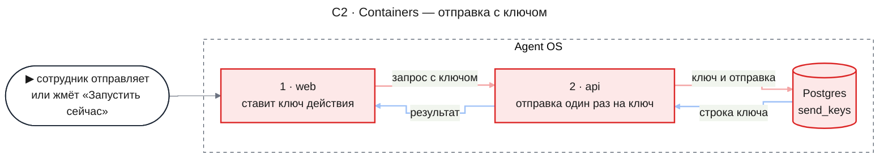
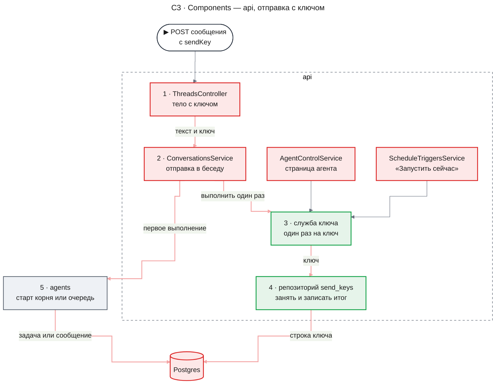
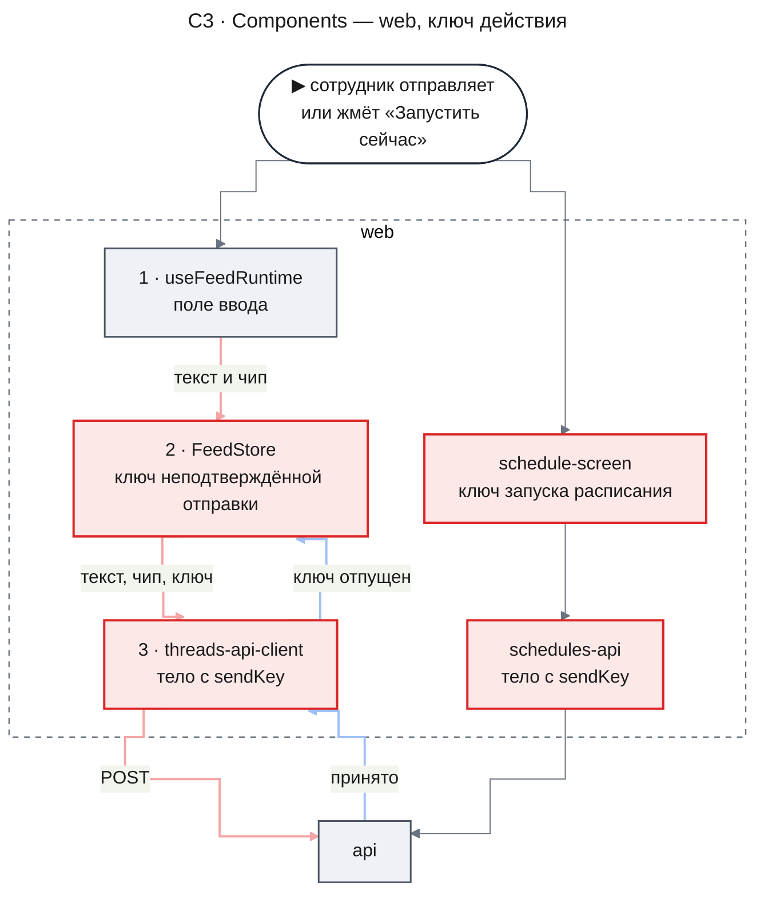
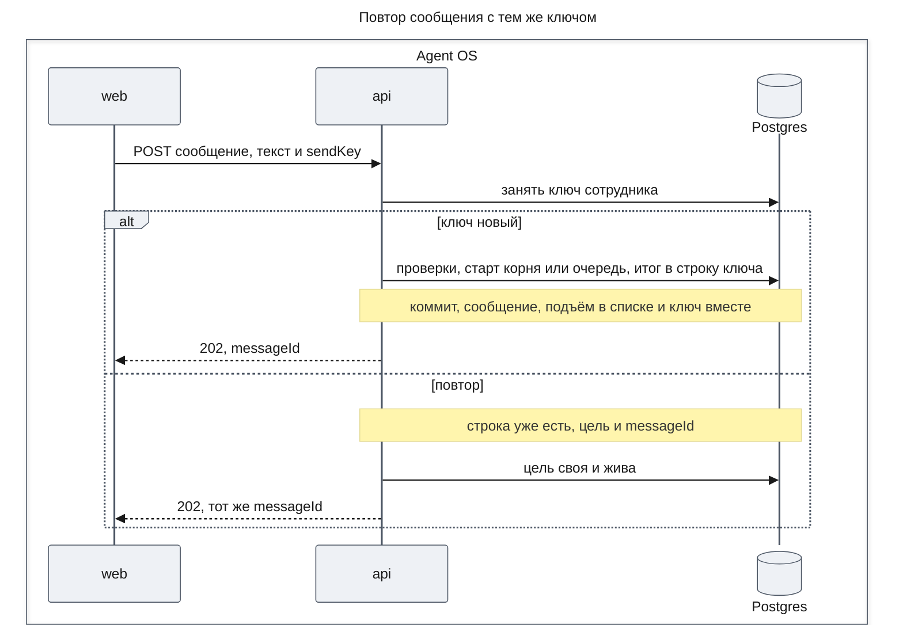
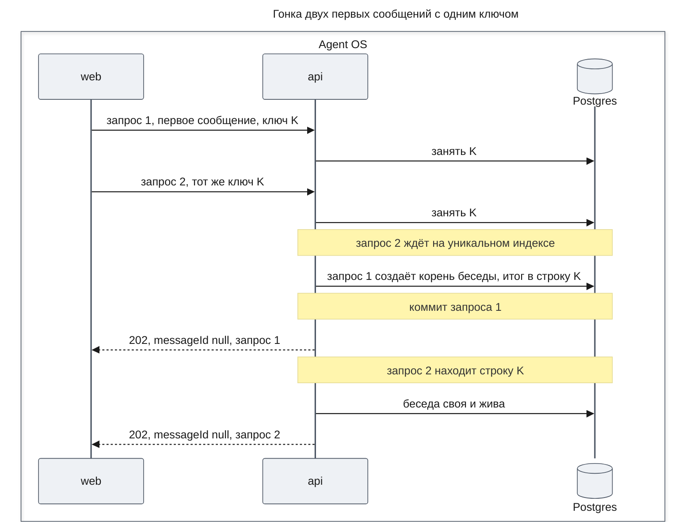
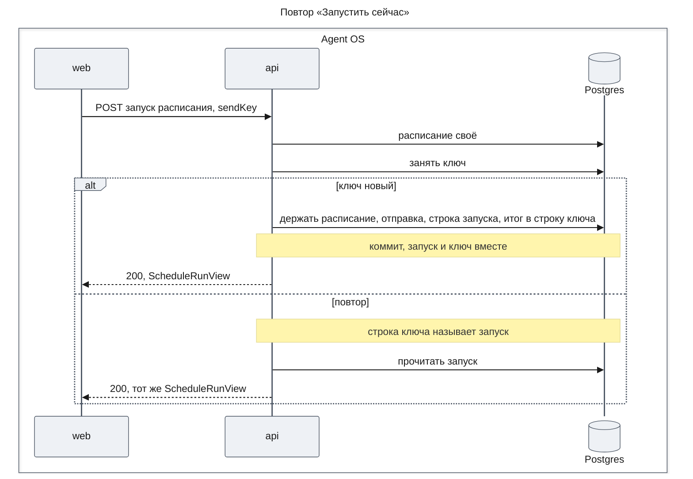

# Устойчивость хода агента — Design Document — send

**Status:** На утверждении · **Date:** 2026-11-28 · **PRD:** [prd.md](./prd.md) · **UXRD:** нет · **Depends on:** нет

## Snapshot

**Overview.** Если ответ сервера на отправку потерялся или сотрудник кликнул дважды, второй запрос сегодня создаёт второе сообщение, вторую беседу или второй запуск расписания. Часть добавляет ключ отправки: веб ставит его на каждое действие сотрудника и шлёт тот же ключ, пока сервер это действие не подтвердил. Сервер записывает ключ в отдельную таблицу первой записью в транзакции отправки, а в конце той же транзакции записывает в ту же строку, что отправка создала. Повтор с тем же ключом ждёт на уникальном индексе, пока первая отправка не закончится, находит её строку и возвращает её результат, ничего не создавая. Один механизм покрывает все четыре отправки: сообщение в беседу, первое сообщение беседы, сообщение на странице агента и «Запустить сейчас».

- **Не меняется**: runtime и порядок записей в его очереди сообщений, форма ответов маршрутов, сработавший в срок запуск расписания, отправка, которую делает само расписание.
- **Главный риск**: отправка в беседу теперь коммитится вместе с ключом, и работа, которую отправка запускает до коммита (генерация заголовка), не нашла бы её строк ([Risks](#risks-and-mitigation)).
- **Открытые вопросы**: нет.

### Key Decisions

#### KD-1: Ключи всех четырёх отправок живут в одной новой таблице `send_keys`

Повтор должен узнаваться одинаково, что бы ни создала отправка: сообщение в очереди агента, корень новой беседы или запуск расписания. Строка `send_keys` называет сотрудника, ключ, цель отправки (беседу или агента — то есть задачу runtime, или расписание) и то, что отправка создала: сообщение очереди или запуск. У первого сообщения беседы создано только сама беседа, и строка называет только цель. Каждая ссылка — внешний ключ с каскадом ([ADR-0024](../../adr/ADR-0024-every-reference-is-a-foreign-key.md)), а уникальный индекс держит одну строку на сотрудника и ключ.

Поиск похожего: `runtime_tasks.exclusive_key` держит одну незаконченную задачу своего типа и отпускает ключ, когда задача кончается, поэтому повтор после конца хода он бы не узнал. Индекс `schedule_runs_term_idx` держит срок расписания, а ручные запуски из него исключены. Очередь `runtime_inbox` не видит первого сообщения беседы: оно становится входом корневой задачи и в очередь не попадает. Отвергнуто: колонка ключа на каждой создаваемой строке (очередь, задача, запуск) — три механизма вместо одного, runtime получает понятие, которого у него нет, а гонку двух первых сообщений всё равно пришлось бы сверять между двумя таблицами. Отвергнут и ответ маршрута целиком в jsonb: ссылки на сообщение и запуск спрятались бы в JSON без внешнего ключа, а такой причины в списке ADR-0024 нет.

#### KD-2: Ключ занимается первой записью транзакции отправки, и все создания отправки коммитятся вместе с ним

Сервер вставляет строку ключа до любой другой записи; при конфликте вставка ничего не делает и возвращает пустой ответ, как у `exclusive_key`. Занятая строка несёт только сотрудника и ключ, а цель и созданное служба пишет в неё в конце той же транзакции: корень первого сообщения появляется только внутри неё, и внешний ключ на него раньше не поставить. Второй запрос с тем же ключом ждёт на уникальном индексе, пока первая транзакция не закончится. После коммита первой он находит её строку, а после её отката занимает ключ сам. Одну отправку держит индекс, а не чтение перед вставкой. Отказ, которым сервер отклоняет запрос (чужая запись в чипе, обучение не принимает сообщений, старт отклонён), откатывает и ключ, поэтому повтор отказа проверяется заново. Транзакция повторяется при взаимной блокировке так же, как транзакции движка (`withTxRetry` runtime).

Такой порядок не создаёт новых циклов ожидания. Строку ключа берут только запросы с тем же ключом, и берут её раньше любой другой строки, поэтому запрос, который ждёт чужой ключ, ещё ничего не держит. После неё строки задач идут ровно в порядке [ADR-0023](../../adr/ADR-0023-live-task-objects-one-stepping-process.md), п. 6: первой — получатель сообщения или корень, а у «Запустить сейчас» первой после ключа остаётся строка расписания (`hold`), с которой начинается каждый захват расписания. Отвергнуто: строка ключа в конце транзакции — тогда второй запрос успел бы поставить своё сообщение и узнал бы о повторе только на последней вставке, и ему пришлось бы откатывать собственную работу. Отвергнут и advisory lock с чтением перед вставкой: правило дома держит «одну на ключ» индексом.

#### KD-3: Повтор проходит проверку цели, а проверки содержания идут только у первого выполнения

Повтор должен вернуть результат первой отправки (AC-03.1), но не должен открыть то, что сотруднику уже не принадлежит. Поэтому проверки «цель своя и жива» выполняются и у повтора, с теми же кодами, что у маршрута: удалённая беседа отвечает `THREAD_NOT_FOUND`, агент — `AGENT_NOT_FOUND`, расписание — `SCHEDULE_NOT_FOUND`. Проверки содержания идут только у первого выполнения, и повтор их не повторяет: чип записи, приём сообщений обучением, отказ старта корня, беседа расписания, которой уже нет (`SCHEDULE_NOT_RUNNABLE`). Иначе повтор принятой отправки мог бы получить отказ, которого первая не получила.

Повтор возвращает то, что вернула первая отправка: `messageId` сообщения очереди, `null` для первого сообщения беседы, а для запуска — тот же `ScheduleRunView`, собранный из строки запуска. Строки запуска не меняются, поэтому вид совпадает с первым. Текст повтора сервер не сравнивает: действие определяет ключ. Ключ, который сотрудник уже потратил на другую цель, отвечает `SEND_KEY_REUSED` и ничего не меняет. Отвергнуто: вернуть результат чужой цели — сотрудник получил бы `messageId` другой беседы.

#### KD-4: `sendKey` обязателен во всех трёх маршрутах отправки

Отправка в беседу, на странице агента и «Запустить сейчас» принимают в теле обязательное поле `sendKey` — UUID. Необязательное поле позволило бы клиенту молча пропустить FR-03, и дубль вернулся бы незаметно. Тело правки в развилке беседы (`ForkRequestSchema`, поле `edit`) берёт текст и чип отправки без ключа: развилка — не отправка из FR-03. Клиент веба и помощники e2e-тестов шлют ключ в том же изменении, второй версии схемы нет.

#### KD-5: Веб держит ключ действия, пока сервер его не подтвердил, и сам повторов не добавляет

Ключ, созданный заново на каждый вызов, не защитил бы от единственного повтора, который в вебе есть: сотрудник отправляет вернувшийся в поле текст ещё раз после ошибки. Поэтому стор ленты помнит ключ последней отправки, которую сервер не подтвердил. Отправка того же текста с тем же чипом в ту же цель берёт этот ключ, а любое другое действие или подтверждённая отправка дают новый. Экран расписания держит ключ «Запустить сейчас» для каждого расписания: два клика до ответа и клик после потерянного ответа идут с одним ключом, а клик после подтверждённого запуска — с новым (AC-03.3, AC-03.4). Автоматического повтора запросов веб не получает: клиент API по-прежнему делает один запрос.

## Terms

- **Ключ отправки** — по PRD ([Terms](./prd.md#terms)); здесь это UUID в поле `sendKey`.
- **Строка ключа** — строка `send_keys`: сотрудник, ключ, цель и то, что отправка создала.
- **Цель отправки** — беседа, агент или расписание из адреса маршрута.
- **Первое выполнение** — запрос, который занял ключ и выполнил отправку; **повтор** — запрос, который нашёл строку ключа уже занятой.

## Part

- **Prerequisite ADRs**: [ADR-0012](../../adr/ADR-0012-closed-api-and-server-issued-employee-id.md) — сотрудника называет сессия, [ADR-0022](../../adr/ADR-0022-one-database-and-nestjs-modules.md) — одна база, репозитории в `packages/db`, [ADR-0023](../../adr/ADR-0023-live-task-objects-one-stepping-process.md) — порядок строк в транзакции и повтор при взаимной блокировке, [ADR-0024](../../adr/ADR-0024-every-reference-is-a-foreign-key.md) — каждая ссылка внешний ключ.

**Out of scope**

- Сработавший в срок запуск расписания остаётся как есть: его уже держит срок (`schedule_runs_term_idx`), а отправка, которую делает расписание, идёт без ключа сотрудника — её покрывает ключ запуска или срок.
- Отправка сообщения агентом агенту (инструмент `message-agent`) и правка в развилке беседы идут без ключа.
- Runtime не меняется: ни очередь сообщений, ни порядок её записей, ни понятия runtime.
- Строки ключей не истекают и не чистятся; каскад уносит их вместе с целью, сообщением, запуском или сотрудником.

**Constraints**

- **Без обратной совместимости** (PRD, Constraints): ключ обязателен сразу во всех трёх маршрутах, старое тело без ключа сервер не принимает (KD-4).
- **Настройки в базе**: новых настроек и переменных окружения нет, у ключа нет срока жизни.
- **Ключ в пределах сотрудника** (NFR-01): уникальный индекс включает сотрудника из сессии, поэтому такой же ключ другого сотрудника занимает его собственную строку.

## Building-block Inventory

Follows the [code system](../../code-system/README.md).

| Building block | Pattern | Status | Note |
|---|---|---|---|
| репозиторий `send_keys` | [repository-over-transaction.md](../../code-system/patterns/repository-over-transaction.md) | new | занимает ключ вставкой без ошибки при конфликте, читает строку и пишет итог; искали в `runtime_tasks`, `schedule_runs`, `runtime_inbox` — KD-1 |
| служба ключа отправки в `apps/api` | [repository-over-transaction.md](../../code-system/patterns/repository-over-transaction.md) | new | открывает транзакцию отправки и выполняет действие один раз на ключ; в `apps/api` такого нет, а три маршрута зовут её одинаково |
| `ThreadsController`, `AgentsController`, `SchedulesController` | [auth-boundary.md](../../code-system/patterns/auth-boundary.md) | reused | берут сотрудника из сессии и проверяют тело схемой с `sendKey` |
| `threads-api-client`, `schedules-api` | [web-api-client.md](../../code-system/patterns/web-api-client.md) | extended | шлют `sendKey` в теле |

## Acceptance Criteria

### FR-03: Повтор отправки ничего не создаёт

- From the PRD: AC-03.1, AC-03.2, AC-03.3, AC-03.4, NFR-01.
- Когда повтор приходит в беседу, удалённую после первой отправки, сервер отвечает 404 `THREAD_NOT_FOUND`, как на любую отправку в неё (KD-3).
- Когда сервер отказал первой отправке, ключ не занят, и повтор с тем же ключом проверяется и выполняется заново (KD-2).
- Когда сотрудник шлёт ключ, уже потраченный им на другую цель, сервер отвечает 409 `SEND_KEY_REUSED`, и ничего не создано (KD-3).
- Когда тело отправки или «Запустить сейчас» приходит без `sendKey` или с ключом не в виде UUID, сервер отвечает 400 `VALIDATION_FAILED` (KD-4).
- Когда сотрудник после ошибки отправляет вернувшийся текст с тем же чипом, запрос несёт ключ неудавшейся отправки (KD-5).

## Design

### Architecture (C1–C4)

#### C2 · Containers

Веб ставит ключ на действие, api занимает его в базе в той же транзакции, что и отправку.

#### C3 · Components: api

**api — отправка сообщения в беседу**

Служба ключа открывает транзакцию отправки, занимает ключ и только у первого выполнения зовёт действие вызывающего сервиса; после действия она записывает в строку ключа цель и то, что действие создало. У повтора она проверяет, что цель строки совпадает с целью запроса, и отдаёт сохранённое. Проверку «цель своя и жива» делает вызывающий сервис своим прежним кодом (KD-3).

`ConversationsService` проверяет беседу у повтора и выполняет у первого выполнения прежнюю отправку: чип, старт корня или очередь, подъём беседы в списке. Подъём (`touchRoot`) пишется внутри транзакции отправки, вместе с сообщением или корнем. После коммита стартует только генерация заголовка, и только у первого выполнения. Отправка, которую делает срабатывание расписания, идёт через тот же код без ключа: ключ ставит только маршрут сотрудника.

`AgentControlService` сначала проверяет агента, как сейчас, а затем ставит сообщение через службу ключа. `ScheduleTriggersService` выполняет «Запустить сейчас» внутри транзакции службы ключа: держит расписание, отправляет инструкцию и пишет строку запуска, а служба записывает этот запуск в строку ключа. Проверку расписания сотрудника `SchedulesService` делает до этого, как сейчас.

Два маршрута сотрудника в трекере задач — поручение и комментарий с пересылкой — зовут ту же службу ключа (task-tracker [design-server.md](../task-tracker/design-server.md)); контракт этой части от этого не меняется.

#### C3 · Components: web

**web — отправка и «Запустить сейчас»**

`FeedStore` ставит ключ всем отправкам ленты, и тихим тоже: кнопкам карточек решений и пересылке в главный чат. Ключ неподтверждённой отправки стор помнит отдельно от ошибки, которую показывает поле ввода, поэтому повтор тихой отправки тоже идёт с прежним ключом (KD-5). `schedule-screen` создаёт новый ключ расписания только после принятого запуска.

### Runtime Flows

#### Flow 1: Повтор сообщения в беседу или на странице агента

**Starts when:** веб шлёт сообщение с ключом, а затем тот же запрос ещё раз, для AC-03.1, AC-03.4, NFR-01

Ключ ищется у того же сотрудника, поэтому такой же ключ другого сотрудника занимает его собственную строку и создаёт его собственное сообщение (NFR-01). Другой ключ от того же сотрудника — новое действие, даже с тем же текстом (AC-03.4). Отказ первого выполнения откатывает ключ вместе со всем остальным. Повтор в беседу, которую удалили после первой отправки, получает 404, а повтор с ключом другой цели — 409 `SEND_KEY_REUSED`.

#### Flow 2: Два одновременных первых сообщения с одним ключом

**Starts when:** в новую беседу почти одновременно приходят два запроса первого сообщения с одним ключом, для AC-03.2

Беседа одна, и в ней одно сообщение: второй запрос не доходит ни до старта корня, ни до очереди. Два первых сообщения с разными ключами идут, как сейчас: одно становится корнем, другое встаёт в его очередь.

#### Flow 3: «Запустить сейчас» с тем же ключом

**Starts when:** два запроса «Запустить сейчас» одного расписания приходят с одним ключом, для AC-03.3

В истории расписания один ручной запуск. Отказ отправки инструкции не отклоняет запрос: запуск записан без беседы, ключ занят, и повтор возвращает тот же вид с `conversationId: null`. Отказ `SCHEDULE_NOT_RUNNABLE` ничего не пишет, поэтому ключ после него свободен.

### Contract Definitions

- **`POST /api/threads/:threadId/messages`** — отправляет сообщение в беседу; тело — `text`, необязательный `recordId` и обязательный `sendKey`. Возвращает 202 `SendMessageResponse`: `messageId` сообщения очереди или `null`, если сообщение стало первым в беседе. Повтор с тем же `sendKey` возвращает тот же ответ и ничего не создаёт. Ошибки: 400 `VALIDATION_FAILED`, 404 `THREAD_NOT_FOUND`, 409 `SEND_KEY_REUSED`; отказы первого выполнения — 404 `RECORD_NOT_FOUND`, `START_REFUSED` и отказы обучения — прежние.
- **`POST /api/agents/:agentId/messages`** — отправляет сообщение агенту; тело то же. Возвращает 202 `SendMessageResponse` с `messageId`; повтор — тот же. Ошибки: 400 `VALIDATION_FAILED`, 404 `AGENT_NOT_FOUND`, 409 `SEND_KEY_REUSED`; отказы обучения у первого выполнения — прежние.
- **`POST /api/schedules/:id/run`** — запускает расписание вручную; тело — обязательный `sendKey`. Возвращает 200 `ScheduleRunView`; повтор возвращает тот же вид и не пишет второго запуска. Ошибки: 400 `VALIDATION_FAILED`, 404 `SCHEDULE_NOT_FOUND`, 409 `SEND_KEY_REUSED`; у первого выполнения — 409 `SCHEDULE_NOT_RUNNABLE`.
- **`POST /api/threads/:threadId/fork`** — поле `edit` по-прежнему несёт `text`, `recordId` и `seq` и `sendKey` не принимает (KD-4).

**Тело отправки**

- `sendKey` — UUID, который веб создаёт на действие сотрудника; один ключ — одно действие этого сотрудника. Сервер не сравнивает остальное тело повтора с первым.

**Error handling**

- `SEND_KEY_REUSED` — 409: сотрудник уже потратил этот ключ на другую беседу, агента или расписание; ничего не создано. Код входит в `ThreadsErrorCodeSchema` и `SchedulesErrorCodeSchema`. Веб его не получает при правильной работе и показывает как общую ошибку отправки.

### Data Model

Таблица `send_keys` — по строке на каждое принятое действие сотрудника с ключом:

- строка называет сотрудника, ключ, цель — задачу runtime (корень беседы или агента) либо расписание — и то, что действие создало: сообщение очереди runtime или запуск расписания;
- уникальный индекс по сотруднику и ключу держит одно действие на ключ; это же правило выстраивает в очередь одновременные запросы с одним ключом (KD-2);
- строка пишется в транзакции действия: первой записью — сотрудник и ключ, в конце — цель и созданное (KD-2); закоммиченная строка всегда называет цель, запуск — только при цели-расписании, сообщение — только при цели-задаче, а у первого сообщения беседы сообщения нет;
- все ссылки — внешние ключи с каскадом и индексом по ссылающейся колонке: на сотрудника, задачу, расписание, сообщение очереди и запуск; удаление любого из них уносит строку;
- схема меняется перегенерацией миграции, записей для переноса нет.

## Security Considerations

- **Authentication & Authorization**: новых маршрутов нет, три маршрута отправки остаются за `SessionGuard`. Сотрудника называет сессия, а не тело, поэтому ключ ищется только среди строк этого сотрудника, и чужая строка недостижима (NFR-01). Повтор проходит ту же проверку цели, что и первая отправка (KD-3).
- **Input Validation**: `sendKey` проверяется схемой как UUID в контроллере, как остальное тело.
- **Sensitive Data Handling**: ключ — не секрет и пишется в лог вместе с сотрудником, целью и исходом: первое выполнение, повтор или `SEND_KEY_REUSED`.

## Risks and Mitigation

- **Отправка в беседу теперь идёт одной транзакцией с ключом** — работа, которая стартует из отправки и читает её строки, до коммита их не видит; вероятность низкая. Тот же путь уже работает внутри транзакции срабатывания расписания, сигнал дерева runtime уходит при коммите, а генерация заголовка стартует после коммита.
- **Взаимная блокировка в более широкой транзакции** — отправка получила бы 500; вероятность низкая. Ключ занимается первым, а транзакция повторяется при взаимной блокировке, как транзакции движка (KD-2).
- **Стор ленты отождествит новую отправку с неудавшейся** — если сотрудник после ошибки нарочно шлёт тот же текст ещё раз, сервер вернёт первую отправку; это и есть повтор, который требует FR-03 (KD-5).

## Update History

| Version | Date | Change |
|---------|------|--------|
| 1.0 | 2026-11-28 | Первая версия |
| 1.1 | 2026-11-28 | Сверка с live-feed и task-tracker: подъём беседы в списке пишется внутри транзакции отправки; маршруты трекера зовут ту же службу ключа |
