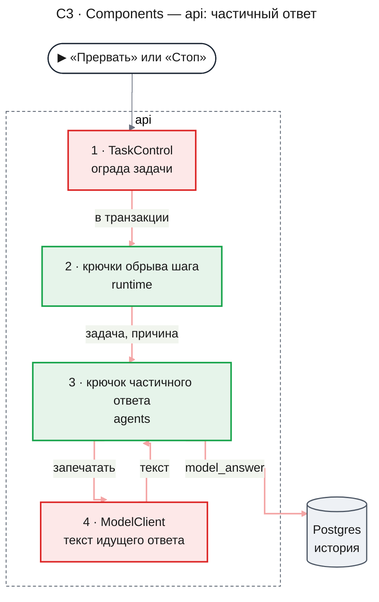
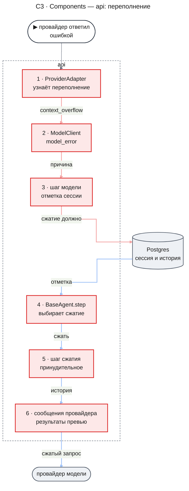
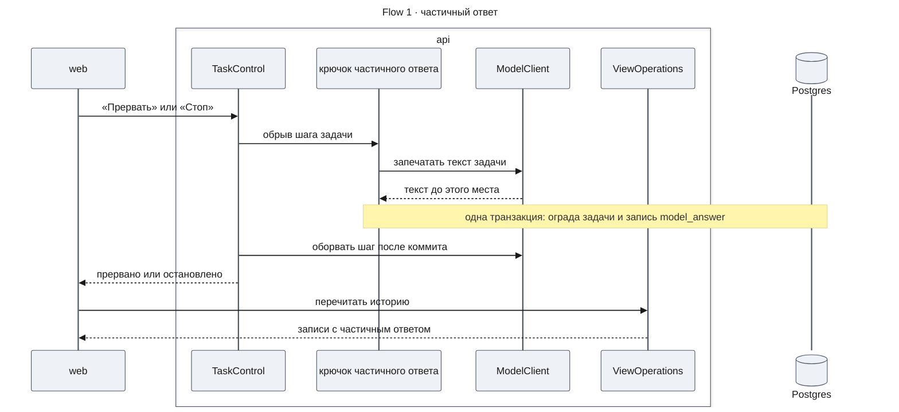
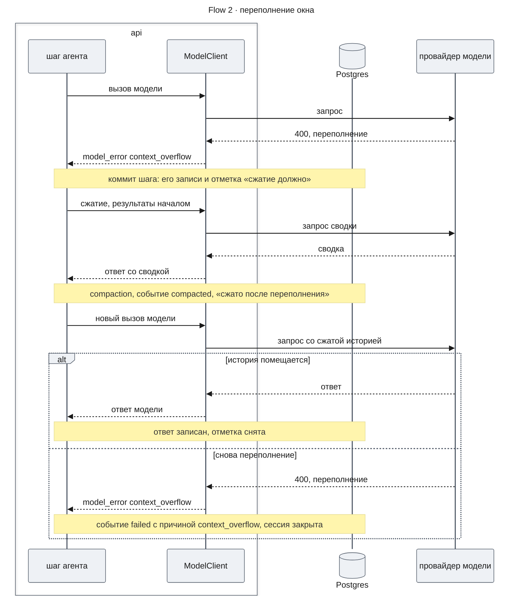
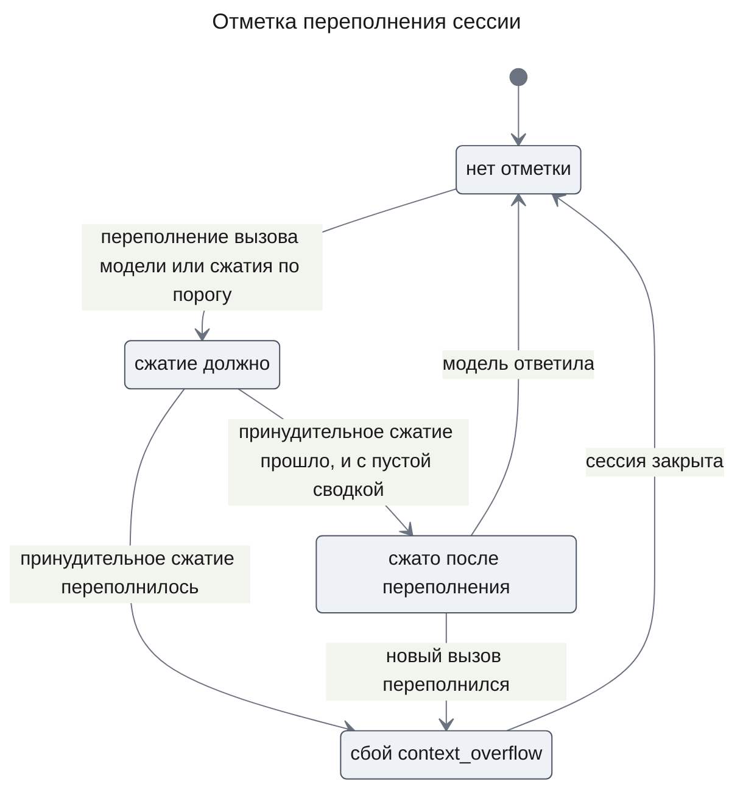

# Устойчивость хода агента — Design Document — steps

**Status:** На утверждении · **Date:** 2026-11-28 · **PRD:** [prd.md](./prd.md) · **UXRD:** нет · **Depends on:** нет

## Snapshot

**Overview.** Часть чинит две поломки хода агента. Первая: на «Прервать» и «Стоп» текст, который модель уже написала, пропадает. Теперь клиент модели держит текст идущего ответа в памяти, а транзакция, которая обрывает шаг, читает этот текст и пишет его в историю обычным ответом агента. Вторая: переполнение окна модели заканчивает беседу сбоем. Теперь адаптер провайдера узнаёт переполнение по телу ошибки, сессия получает отметку, следующий шаг сжимает историю, показывая модели длинные результаты инструментов только началом, и делает один новый вызов; второе переполнение заканчивает агента сбоем с отдельной причиной.

- **Не меняется**: журнал токенов (оборванный вызов по-прежнему даёт одну строку с оценкой), общий порог сжатия, повторов запроса к провайдеру нет, правило черновика в вебе.
- **Главный риск**: переполнение узнаётся по постоянному тексту ошибки там, где у провайдера нет кода; смена текста вернёт прежний сбой ([Risks](#risks-and-mitigation)).
- **Открытые вопросы**: нет.

### Key Decisions

#### KD-1: Частичный ответ пишет транзакция, которая обрывает шаг, через новый крючок обрыва шага в runtime

Текст должен лечь в историю ровно один раз и раньше отметки прерывания или стопа, а при рестарте и лимите шага не лечь вовсе (AC-01.7). Это даёт только транзакция прерывания или стопа: она первой держит строку задачи и поднимает её `attempt`, поэтому после неё шаг уже не закоммитит полный ответ. Текст же уходит из памяти в конце вызова, раньше коммита шага, поэтому транзакция не найдёт текста у ответа, который шаг может закоммитить. Runtime получает крючок обрыва шага по образцу крючка конца задачи: движок зовёт его внутри транзакции прерывания и стопа, после ограды, в своей точке сохранения. Агенты регистрируют один такой крючок, и он пишет запись `model_answer` в историю оборванной задачи через `History.append` в транзакции обрыва, поэтому вместе с записью уходит событие `entries` ленты. Это обычная запись `model_answer`, и `History.append` пишет её без нового параметра. «Ответ готов» эта запись не вызывает: шаг закончил сотрудник или стоп, а не модель. Событие `attention` `answer` шлёт шаг модели корня, когда ответ без вызовов инструментов заканчивает ход, а крючок обрыва идёт мимо этого шага (live-feed [design-server.md](../live-feed/design-server.md), KD-3). Рестарт и лимит шага идут мимо крючка, и текст там не пишется.

Отвергнуто: запись из оборванного шага — каждая его запись после ограды отклоняется. Запись из следующего шага — его объект восстановлен из базы и не видит памяти старого, а при «Стоп» следующего шага нет. Текст в полезной нагрузке сообщения `interrupt` — поток может закончиться между чтением текста и транзакцией, и полный ответ ляжет вместе с копией. Обернуть `TaskControl.interrupt` в свою транзакцию — шаг оборвался бы до коммита, а правило runtime велит обрывать после. Крючок конца задачи для стопа и отдельный механизм для прерывания — два способа вместо одного.

#### KD-2: `ModelClient` держит текст идущего ответа и запечатывает его при чтении

Части ответа сегодня уходят в ленту и нигде не хранятся. Теперь `ModelClient` держит текст каждого вызова агента, чьи части идут в ленту, пока вызов не закончится, и отдаёт его крючку по задаче. Чтение запечатывает текст: после него ни одна часть этого вызова не дойдёт ни до ленты, ни до текста, поэтому в истории ровно то, что видел сотрудник. Вызов сжатия частей не шлёт и текста не держит. Новой строки в журнале токенов нет: оборванный вызов пишет свою одну строку с оценкой, как раньше.

Отвергнуто: держать текст в живом объекте агента — runtime отпускает объект при обрыве, и транзакция прерывания до него не дотягивается. Держать текст в вебе — он не переживает перезагрузку страницы.

#### KD-3: Правило черновика в вебе не меняется

Веб сразу после «Прервать» и «Стоп» перечитывает историю. Частичный ответ к этому моменту уже в базе, потому что его пишет та же транзакция, на которую отвечает запрос. Перечитывание находит новую запись, черновик уходит, а на его месте встаёт запись с тем же текстом (AC-01.4). Отвергнуто: держать черновик, пока не придёт запись, — без записи он остался бы висеть навсегда.

#### KD-4: Переполнение узнаёт адаптер провайдера по телу ошибки и передаёт новой причиной `context_overflow`

Отказ провайдера уже разбирается по виду провайдера (`ProviderAdapter`), и тело ошибки уже читается для отказа в инструментах. Адаптер получает второе правило: сначала поля тела — код, тип, статус, — а где их нет, постоянный текст ошибки провайдера (таблица в [«Как адаптер узнаёт переполнение»](#как-адаптер-узнаёт-переполнение)). Правило проверяется раньше правила инструментов. Узнанное переполнение становится причиной `context_overflow` в прежнем результате `model_error`: шаг видит его по причине, и нового варианта результата не нужно. Эмбеддинги получают ту же причину из общего разбора и сообщают её как `provider_error`, как уже делают с отказом в инструментах.

Отвергнуто: узнавать по статусу 400 — сжатие запускалось бы на любой неверный запрос. Читать поле `data` ошибки AI SDK — второй источник того же тела.

#### KD-5: Принудительное сжатие запускает отметка сессии, а модель видит в нём длинные результаты инструментов только началом

Шаг делает один вызов модели, поэтому переполнение не лечится внутри шага. Шаг с переполнением коммитит свои записи и отметку сессии «сжатие должно», и следующий шаг выбирает сжатие по ней так же, как сегодня по порогу. В этом сжатии каждый результат инструмента длиннее `previewChars` (настройка `tool_result_settings`) модель видит началом с пометкой, сколько символов отрезано; обрезку делает существующая `cutText`. История не меняется: сотрудник видит результаты целиком. Успешное сжатие ставит отметку «сжато после переполнения», а ответ модели снимает отметку.

Отвергнуто: сжатие и новый вызов внутри одного шага — в шаге стало бы три вызова модели, а обрыв между ними оставил бы полуготовое состояние. Подставить в `last_input_tokens` число выше порога — поле солгало бы, и второе переполнение нельзя было бы отличить. Показать результаты обёрткой `wrapperText` — она обещает чтение через `read_tool_result`, которое есть не у всех результатов, а уже обёрнутый результат обернулся бы второй раз.

#### KD-6: Второе переполнение заканчивает агента сбоем `context_overflow`

Переполнение первого вызова после принудительного сжатия или самого принудительного сжатия заканчивает агента итогом «упасть» с причиной `context_overflow`, так же, как сегодня `model_error` (AC-02.3). Переполнение обычного сжатия по порогу сбоем не кончается: оно ставит отметку «сжатие должно», и следующий шаг повторяет сжатие с обрезкой. Принудительное сжатие с пустой сводкой ставит ту же отметку «сжато после переполнения», что и успешное: следующий шаг — шаг модели, как велит правило пустой сводки (agent-harness [design-core.md](../agent-harness/design-core.md), KD-7), и его переполнение кончается сбоем. Так ход никогда не делает больше двух сжатий подряд из-за переполнения. Шаг модели падает с `model_error` только на ошибке, которую правило переполнения не узнало.

#### KD-7: Ответ Anthropic с причиной остановки `model_context_window_exceeded` остаётся обрезанным ответом

Установленный `@ai-sdk/anthropic` 4.0.107 переводит эту причину в общую `length`, ту же, что у `max_tokens` (`map-anthropic-stop-reason.ts`). Клиент модели читает только общую причину и уже обрабатывает её как обрезанный ответ. Сырая причина доходит до чанка `finish` в Mastra 1.85 (`stepResult.rawReason`), но клиент её не читает. Считать `length` переполнением нельзя: сжатие шло бы на каждый ответ, упёршийся в `max_tokens`. Модель в этом случае ответила и вернула расход, поэтому следующий шаг сожмёт историю по общему порогу, если она его перешла.

## Terms

- **Ограда** — подъём `attempt` задачи транзакцией прерывания или стопа: после неё runtime отклоняет каждую запись оборванного шага.
- **Крючок обрыва шага** — функция верхнего слоя, которую runtime зовёт в транзакции, обрывающей шаг задачи.
- **Текст идущего ответа** — то, что модель успела написать в текущем вызове агента; живёт в памяти процесса до конца вызова.
- **Запечатать** — прочитать текст идущего ответа так, что дальше части этого вызова никуда не идут.
- **Отметка переполнения** — состояние сессии: нет, «сжатие должно» или «сжато после переполнения».
- **Превью результата** — по PRD ([Terms](./prd.md#terms)); здесь это начало текста длиной `previewChars` с пометкой `cutText`.

## Part

- **Prerequisite ADRs**: [ADR-0023](../../adr/ADR-0023-live-task-objects-one-stepping-process.md) — шаги и запросы API идут в одном процессе, поэтому транзакция прерывания видит память шага; [ADR-0025](../../adr/ADR-0025-settings-key-table.md) — `tool_result_settings` в таблице настроек.

**Out of scope**

- Журнал токенов и правило `isBilled` не меняются: оборванный вызов пишет одну строку с оценкой, и запись текста её не дублирует.
- Общий порог сжатия `last_input_tokens` и запрос сводки остаются как есть.
- Обёртка больших результатов MCP (`storeFromChars`) и чтение их страниц не меняются.
- Длинные записи, которые не результаты инструментов (сообщения сотрудника и агентов, отчёты детей, сводки), принудительное сжатие показывает целиком.
- Веб получает только тексты новой причины сбоя; правило черновика остаётся прежним (KD-3).
- Ollama: её OpenAI-совместимый вход молча обрезает историю, и платформа переполнения не видит.

**Constraints**

- **Повторов запроса к провайдеру нет.** Вызов после сжатия идёт с другой историей; ни один запрос не повторяется.
- **Сторожевого таймера на молчание модели нет.** Часть не добавляет таймеров; зависший вызов обрывают «Прервать» и «Стоп».
- **Новых переменных окружения и настроек нет.** Обрезка в принудительном сжатии берёт существующую `previewChars`.
- **Без эвристик на тексте сотрудника.** Правило переполнения читает только тело ошибки провайдера: структурные поля, а где их нет, постоянный текст ошибки самого провайдера.

## Building-block Inventory

Follows the [code system](../../code-system/README.md).

| Building block | Pattern | Status | Note |
|---|---|---|---|
| Крючок обрыва шага в runtime | [step-handler.md](../../code-system/patterns/step-handler.md) | extended | новая точка рядом с крючком конца задачи; искали в `TaskEndHooks`, но прерывание не конец задачи |
| Крючок частичного ответа в `agents` | [step-handler.md](../../code-system/patterns/step-handler.md) | reused | «Реакция на обрыв шага»; регистрируется в `onModuleInit` модуля агентов |
| `ProviderAdapter` трёх видов и `classifyRejection` | [pure-decision.md](../../code-system/patterns/pure-decision.md) | extended | правило переполнения рядом с правилом отказа в инструментах |
| Выбор работы в `BaseAgent.step` и `compactionDue` | [pure-decision.md](../../code-system/patterns/pure-decision.md) | extended | сжатие и по отметке «сжатие должно» |
| Шаг модели и шаг сжатия | [step-handler.md](../../code-system/patterns/step-handler.md) | extended | переполнение — коммит с отметкой или сбой |

## Acceptance Criteria

### FR-01: частичный ответ

- From the PRD: AC-01.1, AC-01.2, AC-01.4, AC-01.5, AC-01.6, AC-01.7.
- AC-01.3 уточняется: «Стоп» сохраняет частичный ответ каждого агента остановленного дерева, который писал ответ в этот момент. То же происходит при любом стопе дерева: при сбое родителя и при исчерпанном бюджете обучения.
- Текст частичного ответа в истории совпадает с текстом, который лента показала до обрыва (KD-2).

### FR-02: переполнение окна

- From the PRD: AC-02.1, AC-02.3, AC-02.4.
- AC-02.2 уточняется: когда историю переполнили результаты инструментов, каждый из которых короче порога обёртки, или страницы `read_tool_result`, принудительное сжатие показывает модели каждый результат длиннее `previewChars` его началом с пометкой обрезки и не переполняется. Сотрудник в ленте видит эти результаты целиком.
- AC-02.5 уточняется: платформа узнаёт переполнение каждого провайдера из таблицы [«Как адаптер узнаёт переполнение»](#как-адаптер-узнаёт-переполнение). Ответ Anthropic с причиной `model_context_window_exceeded` остаётся обрезанным ответом (KD-7).
- Переполнение обычного сжатия по порогу ведёт к принудительному сжатию, а не к сбою (KD-6).

## Design

### Architecture (C1–C4)

Контейнеры и связи между ними не меняются: веб зовёт api, api зовёт провайдера модели и пишет в Postgres. Меняются компоненты внутри api.

#### C3 · Components: api

**api — частичный ответ на «Прервать» и «Стоп»**

Runtime зовёт крючки обрыва в транзакции прерывания для прерванной задачи и в каждой транзакции, которая заканчивает задачу `stopped`. Крючок частичного ответа берёт у `ModelClient` запечатанный текст задачи и, если текст не пустой, пишет его записью `model_answer` без вызовов инструментов через `History.append` в транзакции обрыва (KD-1). После коммита `TaskControl`, как и сегодня, обрывает шаг и отпускает живой объект. Следующий шаг прерванного агента пишет событие `interrupted` после этой записи. У остановленного агента отметки стопа выводятся при чтении после последней записи, а при продолжении пишутся по-настоящему, тоже после неё.

**api — переполнение окна**

`ProviderAdapter` каждого вида решает по статусу и телу ошибки, переполнение ли это; `classifyRejection` спрашивает его раньше правила инструментов. `ModelClient` возвращает `model_error` с причиной `context_overflow` и пишет в лог тело ошибки, как делает с каждым отказом. Шаг модели и шаг сжатия решают по отметке, что делать с переполнением ([«Отметка переполнения»](#state-transitions-and-invariants)). `BaseAgent.step` выбирает сжатие, когда его требует порог или отметка «сжатие должно». Шаг сжатия с этой отметкой просит сборку сообщений обрезать результаты инструментов. Остальное у вызова то же, что у обычного шага сжатия: те же инструменты и тот же системный текст с тем набором блоков, который задаёт этот шаг (agent-guidance [design-server.md](../agent-guidance/design-server.md), KD-3; [step-prompt-block.md](../../code-system/patterns/step-prompt-block.md)).

#### Как адаптер узнаёт переполнение

Правило смотрит на ответы со статусом 400 или 422, тело которых разбирается как JSON; поля берутся из `error`, а где его нет, из корня тела. Каждая строка таблицы — одна проверка; совпадение любой значит переполнение.

| Вид адаптера | Провайдер | Признак |
|---|---|---|
| `anthropic` | Anthropic | тип `invalid_request_error`, текст начинается с `prompt is too long` |
| `gemini` | Gemini | статус `INVALID_ARGUMENT`, текст содержит `exceeds the maximum number of tokens allowed` |
| `openai_compatible` | OpenAI, Groq, OpenRouter | код `context_length_exceeded` |
| `openai_compatible` | llama.cpp | тип `exceed_context_size_error` |
| `openai_compatible` | vLLM, DeepSeek, Mistral, OpenRouter | текст содержит `maximum context length` |
| `openai_compatible` | vLLM новых версий | текст начинается с `Input length` и содержит `exceeds the maximum allowed length` |

Адаптер `openai_compatible` один на всех OpenAI-совместимых провайдеров, поэтому его проверки срабатывают у каждого из них. Тексты выбраны так, чтобы не встречаться в других ошибках. Тела Mistral, DeepSeek и OpenRouter взяты из чужих примеров ([Mistral](https://discuss.google.dev/t/mistral-large-2407-inference-context-length-error/165446), [OpenRouter](https://openrouter.ai/docs/api/reference/errors-and-debugging)). Табличный тест правила держит по одному записанному телу каждого провайдера и по одному телу другой ошибки 400 на каждый вид.

### Runtime Flows

#### Flow 1: частичный ответ на «Прервать» или «Стоп»

**Starts when:** сотрудник жмёт «Прервать» или «Стоп», пока модель пишет ответ, for AC-01.1, AC-01.2, AC-01.3, AC-01.4, AC-01.5, AC-01.6.

Если модель не успела написать ни слова, крючок ничего не пишет (AC-01.5). Текст копят только части текста, а недописанный вызов инструмента в него не попадает, поэтому его нет ни в истории, ни в аудите (AC-01.6). После прерывания следующий шаг агента пишет закрытия открытых вызовов и событие `interrupted` уже после частичного ответа, и модель читает их в этом порядке (AC-01.2). При «Стоп» транзакция стопа зовёт крючок для каждой задачи дерева, которую останавливает. Рестарт сервера (`shutdown`) и лимит шага (`step_timeout`) обрывают шаг без транзакции прерывания или стопа: текст не читается, а при конце вызова пропадает (AC-01.7). Если транзакция откатилась после печати, лента до конца этого вызова не получает частей, а ответ ложится обычным коммитом шага.

#### Flow 2: переполнение, принудительное сжатие и новый вызов

**Starts when:** шаг модели вызывает модель, и провайдер отвечает переполнением, for AC-02.1, AC-02.2, AC-02.3, AC-02.4.

Шаг агента на схеме — три шага runtime подряд: шаг модели, шаг сжатия и снова шаг модели; каждый коммитит свои записи сам. Шаг с переполнением записывает то, что задолжал: вступление и доставленные сообщения, — и ход не считает. Отказ провайдера до ответа не оплачивается и строки в журнале токенов не даёт. Если переполнилось само принудительное сжатие, агент падает с той же причиной, а сообщение о сбое — тот же `modelErrorMessage`. Ошибка, которую правило не узнало, идёт прежним путём `model_error` без сжатия (AC-02.4).

### Contract Definitions

- **Крючок обрыва шага** (runtime для верхних слоёв) — верхний слой регистрирует его по имени в `onModuleInit`; второе имя останавливает старт, как у крючков конца задачи. Runtime зовёт каждый крючок в транзакции прерывания для прерванной задачи и в каждой транзакции, которая заканчивает задачу `stopped` (стоп и удаление дерева, стоп потомков упавшей задачи), после ограды и в своей точке сохранения. Вход: `taskId`, `rootId`, `ownerId`, тип задачи и причина обрыва — `interrupted` или `stopped`. Крючок не зовёт модель и сеть и пишет только в эту транзакцию. Исключение крючка откатывает только его записи, пишется в лог, а прерывание или стоп коммитятся. Рестарт, лимит шага, сбой самой задачи и её завершение `completed` крючок не зовут.
- **Частичный ответ в истории** — запись `model_answer` с полем `text` (непустой текст до обрыва) и пустым `toolCalls`, без новых полей. Веб и модель читают её как обычный ответ агента. Она стоит раньше события `interrupted` и раньше отметок стопа. Крючок пишет её через `History.append` в транзакции обрыва, и она даёт событие `change` `entries`. События `attention` `answer` она не даёт: его шлёт шаг модели корня, а крючок обрыва идёт мимо этого шага (live-feed [design-server.md](../live-feed/design-server.md), KD-3).
- **`context_overflow`** — новое значение `AgentFailureReasonSchema`, которое вид агента отдаёт в `failureReason`. Агент падает с ним, когда история не помещается в окно модели даже после принудительного сжатия.

**Тексты причины**

- `errors.json`, ключ `failureReason.context_overflow`: ru «история не помещается в окно модели даже после сжатия», en «the history doesn't fit the model's context window even after compaction».

**Runtime settings**

- `tool_result_settings.previewChars` — default `2000`; сколько символов результата инструмента модель видит в принудительном сжатии. Настройка уже задаёт длину превью в обёртке больших результатов.

### Data Model

Сессия агента (таблица `conversations`) получает отметку переполнения с тремя состояниями: нет, «сжатие должно», «сжато после переполнения». Отметку меняют только коммиты шагов этой сессии. Миграция только схемная, существующих строк она не трогает: база разработчика создаётся заново (data-model [design-runtime.md](../data-model/design-runtime.md), KD-9).

### State Transitions and Invariants

**Invariants**

1. При отметке «сжатие должно» следующий шаг агента без открытых вызовов — сжатие с обрезкой результатов.
2. Подряд из-за переполнения ход делает не больше двух сжатий: одно по порогу и одно принудительное.
3. Частичный ответ пишет только транзакция прерывания или стопа, поэтому у одного вызова модели в истории не бывает и полного, и частичного ответа.

## Security Considerations

- **Authentication & Authorization**: новых точек входа нет. Крючок пишет только в историю задачи, которую `TaskControl` уже проверил на владельца, а при стопе — в задачи её дерева.
- **Input Validation**: внешний ввод — тело ошибки провайдера; оно разбирается как JSON и сравнивается с полями и постоянными текстами, без исполнения и без хранения.
- **Sensitive Data Handling**: текст частичного ответа в лог не идёт: крючок пишет идентификаторы задачи и длину текста. Тело ошибки провайдера, как и сейчас, идёт в лог целиком через маску ключей.

## Risks and Mitigation

- **Провайдер сменит текст ошибки** — платформа перестанет узнавать переполнение, беседа закончится `model_error`, как сегодня; вероятность низкая. Структурные поля проверяются первыми, а табличный тест держит записанные тела.
- **Другая ошибка 400 у OpenAI-совместимого провайдера содержит `maximum context length`** — одно лишнее сжатие, затем, возможно, сбой с неверной причиной; вероятность низкая. Признаки — фразы об окне, а не отдельные слова.
- **Историю переполнили записи, которые не результаты инструментов** — принудительное сжатие тоже переполнится, и агент упадёт с `context_overflow` (UC-3); вероятность средняя на огромных вставках сотрудника. Сотрудник видит понятную причину и сужает задачу.
- **Стоп или прерывание пришли после конца вызова, но до коммита шага** — шаг отклонён оградой, а текста в памяти уже нет, поэтому ответ пропадает, как сегодня; окно — время коммита шага.
- **Сводка в принудительном сжатии упустит деталь из обрезанной части результата** — PRD, Assumptions and Risks; полный результат остаётся в ленте.

## Update History

| Version | Date | Change |
|---------|------|--------|
| 1.0 | 2026-11-28 | Первая версия |
| 1.1 | 2026-11-28 | Сверка с live-feed и agent-guidance: частичный ответ — обычная запись через `History.append` в транзакции обрыва, без «ответ готов», которое шлёт шаг модели корня; принудительное сжатие берёт инструменты и системный текст обычного шага сжатия |
