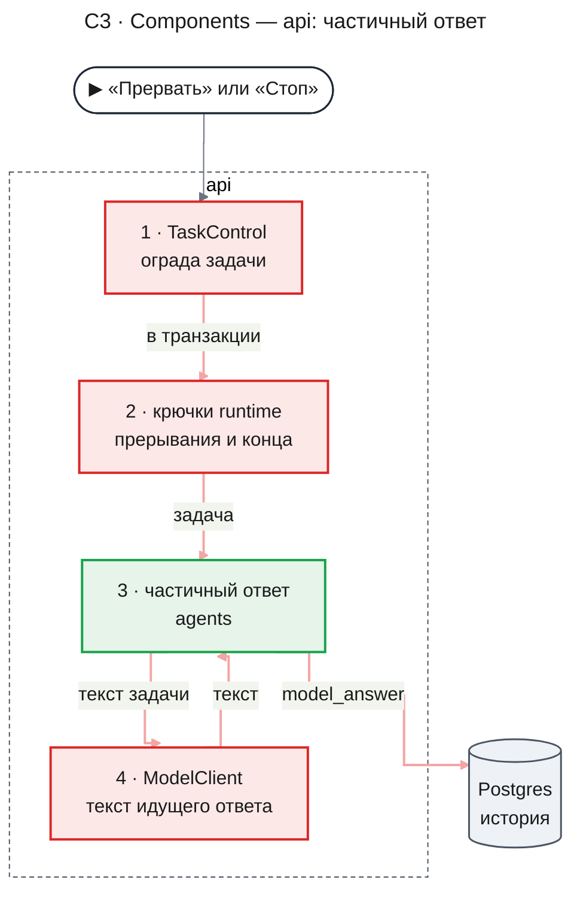
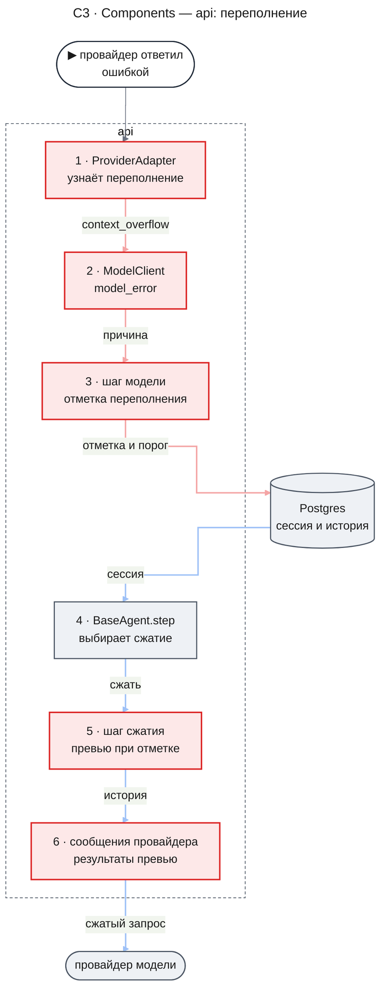
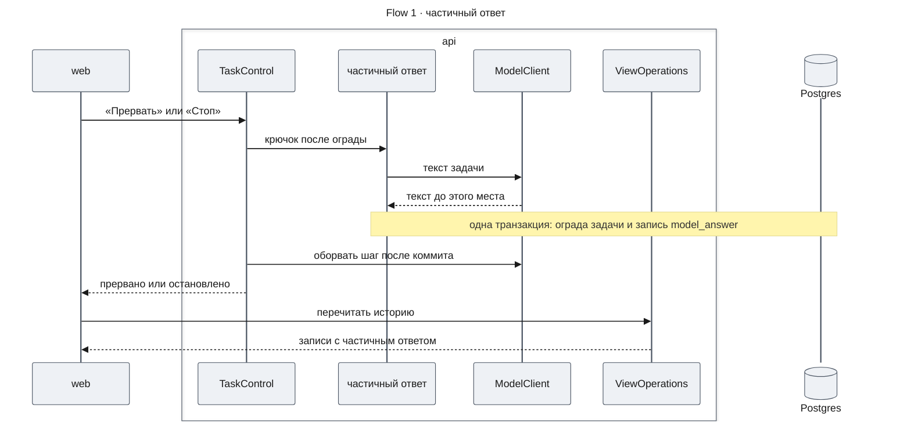
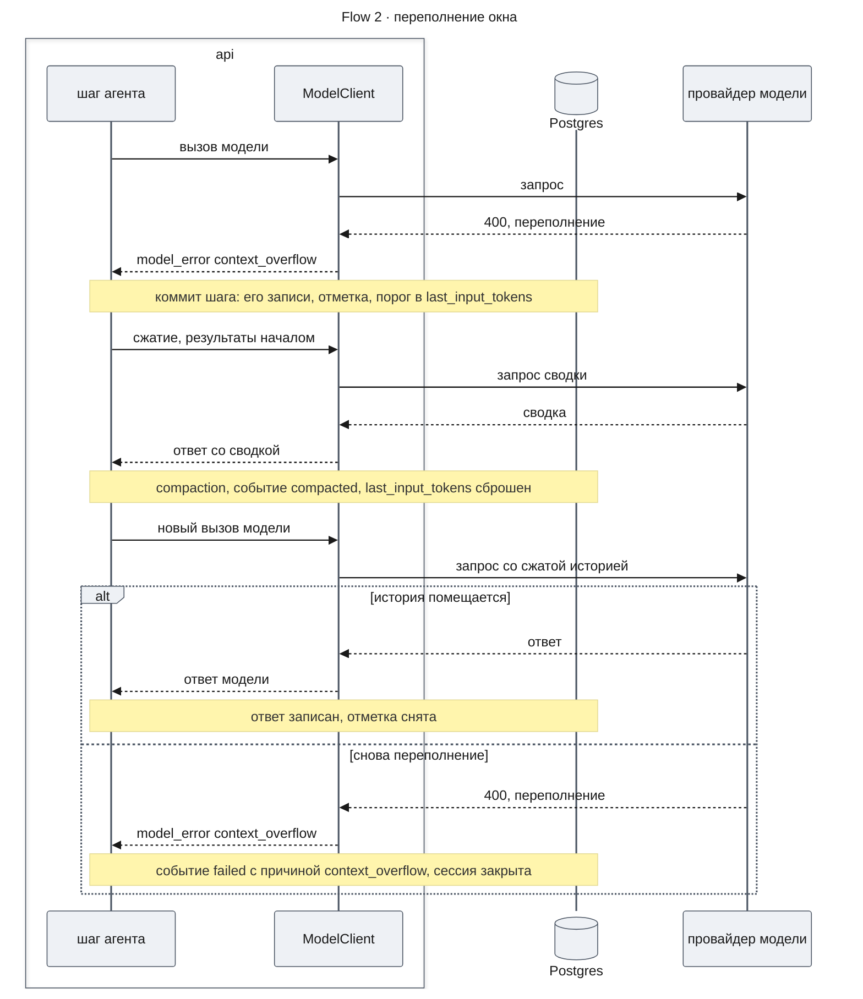

# Устойчивость хода агента — Design Document — steps

**Status:** На утверждении · **Date:** 2026-11-28 · **PRD:** [prd.md](./prd.md) · **UXRD:** нет · **Depends on:** нет

## Snapshot

**Overview.** Часть чинит две поломки хода агента. Первая: на «Прервать» и «Стоп» текст, который модель уже написала, пропадает. Теперь клиент модели держит текст идущего ответа в памяти, а транзакция, которая обрывает шаг, берёт этот текст и пишет его в историю обычным ответом агента. На «Прервать» это делает новый крючок прерывания runtime, на стоп — существующий крючок конца задачи. Вторая: переполнение окна модели заканчивает беседу сбоем. Теперь адаптер провайдера узнаёт переполнение по телу ошибки, а шаг ставит сессии отметку переполнения и поднимает `last_input_tokens` до порога, поэтому следующий шаг сжимает историю по прежнему правилу. Пока отметка стоит, сжатие показывает модели длинные результаты инструментов только началом, а второе переполнение заканчивает агента сбоем `context_overflow`. Ответ модели снимает отметку.

- **Не меняется**: журнал токенов (оборванный вызов по-прежнему даёт одну строку с оценкой), выбор сжатия в шаге агента, повторов запроса к провайдеру нет, правило черновика в вебе.
- **Главный риск**: переполнение узнаётся по постоянному тексту ошибки там, где у провайдера нет кода; смена текста вернёт прежний сбой ([Risks](#risks-and-mitigation)).
- **Открытые вопросы**: нет.

### Key Decisions

#### KD-1: Частичный ответ пишет транзакция, которая обрывает шаг

Текст должен лечь в историю один раз и раньше отметки прерывания или стопа, а при рестарте и лимите шага не лечь вовсе (AC-01.7). Транзакция прерывания или стопа первой держит строку задачи и поднимает её `attempt`. Поэтому шаг, который ещё мог бы закоммитить полный ответ, после неё уже отклонён, и у одного вызова в истории не бывает и полного, и частичного ответа. Запрос «Прервать» отвечает после этой транзакции, и веб, перечитав историю, сразу находит в ней запись (KD-3).

- **Стоп** уже вызывает крючки конца задачи: каждую задачу, которую стоп заканчивает, `endTask` проводит через `TaskEndHooks` в транзакции стопа после ограды. Агенты регистрируют такой крючок, и он действует только на конец `stopped`. Так же кончаются задачи при сбое родителя и при исчерпанном бюджете обучения (AC-01.3).
- **«Прервать»** — не конец задачи, и крючки конца его не видят. Runtime получает крючок прерывания по образцу `TaskEndHooks`: `TaskControl.interrupt` зовёт его в своей транзакции после ограды. У крючка ровно один зарегистрированный обработчик — частичный ответ агентов. Крючок нужен, потому что runtime ничего не знает об агентах и истории и не может писать их строки сам.
- Оба крючка зовут одну функцию агентов: она берёт у `ModelClient` текст задачи и, если он не пустой, пишет запись `model_answer` без вызовов инструментов через `History.append` в транзакции обрыва. Своего события запись не шлёт: ленту перечитать заставляет сигнал runtime той же транзакции — прерывание ставит задачу в `queued` и кладёт сообщение в её очередь, стоп пишет статус. «Ответ готов» запись не вызывает: его шлёт только шаг модели корня (live-feed [design-server.md](../live-feed/design-server.md)).
- Рестарт и лимит шага обрывают шаг без транзакции прерывания или стопа, поэтому текст там не пишется.

Отвергнуто:

- запись из оборванного шага — после ограды runtime отклоняет каждую его запись;
- запись из следующего шага на «Прервать» — он идёт после того, как веб перечитал историю, и текст пропал бы с экрана до его коммита; при стопе следующего шага нет;
- транзакция вызывающего вокруг `TaskControl.interrupt` — `TaskControl` оборвал бы шаг до её коммита, а runtime обрывает шаги только после коммита.

#### KD-2: `ModelClient` держит текст идущего ответа

Части ответа уже идут через `ModelClient` в ленту, а живой объект агента видит ответ только после конца вызова. Поэтому `ModelClient` держит текст каждого идущего вызова агента, чьи части идут в ленту, и отпускает его в конце вызова; крючок берёт текст по задаче. Вызов сжатия частей не шлёт и текста не держит. Части, которые придут между чтением текста и обрывом вызова, лента покажет в черновике, пока перечитывание не заменит его записью. Новой строки в журнале токенов нет: оборванный вызов пишет свою одну строку с оценкой, как раньше.

#### KD-3: Правило черновика в вебе не меняется

Веб сразу после «Прервать» и «Стоп» перечитывает историю. Частичный ответ к этому моменту уже в базе, потому что его пишет та же транзакция, на которую отвечает запрос. Перечитывание находит новую запись, черновик уходит, а на его месте встаёт запись с тем же текстом (AC-01.4).

#### KD-4: Переполнение узнаёт адаптер провайдера по телу ошибки и передаёт новой причиной `context_overflow`

Отказ провайдера уже разбирается по виду провайдера (`ProviderAdapter`), и тело ошибки уже читается для отказа в инструментах. Адаптер получает второе правило: сначала поля тела — код и тип, — а где их нет, постоянный текст ошибки провайдера (таблица в [«Как адаптер узнаёт переполнение»](#как-адаптер-узнаёт-переполнение)). Правило проверяется раньше правила инструментов. Узнанное переполнение становится причиной `context_overflow` в прежнем результате `model_error`, и нового варианта результата не нужно. Эмбеддинги получают ту же причину из общего разбора и сообщают её как `provider_error`, как уже делают с отказом в инструментах. Узнавать по одному статусу 400 нельзя: сжатие запускалось бы на любой неверный запрос.

#### KD-5: Отметка переполнения — одна булева отметка сессии поверх прежнего порога сжатия

- Переполнение вызова модели или сжатия, когда отметки нет, коммитит то, что шаг задолжал, ставит отметку и поднимает `last_input_tokens` до порога сжатия, если число ниже. Следующий шаг выбирает сжатие по прежнему правилу `compactionDue`.
- Пока отметка стоит, шаг сжатия показывает модели каждый результат инструмента длиннее `previewChars` (настройка `tool_result_settings`) его началом с пометкой, сколько символов отрезано. Обрезку делает существующая `cutText`, история не меняется, и сотрудник видит результаты целиком.
- Переполнение, когда отметка стоит, заканчивает агента итогом «упасть» с причиной `context_overflow` (AC-02.3).
- Ответ модели снимает отметку.

Одной отметки без подъёма `last_input_tokens` мало. Отметка стоит до ответа модели, поэтому сама она не отличает «сжатие должно» от «сжато, теперь вызов модели». Это различие уже держит порог: сжатие сбрасывает `last_input_tokens`, и следующий шаг идёт к модели. Пустая сводка сбрасывает его так же (agent-harness [design-core.md](../agent-harness/design-core.md), KD-7), поэтому после неё следующий шаг тоже вызывает модель, а её переполнение кончается сбоем. В логе сжатия после переполнения число входных токенов — порог, а не счёт провайдера.

Отвергнуто: сжатие и новый вызов внутри одного шага — в шаге стало бы три вызова модели, а обрыв между ними оставил бы полуготовое состояние. Показать результаты обёрткой `wrapperText` — она обещает чтение через `read_tool_result`, которое есть не у всех результатов.

## Terms

- **Ограда** — подъём `attempt` задачи транзакцией прерывания или стопа: после неё runtime отклоняет каждую запись оборванного шага.
- **Крючок прерывания** — функция верхнего слоя, которую runtime зовёт в транзакции прерывания после ограды.
- **Текст идущего ответа** — то, что модель успела написать в текущем вызове агента; живёт в памяти процесса до конца вызова.
- **Отметка переполнения** — булева отметка сессии: последнее переполнение ещё не закончилось ответом модели.
- **Превью результата** — по PRD ([Terms](./prd.md#terms)); здесь это начало текста длиной `previewChars` с пометкой `cutText`.

## Part

- **Prerequisite ADRs**: [ADR-0023](../../adr/ADR-0023-live-task-objects-one-stepping-process.md) — шаги и запросы API идут в одном процессе, поэтому транзакция прерывания видит память шага; [ADR-0025](../../adr/ADR-0025-settings-key-table.md) — `tool_result_settings` в таблице настроек.

**Out of scope**

- Журнал токенов и правило `isBilled` не меняются: оборванный вызов пишет одну строку с оценкой, и запись текста её не дублирует.
- Общий порог сжатия и запрос сводки остаются как есть.
- Обёртка больших результатов MCP (`storeFromChars`) и чтение их страниц не меняются.
- Длинные записи, которые не результаты инструментов (сообщения сотрудника и агентов, отчёты детей, сводки), сжатие с отметкой показывает целиком.
- Веб получает только тексты новой причины сбоя; правило черновика остаётся прежним (KD-3).
- Провайдеры без подтверждённого признака (таблица ниже) и Ollama, чей OpenAI-совместимый вход молча обрезает историю: переполнение не узнаётся, и ход падает, как сегодня.
- Ответ Anthropic с причиной остановки `model_context_window_exceeded` остаётся обрезанным ответом: установленный `@ai-sdk/anthropic` переводит её в общую `length`, ту же, что у `max_tokens`.

**Constraints**

- **Повторов запроса к провайдеру нет.** Вызов после сжатия идёт с другой историей; ни один запрос не повторяется.
- **Сторожевого таймера на молчание модели нет.** Часть не добавляет таймеров; зависший вызов обрывают «Прервать» и «Стоп».
- **Новых переменных окружения и настроек нет.** Обрезка берёт существующую `previewChars`.
- **Без эвристик на тексте сотрудника.** Правило переполнения читает только тело ошибки провайдера.

## Building-block Inventory

Follows the [code system](../../code-system/README.md).

| Building block | Pattern | Status | Note |
|---|---|---|---|
| Крючок прерывания в runtime | [step-handler.md](../../code-system/patterns/step-handler.md) | new | по образцу `TaskEndHooks`, один обработчик; крючки конца прерывания не видят — KD-1 |
| Крючок конца задачи частичного ответа в `agents` | [step-handler.md](../../code-system/patterns/step-handler.md) | reused | «Реакция на конец задачи», только конец `stopped`; регистрируется в `onModuleInit` модуля агентов |
| `ModelClient` | — | extended | держит текст идущего вызова агента до конца вызова |
| `ProviderAdapter` трёх видов и `classifyRejection` | [pure-decision.md](../../code-system/patterns/pure-decision.md) | extended | правило переполнения рядом с правилом отказа в инструментах |
| Шаг модели и шаг сжатия | [step-handler.md](../../code-system/patterns/step-handler.md) | extended | переполнение — коммит с отметкой или сбой; превью при отметке |

## Acceptance Criteria

### FR-01: частичный ответ

- From the PRD: AC-01.1, AC-01.2, AC-01.3, AC-01.4, AC-01.5, AC-01.6, AC-01.7.

### FR-02: переполнение окна

- From the PRD: AC-02.1, AC-02.3, AC-02.4.
- AC-02.2 уточняется: когда историю переполнили результаты инструментов, каждый из которых короче порога обёртки, или страницы `read_tool_result`, сжатие с отметкой показывает модели каждый результат длиннее `previewChars` его началом с пометкой обрезки и не переполняется. Сотрудник в ленте видит эти результаты целиком.
- AC-02.5 уточняется: платформа узнаёт переполнение провайдеров, чей признак подтверждён их документацией или их собственным кодом (таблица [«Как адаптер узнаёт переполнение»](#как-адаптер-узнаёт-переполнение)); остальные падают, как сегодня.
- Переполнение сжатия по порогу ведёт к сжатию с превью так же, как переполнение вызова модели (KD-5).

## Design

### Architecture (C1–C4)

Контейнеры и связи между ними не меняются: веб зовёт api, api зовёт провайдера модели и пишет в Postgres. Меняются компоненты внутри api.

#### C3 · Components: api

**api — частичный ответ на «Прервать» и «Стоп»**

`TaskControl.interrupt` зовёт крючок прерывания в своей транзакции после ограды. Стоп зовёт крючки конца для каждой задачи, которую заканчивает, тоже после ограды. Функция частичного ответа берёт у `ModelClient` текст задачи и, если он не пустой, пишет его записью `model_answer` через `History.append` в этой транзакции (KD-1). После коммита `TaskControl`, как и сегодня, обрывает шаг и отпускает живой объект. Следующий шаг прерванного агента пишет событие `interrupted` после этой записи. У остановленного агента отметки стопа выводятся при чтении после последней записи, а при продолжении пишутся по-настоящему, тоже после неё.

**api — переполнение окна**

`ProviderAdapter` каждого вида решает по статусу и телу ошибки, переполнение ли это; `classifyRejection` спрашивает его раньше правила инструментов. `ModelClient` возвращает `model_error` с причиной `context_overflow` и пишет в лог тело ошибки, как делает с каждым отказом. Шаг модели и шаг сжатия решают по отметке, что делать с переполнением (KD-5). `BaseAgent.step` выбирает сжатие прежним правилом `compactionDue`. Шаг сжатия с отметкой просит сборку сообщений обрезать результаты инструментов. Остальное у вызова то же, что у обычного шага сжатия: те же инструменты и тот же системный текст с тем набором блоков, который задаёт этот шаг (agent-guidance [design-server.md](../agent-guidance/design-server.md), KD-3; [step-prompt-block.md](../../code-system/patterns/step-prompt-block.md)).

#### Как адаптер узнаёт переполнение

Правило смотрит на ответы со статусом 400, тело которых разбирается как JSON; поля берутся из `error`, а где его нет, из корня тела. Каждая строка таблицы — одна проверка; совпадение любой значит переполнение. В таблице только признаки, которые подтверждает документация провайдера или его собственный код.

| Вид адаптера | Провайдер | Признак | Источник |
|---|---|---|---|
| `anthropic` | Anthropic | тип `invalid_request_error`, текст начинается с `prompt is too long` | [документация](https://platform.claude.com/docs/en/build-with-claude/context-windows) |
| `openai_compatible` | OpenAI, Groq | код `context_length_exceeded` | код OpenAI [codex](https://github.com/openai/codex/blob/main/codex-rs/codex-api/src/error.rs), код Groq [openbench](https://github.com/groq/openbench/blob/main/src/openbench/model/_providers/groq.py) |
| `openai_compatible` | OpenRouter | `metadata.error_type` равен `context_length_exceeded` | [документация](https://openrouter.ai/docs/api-reference/errors) |
| `openai_compatible` | Mistral | тип `invalid_request_prompt_too_long` | [документация](https://docs.mistral.ai/resources/error-glossary) |
| `openai_compatible` | llama.cpp | тип `exceed_context_size_error` | [исходный код сервера](https://github.com/ggml-org/llama.cpp/blob/master/tools/server/server-common.cpp) |
| `openai_compatible` | vLLM | текст содержит `maximum context length` | [исходный код](https://github.com/vllm-project/vllm/blob/main/vllm/renderers/params.py) |

Адаптер `openai_compatible` один на всех OpenAI-совместимых провайдеров, поэтому его проверки срабатывают у каждого из них. Проверка текста vLLM ловит и ответ OpenAI без кода, где текст начинается с `This model's maximum context length`.

Не узнаются, и ход падает, как сегодня:

- Gemini — ни документация, ни код Google не показывают тела ошибки переполнения;
- DeepSeek — документация называет только общие 400 и 422; если тело содержит `maximum context length`, его узнает строка vLLM.

Табличный тест правила держит по одному записанному телу каждого провайдера из таблицы и по одному телу другой ошибки 400 на каждый вид.

### Runtime Flows

#### Flow 1: частичный ответ на «Прервать» или «Стоп»

**Starts when:** сотрудник жмёт «Прервать» или «Стоп», пока модель пишет ответ, for AC-01.1, AC-01.2, AC-01.3, AC-01.4, AC-01.5, AC-01.6.

Если модель не успела написать ни слова, крючок ничего не пишет (AC-01.5). Текст копят только части текста, а недописанный вызов инструмента в него не попадает, поэтому его нет ни в истории, ни в аудите (AC-01.6). После прерывания следующий шаг агента пишет закрытия открытых вызовов и событие `interrupted` уже после частичного ответа, и модель читает их в этом порядке (AC-01.2). При «Стоп» крючок конца срабатывает для каждой задачи дерева, которую стоп заканчивает. Рестарт сервера и лимит шага обрывают шаг без транзакции прерывания или стопа: текст не читается и пропадает в конце вызова (AC-01.7).

#### Flow 2: переполнение, сжатие с превью и новый вызов

**Starts when:** шаг модели вызывает модель, и провайдер отвечает переполнением, for AC-02.1, AC-02.2, AC-02.3, AC-02.4.

Шаг агента на схеме — три шага runtime подряд: шаг модели, шаг сжатия и снова шаг модели; каждый коммитит свои записи сам. Шаг с переполнением записывает то, что задолжал: вступление и доставленные сообщения, — и ход не считает. Отказ провайдера до ответа не оплачивается и строки в журнале токенов не даёт. Если переполнилось само сжатие с отметкой, агент падает с той же причиной, а сообщение о сбое — тот же `modelErrorMessage`. Ошибка, которую правило не узнало, идёт прежним путём `model_error` без сжатия (AC-02.4).

### Contract Definitions

- **Крючок прерывания** (runtime для верхних слоёв) — устроен как крючок конца задачи: верхний слой регистрирует его по имени в `onModuleInit`, второе имя останавливает старт. `TaskControl.interrupt` зовёт каждый крючок в транзакции прерывания после ограды, в своей точке сохранения. Вход: `taskId`, `rootId`, `ownerId` и тип задачи. Крючок не зовёт модель и сеть и пишет только в эту транзакцию. Исключение крючка откатывает только его записи, пишется в лог, а прерывание коммитится.
- **Частичный ответ в истории** — запись `model_answer` с полем `text` (непустой текст до обрыва) и пустым `toolCalls`, без новых полей. Веб и модель читают её как обычный ответ агента. Она стоит раньше события `interrupted` и раньше отметок стопа. Своего события она не шлёт: веб перечитывает ленту по сигналу runtime транзакции обрыва, а «ответ готов» шлёт только шаг модели корня (live-feed [design-server.md](../live-feed/design-server.md)).
- **`context_overflow`** — новое значение `AgentFailureReasonSchema`, которое вид агента отдаёт в `failureReason`. Агент падает с ним, когда история не помещается в окно модели даже после сжатия с превью.

**Тексты причины**

- `errors.json`, ключ `failureReason.context_overflow`: ru «история не помещается в окно модели даже после сжатия», en «the history doesn't fit the model's context window even after compaction».

**Runtime settings**

- `tool_result_settings.previewChars` — default `2000`; сколько символов результата инструмента модель видит в сжатии с отметкой. Настройка уже задаёт длину превью в обёртке больших результатов.

### Data Model

Сессия агента (таблица `conversations`) получает булеву отметку переполнения, по умолчанию снятую. Отметку меняют только коммиты шагов этой сессии. Миграция только схемная, существующих строк она не трогает: база разработчика создаётся заново (data-model [design-runtime.md](../data-model/design-runtime.md), KD-9).

### State Transitions and Invariants

- Переполнение без отметки ставит отметку и поднимает `last_input_tokens` до порога.
- Переполнение с отметкой заканчивает агента сбоем `context_overflow`.
- Ответ модели снимает отметку.

**Invariants**

1. Пока отметка стоит, шаг сжатия показывает результаты инструментов превью.
2. Подряд из-за переполнения ход делает не больше двух сжатий: одно по порогу, которое переполнилось, и одно с превью.
3. Частичный ответ пишет только транзакция прерывания или стопа, поэтому у одного вызова модели в истории не бывает и полного, и частичного ответа.

## Security Considerations

- **Authentication & Authorization**: новых точек входа нет. Частичный ответ пишется только в историю задачи, которую `TaskControl` уже проверил на владельца, а при стопе — в задачи её дерева.
- **Input Validation**: внешний ввод — тело ошибки провайдера; оно разбирается как JSON и сравнивается с полями и постоянными текстами, без исполнения и без хранения.
- **Sensitive Data Handling**: текст частичного ответа в лог не идёт: функция частичного ответа пишет идентификаторы задачи и длину текста. Тело ошибки провайдера, как и сейчас, идёт в лог целиком через маску ключей.

## Risks and Mitigation

- **Провайдер сменит текст ошибки** — платформа перестанет узнавать переполнение, беседа закончится `model_error`, как сегодня; вероятность низкая. Структурные поля проверяются первыми, а табличный тест держит записанные тела.
- **Другая ошибка 400 у OpenAI-совместимого провайдера содержит `maximum context length`** — одно лишнее сжатие, затем, возможно, сбой с неверной причиной; вероятность низкая. Признак — фраза об окне, а не отдельные слова.
- **Историю переполнили записи, которые не результаты инструментов** — сжатие с превью тоже переполнится, и агент упадёт с `context_overflow` (UC-3); вероятность средняя на огромных вставках сотрудника. Сотрудник видит понятную причину и сужает задачу.
- **Стоп или прерывание пришли после конца вызова, но до коммита шага** — шаг отклонён оградой, а текста в памяти уже нет, поэтому ответ пропадает, как сегодня; окно — время коммита шага.
- **Сводка в сжатии с превью упустит деталь из обрезанной части результата** — PRD, Assumptions and Risks; полный результат остаётся в ленте.

## Update History

| Version | Date | Change |
|---------|------|--------|
| 1.0 | 2026-11-28 | Первая версия |
| 1.1 | 2026-11-28 | Сверка с live-feed и agent-guidance: частичный ответ — обычная запись через `History.append` в транзакции обрыва, без «ответ готов», которое шлёт шаг модели корня; принудительное сжатие берёт инструменты и системный текст обычного шага сжатия |
| 1.2 | 2026-11-28 | Упрощение по решению владельца: стоп пишет частичный ответ существующим крючком конца задачи, а новый крючок runtime остался только для «Прервать», с одним обработчиком; текст больше не запечатывается при чтении. Отметка переполнения с тремя состояниями заменена одной булевой отметкой поверх `last_input_tokens`; выбор сжатия не меняется. Таблица признаков переполнения сокращена до подтверждённых первоисточниками: Gemini и DeepSeek не узнаются, новый текст vLLM убран, Mistral узнаётся по типу, OpenRouter по `metadata.error_type`. Сверка с live-feed 1.2: запись частичного ответа своего события не шлёт, ленту перечитывает сигнал runtime транзакции обрыва |
