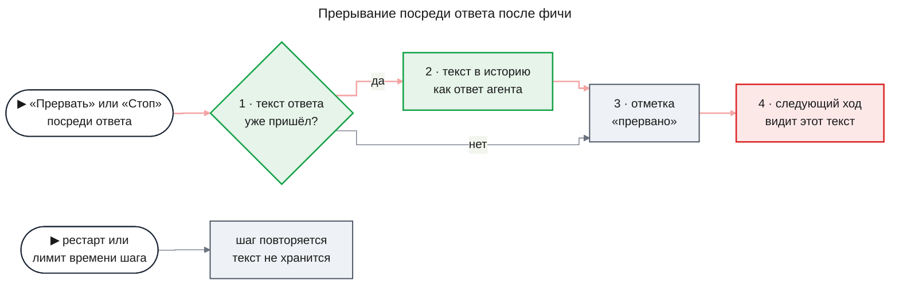
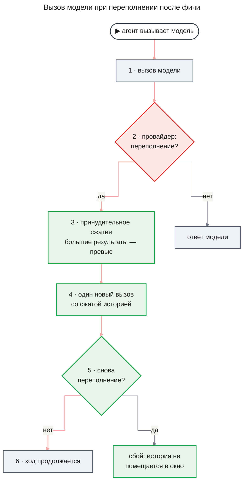
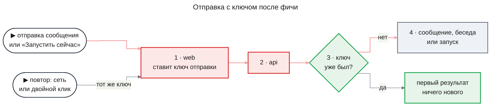

# PRD: Устойчивость хода агента (runtime-fixes)

| Date | Depth |
|---|---|
| 2026-11-28 | full |

## Snapshot

**Overview.** В трёх обычных ситуациях ход агента сегодня ломается. Если сотрудник прерывает агента посреди ответа, уже написанный текст пропадает и с экрана, и из истории, хотя токены за него оплачены, и модель в следующем ходе не знает, что успела сказать. Если история перерастает окно модели, провайдер отвечает ошибкой, и беседа заканчивается сбоем. Если отправка повторилась — мигнула сеть или сотрудник кликнул дважды, — в беседе появляется второе такое же сообщение или второй запуск расписания. После фичи прерванный текст остаётся ответом агента, переполнение лечится сжатием истории и одним новым вызовом, а повтор отправки ничего нового не создаёт.

- **Не входит**: сторожевой таймер на молчание модели, повторы запросов к провайдеру, резерв бюджета, проверки здоровья и умений провайдера, внешний API и webhooks.
- **Главный риск**: переполнение узнаётся по тексту ошибки провайдера; Ollama такой ошибки не даёт, а другой провайдер может сменить текст ([Assumptions and Risks](#assumptions-and-risks)).
- **Открытые вопросы**: три решения приняты по рекомендованным вариантам, владелец может их изменить ([Undetermined Items](#undetermined-items)).

## Terms

- **Ход** — работа агента в ответ на одно сообщение беседы.
- **Шаг** — один вызов модели внутри хода вместе с вызовами инструментов, которые модель в нём попросила.
- **История** — то, что модель читает в каждом шаге: сообщения, ответы агента, вызовы инструментов и их результаты. Сотрудник видит ту же историю в ленте беседы.
- **«Прервать» и «Стоп»** — две кнопки управления агентом (`agent-platform` FR-08). «Прервать» отменяет текущую операцию, и агент ждёт следующего сообщения. «Стоп» заканчивает работу агента и всех его потомков.
- **Частичный ответ** — текст, который модель успела написать до прерывания или остановки.
- **Окно модели** — наибольший объём текста, который модель принимает за один вызов, в токенах.
- **Переполнение** — провайдер отказался отвечать, потому что история вместе с запросом не помещается в окно модели.
- **Сжатие** — замена старой части истории сводкой, которую пишет сама модель (`agent-platform` FR-27). Сегодня сжатие запускает общий порог токенов. **Принудительное сжатие** запускает переполнение.
- **Превью результата** — начало длинного результата инструмента с пометкой, что результат обрезан. Полный результат остаётся в базе и в ленте сотрудника.
- **Ключ отправки** — метка, которую интерфейс ставит на одно действие сотрудника. Повтор с тем же ключом сервер узнаёт и не выполняет второй раз.

## Background

Сотрудник встречает каждую из трёх поломок без всякой ошибки со своей стороны: прервал агента, дал длинное задание, отправил сообщение при плохой сети.

### Частичный ответ сегодня теряется

Модель пишет ответ потоком, и сотрудник видит текст по мере его появления. На «Прервать» вызов модели обрывается: платформа записывает расход токенов, но сам текст в историю не попадает. В историю идёт только отметка прерывания. Текст на экране стирается почти сразу: как только кнопка вернула ответ, интерфейс заново читает беседу с сервера, а там этого текста нет. Сотрудник пишет «продолжи, но про сервис X», а модель не помнит, что уже сказала. После фичи прерванный ход идёт так:

Рестарт сервера и превышение лимита времени шага не прерывают ход, а повторяют шаг заново. Если в этих случаях сохранить частичный ответ, повторный шаг напишет его второй раз, поэтому текст здесь не хранится.

### Переполнение сегодня заканчивает беседу

Сжатие истории уже есть, но его запускает один общий порог токенов, а окна каждой модели платформа не знает. Когда история всё же не помещается, провайдер отвечает ошибкой, платформа считает её обычной ошибкой модели, и беседа заканчивается сбоем. Один огромный результат окно не переполняет: успешный результат MCP-инструмента длиннее порога `storeFromChars` (по умолчанию 50 000 символов, настройка `tool_result_settings`) попадает в историю превью, а полный текст хранится, и модель читает его по страницам инструментом `read_tool_result`. Окно переполняют многие результаты меньше этого порога вместе, страницы `read_tool_result`, которые входят в историю целиком, а также длинные сообщения, отчёты потомков и сводки. Есть и вторая ловушка: сжатию нужно отправить модели ту же историю, которая только что не поместилась, и ещё запрос на сводку, поэтому без превью больших результатов сжатие тоже переполняется. После фичи вызов модели идёт так:

Это сжатие и один новый вызов, а не повтор того же запроса: история уже другая. Повторов запроса к провайдеру платформа не делает (`improvements` FR-02).

Как провайдеры сообщают о переполнении, показывает таблица; откуда взяты тексты, сказано в [Assumptions and Risks](#assumptions-and-risks).

| Провайдер | Ответ при переполнении | Как платформа его узнаёт |
|---|---|---|
| Anthropic | 400 `invalid_request_error` с текстом `prompt is too long: N tokens > M maximum` | по тексту: отдельного кода нет |
| Anthropic, новые модели Claude | 200 с причиной остановки `model_context_window_exceeded`, когда сама история помещается, а места на ответ нет | не узнаёт как переполнение: установленный AI SDK отдаёт ту же причину остановки, что при достигнутом лимите ответа, и ответ остаётся обрезанным |
| Gemini | 400 `INVALID_ARGUMENT` с текстом `The input token count (N) exceeds the maximum number of tokens allowed (M)` | по тексту |
| OpenAI | 400 с кодом `context_length_exceeded` | по коду |
| Groq | код `context_length_exceeded` | по коду |
| llama.cpp | 400 с типом `exceed_context_size_error` | по типу ошибки |
| vLLM | 400 с текстом `maximum context length is N tokens`, в новых версиях — `Input length (N tokens) exceeds the maximum allowed length (M tokens)`; устойчивого кода нет | по тексту |
| OpenRouter | 400 с кодом `context_length_exceeded` и текстом `maximum context length` | по коду |
| DeepSeek | 400 с текстом `This model's maximum context length is N tokens` | по тексту |
| Mistral | 400 с текстом `Prompt contains N tokens … too large for model with M maximum context length` | по тексту |
| Ollama | OpenAI-совместимый вход молча обрезает историю и отвечает 200 | никак: защищает только общий порог сжатия |

### Повтор отправки сегодня создаёт дубль

Каждую отправку сервер ставит в очередь как новое сообщение. Первое сообщение беседы создаёт саму беседу, и повтор, проигравший гонку, ставит тот же текст ещё раз. Сработавший в срок запуск расписания платформа уже не дублирует, а двойной клик по «Запустить сейчас» даёт два запуска. Интерфейс никакой метки повтора не шлёт. После фичи каждое действие сотрудника несёт ключ отправки:

## Users and Use Cases

### Users

- **Сотрудник** — аналитик, SRE или менеджер, который ведёт беседы с агентами и запускает расписания. Ему важно, чтобы прерывание, длинное задание или плохая сеть не стоили ему потерянного текста, закрытой беседы или дубля.

### Use Cases

- **UC-1**: Аня видит, что агент пишет сводку не про тот сервис, и прерывает его на середине → написанный текст остаётся в беседе, а на «продолжи, но про сервис X» агент отвечает с учётом уже сказанного. Покрывает FR-01.
- **UC-2**: Глубокий ресерч Ани читает логи за неделю, и история перерастает окно модели → ход сжимает историю и идёт дальше, а не заканчивается сбоем. Покрывает FR-02.
- **UC-3**: История не помещается даже после сжатия → ход заканчивается сбоем с понятной причиной, и Аня сужает задачу в новой беседе. Покрывает FR-02.
- **UC-4**: Аня отправляет вопрос в поезде, сеть мигает, и интерфейс повторяет отправку → в беседе один вопрос и один ответ. Покрывает FR-03.
- **UC-5**: Аня дважды кликает «Запустить сейчас» → расписание запускается один раз. Покрывает FR-03.

## Functional Requirements

### Must Have (MVP)

#### Частичный ответ — часть `steps`

- **FR-01. Частичный ответ остаётся в истории.** Текст, который модель успела написать до «Прервать» или до остановки, становится ответом агента в истории перед отметкой прерывания или остановки, и модель читает его в следующем ходе.
  - AC-01.1: Given модель написала половину ответа, when сотрудник жмёт «Прервать», then в ленте стоит этот текст обычным ответом агента, под ним строка «прервано», и после перезагрузки страницы порядок тот же.
  - AC-01.2: Given ход прерван посреди ответа, when сотрудник пишет следующее сообщение, then модель получает в истории свой частичный ответ, а за ним отметку прерывания.
  - AC-01.3: Given агент пишет ответ, when остановка заканчивает его работу — «Стоп» на нём или на его предке, сбой родителя или исчерпанный бюджет обучения, — then написанный текст остаётся в истории этого агента перед отметкой остановки.
  - AC-01.4: Given модель пишет ответ, when сотрудник жмёт «Прервать», then текст на экране не пропадает: он стоит на месте и после прихода отметки прерывания.
  - AC-01.5: Given модель не успела написать ни слова, when ход прерван, then в историю пишется только отметка прерывания, как сегодня (`agent-platform` AC-08.2).
  - AC-01.6: Given в оборванном ответе модель начала вызов инструмента, но не дописала его, when ход прерван, then этого вызова нет ни в истории, ни в аудите, а текст до него сохранён.
  - AC-01.7: Given модель пишет ответ, when сервер перезапускается или шаг превышает лимит времени, then шаг повторяется, и в истории один ответ без копии оборванного текста.

#### Переполнение окна — часть `steps`

- **FR-02. Переполнение лечится сжатием.** Когда провайдер отвечает переполнением, ход сжимает историю, показывая модели большие результаты инструментов превью, и делает один новый вызов; если переполнение повторилось, ход заканчивается сбоем с отдельной причиной.
  - AC-02.1: Given провайдер ответил на вызов модели переполнением, when ход обрабатывает ответ, then история сжата, в ленте видна отметка сжатия, следующий вызов модели идёт со сжатой историей, и ход продолжается.
  - AC-02.2: Given переполнение вызвали результаты инструментов меньше порога превью, сложенные вместе, или страницы `read_tool_result`, when идёт принудительное сжатие, then сжатие не переполняется, потому что модель видит большие из этих результатов превью, а сотрудник в ленте видит их целиком.
  - AC-02.3: Given принудительное сжатие прошло, when новый вызов модели снова получает переполнение, then ход заканчивается статусом «сбой» с причиной о том, что история не помещается в окно модели даже после сжатия, на русском и английском по языку сотрудника.
  - AC-02.4: Given провайдер ответил ошибкой, которая не говорит о переполнении, when ход её обрабатывает, then сжатия нет, и ход заканчивается так же, как сегодня (`model-providers` FR-09).
  - AC-02.5: Given провайдер из таблицы в разделе «Переполнение сегодня заканчивает беседу», кроме Ollama и ответа Anthropic с причиной остановки `model_context_window_exceeded`, when он отвечает переполнением, then платформа узнаёт его: по коду ошибки, где он есть, иначе по постоянному тексту ошибки.

#### Ключ отправки — часть `send`

- **FR-03. Повтор отправки ничего не создаёт.** Каждая отправка сотрудника несёт ключ отправки, и повтор с тем же ключом возвращает результат первой отправки, не создавая нового сообщения, беседы или запуска.
  - AC-03.1: Given сообщение в беседу или на странице агента принято, а ответ сервера потерялся, when интерфейс повторяет отправку с тем же ключом, then в беседе одно такое сообщение, агент отвечает один раз, а повтор получает тот же результат, что первая отправка.
  - AC-03.2: Given сотрудник отправляет первое сообщение новой беседы, when одновременно приходят два запроса с одним ключом, then создана одна беседа с одним сообщением, и оба запроса возвращают эту беседу.
  - AC-03.3: Given сотрудник дважды кликнул «Запустить сейчас», when оба запроса пришли с одним ключом, then в истории расписания один запуск с пометкой «вручную» (`schedules-search-memory` FR-11).
  - AC-03.4: Given два разных действия сотрудника, when каждое отправлено со своим ключом, then каждое создаёт своё сообщение или запуск, даже если текст одинаковый.

### Won't Have

- Сторожевой таймер на молчание модели — нет: зависший вызов останавливается «Прервать» или «Стоп».
- Повторы запроса к провайдеру — нет (`improvements` FR-02): принудительное сжатие делает новый вызов с другой историей, а не повторяет прежний.
- Резерв бюджета перед вызовом модели — нет: квота уже проверяется перед каждым вызовом (`improvements`, Won't Have).
- Проверки здоровья и умений провайдера заранее — нет: о сбое и переполнении говорит ответ самого провайдера.
- Внешний API и webhooks с ключом отправки — нет: ключ нужен только интерфейсу платформы.
- Окно каждой модели в каталоге моделей — не в этой фиче: переполнение узнаётся по ответу провайдера, а общий порог сжатия остаётся.
- Сохранение частичного ответа при рестарте и превышении лимита шага — нет: шаг повторяется и напишет ответ заново (AC-01.7).
- Отдельная пометка частичного ответа в ленте — нет: под ним уже стоит строка «прервано».

## Non-Functional Requirements

### Security

- **NFR-01**: Ключ отправки действует в пределах одного сотрудника: такой же ключ от другого сотрудника создаёт его собственное сообщение и никогда не возвращает чужую беседу или чужой результат (бизнес-ограничение 2 в `.claude/skills/project-context/SKILL.md`). Это проверяет e2e-тест с двумя сотрудниками.

## Delivery Parts

| Part | Covers | Cut along | Depends on | Rationale |
|------|--------|-----------|------------|-----------|
| `steps` | FR-01, FR-02 | domain | — | Обе правки живут в шаге модели и клиенте модели агента и проектируются вместе; чтобы текст не стирался, web менять не нужно, его доля — только тексты новой причины сбоя |
| `send` | FR-03 | domain | — | Ключ проходит один путь отправки — от web через api до очереди агента и запуска расписания — и не касается шага модели |

## Success Criteria

- Переполнение больше не закрывает беседы — за две недели после выпуска ни одна беседа не закончилась ошибкой модели из-за переполнения у провайдеров, которых платформа узнаёт; читается из лога api.
- Дублей нет — за те же две недели ни в одной беседе нет двух сообщений с одним ключом отправки и ни у одного расписания двух ручных запусков от одного клика; читается из базы.

## Constraints and Risks

### Constraints

- **PoC.** Без обратной совместимости и переключателей; код, оставшийся без вызова, удаляется в том же изменении (корневой `CLAUDE.md`).
- **Распознавание переполнения.** Переполнение узнаётся сначала по коду ошибки провайдера, а где кода нет — по постоянному тексту ошибки. В принудительном сжатии модель видит большие результаты инструментов превью, полные результаты остаются в базе.
- **Настройки — в базе.** Новых переменных окружения и настроек фича не добавляет.
- **Сохраняется только текст.** Из оборванного ответа в историю идёт текст; недописанные вызовы инструментов отбрасываются.

### Assumptions and Risks

Переполнение узнаётся по ответу провайдера, а не по счёту токенов. Если провайдер сменит текст ошибки, платформа перестанет узнавать переполнение, и беседа закончится сбоем, как сегодня; ход при этом не сломается хуже нынешнего. Тексты OpenRouter, DeepSeek, Mistral и новый текст vLLM взяты из сторонних образцов, а не из собственных вызовов; тест таблицы в плане фиксирует записанные тела этих ответов.

Ollama молча обрезает историю и отвечает успешно, поэтому платформа не узнаёт переполнение. Модель на Ollama может ответить, потеряв начало истории; защищает только общий порог сжатия.

Ответ Anthropic с причиной остановки `model_context_window_exceeded` приходит успешным, но обрезанным. Установленный AI SDK отдаёт его с той же причиной остановки, что и достигнутый лимит ответа, поэтому платформа не считает его переполнением: сжатия нет, и сотрудник получает обрезанный ответ, как сегодня.

Сводка в принудительном сжатии строится по превью больших результатов, поэтому может упустить деталь из обрезанной части. Полный результат остаётся в ленте сотрудника, и сотрудник может указать агенту на нужное место.

## Undetermined Items

Три решения приняты по рекомендованным вариантам и стоят в требованиях; проектирование идёт по ним, а владелец может их изменить.

- Частичный ответ сохраняется на «Прервать» и при остановке, но не при рестарте и превышении лимита шага (AC-01.3, AC-01.7) — проектирование части `steps` идёт по этому варианту; изменить может владелец.
- Частичный ответ выглядит как обычный ответ агента со строкой «прервано» под ним, без отдельной пометки, поэтому UXRD не нужен (AC-01.1) — проектирование части `steps` идёт по этому варианту; изменить может владелец.
- Ключ отправки покрывает все отправки сотрудника — сообщения в беседе и на странице агента, первое сообщение беседы и «Запустить сейчас», а повтор возвращает результат первой отправки (FR-03) — проектирование части `send` идёт по этому варианту; изменить может владелец.

## Update History

| Version | Date | Change |
|---------|------|--------|
| 1.0 | 2026-11-28 | Первая версия |
| 1.1 | 2026-11-28 | По проверке кода в части `steps`: источник переполнения и AC-02.2 при превью больших результатов, тексты OpenRouter, DeepSeek, Mistral и vLLM, решён случай Anthropic `model_context_window_exceeded`, причина стирания текста на экране, доля web в части `steps`, AC-01.3 на все остановки |
