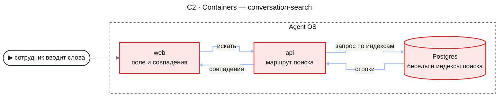
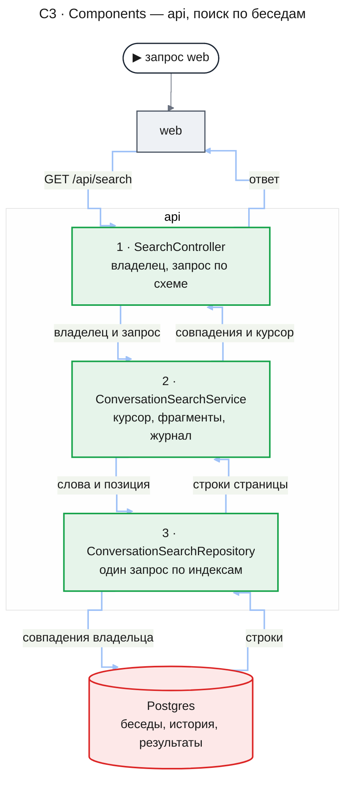
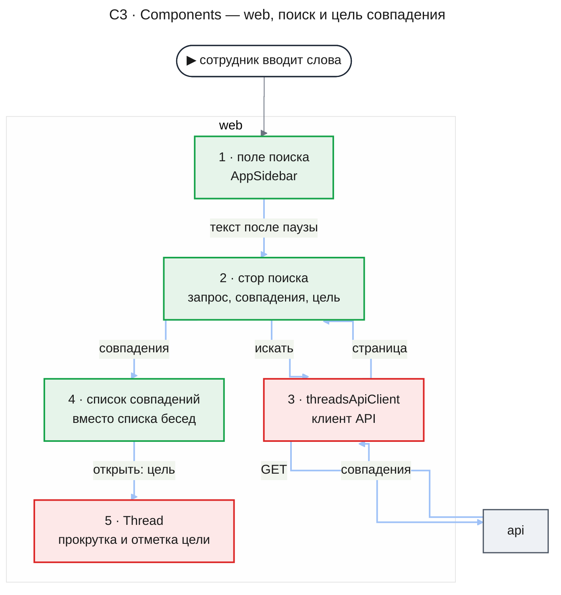
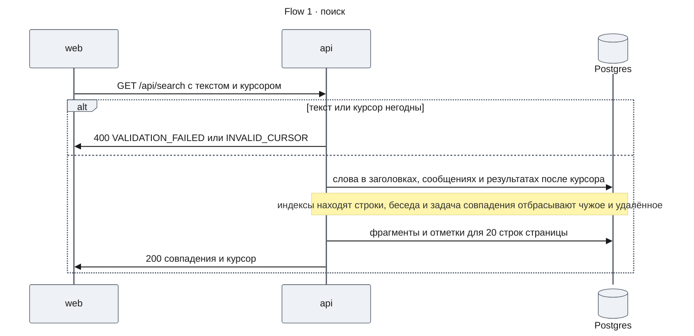
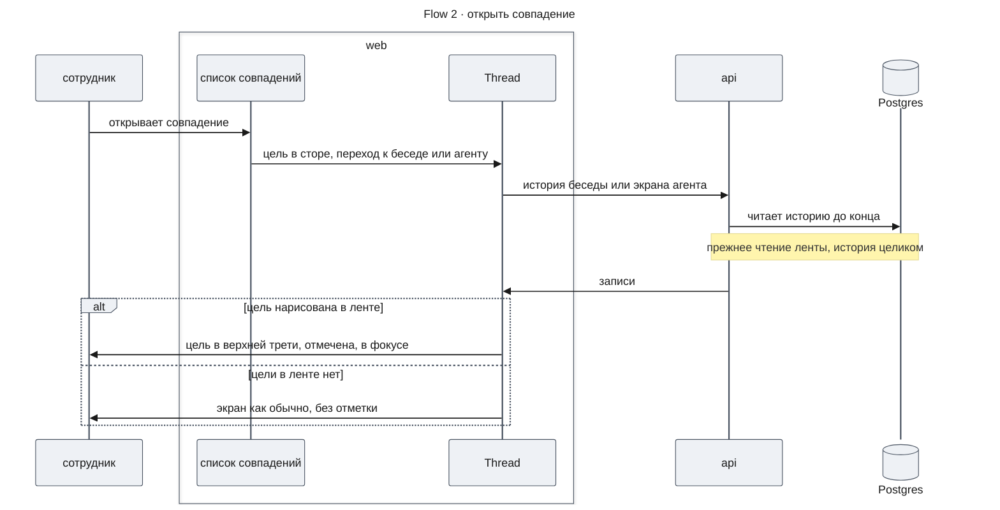

# Расписания, поиск по беседам и чистота памяти — Design Document — conversation-search

**Status:** На утверждении · **Date:** 2026-11-25 · **PRD:** [prd.md](./prd.md) · **UXRD:** [uxrd.md](./uxrd.md) · **Depends on:** нет

## Snapshot

**Overview.** Сегодня старую беседу можно найти, только листая список. Эта часть ставит над списком бесед поле поиска: сотрудник вводит слова и получает места, где они встречаются в его живых беседах, — заголовок, сообщение, беседу сабагента или результат инструмента, от новых к старым. Ищет сам Postgres: на заголовки, сообщения и сохранённые результаты инструментов ставятся полнотекстовые индексы, которые знают формы русских и английских слов. Один запрос находит строки по индексам и тут же отбрасывает всё, что не принадлежит сотруднику или удалено. Открытое совпадение ведёт в беседу или на экран агента, а лента прокручивает найденное сообщение или раскрытый блок вызова в верхнюю треть и отмечает его.

- **Не меняется**: ни один путь записи истории, заголовка или результата инструмента — индексы обновляет база в той же транзакции. Список бесед и его порядок при пустом поле остаются прежними.
- **Главный риск**: индекс не знает владельца, поэтому частое слово находит строки всех сотрудников, и время ответа растёт с объёмом всей платформы ([Risks](#risks-and-mitigation)).
- **Открытые вопросы**: нет.

### Key Decisions

#### KD-1: Ищет полнотекстовый поиск Postgres по индексам-выражениям над существующими таблицами; отдельной таблицы поиска нет

Текст бесед попадает в базу шестью путями: `History.append`, первая запись `task` в `ConversationsRepository.create`, две копии `INSERT … SELECT` при форке и тестовом запуске, `ToolResultsRepository.insert` и три записи заголовка. Индекс-выражение (`to_tsvector` над колонкой, GIN) база обновляет сама в транзакции строки, поэтому ни один из этих путей не меняется. Сообщение находится сразу после коммита шага (NFR-02), копия форка — сразу после форка. Новая база получает индексы вместе со схемой; базу разработки после пересборки `0000_schema.sql` создают заново, как при прежних сжатиях. Удаление беседы — прежняя отметка `runtime_tasks.deleted_at`, которую читает запрос (KD-4).

Отвергнуто:

- Таблица фрагментов, как `thread_search_segments` в bb. Её надо держать в согласии со всеми шестью путями записи; bb делает это триггерами SQLite, а здесь это были бы триггеры в ручной миграции или вызовы в каждом пути.
- `ILIKE` по тексту. Он не знает форм слова (FR-15) и читает весь текст платформы на каждый запрос (NFR-01).
- `pg_trgm`. Расширение в образе есть (проверено: `pg_available_extensions` в `pgvector/pgvector:pg16-trixie`), но оно ищет подстроки, а не формы слова, и вносит в миграции `CREATE EXTENSION`.

#### KD-2: Одна конфигурация `russian` для русских и английских слов; каждое слово запроса — ещё и начало слова

FR-15 требует форм слова для двух языков. Встроенная конфигурация `russian` уже покрывает оба: русские слова она отдаёт русскому стеммеру, а латинские — английскому. Проверено на Postgres 16.16 из образа проекта: «Отчёты по выручке» находится по «отчёт» и по «отчет», регистр не важен, «payment-service» разбирается в целое слово и в его части, «reports» находится по «report».

Каждое слово запроса совпадает со своими формами и со словами, которые с него начинаются: поиск идёт по мере ввода (UXRD SR-01), и «paym» уже находит «payment-service». Все слова запроса должны встретиться в одном тексте: в одном заголовке, одном сообщении или одном результате. Служебные слова («по», «и») конфигурация не ищет, и запрос только из них ничего не находит. Отвергнуто: конфигурация `simple` (нет форм слова) и два индекса на каждый язык (вдвое больше индексов, а запросу пришлось бы выбирать язык).

#### KD-3: Ищутся тексты, которые показывает лента; у результата инструмента — полный сохранённый текст, один раз

| Источник | Что ищется | Что не ищется и почему |
|---|---|---|
| `conversations` | заголовок корня | у сабагента заголовка нет |
| `messages` | `task`, `user_message`, `agent_message`, текст `model_answer`, `tool_result` без сохранённого текста | записи вызова, `notice`, `event` — служебные; `compaction` повторяет записи, которые остаются в истории; `child_report` — копия ответа сабагента, который найдётся в его беседе |
| `tool_results` | полный текст результата | — |

Длинный результат лежит целиком в `tool_results`, а в записи `tool_result` остаётся обёртка с началом текста. Короткий сохранённый результат лежит в обоих местах одинаково. Поэтому запись `tool_result`, у которой есть строка в `tool_results`, не ищется, и каждый результат даёт не больше одного совпадения (DC-1). Результаты инструментов `start_agent`, `start_deep_agent` и `task` не ищутся: их текст — отчёт сабагента, который найдётся в беседе сабагента, а успешный старт лента рисует карточкой, а не блоком вызова.

Каждый текст попадает в индекс первыми 100 000 символами. `to_tsvector` отказывает, когда разобранный текст больше 1 МБ, — проверено: около 1,3 млн символов уникальных слов дают ошибку `string is too long for tsvector`. Такая ошибка в индексе сорвала бы запись результата инструмента и вместе с ней шаг агента. 100 000 символов в худшем измеренном случае дают около 235 КБ. Текст дальше этого предела не находится.

#### KD-4: «Своё и живое» — условие самого запроса, по владельцу в строке беседы

Каждая строка `conversations`, корень и сабагент, несёт неизменную копию владельца `owner_id`. `TaskControl.deleteTree` одной командой отмечает удалённой каждую задачу дерева. Поэтому запрос проверяет беседу самого совпадения: её владелец — сотрудник сеанса, а её задача в `runtime_tasks` не отмечена удалённой. Корень для заголовка лежит в том же дереве, у него тот же владелец и та же отметка. Сотрудник приходит только из сеанса ([auth-boundary.md](../../code-system/patterns/auth-boundary.md)), курсор несёт только позицию, а у метода репозитория нет вызова без владельца.

Отвергнуто: фильтр в службе после чтения (FR-14 запрещает прятать при показе) и копия владельца в строках `messages` и `tool_results` — она меняет самую нагруженную таблицу и каждый путь записи ради скорости, которую NFR-01 пока не требует.

#### KD-5: Одно найденное место — одно совпадение; порядок — дата, затем ключ места; курсор — из `thread-cursor.ts`

FR-12 требует места, а не беседы: сообщение и результат дают каждый своё совпадение, а беседа может дать несколько. Дата сообщения или результата — время его записи. Дата совпадения в заголовке — время последнего изменения беседы (`updated_at`), потому что такое совпадение открывает беседу на последнем сообщении (UXRD SR-03). Порядок — дата с точностью до миллисекунды, новые сверху, затем ключ места. Курсор кодирует эту пару функциями `encodeThreadCursor` и `decodeThreadCursor`, как курсор списка бесед.

Форк — отдельная беседа, и копия истории в нём читается как его собственная. Поэтому одно место из исходной беседы и из каждого её форка даёт отдельные совпадения с одинаковым текстом и датой. Отвергнуто: одно совпадение на беседу, как в bb (FR-12 требует мест), и скрытие копий форка (когда исходную беседу удалят, копия останется единственной, и правилу понадобилось бы смотреть, жив ли источник).

#### KD-6: Фрагмент и отметки найденных слов строит Postgres, только для строк страницы

Фрагмент строит `ts_headline` с той же конфигурацией и тем же запросом по тем же первым 100 000 символам, что и индекс (KD-3), поэтому слово в другой форме отмечено так же, как точное (AC-15.1, UXRD SR-02). Служба превращает его разметку в диапазоны и отдаёт текст без HTML; веб сам ставит `mark`. Фрагмент строится после выбора 20 строк страницы: на 107 000 символах `ts_headline` занял 11 мс, так что страница из одних длинных результатов укладывается примерно в четверть секунды.

#### KD-7: Совпадение открывается через стор оболочки, а не через адрес

Совпадению нужно донести до ленты, какое место отметить, а адреса оболочки — только путь: `parseShellRoute` и `url-sync.ts` не читают ни параметров, ни `#`. Новый стор поиска ([shell-store.md](../../code-system/patterns/shell-store.md)) держит запрос, загруженные совпадения и открытое совпадение. Открытие кладёт в него цель — беседу или агента и номер записи или id вызова — и переходит обычным `threadPath` или `agentPath`. Стор переживает переход и закрытие мобильной шторки, поэтому совпадения остаются на месте (UXRD KD-5).

`Thread` — одна лента и для беседы, и для экрана агента. Она загружает историю целиком (`FeedStore` читает страницы до конца), затем прокручивает и отмечает цель своей беседы. Сегодня в DOM ленты нет ни номера записи, ни id вызова, поэтому корни сообщений и блоки вызова получают data-атрибуты; найти и прокрутить элемент можно так же, как это делает `queue-tray.tsx`. Отвергнуто: цель в адресе — она меняет разбор адресов оболочки ради ссылки, которую никто не просил сохранять или пересылать.

## Terms

- **Полнотекстовый индекс** — индекс Postgres (GIN), который хранит основы слов текста и находит строки по словам в любой форме.
- **Место совпадения** — где найден текст: заголовок беседы, сообщение или результат инструмента, в беседе сотрудника или у сабагента.
- **Цель совпадения** — элемент ленты, который открытое совпадение прокручивает и отмечает: сообщение или блок вызова.
- **Стор поиска** — хранилище состояния поиска в памяти вкладки, общее для сайдбара и ленты.

## Part

- **Prerequisite ADRs**: [ADR-0003](../../adr/ADR-0003-drizzle-data-layer.md) — Drizzle и миграции; [ADR-0012](../../adr/ADR-0012-closed-api-and-server-issued-employee-id.md) — сотрудник только из сеанса; [ADR-0022](../../adr/ADR-0022-one-database-and-nestjs-modules.md) — одна база, репозитории в `packages/db`, модули NestJS.

Часть покрывает FR-12 – FR-15, NFR-01, NFR-02 и NFR-05 для экрана поиска и ни от чего не зависит.

**Out of scope**

- Запись истории, заголовков и результатов инструментов: шаг агента, форк, тестовый запуск и генерация заголовка работают как прежде.
- Список бесед: его данные, порядок и группы по датам при пустом поле.
- Поиск для агента, по документам блокнота, по памяти и по чужим беседам (PRD, Won't Have).
- Отметка найденного внутри длинного текста сообщения: отмечается сообщение или блок целиком (UXRD, Цель совпадения).

**Constraints**

- **PoC.** Индексы входят в схему в `packages/db`, и сжатая миграция `0000_schema.sql` генерируется заново на месте. Drizzle 0.45 выражает GIN-индекс над выражением с условием (`.using('gin', …)` и `.where(…)` в `pg-core`), поэтому ручной миграции нет.
- **Одна база.** Запрос — в одном новом репозитории `packages/db`; выражение каждого индекса и запроса — одно значение там же, иначе планировщик не возьмёт индекс.
- **Без настроек и зависимостей.** 20 совпадений на страницу, предел 100 000 символов и длина фрагмента — константы кода; новых пакетов и расширений Postgres нет (KD-1, KD-2).
- **Изоляция.** Чужое и удалённое отбрасывает запрос (KD-4); e2e-тест с двумя сотрудниками обязателен (UC-2).
- **Мало тестов.** Четыре сценария в CI и один замер по требованию ([Test Strategy](#test-strategy)).

## Building-block Inventory

Follows the [code system](../../code-system/README.md).

| Building block | Pattern | Status | Note |
|---|---|---|---|
| Индексы поиска на `conversations`, `messages`, `tool_results` | [repository-over-transaction.md](../../code-system/patterns/repository-over-transaction.md) | new | текстового поиска в базе нет: ни `tsvector`, ни GIN (KD-1) |
| `ConversationSearchRepository` | [repository-over-transaction.md](../../code-system/patterns/repository-over-transaction.md) | new | запрос идёт по четырём таблицам; сырой SQL в репозитории — как в `MessagesRepository` |
| `ConversationSearchService`, `SearchController` в `ChatModule` | [auth-boundary.md](../../code-system/patterns/auth-boundary.md) | new | владелец из `req.user`, журнал через `loggedRoute` |
| `encodeThreadCursor`, `decodeThreadCursor` | — | reused | позиция «дата, ключ» (KD-5) |
| Схемы запроса и ответа поиска | — | new | в `packages/contracts`, рядом со схемами бесед |
| `threadsApiClient` | [web-api-client.md](../../code-system/patterns/web-api-client.md) | extended | функция поиска |
| Стор поиска | [shell-store.md](../../code-system/patterns/shell-store.md) | new | создаётся лениво в `createShellServices` (KD-7) |
| Поле поиска и список совпадений в `AppSidebar` | — | new | список встаёт на место `ThreadHistoryList` |
| [Совпадение поиска](../../design-system/components/search-result.md) | — | new | компонента в коде нет |
| `Thread`, блок вызова (`tool-fallback.aui.tsx`) | — | extended | data-атрибуты, прокрутка, отметка и раскрытие цели |

## Acceptance Criteria

DC-n ниже — критерии этого дизайна; элементы UXRD названы с приставкой «UXRD».

### FR-12: поиск по своим беседам

- From the PRD: AC-12.1, AC-12.2, AC-12.3.
- Когда результат инструмента сохранён в `tool_results`, по его тексту находится одно совпадение, а не два (DC-1).
- Когда запрос после обрезки пробелов короче 2 или длиннее 200 символов, поиск отвечает 400 `VALIDATION_FAILED`. Когда в запросе только служебные слова, ответ — пустой список (DC-2).
- Когда совпадений больше 20, первая страница несёт 20 самых новых и курсор, а следующая страница — следующие по порядку без повторов (DC-3).

### FR-13: открыть совпадение

- From the PRD: AC-13.1, AC-13.2.
- Когда цель совпадения не нарисована в ленте — например, вызов, который лента показывает карточкой, — беседа открывается как обычно, без отметки (DC-4).

### FR-14: только своё и только живое

- From the PRD: AC-14.1, AC-14.2.
- Когда сотрудник передаёт курсор, выданный другому сотруднику, или курсор, которого сервер не выдавал, ответ — только его собственные совпадения или 400 `INVALID_CURSOR` (DC-5).

### FR-15: слова в любой форме

- From the PRD: AC-15.1.

### NFR-01, NFR-02, NFR-05

- NFR-01 проверяет замер UC-5 по требованию; в CI число не проверяется.
- NFR-02: индекс обновляется в транзакции строки, поэтому текст находится сразу после коммита (KD-1). UC-1 ищет сразу после записи, без ожидания.
- NFR-05: поле и совпадения живут в сайдбаре и в мобильной шторке (UXRD, Responsive Behavior); это проверяется в браузере при сборке экрана.

## Design

### Architecture (C1–C4)

Новых контейнеров нет. Поиск — новый маршрут `api` и новые индексы Postgres; поле и совпадения — в `web`.

#### C2 · Containers

Поиск только читает. Писатели бесед в `api` не меняются: индексы обновляет Postgres при каждой записи строки.

#### C3 · Components: api

**api — поиск по беседам**

- **`SearchController`** — отдельный контроллер `search` в `ChatModule`. В `ThreadsController` путь `threads/search` попал бы под `:threadId`, если бы его объявили не первым.
- **`ConversationSearchService`** разбирает курсор, зовёт репозиторий с владельцем сеанса и превращает строки в совпадения: разметку фрагмента — в диапазоны (KD-6), лишнюю 21-ю строку — в курсор следующей страницы. Транзакции у него нет: поиск — одно чтение.
- **`ConversationSearchRepository`** одним запросом объединяет три источника (KD-3). Каждый источник находит строки по своему индексу, соединяет их с беседой совпадения и её задачей, отбрасывает чужое и удалённое (KD-4) и берёт позиции после курсора. Затем запрос выбирает 21 самую новую строку и для 20 из них строит фрагмент.

#### C3 · Components: web

**web — найти и открыть совпадение**

- **Поле поиска** стоит в `AppSidebar` над списком бесед, а в свёрнутой полосе — кнопкой с лупой (UXRD SR-01). Пока в поле меньше двух знаков, на месте остаётся `ThreadHistoryList`.
- **Стор поиска** шлёт запрос после паузы ввода и применяет только ответ на последний текст поля: ответ на прежний текст, пришедший позже, отбрасывается. Прежние совпадения стоят, пока не пришли новые (UXRD SR-03). «Показать ещё» дочитывает следующую страницу по курсору. Ошибку чтения стор пишет в журнал и показывает ошибку с «Повторить».
- **Список совпадений** строит строку по [спецификации](../../design-system/components/search-result.md) из полей совпадения (см. `ConversationMatch`). Открытие кладёт цель в стор и переходит по `threadPath` к беседе или по `agentPath` к сабагенту; на мобильном оно закрывает шторку.
- **`Thread`** берёт из стора цель своей беседы или своего агента. После загрузки истории лента ищет элемент цели, прокручивает его в верхнюю треть, ставит отметку и фокус; блок вызова при этом раскрыт. Отметка снимается, когда открыто другое совпадение или лента ушла с экрана. Совпадение в заголовке цели не несёт.

### Runtime Flows

#### Flow 1: сотрудник ищет

**Starts when:** в поле поиска не меньше двух знаков и ввод остановился или сотрудник нажал «Показать ещё», для AC-12.1, AC-12.2, AC-12.3, AC-14.1, AC-14.2, AC-15.1, DC-1, DC-2, DC-3, DC-5.

Запрос ничего не пишет. Курсор хранит только дату и ключ последнего места страницы, поэтому чужой курсор не открывает чужих строк: владелец всегда из сеанса (DC-5). Беседу, удалённую между страницами, следующая страница уже не показывает.

#### Flow 2: сотрудник открывает совпадение

**Starts when:** сотрудник открывает совпадение в сообщении или результате инструмента, для AC-13.1, AC-13.2, DC-4.

Совпадение в беседе сабагента открывает его экран, а путь в беседу сотрудника там уже есть: «из беседы «…»» или через родительского агента (UXRD, Flow 2). Беседу, удалённую после поиска, открывает прежний экран «Беседа не найдена» (UXRD, Error Flows).

### Contract Definitions

#### Маршрут

- **`GET /api/search?q=&cursor=`** — совпадения запроса `q` в живых беседах сотрудника сеанса и их сабагентах, новые сверху, страницей до 20 (`ConversationSearchQuery`). Возвращает `ConversationSearchResponse`. 400 `VALIDATION_FAILED` — `q` после обрезки пробелов короче 2 или длиннее 200 символов (DC-2); 400 `INVALID_CURSOR` — курсор не тот, что выдал сервер (DC-5). Маршрут за `SessionGuard`: без сеанса — 401 `AUTH_REQUIRED`. Запрос, в котором нет ни одного искомого слова, отвечает пустой страницей.

Схемы — в `packages/contracts`, рядом со схемами бесед; коды ошибок уже есть в `ThreadsErrorCodeSchema`.

**`ConversationSearchQuery`**

- `q` — текст из поля поиска, от 2 до 200 символов после обрезки пробелов.
- `cursor` — необязательный `nextCursor` прошлой страницы, от 1 до 512 символов, как у списка бесед.

**`ConversationSearchResponse`**

- `matches` — массив `ConversationMatch`, до 20, новые сверху.
- `nextCursor` — курсор следующей страницы или `null`, если страница последняя.

**`ConversationMatch`** — одно найденное место.

- `threadId` — беседа сотрудника, к которой относится место: корень дерева.
- `title` — заголовок этой беседы или `null`, пока заголовка нет (веб пишет «Новая беседа», как в списке).
- `at` — дата места: время записи сообщения или результата; у заголовка — время последнего изменения беседы (KD-5).
- `place` — `title`, `message` или `tool_result`.
- `agent` — сабагент, у которого найдено место: `agentId` (его беседа, адрес экрана агента) и `name` (имя запуска, как на экране агента); `null`, если место в беседе сотрудника или в заголовке.
- `tool` — имя инструмента у `tool_result`, иначе `null`.
- `seq` — номер записи сообщения у `message`, иначе `null`.
- `callId` — id вызова у `tool_result`, иначе `null`. Лента рисует результат частью блока вызова, поэтому цель результата — блок с этим id.
- `titleMarks` — диапазоны найденных слов в `title`; непусто только у `place: title`.
- `snippet` — `MarkedText` с фрагментом вокруг найденного; `null` у `place: title`.

**`MarkedText`**

- `text` — фрагмент: переносы строк заменены пробелами, «…» в начале или в конце стоит, если текст продолжается.
- `marks` — диапазоны найденных слов: `start` и `end`, позиции в `text` в единицах строки JavaScript, без пересечений, по возрастанию.

### Data Model

Новых таблиц и колонок нет. Три GIN-индекса над выражениями, все с конфигурацией `russian` и пределом 100 000 символов (KD-2, KD-3):

- **`conversations`** — заголовок, только у корней (`parent_id` пуст).
- **`messages`** — текст записи (`content` → `text`) для видов `task`, `user_message`, `agent_message`, `model_answer`, `tool_result`.
- **`tool_results`** — полный текст результата.

Правила, которые держат схема и репозиторий:

1. Запрос и фрагмент читают то же выражение, на котором построен индекс; выражение каждого источника определено один раз в `packages/db`.
2. Строка становится находимой в той же транзакции, в которой записана, и перестаёт находиться в той же транзакции, в которой её дерево отмечено удалённым.
3. Совпадение возвращается, только если беседа места принадлежит сотруднику запроса и её задача не удалена (KD-4).
4. Сохранённый результат инструмента находится только через `tool_results`; его запись `tool_result` в поиске не участвует (DC-1). Имя инструмента и номер записи для него берутся из этой записи по `call_id`, через индекс `messages_call_idx`.

## Test Strategy

Тесты e2e — в `apps/api`, на тестовой базе, с двумя сотрудниками; историю бесед пишет скриптовая модель через обычный чат.

- **UC-1: всё находится, один раз, по порядку** — covers AC-12.1, AC-12.2, AC-12.3, AC-15.1, DC-1, DC-2, DC-3, NFR-02
  - Given: у Ани беседа, где сабагент «Разбор логов» получил длинный результат инструмента со строкой «timeout payment-service» и короткий сохранённый результат; беседа со словом только в заголовке; сообщение «Отчёты по выручке»; 21 сообщение со словом «квартальный».
  - When: Аня сразу после записи ищет «payment-service», слово заголовка, «отчёт», «квартальный» с переходом на вторую страницу, слово, которого нет, текст из одного знака и текст только из служебных слов.
  - Then: результат — одно совпадение `tool_result` с сабагентом, инструментом и отмеченным фрагментом; короткий результат — тоже одно; заголовок — `place: title`; «отчёт» находит «Отчёты» с отметкой формы; «квартальный» — 20 и 1 без повторов, новые сверху; несуществующее и служебные слова — пустой список; один знак — 400.
- **UC-2: только своё и живое** — covers AC-14.1, AC-14.2, DC-5
  - Given: у Ани и Бориса беседы со словом «квартальный», у Ани — ещё сабагент и результат инструмента с ним; у Ани больше 20 совпадений.
  - When: Аня удаляет одну беседу с сабагентом и результатом; оба ищут «квартальный»; Борис передаёт курсор Ани и придуманный курсор.
  - Then: Аня не видит удалённой беседы, её сабагента и результата; Борис не видит ни одной беседы Ани, в том числе по курсору Ани; придуманный курсор — 400 `INVALID_CURSOR`.
- **UC-3: открыть совпадение** — covers AC-13.1, AC-13.2, DC-4
  - Given: тест компонента `Thread` с лентой длинной беседы, лентой экрана агента и целью из стора поиска.
  - When: цель — давнее сообщение; цель — результат инструмента; цель — вызов, нарисованный карточкой.
  - Then: сообщение в верхней трети, отмечено и в фокусе; блок вызова раскрыт и отмечен; при цели-карточке лента открыта как обычно, без отметки.
- **UC-4: поле поиска в сайдбаре** — covers AC-12.3 в вебе
  - Given: сайдбар с беседами.
  - When: сотрудник вводит текст быстрее, чем приходят ответы, затем очищает поле.
  - Then: показаны совпадения последнего текста, при пустом ответе — «Ничего не нашлось»; после очистки на месте снова список бесед.
- **UC-5: замер по требованию** — covers NFR-01
  - Given: локальный Postgres, у сотрудника 1 000 бесед с сабагентами и результатами инструментов.
  - When: набор запросов из частых и редких слов, первая и следующие страницы.
  - Then: p95 ответа маршрута ≤ 1 с. Замер живёт в наборе `test:verify` и в CI не запускается.

## Security Considerations

- **Authentication & Authorization**: маршрут закрыт `SessionGuard`, сотрудник — только `req.user.id` (ADR-0012). Чужое и удалённое отбрасывает сам запрос по владельцу беседы и отметке удаления (KD-4); роль администратора ничего не открывает (FR-14). Курсор несёт только позицию.
- **Input Validation**: `q` и `cursor` проверяет схема контракта. Текст запроса не попадает в SQL строкой: репозиторий передаёт его параметром, а слова разбирает функция Postgres, а не склейка текста.
- **Sensitive Data Handling**: фрагмент — текст бесед самого сотрудника; секреты в результатах уже замаскированы при записи (`maskSecrets`). Журнал маршрута пишет владельца, длину запроса, число слов, есть ли курсор, число совпадений и длительность, а ошибки — целиком; текст запроса не пишется. Веб пишет через `src/lib/logger.ts` каждое открытое совпадение: место, позицию в списке и найдена ли цель. Из этих двух журналов читается критерий успеха «открывает одно из совпадений» (PRD, Success Criteria).

## Risks and Mitigation

- **Частое слово находит строки всех сотрудников, и время растёт с объёмом платформы** — среднее влияние, вероятность растёт с числом сотрудников. Индекс не знает владельца, и отбор по нему идёт после индекса (KD-4). UC-5 меряет сценарий NFR-01; если платформа его перерастёт, следующий шаг — владелец в индексируемых строках.
- **Запись длинного результата дороже** — низкое влияние. Разбор до 100 000 символов идёт в транзакции шага и занимает десятки миллисекунд.
- **Текст длиннее 100 000 символов находится только по началу** — низкое влияние. Это свойство KD-3; такие результаты — большие выгрузки, которые модель и так читает по ссылке.
- **Форк повторяет совпадения своей исходной беседы** — низкое влияние. Каждая беседа честно содержит этот текст (KD-5).

## Update History

| Version | Date | Change |
|---------|------|--------|
| 1.0 | 2026-11-25 | Поиск по беседам: индексы Postgres над существующими таблицами, маршрут поиска, стор поиска и цель совпадения в ленте |
